# [BUỔI 12] QUY TRÌNH DEPLOY CƠ BẢN LÊN VPS
*Bài tập chuẩn bị buổi 12*

---
**Menu:**

- [\[BUỔI 12\] QUY TRÌNH DEPLOY CƠ BẢN LÊN VPS](#buổi-12-quy-trình-deploy-cơ-bản-lên-vps)
  - [Phần 1: TỔNG QUAN HẠ TẦNG (VPS, SSH VÀ NETWORK)](#phần-1-tổng-quan-hạ-tầng-vps-ssh-và-network)
    - [I. Quy trình Deploy và Máy chủ VPS](#i-quy-trình-deploy-và-máy-chủ-vps)
    - [II. Giao thức SSH và Lệnh Linux Cơ bản](#ii-giao-thức-ssh-và-lệnh-linux-cơ-bản)
    - [III. Network: IP, Port và Firewall](#iii-network-ip-port-và-firewall)
  - [Phần 2: CÔNG NGHỆ ẢO HÓA (DOCKER)](#phần-2-công-nghệ-ảo-hóa-docker)
    - [I. Kiến trúc Docker cơ bản](#i-kiến-trúc-docker-cơ-bản)
    - [II. Dockerfile và Docker Compose](#ii-dockerfile-và-docker-compose)
  - [Phần 3: ĐIỀU HƯỚNG TRUY CẬP (DNS \& NGINX)](#phần-3-điều-hướng-truy-cập-dns--nginx)
    - [I. DNS và Tên miền (Domain)](#i-dns-và-tên-miền-domain)
    - [II. Reverse Proxy và Nginx](#ii-reverse-proxy-và-nginx)
  - [Phần 4: THỰC HÀNH TỔNG HỢP (DEPLOY DỰ ÁN QUẢN LÝ TOUR)](#phần-4-thực-hành-tổng-hợp-deploy-dự-án-quản-lý-tour)
    - [I. Kết nối VPS qua SSH](#i-kết-nối-vps-qua-ssh)
    - [II. Đóng gói dự án (Dockerize) bằng Dockerfile](#ii-đóng-gói-dự-án-dockerize-bằng-dockerfile)
    - [III. Triển khai Database và App với Docker Compose](#iii-triển-khai-database-và-app-với-docker-compose)
    - [IV. Cấu hình Nginx Reverse Proxy](#iv-cấu-hình-nginx-reverse-proxy)
    - [V. Khởi chạy và Kiểm thử trực tiếp](#v-khởi-chạy-và-kiểm-thử-trực-tiếp)


## Phần 1: TỔNG QUAN HẠ TẦNG (VPS, SSH VÀ NETWORK)

### I. Quy trình Deploy và Máy chủ VPS

**1. Khái niệm Deploy trong phát triển phần mềm:**

- Deploy (triển khai) là quá trình đóng gói toàn bộ mã nguồn, cấu hình và tài nguyên của ứng dụng từ môi trường phát triển của lập trình viên để chuyển giao lên hệ thống máy chủ, giúp phần mềm vận hành thực tế và đón nhận kết nối từ người dùng Internet.
- Lý do cần: Mã nguồn chỉ có giá trị thực tế khi được vận hành trên hạ tầng chung, có khả năng phục vụ liên tục hàng nghìn người dùng đồng thời, kết nối dữ liệu ổn định và không phụ thuộc vào trạng thái bật hay tắt máy tính cá nhân của lập trình viên.
- Không có thì: Ứng dụng chỉ chạy cục bộ trên máy của lập trình viên (localhost), không ai ngoài mạng nội bộ có thể truy cập, dữ liệu không được tích hợp tập trung và sản phẩm không thể đưa vào khai thác kinh doanh.
- **So sánh**:
  - Deploy thủ công: Tải mã nguồn lên máy chủ bằng FTP/SCP, cài đặt Java thủ công, gõ lệnh biên dịch và khởi chạy trực tiếp trên console; quy trình này chậm, dễ quên bước cấu hình và rủi ro sai sót con người rất cao.
  - Deploy hiện đại: Đóng gói ứng dụng thành các container độc lập, tự động hóa toàn bộ quá trình kiểm thử, build và vận hành thông qua kịch bản định sẵn; đảm bảo tính nhất quán tuyệt đối giữa các môi trường.
- Quy trình **4 chặng** chuẩn hóa đưa ứng dụng từ máy tính cá nhân lên môi trường Production.
  - Chặng 1: Hoàn thiện mã nguồn, kiểm thử các tầng Controller, Service, Repository trên môi trường máy cá nhân.
  - Chặng 2: Đóng gói mã nguồn thành tệp thực thi độc lập (Artifact như tệp JAR hoặc Docker Image).
  - Chặng 3: Đẩy bản đóng gói lên máy chủ từ xa thông qua giao thức truyền tải bảo mật.
  - Chặng 4: Khởi chạy ứng dụng trong môi trường runtime khép kín và liên kết với cơ sở dữ liệu.

**2. Khái niệm Máy chủ ảo VPS (Virtual Private Server):**

- VPS là một máy tính ảo độc lập được tạo ra bằng công nghệ phân chia tài nguyên từ một máy chủ vật lý cỡ lớn đặt tại trung tâm dữ liệu (Data Center), được cấp phát riêng CPU, RAM, dung lượng ổ cứng, địa chỉ IP tĩnh công khai và chạy liên tục.
- Nó giúp ta cung cấp môi trường máy chủ ổn định, đường truyền mạng tốc độ cao, khả năng sẵn sàng phục vụ không ngừng nghỉ và trao toàn quyền quản trị cao nhất (root access) cho lập trình viên Backend tự do cài đặt môi trường.
- Trong trường hợp không có VPS: Nếu cố gắng dùng máy tính cá nhân làm máy chủ, khi tắt máy tính, đứt mạng gia đình, cúp điện hoặc địa chỉ IP mạng nội bộ bị thay đổi thì toàn bộ hệ thống dịch vụ sẽ ngừng hoạt động ngay lập tức.
- **So sánh**:
  - Máy tính cá nhân (Localhost): IP động, mạng gia đình không ổn định, tắt máy là ứng dụng chết, không có cổng mạng mở ra Internet công khai.
  - Shared Hosting: Chia sẻ chung tài nguyên và web server với hàng trăm website khác, không có quyền root, không thể cài đặt tùy biến các dịch vụ chạy ngầm như Docker hay Spring Boot.
  - VPS: Toàn quyền kiểm soát hệ điều hành (thường là Ubuntu Linux), có IP tĩnh công khai, tài nguyên RAM/CPU độc lập, cấu hình linh hoạt mọi phần mềm theo nhu cầu.
- Demo minh họa: Các lệnh kiểm tra thông số tài nguyên máy chủ VPS sau khi đăng nhập:
```bash
uname -a
lscpu
free -h
df -h
```
Lệnh `uname -a` hiển thị phiên bản nhân Linux đang vận hành; `lscpu` hiển thị thông tin chi tiết về số nhân và kiến trúc CPU; `free -h` xuất dung lượng RAM đang sử dụng và còn trống; `df -h` hiển thị dung lượng ổ đĩa cứng của máy chủ.

**3. Sơ đồ kiến trúc hạ tầng VPS và luồng Deploy:**

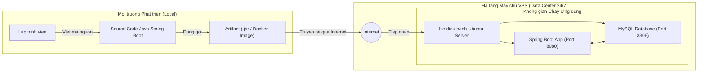

---

### II. Giao thức SSH và Lệnh Linux Cơ bản

**1. Khái niệm Giao thức SSH (Secure Shell):**

- SSH là giao thức mạng sử dụng cơ chế mật mã học để thiết lập một đường truyền điều khiển dòng lệnh an toàn từ xa giữa máy khách (máy tính cá nhân của lập trình viên) và máy chủ (VPS) thông qua cổng mặc định 22.
- Tại sao lại cần: VPS được đặt tại các trung tâm dữ liệu cách xa hàng nghìn cây số, không có màn hình hay bàn phím vật lý; SSH là phương tiện duy nhất để lập trình viên mở cửa sổ Terminal và trực tiếp gõ lệnh điều hành máy chủ.
- Không có thì sao: Không thể đăng nhập, không thể truyền lệnh cấu hình, không thể kiểm tra log hay cài đặt bất kỳ phần mềm nào trên máy chủ.
- **So sánh**:
  - Telnet: Giao thức điều khiển dòng lệnh cổ điển nhưng truyền toàn bộ dữ liệu (bao gồm tài khoản và mật khẩu) dưới dạng văn bản thuần (plain text), rất dễ bị kẻ tấn công nghe lén trên đường truyền.
  - Giao diện đồ họa từ xa (VNC / RDP): Đòi hỏi máy chủ cài đặt môi trường đồ họa GUI cồng kềnh, tiêu tốn nhiều RAM/CPU và băng thông mạng; không phù hợp với chuẩn mực quản trị máy chủ Linux Backend.
  - SSH: Nhẹ, cực nhanh, chỉ truyền tải dữ liệu văn bản thuần được mã hóa bất đối xứng mạnh mẽ bằng các cặp khóa mật mã.

- Demo minh họa: Cú pháp lệnh kết nối SSH cơ bản:

```bash
ssh root@103.179.188.45
```

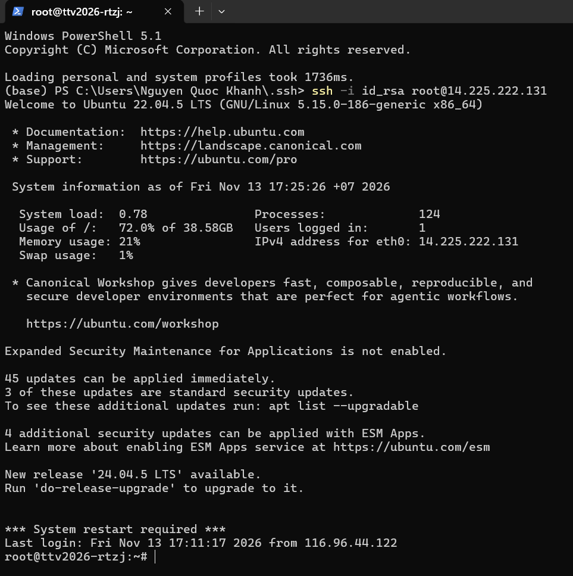

Lệnh `ssh` khởi động tiến trình OpenSSH Client; `root` là định danh tài khoản quản trị tối cao của hệ điều hành Linux; `103.179.188.45` là địa chỉ IP công khai của máy chủ đích.

**2. Sơ đồ cơ chế hoạt động và bắt tay mã hóa của SSH:**

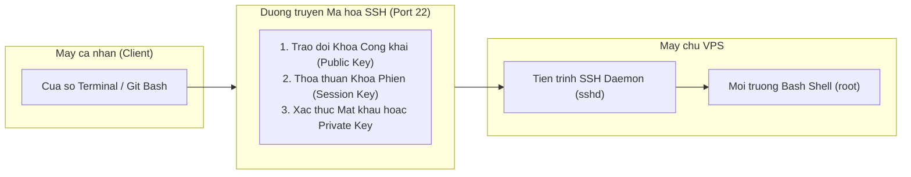

**3. Các lệnh Linux sinh tồn khi thao tác trên VPS:**
- Tập hợp các câu lệnh cơ bản của hệ điều hành Linux giúp người quản trị điều hướng hệ thống tệp, chỉnh sửa cấu hình, kiểm tra tiến trình và trích xuất dữ liệu log.
- Tại sao lại cần: Máy chủ Linux cho Backend luôn được cài đặt ở phiên bản Minimal (không giao diện đồ họa, không chuột click), mọi thao tác từ tạo thư mục, sửa file cấu hình đến bật tắt dịch vụ đều phải thực hiện 100% bằng câu lệnh.
- Nếu không có: Lập trình viên bị tê liệt hoàn toàn khi đăng nhập vào VPS, không biết cách tìm file mã nguồn, không đọc được lỗi ứng dụng đang ghi ở đâu và không thể sửa đổi cấu hình hệ thống.
- **So sánh**: Thao tác đồ họa kéo thả chuột trên Windows Explorer đòi hỏi tài nguyên lớn và không thể tự động hóa; trong khi đó các lệnh Linux gọn gàng, có thể kết hợp qua toán tử đường ống (pipe `|`) để xử lý dữ liệu phức tạp trong tích tắc.
- **Danh sách lệnh thực chiến bắt buộc**:
  - Lệnh `cd`: Di chuyển vị trí làm việc giữa các thư mục trong cây hệ thống tệp.
  - Lệnh `ls -la`: Liệt kê tất cả các tệp tin và thư mục (kể cả tệp ẩn cấu hình bắt đầu bằng dấu chấm), hiển thị chi tiết quyền hạn, chủ sở hữu và kích thước.
  - Lệnh `nano`: Trình biên tập văn bản trực tiếp trên cửa sổ dòng lệnh, dùng để mở và sửa đổi nội dung các tệp cấu hình mà không cần giao diện đồ họa.
  - Lệnh `cat`: Đọc và in toàn bộ nội dung của tệp văn bản ra màn hình Terminal chỉ trong một lần gọi.
  - Lệnh `tail -f`: Hiển thị các dòng văn bản cuối cùng của tệp và duy trì tiến trình để liên tục cập nhật dòng mới, là công cụ số một để xem log ứng dụng thời gian thực.
  - Lệnh `grep`: Tìm kiếm và trích xuất các dòng văn bản chứa từ khóa mong muốn từ một tệp tin lớn hoặc từ đầu ra của một lệnh khác.


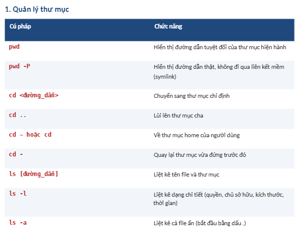
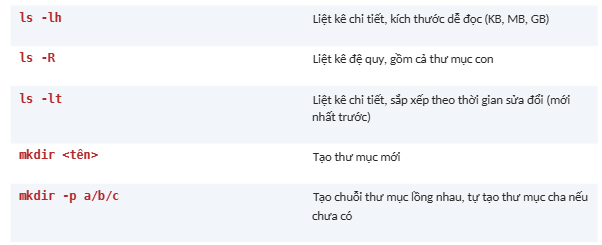
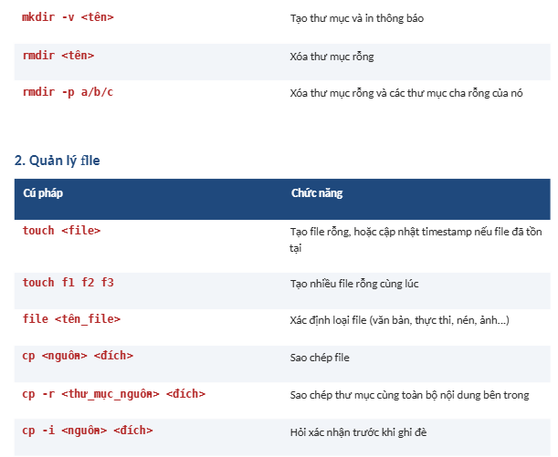
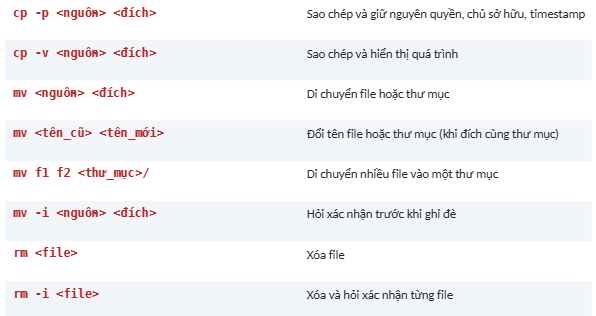
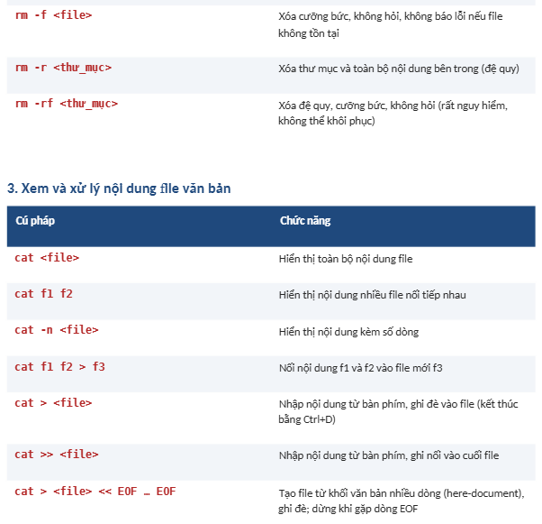
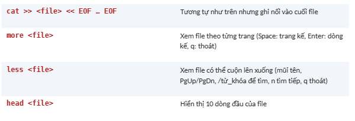
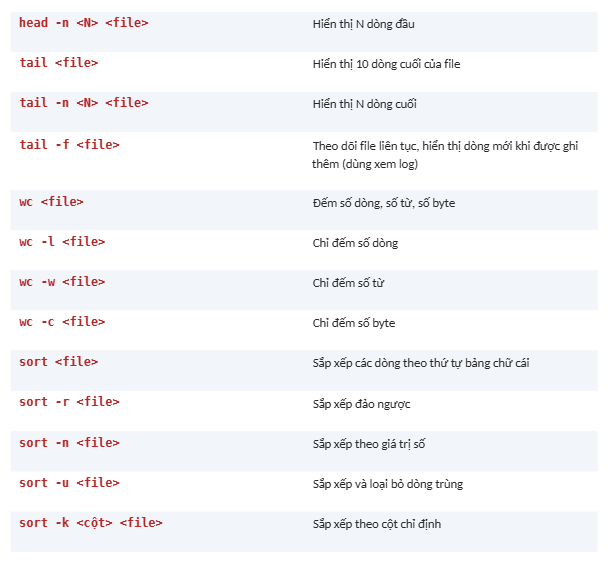
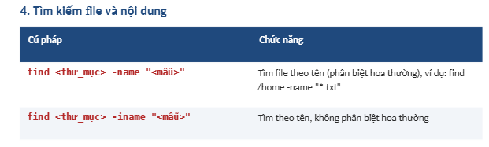
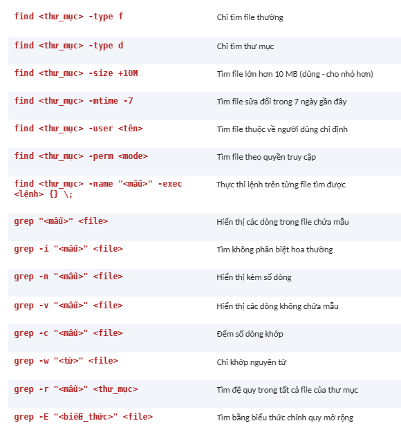
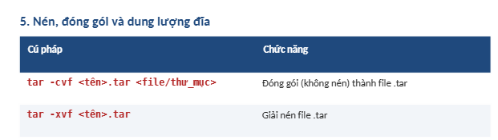
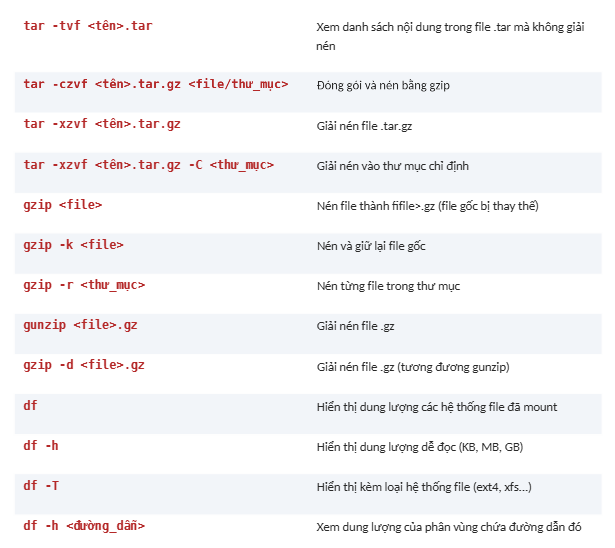
https://www.studocu.vn/vn/document/truong-thpt-chuyen-bien-hoa/hoc-sinh-gioi-anh-11/bang-cu-phap-cac-lenh-linux-co-ban-tai-lieu-tham-khao/176301952?sid=%24device%3A7fa82ca1-5121-488b-82f2-f7654d5672ba1794562563

- Demo minh họa: Chuỗi lệnh thao tác kiểm tra log lỗi thường dùng trên VPS:
```bash
cd /var/log
ls -la
tail -f -n 100 syslog | grep "error"
```
Đoạn lệnh trên thực hiện di chuyển vào thư mục `/var/log`, liệt kê toàn bộ tệp, sau đó theo dõi 100 dòng mới nhất của tệp nhật ký hệ thống `syslog` và chỉ lọc ra những dòng có chứa từ khóa `error`.

---

### III. Network: IP, Port và Firewall

**1. Khái niệm Địa chỉ IP và Cổng kết nối (Port):**

- Địa chỉ IP là mã định danh số duy nhất đại diện cho máy chủ trên mạng Internet (tương tự địa chỉ nhà). Cổng kết nối (Port) là một số nguyên logic từ 1 đến 65535 gắn liền với giao thức mạng, đại diện cho một kênh tiếp nhận dữ liệu của một ứng dụng cụ thể chạy trên máy chủ đó (tương tự số phòng trong một ngôi nhà).
- Tại sao lại cần: Một máy chủ VPS chỉ có một địa chỉ IP duy nhất nhưng có thể chạy đồng thời hàng chục phần mềm (Web Server, Database, SSH, Cache...); Cổng kết nối giúp hệ điều hành biết chính xác gói tin gửi đến dành cho phần mềm nào tiếp nhận.
- Không có thì sao: Không có IP thì gói tin không thể định tuyến đến máy chủ; không có Port thì toàn bộ các ứng dụng chạy trên cùng máy chủ sẽ xung đột dữ liệu, hệ điều hành không thể phân biệt dữ liệu gửi cho MySQL hay dữ liệu gửi cho Spring Boot.
- **So sánh**:
  - Public IP (IP công khai): Địa chỉ duy nhất trên toàn cầu, được các bộ định tuyến Internet nhận diện và dẫn đường từ mọi nơi trên thế giới.
  - Private IP (IP nội bộ): Địa chỉ chỉ có giá trị trong mạng LAN hoặc mạng ảo của Docker, bên ngoài Internet không thể gửi dữ liệu trực tiếp vào dải IP này.
- **Danh mục các cổng tiêu chuẩn trong hệ thống Backend**:
  - Port 22 (SSH): Kênh nhận lệnh điều khiển máy chủ an toàn của OpenSSH Daemon.
  - Port 80 (HTTP): Kênh truyền tải lưu lượng web không mã hóa tiêu chuẩn.
  - Port 443 (HTTPS): Kênh truyền tải lưu lượng web được mã hóa an toàn bằng chứng chỉ SSL/TLS.
  - Port 3306 (MySQL): Cổng lắng nghe truy vấn dữ liệu mặc định của hệ quản trị MySQL.
  - Port 8080 (Spring Boot / Tomcat): Cổng web server mặc định khi khởi chạy các ứng dụng Spring Boot.
- Demo minh họa: Lệnh kiểm tra các cổng đang thực sự lắng nghe (LISTEN) trên máy chủ:
```bash
ss -tuln
```
Lệnh `ss -tuln` hiển thị bảng trạng thái tất cả các cổng mạng TCP/UDP đang mở trên máy chủ cùng địa chỉ IP tương ứng mà tiến trình đang gắn kết.

**2. Khái niệm Tường lửa (Firewall):**

- Tường lửa là hệ thống giám sát an ninh mạng chạy ở tầng nhân của hệ điều hành hoặc phần cứng mạng, hoạt động dựa trên tập luật (rules) nghiêm ngặt nhằm quyết định cho phép (ALLOW) hay ngăn chặn (DENY) các gói tin đi vào hoặc đi ra khỏi máy chủ.
- Tại sao lại cần: Bảo vệ các dịch vụ dữ liệu nội bộ tối mật (như MySQL cổng 3306) khỏi các cuộc tấn công dò quét mật khẩu từ Internet, chỉ mở các cổng công khai cần thiết cho người dùng cuối (như cổng 80 và 443).
- Không có thì sao: Máy chủ bị lộ toàn bộ các cổng dịch vụ ra ngoài mạng công cộng. Kẻ tấn công có thể quét cổng trong vài giây, khai thác các lỗ hổng chưa kịp vá của cơ sở dữ liệu, gửi các cuộc tấn công từ chối dịch vụ hoặc đánh cắp toàn bộ dữ liệu.
- **So sánh**:
  - **Host Firewall** (như UFW trên Ubuntu Linux): Tường lửa phần mềm chạy trực tiếp bên trong hệ điều hành của VPS, quản lý các quy tắc kết nối tới nhân Linux.
  - **Cloud Firewall** (Security Group trên AWS, DigitalOcean, GCP): Tường lửa phần cứng ở tầng hạ tầng ảo hóa bao bọc bên ngoài máy chủ, chặn gói tin độc hại trước khi nó kịp chạm tới card mạng của VPS.

- Demo minh họa: Các lệnh thao tác cấu hình tường lửa UFW chuẩn trên Ubuntu:

```bash
ufw status verbose
ufw allow 22/tcp
ufw allow 80/tcp
ufw allow 443/tcp
ufw enable
```
Chuỗi lệnh trên kiểm tra trạng thái tường lửa, cho phép truy cập cổng SSH 22, mở cổng web 80 và 443, sau đó kích hoạt tường lửa để chặn toàn bộ các cổng còn lại (bao gồm cổng 3306 và 8080) khỏi truy cập ngoài Internet.

**3. Sơ đồ luồng dữ liệu qua Firewall và Port:**

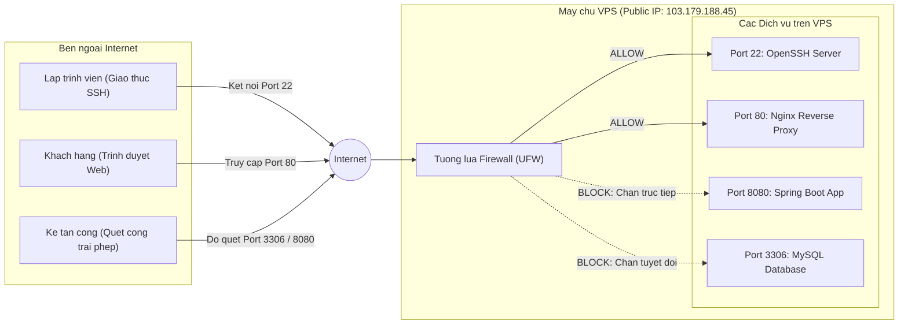

---

## Phần 2: CÔNG NGHỆ ẢO HÓA (DOCKER)

### I. Kiến trúc Docker cơ bản

**1. Khái niệm Docker và Ảo hóa mức Hệ điều hành:**

- Docker là nền tảng ảo hóa mức hệ điều hành (Containerization) cho phép đóng gói toàn bộ mã nguồn ứng dụng cùng môi trường thực thi, thư viện liên kết và biến môi trường vào một đơn vị độc lập gọi là Container, sử dụng chung nhân hệ điều hành của máy chủ mà không cần tạo máy ảo riêng biệt.
- Tại sao lại cần: Giải quyết triệt để vấn đề kinh điển "Trên máy tôi chạy được nhưng lên máy chủ lại lỗi"; giúp việc cài đặt hệ thống phức tạp trở nên đơn giản, đồng nhất từ máy tính phát triển đến máy chủ Production.
- Không có thì sao: Lập trình viên phải lên máy chủ cài đặt thủ công OpenJDK, cấu hình `JAVA_HOME`, cài đặt MySQL, cấu hình timezone và tài khoản; nếu phiên bản Java trên máy chủ lệch với máy phát triển (ví dụ Java 17 với Java 21) thì ứng dụng sẽ văng lỗi `UnsupportedClassVersionError` hoặc sai lệch mã hóa ký tự.
- **So sánh**:
  - **Máy ảo truyền thống** (Virtual Machine - VMware, VirtualBox): Chạy một hệ điều hành khách (Guest OS) hoàn chỉnh trên phần cứng ảo hóa; kích thước hàng chục GB, ngốn nhiều RAM/CPU và mất vài phút để khởi động.
  - **Docker Container**: Chia sẻ trực tiếp nhân Linux với máy chủ gốc, chỉ đóng gói phần ứng dụng và các thư viện cần thiết; kích thước chỉ từ vài chục đến hơn 100 MB, khởi động trong vài giây và tiêu hao rất ít tài nguyên.
- Demo minh họa: Sơ đồ so sánh kiến trúc giữa Máy ảo (VM) và Docker Container:

```mermaid
flowchart TD
    subgraph VMArchitecture["Kien truc May ao (Virtual Machine)"]
        AppVM["Ung dung A | Ung dung B"]
        BinsVM["Bins / Libs day du"]
        GuestOS["He dieu hanh Khach (Guest OS)"]
        Hypervisor["Trinh quan ly ao hoa (Hypervisor)"]
        HostVM["He dieu hanh May chu & Phan cung"]
        AppVM --> BinsVM --> GuestOS --> Hypervisor --> HostVM
    end

    subgraph DockerArchitecture["Kien truc Docker Container"]
        AppDoc["Container 1: App | Container 2: DB"]
        BinsDoc["Bins / Libs toi gian"]
        DockerEngine["Docker Engine (Khong can Guest OS)"]
        HostDoc["He dieu hanh May chu & Phan cung"]
        AppDoc --> BinsDoc --> DockerEngine --> HostDoc
    end
```

**2. Khái niệm Docker Image và Docker Container:**

- Docker Image là một gói phần mềm đóng băng chỉ đọc (read-only), chứa hệ thống tệp thu nhỏ, mã nhị phân của ứng dụng và các chỉ thị cấu hình runtime.
- Docker Container là một thực thể đang chạy được sinh ra từ Docker Image, có vùng nhớ RAM, không gian tiến trình (PID) và giao diện mạng hoàn toàn cô lập.
- Tại sao lại cần: Tách bạch rõ ràng giữa "Bản đóng gói phần mềm" và "Tiến trình thực thi phần mềm", cho phép tạo ra bao nhiêu bản sao chạy song song cũng đều xuất phát từ một nguồn duy nhất.
- Không có thì sao: Không có Image thì không thể tái lập môi trường đồng nhất; không có Container thì các ứng dụng sẽ can thiệp chéo vào nhau, làm nghẽn tài nguyên và gây xung đột cổng mạng trên máy chủ.
- **So sánh**:
  - Trong lập trình hướng đối tượng (OOP): Docker Image tương đương với một `Class` (bản định nghĩa cấu trúc trên giấy); Docker Container tương đương với một `Object` (đối tượng cụ thể được cấp phát bộ nhớ trong RAM để chạy).
  - Trong cài đặt phần mềm: Docker Image là chiếc đĩa cài đặt ISO; Docker Container là phần mềm đã được cài xong và đang bật chạy.

- Demo minh họa: Các lệnh kiểm tra Image và Container đang hoạt động trên hệ thống:
  
```bash
docker images
docker ps -a
```

Lệnh `docker images` liệt kê tất cả các Image đang lưu trong bộ nhớ máy chủ; lệnh `docker ps -a` hiển thị toàn bộ các Container cùng mã định danh (Container ID), tên, trạng thái (Up/Exited) và cấu hình ánh xạ cổng.

**3. Sơ đồ mối quan hệ giữa Dockerfile, Image và Container:**

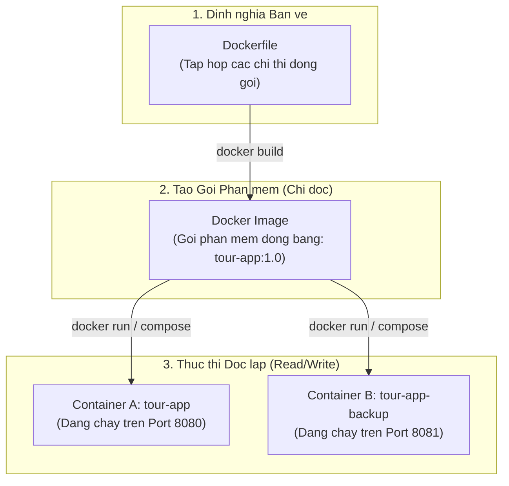

---

### II. Dockerfile và Docker Compose

**1. Khái niệm Dockerfile và Cơ chế Multi-stage Build:**

- Dockerfile là một tệp văn bản thuần chứa chuỗi các câu lệnh tuần tự mà người dùng định nghĩa để Docker đọc và tự động lắp ráp thành một Docker Image.
- Multi-stage Build là kỹ thuật chia quá trình đóng gói trong Dockerfile thành nhiều giai đoạn độc lập, cho phép truyền dữ liệu (như tệp JAR đã build) từ giai đoạn này sang giai đoạn khác và chỉ giữ lại những gì thực sự cần thiết trong sản phẩm cuối cùng.
- Tại sao lại cần: Ứng dụng Spring Boot cần trình biên dịch Java (JDK) và công cụ Maven cồng kềnh để build mã nguồn; nhưng khi chạy thực tế chỉ cần môi trường thực thi máy ảo Java (JRE) siêu nhẹ. Multi-stage Build giúp giảm dung lượng image từ trên 600 MB xuống dưới 150 MB, tiết kiệm băng thông mạng và loại bỏ hoàn toàn mã nguồn gốc khỏi môi trường chạy để tăng tính bảo mật.
- Không có thì sao: Nếu dùng Dockerfile đơn tầng (Single-stage), Image thành phẩm sẽ chứa cả bộ cài Maven, mã nguồn Java, các tệp cấu hình thừa và JDK nặng nề; Image phình to hàng trăm MB, tốn tài nguyên tải lên VPS và mở ra nguy cơ lộ mã nguồn nếu container bị xâm nhập.
- **So sánh**:
  - Single-stage Build: Một lệnh `FROM maven:...`, biên dịch xong giữ nguyên toàn bộ môi trường; kích thước Image rất lớn (> 600 MB).
  - Multi-stage Build: Giai đoạn 1 (`FROM maven:... AS builder`) dùng để build tệp JAR; Giai đoạn 2 (`FROM eclipse-temurin:...-jre`) chỉ copy đúng tệp JAR sang để chạy; kích thước Image siêu nhẹ (< 150 MB).
- Demo minh họa: Sơ đồ luồng Multi-stage Build tối ưu hóa ứng dụng Spring Boot:

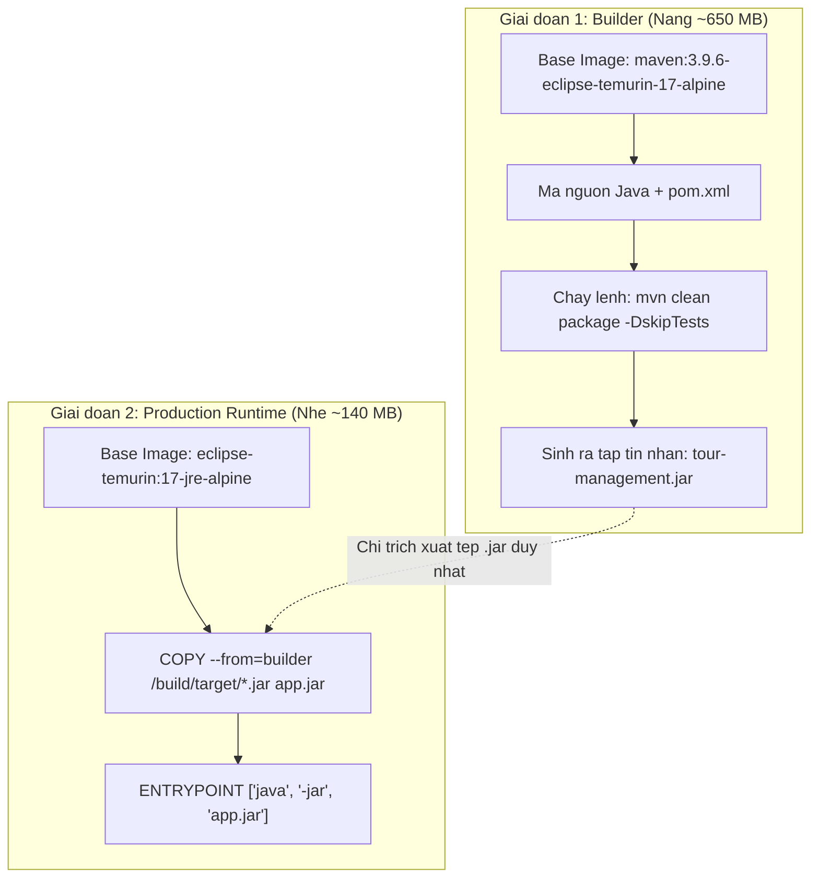

**2. Khái niệm Docker Compose:**

- Docker Compose là công cụ dùng để định nghĩa và khởi chạy các ứng dụng Docker đa dịch vụ (multi-container) thông qua một tệp cấu hình duy nhất viết bằng định dạng YAML (tệp `docker-compose.yml`).
- Tại sao lại cần: Một hệ thống Backend không bao giờ đứng một mình mà luôn đi kèm cơ sở dữ liệu (MySQL), bộ nhớ đệm (Redis) hoặc cổng giao tiếp (Nginx). Docker Compose giúp khởi động, kết nối mạng và quản lý vòng đời của toàn bộ các thành phần này chỉ với đúng một câu lệnh.
- Không có thì sao: Lập trình viên phải gõ hàng chục câu lệnh `docker run` thủ công với hàng loạt tham số dài dòng, phải tự tạo mạng Docker bằng tay, tự gán biến môi trường và phải nhớ khởi động Database trước rồi mới được khởi động Backend; chỉ cần gõ sai một tham số là hệ thống không thể liên lạc được với nhau.
- So sánh:
  - Lệnh `docker run` đơn lẻ: Quản lý từng container riêng lẻ, cấu hình rải rác trong lịch sử dòng lệnh, khó chia sẻ giữa các thành viên dự án và dễ gõ nhầm.
  - Docker Compose: Cấu hình tập trung bằng tệp YAML được lưu vào Git, khởi chạy toàn bộ cụm dịch vụ đồng bộ, tự động xử lý phụ thuộc khởi động (`depends_on`) và tự tạo mạng nội bộ bridge.
- Demo minh họa: Cú pháp lệnh kiểm tra cú pháp tệp Docker Compose trước khi chạy:

```bash
docker compose config
```
Lệnh trên tiến hành đọc tệp `docker-compose.yml`, kiểm tra cấu trúc cú pháp thụt lề YAML, phân giải biến môi trường và in ra cấu trúc hợp nhất của toàn bộ hệ thống dịch vụ.

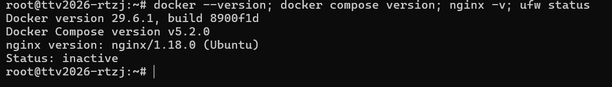

---

## Phần 3: ĐIỀU HƯỚNG TRUY CẬP (DNS & NGINX)

### I. DNS và Tên miền (Domain)

**1. Khái niệm Tên miền và Hệ thống DNS (Domain Name System):**

- Tên miền là chuỗi ký tự định danh dễ nhớ (ví dụ: `tour.example.com`) đại diện cho một tài nguyên trên Internet. DNS là hệ thống máy chủ phân giải tên miền phân tán trên toàn cầu, hoạt động giống như một cuốn danh bạ điện thoại khổng lồ chuyển đổi tên miền dạng chữ thành địa chỉ IP dạng số của máy chủ VPS đích.
- Tại sao lại cần: Bộ não con người rất khó ghi nhớ những dãy số IP phức tạp như `103.179.188.45`; tên miền giúp người dùng dễ dàng truy cập và định hình thương hiệu. Ngoài ra, khi chuyển đổi nhà cung cấp máy chủ hoặc thay đổi IP, ta chỉ cần sửa lại bản ghi DNS mà không làm gián đoạn thói quen truy cập của khách hàng.
- Không có thì sao: Người dùng buộc phải gõ thẳng dãy số IP và cổng lên thanh địa chỉ trình duyệt; không thể thiết lập chứng chỉ bảo mật HTTPS (SSL/TLS) vì các cơ quan cấp phát chứng chỉ uy tín đòi hỏi tên miền hợp lệ để xác thực quyền sở hữu.
- So sánh:
  - Bản ghi A (Address Record): Bản ghi nền tảng trỏ trực tiếp một tên miền hoặc tên miền con (subdomain) về một địa chỉ IPv4 cụ thể của máy chủ VPS.
  - Bản ghi CNAME (Canonical Name): Bản ghi bí danh trỏ một tên miền về một tên miền khác thay vì trỏ về địa chỉ IP.
- Demo minh họa: Lệnh tra cứu phân giải địa chỉ IP của một tên miền từ cửa sổ Terminal:

```bash
nslookup tour.example.com
```
Lệnh `nslookup` gửi truy vấn tới máy chủ DNS mặc định và trả về địa chỉ IP công khai tương ứng đang được ánh xạ cho tên miền đó.

**2. Sơ đồ quy trình phân giải tên miền qua hệ thống DNS:**

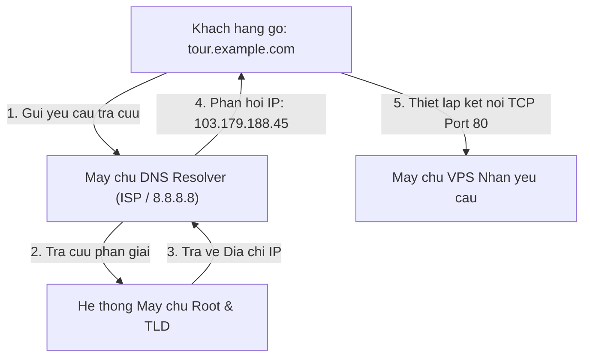

---

### II. Reverse Proxy và Nginx

**1. Khái niệm Proxy và Reverse Proxy:**

- Forward Proxy (Proxy xuôi) là máy chủ trung gian đứng trước các máy khách (Client), nhận yêu cầu từ Client và gửi ra Internet thay mặt cho Client.
- Reverse Proxy (Proxy ngược) là máy chủ trung gian đứng trước các máy chủ backend (Server), tiếp nhận mọi yêu cầu gửi đến từ Internet và điều phối chúng tới các dịch vụ ứng dụng nội bộ phù hợp.
- Tại sao lại cần: Ứng dụng Backend Spring Boot thường chạy ở cổng 8080 trong mạng nội bộ. Reverse Proxy đứng ở tiền tuyến tiếp nhận kết nối ở cổng chuẩn 80 và 443, ẩn giấu cấu trúc mạng phía sau, bảo vệ Backend khỏi truy cập trái phép và thực hiện phân phối tải.
- Không có thì sao: Lập trình viên phải mở trực tiếp cổng 8080 của ứng dụng ra ngoài Internet; người dùng buộc phải gõ thêm đuôi `:8080` phía sau tên miền; không thể gom nhiều ứng dụng chạy trên cùng một máy chủ và ứng dụng Backend phải tự gánh thêm việc giải mã chứng chỉ SSL rất tốn CPU.
- **So sánh**:
  - Forward Proxy: Che giấu danh tính và địa chỉ IP thực của người dùng (Client) đối với Internet (thường dùng trong mạng công ty để kiểm soát truy cập hoặc VPN để vượt tường lửa).
  - Reverse Proxy: Che giấu danh tính, địa chỉ IP và cổng thực của cụm máy chủ ứng dụng (Server) đối với người dùng bên ngoài Internet.
- Demo minh họa: Sơ đồ đối sánh kiến trúc giữa Forward Proxy và Reverse Proxy:

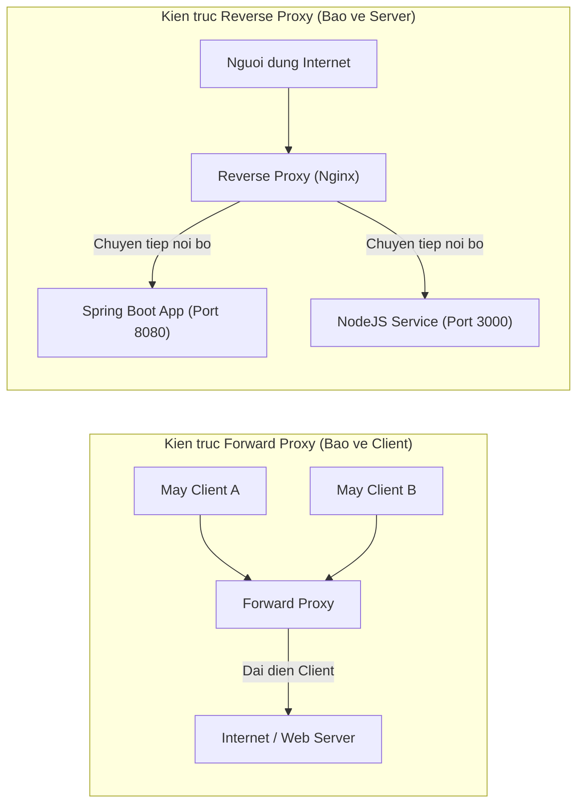

**2. Khái niệm Máy chủ Nginx:**

- Nginx là phần mềm máy chủ mã nguồn mở hiệu năng cao, hoạt động theo kiến trúc bất đồng bộ hướng sự kiện (asynchronous event-driven), chuyên đảm nhận các vai trò Web Server, Reverse Proxy, Cân bằng tải (Load Balancer) và Bộ nhớ đệm (Cache).
- Tại sao lại cần: Nginx có khả năng xử lý hàng chục nghìn kết nối đồng thời với lượng tiêu thụ RAM và CPU cực kỳ thấp; đứng phía trước ứng dụng Spring Boot để tiếp nhận kết nối người dùng, quản lý SSL/TLS tập trung, nén dữ liệu truyền tải (Gzip) và chuyển tiếp yêu cầu đến backend thông qua chỉ thị `proxy_pass`.
- Không có thì sao: Nếu để Spring Boot trực tiếp lắng nghe cổng 80/443, ta phải chạy ứng dụng dưới quyền `root` (lỗi bảo mật nghiêm trọng trên Linux); khả năng phục vụ file tĩnh và tốc độ bắt tay mã hóa HTTPS của Tomcat nhúng chậm hơn Nginx nhiều lần.
- **So sánh**:
  - Apache HTTP Server: Kiến trúc truyền thống dựa trên luồng (process/thread-per-connection); khi có hàng nghìn người truy cập đồng thời, Apache tạo ra hàng nghìn tiến trình làm cạn kiệt RAM của máy chủ.
  - Nginx: Kiến trúc hướng sự kiện (event-loop); một tiến trình đơn lẻ có thể xử lý trơn tru hàng vạn kết nối đồng thời mà lượng RAM tiêu thụ gần như không đổi.
- Demo minh họa: Khối cấu hình chuyển tiếp tối giản trong Nginx:
```nginx
server {
    listen 80;
    server_name _;

    location / {
        proxy_pass http://127.0.0.1:8080;
        proxy_set_header Host $host;
        proxy_set_header X-Real-IP $remote_addr;
        proxy_set_header X-Forwarded-For $proxy_add_x_forwarded_for;
        proxy_set_header X-Forwarded-Proto $scheme;
    }
}
```
Khối cấu hình trên chỉ thị Nginx tiếp nhận mọi kết nối gửi đến cổng 80 và dùng lệnh `proxy_pass` để chuyển tiếp nguyên vẹn gói tin vào ứng dụng Spring Boot đang chạy tại cổng nội bộ 8080, đồng thời đính kèm thông tin địa chỉ IP gốc của người dùng.

**3. Sơ đồ cơ chế điều phối của Nginx Reverse Proxy tới Spring Boot:**

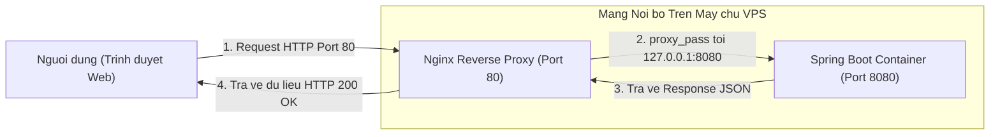

---

## Phần 4: THỰC HÀNH TỔNG HỢP (DEPLOY DỰ ÁN QUẢN LÝ TOUR)

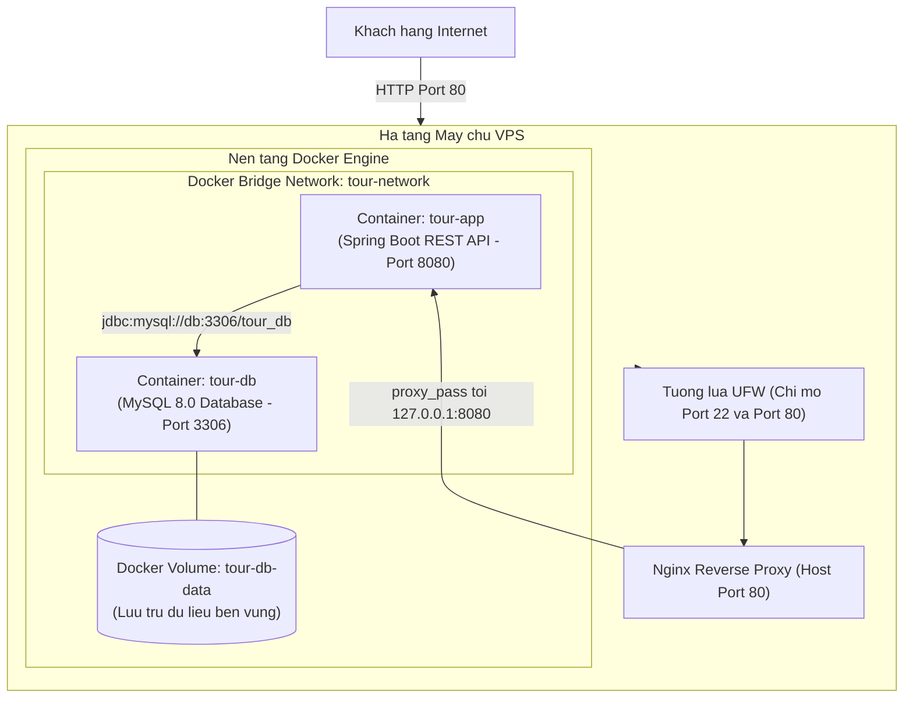

### I. Kết nối VPS qua SSH

**1. Mục đích:**

- Thao tác mở phiên dòng lệnh an toàn từ máy tính cá nhân đến máy chủ VPS từ xa thông qua giao thức SSH.
- Tại sao lại cần: Để trực tiếp thao tác trên hệ điều hành Ubuntu Server, cài đặt các công cụ cần thiết, tải mã nguồn và vận hành hệ thống container.
- Không có thì sao: Không có cách nào truy cập vào máy chủ để bắt đầu quy trình triển khai.
- So sánh: Sử dụng SSH bằng dòng lệnh nhẹ hơn, phản hồi nhanh hơn và an toàn hơn việc cài đặt giao diện đồ họa điều khiển từ xa.
- Demo minh họa: Lệnh truy cập trực tiếp bằng Terminal.

**2. Triển khai Code/Lệnh:**

- Cú pháp câu lệnh truy cập Terminal:

```bash
ssh root@103.179.188.45
```

- Giải thích chi tiết các tham số lệnh:
  - `ssh`: Lệnh khởi động chương trình máy khách OpenSSH trên máy tính cá nhân.
  - `root`: Tài khoản quản trị có đặc quyền cao nhất trên hệ điều hành Linux của máy chủ VPS.
  - `103.179.188.45`: Địa chỉ IP công khai của máy chủ VPS do nhà cung cấp cấp phát.

**3. Demo trực quan:**
- Kết quả hiển thị trên màn hình Terminal khi thực hiện kết nối lần đầu:
```text
The authenticity of host '103.179.188.45 (103.179.188.45)' can't be established.
ED25519 key fingerprint is SHA256:abcd1234efgh5678ijkl9012mnop3456qrst7890uvw.
Are you sure you want to continue connecting (yes/no/[fingerprint])? yes
Warning: Permanently added '103.179.188.45' (ED25519) to the list of known hosts.
root@103.179.188.45's password: 
Welcome to Ubuntu 22.04.4 LTS (GNU/Linux 5.15.0-105-generic x86_64)

 * Documentation:  https://help.ubuntu.com
 * Management:     https://landscape.canonical.com
 * Support:        https://ubuntu.com/advantage

System information as of Wed Nov 11 15:00:00 UTC 2026

  System load:  0.08               Processes:             102
  Usage of /:   18.5% of 38.58GB   Users logged in:       0
  Memory usage: 22%                IPv4 address for eth0: 103.179.188.45
  Swap usage:   0%

root@vps-tour:~#
```
- Phân tích kết quả: Máy chủ yêu cầu xác nhận vân tay khóa bảo mật (fingerprint), sau khi gõ `yes` và nhập mật khẩu chính xác, dấu nhắc lệnh chuyển thành `root@vps-tour:~#` báo hiệu phiên làm việc dòng lệnh từ xa đã sẵn sàng.

---

### II. Đóng gói dự án (Dockerize) bằng Dockerfile

**1. Mục đích:**
- Là gì: Tạo tệp hướng dẫn đóng gói tự động toàn bộ mã nguồn ứng dụng Spring Boot Quản lý Tour thành một Docker Image hoàn chỉnh.
- Tại sao lại cần: Ứng dụng cần chạy độc lập mà không cần cài đặt JDK hay Maven lên hệ điều hành gốc của máy chủ; áp dụng Multi-stage Build để giảm dung lượng file xuống mức tối thiểu và bảo mật mã nguồn.
- Không có thì sao: Phải cài đặt JDK trực tiếp lên máy chủ, dễ xung đột môi trường và khó nâng cấp hệ thống sau này.
- So sánh: Multi-stage Build chỉ tạo ra Image khoảng 140 MB thay vì trên 650 MB như cách build thông thường.
- Demo minh họa: Tệp Dockerfile đa tầng và lệnh build image.

**2. Triển khai Code/Lệnh:**
- Tệp tin cấu hình: `Dockerfile`
```dockerfile
FROM maven:3.9.6-eclipse-temurin-17-alpine AS builder
WORKDIR /build
COPY pom.xml .
RUN mvn dependency:go-offline
COPY src ./src
RUN mvn clean package -DskipTests

FROM eclipse-temurin:17-jre-alpine
WORKDIR /app
COPY --from=builder /build/target/*.jar app.jar
EXPOSE 8080
ENTRYPOINT ["java", "-jar", "app.jar"]
```
- Giải thích chi tiết các chỉ thị:
  - `FROM maven:3.9.6-eclipse-temurin-17-alpine AS builder`: Khởi tạo tầng biên dịch có đầy đủ công cụ Maven và JDK 17 trên nền tảng Alpine Linux siêu nhẹ, đặt tên là builder.
  - `WORKDIR /build`: Thiết lập thư mục làm việc nội bộ của tầng build là `/build`.
  - `COPY pom.xml .`: Sao chép riêng tệp định nghĩa phụ thuộc vào trước để tận dụng bộ nhớ đệm (Docker Layer Cache).
  - `RUN mvn dependency:go-offline`: Tải sẵn toàn bộ các thư viện Maven về máy để không phải tải lại ở các lần build sau nếu file `pom.xml` không thay đổi.
  - `COPY src ./src`: Sao chép toàn bộ thư mục chứa mã nguồn Java vào container.
  - `RUN mvn clean package -DskipTests`: Thực hiện biên dịch mã nguồn thành tệp JAR và bỏ qua khâu chạy unit test để tăng tốc độ đóng gói.
  - `FROM eclipse-temurin:17-jre-alpine`: Khởi tạo tầng chạy sản phẩm hoàn toàn mới, chỉ chứa môi trường thực thi Java Runtime (JRE 17) tối giản.
  - `WORKDIR /app`: Đặt thư mục làm việc cho ứng dụng tại `/app`.
  - `COPY --from=builder /build/target/*.jar app.jar`: Trích xuất duy nhất tệp JAR đã biên dịch xong từ tầng builder sang thư mục `/app` và đổi tên thành `app.jar`.
  - `EXPOSE 8080`: Khai báo cổng 8080 mà ứng dụng Spring Boot sẽ lắng nghe bên trong container.
  - `ENTRYPOINT ["java", "-jar", "app.jar"]`: Khai báo lệnh khởi chạy mặc định để bật tiến trình Java khi container hoạt động.

**3. Demo trực quan:**
- Lệnh thực hiện build Image kiểm tra:
```bash
docker build -t tour-management-app:1.0 .
```
- Kết quả hiển thị trên màn hình Terminal:
```text
[+] Building 24.8s (13/13) FINISHED
 => [internal] load build definition from Dockerfile
 => => transferring dockerfile: 382B
 => [internal] load .dockerignore
 => [stage-0 1/5] FROM docker.io/library/maven:3.9.6-eclipse-temurin-17-alpine
 => [stage-1 1/3] FROM docker.io/library/eclipse-temurin:17-jre-alpine
 => [stage-0 2/5] WORKDIR /build
 => [stage-0 3/5] COPY pom.xml .
 => [stage-0 4/5] RUN mvn dependency:go-offline
 => [stage-0 5/5] COPY src ./src
 => [stage-0 6/5] RUN mvn clean package -DskipTests
 => [stage-1 2/3] WORKDIR /app
 => [stage-1 3/3] COPY --from=builder /build/target/*.jar app.jar
 => exporting to image
 => => exporting layers
 => => writing image sha256:9f40ab3c6b41d08d7e67f08b35ce9892
 => => naming to docker.io/library/tour-management-app:1.0
```
- Phân tích kết quả: Image `tour-management-app:1.0` được tạo ra thành công, toàn bộ mã nguồn gốc và bộ công cụ Maven bị loại bỏ hoàn toàn, chỉ giữ lại JRE và tệp JAR thành phẩm.

---

### III. Triển khai Database và App với Docker Compose

**1. Mục đích:**
- Là gì: Khởi tạo và liên kết đồng thời hai dịch vụ: Cơ sở dữ liệu MySQL 8 và ứng dụng Spring Boot Quản lý Tour trong cùng một mạng ảo.
- Tại sao lại cần: Thiết lập cấu hình kết nối tự động bằng tên dịch vụ `db`, đảm bảo dữ liệu không bị mất khi xóa container bằng Docker Volume, và giới hạn cổng 8080 chỉ mở cho máy chủ nội bộ.
- Không có thì sao: Phải gõ các lệnh `docker run` phức tạp, cấu hình IP thủ công và dữ liệu cơ sở dữ liệu sẽ biến mất hoàn toàn mỗi khi tắt container.
- So sánh: Quản lý cụm ứng dụng bằng một tệp `docker-compose.yml` tập trung, rõ ràng và dễ bảo trì hơn nhiều so với chạy lệnh rời rạc.
- Demo minh họa: Tệp cấu hình `docker-compose.yml` hoàn chỉnh.

**2. Triển khai Code/Lệnh:**
- Tệp tin cấu hình: `docker-compose.yml`
```yaml
version: '3.8'

services:
  db:
    image: mysql:8.0
    container_name: tour-db
    restart: always
    environment:
      MYSQL_DATABASE: tour_db
      MYSQL_ROOT_PASSWORD: RootPassword123
      MYSQL_USER: tour_user
      MYSQL_PASSWORD: TourUserPassword123
    volumes:
      - tour-db-data:/var/lib/mysql
    networks:
      - tour-network

  app:
    build:
      context: .
      dockerfile: Dockerfile
    container_name: tour-app
    restart: always
    ports:
      - "127.0.0.1:8080:8080"
    depends_on:
      - db
    environment:
      SPRING_DATASOURCE_URL: jdbc:mysql://db:3306/tour_db?useSSL=false&allowPublicKeyRetrieval=true&serverTimezone=UTC
      SPRING_DATASOURCE_USERNAME: tour_user
      SPRING_DATASOURCE_PASSWORD: TourUserPassword123
      SPRING_JPA_HIBERNATE_DDL_AUTO: update
    networks:
      - tour-network

volumes:
  tour-db-data:

networks:
  tour-network:
    driver: bridge
```
- Giải thích chi tiết các tham số cấu hình:
  - `version: '3.8'`: Khai báo phiên bản cú pháp của Docker Compose.
  - `services`: Khối định nghĩa danh sách các container dịch vụ cần chạy.
  - `db`: Tên dịch vụ cơ sở dữ liệu, đồng thời là hostname nội bộ trong mạng Docker để backend kết nối tới.
  - `image: mysql:8.0`: Kéo hình ảnh chính thức của MySQL phiên bản 8.0 từ Docker Hub.
  - `container_name: tour-db`: Đặt tên cố định cho container cơ sở dữ liệu.
  - `restart: always`: Tự động khởi động lại container nếu bị crash hoặc khi máy chủ VPS khởi động lại.
  - `environment`: Truyền các biến môi trường cấu hình mật khẩu quản trị root, tạo sẵn cơ sở dữ liệu `tour_db` và tài khoản riêng `tour_user`.
  - `volumes: - tour-db-data:/var/lib/mysql`: Ánh xạ vùng lưu dữ liệu của MySQL vào Docker Volume `tour-db-data` để bảo vệ dữ liệu vĩnh viễn trên máy chủ.
  - `app`: Tên dịch vụ ứng dụng Backend Spring Boot.
  - `build`: Hướng dẫn Docker Compose tự động đóng gói Image từ file `Dockerfile` nằm cùng thư mục.
  - `ports: - "127.0.0.1:8080:8080"`: Ánh xạ cổng 8080 của container vào cổng 8080 của máy chủ VPS nhưng chỉ gắn kết với IP nội bộ `127.0.0.1`, ngăn chặn triệt để mọi truy cập trực tiếp từ Internet vào cổng 8080.
  - `depends_on: - db`: Đảm bảo container cơ sở dữ liệu `db` được bật lên trước container ứng dụng.
  - `SPRING_DATASOURCE_URL`: Chuỗi kết nối JDBC sử dụng tên máy chủ là `db` và cổng là `3306`.
  - `SPRING_DATASOURCE_USERNAME` và `SPRING_DATASOURCE_PASSWORD`: Thông tin xác thực khớp hoàn toàn với tài khoản đã khai báo tại dịch vụ `db`.
  - `SPRING_JPA_HIBERNATE_DDL_AUTO: update`: Tự động đồng bộ các bảng trong cơ sở dữ liệu từ Entity trong mã nguồn Java.
  - `networks: - tour-network`: Gắn cả hai container vào mạng cầu nối chung để chúng tự tìm thấy nhau qua tên dịch vụ.

**3. Demo trực quan:**
- Lệnh kiểm tra cấu trúc cú pháp của file Compose:
```bash
docker compose config
```
- Kết quả hiển thị trên màn hình Terminal:
```text
name: tour-management
services:
  app:
    build:
      context: /root/tour-project
      dockerfile: Dockerfile
    container_name: tour-app
    depends_on:
      db:
        condition: service_started
    environment:
      SPRING_DATASOURCE_PASSWORD: TourUserPassword123
      SPRING_DATASOURCE_URL: jdbc:mysql://db:3306/tour_db?useSSL=false&allowPublicKeyRetrieval=true&serverTimezone=UTC
      SPRING_DATASOURCE_USERNAME: tour_user
      SPRING_JPA_HIBERNATE_DDL_AUTO: update
    networks:
      tour-network: null
    ports:
      - host_ip: 127.0.0.1
        mode: ingress
        protocol: tcp
        published: 8080
        target: 8080
    restart: always
  db:
    container_name: tour-db
    environment:
      MYSQL_DATABASE: tour_db
      MYSQL_PASSWORD: TourUserPassword123
      MYSQL_ROOT_PASSWORD: RootPassword123
      MYSQL_USER: tour_user
    image: mysql:8.0
    networks:
      tour-network: null
    restart: always
    volumes:
      - source: tour-db-data
        target: /var/lib/mysql
        type: volume
networks:
  tour-network:
    name: tour-management_tour-network
volumes:
  tour-db-data:
    name: tour-management_tour-db-data
```
- Phân tích kết quả: Tệp cấu hình chuẩn xác, các thuộc tính về cổng, volume và biến môi trường được phân giải hoàn chỉnh, sẵn sàng kích hoạt.

---

### IV. Cấu hình Nginx Reverse Proxy

**1. Mục đích:**
- Là gì: Cấu hình máy chủ Nginx làm cổng tiếp nhận duy nhất cho toàn bộ người dùng tại cổng web tiêu chuẩn 80.
- Tại sao lại cần: Chuyển tiếp các yêu cầu từ cổng 80 vào cổng nội bộ 8080 của Spring Boot, bảo vệ ứng dụng khỏi các truy cập trực tiếp và giấu cổng backend.
- Không có thì sao: Người dùng bên ngoài không thể truy cập ứng dụng vì cổng 8080 đã bị giới hạn chỉ lắng nghe trên `127.0.0.1` và tường lửa đã chặn cổng này.
- So sánh: Dùng Nginx làm Reverse Proxy xử lý kết nối nhanh hơn, chịu tải tốt hơn và bảo mật hơn rất nhiều so với mở cổng trực tiếp cho Tomcat.
- Demo minh họa: Tệp cấu hình Nginx và các lệnh kích hoạt.

**2. Triển khai Code/Lệnh:**
- Tệp tin cấu hình: `/etc/nginx/sites-available/tour-management`
```nginx
server {
    listen 80;
    server_name _;

    location / {
        proxy_pass http://127.0.0.1:8080;
        proxy_set_header Host $host;
        proxy_set_header X-Real-IP $remote_addr;
        proxy_set_header X-Forwarded-For $proxy_add_x_forwarded_for;
        proxy_set_header X-Forwarded-Proto $scheme;
    }
}
```
- Các câu lệnh thao tác kích hoạt trên VPS:
```bash
ln -s /etc/nginx/sites-available/tour-management /etc/nginx/sites-enabled/
rm -f /etc/nginx/sites-enabled/default
nginx -t
systemctl reload nginx
```
- Giải thích chi tiết các chỉ thị và câu lệnh:
  - `listen 80`: Thiết lập Nginx lắng nghe các kết nối HTTP tại cổng tiêu chuẩn 80.
  - `server_name _`: Cấu hình tiếp nhận mọi yêu cầu gửi đến địa chỉ IP của VPS hoặc bất kỳ tên miền nào trỏ về máy chủ.
  - `location /`: Khối xử lý tiếp nhận mọi đường dẫn bắt đầu từ dấu gạch chéo `/`.
  - `proxy_pass http://127.0.0.1:8080`: Chuyển tiếp toàn bộ nội dung yêu cầu vào cổng 8080 của ứng dụng Spring Boot đang chạy cục bộ trên máy chủ.
  - `proxy_set_header Host $host`: Truyền tiếp tên máy chủ hoặc domain gốc của người dùng vào backend.
  - `proxy_set_header X-Real-IP $remote_addr`: Truyền địa chỉ IP thực của người dùng vào Spring Boot để ghi log kiểm toán.
  - `proxy_set_header X-Forwarded-For $proxy_add_x_forwarded_for`: Lưu lại danh sách chuỗi các địa chỉ IP của các trạm proxy trung gian.
  - `proxy_set_header X-Forwarded-Proto $scheme`: Thông báo cho backend biết giao thức kết nối gốc ban đầu là HTTP hay HTTPS.
  - `ln -s`: Tạo liên kết tượng trưng (symlink) đưa file cấu hình vào danh mục đang hoạt động của Nginx.
  - `rm -f /etc/nginx/sites-enabled/default`: Xóa tệp cấu hình mặc định để không bị xung đột xử lý cổng 80.
  - `nginx -t`: Kiểm tra tính toàn vẹn cú pháp của các tệp cấu hình Nginx.
  - `systemctl reload nginx`: Nạp lại cấu hình mới cho Nginx ngay lập tức mà không gây gián đoạn các kết nối hiện có.

**3. Demo trực quan:**
- Lệnh kiểm tra cú pháp cấu hình Nginx:
```bash
nginx -t
```
- Kết quả hiển thị trên màn hình Terminal:
```text
nginx: the configuration file /etc/nginx/nginx.conf syntax is ok
nginx: configuration file /etc/nginx/nginx.conf test is successful
```
- Phân tích kết quả: Cú pháp tệp Nginx hoàn toàn chính xác, sẵn sàng đón nhận và ủy quyền lưu lượng vào ứng dụng.

---

### V. Khởi chạy và Kiểm thử trực tiếp

**1. Mục đích:**
- Là gì: Khởi động toàn bộ các container chạy ngầm trên VPS, theo dõi log kiểm tra ứng dụng kết nối thành công tới Database và thực hiện kiểm thử endpoint API thực tế qua cổng 80.
- Tại sao lại cần: Để đảm bảo tất cả các thành phần trong chuỗi triển khai (Nginx, Spring Boot, MySQL) phối hợp vận hành nhịp nhàng và sẵn sàng phục vụ người dùng.
- Không có thì sao: Không thể biết hệ thống có phát sinh lỗi kết nối cơ sở dữ liệu hay không, không nghiệm thu được kết quả triển khai thực tế.
- So sánh: Kiểm thử bằng `curl` trực tiếp trên VPS cho phép xác nhận ngay kết quả trước khi bàn giao cho người dùng ngoài Internet.
- Demo minh họa: Lệnh `docker compose up -d`, xem log và gọi API qua `curl`.

**2. Triển khai Code/Lệnh:**
- Lệnh khởi động toàn bộ dịch vụ ngầm:
```bash
docker compose up -d
```
- Lệnh theo dõi dòng log liên tục của container Spring Boot:
```bash
docker compose logs -f app
```
- Lệnh cURL kiểm tra API Quản lý Tour qua cổng 80:
```bash
curl -X GET http://103.179.188.45/api/tours -H "Accept: application/json"
```
- Giải thích chi tiết các câu lệnh:
  - `docker compose up -d`: Tự động biên dịch image từ Dockerfile (nếu chưa có), tạo mạng nội bộ, tạo ổ đĩa volume và khởi chạy các container ở chế độ chạy ngầm (detached mode) trong nền hệ thống.
  - `docker compose logs -f app`: Mở dòng log trực tiếp của container `tour-app`, tham số `-f` (follow) giữ tiến trình theo dõi liên tục các dòng log mới phát sinh.
  - `curl -X GET`: Gửi yêu cầu HTTP phương thức GET trực tiếp đến địa chỉ IP công khai của VPS qua cổng 80 (cổng mặc định không cần ghi rõ `:80`), kèm tiêu đề HTTP yêu cầu định dạng dữ liệu trả về là JSON.

**3. Demo trực quan:**
- Kết quả hiển thị trên màn hình Terminal khi thực hiện lệnh khởi chạy:
```text
[+] Running 3/3
 Network tour-project_tour-network  Created                               0.1s
 Volume "tour-project_tour-db-data" Created                               0.0s
 Container tour-db                  Started                               1.2s
 Container tour-app                 Started                               2.5s
```
- Kết quả hiển thị màn hình log khởi động của Spring Boot:
```text
tour-app  |   .   ____          _            __ _ _
tour-app  |  /\\ / ___'_ __ _ _(_)_ __  __ _ \ \ \ \
tour-app  | ( ( )\___ | '_ | '_| | '_ \/ _` | \ \ \ \
tour-app  |  \\/  ___)| |_)| | | | | || (_| |  ) ) ) )
tour-app  |   '  |____| .__|_| |_|_| |_\__, | / / / /
tour-app  |  =========|_|==============|___/=/_/_/_/
tour-app  |  :: Spring Boot ::                (v3.2.3)
tour-app  | 
tour-app  | 2026-11-11T15:05:01.120Z  INFO 1 --- [main] c.e.tour.TourManagementApplication      : Starting TourManagementApplication v0.0.1 using Java 17
tour-app  | 2026-11-11T15:05:03.450Z  INFO 1 --- [main] o.s.b.w.embedded.tomcat.TomcatWebServer  : Tomcat initialized with port 8080 (http)
tour-app  | 2026-11-11T15:05:04.210Z  INFO 1 --- [main] o.hibernate.jpa.internal.util.LogHelper : HHH000204: Processing PersistenceUnitInfo [name: default]
tour-app  | 2026-11-11T15:05:05.105Z  INFO 1 --- [main] org.hibernate.dialect.Dialect           : HHH000400: Using dialect: org.hibernate.dialect.MySQLDialect
tour-app  | 2026-11-11T15:05:06.890Z  INFO 1 --- [main] o.s.b.w.embedded.tomcat.TomcatWebServer  : Tomcat started on port 8080 (http) with context path ''
tour-app  | 2026-11-11T15:05:06.915Z  INFO 1 --- [main] c.e.tour.TourManagementApplication      : Started TourManagementApplication in 6.25 seconds (process running for 7.1)
```
- Dữ liệu phản hồi định dạng JSON khi gửi lệnh cURL kiểm tra API:
```json
[
  {
    "id": 1,
    "title": "Tour Kham Pha Da Nang - Hoi An 3N2D",
    "price": 3500000.0,
    "duration": 3,
    "maxParticipants": 20,
    "status": "AVAILABLE"
  },
  {
    "id": 2,
    "title": "Tour Nghi Duong Phu Quoc 4N3D",
    "price": 5200000.0,
    "duration": 4,
    "maxParticipants": 15,
    "status": "AVAILABLE"
  }
]
```
- Phân tích kết quả: Spring Boot đã khởi động thành công trên cổng 8080, Hibernate kết nối trơn tru tới cơ sở dữ liệu MySQL trên container `tour-db`. Yêu cầu gửi tới cổng 80 được Nginx tiếp nhận và ủy quyền chính xác tới backend, trả về danh sách dữ liệu Tour dưới định dạng JSON với mã trạng thái HTTP 200 OK.

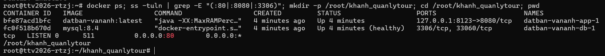