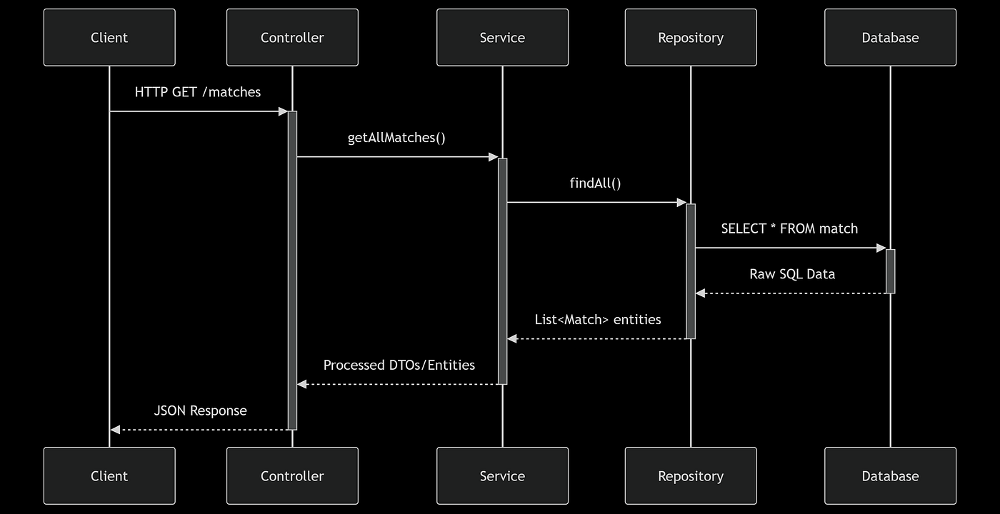
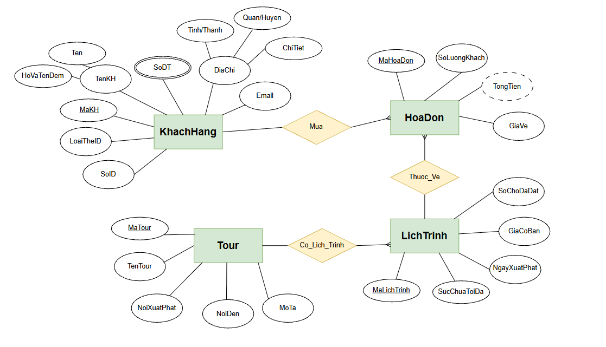
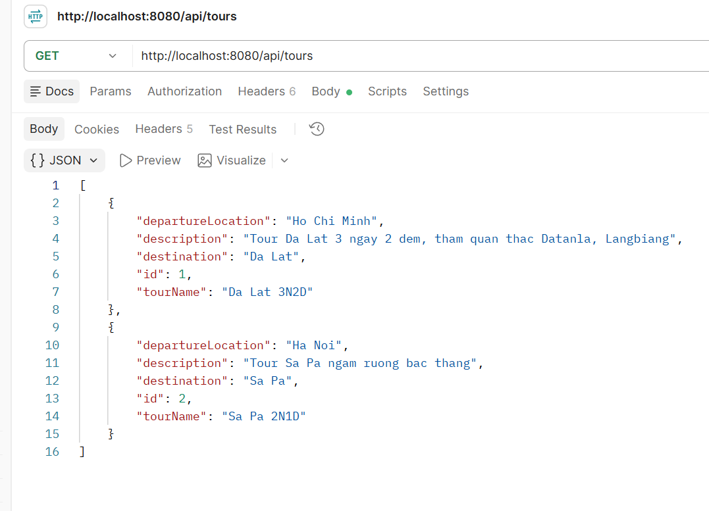
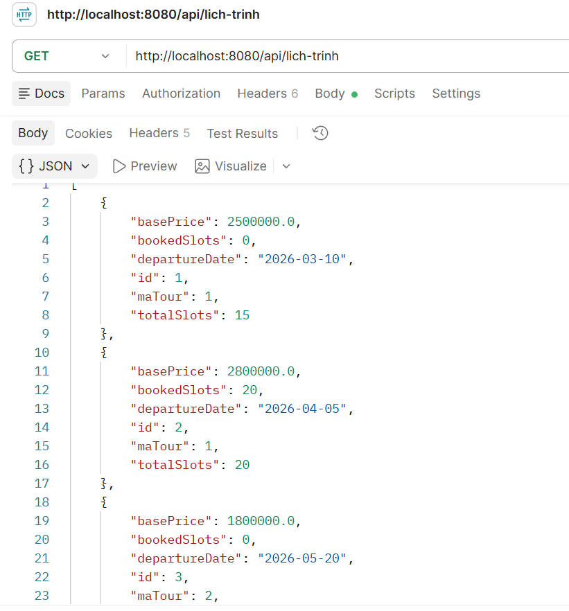
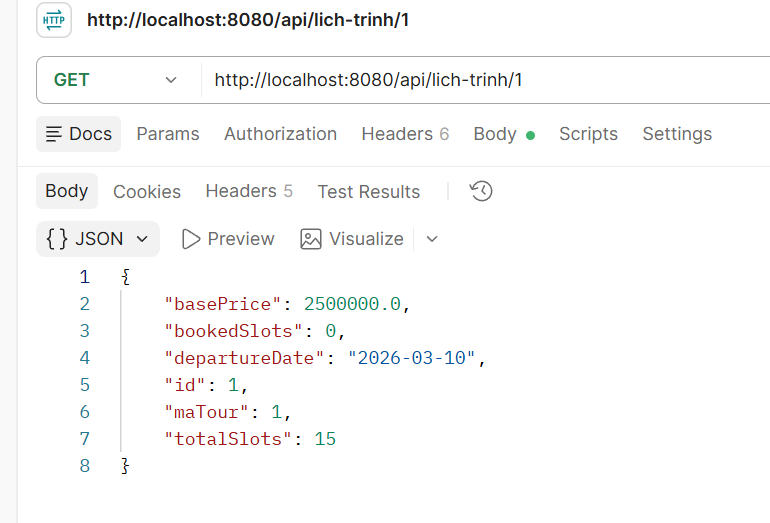
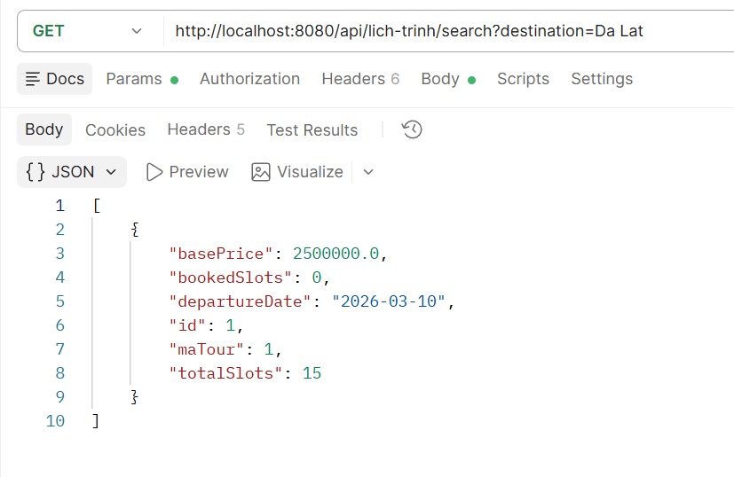
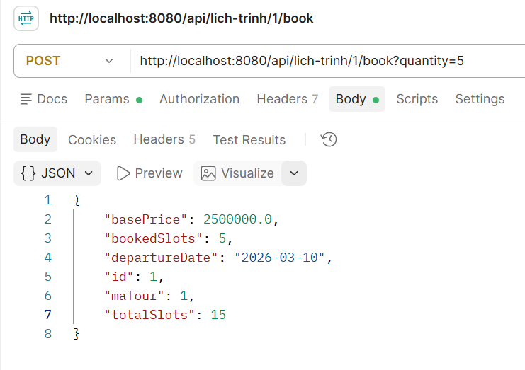
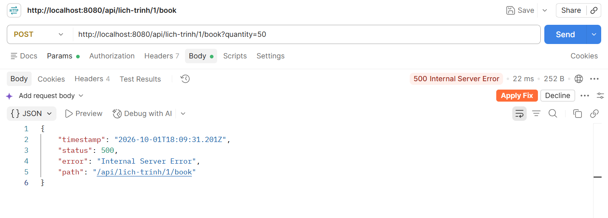
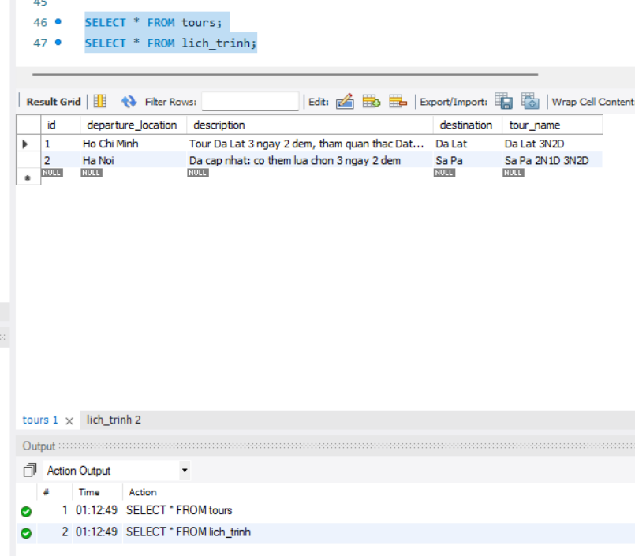
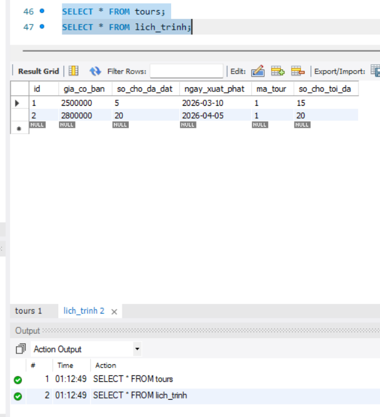

# Nguyễn Quốc Khánh
*Tài liệu chuẩn bị buổi 7*
# BUỔI 7: CRUD cơ bản
--- 

# Mục lục

- [Nguyễn Quốc Khánh](#nguyễn-quốc-khánh)
- [BUỔI 7: CRUD cơ bản](#buổi-7-crud-cơ-bản)
- [Mục lục](#mục-lục)
  - [PHẦN 1: KIẾN TRÚC 4 LỚP VÀ REQUEST FLOW](#phần-1-kiến-trúc-4-lớp-và-request-flow)
    - [I. Kiến trúc 4 lớp trong Spring Boot](#i-kiến-trúc-4-lớp-trong-spring-boot)
      - [A. Bản chất dễ hiểu](#a-bản-chất-dễ-hiểu)
        - [Lớp 1: Presentation Layer (Controller)](#lớp-1-presentation-layer-controller)
        - [Lớp 2: Business Logic Layer (Service)](#lớp-2-business-logic-layer-service)
        - [Lớp 3: Data Access Layer (Repository)](#lớp-3-data-access-layer-repository)
        - [Lớp 4: Persistence Layer (Entity và cơ sở dữ liệu)](#lớp-4-persistence-layer-entity-và-cơ-sở-dữ-liệu)
        - [Quy tắc kết nối giữa các lớp](#quy-tắc-kết-nối-giữa-các-lớp)
      - [B. Tại sao cần có nó? / Không có thì sao?](#b-tại-sao-cần-có-nó--không-có-thì-sao)
      - [C. Phân biệt nhầm lẫn và Lưu ý quan trọng](#c-phân-biệt-nhầm-lẫn-và-lưu-ý-quan-trọng)
      - [D. Demo trực quan](#d-demo-trực-quan)
    - [II. Request Flow - Dòng chảy xử lý một Request](#ii-request-flow---dòng-chảy-xử-lý-một-request)
      - [A. Bản chất dễ hiểu](#a-bản-chất-dễ-hiểu-1)
        - [Khó khăn:](#khó-khăn)
        - [Cách giải quyết: theo dõi hành trình của một cục dữ liệu, và nhớ rằng nó liên tục đổi hình dạng](#cách-giải-quyết-theo-dõi-hành-trình-của-một-cục-dữ-liệu-và-nhớ-rằng-nó-liên-tục-đổi-hình-dạng)
        - [Chiều đi xuống: từ Postman tới MySQL](#chiều-đi-xuống-từ-postman-tới-mysql)
        - [Chiều đi lên: từ MySQL về Postman](#chiều-đi-lên-từ-mysql-về-postman)
        - [Bảng tóm tắt: dữ liệu đổi hình dạng thế nào](#bảng-tóm-tắt-dữ-liệu-đổi-hình-dạng-thế-nào)
        - [Trường hợp yêu cầu có dữ liệu gửi kèm (POST, PUT)](#trường-hợp-yêu-cầu-có-dữ-liệu-gửi-kèm-post-put)
      - [B. Tại sao cần có nó? / Không có thì sao?](#b-tại-sao-cần-có-nó--không-có-thì-sao-1)
      - [C. Phân biệt nhầm lẫn và Lưu ý quan trọng](#c-phân-biệt-nhầm-lẫn-và-lưu-ý-quan-trọng-1)
      - [D. Demo trực quan](#d-demo-trực-quan-1)
        - [Yêu cầu 1: lấy tour theo id](#yêu-cầu-1-lấy-tour-theo-id)
        - [Yêu cầu 2: tạo tour mới](#yêu-cầu-2-tạo-tour-mới)
  - [Phần 2: JPA, Hibernate và DataSource](#phần-2-jpa-hibernate-và-datasource)
    - [I. ORM, JPA và Hibernate là gì?](#i-orm-jpa-và-hibernate-là-gì)
      - [A. Bản chất dễ hiểu](#a-bản-chất-dễ-hiểu-2)
        - [Khó khăn: làm việc với cơ sở dữ liệu bằng JDBC thuần](#khó-khăn-làm-việc-với-cơ-sở-dữ-liệu-bằng-jdbc-thuần)
        - [Cách giải quyết: nhận ra bảng và class giống nhau về hình dạng, rồi để máy tự chuyển đổi](#cách-giải-quyết-nhận-ra-bảng-và-class-giống-nhau-về-hình-dạng-rồi-để-máy-tự-chuyển-đổi)
        - [JPA, Hibernate, Spring Data JPA](#jpa-hibernate-spring-data-jpa)
      - [B. Tại sao cần có nó? / Không có thì sao?](#b-tại-sao-cần-có-nó--không-có-thì-sao-2)
        - [Cách hoạt động của ORM (Hibernate)](#cách-hoạt-động-của-orm-hibernate)
      - [C. Phân biệt nhầm lẫn và Lưu ý quan trọng](#c-phân-biệt-nhầm-lẫn-và-lưu-ý-quan-trọng-2)
      - [D. Demo trực quan](#d-demo-trực-quan-2)
    - [II. Cấu hình DataSource (Kết nối Spring Boot với MySQL)](#ii-cấu-hình-datasource-kết-nối-spring-boot-với-mysql)
      - [A. Bản chất dễ hiểu](#a-bản-chất-dễ-hiểu-3)
        - [Khó khăn: ứng dụng Java và MySQL là hai chương trình tách biệt](#khó-khăn-ứng-dụng-java-và-mysql-là-hai-chương-trình-tách-biệt)
        - [Cách giải quyết: tách thông tin kết nối ra file cấu hình và để Spring Boot lo phần còn lại](#cách-giải-quyết-tách-thông-tin-kết-nối-ra-file-cấu-hình-và-để-spring-boot-lo-phần-còn-lại)
        - [Connection Pool: vì sao có "nhóm kết nối"](#connection-pool-vì-sao-có-nhóm-kết-nối)
        - [Giải phẫu đường dẫn kết nối (JDBC URL)](#giải-phẫu-đường-dẫn-kết-nối-jdbc-url)
      - [B. Tại sao cần có nó? / Không có thì sao?](#b-tại-sao-cần-có-nó--không-có-thì-sao-3)
        - [Các khóa cấu hình sẽ dùng](#các-khóa-cấu-hình-sẽ-dùng)
        - [`spring.jpa.hibernate.ddl-auto`](#springjpahibernateddl-auto)
        - [`show-sql` và `format_sql`](#show-sql-và-format_sql)
      - [C. Phân biệt nhầm lẫn và Lưu ý quan trọng](#c-phân-biệt-nhầm-lẫn-và-lưu-ý-quan-trọng-3)
      - [D. Demo trực quan](#d-demo-trực-quan-3)
        - [Bước 0: Tạo dự án nếu chưa có](#bước-0-tạo-dự-án-nếu-chưa-có)
        - [Bước 1: Khai báo thư viện trong `pom.xml`](#bước-1-khai-báo-thư-viện-trong-pomxml)
        - [Bước 2: Tìm và sửa file `application.properties`](#bước-2-tìm-và-sửa-file-applicationproperties)
        - [Bước 3: Giải thích từng dòng cấu hình](#bước-3-giải-thích-từng-dòng-cấu-hình)
        - [Bước 4: Chạy thử kết nối](#bước-4-chạy-thử-kết-nối)
  - [Phần 3: Các Annotation cốt lõi theo từng lớp](#phần-3-các-annotation-cốt-lõi-theo-từng-lớp)
    - [I.Nhóm khởi tạo và cấu hình (The core)](#inhóm-khởi-tạo-và-cấu-hình-the-core)
      - [1. @`SpringBootApplication`](#1-springbootapplication)
      - [2. `@Bean` (đi kèm với `@Configuration`)](#2-bean-đi-kèm-với-configuration)
      - [3. Ví dụ:](#3-ví-dụ)
    - [II. Nhóm định danh Bean](#ii-nhóm-định-danh-bean)
      - [1. `@Component` - Người đa năng](#1-component---người-đa-năng)
      - [2. `@Repository` - Thủ kho](#2-repository---thủ-kho)
      - [3. `@Service` - Quản lý nghiệp vụ](#3-service---quản-lý-nghiệp-vụ)
      - [4. `@Controller` vs `@RestController`- "Lễ tân"](#4-controller-vs-restcontroller--lễ-tân)
      - [5. Bảng tóm tắt](#5-bảng-tóm-tắt)
    - [III. Nhóm tiêm phụ thuộc (Dependency Injection)](#iii-nhóm-tiêm-phụ-thuộc-dependency-injection)
      - [1. `@Autowired` - keo dán](#1-autowired---keo-dán)
      - [2. `@Qualifier` ("tenbean")](#2-qualifier-tenbean)
      - [3. `@RequiedArgsConstructor` - Lombok](#3-requiedargsconstructor---lombok)
    - [IV. Nhóm xử lý API (Controlller layer)](#iv-nhóm-xử-lý-api-controlller-layer)
      - [1. Định nghĩa Method Các Annotation này giúp xác định xem API này sẽ làm gì (lấy dữ liệu, thêm mới hay Xoá.....)](#1-định-nghĩa-method-các-annotation-này-giúp-xác-định-xem-api-này-sẽ-làm-gì-lấy-dữ-liệu-thêm-mới-hay-xoá)
      - [2. Hứng dữ liệu từ Client Làm sao để lấy dúng dữ liệu người dùng gửi lên? Ta cần phân biệt rõ 3 loại sau](#2-hứng-dữ-liệu-từ-client-làm-sao-để-lấy-dúng-dữ-liệu-người-dùng-gửi-lên-ta-cần-phân-biệt-rõ-3-loại-sau)
      - [3. Ví dụ](#3-ví-dụ-1)
    - [V .Nhóm ánh xạ Database (Entity Layer)](#v-nhóm-ánh-xạ-database-entity-layer)
      - [1. `@Entity`](#1-entity)
      - [2. `@Table(name="tenbang")`](#2-tablenametenbang)
      - [3. `@Id`](#3-id)
      - [4. `@GeneratedValue`](#4-generatedvalue)
      - [5. `@Column`](#5-column)
      - [VD:](#vd)
  - [Phần 4: Bài tập thực hành xuyên suốt – Module Quản lý Tour](#phần-4-bài-tập-thực-hành-xuyên-suốt--module-quản-lý-tour)
    - [Bảng đối chiếu: sơ đồ E-R và Entity Java](#bảng-đối-chiếu-sơ-đồ-e-r-và-entity-java)
    - [Tổng hợp API của Phần 4](#tổng-hợp-api-của-phần-4)
    - [Bước 1: Chuẩn bị Database trên MySQL Workbench](#bước-1-chuẩn-bị-database-trên-mysql-workbench)
    - [Bước 2: Tạo cấu trúc thư mục (Package) chuẩn chỉ](#bước-2-tạo-cấu-trúc-thư-mục-package-chuẩn-chỉ)
    - [Bước 3: Viết code tầng Entity](#bước-3-viết-code-tầng-entity)
      - [`Tour.java`](#tourjava)
      - [`LichTrinh.java`](#lichtrinhjava)
    - [Bước 4: Viết code tầng Repository](#bước-4-viết-code-tầng-repository)
      - [`TourRepository.java`](#tourrepositoryjava)
      - [`LichTrinhRepository.java`](#lichtrinhrepositoryjava)
    - [Bước 5: Viết code tầng Service](#bước-5-viết-code-tầng-service)
      - [`TourService.java`](#tourservicejava)
      - [`LichTrinhService.java`](#lichtrinhservicejava)
    - [Bước 6: Viết code tầng Controller](#bước-6-viết-code-tầng-controller)
      - [`TourController.java`](#tourcontrollerjava)
      - [`LichTrinhController.java`](#lichtrinhcontrollerjava)
    - [Bước 7: Hướng dẫn chạy ứng dụng và Kiểm thử trên Postman](#bước-7-hướng-dẫn-chạy-ứng-dụng-và-kiểm-thử-trên-postman)
      - [7.1. Chạy ứng dụng](#71-chạy-ứng-dụng)
      - [7.2. Tạo 2 tour mẫu](#72-tạo-2-tour-mẫu)
      - [7.3. Tạo 3 lịch trình cho các tour vừa tạo](#73-tạo-3-lịch-trình-cho-các-tour-vừa-tạo)
      - [7.4. Test Read — xem danh sách và chi tiết](#74-test-read--xem-danh-sách-và-chi-tiết)
      - [7.5. Test Search - tìm lịch trình theo nơi đến còn chỗ trống](#75-test-search---tìm-lịch-trình-theo-nơi-đến-còn-chỗ-trống)
      - [7.6. Test Book - đặt giữ chỗ thành công](#76-test-book---đặt-giữ-chỗ-thành-công)
      - [7.7. Test Book - đặt giữ chỗ thất bại, không đủ chỗ](#77-test-book---đặt-giữ-chỗ-thất-bại-không-đủ-chỗ)
      - [7.8. Test Update và Delete](#78-test-update-và-delete)
      - [7.9. Xác nhận dữ liệu thật trong MySQL](#79-xác-nhận-dữ-liệu-thật-trong-mysql)


---

## PHẦN 1: KIẾN TRÚC 4 LỚP VÀ REQUEST FLOW

### I. Kiến trúc 4 lớp trong Spring Boot

#### A. Bản chất dễ hiểu

**Vấn đề khi dồn tất cả vào một file**

Giả sử ta cần làm chức năng "đặt giữ chỗ tour". Cách nghĩ tự nhiên nhất là viết hết vào một hàm, một file.

```java
package com.example.quanlytour.controller;
 
import java.sql.Connection;
import java.sql.DriverManager;
import java.sql.PreparedStatement;
import java.sql.ResultSet;
import java.sql.SQLException;
import java.util.HashMap;
import java.util.Map;
import org.springframework.web.bind.annotation.GetMapping;
import org.springframework.web.bind.annotation.PathVariable;
import org.springframework.web.bind.annotation.RestController;
 
@RestController
public class TourController {
 
    @GetMapping("/api/tours/{id}")
    public Map<String, Object> getTour(@PathVariable Long id) throws SQLException {
        if (id == null || id <= 0) {
            throw new IllegalArgumentException("Ma tour khong hop le");
        }
        Connection connection = DriverManager.getConnection(
                "jdbc:mysql://localhost:3306/quan_ly_tour", "root", "123456");
        PreparedStatement statement = connection.prepareStatement("SELECT * FROM tours WHERE id = ?");
        statement.setLong(1, id);
        ResultSet resultSet = statement.executeQuery();
        Map<String, Object> result = new HashMap<>();
        if (resultSet.next()) {
            result.put("id", resultSet.getLong("id"));
            result.put("tourName", resultSet.getString("tour_name"));
            double price = resultSet.getDouble("price");
            if (price > 10000000) {
                result.put("tourType", "CAO_CAP");
            } else {
                result.put("tourType", "TIET_KIEM");
            }
        }
        connection.close();
        return result;
    }
 
}
```
 
Một hàm duy nhất ở đây đang làm 5 việc thuộc 5 loại hoàn toàn khác nhau:
 
1. **Nhận yêu cầu từ bên ngoài:** `@GetMapping`, `@PathVariable` lấy `id` từ đường dẫn.
2. **Kiểm tra dữ liệu đầu vào:** đoạn `if (id == null || id <= 0)`.
3. **Làm việc với cơ sở dữ liệu:** mở kết nối, viết câu SQL, chạy câu SQL.
4. **Biến dữ liệu thô của bảng thành dữ liệu Java:** đọc từng cột `id`, `tour_name`, `price` bỏ vào `Map`.
5. **Áp dụng luật kinh doanh:** nếu giá trên 10 triệu thì phân loại `CAO_CAP`, ngược lại `TIET_KIEM`.
Ngoài ra, mật khẩu cơ sở dữ liệu `123456` bị viết cứng ngay trong code.
 
**Cách giải quyết: mỗi đoạn code chỉ lo một loại việc**

- Áp dụng vào ứng dụng backend, người ta chia code thành các **lớp**, mỗi lớp lo đúng một loại việc và chỉ được nói chuyện với lớp ngay bên dưới nó. Cách chia phổ biến nhất trong Spring Boot là **kiến trúc 4 lớp**:
 
| Lớp | Tên tiếng Anh        | Class đại diện   | Package      | Nhãn Spring       | Loại việc phụ trách                                         |
| --- | -------------------- | ---------------- | ------------ | ----------------- | ----------------------------------------------------------- |
| 1   | Presentation Layer   | `TourController` | `controller` | `@RestController` | Giao tiếp với thế giới bên ngoài: nhận yêu cầu, trả kết quả |
| 2   | Business Logic Layer | `TourService`    | `service`    | `@Service`        | Luật kinh doanh, quy tắc nghiệp vụ                          |
| 3   | Data Access Layer    | `TourRepository` | `repository` | `@Repository`     | Đọc và ghi dữ liệu trong cơ sở dữ liệu                      |
| 4   | Persistence Layer    | `Tour` (Entity)  | `entity`     | `@Entity`         | Mô tả dữ liệu, ánh xạ với bảng trong cơ sở dữ liệu          |
 
Chiều gọi giữa các lớp là một chiều từ trên xuống:
 
```text
Client (Postman, trình duyệt, ứng dụng di động)
                |
                v
Controller   (Presentation Layer)
                |
                v
Service      (Business Logic Layer)
                |
                v
Repository   (Data Access Layer)
                |
                v
Entity  <---->  Bảng trong MySQL   (Persistence Layer)
```
 


##### Lớp 1: Presentation Layer (Controller)
 
- **Vai trò:** cửa giao tiếp duy nhất giữa ứng dụng và thế giới bên ngoài. Nhận yêu cầu HTTP, lấy dữ liệu từ đường dẫn hoặc từ phần thân yêu cầu, giao việc cho Service, rồi đóng gói kết quả trả về.
- **Được làm:** định nghĩa đường dẫn (`/api/tours`), đọc tham số, gọi Service, chọn mã trạng thái HTTP.
- **Không được làm:** tính toán nghiệp vụ, viết SQL, gọi thẳng Repository.
- **Ví dụ trong dự án:** `TourController` có các phương thức `getAllTours`, `createTour`, `deleteTour`. Mỗi phương thức chỉ dài vài dòng, chủ yếu là "nhận vào, gọi Service, trả ra".

##### Lớp 2: Business Logic Layer (Service)

- **Vai trò:** nơi chứa luật của nghiệp vụ. Mọi quyết định kiểu như có được phép làm việc này không hay làm như thế nào.
- **Được làm:** kiểm tra quy tắc (ví dụ: không cho đặt số khách nhiều hơn số chỗ trống, giá tour không được âm), tính toán, phối hợp nhiều Repository, quản lý giao dịch (`@Transactional`).
- **Không được làm:** biết bất cứ điều gì về HTTP (không nhận `HttpServletRequest`, không quyết định mã trạng thái), không viết SQL.
- **Ví dụ trong dự án:** `TourService` có phương thức `bookTour` kiểm tra số chỗ trống rồi mới trừ đi.

##### Lớp 3: Data Access Layer (Repository)

- **Vai trò:** chỉ biết đọc và ghi dữ liệu mà không quan tâm dữ liệu đó để làm gì.
- **Được làm:** lưu, tìm, xóa, đếm bản ghi; khai báo các câu truy vấn.
- **Không được làm:** chứa luật kinh doanh.
- **Ví dụ trong dự án:** `TourRepository` là một `interface` có các hàm `findAll`, `findById`, `save`, `deleteById` và hàm tìm tour theo nơi đến.

##### Lớp 4: Persistence Layer (Entity và cơ sở dữ liệu)

- **Vai trò:** mô tả hình dạng dữ liệu. Class `Tour` trong Java (gọi là **Entity**) tương ứng với bảng `tours` trong MySQL. Nơi lưu dữ liệu thật vẫn là MySQL; Entity là "bản mô tả bên phía Java" để các lớp trên làm việc với dữ liệu bằng object thay vì bằng dòng chữ trong bảng.
- **Được làm:** khai báo các thuộc tính và cách chúng ánh xạ vào cột.
- **Không được làm:** chứa logic phức tạp. Entity chủ yếu là nới chứa đựng dữ liệu.
- **Ví dụ trong dự án:** `Tour` có 9 thuộc tính như lược đồ E-R đã vẽ.

##### Quy tắc kết nối giữa các lớp
 
- Mỗi lớp chỉ gọi **lớp ngay bên dưới**: Controller gọi Service, Service gọi Repository. Không nhảy cóc.
- `Entity` là ngoại lệ: nó là kiểu dữ liệu đi xuyên suốt các lớp, nên cả Controller, Service, Repository đều biết đến `Tour`.
- Các lớp nhận nhau qua **constructor** .
- Ví dụ: `TourController` khai báo cần một `TourService` trong constructor, và Spring tự cung cấp.

#### B. Tại sao cần có nó? / Không có thì sao?

Sáu lợi ích cốt lõi:

1. **Dễ tìm lỗi.** Mỗi loại việc nằm đúng một chỗ. Sai kết quả tính toán thì nhìn vào Service, sai câu truy vấn thì nhìn vào Repository, sai đường dẫn thì nhìn vào Controller.
2. **Tái sử dụng.** Luật kinh doanh viết một lần ở Service, dùng lại cho mọi nơi gọi tới (API web, ứng dụng di động, tác vụ chạy định kỳ).
3. **Thay đổi công nghệ cục bộ.** Đổi cơ sở dữ liệu chỉ ảnh hưởng lớp dưới cùng. Đổi cách giao tiếp (từ REST sang cách khác) chỉ ảnh hưởng lớp trên cùng.
4. **Làm việc nhóm song song.** Mỗi người nhận một lớp hoặc một chức năng, ít giẫm chân nhau.
5. **Dễ kiểm thử.** Vì mỗi lớp nhận lớp dưới qua constructor, khi kiểm thử có thể thay lớp dưới bằng bản giả.
6. **Có một điểm kiểm soát.** Mọi thao tác thay đổi dữ liệu đều đi qua Service, nên đó là nơi tập trung để kiểm tra dữ liệu và đặt giao dịch (`@Transactional`).

**Cái giá phải trả**: chia lớp làm số lượng file nhiều hơn, với chức năng rất nhỏ. Đổi lại, khi dự án lớn dần, cách tổ chức này giúp code vẫn kiểm soát được. Đây là lý do gần như mọi dự án Spring Boot thực tế đều dùng cách chia lớp này.
 
#### C. Phân biệt nhầm lẫn và Lưu ý quan trọng
 
| Dễ nhầm giữa                                   | Sự khác nhau                                                                                                                                                                                                                |
| ---------------------------------------------- | --------------------------------------------------------------------------------------------------------------------------------------------------------------------------------------------------------------------------- |
| **Service** (lớp nghiệp vụ) và **web service** | Hai khái niệm hoàn toàn khác. `Service` trong dự án chỉ là lớp code chứa luật kinh doanh. "Web service" là một dịch vụ chạy trên mạng, không liên quan                                                                      |
| **Entity** và **bảng**                         | Bảng là cấu trúc nằm trong MySQL. Entity là class Java mô tả bảng đó. Hai thứ được nối với nhau nhờ ORM (Object-Relational Mapping)                                                                                         |
| **Repository** và **Service**                  | Repository chỉ biết lưu và lấy dữ liệu thô. Service quyết định có được phép lưu hay không, lưu như thế nào. Ví dụ "trừ số chỗ trống" là việc của Service, còn "lưu tour vào bảng" là việc của Repository                    |
| **Model** và package `model`                   | `Model` là chiếc khay đưa dữ liệu sang file HTML Thymeleaf. Package `model` (hoặc `entity`) là nơi chứa các class mô tả dữ liệu. Ta hay dùng tên `entity` để tránh nhầm                                                     |
| **Kiến trúc 4 lớp** và **MVC**                 | MVC chia phần giao tiếp với người dùng thành Model, View, Controller. Kiến trúc 4 lớp chia toàn bộ backend. Trong REST API, "View" chính là dữ liệu JSON trả về, còn Controller của MVC chính là lớp Controller trong 4 lớp |
| **Layer** (lớp) và **package**                 | Layer là khái niệm về vai trò. Package là cách sắp thư mục để thể hiện layer đó. Mỗi layer tương ứng một package                                                                                                            |
 
Những lỗi thiết kế hay mắc, cần tránh:

- **Controller gọi thẳng Repository** vì "chỉ lấy danh sách thôi, khỏi qua Service cho nhanh". Thói quen này làm mất điểm kiểm soát, sau này thêm luật vào rất khó. Luôn đi qua Service.
- **Service biết về HTTP**, ví dụ trả về mã trạng thái hay đọc thông tin từ yêu cầu. Service chỉ nên nhận dữ liệu bình thường và trả dữ liệu bình thường.
- **Đặt luật kinh doanh trong Controller.** Controller chỉ nên "nhận vào, gọi Service, trả ra".
- **Đặt `@Transactional` ở Controller.** Nhãn này thuộc về Service.
 
#### D. Demo trực quan
 
Đây là khung xương chức năng xem chi tiết một tour, viết lại theo 4 lớp. Mục đích là nhìn hình dáng của 4 lớp và thấy mỗi file ngắn, gọn, đúng một nhiệm vụ.
 
**Input:** trong bảng `tours` của MySQL đang có một dòng dữ liệu, và Postman gửi yêu cầu `GET http://localhost:8080/api/tours/1`.
 
| id  | tour_name   | price   |
| --- | ----------- | ------- |
| 1   | Da Lat 3N2D | 2500000 |
 
**Cấu trúc thư mục:**
 
```text
com.example.quanlytour
    QuanLyTourApplication.java
    entity
        Tour.java
    repository
        TourRepository.java
    service
        TourService.java
    controller
        TourController.java
```
 
**Lớp 4 – `Tour.java` (Entity):**
 
```java
package com.example.quanlytour.entity;
 
import jakarta.persistence.Entity;
import jakarta.persistence.GeneratedValue;
import jakarta.persistence.GenerationType;
import jakarta.persistence.Id;
import jakarta.persistence.Table;
import lombok.Data;
 
@Entity
@Table(name = "tours")
@Data
public class Tour {
 
    @Id
    @GeneratedValue(strategy = GenerationType.IDENTITY)
    private Long id;
 
    private String tourName;
 
    private Double price;
 
}
```
 
Giải thích: `@Entity` nói với Spring đây là class ánh xạ với một bảng. `@Table(name = "tours")` chỉ rõ bảng tên `tours`. `@Id` đánh dấu `id` là khóa chính, `@GeneratedValue` cho biết giá trị do MySQL tự tăng. `tourName` và `price` là hai thuộc tính tương ứng hai cột `tour_name` và `price`. `@Data` (Lombok) tự sinh getter, setter. Ý nghĩa chi tiết từng annotation nằm ở Phần 3.
 
**Lớp 3 – `TourRepository.java`:**
 
```java
package com.example.quanlytour.repository;
 
import com.example.quanlytour.entity.Tour;
import org.springframework.data.jpa.repository.JpaRepository;
import org.springframework.stereotype.Repository;
 
@Repository
public interface TourRepository extends JpaRepository<Tour, Long> {
 
}
```
 
Giải thích: đây là một `interface` trống, không có phương thức nào, nhưng vì kế thừa `JpaRepository<Tour, Long>` nên tự động có sẵn nhiều hàm như `findById`, `findAll`, `save`. `Tour` là kiểu dữ liệu quản lý, `Long` là kiểu của khóa chính. Cơ chế "vì sao trống mà vẫn dùng được".
 
**Lớp 2 – `TourService.java`:**
 
```java
package com.example.quanlytour.service;
 
import com.example.quanlytour.entity.Tour;
import com.example.quanlytour.repository.TourRepository;
import org.springframework.stereotype.Service;
 
@Service
public class TourService {
 
    private final TourRepository tourRepository;
 
    public TourService(TourRepository tourRepository) {
        this.tourRepository = tourRepository;
    }
 
    public Tour findTourById(Long id) {
        return tourRepository.findById(id).orElse(null);
    }
 
}
```
 
Giải thích: `@Service` biến class thành Bean thuộc lớp nghiệp vụ. Constructor nhận `TourRepository`, Spring tự tiêm vào (DI). Hàm `findTourById` gọi `findById` của Repository. Hàm `findById` trả về một `Optional`, tức một "chiếc hộp" có thể chứa dữ liệu hoặc có thể rỗng. `orElse(null)` nghĩa là: nếu hộp rỗng (không tìm thấy tour) thì trả về `null`.
 
**Lớp 1 – `TourController.java`:**
 
```java
package com.example.quanlytour.controller;
 
import com.example.quanlytour.entity.Tour;
import com.example.quanlytour.service.TourService;
import org.springframework.web.bind.annotation.GetMapping;
import org.springframework.web.bind.annotation.PathVariable;
import org.springframework.web.bind.annotation.RequestMapping;
import org.springframework.web.bind.annotation.RestController;
 
@RestController
@RequestMapping("/api/tours")
public class TourController {
 
    private final TourService tourService;
 
    public TourController(TourService tourService) {
        this.tourService = tourService;
    }
 
    @GetMapping("/{id}")
    public Tour getTourById(@PathVariable Long id) {
        return tourService.findTourById(id);
    }
 
}
```
 
Giải thích: `@RestController` đánh dấu class nhận yêu cầu và trả dữ liệu JSON. `@RequestMapping("/api/tours")` là phần đầu chung của mọi đường dẫn trong class. `@GetMapping("/{id}")` ghép với phần đầu thành `GET /api/tours/{id}`, trong đó `{id}` là chỗ trống được điền bằng số bất kỳ. `@PathVariable Long id` lấy giá trị đó gán vào biến `id`. Phương thức chỉ có một dòng, gọi Service rồi trả kết quả, đúng tinh thần "nhận vào, gọi Service, trả ra".
 
**Output:** Postman nhận được kết quả JSON:
 
```json
{
    "id": 1,
    "tourName": "Da Lat 3N2D",
    "price": 2500000.0
}
```


### II. Request Flow - Dòng chảy xử lý một Request

#### A. Bản chất dễ hiểu

##### Khó khăn:

Khi làm quen với API, ta bấm nút Send trên Postman và vài chục mili giây sau thấy một đoạn JSON hiện ra. Ở giữa đó có rất nhiều việc xảy ra mà mắt không nhìn thấy. Nếu không hình dung được hành trình đó, khi có lỗi ta sẽ không biết lỗi nằm ở đâu: do Postman gửi sai? Do Controller? Do câu SQL? Do MySQL?

##### Cách giải quyết: theo dõi hành trình của một cục dữ liệu, và nhớ rằng nó liên tục đổi hình dạng

- Cách hiệu quả nhất để hiểu hệ thống là **đi theo dữ liệu**, từ lúc nó rời Postman đến lúc trở về.
- Qua mỗi trạm, dữ liệu lại **đổi hình dạng** (chữ, object Java, câu SQL, dòng của bảng...).
 
Ví dụ theo dõi: Postman gửi `GET http://localhost:8080/api/tours/1` để lấy tour có mã 1, dùng đúng 4 lớp đã học ở mục trước.

##### Chiều đi xuống: từ Postman tới MySQL

**Trạm 0 – Client (Postman).** Postman đóng gói yêu cầu thành văn bản theo chuẩn HTTP: dòng đầu ghi phương thức và đường dẫn `GET /api/tours/1 HTTP/1.1`, kèm các dòng header như `Host: localhost:8080`. Văn bản này được gửi qua mạng tới máy tính, cổng 8080.

**Trạm 1 – Tomcat nhúng.** Tomcat đang lắng nghe cổng 8080. Nó nhận chuỗi văn bản, đọc và dựng lại thành một đối tượng Java biểu diễn yêu cầu.

**Trạm 2 – DispatcherServlet.** Đây là cửa vào duy nhất của mọi yêu cầu. Nó dò xem có phương thức Controller nào khớp với `GET` và `/api/tours/1` hay không. Nó tìm thấy `@RequestMapping("/api/tours")` kết hợp `@GetMapping("/{id}")` của `TourController`. Nó lấy con số `1` từ đường dẫn (chuỗi `"1"`), đổi thành kiểu `Long` rồi truyền vào tham số `id` (nhờ `@PathVariable`).
 
**Trạm 3 – Controller.** Phương thức `getTourById(1L)` được gọi. Nó không tự xử lý gì, chỉ gọi tiếp `tourService.findTourById(1L)` rồi chờ kết quả.
 
**Trạm 4 – Service.** `findTourById` áp dụng các luật nghiệp vụ (nếu có) rồi gọi `tourRepository.findById(1L)`.
 
**Trạm 5 – Repository (Spring Data JPA và Hibernate).** Đây là chỗ dữ liệu đổi hình dạng lần đầu: yêu cầu "tìm Tour có id bằng 1" được Hibernate dịch thành câu lệnh SQL, ví dụ `select ... from tours where id = ?`, gán số 1 vào dấu `?`. Hibernate mượn một kết nối đang rảnh từ **connection pool**, rồi gửi câu SQL qua driver JDBC tới MySQL.

**Trạm 6 – MySQL.** MySQL chạy câu lệnh, tìm thấy đúng một dòng dữ liệu của bảng và trả lại dưới dạng các cột `id`, `price`, `tour_name`.

##### Chiều đi lên: từ MySQL về Postman

**Trạm 7 – Hibernate (ORM).** Đây là chỗ dữ liệu đổi hình dạng lần hai: Hibernate đọc dòng dữ liệu thô, tạo một object `Tour` rồi gán từng cột vào từng thuộc tính.

**Trạm 8 – Repository, Service, Controller.** Object `Tour` được trả ngược lên: Repository trả cho Service, Service trả cho Controller. Mỗi lớp có thể xử lý thêm trước khi trả tiếp lên. Kết quả đi ngược về **đúng các lớp đã đi xuống**, không có đường tắt.
 
**Trạm 9 – Chuyển object thành JSON.** Vì Controller có nhãn `@RestController`, Spring không đi tìm file HTML mà chuyển object `Tour` thành chuỗi JSON. Việc này do thư viện **Jackson** đảm nhận. Đây là lần đổi hình dạng thứ ba.
 
**Trạm 10 – Đóng gói phản hồi.** JSON được đặt vào phần thân của phản hồi HTTP, kèm mã trạng thái `200 OK` và header `Content-Type: application/json`, rồi gửi qua Tomcat về Postman.
 
**Trạm 11 – Postman.** Postman đọc phản hồi và hiển thị JSON ở khung **Body** phía dưới.
 


 
##### Bảng tóm tắt: dữ liệu đổi hình dạng thế nào
 
| Vị trí                    | Dữ liệu đang ở dạng                   | Ai chuyển đổi                        |
| ------------------------- | ------------------------------------- | ------------------------------------ |
| Postman gửi đi            | Văn bản theo chuẩn HTTP               | Postman                              |
| Tại Controller            | Tham số Java, ví dụ `Long id = 1`     | Spring MVC (`@PathVariable`)         |
| Giữa Hibernate và MySQL   | Câu lệnh SQL và dòng dữ liệu của bảng | Hibernate                            |
| Trong Repository, Service | Object Java `Tour`                    | Hibernate (ánh xạ dòng thành object) |
| Trả về Postman            | Chuỗi JSON                            | Jackson                              |
 
##### Trường hợp yêu cầu có dữ liệu gửi kèm (POST, PUT)
 
Với `POST /api/tours` gửi kèm chuỗi JSON trong phần thân (body), hành trình có thêm một chiều chuyển đổi ở đầu:
 
1. Tại Trạm 2, Spring dùng Jackson chuyển chuỗi JSON của phần thân thành object `Tour` (nhờ `@RequestBody`).
2. Object `Tour` đi xuống Controller, Service, Repository.
3. Repository gọi `save(tour)`, Hibernate sinh câu `insert into tours ...`.
4. MySQL lưu dòng mới và tự sinh `id` (tự tăng), Hibernate lấy `id` đó gán ngược vào object.
5. Object `Tour` (giờ đã có `id`) đi ngược lên, được chuyển thành JSON và trả về.
Chiều JSON thành object gọi là **deserialize** (giải tuần tự hóa), chiều object thành JSON gọi là **serialize** (tuần tự hóa). Cả hai đều do Jackson đảm nhận.
 
#### B. Tại sao cần có nó? / Không có thì sao?
 
Hiểu Request Flow là kỹ năng **gỡ lỗi** quan trọng nhất của lập trình backend. Khi hệ thống trả lỗi, việc đầu tiên là xác định lỗi xảy ra ở trạm nào. Bảng dưới đây liên kết dấu hiệu lỗi với trạm cần kiểm tra. Các em nên lưu lại để tra cứu về sau:
 
| Dấu hiệu                                                       | Trạm nghi ngờ | Nguyên nhân thường gặp                                                                                      |
| -------------------------------------------------------------- | ------------- | ----------------------------------------------------------------------------------------------------------- |
| Postman báo `Could not get response` hoặc `Connection refused` | Trạm 0 và 1   | Ứng dụng Spring Boot chưa chạy, hoặc gõ sai cổng                                                            |
| `404 Not Found`                                                | Trạm 2        | Gõ sai đường dẫn, hoặc Controller không được Spring quét (nằm sai package)                                  |
| `405 Method Not Allowed`                                       | Trạm 2        | Đường dẫn đúng nhưng sai phương thức HTTP, ví dụ gọi `POST` vào API chỉ hỗ trợ `GET`                        |
| `400 Bad Request`                                              | Trạm 2        | Không đọc được dữ liệu đầu vào: JSON sai cú pháp, ghi chữ vào chỗ cần số, `id` trên đường dẫn không phải số |
| `415 Unsupported Media Type`                                   | Trạm 2        | Gửi JSON nhưng thiếu hoặc sai header `Content-Type: application/json`                                       |
| `500 Internal Server Error`                                    | Trạm 3 đến 7  | Lỗi bên trong ứng dụng: Service ném lỗi, câu SQL sai, mất kết nối cơ sở dữ liệu, `NullPointerException`     |
| `200 OK` nhưng nội dung trống hoặc `null`                      | Trạm 4, 5     | Không tìm thấy dữ liệu nhưng code không báo lỗi (như trường hợp `orElse(null)` ở mục trước)                 |
 
Khi gặp `500`, hãy nhìn vào tab **Run** (Console) của IntelliJ. Ở đó có một chuỗi dòng gọi là **stack trace** (dấu vết lỗi), liệt kê đường đi của lỗi qua từng lớp. Mẹo đọc: tìm dòng **đầu tiên** có tên package của dự án mình (`com.example.quanlytour...`). Dòng đó cho biết lỗi xảy ra ở file nào, dòng số mấy.
 
Nếu không hiểu Request Flow, các em sẽ chỉ biết "nó lỗi", rồi thử sửa lung tung. Khi hiểu, các em xác định được trạm lỗi trong vài giây và sửa đúng chỗ.
 
#### C. Phân biệt nhầm lẫn và Lưu ý quan trọng
 
- **Yêu cầu đi xuống, kết quả đi lên qua cùng các lớp.** Không có đường tắt, ví dụ Repository không trả thẳng về Postman.
- **Mỗi lớp chỉ biết "hàng xóm" của mình.** Controller không biết SQL. Repository không biết HTTP. Service không biết JSON. Nhờ vậy mỗi lớp mới thay thế được độc lập.
- **Object và JSON là hai thứ khác nhau.** Trong Java, dữ liệu là object. Chỉ khi ra khỏi hoặc đi vào ứng dụng qua mạng, nó mới ở dạng JSON (văn bản). Jackson là cầu nối.
- **Trình duyệt chỉ gửi được `GET` khi gõ địa chỉ.** Muốn thử `POST`, `PUT`, `DELETE` phải dùng Postman.
- **Không tìm thấy dữ liệu chưa chắc là lỗi.** Với `findById`, không có bản ghi là một tình huống bình thường, cần code xử lý rõ ràng (sẽ làm ở Phần 4), không phải cứ để `null` rồi trả `200 OK`.
- Để xem trạm 5 (SQL do Hibernate sinh), các em sẽ bật `show-sql` ở Phần 2. Từ đó mọi câu SQL sẽ hiện trong Console.

#### D. Demo trực quan

##### Yêu cầu 1: lấy tour theo id

**Input:** Postman gửi `GET http://localhost:8080/api/tours/1`. Bảng `tours` đang có một dòng như mục trước.

**Hành trình:**
 
| Trạm                 | Việc diễn ra                      | Dữ liệu lúc này                                     |
| -------------------- | --------------------------------- | --------------------------------------------------- |
| Controller           | `getTourById(1L)` được gọi        | `id = 1`                                            |
| Service              | `findTourById(1L)` gọi Repository | `id = 1`                                            |
| Repository/Hibernate | Sinh câu SQL và gửi tới MySQL     | Câu lệnh SQL                                        |
| MySQL                | Trả về một dòng                   | Dòng `1, Da Lat 3N2D, 2500000`                      |
| Hibernate            | Tạo object `Tour`                 | `Tour(id=1, tourName=Da Lat 3N2D, price=2500000.0)` |
| Controller, Jackson  | Chuyển object thành JSON          | Chuỗi JSON                                          |
 
**Output 1 – trong Console của IntelliJ (khi đã bật `show-sql`):**
 
```text
Hibernate: 
    select
        t1_0.id,
        t1_0.price,
        t1_0.tour_name 
    from
        tours t1_0 
    where
        t1_0.id=?
```
 
**Output 2 – trong Postman, ô Body, mã trạng thái `200 OK`:**
 
```json
{
    "id": 1,
    "tourName": "Da Lat 3N2D",
    "price": 2500000.0
}
```

##### Yêu cầu 2: tạo tour mới

Thêm vào `TourService`:

```java
public Tour createTour(Tour tour) {
    return tourRepository.save(tour);
}
```
 
Thêm vào `TourController` (cần thêm `import org.springframework.web.bind.annotation.PostMapping;` và `import org.springframework.web.bind.annotation.RequestBody;`):
 
```java
@PostMapping
public Tour createTour(@RequestBody Tour tour) {
    return tourService.createTour(tour);
}
```
 
Giải thích: `@PostMapping` không có chuỗi phía sau nên lấy nguyên đường dẫn chung `/api/tours`. `@RequestBody Tour tour` yêu cầu Spring lấy JSON trong phần thân và chuyển thành object `Tour`. Controller chuyển cho Service, Service chuyển cho Repository, và Repository gọi `save`, là hàm có sẵn để lưu một bản ghi.
 
**Input:** Postman gửi `POST http://localhost:8080/api/tours` với phần thân JSON:
 
```json
{
    "tourName": "Sa Pa 2N1D",
    "price": 1800000
}
```
 
**Hành trình:**
 
| Trạm                 | Việc diễn ra               | Dữ liệu lúc này                                       |
| -------------------- | -------------------------- | ----------------------------------------------------- |
| Spring MVC, Jackson  | Chuyển JSON thành object   | `Tour(id=null, tourName=Sa Pa 2N1D, price=1800000.0)` |
| Controller, Service  | Chuyển tiếp                | Cùng object đó                                        |
| Repository/Hibernate | Sinh câu `insert`          | Câu lệnh SQL                                          |
| MySQL                | Lưu dòng mới, tự sinh `id` | Dòng mới có `id = 2`                                  |
| Hibernate            | Gán `id` ngược vào object  | `Tour(id=2, ...)`                                     |
| Controller, Jackson  | Chuyển object thành JSON   | Chuỗi JSON có `id`                                    |
 
**Output 1 – trong Console:**
 
```text
Hibernate: 
    insert 
    into
        tours
        (price, tour_name) 
    values
        (?, ?)
```
 
**Output 2 – trong Postman, mã trạng thái `200 OK`:**
 
```json
{
    "id": 2,
    "tourName": "Sa Pa 2N1D",
    "price": 1800000.0
}
```
 
Giải thích: JSON gửi lên **không có `id`**, vì `id` là do MySQL tự tăng. Phản hồi có `id = 2` chứng tỏ Hibernate đã lấy `id` do MySQL sinh ra và gán ngược vào object trước khi trả về. Câu `insert` trong Console không chứa `id` cũng vì lý do đó.

---

## Phần 2: JPA, Hibernate và DataSource

### I. ORM, JPA và Hibernate là gì?

#### A. Bản chất dễ hiểu

##### Khó khăn: làm việc với cơ sở dữ liệu bằng JDBC thuần
 
Dưới đây là đoạn code viết đầy đủ và sạch hơn để lấy **tất cả tour** trong bảng `tours` bằng JDBC (Java Database Connectivity) thuần.

```java
public List<Tour> findAllTours() throws SQLException {
    List<Tour> tourList = new ArrayList<>();
    String sql = "SELECT id, tour_name, price FROM tours";
    try (Connection connection = DriverManager.getConnection(DB_URL, DB_USERNAME, DB_PASSWORD);
         PreparedStatement statement = connection.prepareStatement(sql);
         ResultSet resultSet = statement.executeQuery()) {
        while (resultSet.next()) {
            Tour tour = new Tour();
            tour.setId(resultSet.getLong("id"));
            tour.setTourName(resultSet.getString("tour_name"));
            tour.setPrice(resultSet.getDouble("price"));
            tourList.add(tour);
        }
    }
    return tourList;
}
```
 
Giải thích các nhóm dòng:
 
- `List<Tour> tourList = new ArrayList<>();` tạo danh sách rỗng để chứa kết quả.
- `String sql = "SELECT id, tour_name, price FROM tours";` viết câu SQL dưới dạng một chuỗi chữ. Java không hiểu SQL, nó chỉ coi đây là một chuỗi bình thường.
- `DB_URL`, `DB_USERNAME`, `DB_PASSWORD` là các hằng số (viết theo `UPPER_SNAKE_CASE`) chứa địa chỉ, tên đăng nhập và mật khẩu.
- `DriverManager.getConnection(...)` mở kết nối tới MySQL. `connection.prepareStatement(sql)` chuẩn bị câu lệnh. `statement.executeQuery()` chạy câu lệnh và trả về `ResultSet`, tức kết quả thô dạng bảng.
- Khối `try (...)` đảm bảo kết nối, câu lệnh, kết quả đều được đóng lại khi xong. Nếu quên đóng sẽ rò rỉ kết nối.
- Vòng lặp `while (resultSet.next())` đi qua từng dòng kết quả. Với mỗi dòng, tạo một `Tour` mới và lấy từng cột (`resultSet.getLong("id")`, `resultSet.getString("tour_name")`, `resultSet.getDouble("price")`) gán vào từng thuộc tính.
- `tourList.add(tour);` thêm object vào danh sách. Cuối cùng trả danh sách về.

Chỉ để lấy tất cả tour với 3 cột đã dài như vậy. Nếu bảng có 9 cột, và có thêm các thao tác thêm, sửa, xóa, tìm theo id, tìm theo nơi đến, mỗi thao tác một đoạn tương tự, thì khối lượng lặp lại rất lớn. Các khó khăn cụ thể:
 
1. **Phải viết câu SQL bằng chuỗi chữ.** Gõ sai `tour_name` thành `tour_nam` thì Java không báo lỗi khi biên dịch, chỉ đến lúc chạy mới lỗi.
2. **Phải tự ánh xạ từng cột vào từng thuộc tính.** Bảng 9 cột là 9 dòng `set...(resultSet.get...("..."))`. Thêm một cột là phải sửa nhiều chỗ.
3. **Phải tự mở, đóng kết nối và bắt lỗi.** Quên một chỗ là rò rỉ tài nguyên.
4. **Lặp lại cho từng bảng, từng thao tác.** 10 bảng thì đoạn code này lặp lại hàng chục lần với vài chỗ khác nhau.
5. **Đổi tên cột hay đổi cơ sở dữ liệu phải sửa nhiều nơi.** Câu SQL nằm rải rác khắp chương trình.

##### Cách giải quyết: nhận ra bảng và class giống nhau về hình dạng, rồi để máy tự chuyển đổi
 
| Trong cơ sở dữ liệu (MySQL) | Trong Java                       |
| --------------------------- | -------------------------------- |
| Bảng `tours`                | Class `Tour`                     |
| Một dòng của bảng           | Một object `Tour`                |
| Một cột, ví dụ `tour_name`  | Một thuộc tính, ví dụ `tourName` |
| Cột khóa chính `id`         | Thuộc tính `id` có nhãn `@Id`    |
| Kiểu `VARCHAR`              | Kiểu `String`                    |
| Kiểu `BIGINT`               | Kiểu `Long`                      |
| Kiểu `INT`                  | Kiểu `Integer`                   |
| Kiểu `DOUBLE`               | Kiểu `Double`                    |
| Kiểu `DATE`                 | Kiểu `LocalDate`                 |

- Hai bên tương ứng một-một.
- Ta chỉ cần **khai báo** class `Tour` tương ứng với bảng nào, thuộc tính nào tương ứng cột nào, còn việc sinh câu SQL và chuyển đổi qua lại giữa dòng và object thì để một công cụ tự làm.
 
Kỹ thuật này có tên là **ORM** (Object-Relational Mapping, ánh xạ đối tượng - quan hệ):
 
- Biến **một Bảng** trong cơ sở dữ liệu thành **một Class** trong Java.
- Biến **một Dòng** của bảng thành **một Object** trong Java.
- Biến **một Cột** thành **một thuộc tính**.

##### JPA, Hibernate, Spring Data JPA

**JPA** (Jakarta Persistence API) chỉ là **bản thiết kế, bộ luật lệ** được viết ra trên giấy. Nó quy định: một class được đánh dấu như thế nào thì ánh xạ với bảng (dùng nhãn `@Entity`, `@Id`...), và các thao tác lưu, tìm phải có tên gọi ra sao. JPA chỉ gồm các `interface` và annotation (nằm trong package `jakarta.persistence`), **hoàn toàn không có code thực thi**, nên tự nó không chạy được. Lý do cần bản thiết kế chung: để code không bị buộc chặt vào một thư viện ORM cụ thể.
 
**Hibernate** là **người thực thi** đúng bản thiết kế JPA. Đây là một thư viện ORM thật, có code thật: nó đọc các nhãn trên Entity, sinh câu SQL, gửi tới cơ sở dữ liệu và chuyển kết quả thành object. Spring Boot chọn Hibernate làm bên thực thi mặc định.
 
**Spring Data JPA** là công cụ **bọc bên ngoài** do Spring cung cấp, giúp dùng Hibernate cực kỳ ngắn gọn. Ta chỉ cần khai báo một `interface` (như `TourRepository`), Spring Data JPA sẽ tự sinh ra class thực thi tương ứng lúc ứng dụng khởi động, bên trong gọi Hibernate làm việc thật. Nhờ đó không cần viết bất cứ dòng code truy cập dữ liệu nào.
 
Sơ đồ xếp chồng cho thấy quan hệ giữa các tầng, từ code của các em xuống đến MySQL:
 
```text
Code của bạn (TourService)
            |
            v
Spring Data JPA        (TourRepository extends JpaRepository)
            |
            v
        JPA            (bản thiết kế: jakarta.persistence)
            |
            v
    Hibernate          (bên thực thi: sinh SQL, ánh xạ dữ liệu)
            |
            v
JDBC và MySQL Driver   (đường ống nối Java với MySQL)
            |
            v
MySQL Server
```


#### B. Tại sao cần có nó? / Không có thì sao?

##### Cách hoạt động của ORM (Hibernate)

1. **Lúc khởi động:** Hibernate quét tất cả class có nhãn `@Entity`, đọc nhãn `@Table`, `@Id`, `@Column`... và xây dựng một bản đồ ghi nhớ: class nào tương ứng bảng nào, thuộc tính nào tương ứng cột nào.
2. **Khi gọi `findById(1L)`:** Hibernate tra bản đồ, sinh ra câu `select ... from tours where id=?`, chạy câu lệnh, rồi dùng bản đồ để chuyển dòng kết quả thành object `Tour`.
3. **Khi gọi `save(tour)`:** Hibernate tra bản đồ để biết các cột cần ghi, sinh câu `insert` hoặc `update`, chạy câu lệnh. Nếu bảng dùng khóa tự tăng, sau khi ghi Hibernate lấy `id` mới và gán ngược vào object.
4. **Chọn đúng phương ngữ SQL:** mỗi cơ sở dữ liệu có cách viết SQL hơi khác nhau (ví dụ giới hạn số dòng trả về, MySQL dùng `LIMIT`, SQL Server dùng `TOP`). Hibernate có sẵn cơ chế **dialect** để tự sinh đúng cú pháp cho từng loại. Spring Boot tự nhận biết loại cơ sở dữ liệu từ đường dẫn kết nối nên không cần cấu hình.

* ORM giúp viết ít code hơn, nhưng **không thay thế** việc hiểu SQL. Hibernate vẫn sinh ra SQL bên dưới.
* Khi có lỗi hoặc chậm, người lập trình vẫn phải đọc SQL để hiểu chuyện gì đang xảy ra.
* Gói `spring-boot-starter-data-jpa` sẽ khai báo ở mục sau đã gồm sẵn: Spring Data JPA, JPA API, Hibernate, HikariCP (quản lý nhóm kết nối) và hỗ trợ giao dịch. Vì vậy chỉ cần một dòng khai báo là có đủ cả bộ.
 
#### C. Phân biệt nhầm lẫn và Lưu ý quan trọng
 
| Tiêu chí                | JPA                                                         | Hibernate                              | Spring Data JPA                                                               |
| ----------------------- | ----------------------------------------------------------- | -------------------------------------- | ----------------------------------------------------------------------------- |
| Là gì                   | Bản thiết kế, bộ quy ước                                    | Thư viện ORM thực thi bản thiết kế     | Công cụ bọc ngoài, giúp dùng Hibernate ngắn gọn                               |
| Có code chạy được không | Không, chỉ có interface và annotation                       | Có                                     | Có                                                                            |
| Ví dụ trong code        | `@Entity`, `@Id`, `@Column` (package `jakarta.persistence`) | Chạy ngầm, hầu như không gọi trực tiếp | `JpaRepository`, `@Query` (package `org.springframework.data.jpa.repository`) |
| Ai tạo ra               | Đặc tả chuẩn của Java                                       | Nhóm phát triển Hibernate              | Dự án Spring                                                                  |
 
Các nhầm lẫn khác cần lưu ý:
 
- **JDBC và ORM không loại trừ nhau.** ORM chạy dựa trên JDBC. Hibernate vẫn dùng JDBC bên dưới để nói chuyện với MySQL. ORM chỉ giúp ta không phải viết trực tiếp code JDBC.
- **`jakarta.persistence` và `javax.persistence`.** Spring Boot 3 dùng `jakarta.persistence`. Các tài liệu cũ trên mạng dùng `javax.persistence` (dành cho Spring Boot 2). Nếu chép code cũ, phải đổi `javax` thành `jakarta`, nếu không sẽ báo lỗi.
- **Tên class và tên bảng không nhất thiết trùng nhau.** Class `Tour` (số ít) ánh xạ với bảng `tours` (số nhiều) nhờ nhãn `@Table(name = "tours")`.

#### D. Demo trực quan
 
Dùng cùng một yêu cầu "lấy tất cả tour" để đối chiếu hai cách làm.
 
**Input:** bảng `tours` trong MySQL đang có hai dòng dữ liệu:
 
| id  | tour_name   | price   |
| --- | ----------- | ------- |
| 1   | Da Lat 3N2D | 2500000 |
| 2   | Sa Pa 2N1D  | 1800000 |
 
```java
package com.example.quanlytour.repository;
 
import com.example.quanlytour.entity.Tour;
import org.springframework.data.jpa.repository.JpaRepository;
import org.springframework.stereotype.Repository;
 
@Repository
public interface TourRepository extends JpaRepository<Tour, Long> {
 
}
```
 
Nơi cần lấy danh sách, chỉ cần viết:
 
```java
List<Tour> tourList = tourRepository.findAll();
```
 
Giải thích:
 
- Interface `TourRepository` kế thừa `JpaRepository<Tour, Long>`, nghĩa là "một Repository quản lý các object `Tour`, khóa chính kiểu `Long`". Thân interface để trống vì mọi hàm cơ bản đã có sẵn.
- Kiểu trả về `List<Tour>` cho thấy kết quả đã là danh sách object Java; không phải tự ánh xạ từng cột.
**Output:** cả hai cách cho cùng kết quả là danh sách 2 object:
 
```text
Tour(id=1, tourName=Da Lat 3N2D, price=2500000.0)
Tour(id=2, tourName=Sa Pa 2N1D, price=1800000.0)
```
Câu SQL mà Hibernate tự sinh ra và in trong Console (khi bật `show-sql`) là:
 
```text
Hibernate: 
    select
        t1_0.id,
        t1_0.price,
        t1_0.tour_name 
    from
        tours t1_0
```

### II. Cấu hình DataSource (Kết nối Spring Boot với MySQL)
 
#### A. Bản chất dễ hiểu
 
##### Khó khăn: ứng dụng Java và MySQL là hai chương trình tách biệt

Cách làm ở Phần 1 là viết cứng các thông tin này thẳng vào code Java (`DriverManager.getConnection("jdbc:mysql://...", "root", "123456")`). Cách này có hai nhược điểm lớn:

- Thông tin bị lặp ở nhiều nơi, đổi mật khẩu phải sửa nhiều chỗ
- Mật khẩu nằm ngay trong code, khi đưa code lên GitHub là lộ mật khẩu.
 
##### Cách giải quyết: tách thông tin kết nối ra file cấu hình và để Spring Boot lo phần còn lại

Thông tin kết nối được đặt vào một **file cấu hình bên ngoài code** tên là `application.properties`. Spring Boot đọc file này lúc khởi động, rồi tự tạo ra một đối tượng nắm giữ toàn bộ thông tin kết nối.
Đối tượng đó có tên là **DataSource** (có thể hiểu DataSource là chìa khóa để vào Database, và đồng thời là người quản lý chiếc chìa khóa đó)

##### Connection Pool: vì sao có "nhóm kết nối"

Mở một kết nối tới MySQL khá tốn thời gian. Nếu mỗi yêu cầu API đều mở mới rồi đóng lại thì rất chậm khi có nhiều người dùng. 
Giải pháp: mở sẵn một nhóm kết nối và giữ chúng, ai cần thì **mượn** một kết nối rảnh, dùng xong **trả lại** nhóm để người khác dùng. Nhóm này gọi là **connection pool**. 
Spring Boot mặc định dùng thư viện **HikariCP** làm connection pool. Trong Console sẽ thấy dòng nhắc đến `HikariPool-1` khi ứng dụng khởi động.
 
##### Giải phẫu đường dẫn kết nối (JDBC URL)
 
Thông tin quan trọng nhất là **JDBC URL**, đường dẫn cho biết MySQL ở đâu. Ví dụ:
 
```text
jdbc:mysql://localhost:3306/quan_ly_tour?useSSL=false&serverTimezone=Asia/Ho_Chi_Minh&allowPublicKeyRetrieval=true
```
 
| Thành phần                        | Ý nghĩa                                                                                                                                                  |
| --------------------------------- | -------------------------------------------------------------------------------------------------------------------------------------------------------- |
| `jdbc:mysql:`                     | Dùng JDBC và giao thức của MySQL                                                                                                                         |
| `//localhost`                     | MySQL chạy trên máy nào. `localhost` nghĩa là chính máy tính của mình                                                                                    |
| `:3306`                           | Cổng của MySQL. `3306` là cổng mặc định của MySQL, giống như `8080` là cổng mặc định của ứng dụng Spring Boot                                            |
| `/quan_ly_tour`                   | Tên database muốn kết nối vào                                                                                                                            |
| `?`                               | Bắt đầu phần tham số bổ sung                                                                                                                             |
| `useSSL=false`                    | Tắt mã hóa đường truyền. Khi chạy nội bộ trên máy cá nhân thì không cần, và tắt đi tránh được các cảnh báo không cần thiết                               |
| `serverTimezone=Asia/Ho_Chi_Minh` | Chọn múi giờ. Nếu thiếu, ngày giờ lưu và đọc có thể bị lệch                                                                                              |
| `allowPublicKeyRetrieval=true`    | MySQL 8 dùng cách xác thực mới. Khi tắt SSL, cần cờ này thì driver mới lấy được khóa để xác thực, thiếu sẽ báo lỗi `Public Key Retrieval is not allowed` |
| `&`                               | Dấu ngăn cách giữa các tham số                                                                                                                           |
 
#### B. Tại sao cần có nó? / Không có thì sao?
 
Không có DataSource, ứng dụng không có cách nào đọc ghi dữ liệu. Mọi thao tác `save`, `findAll` đều thất bại, hoặc ứng dụng không khởi động nổi vì Hibernate không kết nối được để kiểm tra bảng.
 
Việc đặt thông tin trong file cấu hình thay vì viết cứng vào code mang lại ba lợi ích cụ thể:
 
1. **Đổi môi trường chỉ cần đổi file.** Máy của bản thân, máy của bạn cùng nhóm, máy chủ thật đều có mật khẩu và địa chỉ MySQL khác nhau. Chỉ cần sửa file cấu hình, không phải sửa và biên dịch lại code.
2. **Không lộ mật khẩu trong code.** Về sau, ở dự án thật, mật khẩu sẽ được truyền qua biến môi trường thay vì ghi vào file.
3. **Một nơi duy nhất để thay đổi.** Không lặp thông tin ở nhiều chỗ.

##### Các khóa cấu hình sẽ dùng

Trong file `application.properties`, mỗi dòng có dạng `khóa=giá trị`. Spring Boot nhận biết chức năng dựa trên **tiền tố** của khóa:

- Các khóa bắt đầu bằng `spring.datasource.` dành cho **DataSource** (thông tin kết nối MySQL).
- Các khóa bắt đầu bằng `spring.jpa.` dành cho **JPA và Hibernate** (cách Hibernate làm việc).
- `server.port` là cổng của chính ứng dụng Spring Boot.
##### `spring.jpa.hibernate.ddl-auto`
 
Khóa này quyết định Hibernate làm gì với **cấu trúc bảng** khi ứng dụng khởi động. `ddl` là viết tắt của Data Definition Language, tức nhóm câu lệnh định nghĩa cấu trúc như `CREATE TABLE`. Các giá trị có thể dùng:
 
| Giá trị       | Hibernate làm gì khi khởi động                                                                                                    |
| ------------- | --------------------------------------------------------------------------------------------------------------------------------- |
| `none`        | Không làm gì với cấu trúc bảng                                                                                                    |
| `validate`    | Chỉ kiểm tra bảng có khớp Entity không. Không khớp thì báo lỗi và dừng, không sửa gì                                              |
| `update`      | So sánh Entity với cấu trúc bảng hiện có. Thiếu bảng thì tạo bảng, thiếu cột thì thêm cột. **Không bao giờ** xóa bảng hay xóa cột |
| `create`      | **Xóa** bảng cũ rồi tạo lại từ đầu mỗi lần chạy. Mất hết dữ liệu                                                                  |
| `create-drop` | Giống `create`, và xóa bảng khi ứng dụng tắt                                                                                      |

Điểm cần cảnh giác khi dùng `update`:

- Nó **chỉ thêm**, không bao giờ sửa hay xóa. Nếu ta đổi tên thuộc tính `tourName` thành `name`, Hibernate sẽ **thêm cột mới** `name` và **để nguyên** cột `tour_name` cũ, khiến dữ liệu cũ nằm lại ở cột cũ.

##### `show-sql` và `format_sql`
 
- `spring.jpa.show-sql=true`: in ra Console **mọi câu SQL** mà Hibernate sinh và chạy. Đây là công cụ học tập và gỡ lỗi rất mạnh: ta sẽ thấy tận mắt `save()` biến thành `insert`, `findById()` biến thành `select`.
- `spring.jpa.properties.hibernate.format_sql=true`: in câu SQL thành nhiều dòng có thụt lề, dễ đọc hơn.
- Ở môi trường thật thường tắt cả hai, vì in nhiều làm chậm và có thể lộ dữ liệu trong log.

#### C. Phân biệt nhầm lẫn và Lưu ý quan trọng

- **Hibernate tạo bảng, không tạo database.** `ddl-auto=update` chỉ sinh bảng và cột **bên trong** một database đã tồn tại. Chưa tạo thì gặp lỗi `Unknown database`.
- **MySQL phải đang chạy** khi khởi động ứng dụng.
- **Cổng MySQL không phải lúc nào cũng là 3306.** Nếu máy có nhiều bản MySQL hoặc XAMPP, cổng có thể là `3307`. Kiểm tra bằng cách mở MySQL Workbench, nhấp phải vào kết nối, chọn **Edit Connection**, xem ô **Port**.
- **Không đưa mật khẩu thật lên GitHub.** File `application.properties` chứa mật khẩu là thứ dễ vô tình bị đẩy lên.
- **Không để dấu cách thừa cuối dòng** trong file `.properties`. Khoảng trắng ở cuối giá trị bị coi là một phần của giá trị (ví dụ mật khẩu `123456 ` có dấu cách sẽ sai). Lỗi này khó nhìn thấy bằng mắt.

#### D. Demo trực quan
 
Phần này hướng dẫn từng bước từ khai báo thư viện, cấu hình kết nối đến chạy thử. **Input** của demo: một dự án Spring Boot và MySQL đang chạy. **Output** là dòng log xác nhận kết nối thành công.

##### Bước 0: Tạo dự án nếu chưa có

| Ô cần điền                              | Giá trị                                                   |
| --------------------------------------- | --------------------------------------------------------- |
| Project                                 | Maven                                                     |
| Language                                | Java                                                      |
| Spring Boot                             | Phiên bản ổn định mới nhất (Spring Boot 3)                |
| Group                                   | `com.example`                                             |
| Artifact                                | `quanlytour`                                              |
| Name                                    | `QuanLyTour`                                              |
| Package name                            | `com.example.quanlytour`                                  |
| Packaging                               | Jar                                                       |
| Java                                    | 17                                                        |
| Dependencies (bấm **ADD DEPENDENCIES**) | `Spring Web`, `Spring Data JPA`, `MySQL Driver`, `Lombok` |
 
Nếu đã tạo dự án và chưa chọn đủ 4 thư viện, làm tiếp ở Bước 1 để bổ sung thủ công.

##### Bước 1: Khai báo thư viện trong `pom.xml`

**Giải thích từng thư viện:**

| Thư viện                       | Vai trò                                                                                                                                               |
| ------------------------------ | ----------------------------------------------------------------------------------------------------------------------------------------------------- |
| `spring-boot-starter-web`      | Nhận yêu cầu HTTP, có Tomcat nhúng và Jackson (chuyển đổi JSON), dùng để xây dựng REST API                                                            |
| `spring-boot-starter-data-jpa` | Gói gộp gồm Spring Data JPA, JPA API, Hibernate, HikariCP và hỗ trợ giao dịch                                                                         |
| `mysql-connector-j`            | Driver MySQL, thư viện "phiên dịch" để Java nói được giao thức của MySQL. `<scope>runtime</scope>` nghĩa là chỉ cần khi chạy, không cần khi viết code |
| `lombok`                       | Viết code ngắn gọn. `<optional>true</optional>` nghĩa là chỉ dùng lúc biên dịch, không đóng gói theo                                                  |
| `spring-boot-starter-test`     | Thư viện dùng cho kiểm thử, được Spring Initializr thêm sẵn. `<scope>test</scope>` nghĩa là chỉ dùng trong phần kiểm thử                              |

##### Bước 2: Tìm và sửa file `application.properties`
 
1. Trong khung **Project**, mở đường dẫn `src` -> `main` -> `resources`.
2. Trong thư mục `resources` sẽ thấy file `application.properties`. Nhấp đúp để mở. Khi tạo bằng Spring Initializr, file này có sẵn một dòng `spring.application.name=quanlytour`.
3. Chọn toàn bộ nội dung (`Ctrl + A`), xóa, rồi dán đoạn sau:
```properties
spring.application.name=quanlytour
server.port=8080
spring.datasource.url=jdbc:mysql://localhost:3306/quan_ly_tour?useSSL=false&serverTimezone=Asia/Ho_Chi_Minh&allowPublicKeyRetrieval=true
spring.datasource.username=root
spring.datasource.password=your_mysql_password
spring.jpa.hibernate.ddl-auto=update
spring.jpa.show-sql=true
spring.jpa.properties.hibernate.format_sql=true
```
 

##### Bước 3: Giải thích từng dòng cấu hình
 
| Dòng cấu hình                                     | Ý nghĩa                                                                                                                              |
| ------------------------------------------------- | ------------------------------------------------------------------------------------------------------------------------------------ |
| `spring.application.name=quanlytour`              | Tên của ứng dụng. Chỉ mang tính nhận diện, không ảnh hưởng chức năng                                                                 |
| `server.port=8080`                                | Cổng mà chính ứng dụng Spring Boot lắng nghe. Postman sẽ gọi vào `localhost:8080`. Nếu cổng 8080 đang bận, đổi số khác, ví dụ `8081` |
| `spring.datasource.url=...`                       | Đường dẫn kết nối tới database: dùng MySQL, trên `localhost`, cổng `3306`, database `quan_ly_tour`, kèm các tham số phụ              |
| `spring.datasource.username=root`                 | Tên đăng nhập MySQL                                                                                                                  |
| `spring.datasource.password=...`                  | Mật khẩu tài khoản MySQL. Đây là thông tin nhạy cảm                                                                                  |
| `spring.jpa.hibernate.ddl-auto=update`            | Khi khởi động, Hibernate tự tạo bảng, thêm cột còn thiếu cho khớp với Entity, nhưng không bao giờ xóa gì                             |
| `spring.jpa.show-sql=true`                        | In mọi câu SQL Hibernate chạy ra Console                                                                                             |
| `spring.jpa.properties.hibernate.format_sql=true` | In câu SQL thành nhiều dòng có thụt lề cho dễ đọc                                                                                    |

##### Bước 4: Chạy thử kết nối

1. Trong khung Project, mở đường dẫn `src` -> `main` -> `java` -> `com.example.quanlytour`, nhấp đúp file `QuanLyTourApplication.java`.
2. Bấm nút **tam giác xanh** bên trái dòng `public static void main`, chọn **Run 'QuanLyTourApplication.main()'**.
3. Nhìn tab **Run** ở đáy IntelliJ.
**Output khi thành công:** trong Console có các dòng tương tự như sau (số hiệu, thời gian có thể khác, thứ tự và một vài dòng khác có thể xuất hiện xen kẽ):
 
```text
HikariPool-1 - Starting...
HikariPool-1 - Added connection com.mysql.cj.jdbc.ConnectionImpl@5f4c8d2b
HikariPool-1 - Start completed.
HHH000412: Hibernate ORM core version 6.x.x
Tomcat started on port(s): 8080 (http) with context path ''
Started QuanLyTourApplication in 3.512 seconds
```

---
 
## Phần 3: Các Annotation cốt lõi theo từng lớp

### I.Nhóm khởi tạo và cấu hình (The core)

Đây là những annotation giúp Spring Boot hiểu và khởi chạy ứng dụng

#### 1. @`SpringBootApplication`

Đây là "trùm cuối", luôn nằm ở class main. Thực chất , nó là tổ hợp của 3 annotation con:
- `@Configuration` : Khai báo đây là file cấu hình
- `@EnableAutoConfiguration`: Kích hoạt cơ chế tự động cấu hình của Spring Boot (thấy dependency nào thì tự config cái đó)
- `@ComponentScan`: Ra lệnh cho Spring đi "quét" toàn bộ các file trong package hiện tại và các package con để tìm Bean

#### 2. `@Bean` (đi kèm với `@Configuration`)

- Bean = object được Spring quản lý.
- **Chức năng**: Dùng để tạo ra các Bean một cách thủ công
- **Khi nào dùng?** Khi ta muốn dùng một thư viện bên thứ 3 và muốn Spring quản lý nó. Vì ta không thể mở source code thư viện đó để gắn `@Component` được, nên phải dùng `@Bean`
 
#### 3. Ví dụ:

```java
@Configuration
public class AppConfig {
    @Bean
    public ModelMapper modelMapper() {
        return new ModelMapper(); // Tự khởi tạo và giao cho Spring quản lý
    }
}
```

### II. Nhóm định danh Bean

Để Spring quản lý các class của ta (DI), ta cần đánh dấu chúng.

Thực chất `@Service`, `@Repository`, `@Controller` đều là "con" của `@Component`. Chúng kế thừa bản chất của `@Component` nhưng có nhiệm vụ và quyền hạn riêng biệt

#### 1. `@Component` - Người đa năng

- **Vai trò**: đây là annotation gốc. Nó đánh dấu một class là một Spring Bean để đưa vào IoC Container quản lý
- **Khi nào dùng**: Dùng cho các class tiện ích, các class cấu hình chung chung không thuộc về tầng Business, Data hay Web
- **vd**: một class gửi email (EmailSender), một class mã hoá mật khẩu (PasswordEncoder)

```java
import org.springframework.stereotype.Component;

@Component
// Lý do dùng: Đây là class tiện ích chung, không chứa logic nghiệp vụ đặc thù,
// cũng không gọi database, chỉ đơn thuần là một công cụ hỗ trợ.
public class EmailValidator {

    public boolean isValid(String email) {
        return email.contains("@") && email.contains(".");
    }
}
```

#### 2. `@Repository` - Thủ kho

Đây là tầng tiếp xúc trực tiếp với Database

- Tại sao không dùng `@Component` ở đây ?
  - **Đây là điểm khác biệt kỹ thuật**: `@Repository` có cơ chế Exception Translation (dịch lỗi)
  - **Vấn đề**: mỗi đoạn Database (MySQL, PostgreSQL, Oracle) ném ra lỗi SQL khác nhau (SQL Exception). Điều này làm code xử lý ở tầng trên rất khổ sở
  - **Giải pháp**: `@Repository` tự động bắt lỗi khó hiểu đó và chuyển đổi chúng thành các lỗi chuẩn của Spring. Nhờ đó, bạn chỉ cần bắt 1 loại lỗi duy nhất

```java
import org.springframework.stereotype.Repository;
import org.springframework.data.jpa.repository.JpaRepository;

@Repository 
// Lý do dùng: Để Spring tự động bắt lỗi Database (SQL Exception) 
// và chuyển thành DataAccessException của Java.
public interface UserRepository extends JpaRepository<User, Long> {

    // Tìm user theo email
    User findByEmail(String email);
}
```

#### 3. `@Service` - Quản lý nghiệp vụ

- **Vai trò**: đánh dấu tầng xử lý logic nghiệp vụ
- Ở thời điểm hiện tại, về mặt kỹ thuật `@Service` hoạt động y hệt `@Component`. và nó chưa có tính năng đặc biệt như là `@Repository`.

- Thế tại sao vẫn dùng `@Sevice` thay vì cho thẳng luôn `@Component`
  - **Tính rõ nghĩa** : ta có thể nhìn vào biết ngay đây là nơi chứa logic quan trọng
  - **Tương lai**: Spring để ngỏ khả năng thêm các tính năng đặc biệt cho `@Service` trong các phiên bản sau
  
```java
import org.springframework.stereotype.Service;

@Service
// Lý do dùng: Đánh dấu đây là nơi xử lý logic. 
// Sau này có thể dùng AOP để đo tốc độ xử lý hoặc quản lý Transaction tại đây.
public class UserService {

    private final UserRepository userRepository;

    public UserService(UserRepository userRepository) {
        this.userRepository = userRepository;
    }

    public User registerNewUser(User user) {
        // Logic nghiệp vụ: Kiểm tra email trùng
        if (userRepository.findByEmail(user.getEmail()) != null) {
            throw new RuntimeException("Email đã tồn tại!");
        }
        return userRepository.save(user);
    }
}
```

#### 4. `@Controller` vs `@RestController`- "Lễ tân"

Đây là tầng giao tiếp với bên ngoài. Có sự phân việt rõ ràng giữa 2 đồng chí này

- `@Controller` (**truyền thống**)
  - Dùng trong mô hình MVC cũ (trả về giao diện HTML/JSP)
  - Nếu muốn trả về dữ liệu JSON, ta phải kẹp thêm `@ResponseBody` và từng hàm
  
- `@RestController` (**Hiện tại- chuẩn cho APi**)
  - **Đây là combo**: `@RestController` = `@Controller` + `@ResponseBody`
  - Mặc định, tất cả các hàm trong class này sẽ trả về dữ liệu (JSON/XML) thay vì giao diện
  - Ta không cần viết đi viết lại @ResponseBody nữa

```java
import org.springframework.web.bind.annotation.*;

@RestController
// Lý do dùng: Kết hợp @Controller + @ResponseBody. 
// Giúp trả về dữ liệu JSON ngay lập tức mà không cần cấu hình thêm.
@RequestMapping("/api/users")
public class UserController {

    private final UserService userService;

    public UserController(UserService userService) {
        this.userService = userService;
    }

    @PostMapping("/register")
    public User register(@RequestBody User user) {
        // Gọi xuống tầng Service để xử lý
        return userService.registerNewUser(user);
    }
}
```

#### 5. Bảng tóm tắt

| Annotation        | Chức năng đặc biệt                                  | Khi nào dùng ?                   |
| ----------------- | --------------------------------------------------- | -------------------------------- |
| `@Component`      | Không có. Là cha của các loại trên                  | Các class tiện ích, config chung |
| `@Repository`     | Tự động dịch lỗi DB sang Spring DataAccessException | Class truy cập Database          |
| `@Service`        | Chưa có                                             | Class xử lý logic nghiệp vụ      |
| `@RestController` | Tự động đóng gói kết quả trả về thành JSON/XML      | Viết RESTful API                 |

### III. Nhóm tiêm phụ thuộc (Dependency Injection)

DI là nguyên lý cốt lỗi của Spring. Nó đảm bảo các đối tượng (Bean) không cần tự đi tìm đối tướng khác mà chúng cần (Dependency), thay vào đó, Sping (IoC Container) sẽ tự động cung cấp chúng

#### 1. `@Autowired` - keo dán

- **Chức năng**: yêu cầu Spring tự động tìm kiếm một Bean có kiểu dữ liệu phù hợp trong Container và tiêm (inject) vào vị trí khai báo.
- **Cơ chế tìm kiếm**:
  - **Theo kiểu dữ liệu**: Spring tìm Bean có kiểu dữ liệu phù hợp
  - **Theo tên**: nếu có nhiều Bean cùng kiểu, Spring sẽ tìm Bean có tên trùng với tên biến

- **Các phương pháp `@Autowired`**

| Phương pháp | Vị trí đặt `@Autowired`                    | Ưu điểm&khuyến nghị              |
| ----------- | ------------------------------------------ | -------------------------------- |
| Constructor | Trên hàm khởi tạo (public className(....)) | Phương pháp chuẩn nhất           |
| Setter      | Trên hàm Setter (public void set ...() )   | Dùng cho các Dependency tuỳ chọn |
| Field       | Trên biến/thuộc tính                       | Không khuyến nghị                |

```java
@Service
public class UserService {
    // Nên dùng final để đảm bảo userRepository không bao giờ bị thay đổi
    private final UserRepository userRepository;

    // Spring tự động tiêm Bean UserRepository vào Constructor
    // (Không cần @Autowired)
    public UserService(UserRepository userRepository) { 
        this.userRepository = userRepository;
    }

    // ... code sử dụng userRepository
}
```

#### 2. `@Qualifier` ("tenbean")

- **Chức năng**: khi có nhiều hơn một Bean cùng kiểu dữ liệu, Spring sẽ không biết chọn Bean nào. `@Qualifier` giúp bạn chỉ định chính xác tên của bean ta muốn tiêm vào
- **Khi nào dùng**: khi sử dụng interface có nhiều implement (đa hình)

Định nghĩa Beans

```java
// Dịch vụ gửi qua Email
@Component("emailService") // Tên Bean là "emailService"
public class EmailNotification implements NotificationService { ... }

// Dịch vụ gửi qua SMS
@Component("smsService") // Tên Bean là "smsService"
public class SmsNotification implements NotificationService { ... }
```

Sử dụng @Qualifier

```java
@Service
public class AlertService {

    private final NotificationService notificationService;

    // Chỉ định: Tôi muốn dùng Bean tên là "emailService"
    public AlertService(@Qualifier("emailService") NotificationService notificationService) {
        this.notificationService = notificationService;
    }

    public void sendAlert(String msg) {
        notificationService.send(msg); // Lệnh này sẽ gửi qua Email
    }
}
```

#### 3. `@RequiedArgsConstructor` - Lombok

- **Vị trí**: Đặt ngay trên đầu Class (Controller, Service)
- **Tác dụng**: Tự động tạo hàm khởi tạo cho tất cả các biến được khai báo là final
- **Tại sao nên dùng?** Giúp code ngắn gọn hơn, không cần viết Constructor thủ công và không cần rải `@Autowired` khắp nơi
ví dụ so sánh


### IV. Nhóm xử lý API (Controlller layer)

Trong kiến trúc Spring Boot, Controller đóng vai trò như một nhân viên lễ tân: **Nhận yêu cầu (Request) -> Gọi bộ phận xử lý (Service) -> Trả kết quả (Response)**

#### 1. Định nghĩa Method Các Annotation này giúp xác định xem API này sẽ làm gì (lấy dữ liệu, thêm mới hay Xoá.....)

- `@RequestMapping`: Annotation gốc. Thường đặt ở đầu class để quy định đường dẫn chung cho tất cả các API bên trong

- `@GetMapping`: Dùng để lấy dữ liệu (tương ứng với lệnh SELECT trong DB)

- `@PostMapping`: Dùng để thêm mới dữ liệu (tương ứng với lệnh INSERT)

- `@PutMapping`: Dùng để cập nhật toàn bộ thông tin đối tượng (tương ứng với UPDATE)

- `@DeleteMapping`: Dùng để xoá dữ liệu (tương ứng với DELETE)

#### 2. Hứng dữ liệu từ Client Làm sao để lấy dúng dữ liệu người dùng gửi lên? Ta cần phân biệt rõ 3 loại sau

| Annotation    | vị trí dữ liệu                               | Khi nào dùng                                                                                |
| ------------- | -------------------------------------------- | ------------------------------------------------------------------------------------------- |
| @PathVariable | Nằm ngay trên đường dẫn (vd: /users/101)     | Dùng khi tham số là định danh duy nhất của tài nguyên (ID, Username)                        |
| @RequestParam | Nằm sau dấu hỏi chấm ? (/user?role=admin)    | Dùng cho các tiêu chí phụ: Lọc , sắp xếp, phân trang                                        |
| @RequestBody  | Nằm ẩn trong Body ({"name":"Hoàn","age":21}) | Dùng khi cần gửi đối tượng lớn, phức tạp.Thường dùng cho Tạo mới (POST) hoặc cập nhật (PUT) |

#### 3. Ví dụ

```java
@RestController
@RequestMapping("/api/products") // Đường dẫn chung cho cả class
public class ProductController {

    // TRƯỜNG HỢP 1: Lấy chi tiết 1 sản phẩm
    // -> Dùng @PathVariable vì ID là định danh duy nhất.
    @GetMapping("/{id}")
    public Product getById(@PathVariable Long id) {
        return productService.findById(id);
    }

    // TRƯỜNG HỢP 2: Tìm kiếm/Lọc sản phẩm
    // -> Dùng @RequestParam vì đây là điều kiện lọc (có cũng được, không có cũng được).
    // URL ví dụ: /api/products/search?keyword=laptop
    @GetMapping("/search")
    public List<Product> search(@RequestParam String keyword) {
        return productService.searchByName(keyword);
    }

    // TRƯỜNG HỢP 3: Tạo mới sản phẩm
    // -> Dùng @RequestBody vì dữ liệu sản phẩm có nhiều trường (tên, giá, mô tả...), gửi dạng JSON.
    @PostMapping
    public Product create(@RequestBody ProductDto productDto) {
        return productService.create(productDto);
    }
}
```

### V .Nhóm ánh xạ Database (Entity Layer)

Trong Spring Boot, chúng ta không tạo bảng bằng lệnh SQL CREATE TABLE thủ công nữa. Thay vào đó, chúng ta tạo ra các Class Java và đánh dấu chúng. Spring sẽ nhìn vào đó và tự động sinh ra bảng trong Database. Kỹ thuật này gọi là ORM (Object Relational Mapping)

Bộ 5 annotation quan trọng khi định nghĩa một bảng (Entity)

#### 1. `@Entity`

- **Bắt buộc** : có
- **Ý nghĩa**: đánh dấu class này là một "thực thể". Spring sẽ hiểu đây là một bảng trong Database

#### 2. `@Table(name="tenbang")`

- **Bắt buộc**: nên dùng
- **Ý nghĩa**: Nếu không dùng, Spring sẽ lấy tên Class làm tên bảng (Vd: Class UserInfo -> bảng user_info ). Tuy nhiên , best practice là luôn đặt tên bẳng rõ ràng, số nhiều (vd: users, products)


#### 3. `@Id`

- **Bắt buộc**: có
- **Ý nghĩa**: Xác định thuôc tính là khoá chính của bảng

#### 4. `@GeneratedValue`

- **Ý nghĩa**: Quy định cách sinh khóa chính
- **Thông dụng**: GenerationType.IDENTITY (tương ứng với AUTO_INCREMENT trong MySQL/SQL Server - nghĩa là ID tự tăng 1,2,3,4,...)

#### 5. `@Column`

- **Ý nghĩa**: Tuỳ chỉnh cấu hình cho cột (cột dài, tên cột, ràng buộc,.....)

Có một thuộc tính, nhưng không muốn lưu nó vào database (kiểu biến tạm thời ấy như nhiểu fullname=firtsname+lastname) -> `@Transient` : đánh dấu thuộc tính này sẽ bị JPA bỏ qua, không tạo cột trong Database

#### VD:

```java
import jakarta.persistence.*; // Spring Boot 3 dùng jakarta, bản cũ dùng javax
import java.util.Date;

@Entity // 1. Đánh dấu đây là Entity
@Table(name = "users") // 2. Tên bảng trong DB sẽ là "users"
public class User {

    @Id // 3. Khóa chính
    @GeneratedValue(strategy = GenerationType.IDENTITY) // 4. ID tự động tăng
    private Long id;

    // 5. Cấu hình chi tiết: Không được null, Tên cột là "user_name", độ dài 50
    @Column(name = "user_name", nullable = false, length = 50)
    private String username;

    // Email phải là duy nhất (unique)
    @Column(unique = true)
    private String email;

    // Mật khẩu không giới hạn độ dài hiển thị code
    @Column(nullable = false)
    private String password;

    // Trường này dùng để tính tuổi hiển thị, KHÔNG lưu vào DB
    @Transient
    private int ageCalculation; 

    // Constructor, Getters, Setters...
}
```
---
 
## Phần 4: Bài tập thực hành xuyên suốt – Module Quản lý Tour
 


Theo đúng sơ đồ E-R của dự án, có hai thực thể tách biệt liên quan đến tour:
 
- **`Tour`**: chỉ mô tả thông tin **cố định, không đổi** của một tour: mã tour, tên tour, nơi xuất phát, nơi đến, mô tả.
- **`LichTrinh`** (lịch trình): mô tả thông tin gắn với **từng lần khởi hành cụ thể** của một tour: ngày khởi hành, giá cơ bản tại lần khởi hành đó, số chỗ đã đặt. Một `Tour` có thể có **nhiều** `LichTrinh` khác nhau.
 
### Bảng đối chiếu: sơ đồ E-R và Entity Java
 
**Thực thể `Tour`**: có 5 thuộc tính:
 
| Tên trong sơ đồ E-R | Thuộc tính Java     | Cột MySQL            | Ghi chú |
| ------------------- | ------------------- | -------------------- | ------- |
| MaTour (khóa chính) | `id`                | `id`                 | Tự tăng |
| TenTour             | `tourName`          | `tour_name`          |         |
| NoiXuatPhat         | `departureLocation` | `departure_location` |         |
| NoiDen              | `destination`       | `destination`        |         |
| MoTa                | `description`       | `description`        |         |
 
**Thực thể `LichTrinh`** : có 5 thuộc tính:
 
| Tên trong sơ đồ E-R        | Thuộc tính Java | Cột MySQL        | Ghi chú                                      |
| -------------------------- | --------------- | ---------------- | -------------------------------------------- |
| MaLichTrinh (khóa chính)   | `id`            | `id`             | Tự tăng                                      |
| *(quan hệ Co_Lich_Trinh)*  | `maTour`        | `ma_tour`        | Khóa ngoại, trỏ về `Tour.id`                 |
| NgayXuatPhat               | `departureDate` | `ngay_xuat_phat` |                                              |
| GiaCoBan                   | `basePrice`     | `gia_co_ban`     |                                              |
| SoChoDaDat                 | `bookedSlots`   | `so_cho_da_dat`  | Số chỗ đã đặt, tăng dần mỗi khi có người đặt |
| SoChoToiDa *(mới bổ sung)* | `totalSlots`    | `so_cho_toi_da`  | Sức chứa tối đa của lần khởi hành này        |

### Tổng hợp API của Phần 4

| STT | Chức năng                                  | Method   | Đường dẫn                                |
| --- | ------------------------------------------ | -------- | ---------------------------------------- |
| 1   | Lấy danh sách tất cả tour                  | `GET`    | `/api/tours`                             |
| 2   | Lấy chi tiết một tour theo mã              | `GET`    | `/api/tours/{id}`                        |
| 3   | Tạo tour mới                               | `POST`   | `/api/tours`                             |
| 4   | Cập nhật tour                              | `PUT`    | `/api/tours/{id}`                        |
| 5   | Xóa tour                                   | `DELETE` | `/api/tours/{id}`                        |
| 6   | Lấy danh sách tất cả lịch trình            | `GET`    | `/api/lich-trinh`                        |
| 7   | Lấy chi tiết một lịch trình theo mã        | `GET`    | `/api/lich-trinh/{id}`                   |
| 8   | Tạo lịch trình mới cho một tour            | `POST`   | `/api/lich-trinh`                        |
| 9   | Cập nhật lịch trình                        | `PUT`    | `/api/lich-trinh/{id}`                   |
| 10  | Xóa lịch trình                             | `DELETE` | `/api/lich-trinh/{id}`                   |
| 11  | Tìm lịch trình theo nơi đến, còn chỗ trống | `GET`    | `/api/lich-trinh/search?destination=...` |
| 12  | Đặt giữ chỗ cho một lịch trình             | `POST`   | `/api/lich-trinh/{id}/book?quantity=...` |
 
### Bước 1: Chuẩn bị Database trên MySQL Workbench
 
Mở MySQL Workbench, mở một tab SQL mới, chạy câu lệnh sau, rồi **Refresh All** ở khung Schemas để xác nhận:
 
```sql
CREATE DATABASE quan_ly_tour;
```

 
### Bước 2: Tạo cấu trúc thư mục (Package) chuẩn chỉ
 
Vì có hai Entity, cấu trúc package đầy đủ lúc này gồm hai file ở mỗi tầng:
 
```text
com.example.quanlytour
    QuanLyTourApplication.java
    entity
        Tour.java
        LichTrinh.java
    repository
        TourRepository.java
        LichTrinhRepository.java
    service
        TourService.java
        LichTrinhService.java
    controller
        TourController.java
        LichTrinhController.java
```
 
Nếu bốn package `entity`, `repository`, `service`, `controller` đã có sẵn (từ các ví dụ minh họa trước), không cần tạo lại, chỉ cần tạo thêm các file còn thiếu bên trong từng package ở các bước sau.
 
### Bước 3: Viết code tầng Entity
 
#### `Tour.java`

```java
package com.example.quanlytour.entity;
 
import jakarta.persistence.Column;
import jakarta.persistence.Entity;
import jakarta.persistence.GeneratedValue;
import jakarta.persistence.GenerationType;
import jakarta.persistence.Id;
import jakarta.persistence.Table;
import lombok.Data;
 
@Entity
@Table(name = "tours")
@Data
public class Tour {
 
    @Id
    @GeneratedValue(strategy = GenerationType.IDENTITY)
    private Long id;
 
    @Column(name = "tour_name", nullable = false, length = 200)
    private String tourName;
 
    @Column(name = "departure_location", length = 100)
    private String departureLocation;
 
    @Column(name = "destination", length = 100)
    private String destination;
 
    @Column(name = "description", length = 1000)
    private String description;
 
}
```

#### `LichTrinh.java`
 
```java
package com.example.quanlytour.entity;
 
import jakarta.persistence.Column;
import jakarta.persistence.Entity;
import jakarta.persistence.GeneratedValue;
import jakarta.persistence.GenerationType;
import jakarta.persistence.Id;
import jakarta.persistence.Table;
import java.time.LocalDate;
import lombok.Data;
 
@Entity
@Table(name = "lich_trinh")
@Data
public class LichTrinh {
 
    @Id
    @GeneratedValue(strategy = GenerationType.IDENTITY)
    private Long id;
 
    @Column(name = "ma_tour", nullable = false)
    private Long maTour;
 
    @Column(name = "ngay_xuat_phat", nullable = false)
    private LocalDate departureDate;
 
    @Column(name = "gia_co_ban", nullable = false)
    private Double basePrice;
 
    @Column(name = "so_cho_toi_da", nullable = false)
    private Integer totalSlots;
 
    @Column(name = "so_cho_da_dat")
    private Integer bookedSlots;
 
}
```
 
**Giải thích:**
 
- `@Table(name = "lich_trinh")`: ánh xạ với bảng mới, tách biệt hoàn toàn với bảng `tours`.
- `maTour`: kiểu `Long`, **không** có `@ManyToOne`, chỉ là một cột số bình thường lưu lại giá trị `id` của `Tour` mà lịch trình này thuộc về. `nullable = false` vì một lịch trình bắt buộc phải gắn với đúng một tour, không được để trống.
- `departureDate`, `basePrice`: tương ứng `NgayXuatPhat`, `GiaCoBan` trong sơ đồ.
- `totalSlots`: thuộc tính mới bổ sung (`SoChoToiDa`), bắt buộc phải có giá trị vì mọi lịch trình đều cần biết sức chứa để kiểm tra chỗ trống.
- `bookedSlots`: tương ứng `SoChoDaDat`, không bắt buộc `nullable = false` vì tầng Service sẽ tự gán mặc định là `0` khi tạo mới, nên tại thời điểm lưu xuống luôn có giá trị hợp lệ.

### Bước 4: Viết code tầng Repository
 
#### `TourRepository.java`

```java
package com.example.quanlytour.repository;
 
import com.example.quanlytour.entity.Tour;
import org.springframework.data.jpa.repository.JpaRepository;
import org.springframework.stereotype.Repository;
 
@Repository
public interface TourRepository extends JpaRepository<Tour, Long> {
 
}
```
 
**Giải thích:** `Tour` chỉ cần các thao tác cơ bản (xem, thêm, sửa, xóa), không cần phương thức tìm kiếm riêng nào, nên kế thừa `JpaRepository<Tour, Long>` trống là đủ.

#### `LichTrinhRepository.java`

```java
package com.example.quanlytour.repository;
 
import com.example.quanlytour.entity.LichTrinh;
import java.util.List;
import org.springframework.data.jpa.repository.JpaRepository;
import org.springframework.data.jpa.repository.Query;
import org.springframework.data.repository.query.Param;
import org.springframework.stereotype.Repository;
 
@Repository
public interface LichTrinhRepository extends JpaRepository<LichTrinh, Long> {
 
    @Query(value = "SELECT lt.* FROM lich_trinh lt INNER JOIN tours t ON lt.ma_tour = t.id WHERE t.destination = :destination AND lt.so_cho_da_dat < lt.so_cho_toi_da", nativeQuery = true)
    List<LichTrinh> findAvailableSchedulesByDestination(@Param("destination") String destination);
 
}
```
 
**Giải thích:** đây chính là tình huống `@Query` với `nativeQuery = true` phát huy giá trị thật sự đã nói ở phần "Một quyết định thiết kế cần giải thích rõ" bên trên. 
Vì `LichTrinh` không có quan hệ đối tượng tới `Tour` (chỉ có cột số `ma_tour`), JPQL **không thể** viết kiểu `t.maTour.destination` để đi xuyên sang bảng `tours`.
Giải pháp là viết thẳng một câu SQL thuần, có `INNER JOIN` nối bảng `lich_trinh` với bảng `tours` qua đúng điều kiện `lt.ma_tour = t.id`, sau đó lọc theo `t.destination` (cột của bảng `tours`) và điều kiện còn chỗ trống `lt.so_cho_da_dat < lt.so_cho_toi_da` (cột của bảng `lich_trinh`).
Vì là Native Query, `SELECT lt.*` sẽ trả về đúng cấu trúc cột của bảng `lich_trinh`, Spring Data JPA tự ánh xạ kết quả thành danh sách object `LichTrinh`.

### Bước 5: Viết code tầng Service

#### `TourService.java`

```java
package com.example.quanlytour.service;
 
import com.example.quanlytour.entity.Tour;
import com.example.quanlytour.repository.TourRepository;
import java.util.List;
import org.springframework.stereotype.Service;
 
@Service
public class TourService {
 
    private final TourRepository tourRepository;
 
    public TourService(TourRepository tourRepository) {
        this.tourRepository = tourRepository;
    }
 
    public List<Tour> getAllTours() {
        return tourRepository.findAll();
    }
 
    public Tour getTourById(Long id) {
        return tourRepository.findById(id)
                .orElseThrow(() -> new IllegalArgumentException("Khong tim thay tour co id: " + id));
    }
 
    public Tour createTour(Tour tour) {
        return tourRepository.save(tour);
    }
 
    public Tour updateTour(Long id, Tour tourDetails) {
        Tour existingTour = getTourById(id);
        existingTour.setTourName(tourDetails.getTourName());
        existingTour.setDepartureLocation(tourDetails.getDepartureLocation());
        existingTour.setDestination(tourDetails.getDestination());
        existingTour.setDescription(tourDetails.getDescription());
        return tourRepository.save(existingTour);
    }
 
    public void deleteTour(Long id) {
        Tour existingTour = getTourById(id);
        tourRepository.deleteById(existingTour.getId());
    }
 
}
```
 
**Giải thích:**  `getTourById` giữ nguyên vai trò quan trọng: vừa dùng để phục vụ API xem chi tiết, vừa được gọi lại bên trong `updateTour`, `deleteTour` để kiểm tra một `maTour` có thật sự tồn tại hay không.

#### `LichTrinhService.java`

```java
package com.example.quanlytour.service;
 
import com.example.quanlytour.entity.LichTrinh;
import com.example.quanlytour.repository.LichTrinhRepository;
import java.util.List;
import org.springframework.stereotype.Service;
import org.springframework.transaction.annotation.Transactional;
 
@Service
public class LichTrinhService {
 
    private final LichTrinhRepository lichTrinhRepository;
    private final TourService tourService;
 
    public LichTrinhService(LichTrinhRepository lichTrinhRepository, TourService tourService) {
        this.lichTrinhRepository = lichTrinhRepository;
        this.tourService = tourService;
    }
 
    public List<LichTrinh> getAllLichTrinh() {
        return lichTrinhRepository.findAll();
    }
 
    public LichTrinh getLichTrinhById(Long id) {
        return lichTrinhRepository.findById(id)
                .orElseThrow(() -> new IllegalArgumentException("Khong tim thay lich trinh co id: " + id));
    }
 
    public LichTrinh createLichTrinh(LichTrinh lichTrinh) {
        tourService.getTourById(lichTrinh.getMaTour());
        if (lichTrinh.getBookedSlots() == null) {
            lichTrinh.setBookedSlots(0);
        }
        return lichTrinhRepository.save(lichTrinh);
    }
 
    public LichTrinh updateLichTrinh(Long id, LichTrinh lichTrinhDetails) {
        LichTrinh existingLichTrinh = getLichTrinhById(id);
        tourService.getTourById(lichTrinhDetails.getMaTour());
        existingLichTrinh.setMaTour(lichTrinhDetails.getMaTour());
        existingLichTrinh.setDepartureDate(lichTrinhDetails.getDepartureDate());
        existingLichTrinh.setBasePrice(lichTrinhDetails.getBasePrice());
        existingLichTrinh.setTotalSlots(lichTrinhDetails.getTotalSlots());
        return lichTrinhRepository.save(existingLichTrinh);
    }
 
    public void deleteLichTrinh(Long id) {
        LichTrinh existingLichTrinh = getLichTrinhById(id);
        lichTrinhRepository.deleteById(existingLichTrinh.getId());
    }
 
    public List<LichTrinh> searchAvailableSchedulesByDestination(String destination) {
        return lichTrinhRepository.findAvailableSchedulesByDestination(destination);
    }
 
    @Transactional
    public LichTrinh bookSlots(Long id, Integer quantity) {
        LichTrinh lichTrinh = getLichTrinhById(id);
        int remainingSlots = lichTrinh.getTotalSlots() - lichTrinh.getBookedSlots();
        if (remainingSlots < quantity) {
            throw new IllegalStateException("Khong du cho trong. Con lai: " + remainingSlots);
        }
        lichTrinh.setBookedSlots(lichTrinh.getBookedSlots() + quantity);
        return lichTrinhRepository.save(lichTrinh);
    }
 
}
```
 
**Giải thích từng phương thức:**
 
- Constructor nhận **hai** dependency: `LichTrinhRepository` (để tự thao tác với bảng `lich_trinh`) và `TourService` (không phải `TourRepository`) gọi sang đúng tầng Service của `Tour`, thay vì chọc thẳng xuống Repository của `Tour`, đúng nguyên tắc "mỗi lớp chỉ gọi lớp ngay bên dưới nó, không nhảy cóc". Đây cũng là một ví dụ cho thấy DI không chỉ tiêm Repository vào Service, mà còn tiêm được **Service vào Service khác**.
- `getAllLichTrinh()`, `getLichTrinhById(Long id)`: giống hệt khuôn mẫu đã quen thuộc.
- `createLichTrinh(LichTrinh lichTrinh)`: dòng đầu tiên `tourService.getTourById(lichTrinh.getMaTour())` chủ động gọi sang `TourService` để kiểm tra `maTour` được gửi lên có thật sự tồn tại hay không. Nếu không tồn tại, `getTourById` bên trong `TourService` sẽ tự ném `IllegalArgumentException`, khiến `createLichTrinh` dừng lại ngay
- Dòng tiếp theo gán `bookedSlots = 0` nếu Client không gửi giá trị này lên (vì lịch trình vừa tạo thì chưa ai đặt chỗ nào cả).
- `updateLichTrinh(...)`: cũng kiểm tra lại `maTour` mới (phòng trường hợp người dùng sửa sang một tour khác) có tồn tại hay không. Để ý: phương thức này **chủ động không** cho phép sửa `bookedSlots` qua đường cập nhật thông thường, chỉ gán lại `maTour`, `departureDate`, `basePrice`, `totalSlots`. Số chỗ đã đặt chỉ nên thay đổi thông qua đúng một con đường duy nhất là nghiệp vụ đặt chỗ (`bookSlots`), để tránh ai đó vô tình (hoặc cố ý) sửa thẳng số liệu này qua API cập nhật, làm sai lệch số liệu thực tế đã đặt.
- `deleteLichTrinh(Long id)`: xóa theo đúng khuôn mẫu quen thuộc.
- `searchAvailableSchedulesByDestination(String destination)`: gọi lại phương thức Native Query ở Repository.
- `bookSlots(Long id, Integer quantity)`:Luồng chạy: lấy lịch trình (ném lỗi nếu không có), **tính** số chỗ còn trống bằng `totalSlots - bookedSlots`, nếu số chỗ còn trống nhỏ hơn số lượng khách muốn đặt (`quantity`) thì ném `IllegalStateException` kèm thông điệp rõ ràng và dừng lại, không lưu gì cả. Nếu đủ chỗ, cộng dồn `bookedSlots` lên rồi lưu. `@Transactional` ở đây đảm bảo bước tính toán và bước lưu luôn là một khối liền mạch trong phạm vi giao dịch của chính request đó.

### Bước 6: Viết code tầng Controller

#### `TourController.java`

```java
package com.example.quanlytour.controller;
 
import com.example.quanlytour.entity.Tour;
import com.example.quanlytour.service.TourService;
import java.util.List;
import org.springframework.web.bind.annotation.DeleteMapping;
import org.springframework.web.bind.annotation.GetMapping;
import org.springframework.web.bind.annotation.PathVariable;
import org.springframework.web.bind.annotation.PostMapping;
import org.springframework.web.bind.annotation.PutMapping;
import org.springframework.web.bind.annotation.RequestBody;
import org.springframework.web.bind.annotation.RequestMapping;
import org.springframework.web.bind.annotation.RestController;
 
@RestController
@RequestMapping("/api/tours")
public class TourController {
 
    private final TourService tourService;
 
    public TourController(TourService tourService) {
        this.tourService = tourService;
    }
 
    @GetMapping
    public List<Tour> getAllTours() {
        return tourService.getAllTours();
    }
 
    @GetMapping("/{id}")
    public Tour getTourById(@PathVariable Long id) {
        return tourService.getTourById(id);
    }
 
    @PostMapping
    public Tour createTour(@RequestBody Tour tour) {
        return tourService.createTour(tour);
    }
 
    @PutMapping("/{id}")
    public Tour updateTour(@PathVariable Long id, @RequestBody Tour tour) {
        return tourService.updateTour(id, tour);
    }
 
    @DeleteMapping("/{id}")
    public void deleteTour(@PathVariable Long id) {
        tourService.deleteTour(id);
    }
 
}
```

#### `LichTrinhController.java`

```java
package com.example.quanlytour.controller;
 
import com.example.quanlytour.entity.LichTrinh;
import com.example.quanlytour.service.LichTrinhService;
import java.util.List;
import org.springframework.web.bind.annotation.DeleteMapping;
import org.springframework.web.bind.annotation.GetMapping;
import org.springframework.web.bind.annotation.PathVariable;
import org.springframework.web.bind.annotation.PostMapping;
import org.springframework.web.bind.annotation.PutMapping;
import org.springframework.web.bind.annotation.RequestBody;
import org.springframework.web.bind.annotation.RequestMapping;
import org.springframework.web.bind.annotation.RequestParam;
import org.springframework.web.bind.annotation.RestController;
 
@RestController
@RequestMapping("/api/lich-trinh")
public class LichTrinhController {
 
    private final LichTrinhService lichTrinhService;
 
    public LichTrinhController(LichTrinhService lichTrinhService) {
        this.lichTrinhService = lichTrinhService;
    }
 
    @GetMapping
    public List<LichTrinh> getAllLichTrinh() {
        return lichTrinhService.getAllLichTrinh();
    }
 
    @GetMapping("/{id}")
    public LichTrinh getLichTrinhById(@PathVariable Long id) {
        return lichTrinhService.getLichTrinhById(id);
    }
 
    @PostMapping
    public LichTrinh createLichTrinh(@RequestBody LichTrinh lichTrinh) {
        return lichTrinhService.createLichTrinh(lichTrinh);
    }
 
    @PutMapping("/{id}")
    public LichTrinh updateLichTrinh(@PathVariable Long id, @RequestBody LichTrinh lichTrinh) {
        return lichTrinhService.updateLichTrinh(id, lichTrinh);
    }
 
    @DeleteMapping("/{id}")
    public void deleteLichTrinh(@PathVariable Long id) {
        lichTrinhService.deleteLichTrinh(id);
    }
 
    @GetMapping("/search")
    public List<LichTrinh> searchAvailableSchedules(@RequestParam String destination) {
        return lichTrinhService.searchAvailableSchedulesByDestination(destination);
    }
 
    @PostMapping("/{id}/book")
    public LichTrinh bookSlots(@PathVariable Long id, @RequestParam Integer quantity) {
        return lichTrinhService.bookSlots(id, quantity);
    }
 
}
```
 
**Giải thích:** `@RequestMapping("/api/lich-trinh")` đặt tiền tố riêng cho toàn bộ Entity này, tách bạch khỏi `/api/tours`. `searchAvailableSchedules` dùng `@RequestParam` lấy `destination` từ query string.
`bookSlots` kết hợp `@PathVariable` (lấy `id` của lịch trình từ URL) và `@RequestParam` (lấy `quantity` từ query string).
 
### Bước 7: Hướng dẫn chạy ứng dụng và Kiểm thử trên Postman

#### 7.1. Chạy ứng dụng

1. Mở `QuanLyTourApplication.java`. Nếu ứng dụng đang chạy, bấm **Stop** trước.
2. Bấm nút **tam giác xanh**, chọn **Run**.
3. Theo dõi tab **Run**.
**Output:** nếu đây là lần đầu chạy với cấu trúc Entity mới (hai Entity `Tour`, `LichTrinh`), Console in ra **hai** câu lệnh tạo bảng:
 
```text
Hibernate: 
    create table tours (
        id bigint not null auto_increment,
        departure_location varchar(100),
        description varchar(1000),
        destination varchar(100),
        tour_name varchar(200) not null,
        primary key (id)
    ) engine=InnoDB
Hibernate: 
    create table lich_trinh (
        gia_co_ban double not null,
        so_cho_da_dat integer,
        so_cho_toi_da integer not null,
        id bigint not null auto_increment,
        ma_tour bigint not null,
        ngay_xuat_phat date not null,
        primary key (id)
    ) engine=InnoDB
```

#### 7.2. Tạo 2 tour mẫu

Mở Postman, tạo request mới, Method **POST**, địa chỉ `http://localhost:8080/api/tours`. Vào tab **Body**, chọn **raw**, chọn **JSON** ở dropdown bên phải.
 
**Tour thứ nhất:**
 
```json
{
    "tourName": "Da Lat 3N2D",
    "departureLocation": "Ho Chi Minh",
    "destination": "Da Lat",
    "description": "Tour Da Lat 3 ngay 2 dem, tham quan thac Datanla, Langbiang"
}
```
 
Bấm **Send**. Output: `200 OK`, trả về tour kèm `id = 1`.
 
**Tour thứ hai:**
 
```json
{
    "tourName": "Sa Pa 2N1D",
    "departureLocation": "Ha Noi",
    "destination": "Sa Pa",
    "description": "Tour Sa Pa ngam ruong bac thang"
}
```

Output: `id = 2`.

#### 7.3. Tạo 3 lịch trình cho các tour vừa tạo

**Lịch trình thứ nhất, cho tour Đà Lạt (`maTour = 1`), còn nhiều chỗ trống:**

Tab request mới, Method **POST**, địa chỉ `http://localhost:8080/api/lich-trinh`. Body:

```json
{
    "maTour": 1,
    "departureDate": "2026-03-10",
    "basePrice": 2500000,
    "totalSlots": 15,
    "bookedSlots": 0
}
```
 
Output: `200 OK`, trả về `id = 1`, các trường đúng như đã gửi.
 
**Lịch trình thứ hai, cũng cho tour Đà Lạt (`maTour = 1`), nhưng đã kín chỗ:**
 
```json
{
    "maTour": 1,
    "departureDate": "2026-04-05",
    "basePrice": 2800000,
    "totalSlots": 20,
    "bookedSlots": 20
}
```
 
Output: `id = 2`. Lịch trình này cố tình tạo với `bookedSlots` bằng đúng `totalSlots` (đã kín chỗ), dùng để kiểm tra API tìm kiếm ở bước 7.5.
 
**Lịch trình thứ ba, cho tour Sa Pa (`maTour = 2`):**
 
```json
{
    "maTour": 2,
    "departureDate": "2026-05-20",
    "basePrice": 1800000,
    "totalSlots": 25,
    "bookedSlots": 0
}
```
 
Output: `id = 3`.
 
**Thử trường hợp lỗi - tạo lịch trình cho một tour không tồn tại**, để kiểm chứng phần kiểm tra thủ công đã viết trong `createLichTrinh`:
 
```json
{
    "maTour": 999,
    "departureDate": "2026-06-01",
    "basePrice": 1000000,
    "totalSlots": 10,
    "bookedSlots": 0
}
```


Output: `500 Internal Server Error`. Đây đúng là hành vi được thiết kế ở Bước 5: `createLichTrinh` gọi `tourService.getTourById(999L)` trước, tìm không thấy nên ném lỗi và dừng lại.
 
#### 7.4. Test Read — xem danh sách và chi tiết

`GET http://localhost:8080/api/tours` 



`GET http://localhost:8080/api/lich-trinh` 


 
`GET http://localhost:8080/api/lich-trinh/1` 



#### 7.5. Test Search - tìm lịch trình theo nơi đến còn chỗ trống
 
`GET http://localhost:8080/api/lich-trinh/search?destination=Da Lat`
 
**Output:** chỉ trả về **lịch trình `id = 1`** (15 chỗ, đã đặt 0, còn trống 15). Lịch trình `id = 2` tuy cùng tour Đà Lạt nhưng **không xuất hiện**, vì `so_cho_da_dat` (20) không nhỏ hơn `so_cho_toi_da` (20)



#### 7.6. Test Book - đặt giữ chỗ thành công

`POST http://localhost:8080/api/lich-trinh/1/book?quantity=5` (không cần Body).

**Output:** `200 OK`, `bookedSlots` của lịch trình `id = 1` tăng từ `0` lên `5`.


#### 7.7. Test Book - đặt giữ chỗ thất bại, không đủ chỗ
 
`POST http://localhost:8080/api/lich-trinh/1/book?quantity=50` (lịch trình 1 lúc này còn trống `15 - 5 = 10` chỗ, cố đặt 50).


 
#### 7.8. Test Update và Delete
 
Cập nhật tour: `PUT http://localhost:8080/api/tours/2`, Body:
 
```json
{
    "tourName": "Sa Pa 2N1D 3N2D",
    "departureLocation": "Ha Noi",
    "destination": "Sa Pa",
    "description": "Da cap nhat: co them lua chon 3 ngay 2 dem"
}
```
 
Output: `200 OK`, tour `id = 2` được cập nhật.
 
Xóa lịch trình: `DELETE http://localhost:8080/api/lich-trinh/3`. Output: `200 OK`, Body trống. Gọi lại `GET /api/lich-trinh` để xác nhận chỉ còn 2 lịch trình.
 
#### 7.9. Xác nhận dữ liệu thật trong MySQL
 
Mở MySQL Workbench, chạy:
 
```sql
SELECT * FROM tours;
SELECT * FROM lich_trinh;
```


