# BUỔI 8 + 9: TỐI ƯU JPA, VALIDATION VÀ EXCEPTION HANDLING + THAO TÁC VỚI DATABASE

*Tài liệu chuẩn bị buổi 8 + 9*

---

**Mục lục**

- [BUỔI 8 + 9: TỐI ƯU JPA, VALIDATION VÀ EXCEPTION HANDLING + THAO TÁC VỚI DATABASE](#buổi-8--9-tối-ưu-jpa-validation-và-exception-handling--thao-tác-với-database)
  - [Phần 1: Các phương pháp tối ưu JPA](#phần-1-các-phương-pháp-tối-ưu-jpa)
    - [I. Lazy / Eager initialization](#i-lazy--eager-initialization)
      - [1. Bản chất kỹ thuật](#1-bản-chất-kỹ-thuật)
      - [2. Giải quyết bài toán gì?](#2-giải-quyết-bài-toán-gì)
      - [3. Lưu ý \& Best Practices](#3-lưu-ý--best-practices)
      - [4. Demo](#4-demo)
    - [II. Pagination](#ii-pagination)
      - [1. Bản chất kỹ thuật](#1-bản-chất-kỹ-thuật-1)
      - [2. Giải quyết bài toán gì?](#2-giải-quyết-bài-toán-gì-1)
      - [3. Lưu ý \& Best Practices:](#3-lưu-ý--best-practices-1)
      - [4. Demo:](#4-demo-1)
    - [III. Caching](#iii-caching)
      - [1. Bản chất kỹ thuật:](#1-bản-chất-kỹ-thuật-2)
      - [2. Giải quyết bài toán gì?](#2-giải-quyết-bài-toán-gì-2)
      - [3. Lưu ý \& Best Practices:](#3-lưu-ý--best-practices-2)
      - [4. Demo:](#4-demo-2)
    - [IV. Manual / Native query](#iv-manual--native-query)
      - [1. Bản chất kỹ thuật:](#1-bản-chất-kỹ-thuật-3)
      - [2. Giải quyết bài toán gì?](#2-giải-quyết-bài-toán-gì-3)
      - [3. Lưu ý \& Best Practices:](#3-lưu-ý--best-practices-3)
      - [4. Demo:](#4-demo-3)
    - [V. Dynamic query](#v-dynamic-query)
      - [1. Bản chất kỹ thuật:](#1-bản-chất-kỹ-thuật-4)
      - [2. Giải quyết bài toán gì?](#2-giải-quyết-bài-toán-gì-4)
      - [3. Lưu ý \& Best Practices:](#3-lưu-ý--best-practices-4)
      - [4. Demo:](#4-demo-4)
    - [VI. Phòng tránh N + 1 query](#vi-phòng-tránh-n--1-query)
      - [1. Bản chất kỹ thuật:](#1-bản-chất-kỹ-thuật-5)
      - [2. Giải quyết bài toán gì?](#2-giải-quyết-bài-toán-gì-5)
      - [3. Lưu ý \& Best Practices](#3-lưu-ý--best-practices-5)
      - [4. Demo Thực chiến:](#4-demo-thực-chiến)
  - [Phần 2: Tìm hiểu về Validation](#phần-2-tìm-hiểu-về-validation)
    - [I. Cơ chế Validation trong Spring Boot](#i-cơ-chế-validation-trong-spring-boot)
      - [1. Bản chất kỹ thuật:](#1-bản-chất-kỹ-thuật-6)
      - [2. Giải quyết bài toán gì?](#2-giải-quyết-bài-toán-gì-6)
      - [3. Lưu ý \& Best Practices:](#3-lưu-ý--best-practices-6)
      - [4. Demo:](#4-demo-5)
  - [Phần 3: Tìm hiểu về Exception Handling](#phần-3-tìm-hiểu-về-exception-handling)
    - [I. Kiến trúc xử lý lỗi tập trung](#i-kiến-trúc-xử-lý-lỗi-tập-trung)
      - [1. Bản chất kỹ thuật:](#1-bản-chất-kỹ-thuật-7)
      - [2. Giải quyết bài toán gì?](#2-giải-quyết-bài-toán-gì-7)
      - [3. Lưu ý \& Best Practices:](#3-lưu-ý--best-practices-7)
      - [4. Demo:](#4-demo-6)
  - [Phần 4: Override default fetch plan với JOIN FETCH / Entity Graph](#phần-4-override-default-fetch-plan-với-join-fetch--entity-graph)
    - [I. Sử dụng JOIN FETCH trong JPQL](#i-sử-dụng-join-fetch-trong-jpql)
      - [1. Bản chất kỹ thuật:](#1-bản-chất-kỹ-thuật-8)
      - [2. Giải quyết bài toán gì?](#2-giải-quyết-bài-toán-gì-8)
      - [3. Lưu ý \& Best Practices:](#3-lưu-ý--best-practices-8)
      - [4. Demo:](#4-demo-7)
    - [II. Sử dụng @EntityGraph](#ii-sử-dụng-entitygraph)
      - [1. Bản chất kỹ thuật:](#1-bản-chất-kỹ-thuật-9)
      - [2. Giải quyết bài toán gì?](#2-giải-quyết-bài-toán-gì-9)
      - [3. Lưu ý \& Best Practices:](#3-lưu-ý--best-practices-9)
      - [4. Demo:](#4-demo-8)
  - [Phần 5: Bài tập chuẩn bị](#phần-5-bài-tập-chuẩn-bị)
    - [I. Yêu cầu 1 (Áp dụng Pagination)](#i-yêu-cầu-1-áp-dụng-pagination)
    - [II. Yêu cầu 2 (Áp dụng Validation)](#ii-yêu-cầu-2-áp-dụng-validation)
    - [III. Yêu cầu 3 (Áp dụng Exception Handling)](#iii-yêu-cầu-3-áp-dụng-exception-handling)
  - [Phần 6: Các mối quan hệ trong JPA](#phần-6-các-mối-quan-hệ-trong-jpa)
    - [I. Quan hệ One-To-Many và Many-To-One (1..N)](#i-quan-hệ-one-to-many-và-many-to-one-1n)
      - [1. Bản chất kỹ thuật:](#1-bản-chất-kỹ-thuật-10)
      - [2. Giải quyết bài toán gì?](#2-giải-quyết-bài-toán-gì-10)
      - [3. Lưu ý \& Best Practices:](#3-lưu-ý--best-practices-10)
      - [4. Demo:](#4-demo-9)
    - [II. Quan hệ Many-To-Many (N..N)](#ii-quan-hệ-many-to-many-nn)
      - [1. Bản chất kỹ thuật:](#1-bản-chất-kỹ-thuật-11)
      - [2. Giải quyết bài toán gì?](#2-giải-quyết-bài-toán-gì-11)
      - [3. Lưu ý \& Best Practices:](#3-lưu-ý--best-practices-11)
      - [4. Demo:](#4-demo-10)
    - [III. Entity trung gian thay cho @ManyToMany](#iii-entity-trung-gian-thay-cho-manytomany)
      - [1. Bản chất kỹ thuật:](#1-bản-chất-kỹ-thuật-12)
      - [2. Giải quyết bài toán gì?](#2-giải-quyết-bài-toán-gì-12)
      - [3. Lưu ý \& Best Practices:](#3-lưu-ý--best-practices-12)
      - [4. Demo:](#4-demo-11)
  - [Phần 7: Các mức độ truy vấn trong Spring Data JPA](#phần-7-các-mức-độ-truy-vấn-trong-spring-data-jpa)
    - [I. Derived Query Methods (Truy vấn theo tên hàm)](#i-derived-query-methods-truy-vấn-theo-tên-hàm)
      - [1. Bản chất kỹ thuật:](#1-bản-chất-kỹ-thuật-13)
      - [2. Giải quyết bài toán gì?](#2-giải-quyết-bài-toán-gì-13)
      - [3. Lưu ý \& Best Practices:](#3-lưu-ý--best-practices-13)
      - [4. Demo:](#4-demo-12)
    - [II. JPQL với @Query](#ii-jpql-với-query)
      - [1. Bản chất kỹ thuật:](#1-bản-chất-kỹ-thuật-14)
      - [2. Giải quyết bài toán gì?](#2-giải-quyết-bài-toán-gì-14)
      - [3. Lưu ý \& Best Practices:](#3-lưu-ý--best-practices-14)
      - [4. Demo:](#4-demo-13)
    - [III. Native Query với Interface Projection](#iii-native-query-với-interface-projection)
      - [1. Bản chất kỹ thuật:](#1-bản-chất-kỹ-thuật-15)
      - [2. Giải quyết bài toán gì?](#2-giải-quyết-bài-toán-gì-15)
      - [3. Lưu ý \& Best Practices:](#3-lưu-ý--best-practices-15)
      - [4. Demo:](#4-demo-14)
    - [IV. EntityManager và Dynamic Query với Criteria API](#iv-entitymanager-và-dynamic-query-với-criteria-api)
      - [1. Bản chất kỹ thuật:](#1-bản-chất-kỹ-thuật-16)
      - [2. Giải quyết bài toán gì?](#2-giải-quyết-bài-toán-gì-16)
      - [3. Lưu ý \& Best Practices:](#3-lưu-ý--best-practices-16)
      - [4. Demo:](#4-demo-15)
  - [Phần 8: Bài tập chuẩn bị (Buổi 9)](#phần-8-bài-tập-chuẩn-bị-buổi-9)
    - [I. Yêu cầu 1 (Thiết lập quan hệ)](#i-yêu-cầu-1-thiết-lập-quan-hệ)
      - [1. Cập nhật `Tour.java` và `LichTrinh.java`](#1-cập-nhật-tourjava-và-lichtrinhjava)
      - [2. Tạo `KhachHang.java` và `HoaDon.java`](#2-tạo-khachhangjava-và-hoadonjava)
      - [3. Tạo Repository](#3-tạo-repository)
      - [4. Sửa `LichTrinhService.createLichTrinh`](#4-sửa-lichtrinhservicecreatelichtrinh)
      - [5. Nghiệp vụ đặt vé tạo `HoaDon`](#5-nghiệp-vụ-đặt-vé-tạo-hoadon)
      - [6. Khách hàng và tour yêu thích](#6-khách-hàng-và-tour-yêu-thích)
      - [7. Kiểm thử trên Postman](#7-kiểm-thử-trên-postman)
    - [II. Yêu cầu 2 (Áp dụng Derived Query)](#ii-yêu-cầu-2-áp-dụng-derived-query)
      - [1. Tìm khách hàng theo tên](#1-tìm-khách-hàng-theo-tên)
      - [2. Lịch trình sắp khởi hành của một tour](#2-lịch-trình-sắp-khởi-hành-của-một-tour)
      - [3. Kiểm thử trên Postman](#3-kiểm-thử-trên-postman)
    - [III. Yêu cầu 3 (Áp dụng JPQL và Native Query)](#iii-yêu-cầu-3-áp-dụng-jpql-và-native-query)
      - [1. JPQL: hóa đơn có tổng tiền lớn hơn X](#1-jpql-hóa-đơn-có-tổng-tiền-lớn-hơn-x)
      - [2. Native Query: doanh thu từng tour](#2-native-query-doanh-thu-từng-tour)
      - [3. Kiểm thử trên Postman](#3-kiểm-thử-trên-postman-1)
    - [IV. Yêu cầu 4 (Áp dụng Dynamic Query với EntityManager)](#iv-yêu-cầu-4-áp-dụng-dynamic-query-với-entitymanager)
      - [1. Chuẩn bị Custom Repository](#1-chuẩn-bị-custom-repository)
      - [2. Thêm Service và Controller](#2-thêm-service-và-controller)
      - [3. Kiểm thử trên Postman](#3-kiểm-thử-trên-postman-2)
    - [V. Tiêu chí hoàn thành](#v-tiêu-chí-hoàn-thành)

---

## Phần 1: Các phương pháp tối ưu JPA

### I. Lazy / Eager initialization


Cách JPA quản lý quan hệ 1-N bằng `@OneToMany`/`@ManyToOne`, và quyết định quan trọng nhất đi kèm nó - dữ liệu liên quan nên được tải ngay lập tức hay chỉ tải khi thật sự cần.

#### 1. Bản chất kỹ thuật

- **A.** `FetchType.EAGER`: dữ liệu quan hệ được tải **ngay lập tức**, cùng lúc hoặc ngay sau khi Entity chính được tải.
- **B.** `FetchType.LAZY`: dữ liệu quan hệ **chưa được tải**, chỉ được tải tại đúng thời điểm có đoạn code gọi đến getter của thuộc tính đó.

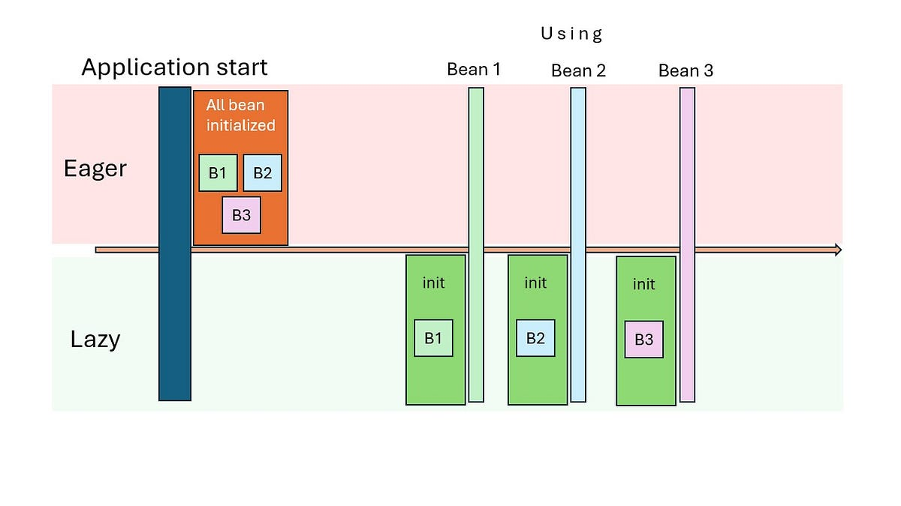

- **C.** Cơ chế đứng sau Lazy là **Proxy Object**: khi Hibernate trả về một Entity có trường Lazy, trường đó không chứa object thật, mà chứa một object giả do Hibernate tự sinh ra lúc chạy, trông giống hệt object thật nhưng bên trong rỗng, chỉ giữ lại giá trị khóa chính.
- **D.** Proxy Object chỉ thức dậy và tự động bắn một câu `SELECT` xuống database **đúng lần đầu tiên** có phương thức nào đó được gọi trên nó (ví dụ `tour.getLichTrinhs().size()`).
- **E.** Việc thức dậy này bắt buộc phải diễn ra trong khi **Hibernate Session** vẫn còn mở. Tức là còn trong phạm vi một `@Transactional`. Ra khỏi phạm vi đó, Proxy không còn cách nào tải dữ liệu, dẫn đến lỗi `LazyInitializationException`.

#### 2. Giải quyết bài toán gì?

- Nếu mọi quan hệ đều tải kiểu Eager, mỗi lần lấy một `Tour` để chỉ hiển thị tên, hệ thống vẫn phải tải kèm toàn bộ danh sách `LichTrinh` của tour đó dẫn đến dữ liệu không dùng đến nhưng vẫn tốn băng thông, bộ nhớ, thời gian truy vấn.

#### 3. Lưu ý & Best Practices

- Mặc định của JPA **khác nhau** theo loại quan hệ:

| Loại quan hệ  | Mặc định |
| ------------- | -------- |
| `@ManyToOne`  | `EAGER`  |
| `@OneToOne`   | `EAGER`  |
| `@OneToMany`  | `LAZY`   |
| `@ManyToMany` | `LAZY`   |

- Lỗi `LazyInitializationException` thường xảy ra khi Controller trả thẳng Entity ra ngoài, và Jackson cố đọc một trường Lazy **sau khi** transaction của Service đã đóng lại.
- Không nên đổi toàn bộ quan hệ sang `EAGER`. Cách này chỉ che giấu vấn đề và trực tiếp dẫn tới N + 1 query.
- Cách xử lý đúng khi cần dữ liệu Lazy ngoài phạm vi transaction không phải là đổi sang Eager, mà là chủ động yêu cầu tải sớm cho đúng truy vấn đó.

#### 4. Demo

Entity `Tour` sau khi bổ sung quan hệ đối tượng:

```java
package com.example.quanlytour.entity;

import jakarta.persistence.Column;
import jakarta.persistence.Entity;
import jakarta.persistence.FetchType;
import jakarta.persistence.GeneratedValue;
import jakarta.persistence.GenerationType;
import jakarta.persistence.Id;
import jakarta.persistence.OneToMany;
import jakarta.persistence.Table;
import java.util.List;
import lombok.Data;

@Entity
@Table(name = "tours")
@Data
public class Tour {

    @Id
    @GeneratedValue(strategy = GenerationType.IDENTITY)
    private Long id;

    @Column(name = "tour_name", nullable = false, length = 200)
    private String tourName;

    @Column(name = "departure_location", length = 100)
    private String departureLocation;

    @Column(name = "destination", length = 100)
    private String destination;

    @Column(name = "description", length = 1000)
    private String description;

    @OneToMany(mappedBy = "tour", fetch = FetchType.LAZY)
    private List<LichTrinh> lichTrinhs;

}
```

Entity `LichTrinh` sau khi đổi `Long maTour` thành quan hệ đối tượng:

```java
package com.example.quanlytour.entity;

import jakarta.persistence.Column;
import jakarta.persistence.Entity;
import jakarta.persistence.FetchType;
import jakarta.persistence.GeneratedValue;
import jakarta.persistence.GenerationType;
import jakarta.persistence.Id;
import jakarta.persistence.JoinColumn;
import jakarta.persistence.ManyToOne;
import jakarta.persistence.Table;
import java.time.LocalDate;
import lombok.Data;

@Entity
@Table(name = "lich_trinh")
@Data
public class LichTrinh {

    @Id
    @GeneratedValue(strategy = GenerationType.IDENTITY)
    private Long id;

    @ManyToOne(fetch = FetchType.LAZY)
    @JoinColumn(name = "ma_tour", nullable = false)
    private Tour tour;

    @Column(name = "ngay_xuat_phat", nullable = false)
    private LocalDate departureDate;

    @Column(name = "gia_co_ban", nullable = false)
    private Double basePrice;

    @Column(name = "so_cho_toi_da", nullable = false)
    private Integer totalSlots;

    @Column(name = "so_cho_da_dat")
    private Integer bookedSlots;

}
```

Giải thích:

- `@OneToMany(mappedBy = "tour", fetch = FetchType.LAZY)` trên `Tour`:
  - Khai báo một `Tour` có nhiều `LichTrinh`.
  - `mappedBy = "tour"` chỉ rõ phía `LichTrinh` mới là nơi thật sự giữ khóa ngoại (tên đúng bằng tên thuộc tính `tour` bên `LichTrinh`), còn `Tour` chỉ là phía "được tham chiếu tới".
- `@ManyToOne(fetch = FetchType.LAZY)` trên `LichTrinh`:
  - Khai báo nhiều `LichTrinh` cùng trỏ về một `Tour`.
  - Cố tình ghi rõ `FetchType.LAZY` để ghi đè mặc định `EAGER` của `@ManyToOne`.
- `@JoinColumn(name = "ma_tour", nullable = false)`:
  - Xác nhận cột khóa ngoại thật trong bảng `lich_trinh` tên là `ma_tour`.
- Từ nay, `lichTrinh.getTour().getTourName()` lấy được tên tour trực tiếp, không cần tự gọi `tourService.getTourById(lichTrinh.getMaTour())`.

Input/Output:

```java
@Transactional
public List<LichTrinh> getLichTrinhsInsideTransaction(Long tourId) {
    Tour tour = tourRepository.findById(tourId).orElseThrow();
    return tour.getLichTrinhs();
}
```

- Input: gọi phương thức trên khi đang còn `@Transactional` bao quanh.
- Output: trả về danh sách `LichTrinh` bình thường, vì `tour.getLichTrinhs()` được gọi **trong khi** Session còn mở.

```java
public List<LichTrinh> getLichTrinhsOutsideTransaction(Long tourId) {
    Tour tour = tourRepository.findById(tourId).orElseThrow();
    return tour.getLichTrinhs();
}
```

- Input: như trên nhưng phương thức này **không có** `@Transactional`.
- Output: ứng dụng ném `LazyInitializationException: could not initialize proxy - no Session`, vì tại thời điểm `getLichTrinhs()` được gọi, Session phục vụ cho `findById` đã đóng ngay sau khi phương thức Repository trả về.

### II. Pagination

#### 1. Bản chất kỹ thuật

- **A.** `Pageable` (`org.springframework.data.domain.Pageable`) là một interface mô tả "muốn trang số mấy, mỗi trang bao nhiêu dòng, sắp xếp theo gì".
- **B.** `PageRequest.of(page, size)` là cách tạo một `Pageable` cụ thể, trong đó `page` được đánh số **bắt đầu từ 0**.
- **C.** Khi một phương thức Repository nhận `Pageable` làm tham số, Spring Data JPA tự dịch nó thành hai mệnh đề SQL: `LIMIT size OFFSET (page * size)`.
- **D.** `JpaRepository` đã có sẵn `Page<T> findAll(Pageable pageable)`, không cần viết gì thêm để có phân trang cơ bản.
- **E.** Kiểu trả về `Page<T>` không chỉ chứa dữ liệu của trang hiện tại, mà còn kèm theo tổng số dòng, tổng số trang; những số liệu này đến từ một câu `SELECT COUNT(*)` chạy riêng, **thêm** vào câu `SELECT` dữ liệu chính.

#### 2. Giải quyết bài toán gì?

- Không có Pagination, một API trả toàn bộ bảng sẽ kéo theo: thời gian phản hồi tăng khi dữ liệu lớn dần, bộ nhớ Server phải giữ toàn bộ kết quả cùng lúc, và Client phải tải về một khối dữ liệu khổng lồ chỉ để hiển thị vài chục dòng đầu tiên trên màn hình.
- Pagination giới hạn chính xác lượng dữ liệu cần xử lý và truyền tải cho mỗi lần gọi, bất kể bảng có bao nhiêu dòng.

#### 3. Lưu ý & Best Practices:

- `page` đánh số từ 0, không phải từ 1 — `page = 0` là trang đầu tiên.
- Không nên để Client tự do truyền `size` tùy ý (ví dụ `size = 100000`) — nên giới hạn giá trị tối đa cho phép ở tầng Service.
- `Page<T>` chạy 2 câu truy vấn (dữ liệu và đếm tổng). Nếu không cần biết tổng số trang (chỉ cần nút "xem thêm"), có thể dùng `Slice<T>` để tiết kiệm câu đếm.

#### 4. Demo:

```java
public Page<Tour> getAllTours(int page, int size) {
    Pageable pageable = PageRequest.of(page, size);
    return tourRepository.findAll(pageable);
}
```

Giải thích:

- `PageRequest.of(page, size)` dựng một đối tượng `Pageable` từ hai số nguyên nhận vào.
- `tourRepository.findAll(pageable)`: gọi đúng phương thức có sẵn của `JpaRepository`, không cần khai báo gì thêm ở `TourRepository`.

Input: gọi `getAllTours(0, 2)` khi bảng `tours` có 5 dòng.

Output — câu lệnh SQL sinh ra trong Console:

```text
Hibernate: 
    select t1_0.id, t1_0.departure_location, t1_0.description, t1_0.destination, t1_0.tour_name 
    from tours t1_0 
    limit ? offset ?
Hibernate: 
    select count(t1_0.id) 
    from tours t1_0
```

Output: dữ liệu `Page<Tour>` trả về, chỉ gồm 2 trong 5 dòng, kèm metadata:

```json
{
    "content": [
        {"id": 1, "tourName": "Da Lat 3N2D"},
        {"id": 2, "tourName": "Sa Pa 2N1D"}
    ],
    "totalElements": 5,
    "totalPages": 3,
    "number": 0,
    "size": 2
}
```

### III. Caching


Giả sử trong một phương thức Service, `tourRepository.findById(5L)` được gọi hai lần liên tiếp; có thể do hai nhánh code khác nhau cùng cần đến dữ liệu tour đó. Trực giác thông thường sẽ nghĩ hệ thống bắn hai câu `SELECT` xuống database. Thực tế, Hibernate đã tự lo việc này từ trước, không cần cấu hình gì thêm.

#### 1. Bản chất kỹ thuật:

- **A.** Mỗi khi một transaction bắt đầu, Hibernate mở một **Persistence Context** (còn gọi là Session), đóng vai trò như một vùng nhớ tạm theo dõi mọi Entity đã được tải trong transaction đó.
- **B.** Vùng nhớ này chính là **First-level Cache**, hoạt động dạng một Map, khóa là cặp (loại Entity, giá trị khóa chính).
- **C.** Khi `findById(5L)` được gọi, Hibernate tra Map này trước. Nếu đã có sẵn Entity `Tour` ứng với `id = 5` (do đã tải ở một lời gọi trước đó trong cùng transaction), nó trả về **thẳng tham chiếu đó**, không thêm câu `SELECT`.
- **D.** First-level Cache được bật mặc định, không thể tắt, và chỉ tồn tại trong đúng phạm vi một transaction - transaction kết thúc, cache bị hủy theo.
- **E.** Khác với First-level Cache, **Second-level Cache** là một cơ chế riêng (không bật mặc định, cần thư viện ngoài như Ehcache).

#### 2. Giải quyết bài toán gì?

- Không có First-level Cache, mỗi lần gọi `findById` với cùng một `id`, dù trong cùng một luồng xử lý, cũng sẽ bắn thêm một câu `SELECT` dư thừa xuống database.
- Với một nghiệp vụ gọi đi gọi lại cùng một Entity ở nhiều bước xử lý khác nhau (ví dụ vừa kiểm tra tồn tại, vừa cập nhật), First-level Cache giúp giảm số lần truy vấn xuống database xuống mức tối thiểu một cách hoàn toàn tự động.

#### 3. Lưu ý & Best Practices:

- First-level Cache chỉ có hiệu lực **trong cùng một transaction**. Hai Request HTTP khác nhau luôn chạy trong hai transaction khác nhau, nên không bao giờ dùng chung cache này.
- Không nên nhầm lẫn First-level Cache với việc dữ liệu luôn mới - nếu một tiến trình khác thay đổi dữ liệu ở database ngay trong lúc transaction này đang chạy, Entity trong cache vẫn giữ giá trị cũ.
- Không cần tự viết code để bật tính năng này. Nó là một phần không thể tách rời của cách Hibernate Session hoạt động.

#### 4. Demo:

```java
@Transactional
public void demoFirstLevelCache(Long tourId) {
    Tour tourLanDau = tourRepository.findById(tourId).orElseThrow();
    Tour tourLanHai = tourRepository.findById(tourId).orElseThrow();
    boolean cungMotObject = (tourLanDau == tourLanHai);
}
```

Giải thích:

- **A.** Hai lời gọi `findById(tourId)` dùng chung một giá trị `tourId`, cùng nằm trong phạm vi của `@Transactional`.
- **B.** `tourLanDau == tourLanHai` so sánh **địa chỉ tham chiếu** , kết quả là `true`, vì Hibernate trả về đúng cùng một object đã nằm sẵn trong Persistence Context.

Input: gọi `demoFirstLevelCache(1L)`.
Console chỉ in **đúng một** câu lệnh SQL, dù trong code có hai lời gọi `findById`:

```text
Hibernate: 
    select t1_0.id, t1_0.departure_location, t1_0.description, t1_0.destination, t1_0.tour_name 
    from tours t1_0 
    where t1_0.id=?
```

### IV. Manual / Native query

#### 1. Bản chất kỹ thuật:

- **A.** Khi `nativeQuery = true`, Hibernate **không hề dịch** câu lệnh mà chuỗi SQL được gửi thẳng, nguyên văn, xuống trình điều khiển MySQL.
- **B.** Câu lệnh phải dùng đúng **tên bảng, tên cột vật lý** (ví dụ `tour_name`), không phải tên class hay tên thuộc tính Java như JPQL.
- **C.** Vì không qua lớp dịch của JPA, Native Query có thể dùng **mọi hàm, mọi cú pháp đặc thù của MySQL** mà JPQL hoàn toàn không hỗ trợ.
- **D.** Kết quả trả về được Hibernate cố gắng ánh xạ lại thành Entity nếu các cột `SELECT` khớp đủ với Entity; nếu chỉ lấy một phần cột hoặc dữ liệu đã tổng hợp (như `COUNT`, `GROUP BY`), kiểu trả về phải là `Object[]` hoặc một interface chiếu, không thể là Entity đầy đủ.

#### 2. Giải quyết bài toán gì?

- JPQL chỉ hiểu các phép toán, hàm được đặc tả chuẩn trong JPA chứ không có khái niệm về hàm xử lý ngày tháng đặc thù của MySQL, không có các chỉ thị tối ưu hóa dành riêng cho một engine cụ thể.
- Với các báo cáo cần nhóm dữ liệu theo tháng, định dạng chuỗi theo kiểu riêng của MySQL, hay các câu truy vấn đã được tối ưu sẵn bằng tay, JPQL không đủ biểu đạt. Đây chính là lúc cần Native Query.

#### 3. Lưu ý & Best Practices:

- Mất khả năng chuyển đổi cơ sở dữ liệu: câu lệnh viết cho MySQL có thể không chạy được nếu đổi sang PostgreSQL hay Oracle.
- Luôn dùng tham số có tên (`:tenThamSo` cùng `@Param`), **tuyệt đối không** tự nối chuỗi giá trị người dùng nhập vào ngay trong câu SQL. Đây là nguyên nhân dẫn đến lỗ hổng SQL Injection.
- Vì là một chuỗi văn bản thuần, lỗi cú pháp trong Native Query **chỉ lộ ra khi chạy thực tế**, không được kiểm tra trước ở thời điểm biên dịch.

#### 4. Demo:

```java
@Query(value = "SELECT DATE_FORMAT(ngay_xuat_phat, '%Y-%m') AS thang, COUNT(*) AS so_luong FROM lich_trinh GROUP BY DATE_FORMAT(ngay_xuat_phat, '%Y-%m')", nativeQuery = true)
List<Object[]> countSchedulesByMonth();
```

Giải thích:

- **A.** `DATE_FORMAT(ngay_xuat_phat, '%Y-%m')` là một hàm dùng để quy một ngày cụ thể về dạng "năm-tháng".
- **B.** `GROUP BY` kết hợp `COUNT(*)` tạo ra dữ liệu tổng hợp (thống kê số lịch trình theo từng tháng), không còn khớp với cấu trúc một `LichTrinh` đầy đủ.
- **C.** Vì kết quả không còn là một `LichTrinh` nguyên vẹn, kiểu trả về bắt buộc phải là `List<Object[]>` - mỗi phần tử `Object[]` ứng với một dòng kết quả, phần tử `[0]` là tháng, phần tử `[1]` là số lượng.

Input: gọi `countSchedulesByMonth()` khi bảng `lich_trinh` có các dòng vào tháng 3 và tháng 4 năm 2026.

Output:

```text
["2026-03", 2]
["2026-04", 1]
```

### V. Dynamic query

#### 1. Bản chất kỹ thuật:

- **A.** **Bài toán cốt lõi**: mỗi điều kiện lọc là **tùy chọn** - có thể có, có thể không, và không biết trước tổ hợp nào sẽ xảy ra.
- **B.** Kỹ thuật được khuyến nghị là **JPA Specification** (thông qua `JpaSpecificationExecutor<T>`) để xây dựng điều kiện `WHERE` bằng code Java tại thời điểm chạy, thay vì một chuỗi JPQL cố định viết sẵn.
- **C.** Với các trường hợp không quá phức tạp (vài điều kiện lọc), có một kỹ thuật gọn hơn, dùng ngay trong JPQL: mẫu `(:thamSo IS NULL OR cot = :thamSo)`.
- **D.** Cơ chế của mẫu trên: nếu `thamSo` được truyền vào là `null`, vế `:thamSo IS NULL` cho kết quả đúng, khiến toàn bộ điều kiện `OR` luôn đúng. Tức điều kiện lọc đó bị vô hiệu hóa.

#### 2. Giải quyết bài toán gì?

- Không có kỹ thuật này, mỗi tổ hợp điều kiện lọc sẽ cần một phương thức Repository riêng dẫn đến số lượng phương thức tăng theo cấp số nhân khi số điều kiện lọc tăng lên.
- Dynamic query cho phép **một** phương thức duy nhất xử lý được mọi tổ hợp điều kiện.

#### 3. Lưu ý & Best Practices:

- Mẫu `(:thamSo IS NULL OR ...)` dễ viết, dễ hiểu, phù hợp với số lượng điều kiện lọc nhỏ.
- JPA Specification mạnh hơn, type-safe hơn, nhưng đòi hỏi làm quen thêm với `CriteriaBuilder`, `Predicate`, `Root`.
- Luôn kiểm tra, làm sạch dữ liệu lọc nhận từ Client trước khi đưa vào truy vấn.

#### 4. Demo:

```java
@Query("SELECT t FROM Tour t WHERE (:tourName IS NULL OR t.tourName LIKE %:tourName%) AND (:destination IS NULL OR t.destination = :destination)")
List<Tour> searchTours(@Param("tourName") String tourName, @Param("destination") String destination);
```

Giải thích:

- **A.** Hai điều kiện được nối bằng `AND`, nhưng mỗi điều kiện tự nó lại là một cặp `OR` cho phép bỏ qua chính nó khi tham số tương ứng là `null`.
- **B.** `t.tourName LIKE %:tourName%` tìm theo tên tour có chứa chuỗi nhập vào.
- **C.** `t.destination = :destination` so khớp chính xác nơi đến.

Input 1: gọi `searchTours("Da Lat", null)`.

Output 1: chỉ lọc theo tên, điều kiện `destination` tự vô hiệu hóa:

```text
Hibernate: 
    ... where (? is null or t1_0.tour_name like ?) and (? is null or t1_0.destination=?)
```

Trả về mọi tour có tên chứa "Da Lat", bất kể nơi đến.

Input 2: gọi `searchTours(null, null)`.

Output 2: cả hai điều kiện cùng vô hiệu hóa, tương đương lấy toàn bộ danh sách tour.

### VI. Phòng tránh N + 1 query

Đây là lỗi hiệu năng phổ biến nhất trong các hệ thống dùng JPA, và là hệ quả trực tiếp của cơ chế Lazy. 
Ví dụ cụ thể: lấy danh sách 10 `Tour`, sau đó với mỗi `Tour`, đọc danh sách `LichTrinh` của nó để hiển thị.

#### 1. Bản chất kỹ thuật:

- **A.** Bước 1: gọi `tourRepository.findAll()` - sinh ra **1 câu** `SELECT` lấy 10 dòng `Tour`.
- **B.** Bước 2: lặp qua 10 `Tour` đó, với mỗi `Tour` gọi `tour.getLichTrinhs()` vì quan hệ này là `LAZY`, **mỗi lần gọi** trên một `Tour` khác nhau sẽ kích hoạt Proxy của chính `Tour` đó, bắn ra **1 câu** `SELECT` riêng.
- **C.** Tổng cộng: 1 câu lấy danh sách Tour, cộng thêm 10 câu lấy LichTrinh tương ứng từng Tour, đúng 11 câu, công thức tổng quát là **1 + N** câu lệnh cho N dòng dữ liệu cha.
- **D.** First-level Cache **không** giúp được ở đây, vì mỗi `Tour` có `id` khác nhau, không có Entity nào bị gọi lặp lại trùng khóa chính để cache phát huy tác dụng.

#### 2. Giải quyết bài toán gì?

- Với 10 Tour, 11 câu lệnh vẫn chạy được, chỉ chậm hơn bình thường một chút.
- Với 10.000 Tour trong một hệ thống thật, con số trở thành 10.001 lượt gọi xuống database, mỗi lượt gọi đều tốn thời gian do độ trễ mạng cộng dồn, dù bản thân mỗi câu truy vấn đơn lẻ rất nhanh.
- Số lượng kết nối là có hạn, hàng nghìn câu truy vấn dồn dập cùng lúc có thể khiến các Request khác phải xếp hàng chờ kết nối rảnh.

#### 3. Lưu ý & Best Practices

- Cách phát hiện: bật `show-sql=true`, nếu thấy **cùng một mẫu câu** `SELECT ... FROM lich_trinh WHERE ma_tour=?` lặp lại nhiều lần liên tiếp với giá trị `?` khác nhau ngay sau một `findAll()`, đó chính là dấu hiệu của N + 1.
- Cần chủ động yêu cầu Hibernate tải sẵn dữ liệu liên quan trong **cùng một** câu truy vấn, ngay tại truy vấn cần đến nó.

#### 4. Demo Thực chiến:

```java
public void printAllToursWithSchedules() {
    List<Tour> tours = tourRepository.findAll();
    for (Tour tour : tours) {
        tour.getLichTrinhs().size();
    }
}
```

Giải thích:

- **A.** `tourRepository.findAll()`: đúng 1 câu truy vấn, lấy toàn bộ `Tour`.
- **B.** Vòng lặp `for` chạy qua từng `Tour`. `tour.getLichTrinhs().size()` chỉ nhằm mục đích chạm vào Proxy để minh họa, buộc nó phải tải dữ liệu thật.
- **C.** Vì `lichTrinhs` là `LAZY`, mỗi lần chạm vào một `Tour` khác nhau trong vòng lặp kích hoạt một câu `SELECT` độc lập cho đúng `Tour` đó.

Input: gọi `printAllToursWithSchedules()` khi bảng `tours` có 3 dòng.

Output: Console in ra đúng mẫu "1 + N", ở đây là 1 + 3 = 4 câu:

```text
Hibernate: select t1_0.id, ... from tours t1_0
Hibernate: select l1_0.ma_tour, ... from lich_trinh l1_0 where l1_0.ma_tour=?
Hibernate: select l1_0.ma_tour, ... from lich_trinh l1_0 where l1_0.ma_tour=?
Hibernate: select l1_0.ma_tour, ... from lich_trinh l1_0 where l1_0.ma_tour=?
```

---

## Phần 2: Tìm hiểu về Validation

### I. Cơ chế Validation trong Spring Boot

Entity `Tour` hiện tại không có bất kỳ ràng buộc nào ở tầng Java: Client hoàn toàn có thể gửi lên một `tourName` rỗng, và `createTour` ở Service vẫn lưu xuống database. Vấn đề chỉ lộ ra khi dữ liệu rác đã nằm sẵn trong bảng.

#### 1. Bản chất kỹ thuật:

- **A.** Cơ chế Validation của Spring Boot dựa trên chuẩn **Bean Validation** (đặc tả JSR 380), được hiện thực bởi thư viện **Hibernate Validator**.
- **B.** Các ràng buộc được khai báo bằng annotation ngay trên thuộc tính của Entity hoặc DTO: `@NotNull`, `@NotBlank`, `@Size`, `@Min`, `@Max`...
- **C.** `@Valid` đặt trước tham số nhận dữ liệu ở Controller (ví dụ `@Valid @RequestBody Tour tour`) là nơi **kích hoạt** việc kiểm tra thiếu `@Valid`, mọi annotation ràng buộc phía trên hoàn toàn bị bỏ qua, không có tác dụng gì.
- **D.** Việc kiểm tra diễn ra **trước khi** thân phương thức Controller được thực thi, ngay tại bước Spring chuẩn bị tham số cho phương thức.
- **E.** Nếu phát hiện vi phạm, Spring tự động ném `MethodArgumentNotValidException`, phương thức Controller **không bao giờ được gọi tới**.

#### 2. Giải quyết bài toán gì?

- Không có Validation khai báo, Service hoặc Controller phải tự viết hàng loạt câu lệnh `if` kiểm tra thủ công cho từng trường dữ liệu, dễ thiếu sót, dễ trùng lặp logic ở nhiều nơi khác nhau khi cùng một Entity được dùng ở nhiều API.
- Validation gom toàn bộ quy tắc ràng buộc vào đúng một nơi ngay trên định nghĩa dữ liệu giúp quy tắc luôn nhất quán dù được gọi từ API nào.

#### 3. Lưu ý & Best Practices:

- Spring Boot 3 đã **tách riêng** Validation ra khỏi `spring-boot-starter-web` bắt buộc phải khai báo thêm dependency `spring-boot-starter-validation` trong `pom.xml`, nếu không mọi annotation `@NotBlank`... sẽ không hoạt động, dù có `@Valid` hay không.
- Phân biệt dễ nhầm giữa ba annotation kiểm tra chuỗi rỗng:

| Annotation  | Chặn `null` | Chặn chuỗi rỗng `""` | Chặn chuỗi chỉ có khoảng trắng `"   "` |
| ----------- | ----------- | -------------------- | -------------------------------------- |
| `@NotNull`  | Có          | Không                | Không                                  |
| `@NotEmpty` | Có          | Có                   | Không                                  |
| `@NotBlank` | Có          | Có                   | Có                                     |

- Ràng buộc `nullable = false` trên `@Column` vẫn nên giữ song song với `@NotBlank` - `@Column` là lớp bảo vệ cuối cùng ở chính database, còn Validation là lớp bảo vệ sớm, phản hồi lỗi thân thiện ngay tại tầng ứng dụng, trước khi kịp chạm tới database.

#### 4. Demo:

Thêm dependency trong `pom.xml`:

```xml
<dependency>
    <groupId>org.springframework.boot</groupId>
    <artifactId>spring-boot-starter-validation</artifactId>
</dependency>
```

Entity `Tour` bổ sung ràng buộc:

```java
package com.example.quanlytour.entity;

import jakarta.persistence.Column;
import jakarta.persistence.Entity;
import jakarta.persistence.GeneratedValue;
import jakarta.persistence.GenerationType;
import jakarta.persistence.Id;
import jakarta.persistence.Table;
import jakarta.validation.constraints.NotBlank;
import lombok.Data;

@Entity
@Table(name = "tours")
@Data
public class Tour {

    @Id
    @GeneratedValue(strategy = GenerationType.IDENTITY)
    private Long id;

    @NotBlank(message = "Ten tour khong duoc de trong")
    @Column(name = "tour_name", nullable = false, length = 200)
    private String tourName;

    @Column(name = "departure_location", length = 100)
    private String departureLocation;

    @Column(name = "destination", length = 100)
    private String destination;

    @Column(name = "description", length = 1000)
    private String description;

}
```

Controller bổ sung `@Valid`:

```java
@PostMapping
public Tour createTour(@Valid @RequestBody Tour tour) {
    return tourService.createTour(tour);
}
```

Giải thích:

- **A.** `@NotBlank(message = "...")` gắn trực tiếp lên `tourName`: nếu giá trị là `null`, rỗng, hoặc chỉ có khoảng trắng, ràng buộc này bị vi phạm. `message` là nội dung sẽ xuất hiện trong lỗi trả về.
- **B.** `@Valid` trên tham số `tour` của `createTour`: ra lệnh cho Spring kiểm tra toàn bộ ràng buộc khai báo trên object `tour` **trước khi** dòng `return tourService.createTour(tour);` có cơ hội chạy.

Input: Postman gửi `POST /api/tours` với Body:

```json
{
    "tourName": "",
    "destination": "Da Lat"
}
```

Output: mã trạng thái `400 Bad Request`.

---

## Phần 3: Tìm hiểu về Exception Handling

### I. Kiến trúc xử lý lỗi tập trung

#### 1. Bản chất kỹ thuật:

- **A.** `@RestControllerAdvice` (kết hợp `@ControllerAdvice` và `@ResponseBody`) đánh dấu một class đóng vai trò **lưới lọc toàn cục**, đứng chắn phía ngoài mọi `@RestController` trong ứng dụng.
- **B.** Bên trong class đó, mỗi phương thức đánh dấu `@ExceptionHandler(LoaiException.class)` là một trạm xử lý dành riêng cho đúng một loại Exception.
- **C.** Khi bất kỳ Controller nào ném ra một Exception khớp loại đã đăng ký, Spring **tự động chuyển hướng** luồng xử lý sang đúng phương thức `@ExceptionHandler` tương ứng, thay vì để Exception rơi thẳng xuống Tomcat.
- **D.** Cơ chế đứng sau là cùng một nguyên lý bọc proxy: Spring chạy mọi phương thức Controller bên trong một lớp bọc có khả năng bắt Exception và định tuyến nó.

#### 2. Giải quyết bài toán gì?

- Không có lưới lọc tập trung, mỗi phương thức Controller phải tự viết `try-catch` riêng, lặp lại cùng một đoạn code định dạng JSON lỗi ở hàng chục nơi khác nhau.
- Tệ hơn, bất kỳ Exception nào bị bỏ sót không bắt sẽ lộ thẳng ra ngoài dưới dạng trang lỗi mặc định của Spring, định dạng không thống nhất với các lỗi khác, đôi khi kèm theo thông tin nội bộ không nên công khai cho Client.
- `@RestControllerAdvice` giải quyết cả hai vấn đề: một nơi duy nhất định nghĩa toàn bộ cách xử lý lỗi, áp dụng tự động cho mọi Controller.

#### 3. Lưu ý & Best Practices:

- Khi một Exception khớp nhiều `@ExceptionHandler` (do quan hệ kế thừa giữa các lớp Exception), Spring luôn ưu tiên phương thức khai báo **loại cụ thể nhất**.
- Luôn có một `@ExceptionHandler(Exception.class)` làm lưới bắt cuối cùng đảm bảo tuyệt đối không có Exception nào lọt ra ngoài dưới dạng lỗi mặc định của Spring.
- Trả đúng mã trạng thái HTTP theo từng loại lỗi (`400` cho dữ liệu sai, `404` cho không tìm thấy, `500` cho lỗi không lường trước), không nên trả `200 OK` kèm một object lỗi, và cũng không nên trả tất cả về `500`.
- Giữ cấu trúc JSON trả về **thống nhất** giữa mọi `@ExceptionHandler` (cùng tên trường `status`, `message`), để code phía Client xử lý lỗi được đơn giản, nhất quán.

#### 4. Demo:

```java
package com.example.quanlytour.exception;

import java.util.HashMap;
import java.util.Map;
import org.springframework.http.HttpStatus;
import org.springframework.http.ResponseEntity;
import org.springframework.web.bind.MethodArgumentNotValidException;
import org.springframework.web.bind.annotation.ExceptionHandler;
import org.springframework.web.bind.annotation.RestControllerAdvice;

@RestControllerAdvice
public class GlobalExceptionHandler {

    @ExceptionHandler(MethodArgumentNotValidException.class)
    public ResponseEntity<Map<String, Object>> handleValidationException(MethodArgumentNotValidException exception) {
        String message = exception.getBindingResult().getFieldErrors().get(0).getDefaultMessage();
        Map<String, Object> body = new HashMap<>();
        body.put("status", HttpStatus.BAD_REQUEST.value());
        body.put("message", message);
        return new ResponseEntity<>(body, HttpStatus.BAD_REQUEST);
    }

    @ExceptionHandler(IllegalArgumentException.class)
    public ResponseEntity<Map<String, Object>> handleIllegalArgumentException(IllegalArgumentException exception) {
        Map<String, Object> body = new HashMap<>();
        body.put("status", HttpStatus.NOT_FOUND.value());
        body.put("message", exception.getMessage());
        return new ResponseEntity<>(body, HttpStatus.NOT_FOUND);
    }

    @ExceptionHandler(Exception.class)
    public ResponseEntity<Map<String, Object>> handleGeneralException(Exception exception) {
        Map<String, Object> body = new HashMap<>();
        body.put("status", HttpStatus.INTERNAL_SERVER_ERROR.value());
        body.put("message", exception.getMessage());
        return new ResponseEntity<>(body, HttpStatus.INTERNAL_SERVER_ERROR);
    }

}
```

Giải thích:

- **A.** `handleValidationException` bắt đúng `MethodArgumentNotValidException` — loại Exception được Spring tự ném ra khi `@Valid` phát hiện vi phạm. `exception.getBindingResult().getFieldErrors().get(0).getDefaultMessage()` lấy ra đúng nội dung `message` đã khai báo trong `@NotBlank`.
- **B.** `handleIllegalArgumentException` bắt đúng loại Exception mà `getTourById` đã ném khi không tìm thấy tour, trả về mã `404` thay vì mã `500` mặc định trước đây.
- **C.** `handleGeneralException` là lưới bắt cuối cùng, dành cho mọi Exception không khớp hai phương thức phía trên.
- **D.** Cả ba phương thức đều trả về cùng cấu trúc `Map` với hai khóa `status` và `message`, đảm bảo định dạng JSON lỗi thống nhất.

---

## Phần 4: Override default fetch plan với JOIN FETCH / Entity Graph

### I. Sử dụng JOIN FETCH trong JPQL

#### 1. Bản chất kỹ thuật:

- **A.** `JOIN` thường trong JPQL (không có `FETCH`) chỉ dùng để **lọc điều kiện**, nó không ép Hibernate tải sẵn dữ liệu của bảng được nối, các trường Lazy liên quan vẫn là Proxy rỗng.
- **B.** `JOIN FETCH` bổ sung thêm chỉ thị: tải luôn cả dữ liệu thật của bảng được nối, gộp chung vào **cùng một** câu `SELECT`.
- **C.** Kết quả là chỉ **một** câu lệnh SQL duy nhất, có `JOIN` thật sự, trả về đủ cột của cả hai bảng trong cùng một lượt gọi xuống database.
- **D.** Cách viết này chỉ ghi đè kiểu tải dữ liệu cho **đúng một câu truy vấn cụ thể**, không làm thay đổi `FetchType` mặc định đã khai báo trên Entity.

#### 2. Giải quyết bài toán gì?

- Thay vì 1 câu lấy `Tour` cộng thêm N câu lấy `LichTrinh` tương ứng từng `Tour`, `JOIN FETCH` gộp tất cả thành đúng 1 câu lệnh giải quyết triệt để N + 1 cho đúng trường hợp cần dữ liệu liên quan ngay lập tức.

#### 3. Lưu ý & Best Practices:

- Kết hợp `JOIN FETCH` trên một quan hệ dạng danh sách (`to-many`) cùng lúc với `Pageable` là một tổ hợp **có vấn đề đã biết**: Hibernate không thể áp dụng đúng `LIMIT`/`OFFSET` trên kết quả đã bị nhân bản dòng do `JOIN`, nên tránh dùng chung hai kỹ thuật này trên cùng một truy vấn.
- Với quan hệ `to-many`, kết quả SQL thô sẽ có **nhiều dòng trùng lặp phía bảng cha** (một dòng cho mỗi bản ghi con), Hibernate tự loại trùng khi ánh xạ lại thành danh sách Entity, không cần tự xử lý tay.
- Chỉ nên `JOIN FETCH` đúng những quan hệ thật sự cần dùng ngay ở truy vấn đó.

#### 4. Demo:

```java
@Query("SELECT t FROM Tour t JOIN FETCH t.lichTrinhs WHERE t.id = :id")
Tour findTourWithSchedules(@Param("id") Long id);
```

Giải thích:

- **A.** `JOIN FETCH t.lichTrinhs`: nối sang quan hệ `lichTrinhs` của `Tour`, đồng thời ép tải dữ liệu thật của nó ngay trong câu lệnh này.
- **B.** `WHERE t.id = :id` vẫn hoạt động như một điều kiện JPQL bình thường, lọc đúng một `Tour`.

Input: gọi `findTourWithSchedules(1L)`, tour này có 2 `LichTrinh`.

Output: đúng **một** câu SQL duy nhất:

```text
Hibernate: 
    select t1_0.id, t1_0.tour_name, l1_0.ma_tour, l1_0.id, l1_0.gia_co_ban, l1_0.ngay_xuat_phat 
    from tours t1_0 
    join lich_trinh l1_0 on t1_0.id=l1_0.ma_tour 
    where t1_0.id=?
```

### II. Sử dụng @EntityGraph

`JOIN FETCH` đòi hỏi tự viết một câu JPQL hoàn chỉnh. `@EntityGraph` là cách đạt được cùng mục tiêu mà không cần viết JPQL, áp dụng trực tiếp lên các phương thức Repository, kể cả những phương thức đã có sẵn từ `JpaRepository`.

#### 1. Bản chất kỹ thuật:

- **A.** `@EntityGraph(attributePaths = {"tenThuocTinh"})` đặt trên một phương thức Repository, khai báo thuộc tính Lazy nào cần được tải Eager **chỉ riêng cho lần gọi phương thức đó**.
- **B.** Có thể dùng để ghi đè ngay cả phương thức đã được `JpaRepository` cung cấp sẵn (`findAll`, `findById`), bằng cách khai báo lại chữ ký phương thức đó trong interface Repository.
- **C.** Về bản chất thực thi, Spring Data JPA chuyển `attributePaths` thành một gợi ý cho Hibernate, và Hibernate dịch gợi ý đó thành một câu SQL có `JOIN` cùng một kết quả cuối cùng như `JOIN FETCH`, chỉ khác cách khai báo.

#### 2. Giải quyết bài toán gì?

- Với các trường hợp chỉ cần tải Eager thêm một quan hệ cho đúng một truy vấn, không có điều kiện lọc phức tạp nào khác, `@EntityGraph` ngắn gọn hơn hẳn so với việc viết lại nguyên một câu JPQL chỉ để thêm `JOIN FETCH`.

#### 3. Lưu ý & Best Practices:

- Có thể khai báo nhiều thuộc tính cùng lúc, cách nhau bằng dấu phẩy trong `attributePaths`, để tải Eager nhiều quan hệ trong một lần.
- Phù hợp nhất cho các trường hợp đơn giản: tải kèm quan hệ cho `findAll()`/`findById()`. Khi cần thêm điều kiện lọc phức tạp đi kèm, `JOIN FETCH` vẫn là lựa chọn linh hoạt hơn.

#### 4. Demo:

```java
@EntityGraph(attributePaths = {"lichTrinhs"})
List<Tour> findAll();
```

Giải thích:

- **A.** Khai báo lại `findAll()` vốn đã có sẵn từ `JpaRepository` ngay trong `TourRepository`, kèm `@EntityGraph`.
- **B.** Từ thời điểm này, mọi lời gọi `tourRepository.findAll()` trong toàn bộ ứng dụng sẽ tự động tải kèm `lichTrinhs`, không cần sửa bất kỳ nơi nào khác đang gọi `findAll()`.

Input: gọi `tourRepository.findAll()` khi có 3 `Tour`, mỗi `Tour` có từ 1 đến 2 `LichTrinh`.

Output: một câu SQL duy nhất có `JOIN`, thay vì 1 + 3 = 4 câu như minh họa N + 1:

```text
Hibernate: 
    select t1_0.id, t1_0.tour_name, l1_0.ma_tour, l1_0.id, l1_0.gia_co_ban 
    from tours t1_0 
    left join lich_trinh l1_0 on t1_0.id=l1_0.ma_tour
```

---

## Phần 5: Bài tập chuẩn bị 

### I. Yêu cầu 1 (Áp dụng Pagination)

**Mục tiêu:** `GET /api/tours` hỗ trợ phân trang qua `page` và `size`.

- **A.** Mở `TourService.java`, sửa phương thức `getAllTours`:

```java
public Page<Tour> getAllTours(int page, int size) {
    Pageable pageable = PageRequest.of(page, size);
    return tourRepository.findAll(pageable);
}
```

- **B.** Thêm hai dòng `import` cần thiết ở đầu `TourService.java`:

```java
import org.springframework.data.domain.Page;
import org.springframework.data.domain.PageRequest;
import org.springframework.data.domain.Pageable;
```

- **C.** Mở `TourController.java`, sửa phương thức `getAllTours`:

```java
@GetMapping
public Page<Tour> getAllTours(@RequestParam(defaultValue = "0") int page, @RequestParam(defaultValue = "5") int size) {
    return tourService.getAllTours(page, size);
}
```

- **D.** Giải thích: `@RequestParam(defaultValue = "0")` nghĩa là nếu Client không truyền `page`, mặc định lấy trang đầu tiên (`0`). Tương tự, không truyền `size` thì mặc định mỗi trang 5 dòng.
- **E.** Lưu lại cả hai file, dừng ứng dụng (nút Stop) rồi chạy lại (nút tam giác xanh), vì code vừa thay đổi.

**Kiểm thử trên Postman:**

- **A.** Tạo Request mới, Method `GET`, địa chỉ: `http://localhost:8080/api/tours?page=0&size=5`.
- **B.** Không cần vào tab Body — đây là `GET`.
- **C.** Bấm **Send**.

**Output**  JSON trả về không còn là một mảng đơn thuần, mà là một object chứa cả dữ liệu lẫn thông tin phân trang:

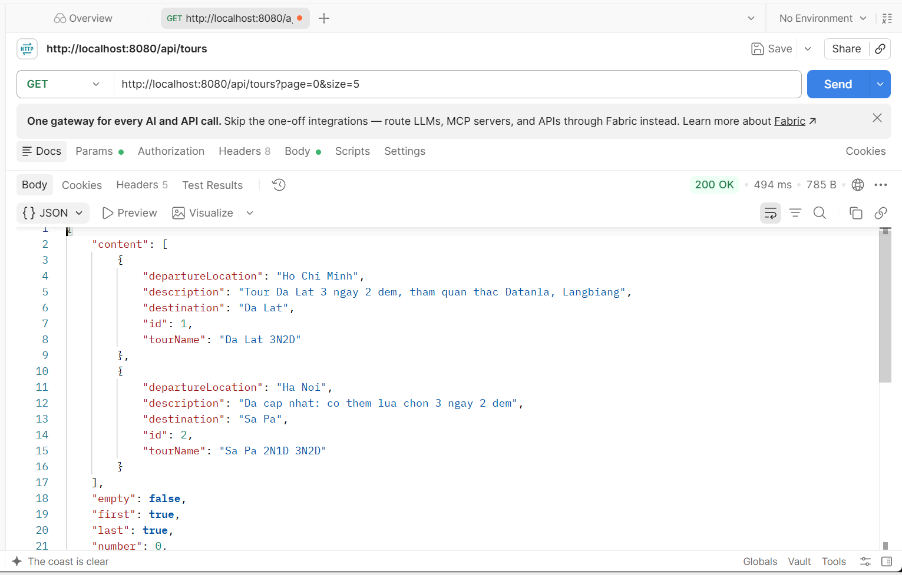
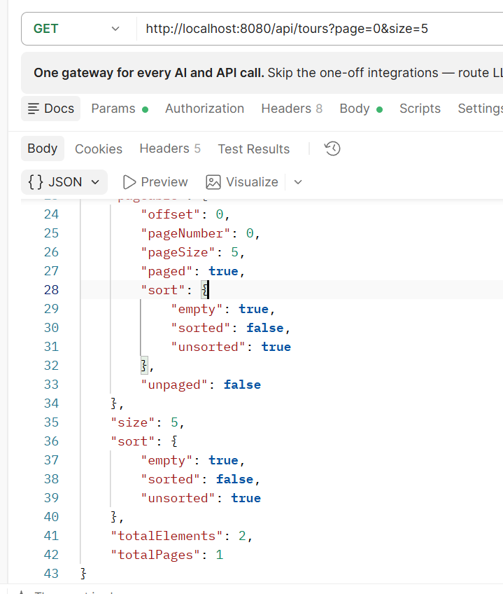

- `content`: danh sách tour của đúng trang hiện tại.
- `totalElements`: tổng số tour trong toàn bộ bảng, không chỉ trang hiện tại.
- `totalPages`: tổng số trang, tính từ `totalElements` chia cho `size`.
- `number`: số thứ tự trang hiện tại (bắt đầu từ `0`).
- `first`, `last`: cho biết trang hiện tại có phải trang đầu/trang cuối hay không.

### II. Yêu cầu 2 (Áp dụng Validation)

**Mục tiêu:** tên tour bắt buộc có khi tạo `Tour`; giá cơ bản bắt buộc lớn hơn 0 khi tạo `LichTrinh`.

- Mở `Tour.java`:

```java
@NotBlank(message = "Ten tour khong duoc de trong")
@Column(name = "tour_name", nullable = false, length = 200)
private String tourName;
```

- Mở `LichTrinh.java`:

```java
@NotNull(message = "Gia co ban khong duoc de trong")
@Positive(message = "Gia co ban phai lon hon 0")
@Column(name = "gia_co_ban", nullable = false)
private Double basePrice;
```

- Giải thích: `@Positive` chặn mọi giá trị nhỏ hơn hoặc bằng `0`, đúng yêu cầu "giá phải > 0". Dùng chung với `@NotNull` vì bản thân `@Positive` không chặn được giá trị `null`.

- Mở `TourController.java`:

```java
@PostMapping
public Tour createTour(@Valid @RequestBody Tour tour) {
    return tourService.createTour(tour);
}
```

- Mở `LichTrinhController.java`:

```java
@PostMapping
public LichTrinh createLichTrinh(@Valid @RequestBody LichTrinh lichTrinh) {
    return lichTrinhService.createLichTrinh(lichTrinh);
}
```

**Kiểm thử trên Postman**

- **A.** Request mới, Method `POST`, địa chỉ `http://localhost:8080/api/tours`.
- **B.** Tab **Body**, chọn **raw**, chọn **JSON**, dán:

```json
{
    "tourName": "",
    "destination": "Da Lat"
}
```

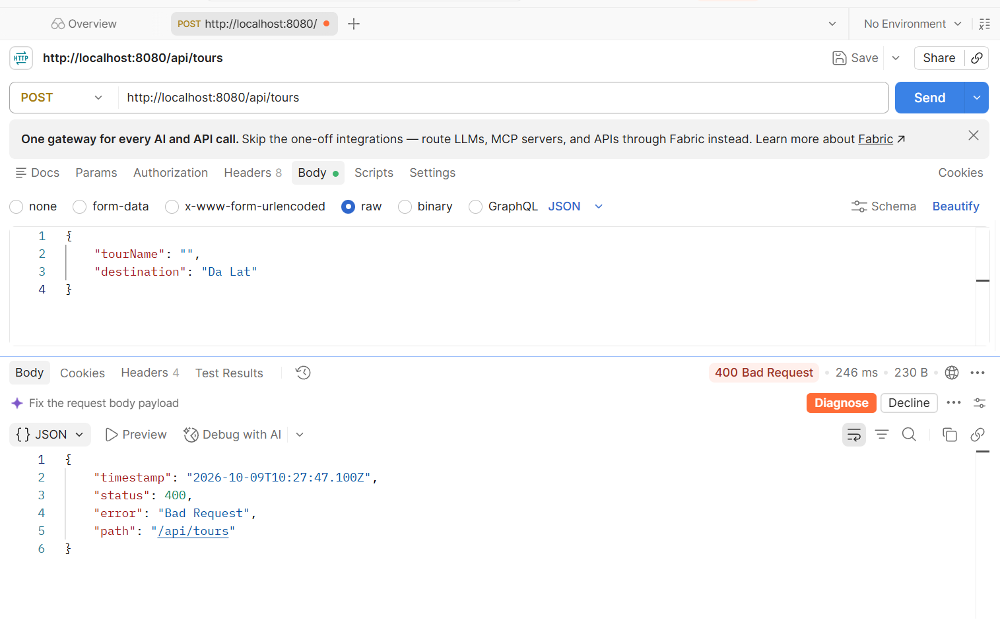

**Kiểm thử trường hợp giá không hợp lệ:**

- **A.** Request mới, Method `POST`, địa chỉ `http://localhost:8080/api/lich-trinh`.
- **B.** Body:

```json
{
    "maTour": 1,
    "departureDate": "2026-06-10",
    "basePrice": -500000,
    "totalSlots": 10,
    "bookedSlots": 0
}
```

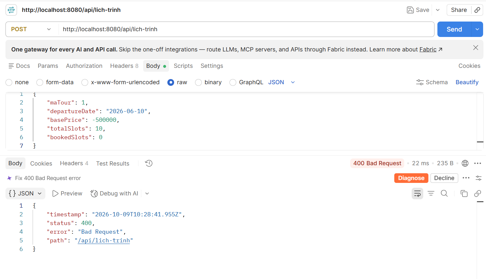

**Output:** `400 Bad Request`, vi phạm ràng buộc `@Positive` trên `basePrice`.

### III. Yêu cầu 3 (Áp dụng Exception Handling)

**Mục tiêu:** chuẩn hóa toàn bộ lỗi ở Yêu cầu 2 về đúng định dạng `{"status": 400, "message": "..."}`.

```java
package com.example.quanlytour.exception;

import java.util.HashMap;
import java.util.Map;
import org.springframework.http.HttpStatus;
import org.springframework.http.ResponseEntity;
import org.springframework.web.bind.MethodArgumentNotValidException;
import org.springframework.web.bind.annotation.ExceptionHandler;
import org.springframework.web.bind.annotation.RestControllerAdvice;

@RestControllerAdvice
public class GlobalExceptionHandler {

    @ExceptionHandler(MethodArgumentNotValidException.class)
    public ResponseEntity<Map<String, Object>> handleValidationException(MethodArgumentNotValidException exception) {
        String message = exception.getBindingResult().getFieldErrors().get(0).getDefaultMessage();
        Map<String, Object> body = new HashMap<>();
        body.put("status", HttpStatus.BAD_REQUEST.value());
        body.put("message", message);
        return new ResponseEntity<>(body, HttpStatus.BAD_REQUEST);
    }

    @ExceptionHandler(IllegalArgumentException.class)
    public ResponseEntity<Map<String, Object>> handleIllegalArgumentException(IllegalArgumentException exception) {
        Map<String, Object> body = new HashMap<>();
        body.put("status", HttpStatus.NOT_FOUND.value());
        body.put("message", exception.getMessage());
        return new ResponseEntity<>(body, HttpStatus.NOT_FOUND);
    }

    @ExceptionHandler(IllegalStateException.class)
    public ResponseEntity<Map<String, Object>> handleIllegalStateException(IllegalStateException exception) {
        Map<String, Object> body = new HashMap<>();
        body.put("status", HttpStatus.BAD_REQUEST.value());
        body.put("message", exception.getMessage());
        return new ResponseEntity<>(body, HttpStatus.BAD_REQUEST);
    }

    @ExceptionHandler(Exception.class)
    public ResponseEntity<Map<String, Object>> handleGeneralException(Exception exception) {
        Map<String, Object> body = new HashMap<>();
        body.put("status", HttpStatus.INTERNAL_SERVER_ERROR.value());
        body.put("message", exception.getMessage());
        return new ResponseEntity<>(body, HttpStatus.INTERNAL_SERVER_ERROR);
    }

}
```

- Giải thích: có thêm `handleIllegalStateException`, dùng để bắt đúng lỗi "không đủ chỗ trống" mà `bookSlots` đã khai báo bằng `IllegalStateException`, trả về `400` thay vì rơi vào lưới bắt chung `500`.
- File này **không cần** khai báo ở bất kỳ đâu khác. `@RestControllerAdvice` tự khiến Spring nhận diện và áp dụng cho toàn bộ Controller ngay khi ứng dụng khởi động, nhờ cơ chế quét Component.
- Lưu file, Stop rồi Run lại ứng dụng.

---

## Phần 6: Các mối quan hệ trong JPA

### I. Quan hệ One-To-Many và Many-To-One (1..N)

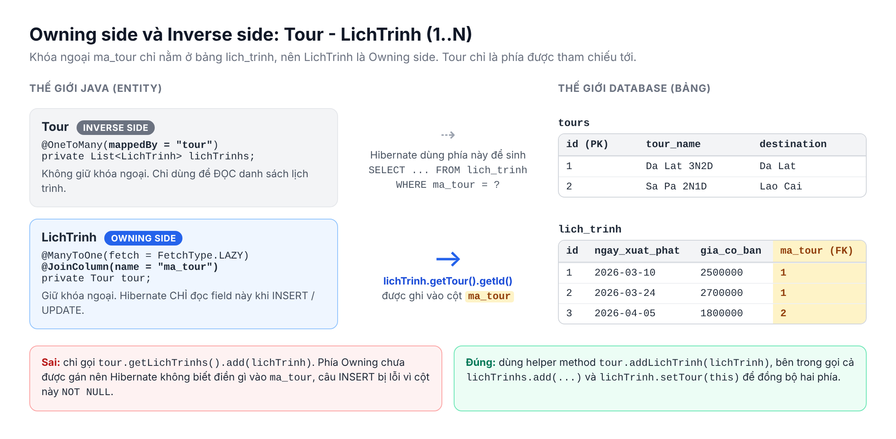

#### 1. Bản chất kỹ thuật:

- **A.** Ở tầng database, quan hệ 1-N chỉ có **một** cột khóa ngoại duy nhất: cột `ma_tour` nằm ở bảng phía N (`lich_trinh`). Bảng `tours` hoàn toàn không có cột nào trỏ sang `lich_trinh`.
- **B.** **Owning side** (phía sở hữu quan hệ) là Entity giữ cột khóa ngoại, ở đây là `LichTrinh`, khai báo bằng `@ManyToOne` kết hợp `@JoinColumn`.
  - Hibernate **chỉ đọc phía này** để quyết định giá trị ghi vào cột `ma_tour` khi `INSERT` hoặc `UPDATE`.
- **C.** **Inverse side** (phía bị tham chiếu) là `Tour`, khai báo bằng `@OneToMany(mappedBy = "tour")`.
  - Hibernate bỏ qua phía này khi ghi dữ liệu, chỉ dùng nó để **đọc** danh sách `LichTrinh` của một `Tour`.
- **D.** Giá trị trong `mappedBy` là **tên thuộc tính Java** bên `LichTrinh` (`tour`), không phải tên cột (`ma_tour`).
- **E.** Nếu quên `mappedBy`, Hibernate hiểu `@OneToMany` và `@ManyToOne` là hai quan hệ độc lập, tự sinh thêm một bảng trung gian `tours_lich_trinhs` không cần thiết.

#### 2. Giải quyết bài toán gì?

- Không có ánh xạ quan hệ, Entity chỉ giữ một con số `Long maTour`. Muốn lấy tên tour phải tự gọi thêm `tourService.getTourById(lichTrinh.getMaTour())`, và tự viết câu truy vấn mỗi khi cần danh sách lịch trình của một tour. 
- Ánh xạ quan hệ cho phép đi lại giữa các object bằng getter: `lichTrinh.getTour().getTourName()` hoặc `tour.getLichTrinhs()`, Hibernate tự sinh câu SQL tương ứng.
- Phân biệt rõ Owning side giúp tránh hai lỗi: tạo bảng thừa (thiếu `mappedBy`) và lưu thiếu khóa ngoại (chỉ cập nhật phía Inverse).

#### 3. Lưu ý & Best Practices:

- **Luôn đồng bộ cả hai phía bằng helper method.** Nếu chỉ gọi `tour.getLichTrinhs().add(lichTrinh)`, phía Owning chưa được gán `tour`, câu `INSERT` gửi `ma_tour = null` và MySQL báo lỗi `Column 'ma_tour' cannot be null`.
- **Không dùng `@Data` của Lombok cho Entity có quan hệ hai chiều.** `@Data` sinh `toString()` và `hashCode()` gọi qua lại `Tour -> lichTrinhs -> tour -> lichTrinhs...` cho đến khi `StackOverflowError`. Thay bằng `@Getter` và `@Setter`.
- **Cẩn thận khi trả Entity hai chiều ra JSON.** Jackson cũng đi vòng `Tour -> lichTrinhs -> tour...` vô hạn. Cách nhanh: đặt `@JsonIgnore` lên phía Collection. Cách chuẩn: trả về DTO (Data tranfer object).
- **Chọn `cascade` theo đúng nghiệp vụ:**

| Giá trị                | Ý nghĩa                                            | Khi nào dùng                                         |
| ---------------------- | -------------------------------------------------- | ---------------------------------------------------- |
| `CascadeType.PERSIST`  | Lưu cha thì lưu luôn các con mới                   | Tạo `Tour` kèm sẵn vài `LichTrinh` trong một lần lưu |
| `CascadeType.MERGE`    | Cập nhật cha thì cập nhật luôn các con             | Sửa `Tour` và danh sách con từ cùng một form         |
| `CascadeType.REMOVE`   | Xóa cha thì xóa luôn các con                       | Chỉ khi con không thể tồn tại nếu thiếu cha          |
| `CascadeType.ALL`      | Gồm tất cả các loại trên                           | Hạn chế dùng nếu chưa hiểu rõ hệ quả                 |
| `orphanRemoval = true` | Con bị gỡ khỏi Collection thì tự sinh câu `DELETE` | Quan hệ "sở hữu" tuyệt đối                           |

- Với dự án Tour, **không** dùng `REMOVE` cho `lichTrinhs`: một `LichTrinh` đã có `HoaDon` thì không được xóa theo `Tour`, nếu không sẽ mất chứng từ hoặc vi phạm khóa ngoại.

#### 4. Demo:

Entity `Tour` sau khi chỉnh lại theo các Best Practices trên:

```java
package com.example.quanlytour.entity;

import com.fasterxml.jackson.annotation.JsonIgnore;
import jakarta.persistence.CascadeType;
import jakarta.persistence.Column;
import jakarta.persistence.Entity;
import jakarta.persistence.FetchType;
import jakarta.persistence.GeneratedValue;
import jakarta.persistence.GenerationType;
import jakarta.persistence.Id;
import jakarta.persistence.OneToMany;
import jakarta.persistence.Table;
import jakarta.validation.constraints.NotBlank;
import java.util.ArrayList;
import java.util.List;
import lombok.Getter;
import lombok.Setter;

@Entity
@Table(name = "tours")
@Getter
@Setter
public class Tour {

    @Id
    @GeneratedValue(strategy = GenerationType.IDENTITY)
    private Long id;

    @NotBlank(message = "Ten tour khong duoc de trong")
    @Column(name = "tour_name", nullable = false, length = 200)
    private String tourName;

    @Column(name = "departure_location", length = 100)
    private String departureLocation;

    @Column(name = "destination", length = 100)
    private String destination;

    @Column(name = "description", length = 1000)
    private String description;

    @JsonIgnore
    @OneToMany(mappedBy = "tour", fetch = FetchType.LAZY, cascade = CascadeType.PERSIST)
    private List<LichTrinh> lichTrinhs = new ArrayList<>();

    public void addLichTrinh(LichTrinh lichTrinh) {
        lichTrinhs.add(lichTrinh);
        lichTrinh.setTour(this);
    }

}
```

Phương thức Service tạo một `Tour` kèm sẵn nhiều `LichTrinh` trong một lần lưu:

```java
@Transactional
public Tour createTourWithSchedules(Tour tour, List<LichTrinh> lichTrinhs) {
    for (LichTrinh lichTrinh : lichTrinhs) {
        tour.addLichTrinh(lichTrinh);
    }
    return tourRepository.save(tour);
}
```

Giải thích:

- **A.** `@Getter` và `@Setter` thay cho `@Data`: vẫn có đủ getter/setter, nhưng không sinh `toString()`, `hashCode()` đệ quy.
- **B.** `@JsonIgnore` trên `lichTrinhs`: Jackson bỏ qua trường này khi trả `Tour` ra JSON. API `GET /api/tours` ở Phần 5 vì thế không bị vòng lặp vô hạn, cũng không vô tình kích hoạt Lazy Load cho từng tour.
- **C.** `cascade = CascadeType.PERSIST`: khi `save(tour)` cho một tour mới, các `LichTrinh` mới nằm trong `lichTrinhs` cũng được `INSERT` theo, không cần gọi `lichTrinhRepository.save` riêng.
- **D.** `= new ArrayList<>()`: khởi tạo sẵn để `addLichTrinh` không bị `NullPointerException` trên một `Tour` vừa `new`.
- **E.** `addLichTrinh`: dòng `lichTrinh.setTour(this)` là dòng quan trọng nhất, vì nó cập nhật Owning side.

Input: gọi `createTourWithSchedules(tour, lichTrinhs)` với một tour mới "Phu Quoc 4N3D" và 2 lịch trình mới.

Output: Hibernate tự sinh 3 câu `INSERT`, khóa ngoại `ma_tour` được điền đúng:

```text
Hibernate: insert into tours (departure_location, description, destination, tour_name) values (?, ?, ?, ?)
Hibernate: insert into lich_trinh (gia_co_ban, ma_tour, ngay_xuat_phat, so_cho_da_dat, so_cho_toi_da) values (?, ?, ?, ?, ?)
Hibernate: insert into lich_trinh (gia_co_ban, ma_tour, ngay_xuat_phat, so_cho_da_dat, so_cho_toi_da) values (?, ?, ?, ?, ?)
```

Nếu xóa dòng `lichTrinh.setTour(this)` khỏi `addLichTrinh`, câu `INSERT` thứ hai bị từ chối:

```text
java.sql.SQLIntegrityConstraintViolationException: Column 'ma_tour' cannot be null
```

### II. Quan hệ Many-To-Many (N..N)

Bài toán: khách hàng có thể đánh dấu nhiều tour là "yêu thích", và một tour được nhiều khách hàng yêu thích. Không bên nào giữ được khóa ngoại của bên kia, vì mỗi bên đều là "nhiều".

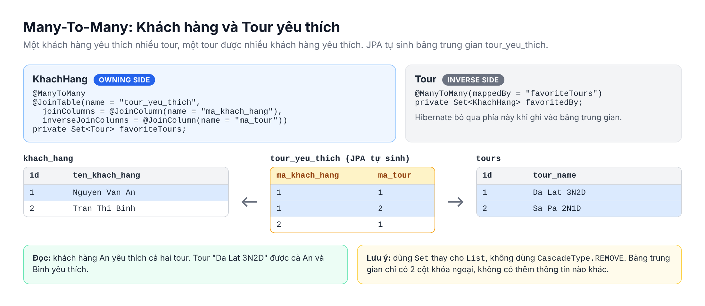

#### 1. Bản chất kỹ thuật:

- **A.** Database quan hệ không lưu được N-N trực tiếp: không thể nhét nhiều khóa ngoại vào một ô dữ liệu (vi phạm 1NF). Cách duy nhất là thêm một **bảng trung gian** (Join Table) chứa hai cột khóa ngoại.
- **B.** Khi gặp `@ManyToMany` kết hợp `@JoinTable`, Hibernate **tự tạo** bảng trung gian `tour_yeu_thich (ma_khach_hang, ma_tour)`. Lập trình viên không cần viết Entity hay Repository cho bảng này.
- **C.** Owning side là phía khai báo `@JoinTable` (ở đây là `KhachHang`). Hibernate chỉ đọc phía này để `INSERT` hoặc `DELETE` dòng trong bảng trung gian.
- **D.** Inverse side là phía khai báo `mappedBy` (ở đây là `Tour`).
- **E.** Thêm một tour vào `favoriteTours` thì Hibernate sinh `INSERT INTO tour_yeu_thich`. Gỡ ra thì sinh `DELETE FROM tour_yeu_thich WHERE ma_khach_hang = ? AND ma_tour = ?`.

#### 2. Giải quyết bài toán gì?

- Không có `@ManyToMany`, phải tự tạo bảng trung gian, tự viết `INSERT` khi khách bấm "yêu thích", và tự `JOIN` ba bảng mỗi lần cần hiển thị danh sách.
- Với `@ManyToMany`, toàn bộ việc đó rút gọn thành `khachHang.addFavoriteTour(tour)` và `khachHang.getFavoriteTours()`.

#### 3. Lưu ý & Best Practices:

- Dùng `Set` thay vì `List`. Với `List`, khi gỡ 1 tour, Hibernate xóa **toàn bộ** dòng của khách hàng đó trong bảng trung gian rồi `INSERT` lại phần còn lại. Với `Set`, chỉ xóa đúng 1 dòng.
- **Tuyệt đối không** dùng `CascadeType.REMOVE` hoặc `CascadeType.ALL` cho `@ManyToMany`: xóa một khách hàng sẽ kéo theo xóa luôn tour mà họ yêu thích, làm mất dữ liệu của mọi khách hàng khác.
- `@ManyToMany` chỉ phù hợp khi bảng trung gian **chỉ có 2 cột khóa ngoại**. Cần lưu thêm bất kỳ thông tin nào (ngày yêu thích, ghi chú...), chuyển sang Entity trung gian ở Mục III.
- Ở mức nâng cao, Entity nằm trong `Set` nên cài đặt `equals()` và `hashCode()` theo `id`. Trong phạm vi bài này, mỗi Entity chỉ được nạp một lần trong một transaction (First-level Cache, Phần 1.III) nên cách so sánh mặc định vẫn đủ dùng.

#### 4. Demo:

Entity `KhachHang` (Owning side):

```java
package com.example.quanlytour.entity;

import com.fasterxml.jackson.annotation.JsonIgnore;
import jakarta.persistence.Column;
import jakarta.persistence.Entity;
import jakarta.persistence.GeneratedValue;
import jakarta.persistence.GenerationType;
import jakarta.persistence.Id;
import jakarta.persistence.JoinColumn;
import jakarta.persistence.JoinTable;
import jakarta.persistence.ManyToMany;
import jakarta.persistence.OneToMany;
import jakarta.persistence.Table;
import jakarta.validation.constraints.Email;
import jakarta.validation.constraints.NotBlank;
import java.util.ArrayList;
import java.util.HashSet;
import java.util.List;
import java.util.Set;
import lombok.Getter;
import lombok.Setter;

@Entity
@Table(name = "khach_hang")
@Getter
@Setter
public class KhachHang {

    @Id
    @GeneratedValue(strategy = GenerationType.IDENTITY)
    private Long id;

    @NotBlank(message = "Ten khach hang khong duoc de trong")
    @Column(name = "ten_khach_hang", nullable = false, length = 100)
    private String customerName;

    @Column(name = "so_dien_thoai", length = 15)
    private String phone;

    @Email(message = "Email khong dung dinh dang")
    @Column(name = "email", length = 100)
    private String email;

    @JsonIgnore
    @ManyToMany
    @JoinTable(
            name = "tour_yeu_thich",
            joinColumns = @JoinColumn(name = "ma_khach_hang"),
            inverseJoinColumns = @JoinColumn(name = "ma_tour")
    )
    private Set<Tour> favoriteTours = new HashSet<>();

    @JsonIgnore
    @OneToMany(mappedBy = "khachHang")
    private List<HoaDon> hoaDons = new ArrayList<>();

    public void addFavoriteTour(Tour tour) {
        favoriteTours.add(tour);
        tour.getFavoritedBy().add(this);
    }

    public void removeFavoriteTour(Tour tour) {
        favoriteTours.remove(tour);
        tour.getFavoritedBy().remove(this);
    }

}
```

Bổ sung vào Entity `Tour` (Inverse side), thêm import `jakarta.persistence.ManyToMany`, `java.util.HashSet`, `java.util.Set`:

```java
@JsonIgnore
@ManyToMany(mappedBy = "favoriteTours")
private Set<KhachHang> favoritedBy = new HashSet<>();
```

Phương thức Service đánh dấu tour yêu thích:

```java
@Transactional
public void addFavoriteTour(Long khachHangId, Long tourId) {
    KhachHang khachHang = khachHangRepository.findById(khachHangId)
            .orElseThrow(() -> new IllegalArgumentException("Khong tim thay khach hang id = " + khachHangId));
    Tour tour = tourRepository.findById(tourId)
            .orElseThrow(() -> new IllegalArgumentException("Khong tim thay tour id = " + tourId));
    khachHang.addFavoriteTour(tour);
}
```

Giải thích:

- **A.** `@JoinTable(name = "tour_yeu_thich")`: tên bảng trung gian Hibernate sẽ tạo.
- **B.** `joinColumns = @JoinColumn(name = "ma_khach_hang")`: cột trỏ về bảng của **chính class này** (`khach_hang`).
- **C.** `inverseJoinColumns = @JoinColumn(name = "ma_tour")`: cột trỏ về bảng của **phía bên kia** (`tours`).
- **D.** `@ManyToMany(mappedBy = "favoriteTours")` bên `Tour`: trỏ về đúng tên thuộc tính `favoriteTours` bên `KhachHang`.
- **E.** Không khai báo `cascade` ở cả hai phía: xóa khách hàng không ảnh hưởng gì đến bảng `tours`.
- **F.** `IllegalArgumentException` khi không tìm thấy: tận dụng luôn `GlobalExceptionHandler` ở Phần 3, tự động trả về `404`.
- **G.** Không cần gọi `save()`: `khachHang` đang được Persistence Context theo dõi, khi transaction commit, Hibernate tự phát hiện `Set` đã thay đổi và sinh câu `INSERT`.

Input: gọi `addFavoriteTour(1L, 2L)`.

Output (bỏ qua các câu `SELECT` nạp khách hàng và tour):

```text
Hibernate: insert into tour_yeu_thich (ma_khach_hang, ma_tour) values (?, ?)
```

### III. Entity trung gian thay cho @ManyToMany

Khách hàng mua vé lịch trình cũng là quan hệ N-N: một khách mua nhiều lịch trình, một lịch trình bán cho nhiều khách. Nhưng mỗi lần mua cần lưu thêm số lượng khách, giá vé, tổng tiền (đúng thiết kế `HoaDon` ở Bài tập buổi 2). `@ManyToMany` không có chỗ cho những cột này.

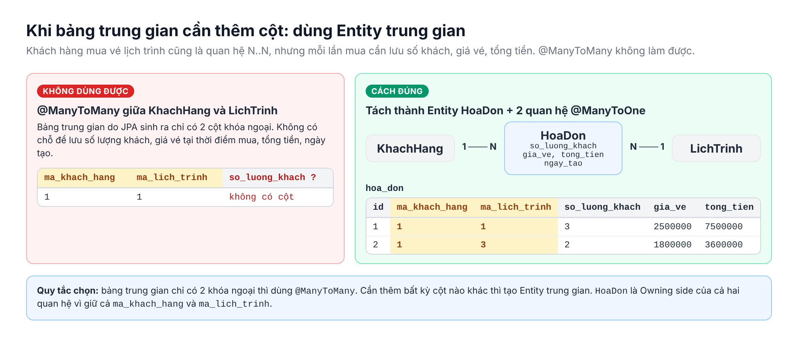

#### 1. Bản chất kỹ thuật:

- **A.** Thay vì để JPA tự sinh bảng trung gian, ta **tự viết** bảng trung gian thành một Entity đầy đủ: `HoaDon`.
- **B.** Quan hệ N-N được tách thành **hai quan hệ 1-N**: `KhachHang` 1-N `HoaDon` và `LichTrinh` 1-N `HoaDon`.
- **C.** `HoaDon` giữ cả hai khóa ngoại `ma_khach_hang` và `ma_lich_trinh`, nên là Owning side của cả hai quan hệ, khai báo bằng hai `@ManyToOne`.
- **D.** Vì là Entity bình thường, `HoaDon` có `id` riêng, có thể thêm bất kỳ cột nào, có Repository riêng, và có thể dùng JPA Lifecycle Callback như `@PrePersist`.

#### 2. Giải quyết bài toán gì?

- Lưu được thông tin của **từng lần mua**: cùng một khách mua cùng một lịch trình hai lần thì có hai `HoaDon` khác nhau, mỗi hóa đơn có số khách, tổng tiền riêng.
- Giữ đúng nguyên tắc 3NF đã phân tích ở buổi 2: `gia_ve` được chụp lại tại thời điểm mua, sau này đổi `gia_co_ban` của lịch trình không làm sai doanh thu của các hóa đơn cũ.

#### 3. Lưu ý & Best Practices:

- Quy tắc chọn: bảng trung gian chỉ có 2 khóa ngoại thì dùng `@ManyToMany`; cần thêm cột thì dùng Entity trung gian.
- Không bắt buộc khai báo phía `@OneToMany` ngược lại. `LichTrinh` không cần `List<HoaDon>` nếu nghiệp vụ không bao giờ duyệt từ lịch trình sang hóa đơn. Ít quan hệ hai chiều thì ít rủi ro vòng lặp.
- Đặt `@ManyToOne(fetch = FetchType.LAZY)` cho cả hai quan hệ để ghi đè mặc định `EAGER` (Phần 1.I).
- Dữ liệu tiền tệ trong hệ thống thật nên dùng `BigDecimal` để tránh sai số dấu phẩy động. Tài liệu giữ `Double` để thống nhất với `basePrice` hiện có.

#### 4. Demo:

```java
package com.example.quanlytour.entity;

import jakarta.persistence.Column;
import jakarta.persistence.Entity;
import jakarta.persistence.FetchType;
import jakarta.persistence.GeneratedValue;
import jakarta.persistence.GenerationType;
import jakarta.persistence.Id;
import jakarta.persistence.JoinColumn;
import jakarta.persistence.ManyToOne;
import jakarta.persistence.PrePersist;
import jakarta.persistence.Table;
import java.time.LocalDateTime;
import lombok.Getter;
import lombok.Setter;

@Entity
@Table(name = "hoa_don")
@Getter
@Setter
public class HoaDon {

    @Id
    @GeneratedValue(strategy = GenerationType.IDENTITY)
    private Long id;

    @ManyToOne(fetch = FetchType.LAZY)
    @JoinColumn(name = "ma_khach_hang", nullable = false)
    private KhachHang khachHang;

    @ManyToOne(fetch = FetchType.LAZY)
    @JoinColumn(name = "ma_lich_trinh", nullable = false)
    private LichTrinh lichTrinh;

    @Column(name = "so_luong_khach", nullable = false)
    private Integer guestCount;

    @Column(name = "gia_ve", nullable = false)
    private Double ticketPrice;

    @Column(name = "tong_tien", nullable = false)
    private Double totalAmount;

    @Column(name = "ngay_tao", nullable = false, updatable = false)
    private LocalDateTime createdAt;

    @PrePersist
    protected void onCreate() {
        createdAt = LocalDateTime.now();
        totalAmount = ticketPrice * guestCount;
    }

}
```

Giải thích:

- **A.** Hai cặp `@ManyToOne` + `@JoinColumn`: tạo hai cột khóa ngoại `ma_khach_hang`, `ma_lich_trinh` trong bảng `hoa_don`, cả hai đều bắt buộc.
- **B.** `ticketPrice`: giá vé tại thời điểm mua, sẽ được gán bằng `lichTrinh.getBasePrice()` lúc tạo hóa đơn.
- **C.** `@PrePersist`: phương thức `onCreate` được Hibernate gọi tự động **ngay trước** câu `INSERT`. Nó gán thời điểm tạo và tính `totalAmount = ticketPrice * guestCount`, Service không cần tự tính.
- **D.** `updatable = false` trên `createdAt`: cột này không bao giờ xuất hiện trong câu `UPDATE`, ngày tạo hóa đơn không thể bị sửa.

Input: tạo `HoaDon` với `guestCount = 3`, `ticketPrice = 2500000`, rồi `hoaDonRepository.save(hoaDon)`.

Output:

```text
Hibernate: insert into hoa_don (ngay_tao, so_luong_khach, ma_khach_hang, ma_lich_trinh, gia_ve, tong_tien) values (?, ?, ?, ?, ?, ?)
```

Cột `tong_tien` trong database có giá trị `7500000`, dù Service không hề gán `totalAmount`.

---

## Phần 7: Các mức độ truy vấn trong Spring Data JPA

Khi các Entity đã nối với nhau, câu hỏi tiếp theo là lấy dữ liệu ra theo đủ loại điều kiện. Buổi 8 đã dùng Native Query (Phần 1.IV) và mẫu `IS NULL OR` (Phần 1.V). Phần này hoàn thiện bức tranh với 4 mức độ truy vấn, đi từ tự động nhất đến linh hoạt nhất.

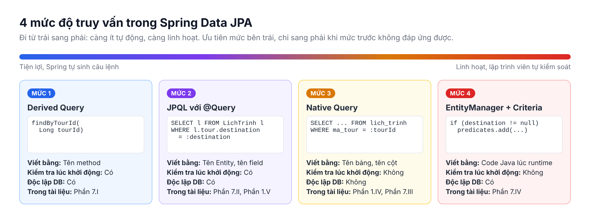

### I. Derived Query Methods (Truy vấn theo tên hàm)

#### 1. Bản chất kỹ thuật:

- **A.** Chỉ cần **khai báo** tên phương thức trong interface Repository theo đúng quy ước, Spring Data JPA tự sinh câu truy vấn, không cần viết dòng JPQL hay SQL nào.
- **B.** Lúc ứng dụng khởi động, Spring quét các interface kế thừa `JpaRepository`. Với mỗi phương thức không có `@Query`, class `PartTree` tách tên thành hai phần:
  - **Subject** (trước chữ `By`): `find`, `exists`, `count`, `delete`.
  - **Predicate** (sau chữ `By`): các điều kiện, nối với nhau bằng `And`, `Or`.
- **C.** Mỗi điều kiện được đối chiếu với **tên thuộc tính Java** của Entity, cộng thêm một từ khóa toán tử. Kết quả được dịch thành JPQL rồi thành SQL.
- **D.** Có thể **đi qua quan hệ**: `findByTourId` được hiểu là `tour.id`, `findByTourDestination` được hiểu là `tour.destination` (Hibernate tự thêm `JOIN` sang bảng `tours`).

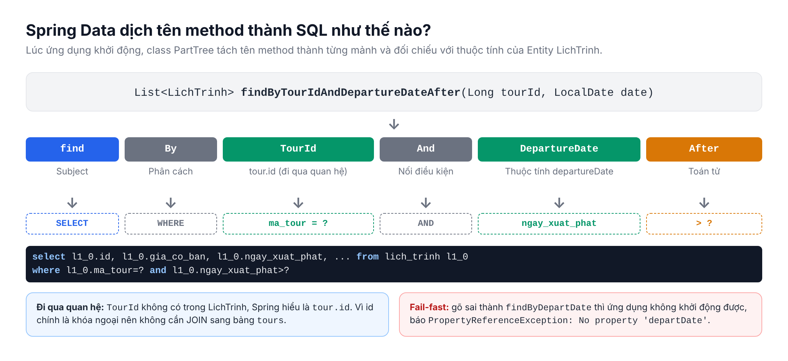

- **E.** Các từ khóa hay dùng:

| Từ khóa                     | Ví dụ tên phương thức                   | SQL sinh ra                      |
| --------------------------- | --------------------------------------- | -------------------------------- |
| (không có)                  | `findByDestination`                     | `destination = ?`                |
| `And` / `Or`                | `findByDestinationAndDepartureLocation` | `destination = ? and ...`        |
| `LessThan` / `GreaterThan`  | `findByBasePriceLessThan`               | `gia_co_ban < ?`                 |
| `Between`                   | `findByBasePriceBetween`                | `gia_co_ban between ? and ?`     |
| `After` / `Before`          | `findByDepartureDateAfter`              | `ngay_xuat_phat > ?`             |
| `Containing` + `IgnoreCase` | `findByTourNameContainingIgnoreCase`    | `upper(tour_name) like upper(?)` |
| `OrderBy...Asc/Desc`        | `findByTourIdOrderByDepartureDateAsc`   | `order by ngay_xuat_phat asc`    |
| `existsBy`                  | `existsByTourName`                      | Trả về `boolean`                 |
| `countBy`                   | `countByTourId`                         | Trả về `long`                    |

#### 2. Giải quyết bài toán gì?

- Phần lớn truy vấn hằng ngày chỉ có 1 đến 2 điều kiện đơn giản. Derived Query giúp viết chúng trong một dòng khai báo, không có code lặp lại.
- **Kiểm tra sớm** (Fail-fast): gõ sai tên thuộc tính, ứng dụng không khởi động được và báo `PropertyReferenceException`. Lỗi lộ ra ngay trên máy lập trình viên, không phải lúc đang chạy thật.

#### 3. Lưu ý & Best Practices:

- Tên phương thức dùng **tên thuộc tính Java** (`departureDate`), không phải tên cột (`ngay_xuat_phat`).
- `Containing` tự bọc ký tự `%` hai đầu tham số. `Like` thì phải tự truyền `%` vào giá trị.
- Dùng `existsBy...` để kiểm tra tồn tại thay vì `findBy...` rồi so sánh `null`: `existsBy` chỉ cần tìm thấy 1 dòng là dừng.
- Tên phương thức dài hơn 3 điều kiện là dấu hiệu nên chuyển sang `@Query` (Mục II) cho dễ đọc.
- Khi tên thuộc tính dễ gây nhầm lẫn khi đi qua quan hệ, có thể dùng dấu gạch dưới để chỉ rõ ranh giới: `findByTour_Id`.

#### 4. Demo:

```java
package com.example.quanlytour.repository;

import com.example.quanlytour.entity.LichTrinh;
import java.time.LocalDate;
import java.util.List;
import org.springframework.data.jpa.repository.JpaRepository;

public interface LichTrinhRepository extends JpaRepository<LichTrinh, Long> {

    List<LichTrinh> findByTourIdOrderByDepartureDateAsc(Long tourId);

    List<LichTrinh> findByTourIdAndDepartureDateAfter(Long tourId, LocalDate date);

    List<LichTrinh> findByBasePriceBetween(Double minPrice, Double maxPrice);

    boolean existsByTourIdAndDepartureDate(Long tourId, LocalDate departureDate);

    long countByTourId(Long tourId);

}
```

Giải thích:

- **A.** `findByTourIdOrderByDepartureDateAsc`: toàn bộ lịch trình của một tour, sắp theo ngày khởi hành tăng dần.
- **B.** `findByTourIdAndDepartureDateAfter`: các lịch trình của tour **sắp khởi hành** sau một ngày cho trước. Truyền `LocalDate.now()` để lấy lịch trình trong tương lai.
- **C.** `findByBasePriceBetween`: lọc theo khoảng giá, hai đầu đều được tính.
- **D.** `existsByTourIdAndDepartureDate`: dùng để chặn tạo trùng lịch trình cùng tour, cùng ngày.
- **E.** `countByTourId`: đếm số lịch trình của một tour.

Input: gọi `findByTourIdAndDepartureDateAfter(1L, LocalDate.of(2026, 3, 15))`.

Output:

```text
Hibernate: 
    select l1_0.id, l1_0.gia_co_ban, l1_0.ngay_xuat_phat, l1_0.so_cho_da_dat, l1_0.so_cho_toi_da, l1_0.ma_tour 
    from lich_trinh l1_0 
    where l1_0.ma_tour=? and l1_0.ngay_xuat_phat>?
```

Câu SQL **không có** `JOIN` sang bảng `tours`: `tour.id` chính là giá trị cột `ma_tour` nằm sẵn trong `lich_trinh`.

### II. JPQL với @Query

Khi điều kiện bắt đầu phức tạp (đi qua nhiều quan hệ, tính toán giữa các cột, cập nhật hàng loạt), tên phương thức trở nên quá dài hoặc không diễn đạt được. Lúc đó tự viết câu truy vấn bằng `@Query`.

#### 1. Bản chất kỹ thuật:

- **A.** JPQL (Jakarta Persistence Query Language) có cú pháp gần giống SQL, nhưng làm việc trên **Entity và thuộc tính Java**, không phải bảng và cột.

| Tiêu chí           | SQL thuần                                  | JPQL                                       |
| ------------------ | ------------------------------------------ | ------------------------------------------ |
| Truy vấn trên      | Bảng `lich_trinh`, cột `gia_co_ban`        | Entity `LichTrinh`, thuộc tính `basePrice` |
| Nối bảng           | Tự viết `JOIN tours t ON t.id = l.ma_tour` | Đi bằng dấu chấm `l.tour.destination`      |
| Phụ thuộc database | Có                                         | Không, Hibernate dịch theo Dialect         |
| Kiểm tra cú pháp   | Chỉ khi chạy                               | Ngay lúc ứng dụng khởi động                |

- **B.** Hibernate phân tích câu JPQL, đối chiếu với các Entity đã khai báo, rồi sinh ra SQL đúng cú pháp MySQL. Đổi sang PostgreSQL không cần sửa câu JPQL.
- **C.** Truyền tham số bằng **named parameter**: viết `:tenThamSo` trong câu truy vấn, đánh dấu `@Param("tenThamSo")` ở tham số phương thức. Giá trị luôn được bind qua `PreparedStatement`, an toàn trước SQL Injection.
- **D.** Câu `UPDATE`/`DELETE` bằng JPQL bắt buộc kèm `@Modifying` (báo cho Spring đây là lệnh thay đổi dữ liệu) và chạy trong `@Transactional`.
- **E.** `JOIN FETCH` ở Phần 4 cũng chính là một câu JPQL.

#### 2. Giải quyết bài toán gì?

- Biểu diễn được các điều kiện Derived Query không làm được: tính toán giữa hai cột (`totalSlots - bookedSlots`), hàm `COALESCE`, `GROUP BY`, cập nhật hàng loạt.
- Đặt tên phương thức theo nghiệp vụ (`findAvailableSchedules`) thay vì một tên dài máy móc.
- Vẫn giữ được ưu điểm kiểm tra sớm lúc khởi động và độc lập với loại database.

#### 3. Lưu ý & Best Practices:

- Sai lầm phổ biến nhất: viết tên **bảng** thay vì tên **Entity** (`FROM lich_trinh` thay vì `FROM LichTrinh`), ứng dụng báo lỗi ngay khi khởi động.
- Tên trong `@Param("...")` phải khớp chính xác với `:tenThamSo` trong câu truy vấn.
- Cột cho phép `null` khi tham gia phép tính phải được bọc `COALESCE`. Ví dụ `so_cho_da_dat` không có `nullable = false`, nếu là `null` thì `totalSlots - bookedSlots` cũng thành `null` và dòng đó bị loại khỏi kết quả.
- Sau một câu `UPDATE` hàng loạt, nên dùng `@Modifying(clearAutomatically = true)` để xóa các Entity cũ trong First-level Cache, tránh đọc lại dữ liệu chưa cập nhật.
- Tuyệt đối không nối chuỗi giá trị người dùng nhập vào câu truy vấn.

#### 4. Demo:

```java
@Query("SELECT l FROM LichTrinh l WHERE l.tour.destination = :destination AND l.departureDate >= :fromDate ORDER BY l.departureDate")
List<LichTrinh> findUpcomingByDestination(@Param("destination") String destination, @Param("fromDate") LocalDate fromDate);

@Query("SELECT l FROM LichTrinh l WHERE l.totalSlots - COALESCE(l.bookedSlots, 0) >= :requiredSlots")
List<LichTrinh> findAvailableSchedules(@Param("requiredSlots") Integer requiredSlots);

@Modifying(clearAutomatically = true)
@Transactional
@Query("UPDATE LichTrinh l SET l.basePrice = l.basePrice * :rate WHERE l.tour.id = :tourId")
int updateBasePriceByTour(@Param("tourId") Long tourId, @Param("rate") Double rate);
```

Giải thích:

- **A.** `findUpcomingByDestination`:
  - `l.tour.destination`: đi từ `LichTrinh` sang thuộc tính `destination` của `Tour` bằng dấu chấm. Hibernate tự sinh `JOIN` sang bảng `tours`.
  - Hai tham số `:destination`, `:fromDate` ứng với hai `@Param` cùng tên.
- **B.** `findAvailableSchedules`: tìm lịch trình còn ít nhất `requiredSlots` chỗ trống. `COALESCE(l.bookedSlots, 0)` coi giá trị `null` là `0`.
- **C.** `updateBasePriceByTour`:
  - Tăng/giảm giá toàn bộ lịch trình của một tour theo tỉ lệ `rate` (ví dụ `1.1` là tăng 10%) chỉ bằng **một** câu `UPDATE`, không cần nạp từng `LichTrinh` lên rồi `save`.
  - Kiểu trả về `int` là số dòng bị ảnh hưởng.

Input: gọi `findUpcomingByDestination("Da Lat", LocalDate.of(2026, 3, 1))`.

Output:

```text
Hibernate: 
    select l1_0.id, l1_0.gia_co_ban, l1_0.ngay_xuat_phat, l1_0.so_cho_da_dat, l1_0.so_cho_toi_da, l1_0.ma_tour 
    from lich_trinh l1_0 
    join tours t1_0 on t1_0.id=l1_0.ma_tour 
    where t1_0.destination=? and l1_0.ngay_xuat_phat>=? 
    order by l1_0.ngay_xuat_phat
```

Input: gọi `updateBasePriceByTour(1L, 1.1)` khi tour 1 có 2 lịch trình.

Output: một câu SQL duy nhất, trả về `2`:

```text
Hibernate: update lich_trinh set gia_co_ban=(gia_co_ban*?) where ma_tour=?
```

### III. Native Query với Interface Projection

Phần 1.IV đã dùng Native Query trả về `List<Object[]>`, phải nhớ `[0]` là tháng, `[1]` là số lượng. Mục này nhắc lại `nativeQuery = true` và nâng cấp kiểu trả về thành **Interface Projection**, đọc dữ liệu bằng getter có tên rõ ràng.

#### 1. Bản chất kỹ thuật:

- **A.** `nativeQuery = true`: câu lệnh được gửi **nguyên văn** xuống MySQL, phải dùng đúng tên bảng, tên cột vật lý (nhắc lại Phần 1.IV).
- **B.** **Interface Projection** là một interface chỉ gồm các getter, ví dụ `getTourName()`. Không cần `@Entity`, không cần bảng tương ứng.
- **C.** Spring tạo một object proxy tự động cài đặt interface đó. Mỗi getter đọc giá trị từ **cột có alias trùng tên** trong câu SQL: `getTourName()` đọc cột có alias `tourName`.
- **D.** Có thể dùng cùng cơ chế này cho JPQL, nhưng giá trị lớn nhất nằm ở các câu Native Query thống kê, nơi kết quả không khớp với bất kỳ Entity nào.

#### 2. Giải quyết bài toán gì?

- `Object[]` dễ đọc nhầm vị trí, phải ép kiểu thủ công, và khi trả ra JSON chỉ là một mảng không có tên trường.
- Interface Projection cho kết quả có kiểu rõ ràng, có tên trường, trả thẳng ra JSON được ngay.

#### 3. Lưu ý & Best Practices:

- Alias trong SQL phải khớp **chính xác** tên getter bỏ chữ `get` (alias `tourName` ứng với `getTourName()`).
- Kiểu dữ liệu getter phải tương thích với kiểu MySQL trả về: `COUNT(...)` trả về số nguyên lớn, nên dùng `Long`. `SUM` trên cột `DOUBLE` dùng `Double`.
- Dùng `LEFT JOIN` khi muốn giữ cả những tour chưa có dữ liệu bên bảng con, kết hợp `COALESCE(SUM(...), 0)` để trả `0` thay vì `null`.
- Native Query kết hợp phân trang (`Pageable`) phải khai báo thêm thuộc tính `countQuery`, vì Spring không tự sinh được câu đếm từ SQL thuần.

#### 4. Demo:

```java
package com.example.quanlytour.repository.projection;

public interface TourRevenue {

    Long getTourId();

    String getTourName();

    Long getInvoiceCount();

    Double getRevenue();

}
```

```java
@Query(value = """
        SELECT t.id AS tourId,
               t.tour_name AS tourName,
               COUNT(h.id) AS invoiceCount,
               COALESCE(SUM(h.tong_tien), 0) AS revenue
        FROM tours t
        LEFT JOIN lich_trinh l ON l.ma_tour = t.id
        LEFT JOIN hoa_don h ON h.ma_lich_trinh = l.id
        GROUP BY t.id, t.tour_name
        ORDER BY revenue DESC
        """, nativeQuery = true)
List<TourRevenue> getRevenueByTour();
```

Giải thích:

- **A.** `"""..."""` là Text Block (Java 15 trở lên), cho phép viết câu SQL nhiều dòng dễ đọc thay vì một dòng rất dài.
- **B.** Hai lần `LEFT JOIN`: đi từ `tours` sang `lich_trinh` rồi sang `hoa_don`. Tour chưa bán được vé nào vẫn xuất hiện với `invoiceCount = 0`, `revenue = 0`.
- **C.** Bốn alias `tourId`, `tourName`, `invoiceCount`, `revenue` khớp với bốn getter của `TourRevenue`.
- **D.** `GROUP BY t.id, t.tour_name`: liệt kê đủ các cột không nằm trong hàm tổng hợp, đúng yêu cầu chế độ `ONLY_FULL_GROUP_BY` mặc định của MySQL.

Input: gọi `getRevenueByTour()` khi tour 1 có 2 hóa đơn, tour 2 chưa có hóa đơn.

Output khi trả ra JSON:

```json
[
    {"tourId": 1, "tourName": "Da Lat 3N2D", "invoiceCount": 2, "revenue": 12900000.0},
    {"tourId": 2, "tourName": "Sa Pa 2N1D", "invoiceCount": 0, "revenue": 0.0}
]
```

### IV. EntityManager và Dynamic Query với Criteria API

Phần 1.V đã giải bài toán bộ lọc tùy chọn bằng mẫu `(:thamSo IS NULL OR ...)`. Khi số ô lọc tăng lên, câu JPQL ngày càng dài và luôn mang theo đủ mọi điều kiện. Mục này dùng công cụ gốc của JPA là `EntityManager` để **lắp ráp** câu truy vấn lúc chạy.

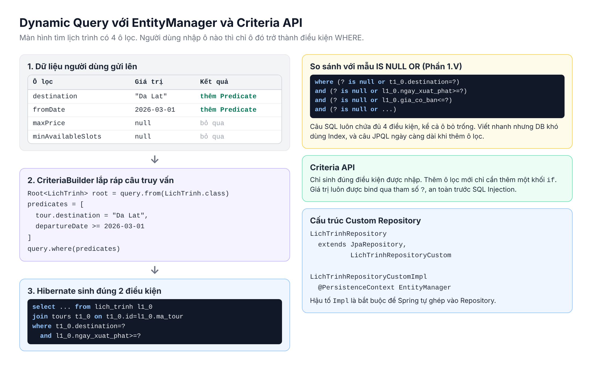

#### 1. Bản chất kỹ thuật:

- **A.** `EntityManager` là interface trung tâm của JPA. Mọi phương thức của `JpaRepository` thực chất đều gọi xuống nó:

| Phương thức của `EntityManager` | Tương ứng                   | `JpaRepository` gọi nó khi     |
| ------------------------------- | --------------------------- | ------------------------------ |
| `persist(entity)`               | `INSERT`                    | `save()` một Entity mới        |
| `merge(entity)`                 | `UPDATE`                    | `save()` một Entity đã có `id` |
| `find(Class, id)`               | `SELECT` theo khóa chính    | `findById()`                   |
| `remove(entity)`                | `DELETE`                    | `delete()`                     |
| `createQuery(...)`              | Truy vấn JPQL hoặc Criteria | Các phương thức có `@Query`    |

- **B.** Mỗi `EntityManager` quản lý một **Persistence Context**, chính là First-level Cache ở Phần 1.III.
- **C.** Spring không inject trực tiếp một `EntityManager` thật, mà inject một **proxy dùng chung**. Mỗi lần được gọi, proxy tìm `EntityManager` thật đang gắn với transaction hiện tại của luồng xử lý đó. Vì vậy có thể inject nó như một bean bình thường.
- **D.** **Criteria API** là bộ công cụ dựng câu truy vấn bằng code Java:
  - `CriteriaBuilder`: "nhà máy" sinh ra điều kiện (`equal`, `like`, `lessThanOrEqualTo`...).
  - `CriteriaQuery<T>`: câu truy vấn đang được lắp ráp, trả về kiểu `T`.
  - `Root<T>`: tương đương mệnh đề `FROM`, dùng để truy cập thuộc tính.
  - `Predicate`: một điều kiện. Chỉ thêm `Predicate` vào danh sách khi người dùng thật sự nhập ô lọc tương ứng.
- **E.** Để Spring Data dùng chung được code tự viết, đặt nó vào một **Custom Repository**: interface `LichTrinhRepositoryCustom` và class `LichTrinhRepositoryCustomImpl` (hậu tố `Impl` là bắt buộc), rồi cho `LichTrinhRepository` kế thừa thêm interface đó.

#### 2. Giải quyết bài toán gì?

- Màn hình tìm lịch trình có 4 ô lọc tùy chọn: nơi đến, từ ngày, giá tối đa, số chỗ trống tối thiểu. Có tới 2^4 = 16 tổ hợp.
- Mẫu `IS NULL OR` vẫn chạy được, nhưng câu SQL luôn chứa đủ 4 điều kiện, khiến database khó tận dụng Index, và mỗi ô lọc mới lại làm câu JPQL dài thêm.
- Criteria API chỉ sinh **đúng** những điều kiện được nhập. Thêm ô lọc mới chỉ là thêm một khối `if`.

#### 3. Lưu ý & Best Practices:

- So sánh với hai cách đã biết:

| Tiêu chí                  | `IS NULL OR` (Phần 1.V) | JPA Specification        | `EntityManager` + Criteria |
| ------------------------- | ----------------------- | ------------------------ | -------------------------- |
| Độ khó                    | Dễ                      | Trung bình               | Trung bình                 |
| SQL sinh ra               | Luôn đủ mọi điều kiện   | Chỉ điều kiện được nhập  | Chỉ điều kiện được nhập    |
| Kiểm soát `JOIN`, `FETCH` | Thấp                    | Trung bình               | Cao nhất                   |
| Phù hợp                   | 1 đến 3 ô lọc           | Nhiều ô lọc, tái sử dụng | Truy vấn đặc thù, phức tạp |

- Kiểm tra chuỗi bằng `StringUtils.hasText()` thay vì chỉ `!= null`, vì người dùng có thể gửi `""` hoặc `"   "`.
- Không viết Criteria trong Controller hay Service. Đặt trong Custom Repository để Service chỉ cần gọi `lichTrinhRepository.search(...)`.
- Nếu kết quả sẽ được dùng để đọc thuộc tính của quan hệ (ví dụ tên tour), dùng `fetch` thay vì `join` để tránh N + 1 (áp dụng kiến thức Phần 4).

#### 4. Demo:

Object chứa các ô lọc:

```java
package com.example.quanlytour.dto;

import java.time.LocalDate;

public record LichTrinhSearchRequest(
        String destination,
        LocalDate fromDate,
        Double maxPrice,
        Integer minAvailableSlots) {
}
```

Interface Custom Repository:

```java
package com.example.quanlytour.repository;

import com.example.quanlytour.dto.LichTrinhSearchRequest;
import com.example.quanlytour.entity.LichTrinh;
import java.util.List;

public interface LichTrinhRepositoryCustom {

    List<LichTrinh> search(LichTrinhSearchRequest request);

}
```

Class cài đặt, dùng `EntityManager`:

```java
package com.example.quanlytour.repository;

import com.example.quanlytour.dto.LichTrinhSearchRequest;
import com.example.quanlytour.entity.LichTrinh;
import com.example.quanlytour.entity.Tour;
import jakarta.persistence.EntityManager;
import jakarta.persistence.PersistenceContext;
import jakarta.persistence.criteria.CriteriaBuilder;
import jakarta.persistence.criteria.CriteriaQuery;
import jakarta.persistence.criteria.Expression;
import jakarta.persistence.criteria.Fetch;
import jakarta.persistence.criteria.Join;
import jakarta.persistence.criteria.Predicate;
import jakarta.persistence.criteria.Root;
import java.util.ArrayList;
import java.util.List;
import org.springframework.stereotype.Repository;
import org.springframework.util.StringUtils;

@Repository
public class LichTrinhRepositoryCustomImpl implements LichTrinhRepositoryCustom {

    @PersistenceContext
    private EntityManager entityManager;

    @Override
    @SuppressWarnings("unchecked")
    public List<LichTrinh> search(LichTrinhSearchRequest request) {
        CriteriaBuilder criteriaBuilder = entityManager.getCriteriaBuilder();
        CriteriaQuery<LichTrinh> criteriaQuery = criteriaBuilder.createQuery(LichTrinh.class);
        Root<LichTrinh> root = criteriaQuery.from(LichTrinh.class);
        Fetch<LichTrinh, Tour> tourFetch = root.fetch("tour");
        Join<LichTrinh, Tour> tourJoin = (Join<LichTrinh, Tour>) tourFetch;

        List<Predicate> predicates = new ArrayList<>();

        if (StringUtils.hasText(request.destination())) {
            predicates.add(criteriaBuilder.equal(tourJoin.get("destination"), request.destination().trim()));
        }
        if (request.fromDate() != null) {
            predicates.add(criteriaBuilder.greaterThanOrEqualTo(root.get("departureDate"), request.fromDate()));
        }
        if (request.maxPrice() != null) {
            predicates.add(criteriaBuilder.lessThanOrEqualTo(root.get("basePrice"), request.maxPrice()));
        }
        if (request.minAvailableSlots() != null) {
            Expression<Integer> bookedSlots = criteriaBuilder.coalesce(root.<Integer>get("bookedSlots"), 0);
            Expression<Integer> availableSlots = criteriaBuilder.diff(root.<Integer>get("totalSlots"), bookedSlots);
            predicates.add(criteriaBuilder.greaterThanOrEqualTo(availableSlots, request.minAvailableSlots()));
        }

        criteriaQuery.select(root)
                .where(predicates.toArray(new Predicate[0]))
                .orderBy(criteriaBuilder.asc(root.get("departureDate")));

        return entityManager.createQuery(criteriaQuery).getResultList();
    }

}
```

Cho `LichTrinhRepository` kế thừa thêm interface vừa tạo:

```java
public interface LichTrinhRepository extends JpaRepository<LichTrinh, Long>, LichTrinhRepositoryCustom {
}
```

Giải thích:

- **A.** `@PersistenceContext private EntityManager entityManager`: Spring inject proxy dùng chung của `EntityManager`.
- **B.** Ba dòng khởi tạo:
  - `getCriteriaBuilder()`: lấy "nhà máy" sinh điều kiện.
  - `createQuery(LichTrinh.class)`: khai báo kết quả là danh sách `LichTrinh`.
  - `criteriaQuery.from(LichTrinh.class)`: tương đương `FROM LichTrinh`, biến `root` dùng để truy cập thuộc tính.
- **C.** `root.fetch("tour")` rồi ép kiểu sang `Join`:
  - `fetch` giống `JOIN FETCH` ở Phần 4: nạp luôn `Tour` trong cùng câu SQL, đọc `getTour().getTourName()` sau đó không sinh thêm câu nào.
  - Ép sang `Join` để dùng được `tourJoin.get("destination")` làm điều kiện lọc trên chính phép nối đó. `@SuppressWarnings("unchecked")` tắt cảnh báo của trình biên dịch cho phép ép kiểu này.
- **D.** Mỗi khối `if` chỉ thêm `Predicate` khi ô lọc tương ứng có giá trị.
- **E.** Khối số chỗ trống: `coalesce(bookedSlots, 0)` coi `null` là `0`, `diff(totalSlots, bookedSlots)` là phép trừ, kết quả phải lớn hơn hoặc bằng số chỗ yêu cầu.
- **F.** `.where(predicates.toArray(new Predicate[0]))`: các `Predicate` được nối bằng `AND`. Danh sách rỗng thì không có mệnh đề `WHERE`, tức là lấy tất cả.
- **G.** `extends JpaRepository<LichTrinh, Long>, LichTrinhRepositoryCustom`: Spring tự tìm class `LichTrinhRepositoryCustomImpl` và ghép vào, Service chỉ cần gọi `lichTrinhRepository.search(request)`.

Input 1: `search(new LichTrinhSearchRequest("Da Lat", LocalDate.of(2026, 3, 1), null, null))`.

Output 1: chỉ 2 điều kiện được nhập xuất hiện trong SQL:

```text
Hibernate: 
    select l1_0.id, l1_0.gia_co_ban, l1_0.ngay_xuat_phat, l1_0.so_cho_da_dat, l1_0.so_cho_toi_da, 
           t1_0.id, t1_0.departure_location, t1_0.description, t1_0.destination, t1_0.tour_name 
    from lich_trinh l1_0 
    join tours t1_0 on t1_0.id=l1_0.ma_tour 
    where t1_0.destination=? and l1_0.ngay_xuat_phat>=? 
    order by l1_0.ngay_xuat_phat
```

Input 2: `search(new LichTrinhSearchRequest(null, null, null, 5))`.

Output 2: chỉ còn điều kiện số chỗ trống:

```text
Hibernate: 
    select ... from lich_trinh l1_0 
    join tours t1_0 on t1_0.id=l1_0.ma_tour 
    where (l1_0.so_cho_toi_da-coalesce(l1_0.so_cho_da_dat,?))>=? 
    order by l1_0.ngay_xuat_phat
```

---

## Phần 8: Bài tập chuẩn bị (Buổi 9)

Tiếp nối dự án ở Phần 5. Sau bài tập này, dự án có đủ 4 Entity và 4 mức độ truy vấn như sơ đồ dưới đây.

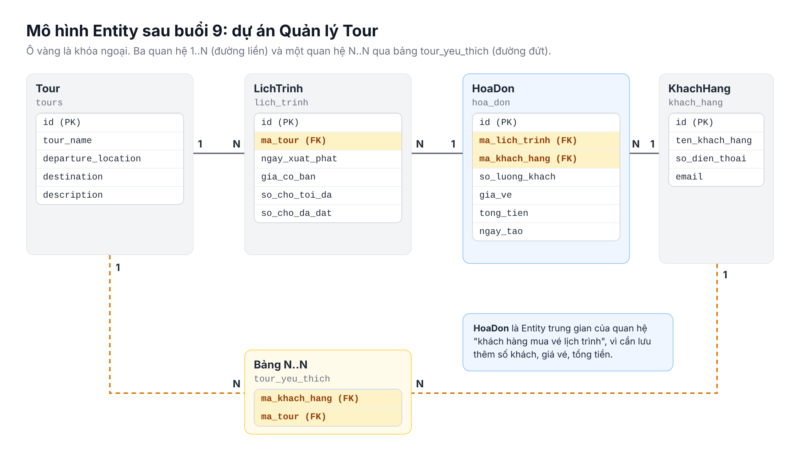

**Lưu ý trước khi bắt đầu:**

- Từ buổi này, `LichTrinh` giữ object `tour` thay cho `Long maTour`. Body JSON tạo lịch trình ở Phần 5 phải đổi `"maTour": 1` thành `"tour": {"id": 1}`.
- Toàn bộ các API **đọc dữ liệu** mới đều trả về DTO (`record`), không trả Entity, để tránh vòng lặp JSON và lỗi Proxy Lazy khi Jackson serialize.
- Nếu project đang có API `GET` trả thẳng `List<LichTrinh>`, hãy chuyển sang trả `LichTrinhResponse` (Yêu cầu 2). Trường `tour` lúc này là Proxy Lazy, Jackson không serialize được và báo lỗi `No serializer found for class ...ByteBuddyInterceptor`.
- `GlobalExceptionHandler` ở Phần 3 được dùng lại nguyên vẹn: `IllegalArgumentException` trả về `404`, `IllegalStateException` trả về `400`.

### I. Yêu cầu 1 (Thiết lập quan hệ)

**Mục tiêu:** bổ sung `KhachHang`, `HoaDon`; thiết lập quan hệ 1-N, N-N; viết nghiệp vụ đặt vé và đánh dấu tour yêu thích.

#### 1. Cập nhật `Tour.java` và `LichTrinh.java`

- **A.** Mở `Tour.java`, thay toàn bộ nội dung:

```java
package com.example.quanlytour.entity;

import com.fasterxml.jackson.annotation.JsonIgnore;
import jakarta.persistence.CascadeType;
import jakarta.persistence.Column;
import jakarta.persistence.Entity;
import jakarta.persistence.FetchType;
import jakarta.persistence.GeneratedValue;
import jakarta.persistence.GenerationType;
import jakarta.persistence.Id;
import jakarta.persistence.ManyToMany;
import jakarta.persistence.OneToMany;
import jakarta.persistence.Table;
import jakarta.validation.constraints.NotBlank;
import java.util.ArrayList;
import java.util.HashSet;
import java.util.List;
import java.util.Set;
import lombok.Getter;
import lombok.Setter;

@Entity
@Table(name = "tours")
@Getter
@Setter
public class Tour {

    @Id
    @GeneratedValue(strategy = GenerationType.IDENTITY)
    private Long id;

    @NotBlank(message = "Ten tour khong duoc de trong")
    @Column(name = "tour_name", nullable = false, length = 200)
    private String tourName;

    @Column(name = "departure_location", length = 100)
    private String departureLocation;

    @Column(name = "destination", length = 100)
    private String destination;

    @Column(name = "description", length = 1000)
    private String description;

    @JsonIgnore
    @OneToMany(mappedBy = "tour", fetch = FetchType.LAZY, cascade = CascadeType.PERSIST)
    private List<LichTrinh> lichTrinhs = new ArrayList<>();

    @JsonIgnore
    @ManyToMany(mappedBy = "favoriteTours")
    private Set<KhachHang> favoritedBy = new HashSet<>();

    public void addLichTrinh(LichTrinh lichTrinh) {
        lichTrinhs.add(lichTrinh);
        lichTrinh.setTour(this);
    }

}
```

- **B.** Mở `LichTrinh.java`, thay `@Data` bằng `@Getter` `@Setter`, giữ nguyên ràng buộc đã thêm ở Phần 5:

```java
package com.example.quanlytour.entity;

import jakarta.persistence.Column;
import jakarta.persistence.Entity;
import jakarta.persistence.FetchType;
import jakarta.persistence.GeneratedValue;
import jakarta.persistence.GenerationType;
import jakarta.persistence.Id;
import jakarta.persistence.JoinColumn;
import jakarta.persistence.ManyToOne;
import jakarta.persistence.Table;
import jakarta.validation.constraints.NotNull;
import jakarta.validation.constraints.Positive;
import java.time.LocalDate;
import lombok.Getter;
import lombok.Setter;

@Entity
@Table(name = "lich_trinh")
@Getter
@Setter
public class LichTrinh {

    @Id
    @GeneratedValue(strategy = GenerationType.IDENTITY)
    private Long id;

    @ManyToOne(fetch = FetchType.LAZY)
    @JoinColumn(name = "ma_tour", nullable = false)
    private Tour tour;

    @NotNull(message = "Ngay xuat phat khong duoc de trong")
    @Column(name = "ngay_xuat_phat", nullable = false)
    private LocalDate departureDate;

    @NotNull(message = "Gia co ban khong duoc de trong")
    @Positive(message = "Gia co ban phai lon hon 0")
    @Column(name = "gia_co_ban", nullable = false)
    private Double basePrice;

    @NotNull(message = "So cho toi da khong duoc de trong")
    @Positive(message = "So cho toi da phai lon hon 0")
    @Column(name = "so_cho_toi_da", nullable = false)
    private Integer totalSlots;

    @Column(name = "so_cho_da_dat")
    private Integer bookedSlots;

}
```

- **C.** Giải thích:
  - `Tour` có thêm `favoritedBy` (Inverse side của quan hệ N-N, Phần 6.II).
  - Cả hai Collection của `Tour` đều có `@JsonIgnore`, nên `GET /api/tours` ở Phần 5 vẫn trả về đúng như cũ.
  - `LichTrinh` không khai báo `List<HoaDon>`: nghiệp vụ không cần duyệt từ lịch trình sang hóa đơn (Phần 6.III).

#### 2. Tạo `KhachHang.java` và `HoaDon.java`

- **A.** Trong package `entity`, tạo `KhachHang.java` với nội dung giống hệt Demo ở Phần 6.II.
- **B.** Tạo `HoaDon.java` với nội dung giống hệt Demo ở Phần 6.III.

#### 3. Tạo Repository

- **A.** Trong package `repository`, tạo `KhachHangRepository.java`:

```java
package com.example.quanlytour.repository;

import com.example.quanlytour.entity.KhachHang;
import org.springframework.data.jpa.repository.JpaRepository;

public interface KhachHangRepository extends JpaRepository<KhachHang, Long> {
}
```

- **B.** Tạo `HoaDonRepository.java`:

```java
package com.example.quanlytour.repository;

import com.example.quanlytour.entity.HoaDon;
import org.springframework.data.jpa.repository.JpaRepository;

public interface HoaDonRepository extends JpaRepository<HoaDon, Long> {
}
```

#### 4. Sửa `LichTrinhService.createLichTrinh`

Client chỉ gửi `"tour": {"id": 1}`, object `tour` nhận được chỉ có mỗi `id`. Service phải nạp `Tour` thật từ database trước khi lưu.

- **A.** Khai báo thêm `TourRepository` trong `LichTrinhService` (inject theo cách project đang dùng cho `LichTrinhRepository`).
- **B.** Sửa phương thức:

```java
public LichTrinh createLichTrinh(LichTrinh lichTrinh) {
    if (lichTrinh.getTour() == null || lichTrinh.getTour().getId() == null) {
        throw new IllegalStateException("Lich trinh phai thuoc ve mot tour");
    }
    Long tourId = lichTrinh.getTour().getId();
    Tour tour = tourRepository.findById(tourId)
            .orElseThrow(() -> new IllegalArgumentException("Khong tim thay tour id = " + tourId));
    lichTrinh.setTour(tour);
    return lichTrinhRepository.save(lichTrinh);
}
```

- **C.** Giải thích:
  - Thiếu `tour` thì ném `IllegalStateException`, `GlobalExceptionHandler` trả `400`.
  - `tourId` không tồn tại thì ném `IllegalArgumentException`, trả `404`.
  - `lichTrinh.setTour(tour)`: gán Owning side bằng `Tour` thật, câu `INSERT` có đúng giá trị `ma_tour`.

#### 5. Nghiệp vụ đặt vé tạo `HoaDon`

- **A.** Tạo package `dto`, thêm `BookTicketRequest.java` (áp dụng Validation của buổi 8):

```java
package com.example.quanlytour.dto;

import jakarta.validation.constraints.Min;
import jakarta.validation.constraints.NotNull;

public record BookTicketRequest(

        @NotNull(message = "Ma khach hang khong duoc de trong")
        Long khachHangId,

        @NotNull(message = "Ma lich trinh khong duoc de trong")
        Long lichTrinhId,

        @NotNull(message = "So luong khach khong duoc de trong")
        @Min(value = 1, message = "So luong khach toi thieu la 1")
        Integer guestCount) {
}
```

- **B.** Thêm `HoaDonResponse.java` trong package `dto`:

```java
package com.example.quanlytour.dto;

import com.example.quanlytour.entity.HoaDon;
import com.example.quanlytour.entity.LichTrinh;
import java.time.LocalDate;
import java.time.LocalDateTime;

public record HoaDonResponse(
        Long id,
        String customerName,
        String tourName,
        LocalDate departureDate,
        Integer guestCount,
        Double ticketPrice,
        Double totalAmount,
        LocalDateTime createdAt) {

    public static HoaDonResponse from(HoaDon hoaDon) {
        LichTrinh lichTrinh = hoaDon.getLichTrinh();
        return new HoaDonResponse(
                hoaDon.getId(),
                hoaDon.getKhachHang().getCustomerName(),
                lichTrinh.getTour().getTourName(),
                lichTrinh.getDepartureDate(),
                hoaDon.getGuestCount(),
                hoaDon.getTicketPrice(),
                hoaDon.getTotalAmount(),
                hoaDon.getCreatedAt());
    }

}
```

- **C.** Tạo `HoaDonService.java` trong package `service`:

```java
package com.example.quanlytour.service;

import com.example.quanlytour.dto.BookTicketRequest;
import com.example.quanlytour.dto.HoaDonResponse;
import com.example.quanlytour.entity.HoaDon;
import com.example.quanlytour.entity.KhachHang;
import com.example.quanlytour.entity.LichTrinh;
import com.example.quanlytour.repository.HoaDonRepository;
import com.example.quanlytour.repository.KhachHangRepository;
import com.example.quanlytour.repository.LichTrinhRepository;
import lombok.RequiredArgsConstructor;
import org.springframework.stereotype.Service;
import org.springframework.transaction.annotation.Transactional;

@Service
@RequiredArgsConstructor
public class HoaDonService {

    private final HoaDonRepository hoaDonRepository;
    private final KhachHangRepository khachHangRepository;
    private final LichTrinhRepository lichTrinhRepository;

    @Transactional
    public HoaDonResponse bookTicket(BookTicketRequest request) {
        KhachHang khachHang = khachHangRepository.findById(request.khachHangId())
                .orElseThrow(() -> new IllegalArgumentException("Khong tim thay khach hang id = " + request.khachHangId()));
        LichTrinh lichTrinh = lichTrinhRepository.findById(request.lichTrinhId())
                .orElseThrow(() -> new IllegalArgumentException("Khong tim thay lich trinh id = " + request.lichTrinhId()));

        int bookedSlots = lichTrinh.getBookedSlots() == null ? 0 : lichTrinh.getBookedSlots();
        if (bookedSlots + request.guestCount() > lichTrinh.getTotalSlots()) {
            throw new IllegalStateException("Khong du cho trong");
        }
        lichTrinh.setBookedSlots(bookedSlots + request.guestCount());

        HoaDon hoaDon = new HoaDon();
        hoaDon.setKhachHang(khachHang);
        hoaDon.setLichTrinh(lichTrinh);
        hoaDon.setGuestCount(request.guestCount());
        hoaDon.setTicketPrice(lichTrinh.getBasePrice());

        return HoaDonResponse.from(hoaDonRepository.save(hoaDon));
    }

}
```

- **D.** Tạo `HoaDonController.java` trong package `controller`:

```java
package com.example.quanlytour.controller;

import com.example.quanlytour.dto.BookTicketRequest;
import com.example.quanlytour.dto.HoaDonResponse;
import com.example.quanlytour.service.HoaDonService;
import jakarta.validation.Valid;
import lombok.RequiredArgsConstructor;
import org.springframework.web.bind.annotation.PostMapping;
import org.springframework.web.bind.annotation.RequestBody;
import org.springframework.web.bind.annotation.RequestMapping;
import org.springframework.web.bind.annotation.RestController;

@RestController
@RequestMapping("/api/hoa-don")
@RequiredArgsConstructor
public class HoaDonController {

    private final HoaDonService hoaDonService;

    @PostMapping
    public HoaDonResponse bookTicket(@Valid @RequestBody BookTicketRequest request) {
        return hoaDonService.bookTicket(request);
    }

}
```

- **E.** Giải thích:
  - `@Transactional` bao toàn bộ nghiệp vụ: cập nhật `bookedSlots` và `INSERT` hóa đơn cùng thành công hoặc cùng bị hủy. Không cần gọi `lichTrinhRepository.save` vì Dirty Checking tự sinh câu `UPDATE`.
  - Không đủ chỗ thì ném `IllegalStateException("Khong du cho trong")`, đúng loại lỗi `handleIllegalStateException` ở Phần 5 đang bắt.
  - `hoaDon.setTicketPrice(lichTrinh.getBasePrice())`: chụp lại giá tại thời điểm mua. `totalAmount` do `@PrePersist` tự tính.
  - `HoaDonResponse.from(...)` được gọi **bên trong** transaction, nên việc đọc `lichTrinh.getTour().getTourName()` (Proxy Lazy) diễn ra an toàn.

#### 6. Khách hàng và tour yêu thích

- **A.** Tạo `KhachHangService.java`:

```java
package com.example.quanlytour.service;

import com.example.quanlytour.entity.KhachHang;
import com.example.quanlytour.entity.Tour;
import com.example.quanlytour.repository.KhachHangRepository;
import com.example.quanlytour.repository.TourRepository;
import java.util.ArrayList;
import java.util.List;
import lombok.RequiredArgsConstructor;
import org.springframework.stereotype.Service;
import org.springframework.transaction.annotation.Transactional;

@Service
@RequiredArgsConstructor
public class KhachHangService {

    private final KhachHangRepository khachHangRepository;
    private final TourRepository tourRepository;

    public KhachHang createKhachHang(KhachHang khachHang) {
        return khachHangRepository.save(khachHang);
    }

    @Transactional
    public void addFavoriteTour(Long khachHangId, Long tourId) {
        KhachHang khachHang = findKhachHang(khachHangId);
        Tour tour = tourRepository.findById(tourId)
                .orElseThrow(() -> new IllegalArgumentException("Khong tim thay tour id = " + tourId));
        khachHang.addFavoriteTour(tour);
    }

    @Transactional(readOnly = true)
    public List<Tour> getFavoriteTours(Long khachHangId) {
        return new ArrayList<>(findKhachHang(khachHangId).getFavoriteTours());
    }

    private KhachHang findKhachHang(Long khachHangId) {
        return khachHangRepository.findById(khachHangId)
                .orElseThrow(() -> new IllegalArgumentException("Khong tim thay khach hang id = " + khachHangId));
    }

}
```

- **B.** Tạo `KhachHangController.java`:

```java
package com.example.quanlytour.controller;

import com.example.quanlytour.entity.KhachHang;
import com.example.quanlytour.entity.Tour;
import com.example.quanlytour.service.KhachHangService;
import jakarta.validation.Valid;
import java.util.List;
import lombok.RequiredArgsConstructor;
import org.springframework.web.bind.annotation.GetMapping;
import org.springframework.web.bind.annotation.PathVariable;
import org.springframework.web.bind.annotation.PostMapping;
import org.springframework.web.bind.annotation.RequestBody;
import org.springframework.web.bind.annotation.RequestMapping;
import org.springframework.web.bind.annotation.RestController;

@RestController
@RequestMapping("/api/khach-hang")
@RequiredArgsConstructor
public class KhachHangController {

    private final KhachHangService khachHangService;

    @PostMapping
    public KhachHang createKhachHang(@Valid @RequestBody KhachHang khachHang) {
        return khachHangService.createKhachHang(khachHang);
    }

    @PostMapping("/{khachHangId}/tour-yeu-thich/{tourId}")
    public void addFavoriteTour(@PathVariable Long khachHangId, @PathVariable Long tourId) {
        khachHangService.addFavoriteTour(khachHangId, tourId);
    }

    @GetMapping("/{khachHangId}/tour-yeu-thich")
    public List<Tour> getFavoriteTours(@PathVariable Long khachHangId) {
        return khachHangService.getFavoriteTours(khachHangId);
    }

}
```

- **C.** Giải thích:
  - `getFavoriteTours` copy `Set` sang một `ArrayList` mới **bên trong** transaction, nên Collection Lazy đã được nạp xong trước khi Jackson đọc tới.
  - Trả về `Tour` trực tiếp ở đây vẫn an toàn vì mọi Collection của `Tour` đều có `@JsonIgnore`.
- **D.** Lưu toàn bộ file, Stop rồi Run lại ứng dụng. Console phải xuất hiện các câu `create table khach_hang`, `create table hoa_don`, `create table tour_yeu_thich`.

#### 7. Kiểm thử trên Postman

- **A.** Tạo lịch trình với cú pháp mới: `POST http://localhost:8080/api/lich-trinh`, Body:

```json
{
    "tour": {"id": 1},
    "departureDate": "2026-12-10",
    "basePrice": 2500000,
    "totalSlots": 10,
    "bookedSlots": 0
}
```

- **B.** Tạo khách hàng: `POST http://localhost:8080/api/khach-hang`, Body:

```json
{
    "customerName": "Nguyen Van An",
    "phone": "0901000001",
    "email": "an@gmail.com"
}
```

- **C.** Đặt vé: `POST http://localhost:8080/api/hoa-don`, Body `{"khachHangId": 1, "lichTrinhId": 1, "guestCount": 3}`.

Output:

```json
{
    "id": 1,
    "customerName": "Nguyen Van An",
    "tourName": "Da Lat 3N2D",
    "departureDate": "2026-12-10",
    "guestCount": 3,
    "ticketPrice": 2500000.0,
    "totalAmount": 7500000.0,
    "createdAt": "2026-10-13T09:30:12.512"
}
```

- **D.** Đặt vé vượt số chỗ: Body `{"khachHangId": 1, "lichTrinhId": 1, "guestCount": 20}`.

Output: `400 Bad Request`, Body `{"status": 400, "message": "Khong du cho trong"}`.

- **E.** Đặt vé với `guestCount = 0`.

Output: `400 Bad Request`, Body `{"status": 400, "message": "So luong khach toi thieu la 1"}`.

- **F.** Đánh dấu yêu thích: `POST http://localhost:8080/api/khach-hang/1/tour-yeu-thich/1`, sau đó `GET http://localhost:8080/api/khach-hang/1/tour-yeu-thich`.

Output: mảng JSON chứa tour id 1. Console có câu `insert into tour_yeu_thich (ma_khach_hang, ma_tour) values (?, ?)`.

### II. Yêu cầu 2 (Áp dụng Derived Query)

**Mục tiêu:** API tìm khách hàng theo tên và API lấy các lịch trình sắp khởi hành của một tour, không viết dòng JPQL nào.

#### 1. Tìm khách hàng theo tên

- **A.** Thêm vào `KhachHangRepository`:

```java
List<KhachHang> findByCustomerNameContainingIgnoreCase(String customerName);
```

- **B.** Thêm vào `KhachHangService`:

```java
public List<KhachHang> searchByName(String name) {
    return khachHangRepository.findByCustomerNameContainingIgnoreCase(name.trim());
}
```

- **C.** Thêm vào `KhachHangController` (import thêm `RequestParam`):

```java
@GetMapping("/search")
public List<KhachHang> searchByName(@RequestParam String name) {
    return khachHangService.searchByName(name);
}
```

#### 2. Lịch trình sắp khởi hành của một tour

- **A.** Tạo `LichTrinhResponse.java` trong package `dto`:

```java
package com.example.quanlytour.dto;

import com.example.quanlytour.entity.LichTrinh;
import java.time.LocalDate;

public record LichTrinhResponse(
        Long id,
        Long tourId,
        String tourName,
        LocalDate departureDate,
        Double basePrice,
        Integer availableSlots) {

    public static LichTrinhResponse from(LichTrinh lichTrinh) {
        int bookedSlots = lichTrinh.getBookedSlots() == null ? 0 : lichTrinh.getBookedSlots();
        return new LichTrinhResponse(
                lichTrinh.getId(),
                lichTrinh.getTour().getId(),
                lichTrinh.getTour().getTourName(),
                lichTrinh.getDepartureDate(),
                lichTrinh.getBasePrice(),
                lichTrinh.getTotalSlots() - bookedSlots);
    }

}
```

- **B.** Thêm vào `LichTrinhRepository`:

```java
List<LichTrinh> findByTourIdAndDepartureDateAfterOrderByDepartureDateAsc(Long tourId, LocalDate date);
```

- **C.** Thêm vào `LichTrinhService`:

```java
@Transactional(readOnly = true)
public List<LichTrinhResponse> getUpcomingSchedules(Long tourId) {
    return lichTrinhRepository.findByTourIdAndDepartureDateAfterOrderByDepartureDateAsc(tourId, LocalDate.now())
            .stream()
            .map(LichTrinhResponse::from)
            .toList();
}
```

- **D.** Thêm vào `LichTrinhController`:

```java
@GetMapping("/tour/{tourId}/upcoming")
public List<LichTrinhResponse> getUpcomingSchedules(@PathVariable Long tourId) {
    return lichTrinhService.getUpcomingSchedules(tourId);
}
```

- **E.** Giải thích:
  - `findByTourIdAndDepartureDateAfterOrderByDepartureDateAsc`: lọc theo `tour.id`, ngày khởi hành sau hôm nay, sắp tăng dần. Parser tự dịch, không cần JPQL.
  - `availableSlots` được tính trong DTO, Client không phải tự trừ.
  - Mọi lịch trình trong kết quả cùng thuộc một tour, nên khi `from()` đọc `getTourName()`, chỉ lần đầu sinh thêm 1 câu `SELECT` vào bảng `tours`. Các lần sau lấy từ First-level Cache (Phần 1.III).

#### 3. Kiểm thử trên Postman

- **A.** `GET http://localhost:8080/api/khach-hang/search?name=an`: trả về mọi khách hàng có tên chứa "an", không phân biệt hoa thường.
- **B.** `GET http://localhost:8080/api/lich-trinh/tour/1/upcoming`:

```json
[
    {"id": 1, "tourId": 1, "tourName": "Da Lat 3N2D", "departureDate": "2026-12-10", "basePrice": 2500000.0, "availableSlots": 7}
]
```

- **C.** Quan sát Console: câu `SELECT` vào `lich_trinh` có điều kiện `where l1_0.ma_tour=? and l1_0.ngay_xuat_phat>?`, đúng như tên phương thức.

### III. Yêu cầu 3 (Áp dụng JPQL và Native Query)

**Mục tiêu:** API tìm hóa đơn có tổng tiền lớn hơn X (JPQL), và API thống kê doanh thu từng tour (Native Query).

#### 1. JPQL: hóa đơn có tổng tiền lớn hơn X

- **A.** Thêm vào `HoaDonRepository`:

```java
@Query("SELECT h FROM HoaDon h JOIN FETCH h.khachHang JOIN FETCH h.lichTrinh l JOIN FETCH l.tour WHERE h.totalAmount > :minTotal ORDER BY h.totalAmount DESC")
List<HoaDon> findInvoicesWithTotalGreaterThan(@Param("minTotal") Double minTotal);
```

- **B.** Thêm vào `HoaDonService`:

```java
@Transactional(readOnly = true)
public List<HoaDonResponse> searchByMinTotal(Double minTotal) {
    return hoaDonRepository.findInvoicesWithTotalGreaterThan(minTotal)
            .stream()
            .map(HoaDonResponse::from)
            .toList();
}
```

- **C.** Thêm vào `HoaDonController`:

```java
@GetMapping("/search")
public List<HoaDonResponse> searchByMinTotal(@RequestParam Double minTotal) {
    return hoaDonService.searchByMinTotal(minTotal);
}
```

- **D.** Giải thích:
  - Câu JPQL dùng tên Entity `HoaDon` và thuộc tính `totalAmount`, không dùng `hoa_don` hay `tong_tien`.
  - Ba lần `JOIN FETCH` (áp dụng Phần 4): nạp sẵn khách hàng, lịch trình và tour mà `HoaDonResponse` cần đọc. Dù trả về bao nhiêu hóa đơn, Console vẫn chỉ có **một** câu SQL.

#### 2. Native Query: doanh thu từng tour

- **A.** Tạo interface `TourRevenue` trong package `repository.projection`, nội dung như Demo ở Phần 7.III.
- **B.** Thêm phương thức `getRevenueByTour()` (Demo Phần 7.III) vào `TourRepository`.
- **C.** Thêm vào `TourService`:

```java
public List<TourRevenue> getRevenueByTour() {
    return tourRepository.getRevenueByTour();
}
```

- **D.** Thêm vào `TourController`:

```java
@GetMapping("/revenue")
public List<TourRevenue> getRevenueByTour() {
    return tourService.getRevenueByTour();
}
```

#### 3. Kiểm thử trên Postman

- **A.** Tạo thêm 1 đến 2 hóa đơn qua `POST /api/hoa-don` để có dữ liệu.
- **B.** `GET http://localhost:8080/api/hoa-don/search?minTotal=5000000`: chỉ trả về các hóa đơn có `totalAmount` lớn hơn 5 triệu, sắp giảm dần.
- **C.** Console chỉ in **một** câu SQL dạng:

```text
Hibernate: 
    select h1_0.id, ..., k1_0.id, k1_0.ten_khach_hang, ..., l1_0.id, ..., t1_0.id, t1_0.tour_name, ... 
    from hoa_don h1_0 
    join khach_hang k1_0 on k1_0.id=h1_0.ma_khach_hang 
    join lich_trinh l1_0 on l1_0.id=h1_0.ma_lich_trinh 
    join tours t1_0 on t1_0.id=l1_0.ma_tour 
    where h1_0.tong_tien>? 
    order by h1_0.tong_tien desc
```

- **D.** `GET http://localhost:8080/api/tours/revenue`: mỗi tour một dòng gồm `tourId`, `tourName`, `invoiceCount`, `revenue`. Tour chưa bán vé nào vẫn xuất hiện với `revenue = 0.0`.

### IV. Yêu cầu 4 (Áp dụng Dynamic Query với EntityManager)

**Mục tiêu:** API tìm lịch trình theo 4 ô lọc tùy chọn: nơi đến, từ ngày, giá tối đa, số chỗ trống tối thiểu.

#### 1. Chuẩn bị Custom Repository

- **A.** Tạo `LichTrinhSearchRequest.java` trong package `dto`, nội dung như Demo ở Phần 7.IV.
- **B.** Tạo `LichTrinhRepositoryCustom.java` và `LichTrinhRepositoryCustomImpl.java` trong package `repository`, nội dung như Demo ở Phần 7.IV.
- **C.** Sửa dòng khai báo `LichTrinhRepository` thành `extends JpaRepository<LichTrinh, Long>, LichTrinhRepositoryCustom`.

#### 2. Thêm Service và Controller

- **A.** Thêm vào `LichTrinhService`:

```java
@Transactional(readOnly = true)
public List<LichTrinhResponse> search(LichTrinhSearchRequest request) {
    return lichTrinhRepository.search(request)
            .stream()
            .map(LichTrinhResponse::from)
            .toList();
}
```

- **B.** Thêm vào `LichTrinhController` (import thêm `DateTimeFormat`, `LocalDate`, `RequestParam`):

```java
@GetMapping("/search")
public List<LichTrinhResponse> search(
        @RequestParam(required = false) String destination,
        @RequestParam(required = false) @DateTimeFormat(iso = DateTimeFormat.ISO.DATE) LocalDate fromDate,
        @RequestParam(required = false) Double maxPrice,
        @RequestParam(required = false) Integer minAvailableSlots) {
    LichTrinhSearchRequest request = new LichTrinhSearchRequest(destination, fromDate, maxPrice, minAvailableSlots);
    return lichTrinhService.search(request);
}
```

- **C.** Giải thích:
  - `required = false`: cả 4 tham số đều không bắt buộc, không truyền thì nhận giá trị `null`.
  - `@DateTimeFormat(iso = DateTimeFormat.ISO.DATE)`: cho phép truyền ngày dạng `2026-12-01` trên URL.
  - Kết quả tìm kiếm có thể thuộc nhiều tour khác nhau. Nhờ `root.fetch("tour")` trong Custom Repository, `LichTrinhResponse.from()` đọc `tourName` mà không sinh thêm câu SQL nào.

#### 3. Kiểm thử trên Postman

- **A.** `GET http://localhost:8080/api/lich-trinh/search?destination=Da Lat&fromDate=2026-12-01`: Console chỉ có 2 điều kiện `t1_0.destination=?` và `l1_0.ngay_xuat_phat>=?`.
- **B.** `GET http://localhost:8080/api/lich-trinh/search?minAvailableSlots=5`: Console chỉ có điều kiện `(l1_0.so_cho_toi_da-coalesce(l1_0.so_cho_da_dat,?))>=?`.
- **C.** `GET http://localhost:8080/api/lich-trinh/search`: không có mệnh đề `where`, trả về toàn bộ lịch trình.
- **D.** So sánh ba câu SQL ở Console để thấy rõ: câu truy vấn được **lắp ráp khác nhau** tùy ô lọc được nhập, khác với mẫu `IS NULL OR` ở Phần 1.V luôn mang đủ mọi điều kiện.

### V. Tiêu chí hoàn thành

- **A.** Ứng dụng khởi động thành công, database có đủ 5 bảng: `tours`, `lich_trinh`, `khach_hang`, `hoa_don`, `tour_yeu_thich`.
- **B.** Không Entity nào còn dùng `@Data`. Mọi `@ManyToOne` đều khai báo `FetchType.LAZY`.
- **C.** Đặt vé thành công thì `so_cho_da_dat` của lịch trình tăng đúng bằng `guestCount`; đặt vượt số chỗ thì nhận `400` và database không thay đổi.
- **D.** API tìm hóa đơn theo tổng tiền chỉ sinh **một** câu SQL (chụp Console làm minh chứng).
- **E.** API tìm lịch trình sinh câu SQL khác nhau theo từng tổ hợp ô lọc (chụp 3 câu SQL ở Yêu cầu 4).
