# [BUỔI 13] KICK-OFF FRONTEND VÀ UI/UX CHO DEVELOPER

*Tài liệu chuẩn bị buổi 13 - Khóa Frontend Cơ bản (Buổi 1)*

---

**Mục lục:**

- [\[BUỔI 13\] KICK-OFF FRONTEND VÀ UI/UX CHO DEVELOPER](#buổi-13-kick-off-frontend-và-uiux-cho-developer)
  - [Phần 1: HÀNH TRÌNH CỦA MỘT TRANG WEB (TỪ GÕ URL ĐẾN HIỂN THỊ)](#phần-1-hành-trình-của-một-trang-web-từ-gõ-url-đến-hiển-thị)
    - [I. Địa chỉ web (URL) và Tên miền (Domain)](#i-địa-chỉ-web-url-và-tên-miền-domain)
    - [II. Phân giải DNS, Kết nối Server và Trao đổi HTTP](#ii-phân-giải-dns-kết-nối-server-và-trao-đổi-http)
    - [III. Trình duyệt xử lý HTML, CSS, JavaScript và Hiển thị trang](#iii-trình-duyệt-xử-lý-html-css-javascript-và-hiển-thị-trang)
  - [Phần 2: UX VÀ UI CHO DEVELOPER](#phần-2-ux-và-ui-cho-developer)
    - [I. Khái niệm và Vai trò của UX / UI](#i-khái-niệm-và-vai-trò-của-ux--ui)
    - [II. So sánh UX và UI](#ii-so-sánh-ux-và-ui)
  - [Phần 3: 10 USABILITY HEURISTICS CỦA NIELSEN NORMAN GROUP (NN/g)](#phần-3-10-usability-heuristics-của-nielsen-norman-group-nng)
    - [I. Tổng quan và Chi tiết 10 nguyên tắc](#i-tổng-quan-và-chi-tiết-10-nguyên-tắc)
    - [II. Phân tích thực tế trên ứng dụng quen thuộc (Ví dụ mẫu: Shopee)](#ii-phân-tích-thực-tế-trên-ứng-dụng-quen-thuộc-ví-dụ-mẫu-shopee)
  - [Phần 4: "AI SLOP" TRONG THIẾT KẾ GIAO DIỆN](#phần-4-ai-slop-trong-thiết-kế-giao-diện)
    - [I. Khái niệm và Nguyên nhân sinh ra "AI Slop"](#i-khái-niệm-và-nguyên-nhân-sinh-ra-ai-slop)
    - [II. Checklist 9 dấu hiệu nhận diện lỗi "AI Slop"](#ii-checklist-9-dấu-hiệu-nhận-diện-lỗi-ai-slop)
  - [Phần 5: CHUẨN BỊ MÔI TRƯỜNG PHÁT TRIỂN FRONTEND](#phần-5-chuẩn-bị-môi-trường-phát-triển-frontend)
    - [I. Công cụ cần cài đặt và Lý do chọn Node.js LTS](#i-công-cụ-cần-cài-đặt-và-lý-do-chọn-nodejs-lts)
    - [II. Lệnh kiểm tra nhanh môi trường](#ii-lệnh-kiểm-tra-nhanh-môi-trường)
  - [Phần 6: KIẾN THỨC NỀN TẢNG VÀ HƯỚNG DẪN SƠ BỘ CHO BÀI TẬP (REPO RIÊNG)](#phần-6-kiến-thức-nền-tảng-và-hướng-dẫn-sơ-bộ-cho-bài-tập-repo-riêng)
    - [I. Chốt đề tài dùng API ngoài và Viết README (3-5 câu)](#i-chốt-đề-tài-dùng-api-ngoài-và-viết-readme-3-5-câu)
    - [II. Vẽ User Flow và Wireframe (đủ trạng thái Loading, Empty, Error)](#ii-vẽ-user-flow-và-wireframe-đủ-trạng-thái-loading-empty-error)
    - [III. Sinh giao diện bằng Google Stitch (hoặc AI) và Bắt ít nhất 5 lỗi "AI Slop"](#iii-sinh-giao-diện-bằng-google-stitch-hoặc-ai-và-bắt-ít-nhất-5-lỗi-ai-slop)
    - [IV. Lập bảng Design Tokens nháp cho dự án](#iv-lập-bảng-design-tokens-nháp-cho-dự-án)
    - [V. Hồ sơ sơ bộ dự án cá nhân dự kiến: OmniLife](#v-hồ-sơ-sơ-bộ-dự-án-cá-nhân-dự-kiến-omnilife)
  - [Tóm tắt nhanh](#tóm-tắt-nhanh)

---

## Phần 1: HÀNH TRÌNH CỦA MỘT TRANG WEB (TỪ GÕ URL ĐẾN HIỂN THỊ)

### I. Địa chỉ web (URL) và Tên miền (Domain)

- **URL (Uniform Resource Locator)** là địa chỉ đầy đủ chỉ định vị trí tài nguyên trên Internet và giao thức truy cập.
- **Domain (Tên miền)** là tên định danh bằng chữ (ví dụ `example.com`) ánh xạ về địa chỉ IP của máy chủ, giúp con người dễ nhớ thay vì phải gõ dãy số IP.

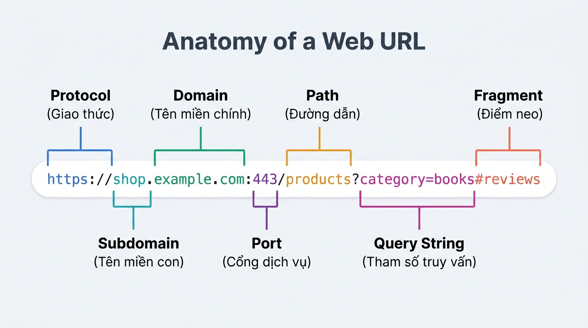

| Thành phần URL         | Ví dụ              | Có gửi lên Server? | Vai trò chính                                                   |
| :--------------------- | :----------------- | :----------------- | :-------------------------------------------------------------- |
| **Protocol / Scheme**  | `https://`         | Dùng khi kết nối   | Quy định giao thức (`HTTPS` = `HTTP` + mã hóa `SSL/TLS`)        |
| **Subdomain + Domain** | `shop.example.com` | Có (`Host` header) | Phân tách dịch vụ con và định danh máy chủ đích                 |
| **Port**               | `:443`             | Có (kết nối TCP)   | Cổng dịch vụ (trình duyệt tự ẩn `80` cho HTTP, `443` cho HTTPS) |
| **Path**               | `/products`        | Có                 | Đường dẫn tới tài nguyên hoặc route trên server                 |
| **Query String**       | `?category=books`  | Có                 | Tham số lọc, tìm kiếm, phân trang                               |
| **Fragment / Hash**    | `#reviews`         | **Không**          | Điểm neo cuộn trang hoặc điều hướng cục bộ phía trình duyệt     |

---

### II. Phân giải DNS, Kết nối Server và Trao đổi HTTP

Khi nhấn `Enter`, trình duyệt thực hiện tuần tự 3 chặng mạng trước khi nhận được mã HTML:

1. **Phân giải DNS (DNS Lookup):** Kiểm tra bộ nhớ đệm qua **4 tầng** từ gần đến xa: `Browser Cache` -> `OS Cache (file hosts)` -> `Router Cache` -> `ISP Recursive Resolver`. Nếu chưa có, Resolver hỏi tuần tự `Root Server` -> `TLD Server` (`.com`, `.vn`) -> `Authoritative Name Server` để lấy về địa chỉ IP máy chủ.
2. **Bắt tay TCP và TLS:** Thiết lập kênh truyền tin cậy qua **TCP 3-Way Handshake** (`SYN` -> `SYN-ACK` -> `ACK`). Nếu dùng `HTTPS`, thực hiện thêm **TLS Handshake** để xác minh chứng chỉ số SSL/TLS và thỏa thuận khóa mã hóa.
3. **Trao đổi HTTP Request & Response:** Trình duyệt gửi HTTP Request (`GET / HTTP/1.1`, kèm `Host`, `Accept: text/html`). Server xử lý và trả về HTTP Response gồm Status Code (`200 OK`), Response Headers (`Content-Type: text/html`) và Body chứa mã HTML.

| Lỗi thường gặp                      | Chặng bị tắc  | Nguyên nhân phổ biến                                           |
| :---------------------------------- | :------------ | :------------------------------------------------------------- |
| `ERR_NAME_NOT_RESOLVED`             | DNS Lookup    | Sai tên miền, chưa trỏ bản ghi DNS `A`/`CNAME`, mất mạng       |
| `ERR_CONNECTION_REFUSED`            | TCP Handshake | Server chưa bật dịch vụ hoặc Firewall đang chặn cổng           |
| `ERR_CERT_AUTHORITY_INVALID`        | TLS Handshake | Chứng chỉ SSL hết hạn, tự ký hoặc sai domain                   |
| `404 Not Found` / `502 Bad Gateway` | HTTP Response | Sai Path URL (`404`) hoặc Nginx không gọi được Backend (`502`) |

---

### III. Trình duyệt xử lý HTML, CSS, JavaScript và Hiển thị trang

- **Vai trò bộ ba Frontend:** `HTML` dựng khung cấu trúc và ngữ nghĩa nội dung; `CSS` quy định bố cục, màu sắc, kiểu chữ; `JavaScript` xử lý tương tác, gọi API và cập nhật DOM động.
- **Critical Rendering Path (6 bước dựng trang):**
  1. **Parse HTML -> DOM Tree:** Đọc HTML từ trên xuống, dựng cây DOM; gặp `<link>`, `<script>`, `` thì tải thêm tài nguyên phụ.
  2. **Parse CSS -> CSSOM Tree:** Dựng cây quy tắc kiểu dáng. CSS là **render-blocking** (chờ CSSOM xong mới vẽ để tránh vỡ bố cục).
  3. **Thực thi JavaScript:** Mặc định `<script>` là **parser-blocking** (dừng dựng DOM để chạy JS). Nên dùng `defer` để tải song song và chạy sau khi parse xong HTML.
  4. **DOM + CSSOM -> Render Tree:** Chỉ giữ phần tử hiển thị (loại bỏ `<head>`, `<script>`, phần tử `display: none`).
  5. **Layout (Reflow):** Tính toán tọa độ `(x, y)` và kích thước (`width`, `height`) theo viewport.
  6. **Paint & Composite:** Tô màu, vẽ chữ/viền/ảnh lên từng lớp rồi ghép lại đẩy ra màn hình.

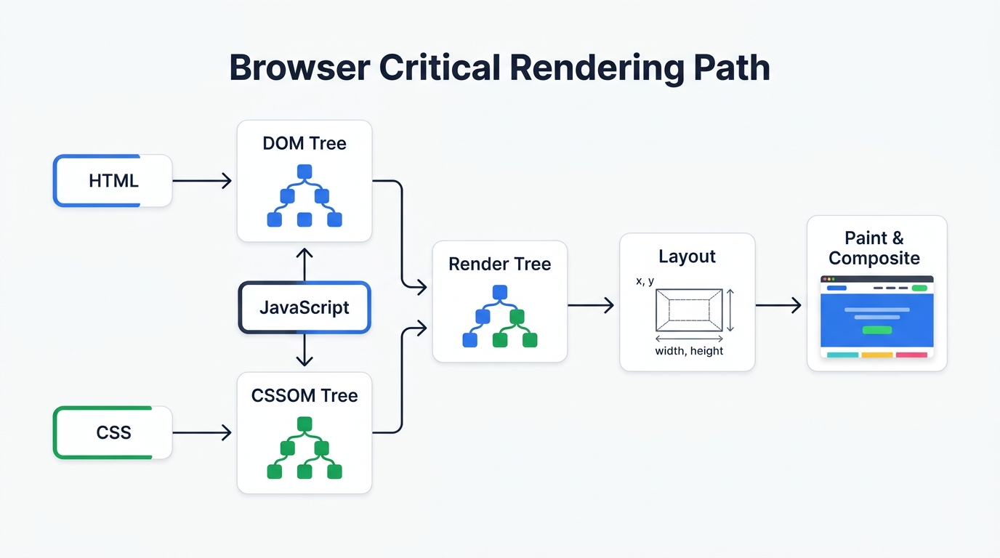

| Cách nhúng `<script>`         | Tải file JS    | Thời điểm chạy                        | Chặn dựng DOM?         | Khuyến nghị dùng               |
| :---------------------------- | :------------- | :------------------------------------ | :--------------------- | :----------------------------- |
| `<script src="app.js">`       | Dừng đọc HTML  | Ngay sau khi tải xong                 | Có                     | Tránh đặt ở `<head>`           |
| `<script src="app.js" async>` | Song song HTML | Tải xong chạy ngay (không giữ thứ tự) | Có thể ngắt giữa chừng | Script độc lập (Analytics)     |
| `<script src="app.js" defer>` | Song song HTML | Sau khi parse xong HTML, đúng thứ tự  | **Không**              | **Mặc định cho code ứng dụng** |


---

## Phần 2: UX VÀ UI CHO DEVELOPER

### I. Khái niệm và Vai trò của UX / UI

- **UX (User Experience - Trải nghiệm người dùng):** Toàn bộ cảm nhận, mức độ dễ hiểu và sự thuận tiện khi người dùng đi hết luồng thao tác để hoàn thành mục tiêu (tìm thông tin, đặt hàng, nộp bài...).
- **UI (User Interface - Giao diện người dùng):** Lớp bề mặt trực quan nơi người dùng nhìn thấy và tương tác (bố cục, màu sắc, kiểu chữ, nút bấm, biểu mẫu, khoảng cách).
- **Vì sao Developer cần nắm UX/UI:**
  - Chuyển tư duy từ *"code chạy không lỗi"* sang *"người dùng thao tác mượt, không bị kẹt ở các trạng thái biên"*.
  - Đọc hiểu bản thiết kế, chủ động bổ sung các trạng thái hay bị quên (`loading`, `empty`, `error`) và tự xây được sản phẩm cá nhân dùng thật.
  - Nếu bỏ qua UX/UI: API trả `200 OK` nhưng người dùng không biết bấm đâu, bấm xong không thấy phản hồi nên bấm trùng, nhập sai 1 ô bị mất sạch dữ liệu form -> rời bỏ ứng dụng.

---

### II. So sánh UX và UI

| Tiêu chí             | UX (User Experience)                                                           | UI (User Interface)                                                                           |
| :------------------- | :----------------------------------------------------------------------------- | :-------------------------------------------------------------------------------------------- |
| **Trọng tâm**        | Cách sản phẩm **vận hành** và giải quyết bài toán                              | Cách sản phẩm **hiển thị** trực quan và tương tác                                             |
| **Câu hỏi cốt lõi**  | Người dùng đi qua bước nào? Có vướng mắc gì không?                             | Đặt nút ở đâu? Màu sắc, font, spacing thế nào cho rõ?                                         |
| **Đầu ra tiêu biểu** | User Flow, Sitemap, Wireframe đen-trắng                                        | Mockup hoàn chỉnh, Style Guide, Design Tokens                                                 |
| **Thứ tự thực hiện** | Đi **trước** (dựng luồng và khung sườn)                                        | Đi **sau** (khoác hình thức và chi tiết lên khung)                                            |
| **Tình huống lệch**  | *UX tệ dù UI đẹp:* Hiệu ứng mượt nhưng ẩn giỏ hàng, form lỗi xóa trắng dữ liệu | *UX tốt dù UI tối giản:* Trang tìm kiếm Google ít trang trí nhưng đạt mục tiêu trong vài giây |

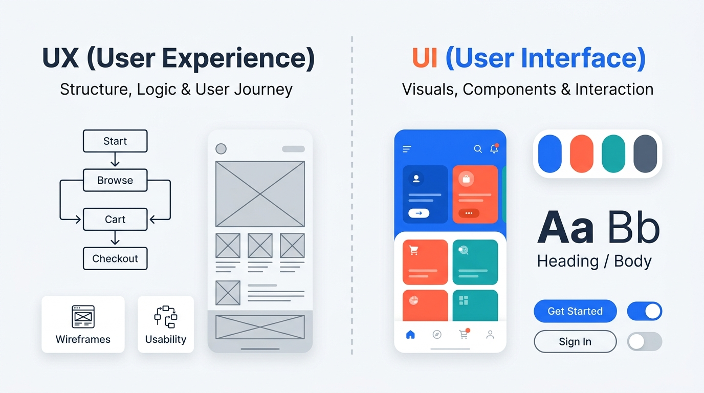


---

## Phần 3: 10 USABILITY HEURISTICS CỦA NIELSEN NORMAN GROUP (NN/g)

### I. Tổng quan và Chi tiết 10 nguyên tắc

Bộ **10 Usability Heuristics** do Jakob Nielsen (NN/g) công bố năm 1994 là 10 nguyên tắc kinh nghiệm giúp phát hiện nhanh lỗi trải nghiệm người dùng trên mọi phần mềm.

|  STT  | Nguyên tắc (Anh - Việt)                                                                  | Bản chất & Ví dụ thực tế                                                                                           | Góc nhìn Frontend Dev cần nhớ                                                     |
| :---: | :--------------------------------------------------------------------------------------- | :----------------------------------------------------------------------------------------------------------------- | :-------------------------------------------------------------------------------- |
|   1   | **Visibility of System Status** (Hiển thị rõ trạng thái hệ thống)                        | Luôn báo cho người dùng biết hệ thống đang làm gì (thanh `%` upload, spinner/skeleton, thông báo "Đã lưu")         | Luôn có `loading`, vô hiệu hóa nút submit khi đang gọi API để tránh gửi trùng     |
|   2   | **Match Between System & Real World** (Tương đồng thế giới thực)                         | Dùng ngôn ngữ đời thường quen thuộc thay vì thuật ngữ kỹ thuật (`Giỏ hàng trống` thay vì `[]` hay `404 Exception`) | Ánh xạ mã lỗi và tên trường DB sang câu tiếng Việt tự nhiên trước khi render      |
|   3   | **User Control and Freedom** (Quyền kiểm soát và tự do)                                  | Cung cấp "lối thoát khẩn cấp" rõ ràng khi bấm nhầm (nút `Hoàn tác/Undo`, `Hủy`, đóng modal bằng `X` / `Esc`)       | Modal phải đóng được bằng nút Đóng, Hủy và phím `Esc`; tác vụ xóa nên có xác nhận |
|   4   | **Consistency and Standards** (Tính nhất quán và chuẩn mực)                              | Giữ đồng nhất nhãn nút, màu sắc, vị trí điều hướng và tuân theo chuẩn web quen thuộc                               | Tái sử dụng component và Design Tokens thay vì mỗi trang tự chế một kiểu nút      |
|   5   | **Error Prevention** (Phòng ngừa lỗi ngay từ đầu)                                        | Ngăn sai sót trước khi xảy ra: xác nhận trước khi xóa vĩnh viễn, làm mờ ngày quá khứ trên lịch                     | Validate sớm ở client (`type="email"`, `min/max`) và xác nhận 2 bước khi xóa      |
|   6   | **Recognition Rather Than Recall** (Nhận diện thay vì ghi nhớ)                           | Hiển thị sẵn gợi ý, lịch sử tìm kiếm, giữ `label` cố định trên ô nhập                                              | Không thay `label` bằng `placeholder` (vì gõ vào sẽ biến mất)                     |
|   7   | **Flexibility and Efficiency of Use** (Linh hoạt và hiệu quả)                            | Dễ cho người mới, nhanh cho người quen (bấm `Enter` để tìm, phím tắt `Ctrl + K`)                                   | Bọc ô tìm kiếm trong `<form>` để tự hỗ trợ `Enter`; hỗ trợ điều hướng `Tab`       |
|   8   | **Aesthetic and Minimalist Design** (Thiết kế tinh gọn)                                  | Loại bỏ thông tin và chi tiết thừa cạnh tranh sự chú ý với tác vụ chính                                            | Card danh sách chỉ giữ thông tin cốt lõi; chi tiết dài đẩy vào trang Detail       |
|   9   | **Help Users Recognize, Diagnose, and Recover from Errors** (Nhận biết, hiểu và sửa lỗi) | Báo lỗi bằng ngôn ngữ dễ hiểu, chỉ rõ sai ở đâu và cách khắc phục                                                  | Không in stack trace / `TypeError` ra UI; tô viền đỏ đúng ô sai + nút `"Thử lại"` |
|  10   | **Help and Documentation** (Trợ giúp và hướng dẫn)                                       | Cung cấp gợi ý ngắn gọn đặt đúng ngữ cảnh khi người dùng cần                                                       | Dùng helper text dưới ô nhập phức tạp và câu hướng dẫn ở màn Empty State          |

---

### II. Phân tích thực tế trên ứng dụng quen thuộc (Ví dụ mẫu: Shopee)

- **1 điểm làm TỐT - Luồng theo dõi và hủy đơn hàng (`Chi tiết đơn hàng`):**
  - *Mô tả:* Hiển thị thanh tiến trình rõ ràng (`Chờ xác nhận` -> `Chờ lấy hàng` -> `Đang giao` -> `Đã giao`) kèm ngày giờ từng chặng vận chuyển; cho phép bấm `Hủy đơn hàng` kèm bước chọn lý do và xác nhận khi đơn chưa giao.
  - *Nguyên tắc áp dụng:* **#1 Visibility of System Status** (giảm lo lắng khi chờ hàng), **#3 User Control and Freedom** và **#5 Error Prevention** (cho phép quay lui nhưng tránh bấm nhầm).
- **1 điểm làm CHƯA TỐT - Popup mở app và Trang chủ quá tải (`Trang chủ`):**
  - *Mô tả:* Vừa mở app thường bị popup quảng cáo toàn màn hình che ngang tác vụ, nút đóng `X` nhỏ sát rìa; trang chủ nhồi nhét đồng thời nhiều banner nhấp nháy, nhãn khuyến mãi nhiều màu chồng lên ảnh, livestream và danh mục dày đặc.
  - *Nguyên tắc vi phạm:* **#8 Aesthetic and Minimalist Design** (quá nhiều yếu tố cạnh tranh sự chú ý, tăng tải nhận thức) và **#3 User Control and Freedom** (nút đóng nhỏ dễ bấm nhầm quảng cáo).
  - *Hướng cải thiện:* Giảm popup toàn màn hình lúc khởi động, tăng vùng chạm nút đóng (`>= 44x44px`), tiết chế badge trên thẻ sản phẩm và giữ thanh tìm kiếm nổi bật ở đầu trang.

---

## Phần 4: "AI SLOP" TRONG THIẾT KẾ GIAO DIỆN

### I. Khái niệm và Nguyên nhân sinh ra "AI Slop"

- **Khái niệm:** **"AI Slop"** trong thiết kế giao diện chỉ các màn hình do AI sinh ra hàng loạt theo khuôn mẫu công nghiệp: nhìn lướt qua có vẻ hiện đại nhưng thiếu bản sắc sản phẩm, thiếu phân cấp thông tin, nội dung chung chung và không dùng được trong thực tế.
- **4 nguyên nhân khiến giao diện do AI tạo ra trông na ná nhau:**
  1. **Hội tụ về mẫu trung bình phổ biến nhất:** Mô hình học từ hàng triệu template SaaS/Tailwind/Dribbble nên mặc định chọn phương án có xác suất an toàn cao nhất.
  2. **Thiếu ngữ cảnh nghiệp vụ (Context Deficit):** Prompt chung chung (*"làm trang web đẹp, hiện đại"*) khiến AI tự điền bố cục mẫu sáo rỗng.
  3. **Tối ưu cho ảnh chụp đẹp thay vì dùng thật:** Chỉ vẽ trạng thái lý tưởng (happy path) với chữ tiếng Anh ngắn đều nhau, bỏ qua trường hợp tên dài, thiếu ảnh, mất mạng, danh sách trống.
  4. **Lặp lại vài phong cách thịnh hành:** Dark mode tím-xanh neon, chữ gradient, thẻ kính mờ (`blur`), lưới 3 card icon căn giữa.

---

### II. Checklist 9 dấu hiệu nhận diện lỗi "AI Slop"

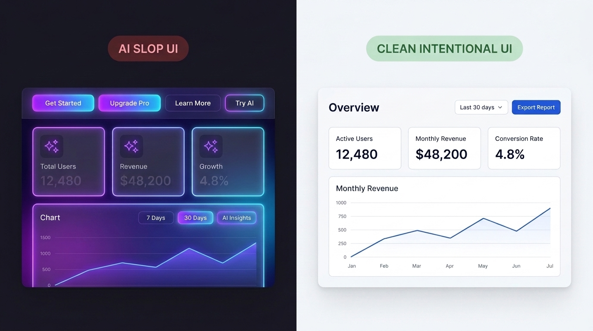

**1. Bảng màu tím-xanh rập khuôn:** Nền tối hoặc trắng đi kèm tím/xanh gradient mặc định. *Khắc phục:* Chọn 1 màu chính hợp lĩnh vực và giữ bảng màu tiết chế.

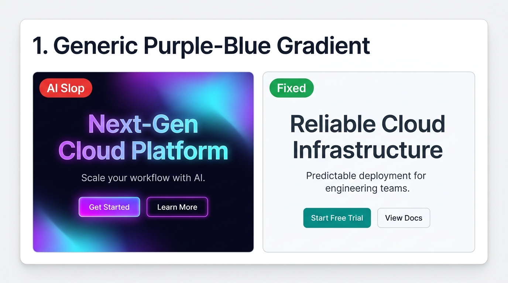

**2. Lạm dụng kính mờ và phát sáng:** Thẻ nào cũng có shadow lớn, viền `glow` hoặc `blur`. *Khắc phục:* Dùng nền phẳng, viền `1px` mảnh và khoảng cách rõ ràng.

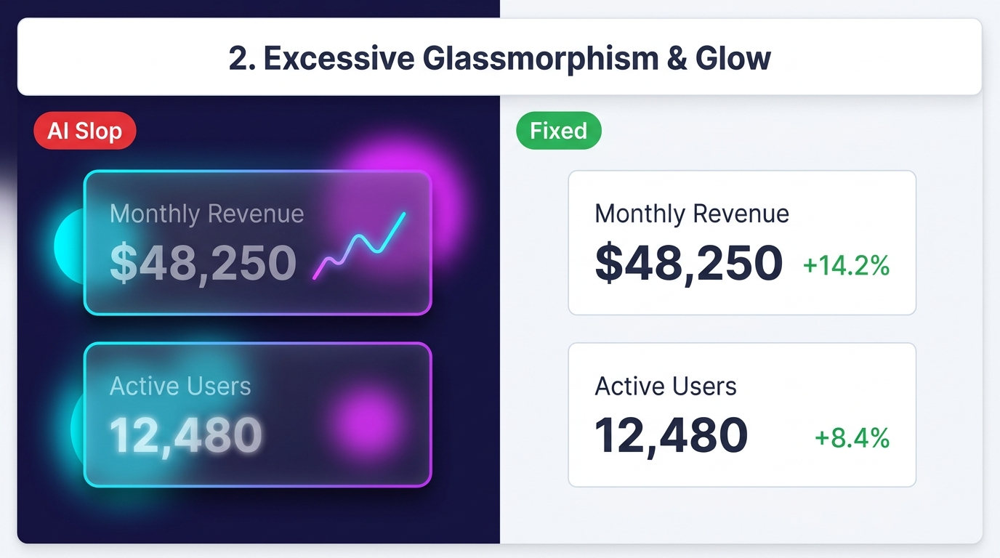

**3. Bố cục 3-card icon rập khuôn:** Chia 3 cột đều nhau: icon tròn + tiêu đề + 2 dòng mô tả. *Khắc phục:* Thiết kế theo đúng tác vụ chính (ô tìm kiếm, bộ lọc, danh sách).

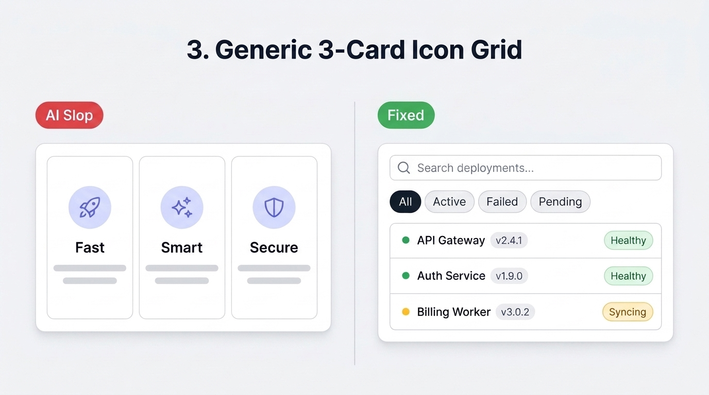

**4. Nội dung giả, văn bản sáo rỗng:** *"Unlock your potential"*, số liệu giả `99.9%` không liên quan. *Khắc phục:* Viết nhãn nút/tiêu đề tiếng Việt sát dữ liệu thật từ API.

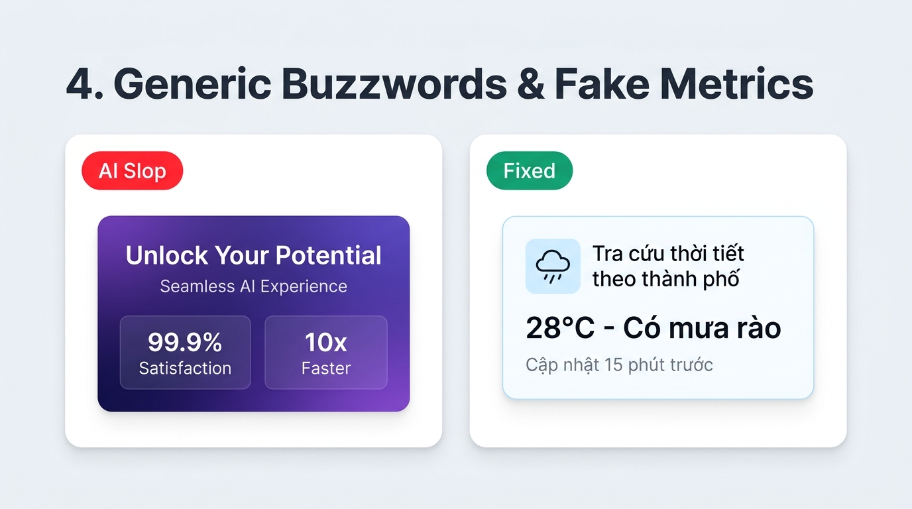

**5. Thiếu trạng thái thực tế:** Chỉ có màn hình đầy đủ dữ liệu; thiếu Loading/Empty/Error. *Khắc phục:* Bắt buộc bổ sung đủ 4 trạng thái: Content, Loading, Empty, Error.

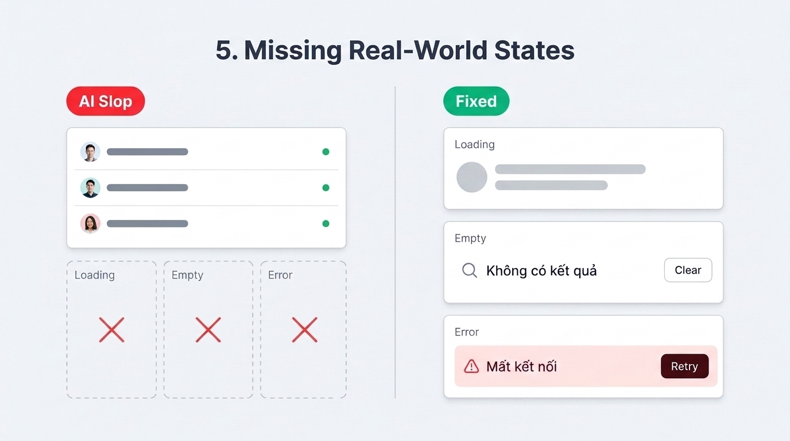

**6. Mất phân cấp thị giác (Quá nhiều CTA):** Nhiều nút trong 1 vùng cùng tô màu nổi bật giống nhau. *Khắc phục:* Mỗi vùng chỉ giữ 1 Primary CTA; còn lại dùng Secondary/Ghost.

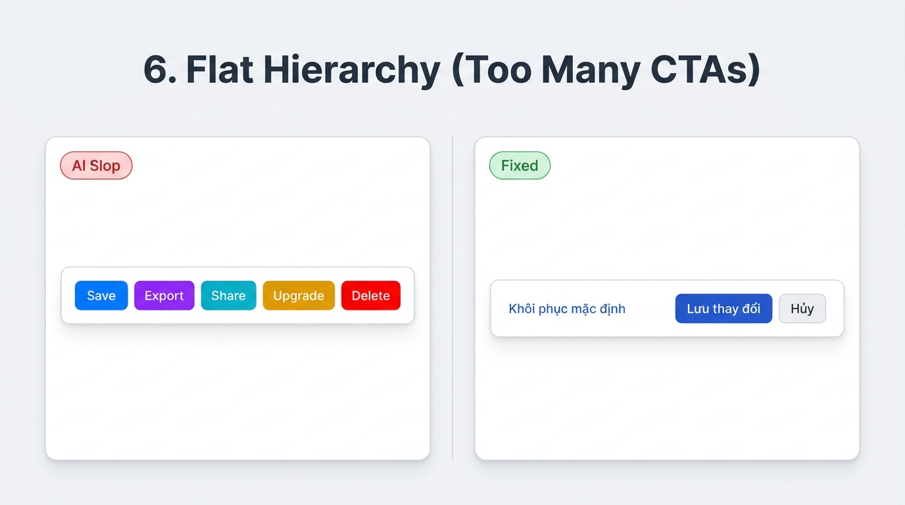

**7. Độ tương phản màu kém:** Chữ xám nhạt trên nền trắng hoặc chữ trắng trên nền sáng. *Khắc phục:* Kiểm tra tỷ lệ tương phản WCAG AA (`>= 4.5:1`).

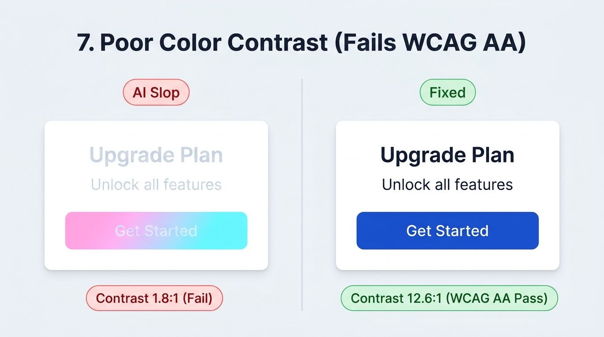

**8. Spacing và cỡ chữ lộn xộn:** Mỗi khối một cỡ chữ và khoảng đệm ngẫu nhiên. *Khắc phục:* Khóa theo Design Tokens (bội số `4px` / `8px`).

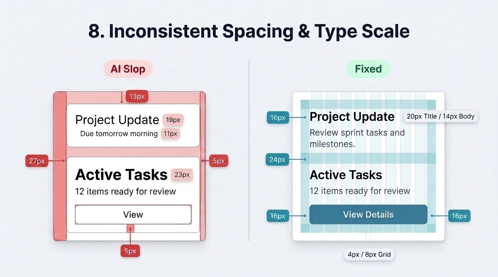

**9. Chi tiết trang trí thừa:** Dày đặc badge màu mè, biểu đồ giả không tương tác được. *Khắc phục:* Xóa mọi thành phần không phục vụ đọc hoặc thao tác dữ liệu.

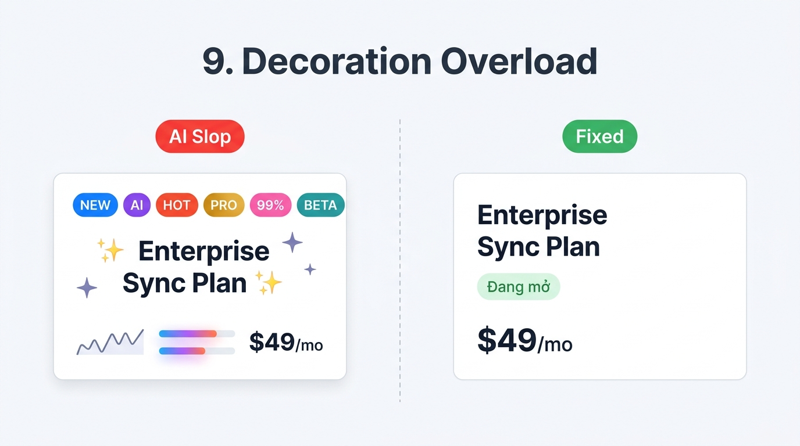

---

## Phần 5: CHUẨN BỊ MÔI TRƯỜNG PHÁT TRIỂN FRONTEND

### I. Công cụ cần cài đặt và Lý do chọn Node.js LTS

- **VS Code (`https://code.visualstudio.com/`):** Trình soạn thảo mã nguồn chuẩn cho Frontend. Nên cài thêm `Prettier` (định dạng code), `Live Server` (chạy nhanh HTML), `ESLint` (bắt lỗi JS).
- **Node.js bản LTS (`https://nodejs.org/`) + `npm`:** Nền tảng để cài thư viện và chạy các công cụ build (Vite, Next.js) ở các buổi sau.
- **Công cụ AI chat (Claude, ChatGPT, Gemini, Antigravity...):** Dùng để hỏi giải thích bản chất lỗi, phản biện User Flow, soi lỗi AI Slop và sinh dữ liệu biên.

| Tiêu chí                 | Node.js bản LTS (Long Term Support)             | Node.js bản Current                            |
| :----------------------- | :---------------------------------------------- | :--------------------------------------------- |
| **Đặc điểm**             | Ổn định, được hỗ trợ và vá lỗi dài hạn          | Thử nghiệm tính năng mới nhất vừa phát hành    |
| **Tương thích thư viện** | Cao, hầu hết công cụ Frontend kiểm thử trên LTS | Dễ gặp lỗi lệch phiên bản với một số gói npm   |
| **Khuyến nghị**          | **Bắt buộc chọn** cho học tập và dự án thực tế  | Chỉ dùng khi cần thử tính năng mới của Node.js |

---

### II. Lệnh kiểm tra nhanh môi trường

Mở Terminal (hoặc `Ctrl + ~` trong VS Code) và chạy 4 lệnh sau để xác nhận đều trả về số phiên bản hợp lệ (không báo lỗi `not recognized` / `command not found`):

```bash
node -v        # Kiểm tra Node.js (bản LTS)
npm -v         # Kiểm tra trình quản lý gói npm
code --version # Kiểm tra lệnh mở VS Code từ Terminal
git --version  # Kiểm tra Git sẵn sàng đẩy bài lên GitHub
```

---

## Phần 6: KIẾN THỨC NỀN TẢNG VÀ HƯỚNG DẪN SƠ BỘ CHO BÀI TẬP (REPO RIÊNG)

### I. Chốt đề tài dùng API ngoài và Viết README (3-5 câu)

- **Tiêu chí chọn đề tài nhỏ:** Gọn trong **2-3 màn hình chính**, dùng dữ liệu sống từ Public API hỗ trợ CORS (hoặc Backend API sẵn có), có ít nhất 1 luồng tìm kiếm/lọc và 1 luồng xem chi tiết.
- **Gợi ý đề tài nhỏ dùng Public API miễn phí (nếu cần tham khảo thêm ngoài dự án chính):**
  - *Đề xuất gọn nhất:* **Tra cứu Thời tiết theo thành phố** dùng **Open-Meteo API** (`open-meteo.com`, miễn phí, không cần API key, hỗ trợ CORS).
  - *Gợi ý khác:* **TheMealDB** (công thức nấu ăn), **Jikan API** (anime), **GitHub REST API** (hồ sơ & repo).
- **Khung viết `README.md` (3-5 câu):** Trả lời thẳng 4 ý: *(1) Sản phẩm là gì & dùng API nào? (2) Dành cho ai? (3) Giải quyết vấn đề gì? (4) Gồm 2-3 chức năng chính nào?*

---

### II. Vẽ User Flow và Wireframe (đủ trạng thái Loading, Empty, Error)

- **User Flow:** Sơ đồ luồng thao tác từ lúc vào app đến khi hoàn thành mục tiêu, thể hiện rõ nhánh thành công và nhánh lỗi.
- **Wireframe:** Phác thảo khung sườn đen-trắng (giấy, Excalidraw hoặc Figma) cho **2-3 màn hình chính**, dùng nhãn nút thật (không dùng *Lorem ipsum*) để kiểm tra cấu trúc trước khi tô màu.


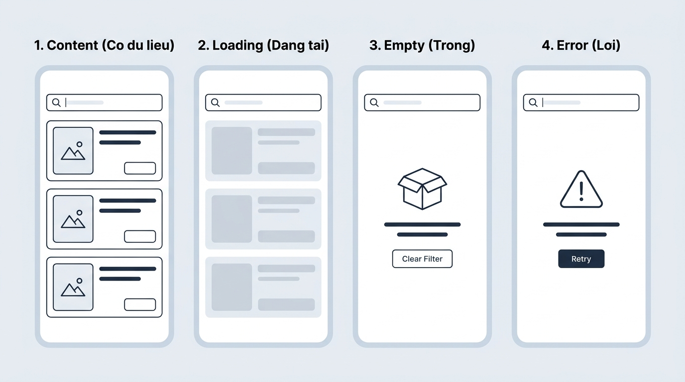

| Trạng thái  | Khi nào xảy ra                      | Thành phần UI cần thể hiện                      | Lưu ý UX                                           |
| :---------- | :---------------------------------- | :---------------------------------------------- | :------------------------------------------------- |
| **Content** | API trả về dữ liệu hợp lệ           | Danh sách card/bảng, nút hành động chính        | Chừa không gian cho tên/tiêu đề dài 2 dòng         |
| **Loading** | Đang chờ phản hồi từ server         | **Skeleton** hoặc Spinner + `"Đang tải..."`     | Khóa nút gửi để tránh bấm trùng                    |
| **Empty**   | Chưa có dữ liệu hoặc lọc không khớp | Câu giải thích ngắn + 1 nút hành động tiếp theo | Không để khoảng trắng trống trơn                   |
| **Error**   | Mất mạng, timeout, lỗi `4xx`/`5xx`  | Câu báo lỗi dễ hiểu + nút `"Thử lại"`           | Không in lỗi kỹ thuật thô; giữ lại dữ liệu đã nhập |

---

### III. Sinh giao diện bằng Google Stitch (hoặc AI) và Bắt ít nhất 5 lỗi "AI Slop"

1. Viết prompt có ngữ cảnh rõ từ Wireframe của 1 màn chính (đối tượng dùng, thiết bị, tông màu, dữ liệu thật).
2. Sinh giao diện bằng Google Stitch (hoặc công cụ AI khác) và chụp lại ảnh gốc chưa chỉnh sửa vào repo bài tập.
3. Đối chiếu với **10 Usability Heuristics** (Phần 3) và **Checklist AI Slop** (Phần 4) để ghi nhận tối thiểu **5 lỗi** theo bảng mẫu:

|  STT  | Vị trí lỗi           | Lỗi "AI Slop" phát hiện                | Lý do (ảnh hưởng UI/UX)                           | Hướng sửa đề xuất                            |
| :---: | :------------------- | :------------------------------------- | :------------------------------------------------ | :------------------------------------------- |
|   1   | Ví dụ: Toàn màn hình | Thiếu trạng thái Loading, Empty, Error | Người dùng tưởng treo trang khi API chậm hoặc lỗi | Bổ sung Skeleton, Empty State và nút Thử lại |

---

### IV. Lập bảng Design Tokens nháp cho dự án

Cần chốt trước 3 nhóm biến ngữ nghĩa để giữ đồng bộ giao diện và ánh xạ sang CSS `:root` ở các buổi sau:
1. **Color Tokens:** Màu chính (`Primary`), Màu trung tính (`Neutral`: nền trang, nền thẻ, viền, chữ chính/phụ — đảm bảo tương phản WCAG AA `>= 4.5:1`), Màu trạng thái (`Success`, `Warning`, `Error`).
2. **Typography Tokens:** 1-2 họ font hỗ trợ tiếng Việt (`Inter`, `Be Vietnam Pro`, `Plus Jakarta Sans`), thang cỡ chữ (`12px`, `14px`, `16px`, `20px`, `24px`) và `line-height` (~`1.5`).
3. **Spacing Scale:** Bội số `4px` / `8px` (`4px, 8px, 12px, 16px, 24px, 32px`).

---

### V. Hồ sơ sơ bộ dự án cá nhân dự kiến: OmniLife


**1. Bối cảnh thay đổi quy mô:**


**2. Bản nháp README (3-5 câu) cho dự án OmniLife (Phạm vi Frontend MVP):**

> **OmniLife** là ứng dụng web quản trị năng suất và học tập cá nhân theo phong cách Dark-First Bento Grid, kết nối với Backend RESTful API (Java/Spring Boot) cùng Google OAuth2 và Google Calendar API. Sản phẩm dành cho sinh viên ngành CNTT (18-23 tuổi) và lập trình viên làm việc nhiều giờ trên máy tính. Ứng dụng giải quyết tình trạng phải mở rời rạc nhiều app (quản lý việc, lịch biểu, ôn thi, ghi chép chi tiêu) và khắc phục lỗi quên deadline nhờ cơ chế tính điểm khẩn cấp động ($U \in [0, 100]$). Trong phạm vi khóa Frontend, dự án tập trung vào 3 màn hình chính: Đăng nhập/Xác thực, Dashboard công việc khẩn cấp (kèm Pomodoro) và Không gian học tập/Ngân sách cá nhân.

**3. Phạm vi 3 màn hình chính cho User Flow & Wireframe Buổi 1 (MVP):**

1. **Màn hình 1 — Dashboard & Dynamic Tasks:** Danh sách công việc sắp xếp theo điểm khẩn cấp ($U \in [0, 100]$ với 5 cấp độ màu), bộ lọc/tìm kiếm nhanh, tạo/sửa task (phục vụ thực hành Form UX & API).
2. **Màn hình 2 — Study Workspace (hoặc Finance Ledger):** Theo dõi danh sách môn học / kỳ thi sắp tới (hoặc sổ thu-chi theo ví và cảnh báo ngân sách 80%/100%).
3. **Màn hình 3 — Login & Settings:** Đăng nhập Email/Mật khẩu hoặc Google OAuth2, chuyển đổi Dark/Light Mode (phục vụ Protected Route & xử lý `401` ở Buổi 6).

- **Quy chuẩn 4 trạng thái từ `docs/design-system.md`:**
  - **Loading:** Dùng **Shimmer Skeleton** khớp kích thước thẻ Bento (tránh Spinner toàn màn hình, giữ `CLS = 0`).
  - **Empty:** SVG nét mảnh + câu hướng dẫn + nút hành động trực tiếp (nhấn `C` thêm việc mới).
  - **Error & Conflict:** Lỗi nhập liệu `#EF4444` (`12px`) dưới ô input; lỗi mạng hoặc `409 Conflict` hiện Toast ở góc dưới phải kèm nút `"Tải lại dữ liệu mới nhất"`.

**4. Bảng Design Tokens chốt sẵn từ `docs/design-system.md`:**

| Nhóm Token           | Tên Token                                 | Dark Mode (Mặc định)                          | Light Mode            | Mục đích sử dụng                                              |
| :------------------- | :---------------------------------------- | :-------------------------------------------- | :-------------------- | :------------------------------------------------------------ |
| **Màu chính**        | `--accent-primary` / `hover`              | `#6366F1` / `#4F46E5`                         | `#6366F1` / `#4F46E5` | Nút hành động chính (Primary CTA), trạng thái Active          |
| **Màu nền**          | `--bg-canvas` / `--bg-surface-1`          | `#090A0F` / `#11131A`                         | `#F8FAFC` / `#FFFFFF` | Nền trang và nền các khối Bento Card, Sidebar                 |
| **Màu phụ & Viền**   | `--bg-surface-2` / `--border-subtle`      | `#181B24` / `#222634`                         | `#F1F5F9` / `#E2E8F0` | Nền thẻ con, Input và đường viền `1px`                        |
| **Màu chữ**          | `--text-primary` / `--text-secondary`     | `#F3F4F6` / `#9CA3AF`                         | `#0F172A` / `#475569` | Tiêu đề, nội dung chính và mô tả phụ                          |
| **Màu trạng thái**   | `success` / `warning` / `danger` / `info` | `#10B981` / `#F59E0B` / `#EF4444` / `#3B82F6` | Giống Dark Mode       | Hoàn thành / Cảnh báo 80% / Quá hạn & Lỗi / Lịch Google       |
| **Font chữ**         | `--font-sans` / `--font-mono`             | `Inter, Plus Jakarta Sans` / `JetBrains Mono` | Giống Dark Mode       | Văn bản tiếng Việt và số liệu đếm ngược (`tabular-nums`)      |
| **Cỡ chữ & Spacing** | Type Scale / Base `4px`                   | `12, 14, 15, 18, 24, 36px` / `4px–32px`       | Giống Dark Mode       | Bento `gap: 16px`, bo góc Card `12px`, Nút `8px`, Badge `6px` |

---

## Tóm tắt nhanh

| Chủ đề                     | Ý cần nhớ                                                                                                                                   |
| :------------------------- | :------------------------------------------------------------------------------------------------------------------------------------------ |
| **Từ URL đến trang web**   | DNS 4 tầng cache -> TCP (+ TLS) -> HTTP Request/Response HTML -> DOM + CSSOM -> Render Tree -> Layout -> Paint & Composite (`defer` cho JS) |
| **UX và UI**               | UX là luồng trải nghiệm và giải quyết bài toán (đi trước); UI là giao diện trực quan và chi tiết tương tác (đi sau)                         |
| **10 Heuristics (NN/g)**   | Phản hồi trạng thái, ngôn ngữ tự nhiên, cho phép hủy/hoàn tác, nhất quán, phòng ngừa lỗi sớm, báo lỗi kèm cách sửa                          |
| **AI Slop**                | Tránh màu tím-xanh rập khuôn, nội dung giả sáo rỗng, chữ thiếu tương phản và thiếu trạng thái Loading/Empty/Error                           |
| **Môi trường Frontend**    | Cài VS Code, Node.js bản **LTS** (không dùng Current), Git và 1 công cụ AI chat; kiểm tra bằng `node -v`, `npm -v`                          |
| **Bài tập & OmniLife MVP** | Thu gọn OmniLife từ 8 phân hệ xuống MVP 3 màn hình khớp lộ trình 7 buổi, đủ 4 trạng thái và dùng bộ Design Tokens `#090A0F` / `#6366F1`     |
