# [BUỔI 14] HTML & CSS: TỪ THIẾT KẾ RA LAYOUT

*Tài liệu chuẩn bị buổi 14 - Khóa Frontend Cơ bản (Buổi 2)*

---

**Mục lục:**

- [\[BUỔI 14\] HTML \& CSS: TỪ THIẾT KẾ RA LAYOUT](#buổi-14-html--css-từ-thiết-kế-ra-layout)
  - [Phần 1: HTML NGỮ NGHĨA VÀ BIỂU MẪU](#phần-1-html-ngữ-nghĩa-và-biểu-mẫu)
    - [I. Thẻ HTML thông dụng, Cấu trúc Semantic HTML5 và Phân cấp tiêu đề](#i-thẻ-html-thông-dụng-cấu-trúc-semantic-html5-và-phân-cấp-tiêu-đề)
    - [II. Phân biệt Link và Button, Biểu mẫu Form chuẩn và Thuộc tính alt](#ii-phân-biệt-link-và-button-biểu-mẫu-form-chuẩn-và-thuộc-tính-alt)
  - [Phần 2: ACCESSIBILITY CƠ BẢN CHO FRONTEND](#phần-2-accessibility-cơ-bản-cho-frontend)
    - [I. Điều hướng bàn phím, focus-visible và Độ tương phản WCAG AA](#i-điều-hướng-bàn-phím-focus-visible-và-độ-tương-phản-wcag-aa)
    - [II. Quy tắc số 1 của ARIA và Các thuộc tính cần dùng](#ii-quy-tắc-số-1-của-aria-và-các-thuộc-tính-cần-dùng)
  - [Phần 3: MÔ HÌNH TƯ DUY CSS](#phần-3-mô-hình-tư-duy-css)
    - [I. Thuộc tính CSS cơ bản (Màu, Font, Nền), Selector và Pseudo-class](#i-thuộc-tính-css-cơ-bản-màu-font-nền-selector-và-pseudo-class)
    - [II. The Cascade, Specificity và Kế thừa (Inheritance)](#ii-the-cascade-specificity-và-kế-thừa-inheritance)
    - [III. Box Model, box-sizing, display và position](#iii-box-model-box-sizing-display-và-position)
  - [Phần 4: LAYOUT HIỆN ĐẠI VÀ RESPONSIVE DESIGN](#phần-4-layout-hiện-đại-và-responsive-design)
    - [I. Flexbox (1 chiều), CSS Grid (2 chiều) và Flexbox Froggy / Grid Garden](#i-flexbox-1-chiều-css-grid-2-chiều-và-flexbox-froggy--grid-garden)
    - [II. Mobile-First, Media Query, rem, clamp() và CSS Variables (Design Tokens)](#ii-mobile-first-media-query-rem-clamp-và-css-variables-design-tokens)
    - [III. Đọc thêm CSS hiện đại: :has(), Container Queries và CSS Nesting](#iii-đọc-thêm-css-hiện-đại-has-container-queries-và-css-nesting)
  - [Phần 5: DEBUG CSS BẰNG DEVTOOLS, LIGHTHOUSE VÀ AI](#phần-5-debug-css-bằng-devtools-lighthouse-và-ai)
    - [I. Chrome DevTools: Inspect Box Model, Flex/Grid Overlay và Device Mode](#i-chrome-devtools-inspect-box-model-flexgrid-overlay-và-device-mode)
    - [II. Lighthouse Accessibility, axe DevTools / WAVE và AI (Cursor / Copilot)](#ii-lighthouse-accessibility-axe-devtools--wave-và-ai-cursor--copilot)
  - [Phần 6: THỰC HÀNH ĐẠT OUTPUT BUỔI 14 (OMNILIFE MVP VÀ DEPLOY)](#phần-6-thực-hành-đạt-output-buổi-14-omnilife-mvp-và-deploy)
    - [I. Mã nguồn mẫu Dashboard OmniLife (index.html và styles.css)](#i-mã-nguồn-mẫu-dashboard-omnilife-indexhtml-và-stylescss)
    - [II. Checklist Output (A11y từ 90 điểm, Bàn phím 100%) và Deploy GitHub Pages / Netlify](#ii-checklist-output-a11y-từ-90-điểm-bàn-phím-100-và-deploy-github-pages--netlify)
  - [Tóm tắt nhanh](#tóm-tắt-nhanh)

---

## Phần 1: HTML NGỮ NGHĨA VÀ BIỂU MẪU

> **Bài toán thực tế:** Nếu cả trang web chỉ ghép từ `<div>` và `<span>` (*Div Soup*), Googlebot và trình đọc màn hình của người khiếm thị sẽ "mù đường" vì không biết đâu là menu, đâu là nút bấm hay nội dung chính.

### I. Thẻ HTML thông dụng, Cấu trúc Semantic HTML5 và Phân cấp tiêu đề

- **Nhóm thẻ HTML thông dụng:** Văn bản (`<h1>`-`<h6>`, `<p>`, `<strong>`, `<em>`, `<span>`); Danh sách (`<ul>`, `<ol>`, `<li>`); Tương tác & Đa phương tiện (`<a href>`, `<button>`, ``, `<form>`, `<label>`, `<input>`, `<select>`, `<textarea>`).


| Thẻ HTML5 | Landmark Role | Vai trò cốt lõi trên trang |
| :--- | :--- | :--- |
| `<header>` | `banner` | Phần đầu trang chứa Logo, thanh tìm kiếm hoặc phần đầu của một `<article>`. |
| `<nav>` | `navigation` | Nhóm liên kết điều hướng chính (Navbar, Sidebar, Breadcrumb). |
| `<main>` | `main` | Nội dung cốt lõi, độc nhất của trang (**chỉ duy nhất 1 thẻ `<main>` mỗi trang**). |
| `<section>` | `region` | Nhóm các nội dung cùng một chủ đề (nên có heading `<h2>`-`<h6>` bên trong). |
| `<article>` | `article` | Khối nội dung **tự đứng độc lập** (1 bài viết, 1 thẻ sản phẩm, 1 bình luận). |
| `<aside>` | `complementary` | Nội dung bổ trợ đặt cạnh phần chính (Sidebar bộ lọc, widget Pomodoro). |
| `<footer>` | `contentinfo` | Chân trang chứa bản quyền, liên kết phụ, thông tin liên hệ. |

- **Phân cấp tiêu đề (`<h1>` - `<h6>`):** Mỗi trang giữ đúng **1 thẻ `<h1>`**, đi tuần tự `h1 -> h2 -> h3` (tuyệt đối không nhảy cóc). Muốn chữ to hay nhỏ, hãy chỉnh bằng CSS `font-size` thay vì chọn bừa cấp thẻ heading.

### II. Phân biệt Link và Button, Biểu mẫu Form chuẩn và Thuộc tính alt

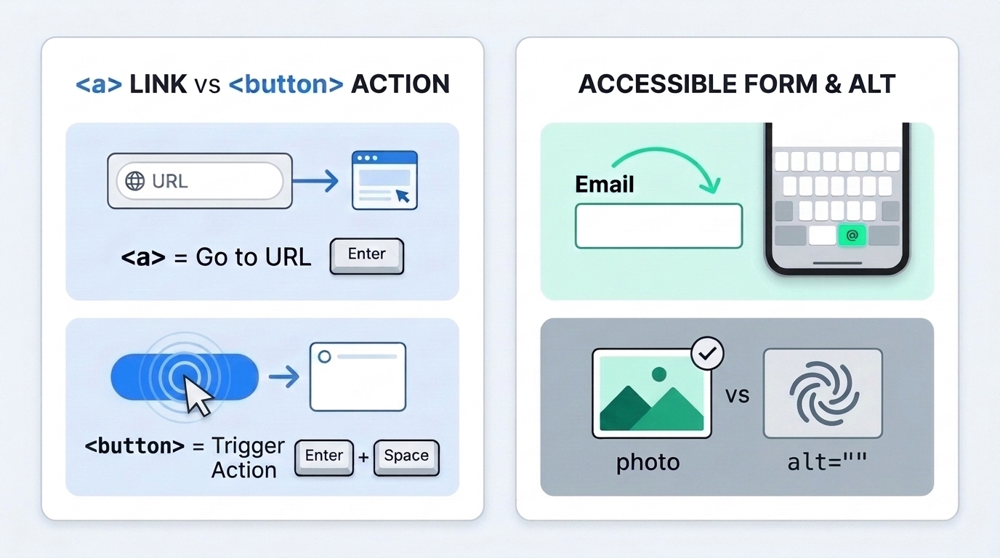

| Tiêu chí | `<a href="...">` (Link) | `<button type="...">` (Nút bấm) |
| :--- | :--- | :--- |
| **Châm ngôn nhớ nhanh** | *"Links go places"* — Chuyển sang URL mới hoặc nhảy neo `#id`. | *"Buttons do things"* — Đổi trạng thái tại chỗ (gửi form, mở modal, xóa). |
| **Bàn phím & Chuột phải** | Chỉ kích hoạt bằng `Enter` (`Space` cuộn trang); mở được tab mới. | Kích hoạt bằng cả `Enter` và `Space`; ghi rõ `type="button"` nếu không submit. |

> **Bẫy hay gặp:** Không dùng `<a href="#">` làm nút mở Modal (nhấn `Space` sẽ bị giật cuộn trang), và không dùng `<div onclick>` thay `<button>` vì phím `Tab` bỏ qua thẻ `<div>`.

- **3 nguyên tắc vàng khi dựng Form (`<form>`):**
  1. Luôn nối `<label for="...">` với `<input id="...">` (không thay bằng `placeholder` vì gõ chữ sẽ biến mất).
  2. Chọn đúng `input type` (`email`, `tel`, `search`, `date`, `number`) để điện thoại bật đúng bàn phím ảo (như phím `@`).
  3. Dùng `required`, `minlength` kết hợp CSS `:user-invalid` (khác `:invalid` là báo đỏ ngay lúc mở trang, `:user-invalid` chỉ báo lỗi *sau khi* người dùng chạm vào ô rồi rời đi).

```html
<form class="quick-task-form" novalidate>
  <label for="task-name">Tên công việc *</label>
  <input id="task-name" name="title" type="text" required minlength="3" placeholder="Ví dụ: Ôn CSS Grid" />

  <label for="task-email">Email nhắc lịch</label>
  <input id="task-email" name="email" type="email" required />

  <button type="submit">Thêm công việc</button>
</form>
```

| Loại hình ảnh (``) | Cách viết `alt` đúng chuẩn W3C | Lý do |
| :--- | :--- | :--- |
| **Ảnh nội dung / minh họa** | `alt="Bàn phím cơ 75% màu đen"` | Mô tả ngắn gọn nội dung ảnh (tránh mở đầu bằng *"Hình ảnh của..."*). |
| **Ảnh làm nút / Logo về Home** | `alt="OmniLife - Về trang chủ"` | Mô tả **đích đến hoặc hành động** thay vì tả hình dáng logo. |
| **Ảnh thuần túy trang trí** | **`alt=""`** (Chuỗi rỗng) | Screen Reader sẽ bỏ qua hoàn toàn, không đọc lặp chữ rác. |
| **Quên hẳn thuộc tính `alt`** | Tránh tuyệt đối! | Trình đọc màn hình sẽ đọc to tên file (`IMG_001.jpg`) và Lighthouse trừ điểm nặng. |

---

## Phần 2: ACCESSIBILITY CƠ BẢN CHO FRONTEND

> **Thử thách 2 phút không dùng chuột:** Rút chuột ra và đi hết trang web chỉ với `Tab`, `Shift + Tab`, `Enter`, `Space` và `Esc`. Nếu không thấy con trỏ đang đứng đâu, người dùng sẽ bị kẹt.

### I. Điều hướng bàn phím, focus-visible và Độ tương phản WCAG AA

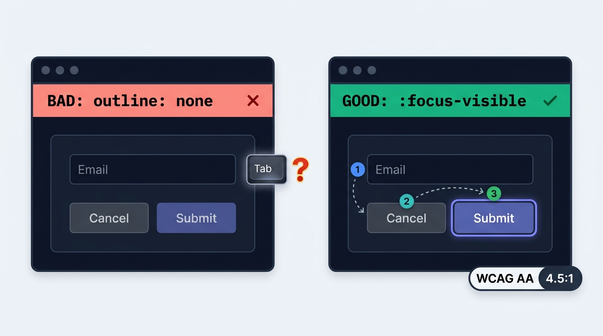


| Trụ cột A11y | Quy tắc bắt buộc | Mẹo thực hành chuẩn |
| :--- | :--- | :--- |
| **Keyboard & `tabindex`** | Mọi thao tác phải dùng được bằng phím; đặt `Skip link` nhảy thẳng tới `#main`. | Ưu tiên thẻ HTML gốc; chỉ dùng `tabindex="0"` / `"-1"` khi cần, **cấm `tabindex > 0`**. |
| **`:focus-visible`** | Tuyệt đối không viết `*:focus { outline: none; }` khiến bàn phím "mù đường". | Dùng `:focus-visible` để chỉ bật vòng sáng khi nhấn `Tab`, ẩn gọn khi click chuột. |
| **Độ tương phản (WCAG AA)** | Chữ thường đạt tối thiểu **`4.5 : 1`**; chữ lớn (`>= 24px`) & viền input đạt **`3.0 : 1`**. | Trên Dark Mode `#11131A`, dùng chữ `#F3F4F6` và nền nút `#4F46E5` (`~6.28:1`). |

```css
/* Chuẩn mực A11y: Dùng outline thay cho box-shadow để tương thích Windows High Contrast Mode */
:focus-visible {
  outline: 2px solid var(--accent-focus, #818CF8);
  outline-offset: 3px;
}
```

### II. Quy tắc số 1 của ARIA và Các thuộc tính cần dùng

> **Quy tắc số 1 (W3C):** *"No ARIA is better than Bad ARIA"* — Luôn dùng thẻ HTML gốc (`<button>`, `<nav>`) trước; chỉ thêm ARIA khi HTML thuần chưa diễn đạt được tên nút hoặc trạng thái động.

| Thuộc tính ARIA | Khi nào bắt buộc dùng | Ví dụ chuẩn |
| :--- | :--- | :--- |
| `aria-label="..."` | Nút chỉ có icon SVG, không có chữ hiển thị. | `<button type="button" aria-label="Đóng hộp thoại">X</button>` |
| `aria-hidden="true"` | Icon trang trí hoặc dấu `*` để máy đọc bỏ qua. | `<span aria-hidden="true">*</span>` |
| `aria-expanded` | Báo trạng thái đang mở (`true`) hay đóng (`false`) của menu. | `<button aria-expanded="false" aria-controls="menu">Menu</button>` |
| `aria-live="polite"` | Thông báo động (Toast lưu xong, báo lỗi) tự đọc cho người dùng. | `<div role="status" aria-live="polite">Đã lưu!</div>` |

---

## Phần 3: MÔ HÌNH TƯ DUY CSS

> **Bí ẩn đầu tiên của CSS (theo `web.dev`):** Tại sao bạn đặt `width: 200px; padding: 20px; border: 5px;` nhưng lên màn hình chiếc hộp lại phình thành **`250px`** làm vỡ cột?

### I. Thuộc tính CSS cơ bản (Màu, Font, Nền), Selector và Pseudo-class

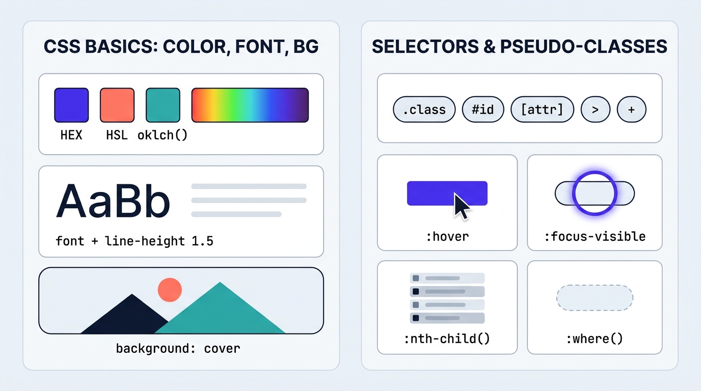

| Nhóm kiến thức | Thành phần cốt lõi | Ghi nhớ thực chiến |
| :--- | :--- | :--- |
| **Màu, Font, Nền** | `HEX`, `HSL`, `oklch()`, `font-family`, `line-height`, `background-size: cover` | Chọn font hỗ trợ tiếng Việt (`Inter`, `Be Vietnam Pro`); `line-height: 1.5` (không đơn vị) giúp chữ tự thoáng theo cỡ font. |
| **Selectors & Combinators** | `.class`, `#id`, `[attr]`, `A B` (hậu duệ), `A > B` (con trực tiếp), `A + B` (liền kề) | Ưu tiên `.class` phẳng và `>` để tránh CSS rò rỉ xuống sâu; dùng `.stack > * + *` tạo khoảng cách đều giữa các khối. |
| **Pseudo-class & Element** | `:hover`, `:focus-visible`, `:nth-child()`, `:is()`, `:where()`, `::before`, `::after` | `:where(...)` có độ đặc hiệu bằng `0`; `::before`/`::after` dùng cho chi tiết trang trí và bắt buộc có `content: ""`. |

### II. The Cascade, Specificity và Kế thừa (Inheritance)


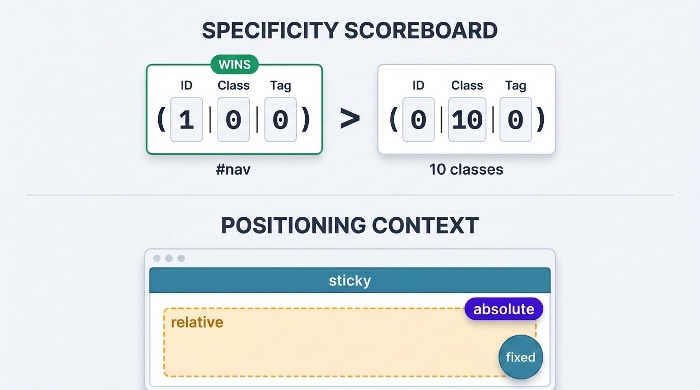

- **The Cascade & `@layer`:** Thứ tự thắng là `Origin / !important` > `Inline style` > `Specificity` > `Viết sau thắng`. Dùng `@layer reset, base, components;` để phân tầng sạch thay vì lạm dụng `!important`.
- **Specificity `(A, B, C)`:** Đếm `(ID, Class/Attr/Pseudo, Tag)` và so từng cột từ trái sang phải (`1` ID `(1,0,0)` luôn thắng `10` Class `(0,10,0)`).
- **Inheritance:** Tự truyền thuộc tính chữ (`color`, `font-*`, `line-height`) từ cha xuống con, không truyền khung hộp (`margin`, `padding`, `border`). Thẻ `<button>`, `<input>` không tự kế thừa font từ `body` nên phải reset `font: inherit;`.

### III. Box Model, box-sizing, display và position

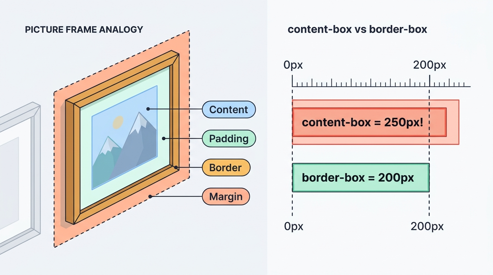

- **Ẩn dụ khung tranh (`web.dev`):** **Content** (bức tranh) -> **Padding** (bìa lót) -> **Border** (khung gỗ) -> **Margin** (khoảng cách giữa các tranh). Mặc định `content-box` cộng `padding + border` ra ngoài làm hộp `200px` phình thành `250px`; luôn bật **`box-sizing: border-box`** để khóa đúng `200px`.
- **Margin Collapse & Ẩn phần tử:** Hai lề dọc xếp chồng bị gộp lấy số lớn hơn (dùng Flex/Grid + **`gap`** để triệt tiêu). Phân biệt ẩn: `display: none` (mất chỗ và mất khỏi A11y Tree) khác `visibility: hidden` (giữ chỗ, không Tab được) và `opacity: 0` (vô hình nhưng vẫn giữ chỗ và **vẫn bấm/Tab trúng**).

```css
/* CSS Reset hiện đại gọn nhẹ (Josh W. Comeau) */
*, *::before, *::after { box-sizing: border-box; }
* { margin: 0; }
img, picture, svg { display: block; max-width: 100%; }
input, button, textarea, select { font: inherit; color: inherit; }
```

| Thuộc tính & Giá trị | Hành vi & Quy tắc cần nhớ | Ứng dụng phổ biến |
| :--- | :--- | :--- |
| `display`: `block` / `inline` / `inline-block` / `none` | `block` xuống dòng, chỉnh được `width/height`; `inline` cùng dòng nhưng bỏ qua `width/height/margin dọc`; `none` ẩn cả DOM & A11y Tree. | Bố cục khối, thẻ nội tuyến, nút bấm hoặc ẩn hẳn panel. |
| `position: relative` | Nằm trong luồng bình thường; **đóng vai trò mỏ neo** cho con `absolute`. | Bọc Card hoặc ô tìm kiếm có icon/badge đặt ở góc. |
| `position: absolute` | Nhấc khỏi luồng; bám theo **tổ tiên gần nhất khác `static`** (hoặc Viewport). | Huy hiệu thông báo góc Card, nút `X` góc Modal. |
| `position: fixed` / `sticky` | `fixed` bám cố định màn hình; `sticky` dính lại khi cuộn chạm `top: 0`. | Header dính đầu trang (**lưu ý:** cha dùng `overflow: clip`, tránh `overflow: hidden`). |

---

## Phần 4: LAYOUT HIỆN ĐẠI VÀ RESPONSIVE DESIGN

> **Nguyên tắc chọn nhanh (Rachel Andrew):** Flexbox là **1 chiều (Content-Out)** để dàn 1 hàng hoặc 1 cột; CSS Grid là **2 chiều (Layout-In)** để kiểm soát đồng thời cả hàng lẫn cột.

### I. Flexbox (1 chiều), CSS Grid (2 chiều) và Flexbox Froggy / Grid Garden

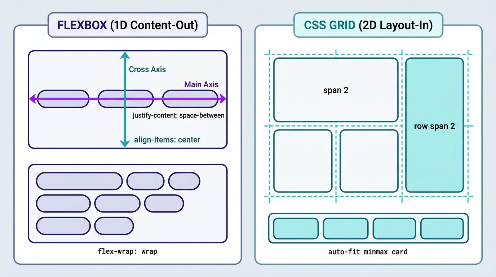

| Bài toán giao diện | Công cụ chọn | Công thức CSS cốt lõi |
| :--- | :--- | :--- |
| Navbar, nhóm nút, Tag tự xuống dòng | **Flexbox** | `display: flex; flex-wrap: wrap; justify-content: space-between; align-items: center; gap: 1rem;` |
| Đẩy nút đáy Card luôn thẳng hàng nhau | **Flexbox** (`column`) | Card đặt `display: flex; flex-direction: column;`, nút cuối đặt `margin-top: auto;`. |
| Bento Grid (ô to chiếm 2 cột/2 hàng) | **CSS Grid** | `grid-template-columns: repeat(3, 1fr); gap: 1rem;` kết hợp `grid-column: span 2;` / `grid-row: span 2;`. |
| Lưới thẻ tự co cột không cần `@media` | **CSS Grid (RAM)** | `grid-template-columns: repeat(auto-fit, minmax(min(280px, 100%), 1fr));` |

- **Quy luật luyện nhanh Flexbox Froggy (24 màn) & Grid Garden (28 màn):** Trong Flexbox, `flex-direction` đổi giữa `row`/`column` sẽ hoán đổi 2 trục `justify-content` (trục chính) và `align-items` (trục phụ); trong Grid, đếm tọa độ theo **đường kẻ (Grid Lines)** từ `1` hoặc dùng `span` (`grid-column: 1 / span 2`) và đơn vị chia tỷ lệ `fr`.

### II. Mobile-First, Media Query, rem, clamp() và CSS Variables (Design Tokens)

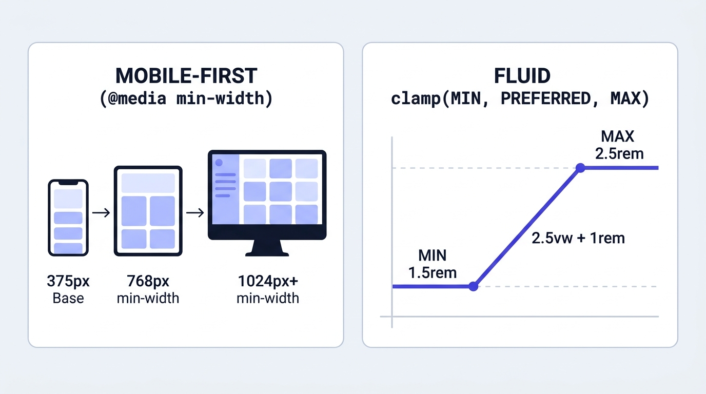

- **Mobile-First (`@media (min-width: ...)`):** Viết CSS mặc định xếp 1 cột cho điện thoại trước, rồi mở rộng cột ở Tablet (`48rem` ~ `768px`) và Desktop (`64rem` ~ `1024px`).
- **Đơn vị chuẩn A11y:** Dùng `rem` cho chữ/spacing (tự co giãn theo cài đặt font trình duyệt), `dvh` thay `100vh` trên Mobile (tránh thanh địa chỉ che nút), `px` cho đường viền `1px`.
- **Fluid `clamp(MIN, 2.5vw + 1rem, MAX)`:** Chữ trượt mượt giữa sàn `MIN` và trần `MAX`. **Luôn cộng thêm `rem` vào `vw`** để khi phóng to (`Ctrl +`), chữ vẫn phóng to theo.


```css
/* Design Tokens chạy runtime bằng CSS Variables — Đổi Dark/Light Mode trong 1 block */
:root {
  --bg-canvas: #090A0F; --bg-surface-1: #11131A; --bg-surface-2: #181B24; --border-subtle: #222634;
  --text-primary: #F3F4F6; --text-secondary: #9CA3AF; --accent-primary: #4F46E5; --accent-hover: #4338CA;
}
[data-theme="light"] {
  --bg-canvas: #F8FAFC; --bg-surface-1: #FFFFFF; --bg-surface-2: #F1F5F9; --border-subtle: #E2E8F0;
  --text-primary: #0F172A; --text-secondary: #475569;
}
```

### III. Đọc thêm CSS hiện đại: :has(), Container Queries và CSS Nesting

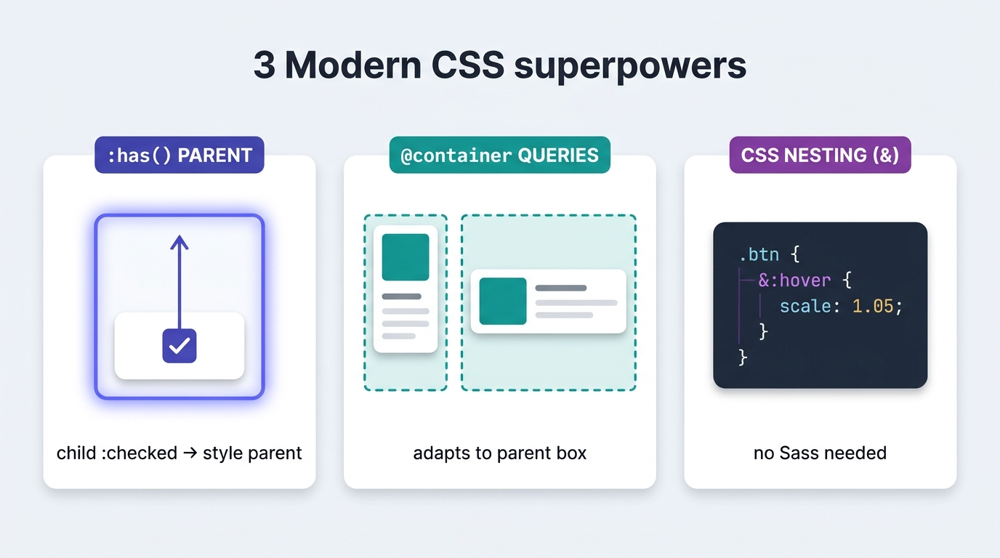

| Tính năng CSS mới | Giải quyết bài toán gì? | Ví dụ cú pháp ngắn |
| :--- | :--- | :--- |
| **`:has()` (Parent Selector)** | Chọn ngược thẻ cha theo trạng thái thẻ con mà không cần JS. | `.task-item:has(:checked) { opacity: 0.65; }` |
| **`@container` Queries** | Component tự đổi bố cục theo độ rộng **khung chứa** (không phụ thuộc màn hình). | `@container (min-width: 420px) { .card { flex-direction: row; } }` |
| **CSS Nesting (`&`)** | Viết CSS lồng nhau trực tiếp như Sass ngay trong CSS thuần. | `.btn { &:hover { background: var(--accent-hover); } }` |

---

## Phần 5: DEBUG CSS BẰNG DEVTOOLS, LIGHTHOUSE VÀ AI


### I. Chrome DevTools: Inspect Box Model, Flex/Grid Overlay và Device Mode

| Công cụ Chrome DevTools | Cách dùng nhanh để bắt bệnh giao diện |
| :--- | :--- |
| **Tab `Styles` & `Computed`** | Dòng CSS bị gạch ngang = thua Specificity; rê chuột vào sơ đồ Box Model để soi `margin`/`padding` thực tế (`px`). |
| **Huy hiệu `[flex]` / `[grid]`** | Bấm badge cạnh thẻ trong DOM `Elements` để vẽ đường kẻ lưới, vùng `gap` và số Grid Line trực tiếp lên trang. |
| **Device Mode (`Ctrl+Shift+M`)** | Kiểm tra các mốc `375px`, `768px`, `1280px`; bật `:hov -> :focus-visible` để debug vòng focus. |

```js
// Dán vào Console DevTools để tìm phần tử gây thanh cuộn ngang trên Mobile
document.querySelectorAll('*').forEach(el => {
  if (el.offsetWidth > document.documentElement.clientWidth) console.log('Tràn ngang:', el, el.offsetWidth);
});
```

### II. Lighthouse Accessibility, axe DevTools / WAVE và AI (Cursor / Copilot)

- **Lighthouse Accessibility (`>= 90`):** Luôn chạy trong **cửa sổ Ẩn danh** (tránh Extension làm nhiễu DOM) -> tab `Lighthouse` -> chọn `Accessibility` -> sửa triệt để lỗi thiếu `alt`, `<label>`, tương phản màu và `<html lang="vi">`.
- **axe DevTools / WAVE:** Cài Extension để soi trực quan thứ bậc heading (`h1-h3`), Landmark (`header/nav/main`) và tương phản trực tiếp trên từng phần tử.
- **Cursor / Copilot:** Luôn khóa rõ trong prompt: *"Dùng Semantic HTML5, 1 thẻ h1, gắn `<label for>` cho mọi input, dùng CSS Variables trong `:root`, hỗ trợ `:focus-visible` và đạt tương phản WCAG AA >= 4.5:1"* để tránh AI Slop.

---

## Phần 6: THỰC HÀNH ĐẠT OUTPUT BUỔI 14 (OMNILIFE MVP VÀ DEPLOY)


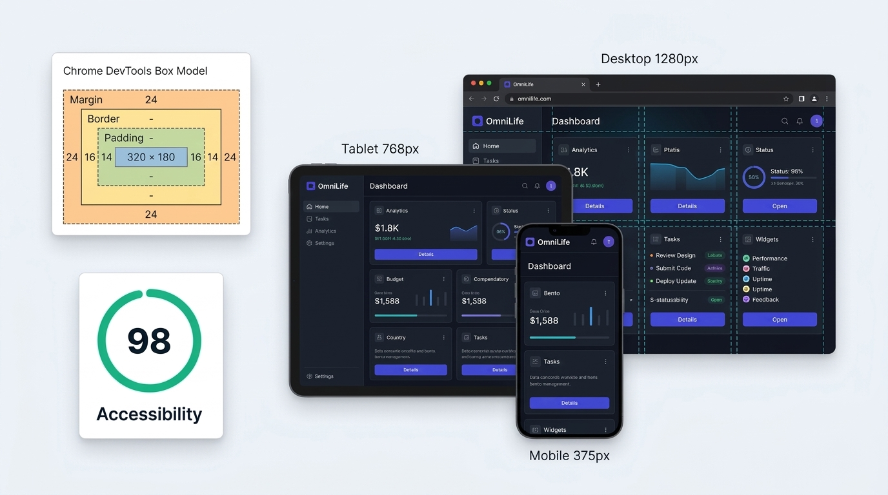

### I. Mã nguồn mẫu Dashboard OmniLife (index.html và styles.css)

```html
<!DOCTYPE html>
<html lang="vi">
<head>
  <meta charset="UTF-8" />
  <meta name="viewport" content="width=device-width, initial-scale=1.0" />
  <title>OmniLife — Bảng điều khiển Công việc Khẩn cấp</title>
  <link rel="stylesheet" href="styles.css" />
</head>
<body>
  <a class="skip-link" href="#main-content">Bỏ qua điều hướng, đến nội dung chính</a>

  <header class="site-header">
    <div class="container header-inner">
      <a href="index.html" class="brand" aria-label="OmniLife - Về trang chủ">
        <span class="brand-mark" aria-hidden="true">OL</span>
        <span class="brand-name">OmniLife</span>
      </a>
      <nav class="main-nav" aria-label="Điều hướng chính">
        <ul class="nav-list">
          <li><a href="#main-content" class="nav-link is-active" aria-current="page">Dashboard</a></li>
          <li><a href="#study-workspace" class="nav-link">Học tập</a></li>
          <li><a href="#finance-ledger" class="nav-link">Ngân sách</a></li>
        </ul>
      </nav>
      <button type="button" class="btn-secondary">Đổi Theme</button>
    </div>
  </header>

  <main id="main-content" class="container dashboard-layout" tabindex="-1">
    <section aria-labelledby="dashboard-heading">
      <div class="section-head">
        <div>
          <h1 id="dashboard-heading" class="page-title">Bảng điều khiển hôm nay</h1>
          <p class="page-subtitle">Ưu tiên công việc tự động theo chỉ số khẩn cấp U (0 - 100).</p>
        </div>
        <a href="#quick-add-form" class="btn-primary">Tạo công việc mới</a>
      </div>

      <div class="kpi-grid">
        <article class="bento-card">
          <h2 class="kpi-label">Việc khẩn cấp (&ge; 80 điểm)</h2>
          <p class="kpi-value text-danger">03</p>
        </article>
        <article class="bento-card">
          <h2 class="kpi-label">Phiên Pomodoro</h2>
          <p class="kpi-value text-info">25:00</p>
        </article>
        <article class="bento-card">
          <h2 class="kpi-label">Hoàn thành tuần này</h2>
          <p class="kpi-value text-success">14 / 18</p>
        </article>
      </div>
    </section>

    <div class="workspace-grid">
      <section class="bento-card" aria-labelledby="task-list-heading">
        <div class="task-header">
          <h2 id="task-list-heading" class="section-title">Danh sách ưu tiên động</h2>
          <form role="search" aria-label="Lọc công việc">
            <label for="search-task" class="sr-only">Tìm kiếm công việc</label>
            <input id="search-task" type="search" placeholder="Tìm tên việc..." />
          </form>
        </div>
        <ul class="task-list">
          <li class="task-item">
            <div class="task-check-wrap">
              <input id="task-1" type="checkbox" class="task-checkbox" />
              <label for="task-1" class="task-title">Hoàn thành layout Dashboard OmniLife chuẩn Responsive</label>
            </div>
            <span class="urgency-badge is-critical">U = 92</span>
          </li>
          <li class="task-item">
            <div class="task-check-wrap">
              <input id="task-2" type="checkbox" class="task-checkbox" checked />
              <label for="task-2" class="task-title">Chốt Design Tokens Dark/Light Mode trong :root</label>
            </div>
            <span class="urgency-badge is-done">Xong</span>
          </li>
        </ul>
      </section>

      <aside class="bento-card" aria-labelledby="quick-add-heading">
        <h2 id="quick-add-heading" class="section-title">Thêm nhanh công việc</h2>
        <form id="quick-add-form" class="quick-form">
          <div class="form-group">
            <label for="new-task-title">Tên công việc *</label>
            <input id="new-task-title" type="text" required minlength="3" placeholder="Ví dụ: Ôn CSS Specificity" />
          </div>
          <div class="form-group">
            <label for="new-task-date">Hạn chót *</label>
            <input id="new-task-date" type="date" required />
          </div>
          <button type="submit" class="btn-primary btn-full">Lưu công việc</button>
        </form>
      </aside>
    </div>
  </main>

  <footer class="site-footer">
    <div class="container footer-inner">
      <p>OmniLife MVP — Thực hành Buổi 14</p>
      <a href="#main-content">Lên đầu trang</a>
    </div>
  </footer>
</body>
</html>
```

```css
:root {
  --bg-canvas: #090A0F; --bg-surface-1: #11131A; --bg-surface-2: #181B24; --border-subtle: #222634;
  --text-primary: #F3F4F6; --text-secondary: #9CA3AF;
  --accent-primary: #4F46E5; --accent-hover: #4338CA; --accent-focus: #818CF8;
  --status-success: #10B981; --status-danger: #EF4444; --status-info: #3B82F6;
}
*, *::before, *::after { box-sizing: border-box; }
* { margin: 0; }
body { min-height: 100dvh; display: flex; flex-direction: column; font-family: 'Inter', system-ui, sans-serif; line-height: 1.5; color: var(--text-primary); background: var(--bg-canvas); }
input, button { font: inherit; color: inherit; }
:focus-visible { outline: 2px solid var(--accent-focus); outline-offset: 3px; }
.sr-only { position: absolute; width: 1px; height: 1px; overflow: hidden; clip-path: inset(50%); white-space: nowrap; }
.skip-link { position: absolute; top: -100%; left: 1rem; z-index: 100; padding: 0.75rem 1rem; background: var(--accent-primary); color: #FFF; border-radius: 8px; text-decoration: none; }
.skip-link:focus { top: 1rem; }

.container { width: min(100% - 2rem, 1200px); margin-inline: auto; }
.site-header { position: sticky; top: 0; z-index: 20; background: var(--bg-surface-1); border-bottom: 1px solid var(--border-subtle); }
.header-inner, .footer-inner { display: flex; flex-wrap: wrap; align-items: center; justify-content: space-between; gap: 1rem; padding-block: 0.875rem; }
.brand { display: inline-flex; align-items: center; gap: 0.5rem; text-decoration: none; font-weight: 700; }
.brand-mark { display: grid; place-items: center; width: 2rem; height: 2rem; background: var(--accent-primary); border-radius: 6px; font-size: 0.875rem; }
.nav-list { display: flex; flex-wrap: wrap; list-style: none; padding: 0; gap: 0.5rem; }
.nav-link { display: inline-block; padding: 0.5rem 0.75rem; border-radius: 8px; text-decoration: none; color: var(--text-secondary); }
.nav-link:hover, .nav-link.is-active { color: var(--text-primary); background: var(--bg-surface-2); }

.dashboard-layout { flex: 1; display: flex; flex-direction: column; gap: 1.5rem; padding-block: 1.5rem; }
.section-head, .task-header { display: flex; flex-wrap: wrap; align-items: center; justify-content: space-between; gap: 1rem; margin-bottom: 1rem; }
.page-title { font-size: clamp(1.375rem, 1.5vw + 1rem, 1.75rem); }
.page-subtitle { color: var(--text-secondary); font-size: 0.9375rem; }
.bento-card { background: var(--bg-surface-1); border: 1px solid var(--border-subtle); border-radius: 12px; padding: 1.25rem; }
.kpi-grid { display: grid; grid-template-columns: repeat(auto-fit, minmax(min(240px, 100%), 1fr)); gap: 1rem; }
.kpi-label { font-size: 0.875rem; color: var(--text-secondary); font-weight: 500; }
.kpi-value { font-size: clamp(1.75rem, 2vw + 1rem, 2.25rem); font-weight: 700; font-variant-numeric: tabular-nums; }
.text-danger { color: var(--status-danger); } .text-info { color: var(--status-info); } .text-success { color: var(--status-success); }

.workspace-grid { display: grid; grid-template-columns: 1fr; gap: 1rem; align-items: start; }
@media (min-width: 60rem) { .workspace-grid { grid-template-columns: 2fr 1fr; } }

.task-list, .quick-form { list-style: none; padding: 0; display: flex; flex-direction: column; gap: 0.75rem; margin-top: 0.75rem; }
.task-item { display: flex; flex-wrap: wrap; align-items: center; justify-content: space-between; gap: 0.75rem; padding: 0.875rem; background: var(--bg-surface-2); border: 1px solid var(--border-subtle); border-radius: 8px; }
.task-item:has(.task-checkbox:checked) { opacity: 0.65; }
.task-item:has(.task-checkbox:checked) .task-title { text-decoration: line-through; }
.task-check-wrap { display: flex; align-items: center; gap: 0.75rem; flex: 1 1 220px; }
.task-checkbox { width: 1.125rem; height: 1.125rem; accent-color: var(--accent-primary); }
.urgency-badge { padding: 0.25rem 0.5rem; border-radius: 6px; font-size: 0.75rem; font-weight: 600; }
.is-critical { background: rgba(239, 68, 68, 0.16); color: #FCA5A5; }
.is-done { background: rgba(16, 185, 129, 0.16); color: #6EE7B7; }

.form-group { display: flex; flex-direction: column; gap: 0.375rem; }
input[type="text"], input[type="date"], input[type="search"] { width: 100%; padding: 0.625rem 0.75rem; background: var(--bg-surface-2); border: 1px solid var(--border-subtle); border-radius: 8px; }
input:user-invalid { border-color: var(--status-danger); }
.btn-primary, .btn-secondary { display: inline-flex; align-items: center; justify-content: center; min-height: 2.75rem; padding: 0.5rem 1rem; border-radius: 8px; font-weight: 600; text-decoration: none; border: 1px solid transparent; cursor: pointer; }
.btn-primary { background: var(--accent-primary); color: #FFF; }
.btn-primary:hover { background: var(--accent-hover); }
.btn-secondary { background: var(--bg-surface-2); border-color: var(--border-subtle); }
.btn-full { width: 100%; }
.site-footer { border-top: 1px solid var(--border-subtle); background: var(--bg-surface-1); font-size: 0.875rem; color: var(--text-secondary); }
```

### II. Checklist Output (A11y từ 90 điểm, Bàn phím 100%) và Deploy GitHub Pages / Netlify

| Hạng mục kiểm tra trước khi nộp | Tiêu chuẩn đạt |
| :--- | :--- |
| **Semantic HTML & Form** | Có đủ `<header>`, `<nav>`, 1 `<main>`, 1 `<h1>` (không nhảy cấp); mọi `<input>` có `<label for>`, ảnh trang trí có `alt=""`. |
| **Keyboard & A11y** | Dùng được 100% bằng `Tab`/`Enter`/`Space`, thấy rõ `:focus-visible`, **Lighthouse Accessibility >= 90** ở tab Ẩn danh. |
| **Responsive & Vùng chạm** | Không xuất hiện thanh cuộn ngang từ `375px` đến `1280px`; chiều cao nút chạm đạt `>= 44px` (`2.75rem`). |

- **Deploy GitHub Pages:** Đặt `index.html` ở thư mục gốc repo -> push lên `main` -> vào **Settings -> Pages -> Deploy from branch `main` / `(root)`** -> **Save**.
- **Deploy Netlify:** Kéo thả thư mục dự án vào `https://app.netlify.com/drop`, hoặc kết nối GitHub repo (Publish directory `.`, bỏ trống Build command).

---

## Tóm tắt nhanh

| Chủ đề | Từ khóa cốt lõi cần nhớ |
| :--- | :--- |
| **Semantic HTML & Form** | `header/nav/main/section/article/aside/footer`; 1 `h1`; `<a>` đi URL vs `<button>` hành động; `<label for>`, `input type`, `:user-invalid`, `alt=""`. |
| **Accessibility (A11y)** | Test không chuột (`Tab`, `Enter`, `Space`), `:focus-visible`, WCAG AA `>= 4.5:1`, không lạm dụng ARIA khi HTML gốc đã có sẵn. |
| **Mô hình tư duy CSS** | Màu/Font/Nền, Selector/Pseudo-class; Cascade > Specificity `(ID, Class, Tag)` > Viết sau; `border-box`; `gap` tránh Margin Collapse; `relative` neo `absolute`; `overflow: clip` cho `sticky`. |
| **Layout & Responsive** | Flexbox 1 chiều vs Grid 2 chiều (`repeat(auto-fit, minmax())`); Mobile-First (`min-width`), `rem`, `clamp(... + rem)`, Design Tokens `:root`, `:has()`, `@container`, Nesting. |
| **DevTools & Output** | Tab `Styles/Computed`, badge `[flex]`/`[grid]`, Device Mode `375px-1280px`, Lighthouse Incognito `>= 90` + `axe/WAVE` -> Deploy GitHub Pages / Netlify. |
