# [BUỔI 14] HTML & CSS: TỪ THIẾT KẾ RA LAYOUT

*Tài liệu chuẩn bị buổi 14 - Khóa Frontend (giao diện web phía người dùng) Cơ bản (Buổi 2)*

---

**Mục lục:**

- [\[BUỔI 14\] HTML \& CSS: TỪ THIẾT KẾ RA LAYOUT](#buổi-14-html--css-từ-thiết-kế-ra-layout)
  - [Phần 1: HTML ngữ nghĩa và biểu mẫu](#phần-1-html-ngữ-nghĩa-và-biểu-mẫu)
    - [I. HTML là gì, cấu tạo một thẻ và các thẻ HTML thông dụng](#i-html-là-gì-cấu-tạo-một-thẻ-và-các-thẻ-html-thông-dụng)
    - [II. Cấu trúc trang HTML5 ngữ nghĩa và phân cấp tiêu đề](#ii-cấu-trúc-trang-html5-ngữ-nghĩa-và-phân-cấp-tiêu-đề)
    - [III. Phân biệt Link và Button, Biểu mẫu Form chuẩn và Thuộc tính alt](#iii-phân-biệt-link-và-button-biểu-mẫu-form-chuẩn-và-thuộc-tính-alt)
  - [Phần 2: Accessibility cơ bản cho Frontend](#phần-2-accessibility-cơ-bản-cho-frontend)
    - [I. Điều hướng bàn phím, focus-visible và Độ tương phản WCAG AA](#i-điều-hướng-bàn-phím-focus-visible-và-độ-tương-phản-wcag-aa)
    - [II. Quy tắc số 1 của ARIA và Các thuộc tính cần dùng](#ii-quy-tắc-số-1-của-aria-và-các-thuộc-tính-cần-dùng)
  - [Phần 3: Mô hình tư duy CSS](#phần-3-mô-hình-tư-duy-css)
    - [I. Cú pháp CSS, Thuộc tính cơ bản, Selector và Pseudo-class](#i-cú-pháp-css-thuộc-tính-cơ-bản-selector-và-pseudo-class)
    - [II. Cơ chế Cascade, Specificity và Tính kế thừa](#ii-cơ-chế-cascade-specificity-và-tính-kế-thừa)
    - [III. Box Model, box-sizing, Margin Collapse, Display và Position](#iii-box-model-box-sizing-margin-collapse-display-và-position)
  - [Phần 4: Layout hiện đại và Responsive Design](#phần-4-layout-hiện-đại-và-responsive-design)
    - [I. Flexbox một chiều, CSS Grid hai chiều và mẹo luyện game](#i-flexbox-một-chiều-css-grid-hai-chiều-và-mẹo-luyện-game)
    - [II. Chiến lược Mobile-First, Media Query, rem, clamp và Design Tokens](#ii-chiến-lược-mobile-first-media-query-rem-clamp-và-design-tokens)
    - [III. Đọc thêm CSS hiện đại: :has(), Container Queries và CSS Nesting](#iii-đọc-thêm-css-hiện-đại-has-container-queries-và-css-nesting)
  - [Phần 5: Debug CSS bằng DevTools, Lighthouse và AI](#phần-5-debug-css-bằng-devtools-lighthouse-và-ai)
    - [I. Chrome DevTools: Inspect Box Model, Flex và Grid Overlay, Device Mode](#i-chrome-devtools-inspect-box-model-flex-và-grid-overlay-device-mode)
    - [II. Lighthouse Accessibility, axe DevTools, WAVE và cách nhắc AI](#ii-lighthouse-accessibility-axe-devtools-wave-và-cách-nhắc-ai)
  - [Phần 6: Thực hành đạt Output Buổi 14 với OmniLife MVP và Deploy](#phần-6-thực-hành-đạt-output-buổi-14-với-omnilife-mvp-và-deploy)
    - [I. Mã nguồn mẫu Dashboard OmniLife](#i-mã-nguồn-mẫu-dashboard-omnilife)
    - [II. Checklist Output và hướng dẫn Deploy từng bước](#ii-checklist-output-và-hướng-dẫn-deploy-từng-bước)
  - [Từ điển bỏ túi Anh - Việt cho người mới](#từ-điển-bỏ-túi-anh---việt-cho-người-mới)
  - [Tóm tắt nhanh](#tóm-tắt-nhanh)

> **Mục tiêu buổi học:** Biết cách biến bản phác thảo thành giao diện **Layout** (bố cục sắp xếp các phần tử lên màn hình) hoàn chỉnh: viết HTML đúng ngữ nghĩa, trình bày **Responsive** (tự co giãn đẹp trên cả điện thoại lẫn máy tính), đảm bảo **Accessibility** (ai cũng dùng được kể cả khi chỉ bấm bàn phím) và biết **Debug CSS** (tìm-sửa lỗi giao diện) bằng **DevTools** (bộ công cụ kiểm tra tích hợp trong trình duyệt).

---

## Phần 1: HTML ngữ nghĩa và biểu mẫu

> **Giải nghĩa nhanh:** **Frontend** (*giao diện phía người dùng*) là phần bạn nhìn thấy và bấm trực tiếp trên trình duyệt, đối lập với **Backend** (*hệ thống chạy ngầm trên máy chủ*). Để tạo phần nhìn thấy đó, ta bắt đầu từ bộ khung **HTML** và lớp trang trí **CSS**.

### I. HTML là gì, cấu tạo một thẻ và các thẻ HTML thông dụng

Hãy tưởng tượng việc làm web giống như **xây một ngôi nhà**:

- **HTML** (*HyperText Markup Language* - Ngôn ngữ đánh dấu siêu văn bản): Hiểu đơn giản là **khung gạch chịu lực** dựng lên bộ xương trang web, phân chia rõ đâu là tiêu đề, đoạn văn, hình ảnh hay nút bấm.
- **CSS** (*Cascading Style Sheets* - Bảng kiểu xếp tầng): Hiểu đơn giản là **lớp sơn tường, ánh sáng và nội thất** giúp chọn màu sắc, cỡ chữ và sắp xếp các khung nằm gọn đẹp mắt.

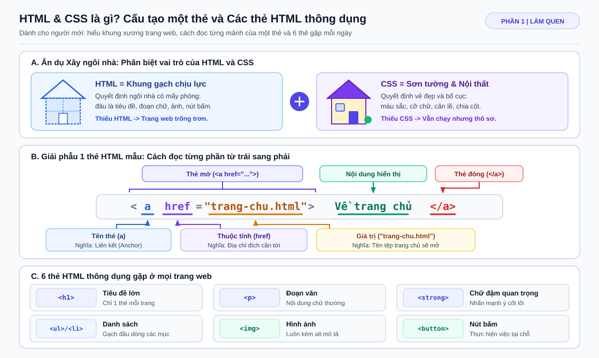

Mỗi thành phần trong HTML được viết bằng một **Tag** (*Thẻ* - cặp dấu ngoặc nhọn `<...>` bọc lấy nội dung để trình duyệt hiểu vai trò của nó). Ví dụ cấu tạo chi tiết thẻ `<a href="trang-chu.html">Về trang chủ</a>`:

1. **Thẻ mở (`<a ...>`) và Tên thẻ (`a`):** Báo điểm bắt đầu; chữ `a` viết tắt của *Anchor* (cái neo) dùng tạo liên kết chuyển trang.
2. **Thuộc tính (`Attribute` - `href`) và Giá trị (`"trang-chu.html"`):** Thông tin phụ dặn thêm cho thẻ (ở đây `href` là *Hypertext Reference* - đường dẫn trang đích muốn đi tới, giá trị luôn đặt trong dấu ngoặc kép).
3. **Nội dung hiển thị (`Về trang chủ`) và Thẻ đóng (`</a>`):** Dòng chữ người dùng thấy trên màn hình, kết thúc bằng thẻ đóng có dấu gạch chéo `/`. Riêng một số thẻ rỗng như `` hay `<input>` không bọc chữ bên trong nên tự đóng ngay, không cần thẻ đóng riêng.

| Nhóm thẻ thông dụng | Tên thẻ HTML | Nghĩa Tiếng Việt và hiểu đơn giản | Ví dụ thực tế |
| :--- | :--- | :--- | :--- |
| **Tiêu đề và văn bản** | `<h1>`-`<h6>`, `<p>` | Tiêu đề lớn-nhỏ (`Heading`) và đoạn văn (`Paragraph`). | Tên bài viết đặt trong `<h1>`, nội dung bài đặt trong `<p>`. |
| **Nhấn mạnh chữ** | `<strong>`, `<em>` | Chữ in đậm ý quan trọng và chữ in nghiêng nhấn giọng. | Cảnh báo quan trọng hoặc thuật ngữ cần chú ý. |
| **Danh sách** | `<ul>`, `<ol>`, `<li>` | Danh sách chấm tròn (`ul`), đánh số `1, 2` (`ol`), và từng dòng mục (`li`). | Danh sách việc cần làm hoặc các bước nấu ăn. |
| **Tương tác và ảnh** | `<a href>`, `<button>`, `` | Liên kết chuyển trang, nút bấm hành động và hình ảnh. | Bấm sang trang mới (`a`), bấm lưu (`button`), ảnh minh họa (`img`). |
| **Biểu mẫu nhập liệu** | `<form>`, `<label>`, `<input>`, `<select>`, `<textarea>` | Khung phiếu điền, nhãn tên ô, ô nhập 1 dòng, hộp chọn thả xuống và ô nhập nhiều dòng. | Phiếu đăng ký tài khoản hoặc thêm công việc mới. |
| **Hộp chứa trung tính** | `<div>`, `<span>` | Hộp bọc theo cả khối hàng (`div`) và bọc cụm chữ giữa dòng (`span`). | Chỉ dùng gom nhóm để trang trí CSS khi không có thẻ mang ý nghĩa phù hợp. |

### II. Cấu trúc trang HTML5 ngữ nghĩa và phân cấp tiêu đề

> **Giải nghĩa nhanh:**
> - **Semantic HTML5** (*HTML ngữ nghĩa*): Hiểu đơn giản là chọn đúng tên thẻ phản ánh đúng vai trò thật của vùng nội dung, tránh thói quen xấu nhồi toàn thẻ `<div>` vô nghĩa gọi là **Div Soup** (*súp thẻ div*).
> - **DOM** (*Document Object Model* - Cây cấu trúc tài liệu) và **Screen Reader** (*Trình đọc màn hình*): Trình duyệt đọc HTML để dựng thành cây cha-con DOM; phần mềm hỗ trợ người khiếm thị đọc lướt cây này nhờ các biển mốc vùng (**Landmark Role**) như biển chỉ dẫn quầy hàng trong siêu thị.


| Thẻ HTML5 ngữ nghĩa | Landmark Role (Mốc vùng) | Vai trò dễ hiểu trên trang web |
| :--- | :--- | :--- |
| `<header>` | `banner` | Phần đầu trang chứa Logo, tên thương hiệu hoặc thanh tìm kiếm. |
| `<nav>` | `navigation` | Cụm liên kết điều hướng như **Navbar** (*thanh menu ngang đầu trang*), **Sidebar** (*thanh menu bên cạnh*) hoặc **Breadcrumb** (*đường dẫn phân cấp kiểu Trang chủ -> Buổi 14*). |
| `<main>` | `main` | Phần nội dung chính độc nhất của trang (**mỗi trang chỉ có đúng 1 thẻ `<main>`**). |
| `<section>` | `region` | Một khu vực gom các nội dung cùng chủ đề (nên có tiêu đề `<h2>`-`<h6>` mở đầu). |
| `<article>` | `article` | Một khối nội dung **đứng độc lập** cắt riêng ra vẫn hiểu được (1 bài báo, 1 thẻ sản phẩm). |
| `<aside>` | `complementary` | Phần thông tin bổ trợ đặt bên cạnh phần chính (thanh lọc tìm kiếm, **Widget** - *ô tiện ích nhỏ* như đồng hồ). |
| `<footer>` | `contentinfo` | Phần chân trang chứa bản quyền, liên kết phụ, thông tin liên hệ. |

- **Quy tắc phân cấp tiêu đề (`<h1>` đến `<h6>`):** Mỗi trang chỉ giữ **1 thẻ `<h1>`** làm tựa đề chính lớn nhất, rồi đi tuần tự `h1` -> `h2` -> `h3` như mục lục sách. Tuyệt đối không nhảy cóc từ `h1` xuống `h4` chỉ để chữ nhỏ đi; muốn đổi cỡ chữ, hãy chỉnh bằng CSS.

### III. Phân biệt Link và Button, Biểu mẫu Form chuẩn và Thuộc tính alt

> **Giải nghĩa nhanh:**
> - **Link** (`<a href>`) giống **cánh cửa** đưa bạn chuyển sang **URL** (*địa chỉ trang web trên thanh trình duyệt*) mới hoặc nhảy đến một mục khác.
> - **Button** (`<button>`) giống **công tắc** thực hiện hành động ngay tại chỗ: gửi dữ liệu (**Submit**), mở hộp thoại nổi đè lên trang (**Modal**) hay xóa một dòng.

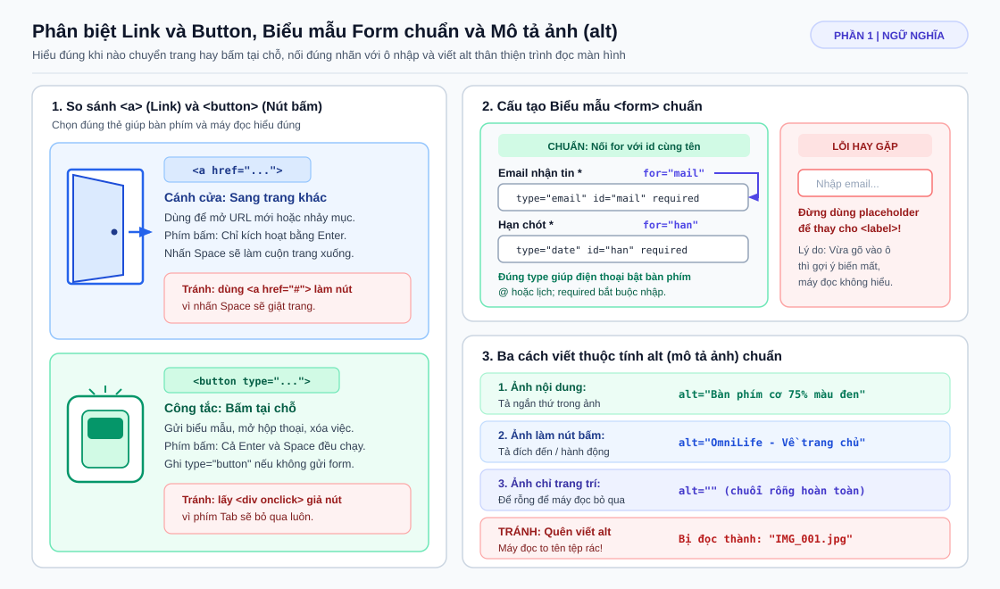

| Tiêu chí so sánh | `<a href="...">` (Link - Liên kết) | `<button type="...">` (Button - Nút bấm) |
| :--- | :--- | :--- |
| **Quy tắc nhớ nhanh** | "Cánh cửa đi tới nơi khác" (chuyển trang hoặc nhảy neo `#id`). | "Công tắc làm việc tại chỗ" (gửi biểu mẫu, bật/tắt hộp thoại). |
| **Cách bấm bàn phím** | Kích hoạt bằng phím `Enter` (`Space` sẽ làm cuộn trang). | Kích hoạt bằng cả `Enter` và `Space`; ghi `type="button"` nếu không dùng gửi biểu mẫu. |

> **Bẫy người mới hay mắc:** Không dùng `<a href="#">` giả làm nút bấm (vì bấm `Space` sẽ bị giật trang), và không dùng `<div onclick>` làm nút vì phím `Tab` sẽ lướt qua luôn, không bấm được bằng bàn phím.

**3 nguyên tắc vàng khi tạo Form (*Biểu mẫu nhập liệu - hiểu đơn giản là tờ phiếu điện tử cho người dùng điền thông tin đăng ký hoặc thêm công việc*):**

1. **Gắn nhãn `Label` (*nhãn tên gọi*) với ô `Input` (*ô nhập dữ liệu*):** Luôn nối `<label for="...">` trùng tên **`id`** (*mã định danh riêng duy nhất cho từng thẻ, giống số căn cước*) với `<input id="...">`. Tuyệt đối không bỏ `<label>` để dùng mỗi **Placeholder** (*chữ gợi ý mờ nằm tạm trong ô*) vì chữ đó biến mất ngay khi người dùng gõ.
2. **Chọn đúng `input type`:** Dùng đúng loại `email`, `tel`, `search`, `date`, `number` để điện thoại tự mở đúng bàn phím số hoặc phím `@`.
3. **Kiểm tra hợp lệ văn minh:** Dùng `required` (*bắt buộc nhập*), `minlength` (*độ dài tối thiểu*) kết hợp trạng thái CSS `:user-invalid` (khác `:invalid` là vừa mở trang đã tô đỏ, `:user-invalid` chỉ báo lỗi *sau khi* người dùng nhập xong và rời khỏi ô).

```html
<!-- novalidate tắt bảng báo lỗi thô mặc định của trình duyệt để tự trang trí bằng CSS -->
<form class="quick-task-form" novalidate>
  <!-- Thuộc tính for="task-name" móc nối chính xác với ô input có id="task-name" -->
  <label for="task-name">Tên công việc *</label>
  <!-- required: bắt buộc nhập; minlength="3": ít nhất 3 ký tự; placeholder: chữ gợi ý mờ -->
  <input id="task-name" name="title" type="text" required minlength="3" placeholder="Ví dụ: Ôn CSS Grid" />

  <label for="task-email">Email nhắc lịch</label>
  <!-- type="email" kiểm tra định dạng có dấu @ và tự bật bàn phím email trên điện thoại -->
  <input id="task-email" name="email" type="email" required />

  <!-- type="submit" báo đây là nút bấm gửi toàn bộ dữ liệu trong form đi -->
  <button type="submit">Thêm công việc</button>
</form>
```

**Thuộc tính `Alt` (*Alternative Text* - Văn bản thay thế cho ảnh ``):** Khi mạng lỗi khiến ảnh không hiện hoặc khi trình đọc màn hình lướt qua, chữ trong `alt` sẽ thay thế bức ảnh theo chuẩn tổ chức web quốc tế **W3C**.

| Loại hình ảnh (``) | Cách viết `alt` đúng chuẩn | Lý do dễ hiểu |
| :--- | :--- | :--- |
| **Ảnh minh họa nội dung** | `alt="Bàn phím cơ 75% màu đen"` | Mô tả ngắn gọn vật thể trong ảnh, tránh viết thừa chữ *"Hình ảnh của..."*. |
| **Ảnh làm nút hoặc Logo về Trang chủ** | `alt="OmniLife - Về trang chủ"` | Nói rõ **nơi sẽ đi tới** khi bấm vào ảnh thay vì tả màu sắc logo. |
| **Ảnh chỉ để trang trí cho đẹp** | `alt=""` (Để cặp ngoặc kép rỗng) | Báo trình đọc màn hình bỏ qua hẳn, không đọc rác gây phiền. |
| **Quên hẳn thuộc tính `alt`** | Tránh tuyệt đối | Phần mềm đọc sẽ đọc to tên file rối mắt như `IMG_001.jpg` và bị trừ điểm nặng. |

---

## Phần 2: Accessibility cơ bản cho Frontend

> **Giải nghĩa nhanh:** **Accessibility** (viết tắt là **A11y**, vì giữa chữ `A` và chữ `y` có đúng `11` chữ cái) nghĩa là **khả năng tiếp cận**. Hiểu đơn giản là làm web sao cho ai cũng dùng được: từ người hỏng chuột chỉ bấm bàn phím, người lớn tuổi mắt kém cho đến người khiếm thị dùng trình đọc màn hình.

### I. Điều hướng bàn phím, focus-visible và Độ tương phản WCAG AA

Hãy thử rút chuột ra trong 2 phút và điều khiển trang web chỉ bằng **bàn phím**: `Tab` (nhảy tới nút tiếp theo), `Shift + Tab` (lùi lại), `Enter` (mở liên kết/bấm nút), `Space` (bấm nút/tích ô vuông) và `Esc` (đóng hộp thoại).

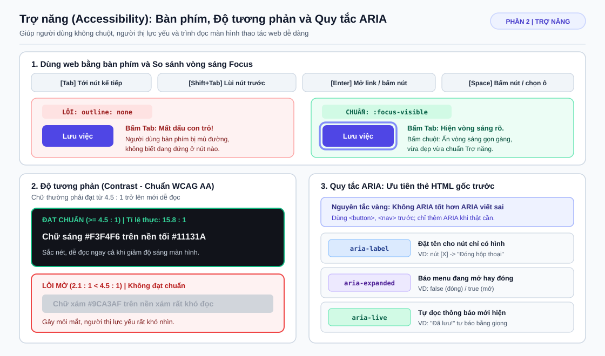


> **Giải nghĩa nhanh:**
> - **Focus** (*Tiêu điểm đang chọn*) và **Outline** (*Đường viền sáng bọc ngoài*): Khi bạn bấm `Tab`, khung `outline` sáng lên giống ánh đèn pin chiếu vào nút bạn đang đứng để bạn không bị lạc giữa trang.
> - **Contrast** (*Độ tương phản*) và **WCAG AA** (*Bộ tiêu chuẩn quốc tế về khả năng tiếp cận web mức chuẩn thông dụng*): Chữ và nền phải lệch sáng đủ rõ (ví dụ trên giao diện nền tối **Dark Mode**, chữ sáng phải đạt tỷ lệ tương phản từ `4.5 : 1` trở lên để không bị chìm mờ).

| Trụ cột A11y | Quy tắc bắt buộc | Mẹo dễ nhớ cho người mới |
| :--- | :--- | :--- |
| **Điều hướng bàn phím và `tabindex`** | Mọi nút đều bấm được bằng phím; đặt **Skip link** (*liên kết nhảy cóc* ẩn đầu trang để bấm `Tab` nhảy thẳng vào `#main`). | Ưu tiên thẻ HTML chuẩn; thuộc tính `tabindex` (*thứ tự dừng phím Tab*) chỉ dùng `0` hoặc `-1`, **cấm dùng số lớn hơn `0`**. |
| **Vòng sáng `:focus-visible`** | Tuyệt đối không viết `*:focus { outline: none; }` vì sẽ xóa mất đèn pin chỉ vị trí của người dùng bàn phím. | Dùng `:focus-visible` để vòng sáng chỉ hiện khi bấm `Tab`, còn click chuột thì ẩn gọn gàng. |
| **Độ tương phản WCAG AA** | Chữ thường đạt tối thiểu `4.5 : 1`; chữ lớn (`>= 24px`) và viền ô nhập đạt `3.0 : 1`. | Nền tối `#11131A` đi với chữ sáng `#F3F4F6` và nút `#4F46E5` đạt khoảng `6.28 : 1`. |

```css
/* :focus-visible chỉ bật đường viền khi người dùng di chuyển bằng phím Tab */
:focus-visible {
  /* Vẽ viền ngoài 2px nét liền; ưu tiên dùng biến màu hoặc mặc định #818CF8 */
  outline: 2px solid var(--accent-focus, #818CF8);
  /* Đẩy viền sáng hở ra khỏi mép nút 3px cho thoáng mắt, không dính sát chữ */
  outline-offset: 3px;
}
```

### II. Quy tắc số 1 của ARIA và Các thuộc tính cần dùng

> **Giải nghĩa nhanh:** **ARIA** (*Accessible Rich Internet Applications*) là bộ thuộc tính phụ dán thêm vào thẻ HTML để giải thích ý nghĩa cho trình đọc màn hình. **Quy tắc số 1 của W3C:** *"Không dùng ARIA còn hơn dùng sai ARIA"* - luôn dùng thẻ thật như `<button>`, `<nav>` trước, chỉ dán nhãn ARIA khi HTML thuần không nói hết ý.

| Thuộc tính ARIA | Khi nào cần dán nhãn thêm | Ví dụ thực tế dễ hiểu |
| :--- | :--- | :--- |
| `aria-label="..."` | Khi nút chỉ vẽ một **Icon** (*biểu tượng nhỏ*) bằng hình ảnh **SVG** (*ảnh vector nét căng không vỡ khi phóng to*), không có chữ đi kèm. | `<button type="button" aria-label="Đóng hộp thoại">X</button>` |
| `aria-hidden="true"` | Dán lên hình trang trí hoặc dấu `*` để trình đọc màn hình lướt qua, không đọc thành tiếng vô nghĩa. | `<span aria-hidden="true">*</span>` |
| `aria-expanded` | Báo cho máy đọc biết nút mở danh sách hiện đang mở (`true`) hay đang đóng (`false`). | `<button type="button" aria-expanded="false">Menu</button>` |
| `aria-live="polite"` | Dán lên **Toast** (*thông báo nhỏ bật thoáng qua góc màn hình rồi tự tắt*) để máy đọc chờ đọc xong câu hiện tại rồi đọc to thông báo mới. | `<div role="status" aria-live="polite">Đã lưu công việc!</div>` |

---

## Phần 3: Mô hình tư duy CSS

> **Giải nghĩa nhanh:** Để hết cảnh sửa CSS chỗ này lại vỡ bố cục chỗ kia, bạn cần nắm cách trình duyệt hiểu 3 phần cốt lõi: **Cách chọn thẻ** (`Selector`), **Ai thắng khi viết trùng lệnh** (`Cascade` và `Specificity`), và **Quy tắc chiếc hộp** (`Box Model`).

### I. Cú pháp CSS, Thuộc tính cơ bản, Selector và Pseudo-class

Một câu lệnh CSS chuẩn như `h1 { color: #4F46E5; }` gồm 3 phần: **Selector** (*Bộ chọn* `h1` - chọn thẻ nào?), **Property** (*Thuộc tính CSS* `color` - chỉnh đặc điểm gì?) và **Value** (*Giá trị* `#4F46E5` - chỉnh thành màu gì?).

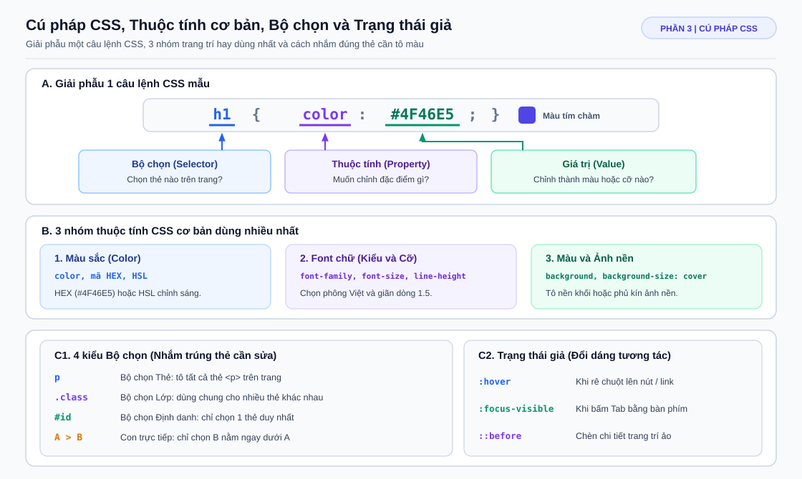

| Nhóm kiến thức | Khái niệm và cú pháp hay dùng | Giải thích dễ hiểu và ghi nhớ thực chiến |
| :--- | :--- | :--- |
| **Màu sắc, Font chữ, Nền** | Mã màu `HEX` (`#4F46E5`), `HSL`, `oklch()`; `font-family`; `font-size`; `line-height`; `background-size: cover` | Chọn font hỗ trợ dấu Tiếng Việt (`Inter`, `Be Vietnam Pro`). Đặt `line-height: 1.5` (*chiều cao dòng không đơn vị*) để dòng chữ tự thoáng; `background-size: cover` giúp ảnh nền phủ kín khung không bị méo. |
| **Selector và Combinator** | `.class` (*tên nhóm dùng chung nhiều chỗ*), `#id` (*tên riêng cho 1 thẻ*), `[attr]` (*chọn theo thuộc tính*); **Combinator** (*ký tự nối quan hệ*): `A B` (con cháu), `A > B` (con trực tiếp), `A + B` (đứng sát ngay sau) | Nên đặt `.class` ngắn gọn và dùng `>` để tránh CSS lan tràn xuống thẻ sâu bên trong. Ví dụ `.stack > * + *` (dấu `*` đại diện mọi thẻ con) giúp tự chèn khoảng trống giữa các khối xếp dọc. |
| **Pseudo-class và Pseudo-element** | **Lớp giả** (*trạng thái tạm thời*): `:hover` (rê chuột), `:focus-visible`, `:nth-child()` (*chọn theo thứ tự thứ n*), `:is()`, `:where()` (*gom nhóm nhiều bộ chọn*). **Phần tử giả** (*chi tiết phụ ảo*): `::before`, `::after` | `:where(...)` có điểm ưu tiên bằng `0` nên rất dễ ghi đè lại. `::before` và `::after` dùng chèn dấu chấm/đường gạch trang trí trước hoặc sau chữ và luôn phải có `content: ""`. |

### II. Cơ chế Cascade, Specificity và Tính kế thừa


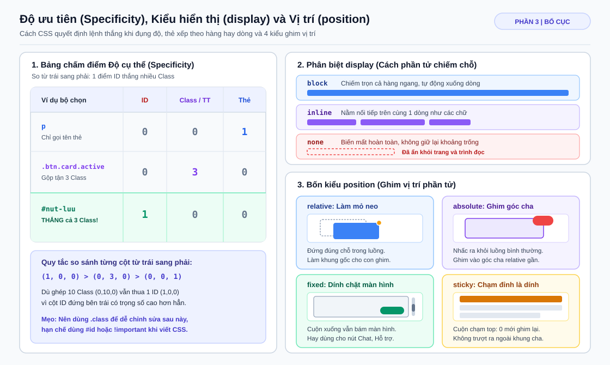

- **The Cascade (*Cơ chế dòng thác xếp tầng*):** Khi nhiều lệnh CSS cùng tô màu cho một thẻ, trình duyệt lọc theo thứ tự thắng từ cao xuống thấp: Nguồn file và cờ ép `!important` (**Origin**) -> CSS viết thẳng trong thẻ HTML kiểu `style="..."` (**Inline style**) -> Độ cụ thể (**Specificity**) -> Lệnh nào **viết ở dòng dưới sẽ thắng**. Nên dùng `@layer reset, base, components;` (*chia tầng ưu tiên rõ ràng: tầng làm sạch, tầng nền, tầng thành phần nút-thẻ*) thay vì lạm dụng `!important`.
- **Specificity (*Độ đặc hiệu - Bảng chấm điểm 3 cột*):** Trình duyệt đếm theo thứ tự `(ID | Class/Thuộc tính/Lớp giả | Thẻ)` từ trái sang phải. Một cái `#id` ở cột đầu `(1,0,0)` luôn thắng dù bên kia ghép tới `10` cái `.class` `(0,10,0)` - giống như 1 tờ 100 nghìn luôn lớn hơn 10 tờ 1 nghìn.
- **Inheritance (*Tính kế thừa*):** Các lệnh về chữ (`color`, `font-*`, `line-height`) tự truyền từ thẻ cha xuống thẻ con như tính di truyền, nhưng lệnh khung hộp (`margin`, `padding`, `border`) thì không truyền. Riêng thẻ `<button>` và `<input>` mặc định không chịu kế thừa font từ `body`, nên phải tự khai báo `font: inherit;` (*ép kế thừa kiểu chữ từ cha*).

### III. Box Model, box-sizing, Margin Collapse, Display và Position

> **Giải nghĩa nhanh:** Trình duyệt coi mọi thẻ HTML như một **chiếc hộp chữ nhật** (**Box Model**) gồm 4 lớp giống hệt **một bức tranh đóng khung**: **Content** (*bức tranh ở giữa*) -> **Padding** (*lớp bìa lót bên trong khung*) -> **Border** (*khung gỗ bên ngoài*) -> **Margin** (*khoảng cách trống trên tường tới bức tranh bên cạnh*).

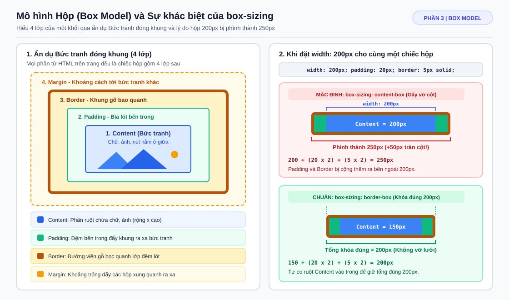

Mặc định trình duyệt đo hộp theo kiểu `content-box`: đặt `width: 200px` nhưng cộng thêm `padding: 20px` mỗi bên và `border: 5px` mỗi bên khiến cả khung phình to thành `250px` gây vỡ cột. Vì thế, luôn bật `box-sizing: border-box;` trong **CSS Reset** (*đoạn code đưa mặc định lệch lạc giữa các trình duyệt về vạch xuất phát sạch sẽ*) để khóa tổng kích thước đúng `200px`.

```css
/* CSS Reset gọn nhẹ: chạy đầu file CSS để các trình duyệt hiển thị đồng nhất */
/* Ép mọi thẻ và phần tử giả đo kích thước tính luôn cả padding và border */
*, *::before, *::after { box-sizing: border-box; }
/* Xóa toàn bộ lề margin mặc định lộn xộn ở các thẻ như body, h1, p */
* { margin: 0; }
/* Biến ảnh và SVG thành khối block, không bao giờ phình to vượt quá khung cha */
img, picture, svg { display: block; max-width: 100%; }
/* Bắt buộc các ô nhập và nút bấm dùng chung kiểu chữ và màu chữ với phần còn lại */
input, button, textarea, select { font: inherit; color: inherit; }
```

- **Margin Collapse (*Sụp lề dọc*) và Cách ẩn phần tử:** Khi hai khối xếp trên-dưới chạm lề dọc vào nhau, hai `margin` không cộng dồn mà gộp lại lấy số lớn hơn (giống hai người đứng cùng hành lang giữ khoảng cách theo bước dài hơn thay vì cộng cả hai bước; cách tránh dễ nhất là xếp bằng Flexbox/Grid rồi dùng `gap`). Phân biệt 3 kiểu ẩn: `display: none` (*biến mất cả chỗ trống lẫn trên cây đọc*), `visibility: hidden` (*tàng hình nhưng vẫn giữ chỗ, phím Tab bỏ qua*) và `opacity: 0` (*trong suốt nhưng vẫn giữ chỗ và **vẫn bấm hoặc Tab trúng***).

| Thuộc tính CSS | Các giá trị hay dùng và hành vi thực tế | Ứng dụng thường gặp |
| :--- | :--- | :--- |
| **`display`** (*Kiểu hiển thị hộp*) | `block` (chiếm trọn 1 hàng, đặt được `width/height`); `inline` (nằm nối tiếp trên 1 dòng, bỏ qua `width/height` và `margin` trên-dưới); `inline-block`; `none`. | Chia khối lớn (`block`), tô màu vài chữ giữa đoạn (`inline`), hoặc ẩn hộp thoại (`none`). |
| **`position: static` và `relative`** (*Mặc định và Tương đối*) | `static` là mặc định (nằm xuôi tự nhiên theo thứ tự viết); `relative` vẫn giữ chỗ trong luồng nhưng **đóng vai trò mỏ neo** để thẻ con `absolute` bám theo. | Bọc ngoài **Card** (*thẻ thông tin bo góc*) hoặc ô tìm kiếm có biểu tượng ở góc. |
| **`position: absolute`** (*Định vị tuyệt đối*) | Nhấc hẳn khỏi luồng; bay dính vào góc của **tổ tiên gần nhất có `position` khác `static`** hoặc cả **Viewport** (*khung màn hình đang xem*). | Chấm đỏ thông báo góc biểu tượng chuông, nút `X` góc hộp thoại. |
| **`position: fixed` / `sticky`** | `fixed` ghim cứng vào màn hình dù cuộn chuột; `sticky` nằm bình thường tới khi cuộn chạm mép `top: 0` mới dính lại. | Thanh menu bám đỉnh trang (**lưu ý:** thẻ cha nên dùng `overflow: clip` thay cho `overflow: hidden` - *cách xử lý nội dung tràn khung* - để không làm hỏng `sticky`). |

---

## Phần 4: Layout hiện đại và Responsive Design

> **Giải nghĩa nhanh:** Trước đây lập trình viên phải ghép bố cục bằng mẹo rất cực; ngày nay chỉ cần nắm 2 công cụ chính là **Flexbox** (*xếp hộp linh hoạt 1 chiều*) và **CSS Grid** (*chia lưới 2 chiều*), kết hợp tư duy **Responsive** (*tự co giãn đẹp trên mọi kích thước màn hình*).

### I. Flexbox một chiều, CSS Grid hai chiều và mẹo luyện game

Nguyên tắc chọn nhanh: dùng **Flexbox** khi xếp phần tử theo **1 chiều** (chỉ 1 hàng ngang hoặc 1 cột dọc, nội dung tự quyết định độ rộng); dùng **CSS Grid** khi cần chia **2 chiều** (kiểm soát thẳng tắp cả hàng lẫn cột cùng lúc như bàn cờ).

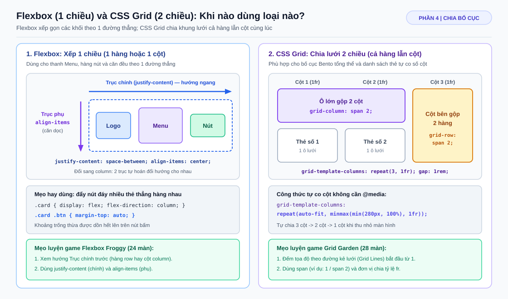

| Bài toán giao diện thực tế | Công cụ nên chọn | Công thức CSS cốt lõi |
| :--- | :--- | :--- |
| Thanh menu đầu trang, nhóm nút, nhãn tự xuống dòng | **Flexbox** | `display: flex; flex-wrap: wrap; justify-content: space-between; align-items: center; gap: 1rem;` |
| Đẩy nút dưới đáy các **Card** (*thẻ nội dung*) luôn thẳng hàng nhau | **Flexbox** (dọc) | Thẻ Card đặt `display: flex; flex-direction: column;`, nút ở đáy đặt `margin-top: auto;`. |
| **Bento Grid** (lưới ô to-nhỏ kiểu hộp cơm Nhật) | **CSS Grid** | `grid-template-columns: repeat(3, 1fr); gap: 1rem;` kết hợp `grid-column: span 2;` để gộp ô. |
| Lưới thẻ tự co số cột theo màn hình không cần `@media` | **CSS Grid (RAM)** | `grid-template-columns: repeat(auto-fit, minmax(min(280px, 100%), 1fr));` (với `fr` là phần tỷ lệ chia đều khoảng trống). |

- **Mẹo vượt nhanh 2 game thực hành:**
  1. **Flexbox Froggy (24 màn):** Khi đổi `flex-direction` giữa hàng (`row`) và cột (`column`), hai trục sẽ xoay theo: `justify-content` luôn chỉnh theo **trục chính**, còn `align-items` luôn chỉnh theo **trục phụ** vuông góc.
  2. **Grid Garden (28 màn):** Đếm tọa độ dựa vào **đường kẻ lưới** bắt đầu từ `1` (không đếm ô), kết hợp từ khóa gộp ô `span` (ví dụ `grid-column: 1 / span 2`) và đơn vị chia tỷ lệ `fr`.

### II. Chiến lược Mobile-First, Media Query, rem, clamp và Design Tokens

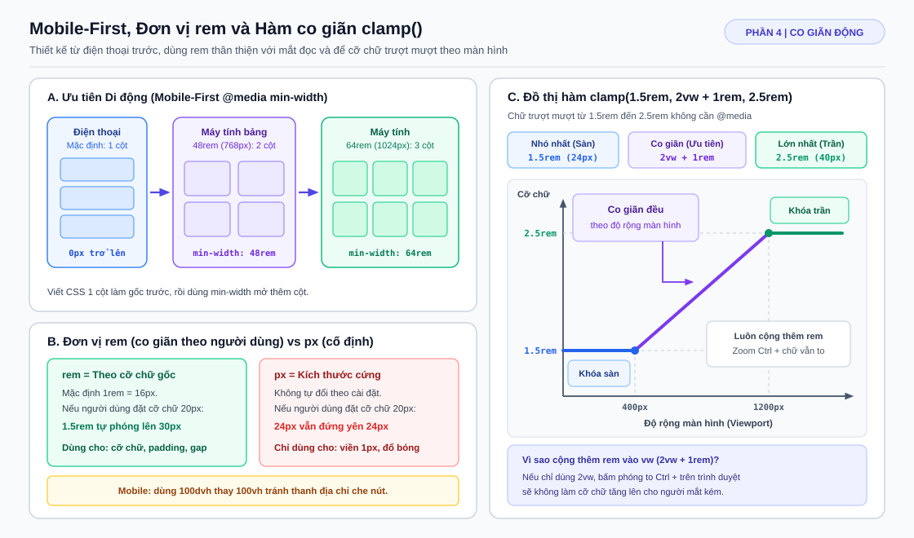

- **Mobile-First (*Ưu tiên thiết kế cho điện thoại trước*):** Viết CSS mặc định xếp gọn 1 cột cho điện thoại, sau đó mới dùng **Media Query** (*câu điều kiện kiểm tra cỡ màn hình* `@media (min-width: ...)`) mở rộng thành 2 cột ở **Breakpoint** (*điểm gãy màn hình*) máy tính bảng (`48rem` ~ `768px`) và 3 cột ở máy tính (`64rem` ~ `1024px`).
- **Đơn vị đo kích thước chuẩn:** Dùng `px` (*điểm ảnh cố định*) cho đường viền mỏng `1px`. Dùng `rem` (*tỷ lệ theo cỡ chữ gốc trình duyệt*, mặc định `1rem = 16px`) cho chữ và khoảng cách để giao diện tự phóng đều khi người dùng tăng cỡ chữ trình duyệt; dùng `dvh` (*chiều cao khung nhìn động*) thay cho `100vh` trên điện thoại để thanh địa chỉ không che mất nút dưới đáy.
- **Hàm `clamp(NHỎ NHẤT, CO GIÃN, LỚN NHẤT)`:** Giống rào chắn kẹp giúp cỡ chữ tự trượt mượt giữa sàn và trần. Phần ở giữa **luôn phải cộng thêm `rem`** (ví dụ `2.5vw + 1rem` với `vw` là % chiều rộng màn hình) để khi người dùng bấm phóng to `Ctrl +`, chữ vẫn to theo được.


> **Giải nghĩa nhanh:** **Design Tokens** / **CSS Variables** (*Biến thiết kế trong `:root`*) giống bảng quy ước đặt tên màu và cỡ chữ chung cho cả ngôi nhà. Thay vì chép mã màu `#4F46E5` ở hàng chục nơi, bạn lưu vào một biến trong `:root` (*gốc toàn bộ tài liệu*) để khi cần đổi sang giao diện nền sáng (**Light Mode**) chỉ sửa đúng 1 chỗ.

```css
/* Khai báo bộ biến màu mặc định (Giao diện nền tối - Dark Mode) cho toàn trang */
:root {
  --bg-canvas: #090A0F;       /* Màu nền tổng thể ngoài cùng */
  --bg-surface-1: #11131A;    /* Màu nền các thẻ Card chính */
  --bg-surface-2: #181B24;    /* Màu nền ô nhập hoặc phần tử nổi bên trong Card */
  --border-subtle: #222634;   /* Màu đường viền mảnh tách khối */
  --text-primary: #F3F4F6;    /* Màu chữ chính độ tương phản cao */
  --text-secondary: #9CA3AF;  /* Màu chữ phụ giải thích */
  --accent-primary: #4F46E5;  /* Màu nhấn chủ đạo cho nút chính */
  --accent-hover: #4338CA;    /* Màu nút khi rê chuột vào */
}

/* Khi thẻ html có thêm thuộc tính data-theme="light", các biến tự đổi sang bộ màu Sáng */
[data-theme="light"] {
  --bg-canvas: #F8FAFC; --bg-surface-1: #FFFFFF; --bg-surface-2: #F1F5F9; --border-subtle: #E2E8F0;
  --text-primary: #0F172A; --text-secondary: #475569;
}
```

### III. Đọc thêm CSS hiện đại: :has(), Container Queries và CSS Nesting

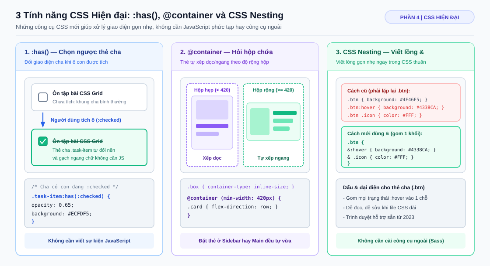

| Tính năng CSS hiện đại | Giải quyết việc gì dễ hơn trước kia? | Ví dụ cú pháp ngắn gọn |
| :--- | :--- | :--- |
| **`:has()` (*Bộ chọn ngược theo con*)** | Đổi kiểu dáng thẻ cha khi thẻ con bên trong được tích chọn, không cần viết **JavaScript** (*ngôn ngữ lập trình xử lý tương tác động trên web*). | `.task-item:has(:checked) { opacity: 0.65; }` |
| **`@container` (*Container Queries*)** | Khối tự xếp lại bố cục dựa theo độ rộng **hộp chứa quanh nó**, không phụ thuộc cỡ màn hình. | `@container (min-width: 420px) { .card { flex-direction: row; } }` |
| **CSS Nesting (`&` - *Viết lồng cấp*)** | Viết trạng thái `:hover` hoặc thẻ con lồng luôn bên trong khối cha cho gọn code. | `.btn { &:hover { background: var(--accent-hover); } }` |

---

## Phần 5: Debug CSS bằng DevTools, Lighthouse và AI

> **Giải nghĩa nhanh:** **Debug** là quá trình tìm ra nguyên nhân và sửa lỗi (hiểu đơn giản như thợ điện dò từng đoạn dây xem đứt ở đâu). Thay vì đoán mò trong code, lập trình viên mở **DevTools** (*Bộ công cụ nhà phát triển* bằng phím `F12`) để **Inspect** (*soi trực tiếp*) từng thẻ ngay trên màn hình trình duyệt.


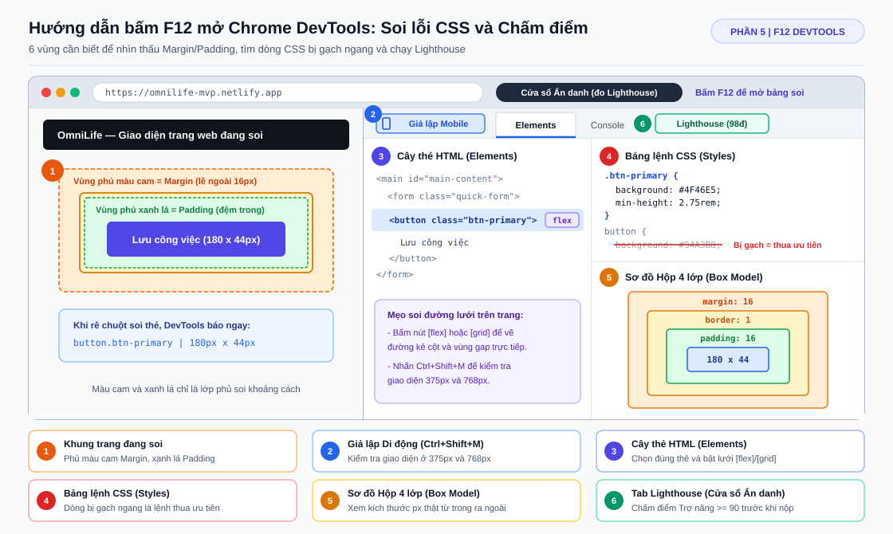

### I. Chrome DevTools: Inspect Box Model, Flex và Grid Overlay, Device Mode

| Công cụ trong Chrome DevTools | Cách dùng nhanh để bắt bệnh giao diện |
| :--- | :--- |
| **Tab `Elements`, `Styles` và `Computed`** | Chuột phải chọn *Inspect* để soi thẻ trong cây `Elements`. Ở tab `Styles`, dòng CSS bị gạch ngang nghĩa là đã thua `Specificity`; sang tab `Computed` để soi hình **Box Model** màu cam (`margin`) và xanh lá (`padding`). |
| **Nút `[flex]` / `[grid]` (**Overlay**)** | Bấm huy hiệu nhỏ cạnh thẻ để bật **Overlay** (*lớp phủ vẽ đường kẻ lưới*), hiện rõ vùng `gap` và số đường kẻ **Grid Line** ngay trên trang. |
| **Device Mode (`Ctrl + Shift + M`)** | Bật **Device Mode** (*chế độ giả lập điện thoại/máy tính bảng*) kiểm tra các mốc `375px`, `768px`, `1280px`; bấm nút `:hov` -> tích `:focus-visible` để kiểm tra vòng sáng bàn phím. |

```js
// Mở tab Console (cửa sổ chạy lệnh của DevTools), dán đoạn này rồi bấm Enter để tìm thẻ làm trang bị cuộn ngang trên điện thoại
document.querySelectorAll('*').forEach(el => {
  // Nếu bề rộng thật của một thẻ lớn hơn bề rộng màn hình đang mở thì in thẻ đó ra
  if (el.offsetWidth > document.documentElement.clientWidth) {
    console.log('Phần tử bị tràn ngang:', el, el.offsetWidth);
  }
});
```

### II. Lighthouse Accessibility, axe DevTools, WAVE và cách nhắc AI

- **Lighthouse Accessibility (`>= 90` điểm):** **Lighthouse** (*nghĩa gốc là "Ngọn hải đăng"*) là công cụ rọi lỗi và chấm điểm chất lượng tự động sẵn có trong Chrome. Luôn mở trang ở **cửa sổ Ẩn danh** (*Incognito* - giúp tắt các tiện ích ngoài gây sai lệch điểm) -> mở `F12` tab `Lighthouse` -> chọn `Accessibility` -> bấm phân tích để sửa hết lỗi thiếu `alt`, thiếu `<label>`, tương phản kém và thiếu `<html lang="vi">`.
- **axe DevTools / WAVE:** Là các **Extension** (*tiện ích mở rộng cài thêm vào trình duyệt*) giúp khoanh vùng trực tiếp trên màn hình xem trang có bị nhảy cấp tiêu đề `h1-h3`, thiếu vùng `Landmark` hay chữ mờ khó đọc không.
- **Cách nhắc AI (`Cursor` / `GitHub Copilot`):** Nếu đưa **Prompt** (*câu lệnh giao việc cho AI*) chung chung, AI rất dễ sinh ra **AI Slop** (*giao diện rập khuôn cẩu thả, toàn `<div>`, thiếu tương phản*). Hãy khóa rõ yêu cầu: *"Dùng Semantic HTML5, đúng 1 thẻ h1, nối `<label for>` cho mọi ô input, khai báo biến màu trong `:root`, hỗ trợ `:focus-visible` và độ tương phản WCAG AA >= 4.5:1"*.

---

## Phần 6: Thực hành đạt Output Buổi 14 với OmniLife MVP và Deploy

> **Giải nghĩa nhanh:**
> - **Output** (*Sản phẩm đầu ra cần hoàn thành cuối buổi*) là biến **Wireframe** (*bản phác thảo nét đơn đen trắng giống sơ đồ mặt bằng trước khi xây nhà* ở Buổi 1) thành **MVP** (*Minimum Viable Product* - phiên bản đầu tiên gọn nhẹ nhưng đủ tính năng chính).
> - Giao diện chính là **Dashboard** (*Bảng điều khiển tổng hợp*, giống bảng đồng hồ trước mặt tài xế), gồm các chỉ số **KPI** (*chỉ số đo lường chính* như số việc khẩn cấp) và đồng hồ **Pomodoro** (*đếm phiên tập trung 25 phút*).


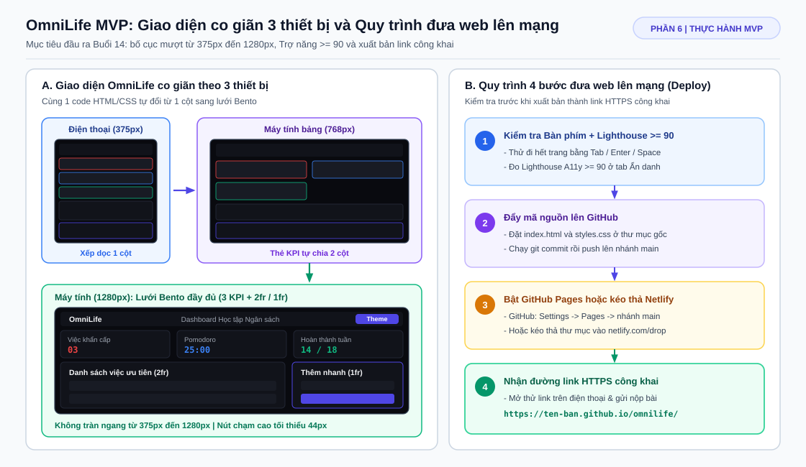

### I. Mã nguồn mẫu Dashboard OmniLife

Tạo một thư mục mới trên máy (ví dụ `omnilife-mvp`), tạo 2 file nằm cạnh nhau là `index.html` và `styles.css`, chép hai đoạn code dưới đây vào rồi nhấp đúp mở `index.html` bằng Chrome.

```html
<!DOCTYPE html>
<!-- Khai báo ngôn ngữ trang là Tiếng Việt (lang="vi") để trình đọc màn hình đọc đúng giọng -->
<html lang="vi">
<head>
  <!-- Hỗ trợ hiển thị chuẩn dấu Tiếng Việt UTF-8 -->
  <meta charset="UTF-8" />
  <!-- Giúp trang co giãn đúng theo kích thước màn hình điện thoại thật -->
  <meta name="viewport" content="width=device-width, initial-scale=1.0" />
  <title>OmniLife - Bảng điều khiển Công việc Khẩn cấp</title>
  <!-- Nối file trang trí styles.css nằm cùng thư mục với index.html -->
  <link rel="stylesheet" href="styles.css" />
</head>
<body>
  <!-- Liên kết nhảy cóc ẩn đầu trang: người dùng bấm phím Tab sẽ thấy để nhảy thẳng vào nội dung chính -->
  <a class="skip-link" href="#main-content">Bỏ qua điều hướng, đến nội dung chính</a>

  <!-- Phần đầu trang chứa Logo, thanh menu điều hướng và nút đổi giao diện -->
  <header class="site-header">
    <div class="container header-inner">
      <!-- aria-label giúp trình đọc màn hình đọc rõ đích đến thay vì chỉ đọc chữ viết tắt OL -->
      <a href="index.html" class="brand" aria-label="OmniLife - Về trang chủ">
        <!-- aria-hidden="true" giấu ký hiệu trang trí OL khỏi trình đọc màn hình -->
        <span class="brand-mark" aria-hidden="true">OL</span>
        <span class="brand-name">OmniLife</span>
      </a>
      <nav class="main-nav" aria-label="Điều hướng chính">
        <ul class="nav-list">
          <!-- aria-current="page" báo cho máy đọc biết đây là trang đang xem hiện tại -->
          <li><a href="#main-content" class="nav-link is-active" aria-current="page">Dashboard</a></li>
          <li><a href="#study-workspace" class="nav-link">Học tập</a></li>
          <li><a href="#finance-ledger" class="nav-link">Ngân sách</a></li>
        </ul>
      </nav>
      <!-- Nút bấm hành động tại chỗ nên dùng thẻ button type="button" -->
      <button type="button" class="btn-secondary">Đổi giao diện</button>
    </div>
  </header>

  <!-- Nội dung cốt lõi độc nhất của trang; tabindex="-1" để Skip link nhảy con trỏ thẳng vào đây được -->
  <main id="main-content" class="container dashboard-layout" tabindex="-1">
    <!-- Khu vực 1: Thanh tiêu đề trang và 3 ô chỉ số KPI -->
    <section aria-labelledby="dashboard-heading">
      <div class="section-head">
        <div>
          <!-- Duy nhất 1 thẻ h1 lớn nhất trên toàn trang -->
          <h1 id="dashboard-heading" class="page-title">Bảng điều khiển hôm nay</h1>
          <p class="page-subtitle">Ưu tiên công việc tự động theo chỉ số khẩn cấp U (từ 0 đến 100).</p>
        </div>
        <!-- Chuyển xuống khu vực form tạo việc nên dùng thẻ liên kết a href -->
        <a href="#quick-add-form" class="btn-primary">Tạo công việc mới</a>
      </div>

      <!-- Lưới 3 thẻ số liệu KPI tự co giãn cột -->
      <div class="kpi-grid">
        <article class="bento-card">
          <h2 class="kpi-label">Việc khẩn cấp (&ge; 80 điểm)</h2>
          <p class="kpi-value text-danger">03</p>
        </article>
        <article class="bento-card">
          <h2 class="kpi-label">Phiên tập trung Pomodoro</h2>
          <p class="kpi-value text-info">25:00</p>
        </article>
        <article class="bento-card">
          <h2 class="kpi-label">Hoàn thành tuần này</h2>
          <p class="kpi-value text-success">14 / 18</p>
        </article>
      </div>
    </section>

    <!-- Khu vực 2: Chia 2 cột trên máy tính (Danh sách việc bên trái, Form thêm nhanh bên phải) -->
    <div class="workspace-grid">
      <section class="bento-card" aria-labelledby="task-list-heading">
        <div class="task-header">
          <h2 id="task-list-heading" class="section-title">Danh sách ưu tiên động</h2>
          <!-- Biểu mẫu tìm kiếm nhanh: dùng lớp .sr-only giấu nhãn bằng mắt nhưng máy đọc vẫn đọc được -->
          <form role="search" aria-label="Lọc công việc">
            <label for="search-task" class="sr-only">Tìm kiếm công việc</label>
            <input id="search-task" type="search" placeholder="Tìm tên việc..." />
          </form>
        </div>
        <ul class="task-list">
          <li class="task-item">
            <div class="task-check-wrap">
              <!-- Ô tích checkbox gắn liền với nhãn label qua cặp id và for -->
              <input id="task-1" type="checkbox" class="task-checkbox" />
              <label for="task-1" class="task-title">Hoàn thành layout Dashboard OmniLife chuẩn Responsive</label>
            </div>
            <span class="urgency-badge is-critical">Khẩn cấp: 92</span>
          </li>
          <li class="task-item">
            <div class="task-check-wrap">
              <input id="task-2" type="checkbox" class="task-checkbox" checked />
              <label for="task-2" class="task-title">Chốt bộ biến màu Sáng/Tối trong :root</label>
            </div>
            <span class="urgency-badge is-done">Xong</span>
          </li>
        </ul>
      </section>

      <!-- Khối bổ trợ bên phải: Form thêm nhanh công việc mới -->
      <aside class="bento-card" aria-labelledby="quick-add-heading">
        <h2 id="quick-add-heading" class="section-title">Thêm nhanh công việc</h2>
        <form id="quick-add-form" class="quick-form">
          <div class="form-group">
            <label for="new-task-title">Tên công việc *</label>
            <input id="new-task-title" type="text" required minlength="3" placeholder="Ví dụ: Ôn CSS Specificity" />
          </div>
          <div class="form-group">
            <label for="new-task-date">Hạn chót *</label>
            <input id="new-task-date" type="date" required />
          </div>
          <button type="submit" class="btn-primary btn-full">Lưu công việc</button>
        </form>
      </aside>
    </div>
  </main>

  <!-- Chân trang chứa ghi chú thực hành và nút nhảy về đầu nội dung -->
  <footer class="site-footer">
    <div class="container footer-inner">
      <p>OmniLife MVP - Thực hành Buổi 14</p>
      <a href="#main-content">Lên đầu trang</a>
    </div>
  </footer>
</body>
</html>
```

```css
/* 1. BỘ BIẾN MÀU VÀ QUY TẮC RESET CƠ BẢN */
:root {
  --bg-canvas: #090A0F; --bg-surface-1: #11131A; --bg-surface-2: #181B24; --border-subtle: #222634;
  --text-primary: #F3F4F6; --text-secondary: #9CA3AF;
  --accent-primary: #4F46E5; --accent-hover: #4338CA; --accent-focus: #818CF8;
  --status-success: #10B981; --status-danger: #EF4444; --status-info: #3B82F6;
}
*, *::before, *::after { box-sizing: border-box; }
* { margin: 0; }
/* min-height: 100dvh ép trang cao ít nhất bằng màn hình thật để phần chân trang (Footer) luôn nằm dưới đáy; system-ui lấy font chuẩn theo hệ điều hành */
body { min-height: 100dvh; display: flex; flex-direction: column; font-family: 'Inter', system-ui, sans-serif; line-height: 1.5; color: var(--text-primary); background: var(--bg-canvas); }
input, button { font: inherit; color: inherit; }

/* 2. ACCESSIBILITY: VÒNG SÁNG BÀN PHÍM, NHÃN ẨN VÀ NÚT NHẢY CÓC */
:focus-visible { outline: 2px solid var(--accent-focus); outline-offset: 3px; }
/* clip-path: inset(50%) cắt ẩn chữ khỏi mắt nhưng trình đọc màn hình vẫn đọc được bình thường */
.sr-only { position: absolute; width: 1px; height: 1px; overflow: hidden; clip-path: inset(50%); white-space: nowrap; }
/* Đẩy Skip link lên trên màn hình (-100%) và kéo xuống khi người dùng bấm Tab trúng */
.skip-link { position: absolute; top: -100%; left: 1rem; z-index: 100; padding: 0.75rem 1rem; background: var(--accent-primary); color: #FFF; border-radius: 8px; text-decoration: none; }
.skip-link:focus { top: 1rem; }

/* 3. KHUNG CHỨA GIỮA TRANG VÀ THANH HEADER (ĐẦU TRANG) BÁM ĐỈNH */
/* width: min(...) giữ 2 bên chừa mép 1rem trên điện thoại và tối đa 1200px trên máy tính; margin-inline: auto căn giữa trái-phải */
.container { width: min(100% - 2rem, 1200px); margin-inline: auto; }
/* z-index: 20 giúp thanh đầu trang nổi đè lên trên nội dung bên dưới khi cuộn */
.site-header { position: sticky; top: 0; z-index: 20; background: var(--bg-surface-1); border-bottom: 1px solid var(--border-subtle); }
/* padding-block chỉ tạo đệm trên-dưới; flex-wrap: wrap cho phép tự rớt dòng; justify-content và align-items căn đều hai mép và giữa dọc */
.header-inner, .footer-inner { display: flex; flex-wrap: wrap; align-items: center; justify-content: space-between; gap: 1rem; padding-block: 0.875rem; }
.brand { display: inline-flex; align-items: center; gap: 0.5rem; text-decoration: none; font-weight: 700; }
/* display: grid và place-items: center là mẹo 2 dòng căn chữ OL vào chính giữa ô vuông */
.brand-mark { display: grid; place-items: center; width: 2rem; height: 2rem; background: var(--accent-primary); border-radius: 6px; font-size: 0.875rem; }
/* list-style: none xóa dấu chấm tròn mặc định của danh sách ul */
.nav-list { display: flex; flex-wrap: wrap; list-style: none; padding: 0; gap: 0.5rem; }
/* text-decoration: none bỏ gạch chân mặc định của thẻ liên kết */
.nav-link { display: inline-block; padding: 0.5rem 0.75rem; border-radius: 8px; text-decoration: none; color: var(--text-secondary); }
.nav-link:hover, .nav-link.is-active { color: var(--text-primary); background: var(--bg-surface-2); }

/* 4. BỐ CỤC CHÍNH, LƯỚI BENTO KPI VÀ KHUNG LÀM VIỆC 2 CỘT */
/* flex: 1 đẩy phần main giãn hết khoảng trống để footer nằm sát đáy */
.dashboard-layout { flex: 1; display: flex; flex-direction: column; gap: 1.5rem; padding-block: 1.5rem; }
.section-head, .task-header { display: flex; flex-wrap: wrap; align-items: center; justify-content: space-between; gap: 1rem; margin-bottom: 1rem; }
/* clamp giúp cỡ chữ tiêu đề tự co giãn mượt từ 22px đến 28px */
.page-title { font-size: clamp(1.375rem, 1.5vw + 1rem, 1.75rem); }
.page-subtitle { color: var(--text-secondary); font-size: 0.9375rem; }
.bento-card { background: var(--bg-surface-1); border: 1px solid var(--border-subtle); border-radius: 12px; padding: 1.25rem; }
/* Lưới tự động chia cột: mỗi thẻ tối thiểu 240px (nhưng không vượt 100% điện thoại) */
.kpi-grid { display: grid; grid-template-columns: repeat(auto-fit, minmax(min(240px, 100%), 1fr)); gap: 1rem; }
.kpi-label { font-size: 0.875rem; color: var(--text-secondary); font-weight: 500; }
/* tabular-nums giúp các con số rộng bằng nhau để đồng hồ 25:00 không bị rung giật khi đếm */
.kpi-value { font-size: clamp(1.75rem, 2vw + 1rem, 2.25rem); font-weight: 700; font-variant-numeric: tabular-nums; }
.text-danger { color: var(--status-danger); } .text-info { color: var(--status-info); } .text-success { color: var(--status-success); }

/* Mobile-First: mặc định xếp 1 cột; từ màn hình >= 60rem (960px) chia tỷ lệ 2 phần danh sách - 1 phần form */
.workspace-grid { display: grid; grid-template-columns: 1fr; gap: 1rem; align-items: start; }
@media (min-width: 60rem) { .workspace-grid { grid-template-columns: 2fr 1fr; } }

/* 5. DANH SÁCH CÔNG VIỆC (:has) VÀ FORM + NÚT BẤM CHUẨN CHẠM >= 44px */
.task-list, .quick-form { list-style: none; padding: 0; display: flex; flex-direction: column; gap: 0.75rem; margin-top: 0.75rem; }
.task-item { display: flex; flex-wrap: wrap; align-items: center; justify-content: space-between; gap: 0.75rem; padding: 0.875rem; background: var(--bg-surface-2); border: 1px solid var(--border-subtle); border-radius: 8px; }
/* Dùng :has() làm mờ và gạch ngang tên việc khi ô checkbox bên trong được tích chọn */
.task-item:has(.task-checkbox:checked) { opacity: 0.65; }
.task-item:has(.task-checkbox:checked) .task-title { text-decoration: line-through; }
.task-check-wrap { display: flex; align-items: center; gap: 0.75rem; flex: 1 1 220px; }
/* accent-color đổi màu dấu tích theo màu nhấn chủ đạo */
.task-checkbox { width: 1.125rem; height: 1.125rem; accent-color: var(--accent-primary); }
.urgency-badge { padding: 0.25rem 0.5rem; border-radius: 6px; font-size: 0.75rem; font-weight: 600; }
/* rgba(..., 0.16) tạo màu nền đỏ/xanh có độ trong suốt 16% để huy hiệu dịu mắt */
.is-critical { background: rgba(239, 68, 68, 0.16); color: #FCA5A5; }
.is-done { background: rgba(16, 185, 129, 0.16); color: #6EE7B7; }

.form-group { display: flex; flex-direction: column; gap: 0.375rem; }
input[type="text"], input[type="date"], input[type="search"] { width: 100%; padding: 0.625rem 0.75rem; background: var(--bg-surface-2); border: 1px solid var(--border-subtle); border-radius: 8px; }
/* Chỉ tô viền đỏ khi người dùng gõ sai rồi rời khỏi ô nhập */
input:user-invalid { border-color: var(--status-danger); }
/* Chiều cao tối thiểu 2.75rem (44px) để ngón tay bấm không trượt; cursor: pointer đổi chuột thành hình bàn tay */
.btn-primary, .btn-secondary { display: inline-flex; align-items: center; justify-content: center; min-height: 2.75rem; padding: 0.5rem 1rem; border-radius: 8px; font-weight: 600; text-decoration: none; border: 1px solid transparent; cursor: pointer; }
.btn-primary { background: var(--accent-primary); color: #FFF; }
.btn-primary:hover { background: var(--accent-hover); }
.btn-secondary { background: var(--bg-surface-2); border-color: var(--border-subtle); }
.btn-full { width: 100%; }
.site-footer { border-top: 1px solid var(--border-subtle); background: var(--bg-surface-1); font-size: 0.875rem; color: var(--text-secondary); }
```

### II. Checklist Output và hướng dẫn Deploy từng bước

**Checklist** (*Bảng các đầu mục tự rà soát trước khi nộp bài*):

| Hạng mục kiểm tra trước khi nộp bài | Tiêu chuẩn cần đạt |
| :--- | :--- |
| **Semantic HTML và Form** | Đủ `<header>`, `<nav>`, 1 `<main>`, 1 `<h1>` (không nhảy cấp); mọi `<input>` có `<label for>`, ảnh trang trí để `alt=""`. |
| **Bàn phím và Accessibility** | Bấm `Tab`/`Enter`/`Space` đi hết trang 100%, thấy rõ `:focus-visible`, **Lighthouse Accessibility >= 90** ở cửa sổ Ẩn danh. |
| **Responsive và Vùng chạm** | Kéo từ `375px` đến `1280px` không xuất hiện thanh cuộn ngang; chiều cao nút bấm đạt `>= 44px` (`2.75rem`). |

> **Giải nghĩa nhanh:** **Deploy** (*Triển khai lên mạng*) là đưa bộ file **Web tĩnh** (*Static* - chỉ có HTML/CSS chạy thẳng trên trình duyệt) từ máy cá nhân lên máy chủ công cộng để nhận đường link chia sẻ cho mọi người. Dưới đây là 2 cách miễn phí dễ làm nhất:

- **Cách 1 - GitHub Pages (Dùng kho code GitHub):**
  1. Đặt `index.html` và `styles.css` ngay thư mục gốc của **Repo** (*Repository - kho lưu trữ code*), rồi **Push** (*đẩy code lên*) nhánh (`Branch`) `main`.
  2. Trên web GitHub, mở **Settings** -> chọn mục **Pages** ở cột trái -> mục **Branch** chọn `main` và thư mục `/(root)` -> bấm **Save**.
  3. Đợi 1-2 phút rồi tải lại trang để nhận đường link công khai có bảo mật `HTTPS` (*kết nối an toàn có biểu tượng ổ khóa*).
- **Cách 2 - Netlify (Kéo thả không cần lệnh Git):**
  1. Mở trang `https://app.netlify.com/drop` và đăng nhập tài khoản miễn phí.
  2. Kéo thẳng thư mục chứa `index.html` và `styles.css` thả vào khung giữa màn hình (hoặc kết nối Repo GitHub với thư mục Publish là `.` và để trống ô Build command).
  3. Chờ vài giây là nhận ngay đường link công khai dùng được trên điện thoại.

---

## Từ điển bỏ túi Anh - Việt cho người mới

| Thuật ngữ Tiếng Anh | Nghĩa Tiếng Việt | Hiểu đơn giản trong 1 câu |
| :--- | :--- | :--- |
| **Frontend** | Giao diện phía người dùng | Phần trang web hiện lên trình duyệt cho bạn nhìn và bấm vào. |
| **HTML** | Ngôn ngữ đánh dấu | Khung xương xây dựng bố cục nội dung trang web bằng các thẻ. |
| **CSS** | Bảng kiểu xếp tầng | Bộ quy tắc tô màu, chọn font chữ và chia cột cho HTML. |
| **Tag / Attribute** | Thẻ / Thuộc tính | Cặp `<...>` đánh dấu nội dung, bên trong chứa cài đặt phụ như `href`. |
| **Semantic HTML** | HTML ngữ nghĩa | Đặt đúng tên thẻ (`nav`, `main`, `footer`) theo đúng vai trò thật. |
| **DOM** | Cây cấu trúc trang | Sơ đồ cha-con của toàn bộ thẻ HTML trong bộ nhớ trình duyệt. |
| **Screen Reader** | Trình đọc màn hình | Phần mềm đọc to nội dung web thành tiếng cho người khiếm thị. |
| **Accessibility (A11y)** | Khả năng tiếp cận | Làm web dễ dùng cho mọi người, kể cả người chỉ dùng bàn phím. |
| **Focus / Outline** | Tiêu điểm / Viền sáng | Đèn pin viền ngoài báo vị trí nút đang được chọn khi bấm `Tab`. |
| **WCAG AA** | Tiêu chuẩn tiếp cận AA | Quy chuẩn quốc tế yêu cầu độ tương phản chữ-nền từ `4.5 : 1` trở lên. |
| **ARIA** | Thuộc tính trợ năng bổ sung | Nhãn phụ giải thích cho máy đọc khi thẻ HTML thường chưa đủ ý. |
| **Selector** | Bộ chọn CSS | Phần chỉ định thẻ HTML nào sẽ nhận lệnh trang trí CSS. |
| **Cascade & Specificity** | Xếp tầng và Độ đặc hiệu | Quy tắc chấm điểm phân xử lệnh CSS nào thắng khi bị viết đè. |
| **Box Model** | Mô hình chiếc hộp | Cấu trúc 4 lớp mọi thẻ đều có: `Content`, `Padding`, `Border`, `Margin`. |
| **Flexbox / CSS Grid** | Bố cục 1 chiều / 2 chiều | Flexbox xếp 1 hàng hoặc 1 cột; Grid chia đồng thời cả hàng và cột. |
| **Responsive / Mobile-First** | Co giãn / Ưu tiên di động | Viết CSS cho điện thoại 1 cột trước rồi mở rộng nhiều cột lên máy tính. |
| **rem / clamp()** | Đơn vị co giãn / Hàm kẹp | `rem` tỷ lệ theo cỡ chữ gốc trình duyệt; `clamp()` chặn ngưỡng nhỏ-lớn. |
| **Design Tokens (:root)** | Biến thiết kế dùng chung | Lưu màu sắc vào biến ở `:root` để đổi giao diện Sáng/Tối ở một chỗ. |
| **DevTools / Lighthouse** | Bộ soi lỗi / Chấm điểm | Công cụ bật bằng `F12` để soi CSS và chấm điểm chất lượng web. |
| **Wireframe / MVP / Deploy** | Phác thảo / Bản chạy thử / Đưa lên mạng | Vẽ khung -> Code bản gọn nhẹ đủ dùng -> Xuất ra link công khai. |

---

## Tóm tắt nhanh

| Chủ đề trọng tâm | Những ý cốt lõi cần nhớ sau Buổi 14 |
| :--- | :--- |
| **1. HTML ngữ nghĩa và Form** | Phân biệt `HTML` (khung nhà) và `CSS` (nội thất); dùng `header/nav/main/section/article/aside/footer`; 1 `h1`; `<a>` chuyển trang khác `<button>` hành động; nối `<label for>` với `<input id>`, `:user-invalid`, `alt=""`. |
| **2. Accessibility (A11y)** | Thao tác 100% bằng `Tab`/`Enter`/`Space`; bật `:focus-visible` thay vì xóa `outline`; tương phản WCAG AA `>= 4.5:1`; không lạm dụng ARIA khi HTML gốc đã có. |
| **3. Mô hình tư duy CSS** | Nắm `Selector`, `Pseudo-class`; `Cascade` + `Specificity` `(ID, Class, Thẻ)`; `box-sizing: border-box`; tránh sụp lề bằng `gap`; `relative` làm mỏ neo cho `absolute`; `overflow: clip` cho `sticky`. |
| **4. Layout và Responsive** | `Flexbox` 1 chiều vs `Grid` 2 chiều (`repeat(auto-fit, minmax())`); `Mobile-First` (`min-width`), `rem`, `clamp(... + rem)`, Design Tokens `:root`, `:has()`, `@container`, Nesting. |
| **5. DevTools và Output** | Soi `Styles`/`Computed`, bật `[flex]`/`[grid]`, test `375px-1280px`, chấm `Lighthouse` ở cửa sổ Ẩn danh `>= 90` điểm, rồi Deploy lên GitHub Pages hoặc Netlify. |
