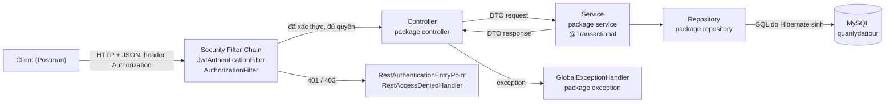
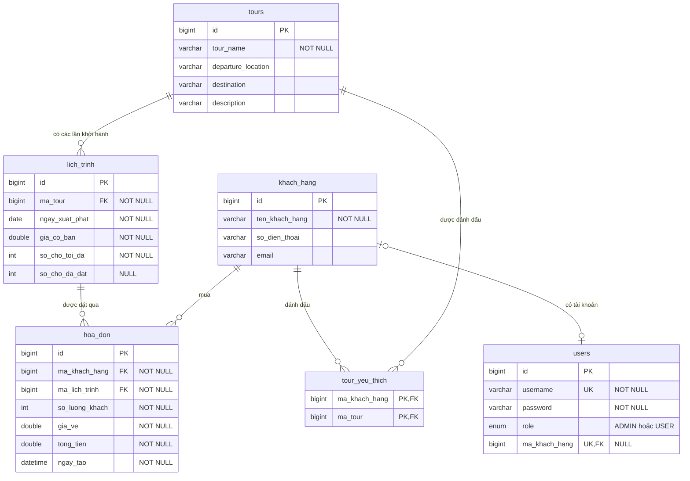
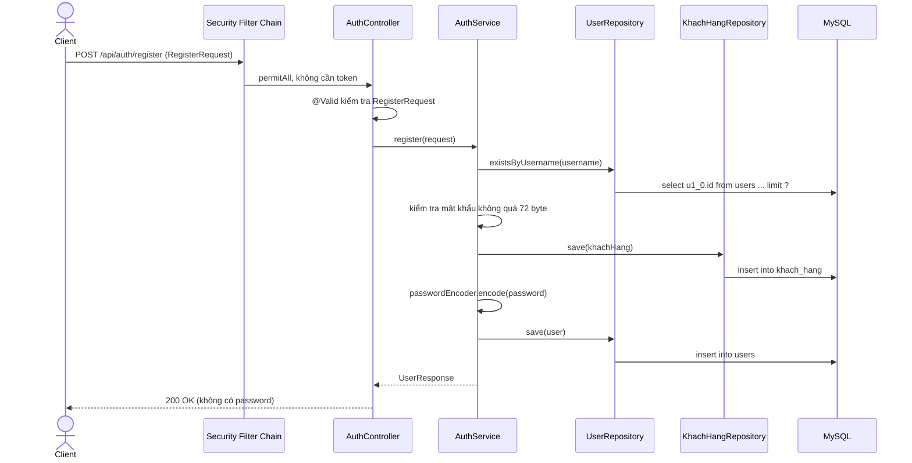
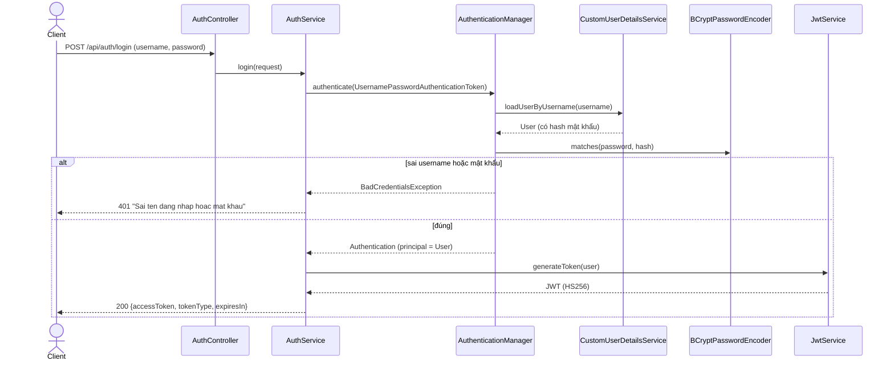
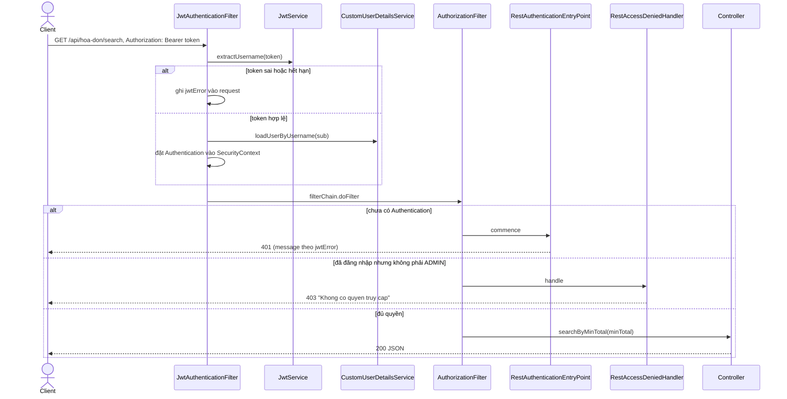
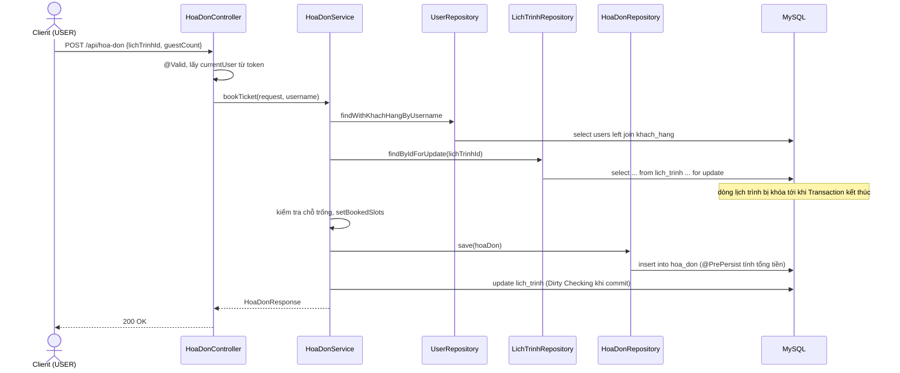
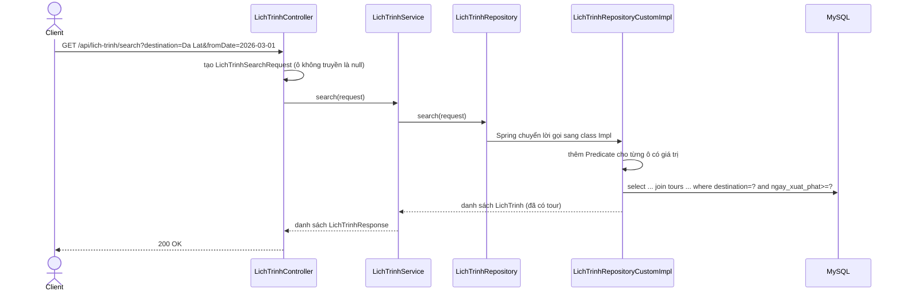
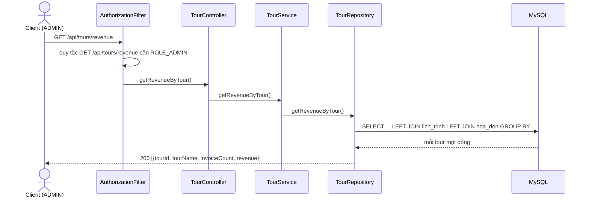

# GIẢI THÍCH DỰ ÁN QUẢN LÝ ĐẶT TOUR

*Tài liệu giải thích dự án, theo trạng thái code ngày 02/11/2026*

---

**Mục lục**

- [Phần 1: Tổng quan dự án](#phần-1-tổng-quan-dự-án): dự án làm gì, công nghệ, kiến trúc, cách chạy.
- [Phần 2: Cấu trúc thư mục](#phần-2-cấu-trúc-thư-mục): cây thư mục, vai trò từng package.
- [Phần 3: Giải thích từng file](#phần-3-giải-thích-từng-file): entity, repository, dto, service, controller, security, config, exception, build, test.
- [Phần 4: Database](#phần-4-database): bảng, ERD, khóa ngoại, SQL, Transaction, dữ liệu mẫu.
- [Phần 5: Danh sách API](#phần-5-danh-sách-api)
- [Phần 6: Các luồng xử lý chính](#phần-6-các-luồng-xử-lý-chính): đăng ký, đăng nhập, gọi API có token, đặt vé, tìm kiếm, doanh thu.
- [Phần 7: Đối chiếu yêu cầu và phần còn thiếu](#phần-7-đối-chiếu-yêu-cầu-và-phần-còn-thiếu): bảng đối chiếu, nhật ký thay đổi, vấn đề còn lại.
- [Phần 8: Kết quả kiểm tra](#phần-8-kết-quả-kiểm-tra)
- [Phần 9: Việc cần làm sau bàn giao](#phần-9-việc-cần-làm-sau-bàn-giao): các bước người quản lý repo tự làm.
- [Phụ lục A: Thuật ngữ](#phụ-lục-a-thuật-ngữ)
- [Phụ lục B: Câu hỏi thường gặp khi đọc code](#phụ-lục-b-câu-hỏi-thường-gặp-khi-đọc-code)

---

**Trước khi đọc:**

- Dành cho người chưa biết Spring Boot, cần hiểu dự án làm gì, chạy thế nào, mỗi file để làm gì.
- Thứ tự đọc: người mới đọc Phần 1, 2, 6 rồi tra Phần 3 khi cần; người sửa code đọc Phần 5, 7, 4; người quản lý repo làm Phần 9 đúng thứ tự. Thuật ngữ in đậm tra Phụ lục A.
- Đường dẫn Java tính từ `quanlytour/src/main/java/com/example/quanlytour/`, ví dụ `service/HoaDonService.java:25-50` là dòng 25 đến 50. Code trích được chép **nguyên văn** từ file thật.
- Message lỗi là tiếng Việt không dấu (ví dụ `"Khong du cho trong"`), JSON lỗi có dạng `{"status": ..., "message": "..."}`. Mật khẩu database, `jwt.secret`, mật khẩu admin trong tài liệu đều là **giá trị mẫu**.
- Trạng thái code: nhánh `Buoi-11`, gồm code Buổi 10, commit `dedeaa6` (bổ sung `findInvoicesWithTotalGreaterThan`) và các thay đổi ngày 02/11/2026 hoàn thiện Buổi 9, Buổi 10. Lúc viết, các thay đổi này chưa commit (cách commit ở Phần 9.II). Mỗi file ở Phần 3 ghi trạng thái `Giữ nguyên`, `Đã sửa` hoặc `Thêm mới`.
- Trạng thái kiểm thử: mọi kết quả đều **đã chạy thật** ngày 02/11/2026 trên Windows 11, JDK 25.0.1, MySQL 8.0.46, trừ chỗ ghi "Output mong đợi":
  - `./mvnw.cmd -q -DskipTests compile` và `./mvnw.cmd package` (chạy test `contextLoads`) thành công; chạy `java -jar` rồi gọi API bằng `curl` hơn 90 case, gồm 10 request đặt vé đồng thời; đọc cấu trúc bảng thật bằng `mysql.exe`.

---

## Phần 1: Tổng quan dự án

### I. Dự án làm gì

Dự án là một **REST API** (chỉ có backend) cho nghiệp vụ "Mua vé" của công ty du lịch, phát triển từ thiết kế CSDL Bài tập Buổi 2. Client (Postman, sau này là Frontend) gửi request HTTP và nhận JSON.

| Khái niệm                                           | Entity      | Ví dụ                                                |
| --------------------------------------------------- | ----------- | ---------------------------------------------------- |
| Tour: sản phẩm du lịch                              | `Tour`      | "Da Lat 3N2D", từ Hồ Chí Minh đến Đà Lạt             |
| Lịch trình: một lần khởi hành, có ngày, giá, số chỗ | `LichTrinh` | Đà Lạt ngày 10/12/2026, 2.500.000 đồng/khách, 10 chỗ |
| Khách hàng: người đại diện mua vé                   | `KhachHang` | Nguyễn Văn An, số điện thoại, email                  |
| Hóa đơn: một lần mua vé                             | `HoaDon`    | An mua 3 vé lịch trình 10/12, tổng 7.500.000 đồng    |
| Tài khoản đăng nhập                                 | `User`      | `an` (USER), `admin` (ADMIN)                         |

| Vai trò        | Là ai                          | Được làm                                                                                | Không được làm                                                                         |
| -------------- | ------------------------------ | --------------------------------------------------------------------------------------- | -------------------------------------------------------------------------------------- |
| Khách vãng lai | Chưa đăng nhập                 | Đăng ký, đăng nhập                                                                      | Mọi API khác (`401`)                                                                   |
| `USER`         | Khách tự đăng ký               | Xem tour, lịch trình, tìm lịch trình; đặt vé cho **chính mình**; xem thông tin của mình | Thêm, sửa, xóa tour, lịch trình; xem khách hàng, hóa đơn người khác, doanh thu (`403`) |
| `ADMIN`        | Quản lý, tạo sẵn khi khởi động | Toàn quyền tour, lịch trình, khách hàng; xem mọi hóa đơn, doanh thu, danh sách user     | Đặt vé (không gắn khách hàng nào, `403`)                                               |

- Chức năng: đăng ký, đăng nhập nhận JWT; tour (phân trang, thêm, sửa, xóa, doanh thu); lịch trình (thêm, sửa, xóa, sắp khởi hành, tìm theo 4 ô lọc); khách hàng (thêm, tìm theo tên, tour yêu thích).
- Đặt vé: tạo hóa đơn, trừ chỗ trống, chặn đặt vượt chỗ kể cả khi nhiều người đặt cùng lúc; tìm hóa đơn theo tổng tiền.

### II. Công nghệ và phiên bản

Version thật, lấy từ `pom.xml`, file jar và log khởi động.

| Thành phần                | Version                         | Dùng để                                                     |
| ------------------------- | ------------------------------- | ----------------------------------------------------------- |
| Java (JDK)                | 25.0.1                          | Ngôn ngữ, `pom.xml:30` yêu cầu `java.version` 25            |
| Spring Boot               | 4.1.1                           | Khung ứng dụng, tự cấu hình, nhúng web server (`pom.xml:8`) |
| Spring Framework          | 7.0.9                           | Dependency Injection, Spring MVC                            |
| Spring Security           | 7.1.1                           | Xác thực, phân quyền, BCrypt                                |
| Spring Data JPA           | 4.1.1                           | Sinh Repository từ interface                                |
| Hibernate ORM             | 7.4.5.Final                     | Ánh xạ Entity sang bảng, sinh SQL                           |
| Hibernate Validator       | 9.1.3.Final                     | Bean Validation (`@NotBlank`, `@Positive`...)               |
| Jackson                   | 3.1.5 (package `tools.jackson`) | Đổi object Java sang JSON và ngược lại                      |
| jjwt                      | 0.13.0                          | Tạo, kiểm tra JWT (`pom.xml:31`)                            |
| MySQL Connector/J         | 9.7.0                           | Driver JDBC                                                 |
| MySQL Server              | 8.0.46                          | Database                                                    |
| Apache Tomcat (nhúng)     | 11.0.24                         | Web server, cổng 8080                                       |
| JUnit Jupiter             | 6.0.3                           | Chạy test                                                   |
| Maven (qua Maven Wrapper) | 3.9.16                          | Tải thư viện, biên dịch, test, đóng gói                     |

- `jjwt-jackson` vẫn dùng Jackson 2 (`jackson-databind` 2.21.5) cho phần JSON trong token. Hai bản Jackson khác package nên không xung đột.
- Spring Boot 4 đổi tên starter web thành `spring-boot-starter-webmvc` (`pom.xml:40`) và dùng Jackson 3 (xem Phụ lục B).

### III. Kiến trúc phân lớp

Request đi qua các lớp theo một chiều. Lớp trên chỉ gọi lớp ngay dưới.



- Security Filter Chain: chặn request trước Controller. `JwtAuthenticationFilter` đọc token để biết ai gọi; `AuthorizationFilter` (có sẵn) đối chiếu quy tắc trong `SecurityConfig` để cho qua, trả `401` hay `403`.
- Controller: nhận request, kiểm tra dữ liệu bằng `@Valid`, gọi Service; không chứa nghiệp vụ. Service: chứa nghiệp vụ, quản lý **Transaction** bằng `@Transactional`. Repository: đọc, ghi database, phần lớn chỉ là interface.
- Entity: class ánh xạ 1-1 với bảng. DTO: object nhận, trả dữ liệu qua API, tách khỏi Entity để không lộ dữ liệu nội bộ (ví dụ mật khẩu).
- Xử lý lỗi ở hai nơi: lỗi trong Filter do `RestAuthenticationEntryPoint` (401), `RestAccessDeniedHandler` (403) trả; lỗi từ Controller trở xuống do `GlobalExceptionHandler` trả.

### IV. Chạy dự án từ đầu

#### 1. Cài đặt

- JDK 25 trở lên (kiểm tra: `java -version`), MySQL Server 8.0 và MySQL Workbench (hoặc `mysql.exe`), IntelliJ IDEA, Postman.
- Không cần cài Maven: Maven Wrapper (`mvnw`, `mvnw.cmd`) tự tải Maven 3.9.16 ở lần chạy đầu.

#### 2. Tạo database

Chỉ cần tạo database rỗng. Bảng do Hibernate tự tạo khi khởi động (`spring.jpa.hibernate.ddl-auto=update`):

```sql
CREATE DATABASE quanlydattour CHARACTER SET utf8mb4 COLLATE utf8mb4_0900_ai_ci;
```

#### 3. Cấu hình

Sửa `quanlytour/src/main/resources/application.properties` cho khớp máy. Giá trị bí mật dưới đây là **giá trị mẫu**:

```properties
spring.datasource.url=jdbc:mysql://localhost:3306/quanlydattour?useSSL=false&serverTimezone=Asia/Ho_Chi_Minh&allowPublicKeyRetrieval=true
spring.datasource.username=root
spring.datasource.password=<mat-khau-mysql-cua-ban>
jwt.secret=<chuoi-base64-32-byte-tu-sinh>
jwt.expiration-ms=3600000
app.admin.username=admin
app.admin.password=<mat-khau-admin-tu-dat>
```

- Sinh `jwt.secret` bằng `openssl rand -base64 32` (Git Bash có sẵn `openssl`).
- File này đang được commit lên GitHub kèm giá trị thật, là lỗ hổng (D1). Trên máy đã chạy dự án lúc viết tài liệu: không sửa file này, làm theo Phần 9.V và 9.VI.

#### 4. Lệnh chạy

- Trong IntelliJ: mở thư mục `quanlytour`, chờ Maven tải thư viện, chạy `QuanlytourApplication.java`.
- Bằng dòng lệnh (PowerShell, trong thư mục `quanlytour`), cách đã chạy thật:

```powershell
.\mvnw.cmd -DskipTests package
java -jar target\quanlytour-0.0.1-SNAPSHOT.jar
```

- Thành công khi Console có dòng:

```text
INFO ... c.e.quanlytour.QuanlytourApplication     : Started QuanlytourApplication in 5.089 seconds (process running for 5.522)
```

#### 5. Tài khoản admin

- `DataInitializer` tạo ADMIN ở **lần khởi động đầu tiên**, lấy từ `app.admin.username`, `app.admin.password`. Console in `Da tao tai khoan ADMIN mac dinh: admin`.
- Các lần sau tài khoản đã có nên không tạo lại. Tài khoản USER tự tạo qua `POST /api/auth/register`.

#### 6. Kiểm tra nhanh

Chạy trong Git Bash, kết quả là kết quả thật:

```bash
curl -s -o /dev/null -w "%{http_code}\n" http://localhost:8080/api/tours
curl -s -X POST http://localhost:8080/api/auth/login -H "Content-Type: application/json" -d "{\"username\":\"admin\",\"password\":\"<mat-khau-admin>\"}"
curl -s -H "Authorization: Bearer <accessToken-vua-nhan>" "http://localhost:8080/api/tours?page=0&size=2"
```

- Lệnh 1 ra `401` vì chưa gửi token. Lệnh 2 ra `200`, Body `{"accessToken":"eyJ...","tokenType":"Bearer","expiresIn":3600}`. Lệnh 3 ra `200`, Body là một trang `{"content":[...],"totalElements":...}`.

---

## Phần 2: Cấu trúc thư mục

### I. Cây thư mục

Bỏ qua thư mục sinh tự động (`target/`, `.idea/`). Nhãn `(mới)`, `(sửa)` là thay đổi ngày 02/11/2026.

```text
D:\Khanh\java\Web                             (repo Git, nhánh Buoi-11)
├── README.md                                  giới thiệu repo: mỗi nhánh là một buổi học
├── docs/
│   └── Giai_thich_du_an_QuanLyTour.md          tài liệu này
├── tai-lieu-buoi-truoc/                       tài liệu các buổi trước (chưa đưa vào Git)
└── quanlytour/                                project Spring Boot
    ├── pom.xml                                khai báo thư viện, version Java
    ├── mvnw, mvnw.cmd                         Maven Wrapper cho Linux/macOS và Windows
    ├── .mvn/wrapper/maven-wrapper.properties  version Maven mà Wrapper sẽ tải
    ├── .gitignore, .gitattributes             cấu hình Git
    ├── HELP.md                                file Spring Initializr sinh ra, bị .gitignore bỏ qua
    └── src/
        ├── main/
        │   ├── java/com/example/quanlytour/
        │   │   ├── QuanlytourApplication.java        điểm khởi động
        │   │   ├── config/
        │   │   │   └── DataInitializer.java
        │   │   ├── controller/
        │   │   │   ├── AuthController.java
        │   │   │   ├── HoaDonController.java
        │   │   │   ├── KhachHangController.java       (sửa)
        │   │   │   ├── LichTrinhController.java       (sửa)
        │   │   │   ├── TourController.java            (sửa)
        │   │   │   └── UserController.java
        │   │   ├── dto/
        │   │   │   ├── AuthResponse.java
        │   │   │   ├── BookTicketRequest.java
        │   │   │   ├── HoaDonResponse.java
        │   │   │   ├── LichTrinhResponse.java         (mới)
        │   │   │   ├── LichTrinhSearchRequest.java    (mới)
        │   │   │   ├── LoginRequest.java
        │   │   │   ├── RegisterRequest.java
        │   │   │   └── UserResponse.java
        │   │   ├── entity/
        │   │   │   ├── HoaDon.java
        │   │   │   ├── KhachHang.java
        │   │   │   ├── LichTrinh.java
        │   │   │   ├── Role.java
        │   │   │   ├── Tour.java
        │   │   │   └── User.java
        │   │   ├── exception/
        │   │   │   └── GlobalExceptionHandler.java
        │   │   ├── repository/
        │   │   │   ├── HoaDonRepository.java
        │   │   │   ├── KhachHangRepository.java       (sửa)
        │   │   │   ├── LichTrinhRepository.java       (sửa)
        │   │   │   ├── LichTrinhRepositoryCustom.java     (mới)
        │   │   │   ├── LichTrinhRepositoryCustomImpl.java (mới)
        │   │   │   ├── TourRepository.java            (sửa)
        │   │   │   ├── UserRepository.java
        │   │   │   └── projection/
        │   │   │       └── TourRevenue.java           (mới)
        │   │   ├── security/
        │   │   │   ├── CustomUserDetailsService.java
        │   │   │   ├── JwtAuthenticationFilter.java
        │   │   │   ├── JwtService.java
        │   │   │   ├── RestAccessDeniedHandler.java
        │   │   │   ├── RestAuthenticationEntryPoint.java
        │   │   │   └── SecurityConfig.java            (sửa)
        │   │   └── service/
        │   │       ├── AuthService.java
        │   │       ├── HoaDonService.java             (sửa)
        │   │       ├── KhachHangService.java          (sửa)
        │   │       ├── LichTrinhService.java          (sửa)
        │   │       ├── TourService.java               (sửa)
        │   │       └── UserService.java
        │   └── resources/
        │       └── application.properties
        └── test/java/com/example/quanlytour/
            └── QuanlytourApplicationTests.java
```

### II. Vai trò từng package

| Package                  | Số file | Vai trò                                                    | Ví dụ                           |
| ------------------------ | ------- | ---------------------------------------------------------- | ------------------------------- |
| `com.example.quanlytour` | 1       | Chứa `main`, bật tự cấu hình, quét package con             | `QuanlytourApplication`         |
| `entity`                 | 6       | Class ánh xạ bảng, cùng `enum Role`                        | `Tour` ứng với `tours`          |
| `repository`             | 8       | Đọc, ghi database; Custom Repository; Interface Projection | `HoaDonRepository`              |
| `dto`                    | 8       | Object nhận, trả dữ liệu qua API, có Validation            | `RegisterRequest`               |
| `service`                | 6       | Nghiệp vụ, Transaction                                     | `HoaDonService.bookTicket`      |
| `controller`             | 6       | Khai báo URL, nhận request, gọi Service                    | `TourController` (`/api/tours`) |
| `security`               | 6       | JWT, nạp user, Filter, lỗi 401/403, phân quyền             | `SecurityConfig`                |
| `config`                 | 1       | Việc chạy ngay sau khi khởi động                           | `DataInitializer` tạo ADMIN     |
| `exception`              | 1       | Đổi exception thành JSON lỗi thống nhất                    | `GlobalExceptionHandler`        |

---

## Phần 3: Giải thích từng file

Mỗi file chỉ ghi trạng thái, mục đích và điểm đáng chú ý. Cột của từng bảng xem Phần 4.III, URL và mã lỗi từng API xem Phần 5.

### I. Package entity

**Entity** là class ánh xạ một bảng: mỗi object là một dòng, mỗi thuộc tính là một cột. Cả 5 Entity dùng `@Getter`, `@Setter` của **Lombok** thay cho `@Data` (lý do ở Phụ lục B).

#### 1. `Tour.java`

- Giữ nguyên. Ánh xạ bảng `tours`. `@GeneratedValue(strategy = GenerationType.IDENTITY)`: khóa chính do MySQL tự tăng; `@NotBlank` chặn tên rỗng khi có `@Valid`.
- `@OneToMany(mappedBy = "tour", fetch = FetchType.LAZY, cascade = CascadeType.PERSIST)` với `LichTrinh`, `@ManyToMany(mappedBy = "favoriteTours")` với `KhachHang`. Khóa ngoại nằm ở phía bên kia (**Owning side**). `@JsonIgnore` trên hai Collection để tránh vòng lặp JSON và nạp Lazy ngoài ý muốn.
- Helper `addLichTrinh` hiện không ai gọi. Gửi kèm `id` khi thêm tour sẽ ghi đè tour cũ (D4); xóa tour còn lịch trình trả `500` (D16).

#### 2. `LichTrinh.java`

- Giữ nguyên. Ánh xạ bảng `lich_trinh`: một lần khởi hành của tour. `@ManyToOne(fetch = FetchType.LAZY)` + `@JoinColumn(name = "ma_tour", nullable = false)`: giữ khóa ngoại, chỉ nạp `Tour` khi cần (mặc định của `@ManyToOne` là `EAGER`).
- `bookedSlots` cho phép `NULL` (dữ liệu Buổi 8), mọi nơi đọc đều đổi `null` thành `0`. Client gửi `"tour": {"id": 1}` nên Service phải nạp lại `Tour` thật (`resolveTour`). Không có `@Version`: chống đặt vượt chỗ bằng **Pessimistic Lock** (`findByIdForUpdate`).

#### 3. `KhachHang.java`

- Giữ nguyên. Ánh xạ bảng `khach_hang`, phía chủ của N-N "tour yêu thích" qua `@JoinTable(name = "tour_yeu_thich", ...)`. Helper `addFavoriteTour`, `removeFavoriteTour` cập nhật cả hai phía (`removeFavoriteTour` chưa có API gọi).
- Dùng `Set`: bỏ một tour thì Hibernate chỉ xóa đúng một dòng ở bảng nối (`List` có thể xóa hết rồi chèn lại). `@Email` chặn sai định dạng nhưng vẫn cho `null`. Đã chạy thật: `POST /api/khach-hang` kèm `"id": 5` ghi đè khách 5 và xóa luôn tour yêu thích của khách đó (D4).

#### 4. `HoaDon.java`

- Giữ nguyên. Ánh xạ bảng `hoa_don`: Entity trung gian giữa `KhachHang` và `LichTrinh`, có thêm số khách, giá vé, tổng tiền, ngày tạo (`updatable = false`).
- `@PrePersist onCreate()`: ngay trước `INSERT`, gán `createdAt = now()`, `totalAmount = ticketPrice * guestCount`. `ticketPrice` chụp giá lúc mua (3NF Buổi 2), đổi giá sau này không làm sai hóa đơn cũ. Tiền lưu bằng `Double` nên có sai số khi cộng dồn, hệ thống thật nên dùng `BigDecimal`.

#### 5. `User.java`

- Giữ nguyên. Ánh xạ bảng `users` (tên `users` vì `user` là từ khóa ở nhiều hệ quản trị). `implements UserDetails` nên Spring Security đọc thẳng Entity này; `getAuthorities()` trả `ROLE_USER` hoặc `ROLE_ADMIN`.
- `@Enumerated(EnumType.STRING)` lưu chữ `USER`, `ADMIN`. `@OneToOne` + `@JoinColumn(name = "ma_khach_hang", unique = true)`: hai tài khoản không chung một khách hàng; cho `NULL` vì ADMIN không có khách hàng. `User` **không bao giờ** trả ra JSON, mọi API trả `UserResponse` (không có `password`).

#### 6. `Role.java`

- Giữ nguyên. `enum` gồm `USER`, `ADMIN`. Cột `role` là `ENUM` của MySQL: thêm, bỏ giá trị trong `enum` thì Hibernate 7.4.5 tự `alter` cột theo (Phần 4.I).

### II. Package repository

**Repository** là interface kế thừa `JpaRepository<Entity, KieuKhoaChinh>`. Spring tự sinh phần cài đặt, có sẵn `save`, `findById`, `findAll`, `deleteById`... SQL dưới đây chép từ Console khi chạy thật; dấu `?` là tham số được bind, không phải nối chuỗi.

#### 1. `TourRepository.java`

- Đã sửa (thêm `getRevenueByTour`). `findAll(Pageable)` sinh `limit ?, ?`; `save` là `persist` nếu `id` là `null`, `merge` nếu có `id`. `getRevenueByTour`: **Native Query** + **Interface Projection**, thống kê doanh thu từng tour:

```java
    @Query(value = """
            SELECT t.id AS tourId,
                   t.tour_name AS tourName,
                   COUNT(h.id) AS invoiceCount,
                   COALESCE(SUM(h.tong_tien), 0) AS revenue
            FROM tours t
            LEFT JOIN lich_trinh l ON l.ma_tour = t.id
            LEFT JOIN hoa_don h ON h.ma_lich_trinh = l.id
            GROUP BY t.id, t.tour_name
            ORDER BY revenue DESC
            """, nativeQuery = true)
    List<TourRevenue> getRevenueByTour();
```

- Alias `tourId`, `tourName`, `invoiceCount`, `revenue` khớp 4 getter của `TourRevenue`. `LEFT JOIN` hai lần nên tour chưa bán vẫn có mặt; `COALESCE(SUM(...), 0)` đổi `NULL` thành `0`. `GROUP BY t.id, t.tour_name` đủ cột, đúng chế độ `ONLY_FULL_GROUP_BY`. Native Query gắn chặt với MySQL.

#### 2. `LichTrinhRepository.java`

- Đã sửa (thêm 3 method, kế thừa `LichTrinhRepositoryCustom`, xóa native query `findAvailableSchedulesByDestination`).

| Method                                                     | Kỹ thuật                                         | SQL Hibernate sinh ra                                                                  |
| ---------------------------------------------------------- | ------------------------------------------------ | -------------------------------------------------------------------------------------- |
| `findByTourIdAndDepartureDateAfterOrderByDepartureDateAsc` | **Derived Query**                                | `... where lt1_0.ma_tour=? and lt1_0.ngay_xuat_phat>? order by lt1_0.ngay_xuat_phat`   |
| `findAllWithTour`                                          | JPQL + `@EntityGraph(attributePaths = {"tour"})` | `... from lich_trinh lt1_0 join tours t1_0 on t1_0.id=lt1_0.ma_tour order by lt1_0.id` |
| `findByIdForUpdate`                                        | JPQL + `@Lock(LockModeType.PESSIMISTIC_WRITE)`   | `... where lt1_0.id=? for update of lt1_0`                                             |

- `@EntityGraph` nạp luôn `tour` trong cùng câu, tránh **N + 1**. `@Lock` thêm `FOR UPDATE`, khóa dòng tới khi Transaction kết thúc. API cũ `GET /api/lich-trinh/search?destination=` đã thay bằng 4 ô lọc. Muốn kết quả như cũ: `?destination=Da Lat&minAvailableSlots=1`.

#### 3. `LichTrinhRepositoryCustom.java`

- Thêm mới. Khai báo `search(LichTrinhSearchRequest)`. Class cài đặt bắt buộc tên là tên interface cộng `Impl`, Spring mới tự ghép.

#### 4. `LichTrinhRepositoryCustomImpl.java`

- Thêm mới. Dựng truy vấn lúc chạy bằng **Criteria API** qua `EntityManager` (`@PersistenceContext`): ô lọc nào có giá trị mới vào `WHERE`.

```java
    @Override
    @SuppressWarnings("unchecked")
    public List<LichTrinh> search(LichTrinhSearchRequest request) {
        CriteriaBuilder criteriaBuilder = entityManager.getCriteriaBuilder();
        CriteriaQuery<LichTrinh> criteriaQuery = criteriaBuilder.createQuery(LichTrinh.class);
        Root<LichTrinh> root = criteriaQuery.from(LichTrinh.class);
        Fetch<LichTrinh, Tour> tourFetch = root.fetch("tour");
        Join<LichTrinh, Tour> tourJoin = (Join<LichTrinh, Tour>) tourFetch;

        List<Predicate> predicates = new ArrayList<>();

        if (StringUtils.hasText(request.destination())) {
            predicates.add(criteriaBuilder.equal(tourJoin.get("destination"), request.destination().trim()));
        }
        if (request.fromDate() != null) {
            predicates.add(criteriaBuilder.greaterThanOrEqualTo(root.get("departureDate"), request.fromDate()));
        }
        if (request.maxPrice() != null) {
            predicates.add(criteriaBuilder.lessThanOrEqualTo(root.get("basePrice"), request.maxPrice()));
        }
        if (request.minAvailableSlots() != null) {
            Expression<Integer> bookedSlots = criteriaBuilder.coalesce(root.<Integer>get("bookedSlots"), 0);
            Expression<Integer> availableSlots = criteriaBuilder.diff(root.<Integer>get("totalSlots"), bookedSlots);
            predicates.add(criteriaBuilder.greaterThanOrEqualTo(availableSlots, request.minAvailableSlots()));
        }

        criteriaQuery.select(root)
                .where(predicates.toArray(new Predicate[0]))
                .orderBy(criteriaBuilder.asc(root.get("departureDate")));

        return entityManager.createQuery(criteriaQuery).getResultList();
    }
```

- `root.fetch("tour")` nạp `Tour` cùng câu SQL, ép sang `Join` để lọc theo `tour.destination` (vì thế cần `@SuppressWarnings("unchecked")`). `StringUtils.hasText`: chuỗi rỗng hoặc toàn khoảng trắng coi như không nhập. `coalesce(bookedSlots, 0)` coi `NULL` là `0`.
- Tên thuộc tính viết dạng chuỗi (`"departureDate"`), gõ sai chỉ lỗi lúc chạy.

| Tham số gửi lên                             | Phần SQL sau `from` (chạy thật)                                                          |
| ------------------------------------------- | ---------------------------------------------------------------------------------------- |
| `destination=Da Lat&fromDate=2026-03-01`    | `... where t1_0.destination=? and lt1_0.ngay_xuat_phat>=? order by lt1_0.ngay_xuat_phat` |
| `minAvailableSlots=5`                       | `... where ( lt1_0.so_cho_toi_da-coalesce(lt1_0.so_cho_da_dat, ?) )>=? order by ...`     |
| `maxPrice=2600000`                          | `... where lt1_0.gia_co_ban<=? order by ...`                                             |
| Không tham số, hoặc `destination=%20%20%20` | `... join tours t1_0 on t1_0.id=lt1_0.ma_tour order by lt1_0.ngay_xuat_phat`             |

#### 5. `KhachHangRepository.java`

- Đã sửa (thêm `findByCustomerNameContainingIgnoreCase`). SQL: `... where upper(kh1_0.ten_khach_hang) like upper(?) escape '\\'`. `Containing` tự bọc `%...%` và escape `%`, `_` nên không bị SQL Injection.

#### 6. `HoaDonRepository.java`

- Giữ nguyên so với commit `dedeaa6` (commit thêm `findInvoicesWithTotalGreaterThan`; nhánh `Buoi-10` thiếu nên không biên dịch được). JPQL có 3 lần `JOIN FETCH`: hóa đơn có `totalAmount > minTotal` kèm khách, lịch trình, tour, chỉ **một** câu SQL dù trả bao nhiêu dòng.

#### 7. `UserRepository.java`

- Giữ nguyên. `findByUsername` (đăng nhập, Filter), `existsByUsername` (kiểm tra trùng, sinh `select u1_0.id ... limit ?`). `findWithKhachHangByUsername`, `findAllWithKhachHang` dùng `@EntityGraph`, sinh `left join khach_hang` trong một câu. Phần `WithKhachHang` chỉ để dễ đọc, Spring Data bỏ qua khi dịch tên method.

#### 8. `projection/TourRevenue.java`

- Thêm mới. Interface Projection có 4 getter `getTourId`, `getTourName`, `getInvoiceCount` (`Long`), `getRevenue` (`Double`). JSON thật: `{"invoiceCount":2,"revenue":1.25E7,"tourId":1,"tourName":"Da Lat 3N2D"}`. `Double` từ 10 triệu trở lên in dạng `1.25E7`, vẫn là số JSON hợp lệ.

### III. Package dto

**DTO** là object chỉ để nhận hoặc trả dữ liệu cho client. Cả 8 DTO viết bằng **Record** (tự có constructor, getter dạng `username()`, field `final`).

- DTO nhận (`...Request`) có Bean Validation, chạy khi Controller ghi `@Valid`. DTO trả (`...Response`) có `static from(Entity)`. Phải gọi `from` trong Service có `@Transactional`, nếu không đọc quan hệ Lazy sẽ ném `LazyInitializationException`.
  

  
|                          |            |                                                                                                                                                                                                         |
| ------------------------ | ---------- | ------------------------------------------------------------------------------------------------------------------------------------------------------------------------------------------------------- |
| `RegisterRequest`        | Giữ nguyên | `username` 4-50 ký tự, chỉ chữ không dấu, số, `.`, `_`; `password` 6-72 ký tự (72 **byte** kiểm tra thêm ở `AuthService`); `customerName`, `email` bắt buộc; `phone` không bắt buộc, có thì `^0\\d{9}$` |
| `LoginRequest`           | Giữ nguyên | `username`, `password` `@NotBlank`, không giới hạn độ dài                                                                                                                                               |
| `AuthResponse`           | Giữ nguyên | `accessToken`, `tokenType` luôn `"Bearer"`, `expiresIn` tính bằng **giây**                                                                                                                              |
| `UserResponse`           | Giữ nguyên | Không có `password`; `customerName`, `phone`, `email` là `null` với ADMIN                                                                                                                               |
| `BookTicketRequest`      | Giữ nguyên | `lichTrinhId`, `guestCount` (`@Min(value = 1)`). Không có `khachHangId`: khách lấy từ token                                                                                                             |
| `HoaDonResponse`         | Giữ nguyên | `id`, `customerName`, `tourName`, `departureDate`, `guestCount`, `ticketPrice`, `totalAmount`, `createdAt`                                                                                              |
| `LichTrinhResponse`      | Thêm mới   | `id`, `tourId`, `tourName`, `departureDate`, `basePrice`, `availableSlots = totalSlots - bookedSlots`. Trước đó JSON lộ `"hibernateLazyInitializer": {}` của **Proxy**                                  |
| `LichTrinhSearchRequest` | Thêm mới   | 4 ô lọc `destination`, `fromDate`, `maxPrice`, `minAvailableSlots`; ô không truyền là `null`                                                                                                            |

### IV. Package service

- `@Service` đăng ký class thành Bean để Spring inject vào Controller (**Dependency Injection**). `@RequiredArgsConstructor` sinh constructor cho field `final`. `@Transactional`: mọi SQL trong method cùng thành công hoặc cùng hủy. `readOnly = true` bỏ qua **Dirty Checking** nên nhẹ hơn, vẫn đọc Lazy được.

#### 1. `AuthService.java`

- Giữ nguyên. Đăng ký (`register`, `@Transactional`) và đăng nhập (`login`).

```java
    @Transactional
    public UserResponse register(RegisterRequest request) {
        String username = request.username();
        if (userRepository.existsByUsername(username)) {
            throw new IllegalStateException("Ten dang nhap da ton tai");
        }
        if (request.password().getBytes(StandardCharsets.UTF_8).length > MAX_PASSWORD_BYTES) {
            throw new IllegalStateException("Mat khau vuot qua 72 byte");
        }

        KhachHang khachHang = new KhachHang();
        khachHang.setCustomerName(request.customerName().trim());
        khachHang.setPhone(request.phone());
        khachHang.setEmail(request.email());
        khachHangRepository.save(khachHang);

        User user = new User();
        user.setUsername(username);
        user.setPassword(passwordEncoder.encode(request.password()));
        user.setRole(Role.USER);
        user.setKhachHang(khachHang);
        return UserResponse.from(userRepository.save(user));
    }
```

- Kiểm tra trùng username (`400 "Ten dang nhap da ton tai"`), rồi độ dài **byte** của mật khẩu (`400 "Mat khau vuot qua 72 byte"`; ký tự `ạ` chiếm 3 byte). Lưu `KhachHang` trước để có `id`, gán vào `User` rồi lưu. Lỗi ở bước nào thì cả hai bị hủy. Chỉ lưu hash `$2a$10$...` dài 60 ký tự.
- `login` giao cho `AuthenticationManager` kiểm tra. Sai username hay sai mật khẩu đều trả `401 "Sai ten dang nhap hoac mat khau"`. Chưa giới hạn số lần đăng nhập sai (Buổi 11).

#### 2. `UserService.java`

- Giữ nguyên. `getCurrentUser`, `getAllUsers` (`readOnly = true`) nạp user kèm khách hàng bằng `@EntityGraph`. Không dùng thẳng `User` lấy từ token để đọc `khachHang`: object đó nạp ở Filter, Persistence Context đã đóng, sẽ ném `LazyInitializationException`.

#### 3. `TourService.java`

- Đã sửa (thêm `getRevenueByTour`). Không method nào có `@Transactional`. Không thấy tour: `IllegalArgumentException "Khong tim thay tour co id: ..."` (`404`). `createTour` lưu nguyên object client gửi, có `id` thì thành cập nhật (D4). `updateTour` chỉ chép 4 trường thông tin nên an toàn hơn.

#### 4. `LichTrinhService.java`

- Đã sửa: API đọc trả `LichTrinhResponse`; thêm `getLichTrinhResponseById`, `getUpcomingSchedules`, `search`; `bookSlots` dùng khóa dòng; xóa `searchAvailableSchedulesByDestination`.
- `createLichTrinh` gọi `setId(null)` (không bị Mass Assignment), nạp tour thật, đặt `bookedSlots = 0`. `updateLichTrinh` không cho số chỗ tối đa nhỏ hơn số đã đặt (`400`). `bookSlots` (`POST /api/lich-trinh/{id}/book`) là API cũ Buổi 8, tăng số chỗ mà không tạo hóa đơn; nay chỉ ADMIN gọi được (D6).

#### 5. `KhachHangService.java`

- Đã sửa (thêm `searchByName`). `addFavoriteTour` có `@Transactional` nên không cần `save`, Dirty Checking tự `INSERT` vào `tour_yeu_thich`. Không thấy khách: `IllegalArgumentException("Khong tim thay khach hang id = ...")` (`404`). `searchByName("")` trả toàn bộ khách hàng.

#### 6. `HoaDonService.java`

- Đã sửa (`bookTicket` nạp lịch trình bằng `findByIdForUpdate`). Đặt vé và tìm hóa đơn theo tổng tiền (`searchByMinTotal`).

```java
    @Transactional
    public HoaDonResponse bookTicket(BookTicketRequest request, String username) {
        User user = userRepository.findWithKhachHangByUsername(username)
                .orElseThrow(() -> new IllegalArgumentException("Khong tim thay user: " + username));
        KhachHang khachHang = user.getKhachHang();
        if (khachHang == null) {
            throw new IllegalStateException("Tai khoan chua gan voi khach hang");
        }

        LichTrinh lichTrinh = lichTrinhRepository.findByIdForUpdate(request.lichTrinhId())
                .orElseThrow(() -> new IllegalArgumentException("Khong tim thay lich trinh id = " + request.lichTrinhId()));

        int bookedSlots = lichTrinh.getBookedSlots() == null ? 0 : lichTrinh.getBookedSlots();
        if (bookedSlots + request.guestCount() > lichTrinh.getTotalSlots()) {
            throw new IllegalStateException("Khong du cho trong");
        }
        lichTrinh.setBookedSlots(bookedSlots + request.guestCount());

        HoaDon hoaDon = new HoaDon();
        hoaDon.setKhachHang(khachHang);
        hoaDon.setLichTrinh(lichTrinh);
        hoaDon.setGuestCount(request.guestCount());
        hoaDon.setTicketPrice(lichTrinh.getBasePrice());

        return HoaDonResponse.from(hoaDonRepository.save(hoaDon));
    }
```

- Khách hàng suy ra từ `username` trong token. Tài khoản không có khách hàng: `400 "Tai khoan chua gan voi khach hang"`; không đủ chỗ: `400 "Khong du cho trong"`. `findByIdForUpdate` khóa dòng lịch trình, request thứ hai phải chờ. `setBookedSlots(...)` không cần `save` nhờ Dirty Checking; `totalAmount` do `@PrePersist` tính.
- Thứ tự SQL thật: nạp user, khóa lịch trình, `insert into hoa_don`, nạp tour, `update lich_trinh`. Hibernate đẩy `INSERT` trước `UPDATE`, lý do bản chưa khóa bị deadlock (Phần 4.VII).

### V. Package controller

- `@RestController` trả JSON. `@PathVariable` lấy từ đường dẫn, `@RequestParam` từ query string, `@RequestBody` đọc Body. `@Valid` sai thì `400`. `@AuthenticationPrincipal User currentUser` lấy **Principal** mà Filter đặt vào **SecurityContext**. Method không trả `ResponseEntity` luôn trả `200` khi thành công, kể cả `void`.

#### 1. `AuthController.java`

- Giữ nguyên. `POST /api/auth/register`, `/login`, được `permitAll()`. JSON sai cú pháp hiện trả `500` thay vì `400` (D2).

#### 2. `UserController.java`

- Giữ nguyên. `/me` không nhận `id` nên không có lỗi **IDOR**. `GET /api/users` chặn hai lớp: URL ở `SecurityConfig.java:37` và `@PreAuthorize("hasRole('ADMIN')")`.

#### 3. `TourController.java`

- Đã sửa: thêm `GET /api/tours/revenue`, `@Valid` cho `PUT`, import tường minh thay cho `*`. `page` mặc định `0`, `size` mặc định `5`. `/revenue` và `/{id}` cùng là `GET`, Spring chọn mẫu cụ thể hơn trước. Trả thẳng `Page<Tour>` nên log cảnh báo `Serializing PageImpl instances as-is is not supported` (D10).

#### 4. `LichTrinhController.java`

- Đã sửa: `GET` trả `LichTrinhResponse`, thêm `/tour/{tourId}/upcoming`, `/search` 4 ô lọc (`@RequestParam(required = false)`, `@DateTimeFormat(iso = DateTimeFormat.ISO.DATE)`), `@Valid` cho `PUT`. `POST`, `PUT`, `book` vẫn nhận và trả Entity `LichTrinh`. Chỉ ADMIN gọi nên rủi ro thấp, nhưng nên đổi sang DTO.

#### 5. `KhachHangController.java`

- Đã sửa (thêm `GET /api/khach-hang/search`). Mọi API chỉ cho ADMIN. `createKhachHang` nhận Entity nên bị ghi đè qua `id` (D4).

#### 6. `HoaDonController.java`

- Giữ nguyên. Phải import `com.example.quanlytour.entity.User`; nhầm `org.springframework.security.core.userdetails.User` thì `currentUser` luôn là `null`.

### VI. Package security

Package này làm **Authentication** (bạn là ai) bằng **JWT** và **Authorization** (bạn được làm gì) theo vai trò, qua **Security Filter Chain** chạy trước Controller.

#### 1. `SecurityConfig.java`

- Đã sửa (thêm 6 quy tắc ma trận phân quyền Buổi 10, dòng 38-43). `@EnableMethodSecurity` bật `@PreAuthorize`. Khai báo Bean `PasswordEncoder` (`BCryptPasswordEncoder`, cost 10) và `AuthenticationManager`.

```java
    @Bean
    public SecurityFilterChain securityFilterChain(HttpSecurity http) throws Exception {
        http
                .csrf(csrf -> csrf.disable())
                .sessionManagement(session -> session.sessionCreationPolicy(SessionCreationPolicy.STATELESS))
                .authorizeHttpRequests(auth -> auth
                        .requestMatchers("/error").permitAll()
                        .requestMatchers("/api/auth/**").permitAll()
                        .requestMatchers(HttpMethod.GET, "/api/users/me").authenticated()
                        .requestMatchers(HttpMethod.GET, "/api/users").hasRole("ADMIN")
                        .requestMatchers(HttpMethod.GET, "/api/tours/revenue").hasRole("ADMIN")
                        .requestMatchers(HttpMethod.GET, "/api/tours/**", "/api/lich-trinh/**").authenticated()
                        .requestMatchers("/api/tours/**", "/api/lich-trinh/**").hasRole("ADMIN")
                        .requestMatchers(HttpMethod.POST, "/api/hoa-don").hasRole("USER")
                        .requestMatchers(HttpMethod.GET, "/api/hoa-don/search").hasRole("ADMIN")
                        .requestMatchers("/api/khach-hang/**").hasRole("ADMIN")
                        .anyRequest().authenticated())
                .exceptionHandling(exception -> exception
                        .authenticationEntryPoint(restAuthenticationEntryPoint)
                        .accessDeniedHandler(restAccessDeniedHandler))
                .addFilterBefore(jwtAuthenticationFilter, UsernamePasswordAuthenticationFilter.class);
        return http.build();
    }
```

- `csrf.disable()` an toàn vì token gửi qua header, trình duyệt không tự đính kèm như cookie. `STATELESS`: không tạo `HttpSession`.
- Quy tắc xét **từ trên xuống, khớp quy tắc đầu tiên thì dừng**: `GET /api/tours/revenue` (ADMIN) phải đứng trước `GET /api/tours/**`. Dòng không ghi HTTP method đứng sau dòng `GET` nên chỉ còn áp cho `POST`, `PUT`, `DELETE`.
- `POST /api/hoa-don` dùng `hasRole("USER")` vì ADMIN không có khách hàng. Trước 02/11/2026, USER xem được mọi hóa đơn, sửa tour, xóa lịch trình. Chưa có `Content-Security-Policy` (Buổi 11).

#### 2. `JwtService.java`

- Giữ nguyên. Tạo khóa từ `jwt.secret` bằng `Keys.hmacShaKeyFor`; secret ngắn hơn 32 byte thì `WeakKeyException`, ứng dụng không khởi động. `generateToken`: `sub` là username, claim `role`, `iat`, `exp`, HS256. Payload chỉ **mã hóa Base64URL**, ai có token cũng đọc được, nên không đưa dữ liệu nhạy cảm vào.
- Claim `role` chỉ để tham khảo: Filter luôn nạp lại user từ database nên đổi role có hiệu lực ngay.

#### 3. `JwtAuthenticationFilter.java`

- Giữ nguyên. `OncePerRequestFilter`: đọc `Authorization: Bearer <token>`, kiểm tra, nạp user, đặt vào SecurityContext.

```java
    @Override
    protected void doFilterInternal(HttpServletRequest request,
                                    HttpServletResponse response,
                                    FilterChain filterChain) throws ServletException, IOException {
        String authorizationHeader = request.getHeader(HttpHeaders.AUTHORIZATION);
        if (authorizationHeader == null || !authorizationHeader.startsWith(BEARER_PREFIX)) {
            filterChain.doFilter(request, response);
            return;
        }

        String token = authorizationHeader.substring(BEARER_PREFIX.length());
        try {
            String username = jwtService.extractUsername(token);
            UserDetails userDetails = customUserDetailsService.loadUserByUsername(username);
            UsernamePasswordAuthenticationToken authentication =
                    new UsernamePasswordAuthenticationToken(userDetails, null, userDetails.getAuthorities());
            SecurityContext context = SecurityContextHolder.createEmptyContext();
            context.setAuthentication(authentication);
            SecurityContextHolder.setContext(context);
        } catch (ExpiredJwtException exception) {
            request.setAttribute(JWT_ERROR_ATTRIBUTE, "Token da het han");
        } catch (JwtException | IllegalArgumentException | UsernameNotFoundException exception) {
            request.setAttribute(JWT_ERROR_ATTRIBUTE, "Token khong hop le");
        }

        filterChain.doFilter(request, response);
    }
```

- Không có header hợp lệ: cho đi tiếp không danh tính, API cần đăng nhập bị chặn ở bước sau. Token hết hạn: `jwtError = "Token da het han"`; sai chữ ký, sai định dạng, user không còn: `"Token khong hop le"`.
- Lỗi trong Filter **không** đi qua `GlobalExceptionHandler`, nên Filter tự bắt và chuyển lý do qua attribute cho `RestAuthenticationEntryPoint`.

#### 4. `CustomUserDetailsService.java`

- Giữ nguyên. `loadUserByUsername` nạp user khi đăng nhập và ở mỗi request có token (thêm một câu `select ... from users where username=?`, đổi lại khóa hoặc đổi role có hiệu lực ngay).

#### 5. `RestAuthenticationEntryPoint.java`

- Giữ nguyên. Trả `{"status": 401, "message": "..."}`, lý do lấy từ `jwtError`, không có thì `"Chua xac thuc"`.

#### 6. `RestAccessDeniedHandler.java`

- Giữ nguyên. Trả `{"status": 403, "message": "Khong co quyen truy cap"}` khi thiếu quyền theo URL. Từ chối của `@PreAuthorize` đi qua `GlobalExceptionHandler`, cùng một JSON.

### VII. Package config

#### 1. `DataInitializer.java`

- Giữ nguyên. `CommandLineRunner` chạy một lần sau khởi động, tạo ADMIN từ `app.admin.username`, `app.admin.password` nếu chưa có. Đổi `app.admin.password` sau khi admin đã có thì **không** có tác dụng (cách đổi ở Phần 9.VII).

### VIII. Package exception

#### 1. `GlobalExceptionHandler.java`

- Giữ nguyên. `@RestControllerAdvice` đổi exception từ Controller trở xuống thành JSON lỗi. Spring chọn handler có kiểu **gần nhất** với exception.

| Exception                         | Mã HTTP | Ghi chú                                                       |
| --------------------------------- | ------- | ------------------------------------------------------------- |
| `MethodArgumentNotValidException` | `400`   | Message của lỗi Validation đầu tiên                           |
| `IllegalArgumentException`        | `404`   | Quy ước "không tìm thấy", kể cả lỗi của thư viện (D3)         |
| `IllegalStateException`           | `400`   | Vi phạm nghiệp vụ                                             |
| `BadCredentialsException`         | `401`   | `"Sai ten dang nhap hoac mat khau"`                           |
| `AccessDeniedException`           | `403`   | Bắt cả `AuthorizationDeniedException` của `@PreAuthorize`     |
| `Exception`                       | `500`   | Trả nguyên `exception.getMessage()`, lộ thông tin nội bộ (D2) |

### IX. Lớp khởi động, cấu hình và build

#### 1. `QuanlytourApplication.java`

- Giữ nguyên. `@SpringBootApplication` gộp `@Configuration`, `@EnableAutoConfiguration`, `@ComponentScan`. Class đặt ngoài package gốc thì không được quét.

#### 2. `application.properties`

- Giữ nguyên. 12 dòng, giá trị bí mật dưới đây là giá trị mẫu.

| Dòng  | Khóa                                                                | Giá trị                                                                                                               |
| ----- | ------------------------------------------------------------------- | --------------------------------------------------------------------------------------------------------------------- |
| 1-2   | `spring.application.name`, `server.port`                            | `quanlytour`, `8080`                                                                                                  |
| 3     | `spring.datasource.url`                                             | `jdbc:mysql://localhost:3306/quanlydattour?useSSL=false&serverTimezone=Asia/Ho_Chi_Minh&allowPublicKeyRetrieval=true` |
| 4-5   | `spring.datasource.username`, `spring.datasource.password`          | `root`, `<mat-khau-mau>`                                                                                              |
| 6     | `spring.jpa.hibernate.ddl-auto`                                     | `update`                                                                                                              |
| 7-8   | `spring.jpa.show-sql`, `spring.jpa.properties.hibernate.format_sql` | `true`, `true`                                                                                                        |
| 9-10  | `jwt.secret`, `jwt.expiration-ms`                                   | `<base64-32-byte-mau>`, `3600000` (1 giờ)                                                                             |
| 11-12 | `app.admin.username`, `app.admin.password`                          | `admin`, `<mat-khau-admin-mau>`                                                                                       |

- File chứa mật khẩu thật và đã commit lên repo công khai (D1). Mọi khóa ghi đè được lúc chạy, ví dụ `java -jar app.jar --jwt.expiration-ms=3000`. Không khai báo `spring.jpa.open-in-view` nên **Open Session In View** đang bật (D11).

#### 3. `pom.xml`

- Giữ nguyên. Kế thừa `spring-boot-starter-parent` `4.1.1` nên dependency không cần version; riêng `jjwt.version` 0.13.0 phải tự ghi.
- Có `spring-boot-starter-data-jpa`, `-webmvc`, `-validation`, `-security`, `mysql-connector-j`, `lombok`, `jjwt-api`, `jjwt-impl`, `jjwt-jackson`; `maven-compiler-plugin` khai báo Lombok trong `annotationProcessorPaths`. Chưa có `spring-security-test`, test API có bảo mật sẽ cần thêm (hỏi trước khi thêm dependency).

#### 4. Maven Wrapper: `mvnw`, `mvnw.cmd`, `.mvn/wrapper/maven-wrapper.properties`

- Giữ nguyên. `wrapperVersion=3.3.4`, tải Maven 3.9.16 về `C:\Users\<ten>\.m2\wrapper\dists\`. Trong PowerShell gõ `.\mvnw.cmd`, trong Git Bash gõ `./mvnw.cmd` hoặc `./mvnw`.

#### 5. `.gitignore`, `.gitattributes`, `HELP.md`, `README.md`

- Giữ nguyên. `.gitignore` bỏ qua `target/`, `.idea`, `HELP.md`; `.gitattributes` giữ `mvnw` kiểu LF, `*.cmd` kiểu CRLF. `README.md` ở gốc repo: mỗi nhánh là một buổi học. `.gitignore` chưa có mục cho file secret (ví dụ `application-local.properties`), cần thêm khi tách secret (D1).

### X. Test

#### 1. `QuanlytourApplicationTests.java`

- Giữ nguyên. Test duy nhất `contextLoads` (`@SpringBootTest`, thân rỗng): đạt khi ứng dụng khởi động không lỗi. Cần MySQL đang chạy, chạy luôn `DataInitializer` trên database thật, chưa có test nghiệp vụ (D9).

---

## Phần 4: Database

Thông tin đọc trực tiếp từ MySQL ngày 02/11/2026 (`SHOW CREATE TABLE`, `information_schema`, `SELECT COUNT(*)`). Đây là cấu trúc **thật** do Hibernate tạo, có thể khác bản viết tay ở các buổi trước.

### I. Tổng quan

| Thông số              | Giá trị thật                                                                                                                 | Ý nghĩa                                                   |
| --------------------- | ---------------------------------------------------------------------------------------------------------------------------- | --------------------------------------------------------- |
| Hệ quản trị, database | MySQL 8.0.46, `quanlydattour`                                                                                                | Khai báo trong `spring.datasource.url`                    |
| Bộ ký tự              | `utf8mb4`, collation `utf8mb4_0900_ai_ci`                                                                                    | Lưu tiếng Việt; so sánh không phân biệt hoa thường và dấu |
| Storage engine        | InnoDB                                                                                                                       | Có Transaction, khóa ngoại, khóa dòng                     |
| Mức cô lập            | `REPEATABLE_READ`                                                                                                            | Trong một Transaction, đọc lại một dòng thấy cùng dữ liệu |
| `sql_mode`            | `ONLY_FULL_GROUP_BY, STRICT_TRANS_TABLES, NO_ZERO_IN_DATE, NO_ZERO_DATE, ERROR_FOR_DIVISION_BY_ZERO, NO_ENGINE_SUBSTITUTION` | `GROUP BY` phải liệt kê đủ cột                            |
| Ai tạo bảng           | Hibernate (`ddl-auto=update`)                                                                                                | Mỗi lần khởi động tạo bảng, thêm cột còn thiếu            |

- Với Hibernate 7.4.5, `ddl-auto=update` **có sửa** cột đã tồn tại khi kiểu trong Entity khác database (bảng thừa thì không xóa). Đã chạy thật khi thử code Buổi 11:
  - Đổi `length = 15` thành `length = 100`: Hibernate tự chạy `alter table khach_hang modify column so_dien_thoai varchar(100)`.
  - Thêm `STAFF` vào `enum Role`: tự chạy `alter table users modify column role enum ('ADMIN','STAFF','USER') not null`; bỏ `STAFF` thì tự thu hẹp về `enum ('ADMIN','USER')`.
- Vì vậy đổi Entity mà không xem trước câu `alter` là rủi ro: thu hẹp cột hoặc bỏ giá trị `enum` khi còn dữ liệu có thể làm `alter` lỗi hoặc sai dữ liệu.
- Database có **10 bảng**: 6 bảng ứng dụng dùng, 4 bảng cũ từ Buổi 2 (mục IX).

| Bảng             | Entity                            | Số dòng (02/11/2026) | Vai trò                      |
| ---------------- | --------------------------------- | -------------------- | ---------------------------- |
| `tours`          | `Tour`                            | 3                    | Danh mục tour                |
| `lich_trinh`     | `LichTrinh`                       | 6                    | Các lần khởi hành            |
| `khach_hang`     | `KhachHang`                       | 6                    | Khách hàng                   |
| `hoa_don`        | `HoaDon`                          | 14                   | Hóa đơn                      |
| `tour_yeu_thich` | Không có (bảng nối `@ManyToMany`) | 2                    | Khách nào yêu thích tour nào |
| `users`          | `User`                            | 5 (1 ADMIN, 4 USER)  | Tài khoản đăng nhập          |

- Sau khi thử code Buổi 11 trên cùng database (mục III là trạng thái trước lần thử): có thêm 3 bảng `conversations`, `conversation_members`, `messages` mà code nhánh `Buoi-11` không dùng; cột `so_dien_thoai` thành `VARCHAR(100)`, số cũ thành `NULL`, số mới lưu dạng mã hóa (code nhánh `Buoi-11` sẽ trả chuỗi mã hóa ra JSON).
- Một số tài khoản `test_*` có mật khẩu dạng `{bcrypt}$2a$10$...`, chỉ đăng nhập được bằng code Buổi 11 (Phần 9.VIII). Tài khoản `admin` không bị đổi.

### II. Sơ đồ ERD



- `o{` là "nhiều (có thể không có)", `||` là "đúng một", `|o` là "không hoặc một". `khach_hang |o--o| users`: 1-1, hai phía không bắt buộc. Khách tạo tại quầy chưa có tài khoản; ADMIN có tài khoản nhưng không có khách hàng.

### III. Chi tiết từng bảng

DDL dưới đây là kết quả `SHOW CREATE TABLE` thật. Mỗi bảng chỉ ghi thêm cột ứng với thuộc tính Java nào.

#### 1. `tours`

- `tour_name` = `tourName`, `departure_location` = `departureLocation`; `id`, `destination`, `description` trùng tên.

```sql
CREATE TABLE `tours` (
  `id` bigint NOT NULL AUTO_INCREMENT,
  `departure_location` varchar(100) DEFAULT NULL,
  `description` varchar(1000) DEFAULT NULL,
  `destination` varchar(100) DEFAULT NULL,
  `tour_name` varchar(200) NOT NULL,
  PRIMARY KEY (`id`)
) ENGINE=InnoDB DEFAULT CHARSET=utf8mb4 COLLATE=utf8mb4_0900_ai_ci
```

#### 2. `lich_trinh`

- `ma_tour` = `tour` (khóa ngoại tới `tours(id)`), `ngay_xuat_phat` = `departureDate`, `gia_co_ban` = `basePrice`, `so_cho_toi_da` = `totalSlots`, `so_cho_da_dat` = `bookedSlots` (cho `NULL`).

```sql
CREATE TABLE `lich_trinh` (
  `id` bigint NOT NULL AUTO_INCREMENT,
  `gia_co_ban` double NOT NULL,
  `so_cho_da_dat` int DEFAULT NULL,
  `ngay_xuat_phat` date NOT NULL,
  `ma_tour` bigint NOT NULL,
  `so_cho_toi_da` int NOT NULL,
  PRIMARY KEY (`id`),
  KEY `FKpkdkngxcpk2vdiloqt4udkx8c` (`ma_tour`),
  CONSTRAINT `FKpkdkngxcpk2vdiloqt4udkx8c` FOREIGN KEY (`ma_tour`) REFERENCES `tours` (`id`)
) ENGINE=InnoDB DEFAULT CHARSET=utf8mb4 COLLATE=utf8mb4_0900_ai_ci
```

#### 3. `khach_hang`

- `ten_khach_hang` = `customerName`, `so_dien_thoai` = `phone`, `email` = `email` (không có `UNIQUE`).

```sql
CREATE TABLE `khach_hang` (
  `id` bigint NOT NULL AUTO_INCREMENT,
  `ten_khach_hang` varchar(100) NOT NULL,
  `email` varchar(100) DEFAULT NULL,
  `so_dien_thoai` varchar(15) DEFAULT NULL,
  PRIMARY KEY (`id`)
) ENGINE=InnoDB DEFAULT CHARSET=utf8mb4 COLLATE=utf8mb4_0900_ai_ci
```

#### 4. `hoa_don`

- `ma_khach_hang` = `khachHang`, `ma_lich_trinh` = `lichTrinh`, `so_luong_khach` = `guestCount`, `gia_ve` = `ticketPrice`, `tong_tien` = `totalAmount`, `ngay_tao` = `createdAt` (`DATETIME(6)`, chính xác tới micro giây, không cập nhật qua Hibernate).

```sql
CREATE TABLE `hoa_don` (
  `id` bigint NOT NULL AUTO_INCREMENT,
  `ngay_tao` datetime(6) NOT NULL,
  `so_luong_khach` int NOT NULL,
  `gia_ve` double NOT NULL,
  `tong_tien` double NOT NULL,
  `ma_khach_hang` bigint NOT NULL,
  `ma_lich_trinh` bigint NOT NULL,
  PRIMARY KEY (`id`),
  KEY `FKnuqkgajew2traqcy7umgm7i1g` (`ma_khach_hang`),
  KEY `FKcs9lokwrstrvuuh6wqca21eq` (`ma_lich_trinh`),
  CONSTRAINT `FKcs9lokwrstrvuuh6wqca21eq` FOREIGN KEY (`ma_lich_trinh`) REFERENCES `lich_trinh` (`id`),
  CONSTRAINT `FKnuqkgajew2traqcy7umgm7i1g` FOREIGN KEY (`ma_khach_hang`) REFERENCES `khach_hang` (`id`)
) ENGINE=InnoDB DEFAULT CHARSET=utf8mb4 COLLATE=utf8mb4_0900_ai_ci
```

#### 5. `tour_yeu_thich`

- `ma_khach_hang` (`joinColumns` của `KhachHang.favoriteTours`), `ma_tour` (`inverseJoinColumns`). Khóa chính kép chặn đánh dấu một tour hai lần; Hibernate tạo khóa này vì Collection là `Set`.

```sql
CREATE TABLE `tour_yeu_thich` (
  `ma_khach_hang` bigint NOT NULL,
  `ma_tour` bigint NOT NULL,
  PRIMARY KEY (`ma_khach_hang`,`ma_tour`),
  KEY `FKlq969nxutriww9o17yjwsud08` (`ma_tour`),
  CONSTRAINT `FKfvsuuvkf3yr2vdv0cdw44byte` FOREIGN KEY (`ma_khach_hang`) REFERENCES `khach_hang` (`id`),
  CONSTRAINT `FKlq969nxutriww9o17yjwsud08` FOREIGN KEY (`ma_tour`) REFERENCES `tours` (`id`)
) ENGINE=InnoDB DEFAULT CHARSET=utf8mb4 COLLATE=utf8mb4_0900_ai_ci
```

#### 6. `users`

- `password` là hash BCrypt 60 ký tự, bắt đầu `$2a$10$`; `ma_khach_hang` = `khachHang` (`UNIQUE`, ADMIN là `NULL`).
- `role` là `ENUM` vì Hibernate 7 tự chọn kiểu này cho `@Enumerated(EnumType.STRING)` trên MySQL; `length = 20` không có tác dụng. Tài liệu Buổi 10 ghi `VARCHAR(20)` là cách viết tay tương đương. MySQL cho nhiều `NULL` trong cột `UNIQUE`, nên tạo bao nhiêu ADMIN cũng được.

```sql
CREATE TABLE `users` (
  `id` bigint NOT NULL AUTO_INCREMENT,
  `password` varchar(100) NOT NULL,
  `role` enum('ADMIN','USER') NOT NULL,
  `username` varchar(50) NOT NULL,
  `ma_khach_hang` bigint DEFAULT NULL,
  PRIMARY KEY (`id`),
  UNIQUE KEY `UKr43af9ap4edm43mmtq01oddj6` (`username`),
  UNIQUE KEY `UK5doybom03uhnj9k96nvqilik1` (`ma_khach_hang`),
  CONSTRAINT `FKihl5yrga8s3monfc1ak9nfr8v` FOREIGN KEY (`ma_khach_hang`) REFERENCES `khach_hang` (`id`)
) ENGINE=InnoDB DEFAULT CHARSET=utf8mb4 COLLATE=utf8mb4_0900_ai_ci
```

### IV. Quan hệ và khóa ngoại

| Quan hệ                            | Kiểu | Khóa ngoại nằm ở                             | Phía chủ trong Java       | Xóa cha khi còn con                    |
| ---------------------------------- | ---- | -------------------------------------------- | ------------------------- | -------------------------------------- |
| `tours` - `lich_trinh`             | 1-N  | `lich_trinh.ma_tour` (`NOT NULL`)            | `LichTrinh.tour`          | Bị chặn, lỗi MySQL 1451, API trả `500` |
| `lich_trinh` - `hoa_don`           | 1-N  | `hoa_don.ma_lich_trinh` (`NOT NULL`)         | `HoaDon.lichTrinh`        | Bị chặn                                |
| `khach_hang` - `hoa_don`           | 1-N  | `hoa_don.ma_khach_hang` (`NOT NULL`)         | `HoaDon.khachHang`        | Bị chặn                                |
| `khach_hang` - `tours` (yêu thích) | N-N  | Bảng `tour_yeu_thich`                        | `KhachHang.favoriteTours` | Bị chặn                                |
| `users` - `khach_hang`             | 1-1  | `users.ma_khach_hang` (`UNIQUE`, cho `NULL`) | `User.khachHang`          | Bị chặn                                |

- Không khóa ngoại nào có `ON DELETE CASCADE`: không lỡ mất hóa đơn khi xóa tour, nhưng API xóa cần báo lỗi rõ thay vì `500` (D16).
- InnoDB tự tạo index cho mọi cột khóa ngoại, nên `JOIN` theo khóa ngoại không quét toàn bảng.

### V. Ánh xạ Entity sang bảng

| Kiểu Java                                 | Kiểu MySQL Hibernate sinh                   | Ví dụ                         |
| ----------------------------------------- | ------------------------------------------- | ----------------------------- |
| `Long` (`@Id`, `IDENTITY`)                | `BIGINT NOT NULL AUTO_INCREMENT`            | `tours.id`                    |
| `String` + `length = n`                   | `VARCHAR(n)` (không ghi thì `VARCHAR(255)`) | `tour_name VARCHAR(200)`      |
| `Integer`, `Double`                       | `INT`, `DOUBLE`                             | `so_cho_toi_da`, `gia_co_ban` |
| `LocalDate`, `LocalDateTime`              | `DATE`, `DATETIME(6)`                       | `ngay_xuat_phat`, `ngay_tao`  |
| `enum` + `@Enumerated(EnumType.STRING)`   | `ENUM('ADMIN','USER')`                      | `users.role`                  |
| `@ManyToOne`, `@OneToOne` + `@JoinColumn` | `BIGINT` + khóa ngoại                       | `lich_trinh.ma_tour`          |
| `@ManyToMany` + `@JoinTable`              | Bảng nối 2 cột, khóa chính kép              | `tour_yeu_thich`              |

- `nullable = false` sinh `NOT NULL`, `unique = true` sinh `UNIQUE KEY`. Không ghi `name` thì tên cột là tên thuộc tính dạng `snake_case`.
- Bean Validation (`@NotBlank`, `@Positive`...) **không** tạo ràng buộc trong database, chỉ chạy trong Java.

### VI. Các câu SQL ứng dụng chạy

SQL của từng method Repository ở Phần 3.II. Mỗi request có token sinh thêm một câu `select ... from users u1_0 where u1_0.username=?` do Filter nạp user. Số câu SQL thật (không tính câu của Filter):

| API                                                 | Số câu SQL | Ghi chú                                                                    |
| --------------------------------------------------- | ---------- | -------------------------------------------------------------------------- |
| `GET /api/users`                                    | 1          | `left join khach_hang`, không N + 1                                        |
| `GET /api/hoa-don/search`                           | 1          | 3 lần `join`                                                               |
| `GET /api/lich-trinh`, `GET /api/lich-trinh/search` | 1          | `join tours` nhờ `@EntityGraph`, `fetch`                                   |
| `GET /api/lich-trinh/tour/{id}/upcoming`            | 2          | Thêm 1 câu nạp tour                                                        |
| `POST /api/hoa-don`                                 | 5          | Nạp user, khóa lịch trình, `insert` hóa đơn, nạp tour, `update` lịch trình |
| `POST /api/auth/register`                           | 3          | Kiểm tra trùng, `insert` khách hàng, `insert` user                         |

### VII. Transaction, khóa và đặt vé đồng thời

- Mỗi lần đặt vé chạy trong một Transaction (`HoaDonService.bookTicket`): cập nhật số chỗ và tạo hóa đơn cùng thành công hoặc cùng hủy.
- Vấn đề: hai người cùng đọc "còn 2 chỗ", cùng ghi, một bên ghi đè bên kia (lost update). Từ 02/11/2026, `SELECT ... FOR UPDATE` (Pessimistic Lock) khóa dòng lịch trình, request sau phải chờ request trước xong.
- Kết quả thật, 10 request đồng thời, mỗi request đặt 2 chỗ trên lịch trình 10 chỗ:

| Chỉ số                             | Trước khi khóa       | Sau khi khóa |
| ---------------------------------- | -------------------- | ------------ |
| Request `200`                      | 6                    | 5            |
| Request `400 "Khong du cho trong"` | 0                    | 5            |
| Request `500`                      | 4 (**Deadlock**)     | 0            |
| Số hóa đơn                         | 6                    | 5            |
| Tổng khách trong hóa đơn           | **12** (vượt 10 chỗ) | 10           |
| Cột `so_cho_da_dat`                | 10 (lệch hóa đơn)    | 10 (khớp)    |

- Vì sao bản cũ deadlock: Hibernate đẩy `INSERT hoa_don` trước `UPDATE lich_trinh`. `INSERT` kiểm tra khóa ngoại nên giữ khóa chia sẻ trên dòng `lich_trinh`; hai Transaction cùng giữ khóa chia sẻ rồi cùng xin khóa ghi, chờ nhau mãi. MySQL hủy một bên.

### VIII. Dữ liệu hiện có và cách tạo dữ liệu mẫu

- `quanlydattour` chỉ chứa dữ liệu mẫu. Tài khoản có tiền tố `test_` được tạo khi viết tài liệu.
- Xem nhanh dữ liệu (MySQL Workbench):

```sql
SELECT id, username, role, LEFT(password, 7) AS password_prefix, ma_khach_hang FROM users;
SELECT l.id, t.tour_name, l.ngay_xuat_phat, l.so_cho_toi_da, l.so_cho_da_dat
FROM lich_trinh l JOIN tours t ON t.id = l.ma_tour ORDER BY l.ngay_xuat_phat;
SELECT h.id, k.ten_khach_hang, h.so_luong_khach, h.tong_tien, h.ngay_tao
FROM hoa_don h JOIN khach_hang k ON k.id = h.ma_khach_hang ORDER BY h.id DESC;
```

- Thêm tour và lịch trình mẫu bằng SQL (đã chạy thử trong Transaction rồi `ROLLBACK`, ra 2 lịch trình của tour mới):

```sql
INSERT INTO tours (tour_name, departure_location, destination, description)
VALUES ('Phu Quoc 4N3D', 'Ho Chi Minh', 'Kien Giang', 'Tour bien dao 4 ngay 3 dem');
SET @tour_id = LAST_INSERT_ID();
INSERT INTO lich_trinh (ma_tour, ngay_xuat_phat, gia_co_ban, so_cho_toi_da, so_cho_da_dat)
VALUES (@tour_id, '2026-12-15', 4500000, 15, 0),
       (@tour_id, '2027-01-10', 4800000, 15, 0);
```

- Tài khoản **không** thêm bằng SQL vì mật khẩu phải là hash BCrypt. USER dùng `POST /api/auth/register`, ADMIN do `DataInitializer` tạo.

### IX. Bảng cũ không dùng

Bốn bảng `tour`, `lichtrinh`, `khachhang`, `hoadon` tạo bằng SQL viết tay theo Bài tập Buổi 2, trước khi dùng Hibernate. Đều có 0 dòng, không Entity nào ánh xạ.

| Bảng cũ     | Khác biệt so với bảng đang dùng                                                      |
| ----------- | ------------------------------------------------------------------------------------ |
| `tour`      | Khóa `MaTour INT`; cột `TenTour`, `NoiXuatPhat`, `NoiDen`, `MoTa`                    |
| `lichtrinh` | `NgayXuatPhat DATETIME`, `GiaCoBan DECIMAL(12,2)`, khóa ngoại `ON DELETE CASCADE`    |
| `khachhang` | Thêm `SoID`, `LoaiTheID`, `DiaChi`, `SoDT NOT NULL`                                  |
| `hoadon`    | Có `TrangThai ENUM`, `TienPhatHuy DECIMAL(12,2)`; giá trị `ENUM` bị lỗi mã hóa ký tự |

- Giữ lại không ảnh hưởng ứng dụng. Muốn dọn thì chạy câu dưới **sau khi đã chắc chắn** (xóa là mất hẳn, tài liệu không chạy câu này):

```sql
DROP TABLE hoadon, lichtrinh, khachhang, tour;
```

### X. Lưu ý về database

- Đổi kiểu, độ dài cột trong Entity sẽ được Hibernate tự `alter` (mục I). Vẫn nên viết sẵn câu `ALTER TABLE` để đọc lại và dùng cho môi trường không bật `ddl-auto=update`.
- Tiền lưu bằng `DOUBLE` có thể sai ở chữ số cuối; `DECIMAL(12,2)` (như bảng cũ `hoadon`) mới đúng cho tiền. Chưa có index cho cột dùng để lọc: `tours.destination`, `lich_trinh.ngay_xuat_phat`, `khach_hang.ten_khach_hang`. Bảng lớn thì nên thêm.
- `khach_hang.email` không có `UNIQUE`, hai khách cùng email vẫn được. Môi trường thật không nên dùng `ddl-auto=update`; dùng `validate` cùng Flyway hoặc Liquibase.

---

## Phần 5: Danh sách API

- Địa chỉ gốc `http://localhost:8080`. Mọi API trừ `/api/auth` cần header `Authorization: Bearer <token>`.
- Cột "Quyền" theo ma trận phân quyền Buổi 10 (`security/SecurityConfig.java:33-44`).
- `401` có thể xảy ra ở mọi API cần đăng nhập (thiếu token, token sai, hết hạn: `"Chua xac thuc"`, `"Token khong hop le"`, `"Token da het han"`). Bảng không ghi lại `401`.
- `500 (D2)` là lỗi do client gửi sai nhưng hiện trả `500`, sẽ sửa ở Buổi 11.

| Method   | URL                                                     | Quyền        | Request                                                                                  | Response                  | Mã lỗi khác                                                                      |
| -------- | ------------------------------------------------------- | ------------ | ---------------------------------------------------------------------------------------- | ------------------------- | -------------------------------------------------------------------------------- |
| `POST`   | `/api/auth/register`                                    | Công khai    | Body `RegisterRequest`                                                                   | `UserResponse`            | `400` (Validation, trùng username, quá 72 byte); `500` (D2) khi JSON sai cú pháp |
| `POST`   | `/api/auth/login`                                       | Công khai    | Body `LoginRequest`                                                                      | `AuthResponse`            | `400`, `401` sai thông tin; `500` (D2)                                           |
| `GET`    | `/api/users/me`                                         | Đã đăng nhập | Không có                                                                                 | `UserResponse`            |                                                                                  |
| `GET`    | `/api/users`                                            | ADMIN        | Không có                                                                                 | `List<UserResponse>`      | `403`                                                                            |
| `GET`    | `/api/tours`                                            | Đã đăng nhập | Query `page` (mặc định `0`), `size` (mặc định `5`)                                       | `Page<Tour>`              |                                                                                  |
| `GET`    | `/api/tours/{id}`                                       | Đã đăng nhập | Path `id`                                                                                | `Tour`                    | `404`; `500` (D2) khi `id` không phải số                                         |
| `GET`    | `/api/tours/revenue`                                    | ADMIN        | Không có                                                                                 | `List<TourRevenue>`       | `403`                                                                            |
| `POST`   | `/api/tours`                                            | ADMIN        | Body `Tour` (`tourName` bắt buộc)                                                        | `Tour`                    | `400`, `403`                                                                     |
| `PUT`    | `/api/tours/{id}`                                       | ADMIN        | Path `id`, Body `Tour`                                                                   | `Tour`                    | `400`, `403`, `404`                                                              |
| `DELETE` | `/api/tours/{id}`                                       | ADMIN        | Path `id`                                                                                | Body rỗng                 | `403`, `404`; `500` (D16) khi còn lịch trình                                     |
| `GET`    | `/api/lich-trinh`                                       | Đã đăng nhập | Không có                                                                                 | `List<LichTrinhResponse>` |                                                                                  |
| `GET`    | `/api/lich-trinh/{id}`                                  | Đã đăng nhập | Path `id`                                                                                | `LichTrinhResponse`       | `404`                                                                            |
| `GET`    | `/api/lich-trinh/tour/{tourId}/upcoming`                | Đã đăng nhập | Path `tourId`                                                                            | `List<LichTrinhResponse>` |                                                                                  |
| `GET`    | `/api/lich-trinh/search`                                | Đã đăng nhập | Query tùy chọn `destination`, `fromDate` (`yyyy-MM-dd`), `maxPrice`, `minAvailableSlots` | `List<LichTrinhResponse>` | `500` (D2) khi sai định dạng                                                     |
| `POST`   | `/api/lich-trinh`                                       | ADMIN        | Body `LichTrinh` (`tour.id`, `departureDate`, `basePrice`, `totalSlots`)                 | `LichTrinh`               | `400`, `403`, `404`                                                              |
| `PUT`    | `/api/lich-trinh/{id}`                                  | ADMIN        | Path `id`, Body như `POST`                                                               | `LichTrinh`               | `400`, `403`, `404`                                                              |
| `DELETE` | `/api/lich-trinh/{id}`                                  | ADMIN        | Path `id`                                                                                | Body rỗng                 | `403`, `404`; `500` (D16) khi đã có hóa đơn                                      |
| `POST`   | `/api/lich-trinh/{id}/book`                             | ADMIN        | Path `id`, Query `quantity`                                                              | `LichTrinh`               | `400`, `403`, `404`                                                              |
| `POST`   | `/api/khach-hang`                                       | ADMIN        | Body `KhachHang`                                                                         | `KhachHang`               | `400`, `403`                                                                     |
| `POST`   | `/api/khach-hang/{khachHangId}/tour-yeu-thich/{tourId}` | ADMIN        | Path 2 id                                                                                | Body rỗng                 | `403`, `404`                                                                     |
| `GET`    | `/api/khach-hang/{khachHangId}/tour-yeu-thich`          | ADMIN        | Path `khachHangId`                                                                       | `List<Tour>`              | `403`, `404`                                                                     |
| `GET`    | `/api/khach-hang/search`                                | ADMIN        | Query `name` (bắt buộc)                                                                  | `List<KhachHang>`         | `403`; `500` (D2) khi thiếu `name`                                               |
| `POST`   | `/api/hoa-don`                                          | USER         | Body `BookTicketRequest`                                                                 | `HoaDonResponse`          | `400` (Validation, hết chỗ), `403` (ADMIN), `404`                                |
| `GET`    | `/api/hoa-don/search`                                   | ADMIN        | Query `minTotal` (bắt buộc)                                                              | `List<HoaDonResponse>`    | `403`; `500` (D2) khi thiếu hoặc sai kiểu                                        |

- URL không tồn tại (ví dụ `/api/khong-ton-tai`): chưa đăng nhập trả `401`, đã đăng nhập trả `500` (D2).

---

## Phần 6: Các luồng xử lý chính

Mỗi luồng có một sơ đồ tuần tự và các bước chính. Chi tiết từng method xem Phần 3.

### I. Đăng ký



- Filter không thấy token, cho đi tiếp vì `/api/auth/**` là `permitAll`. `AuthController.register()` kiểm tra Body bằng `@Valid`, sai thì `400`.
- `AuthService.register()` kiểm tra trùng username, độ dài 72 byte, rồi lưu `KhachHang` và `User` trong một Transaction.
- Kết quả thật: `{"id":4,"username":"test_doc01","role":"USER","customerName":"Tran Thi Doc","phone":"0900000002","email":"test_doc01@example.com"}`.

### II. Đăng nhập



- `AuthService.login()` gọi `AuthenticationManager.authenticate()`; bên trong `DaoAuthenticationProvider` gọi `CustomUserDetailsService.loadUserByUsername()` rồi `BCryptPasswordEncoder.matches()`.
- Sai thông tin: `BadCredentialsException`, `401`. Username không tồn tại cũng ra cùng kết quả.
- Đúng: `JwtService.generateToken()` ký token, trả `AuthResponse` với `expiresIn = jwt.expiration-ms / 1000` (3600 giây).

### III. Gọi API có token



- `JwtAuthenticationFilter` đọc header, đặt `Authentication` vào SecurityContext hoặc ghi attribute `jwtError`. `AuthorizationFilter` đối chiếu quy tắc ở `SecurityConfig`; ví dụ `GET /api/hoa-don/search` cần `ROLE_ADMIN`.
- Kết quả thật: USER nhận `403`, ADMIN nhận `200`, không token nhận `401 "Chua xac thuc"`.

### IV. Đặt vé



- `HoaDonController.bookTicket()` nhận `BookTicketRequest` và `User` từ token. `guestCount < 1`: `400 "So luong khach toi thieu la 1"`.
- `HoaDonService.bookTicket()`: lịch trình không tồn tại `404`, không đủ chỗ `400 "Khong du cho trong"`. ADMIN đã bị chặn `403` ở Filter.
- Kết quả thật: `{"id":18,"customerName":"Tran Thi Doc","tourName":"Ha Long 2N1D","departureDate":"2026-12-24","guestCount":3,"ticketPrice":1800000.0,"totalAmount":5400000.0,...}`.
- 10 request đồng thời: đúng 5 thành công, 5 nhận `400`, không deadlock (Phần 4.VII).

### V. Tìm kiếm lịch trình động



- Controller nhận 4 ô lọc tùy chọn, Service (`readOnly = true`) gọi `LichTrinhRepositoryCustomImpl.search()` dựng câu Criteria. Chỉ ô có giá trị mới thành điều kiện. Không có kết quả trả `[]`. Câu `WHERE` thật ở Phần 3.II, mục 4.

### VI. Thống kê doanh thu



- USER bị Filter chặn `403`. ADMIN đi qua `TourController`, `TourService`, `TourRepository.getRevenueByTour()` (Native Query); Spring tạo `TourRevenue` cho mỗi dòng.
- Kết quả thật: `[{"invoiceCount":2,"revenue":1.25E7,"tourId":1,"tourName":"Da Lat 3N2D"},{"invoiceCount":0,"revenue":0.0,"tourId":2,"tourName":"Sa Pa 2N1D 3N2D"}]`. Khớp SQL tính tay: tour 1 có 2 hóa đơn, tổng 12.500.000.

---

## Phần 7: Đối chiếu yêu cầu và phần còn thiếu

Rà soát ngày 02/11/2026 trên nhánh `Buoi-11`, đối chiếu tài liệu Buổi 8 + 9 (Phần 5, Phần 8) và Buổi 10 (Phần 4). Mục thiếu đã sửa trong ngày (mục II), mục III là vấn đề còn lại.

### I. Bảng đối chiếu

Kết luận: 18/18 yêu cầu hiện đạt. 4 yêu cầu lúc rà soát còn thiếu đã được sửa.

| Mã     | Yêu cầu                                                 | Lúc rà soát                  | Hiện tại | Bằng chứng                                                                        |
| ------ | ------------------------------------------------------- | ---------------------------- | -------- | --------------------------------------------------------------------------------- |
| B9.2   | Derived Query: tìm khách hàng, lịch trình sắp khởi hành | Thiếu                        | Đạt      | `repository/KhachHangRepository.java:9`, `repository/LichTrinhRepository.java:18` |
| B9.3b  | Native Query + Projection doanh thu                     | Thiếu                        | Đạt      | `repository/TourRepository.java:13-24`                                            |
| B9.4   | Criteria API qua Custom Repository                      | Thiếu                        | Đạt      | `repository/LichTrinhRepositoryCustomImpl.java:26-57`                             |
| B10.7a | Ma trận phân quyền                                      | Thiếu                        | Đạt      | `security/SecurityConfig.java:38-43`                                              |
| B10.8  | Không lộ password, JSON lỗi đúng, 401 có message riêng  | Đạt (case hết hạn chưa chạy) | Đạt      | case H11, H30, V19                                                                |
| B9.3a  | JPQL `JOIN FETCH` tìm hóa đơn                           | Đạt (sau commit `dedeaa6`)   | Đạt      | `repository/HoaDonRepository.java:11-12`                                          |

- 12 yêu cầu còn lại đạt từ lúc rà soát: B8.1 phân trang, B8.2 Validation, B8.3 `GlobalExceptionHandler`, B9.1 quan hệ và đặt vé, B10.1 bảng `users`, B10.2 cấu hình và `DataInitializer`, B10.3 JWT và Filter, B10.4 đăng ký, đăng nhập, B10.5 `/api/users/me`, B10.6 `/api/users` chỉ ADMIN, B10.7b đặt vé theo token, B10.7c handler 401, 403.

### II. Nhật ký thay đổi ngày 02/11/2026

- Trước rà soát, commit `dedeaa6` thêm `findInvoicesWithTotalGreaterThan` (nhánh `Buoi-10` gọi method này nhưng Repository chưa có nên không biên dịch được). Sau rà soát (chưa commit) sửa 6 bước, mỗi bước đều chạy `compile`, `package` (gồm test) và gọi API thật.

| Bước | Thay đổi chính                                                                                                 | File                                                                                                                                                           | Mã         |
| ---- | -------------------------------------------------------------------------------------------------------------- | -------------------------------------------------------------------------------------------------------------------------------------------------------------- | ---------- |
| 1    | Thêm 6 quy tắc phân quyền                                                                                      | `SecurityConfig`                                                                                                                                               | B10.7a     |
| 2    | `LichTrinhResponse` (mới); tìm khách theo tên; lịch trình sắp khởi hành; API đọc lịch trình trả DTO            | `LichTrinhResponse`, `KhachHangRepository`, `LichTrinhRepository`, `KhachHangService`, `LichTrinhService`, `KhachHangController`, `LichTrinhController`        | B9.2, D7   |
| 3    | Doanh thu từng tour; import tường minh trong `TourController`                                                  | `TourRevenue` (mới), `TourRepository`, `TourService`, `TourController`                                                                                         | B9.3b, D12 |
| 4    | Tìm lịch trình 4 ô lọc; **xóa** `findAvailableSchedulesByDestination`, `searchAvailableSchedulesByDestination` | `LichTrinhSearchRequest`, `LichTrinhRepositoryCustom`, `LichTrinhRepositoryCustomImpl` (mới), `LichTrinhRepository`, `LichTrinhService`, `LichTrinhController` | B9.4       |
| 5    | `@Valid` cho `PUT`                                                                                             | `TourController`, `LichTrinhController`                                                                                                                        | D8         |
| 6    | `findByIdForUpdate` có `@Lock(PESSIMISTIC_WRITE)`, dùng trong `bookTicket`, `bookSlots`                        | `LichTrinhRepository`, `HoaDonService`, `LichTrinhService`                                                                                                     | D5         |

Ba thay đổi quan trọng nhất, trước và sau. Bản "trước" lấy từ commit `dedeaa6` bằng `git show`.

- Bước 1, phân quyền. Trước, `security/SecurityConfig.java:33-38`:

```java
                .authorizeHttpRequests(auth -> auth
                        .requestMatchers("/error").permitAll()
                        .requestMatchers("/api/auth/**").permitAll()
                        .requestMatchers(HttpMethod.GET, "/api/users/me").authenticated()
                        .requestMatchers(HttpMethod.GET, "/api/users").hasRole("ADMIN")
                        .anyRequest().authenticated())
```

- Sau, `security/SecurityConfig.java:33-44`:

```java
                .authorizeHttpRequests(auth -> auth
                        .requestMatchers("/error").permitAll()
                        .requestMatchers("/api/auth/**").permitAll()
                        .requestMatchers(HttpMethod.GET, "/api/users/me").authenticated()
                        .requestMatchers(HttpMethod.GET, "/api/users").hasRole("ADMIN")
                        .requestMatchers(HttpMethod.GET, "/api/tours/revenue").hasRole("ADMIN")
                        .requestMatchers(HttpMethod.GET, "/api/tours/**", "/api/lich-trinh/**").authenticated()
                        .requestMatchers("/api/tours/**", "/api/lich-trinh/**").hasRole("ADMIN")
                        .requestMatchers(HttpMethod.POST, "/api/hoa-don").hasRole("USER")
                        .requestMatchers(HttpMethod.GET, "/api/hoa-don/search").hasRole("ADMIN")
                        .requestMatchers("/api/khach-hang/**").hasRole("ADMIN")
                        .anyRequest().authenticated())
```

- Bước 4, API tìm lịch trình. Trước, `controller/LichTrinhController.java:53-56`:

```java
    @GetMapping("/search")
    public List<LichTrinh> searchAvailableSchedules(@RequestParam String destination) {
        return lichTrinhService.searchAvailableSchedulesByDestination(destination);
    }
```

- Sau, `controller/LichTrinhController.java:62-70`:

```java
    @GetMapping("/search")
    public List<LichTrinhResponse> search(
            @RequestParam(required = false) String destination,
            @RequestParam(required = false) @DateTimeFormat(iso = DateTimeFormat.ISO.DATE) LocalDate fromDate,
            @RequestParam(required = false) Double maxPrice,
            @RequestParam(required = false) Integer minAvailableSlots) {
        LichTrinhSearchRequest request = new LichTrinhSearchRequest(destination, fromDate, maxPrice, minAvailableSlots);
        return lichTrinhService.search(request);
    }
```

- Bước 6, khóa dòng khi đặt vé. Trước, `service/HoaDonService.java:34-35`:

```java
        LichTrinh lichTrinh = lichTrinhRepository.findById(request.lichTrinhId())
                .orElseThrow(() -> new IllegalArgumentException("Khong tim thay lich trinh id = " + request.lichTrinhId()));
```

- Sau, `service/HoaDonService.java:34-35` và method mới `repository/LichTrinhRepository.java:24-26`:

```java
        LichTrinh lichTrinh = lichTrinhRepository.findByIdForUpdate(request.lichTrinhId())
                .orElseThrow(() -> new IllegalArgumentException("Khong tim thay lich trinh id = " + request.lichTrinhId()));
```

```java
    @Lock(LockModeType.PESSIMISTIC_WRITE)
    @Query("SELECT l FROM LichTrinh l WHERE l.id = :id")
    Optional<LichTrinh> findByIdForUpdate(@Param("id") Long id);
```

### III. Các vấn đề còn lại

Đã xử lý trong ngày: D5 (Bước 6), D7 (Bước 2), D8 (Bước 5), D12 (Bước 3). D15 không còn vì câu truy vấn liên quan đã xóa ở Bước 4.

| Mã  | Vấn đề                                                                        | Bằng chứng                                                    | Cách sửa đề xuất                                                                                                                   | Ưu tiên |
| --- | ----------------------------------------------------------------------------- | ------------------------------------------------------------- | ---------------------------------------------------------------------------------------------------------------------------------- | ------- |
| D1  | Secret bị commit lên repo công khai                                           | `application.properties:5, 9, 12`                             | Mục 1 dưới đây, Phần 9.V                                                                                                           | Must    |
| D2  | Client gửi sai nhận `500` kèm message nội bộ                                  | `GlobalExceptionHandler.java:57-63`                           | Mục 2 dưới đây (Buổi 11)                                                                                                           | Should  |
| D3  | Mọi `IllegalArgumentException` thành `404`, ví dụ `page=-1`                   | `GlobalExceptionHandler.java:25-31`                           | Exception riêng (ví dụ `ResourceNotFoundException`) cho "không tìm thấy"; kiểm tra `page`, `size` ở Controller                     | Could   |
| D4  | Mass Assignment qua `id`                                                      | `KhachHangController.java:24-27`, `TourController.java:39-42` | Mục 3 dưới đây (Buổi 11)                                                                                                           | Should  |
| D6  | `POST /api/lich-trinh/{id}/book` đặt chỗ không tạo hóa đơn, nay chỉ ADMIN gọi | `LichTrinhController.java:72-75`                              | Xóa API, hoặc đổi tên rõ nghĩa và ghi log                                                                                          | Could   |
| D9  | Test phụ thuộc database thật                                                  | `QuanlytourApplicationTests.java:6-13`                        | Unit test không cần database; test tích hợp dùng `spring.datasource.url` riêng trong `src/test/resources/application.properties`   | Could   |
| D10 | Trả `PageImpl` trực tiếp, JSON có thể đổi khi nâng Spring Data                | `TourController.java:29-32`                                   | `@EnableSpringDataWebSupport(pageSerializationMode = VIA_DTO)`; JSON sẽ đổi dạng (thông tin trang vào khóa `page`), cần báo client | Could   |
| D11 | Open Session In View bật mặc định, che giấu N + 1                             | Cảnh báo `spring.jpa.open-in-view is enabled by default`      | Khi mọi API đọc trả DTO, đặt `spring.jpa.open-in-view=false` và chạy lại toàn bộ case                                              | Could   |
| D13 | Cột `role` là `ENUM`, Hibernate tự `alter` theo `enum` Java                   | Phần 4.I                                                      | Xem trước câu `alter` khi đổi `Role`                                                                                               | Could   |
| D14 | 4 bảng cũ không dùng                                                          | Phần 4.IX                                                     | Dọn khi đã chắc chắn, cần xác nhận trước                                                                                           | Could   |
| D16 | Xóa bản ghi đang được tham chiếu trả `500` kèm câu SQL                        | case V10, V11                                                 | Mục 4 dưới đây                                                                                                                     | Should  |

#### 1. D1: Secret bị commit lên repo công khai

- Dòng 5 (mật khẩu MySQL), 9 (`jwt.secret`), 12 (mật khẩu admin) của `application.properties` chứa giá trị thật, có trên nhánh Buoi-7, 8, 10, 11. Có `jwt.secret` là tự ký được token ADMIN; `jwt.secret` và mật khẩu admin còn trùng giá trị mẫu trong tài liệu Buổi 10.
- Đề xuất (chưa áp dụng vào dự án): đổi ngay mật khẩu MySQL `root`, sinh `jwt.secret` mới, đọc giá trị từ biến môi trường, không để giá trị mặc định:

```properties
spring.datasource.password=${DB_PASSWORD}
jwt.secret=${JWT_SECRET}
app.admin.password=${ADMIN_PASSWORD}
```

- Xóa secret khỏi lịch sử Git cần viết lại lịch sử và `push --force`; tài liệu không hướng dẫn, vì sau khi đổi mật khẩu giá trị cũ đã vô hiệu. Các bước trên máy hiện tại: Phần 9.V đến 9.VII. Code Buổi 11 đã chuyển sang biến môi trường (tài liệu Buổi 11, Phần 5.VII).

#### 2. D2: Lỗi do client gửi sai trả `500` kèm message nội bộ

- `handleGeneralException` bắt mọi lỗi còn lại: JSON sai cú pháp (H27), sai kiểu tham số (H28), thiếu tham số (H29, V23), URL không tồn tại (H32). Client không biết sửa gì; message lộ tên class, câu SQL, tên constraint.
- Đề xuất (chưa áp dụng): handler trả `400` cho `HttpMessageNotReadableException`, `MethodArgumentTypeMismatchException`; lỗi Spring MVC cài `ErrorResponse` giữ mã của chúng; `500` chỉ trả message chung và ghi log. Code ở tài liệu Buổi 11.

#### 3. D4: Mass Assignment qua `id`

- `POST /api/khach-hang`, `POST /api/tours` nhận thẳng Entity. `save()` thấy `id` khác `null` thì `merge` (cập nhật) thay vì `persist`. Đã chạy thật: gửi `{"id": 5, "customerName": "Bi ghi de qua id"}` ghi đè khách 5, `phone`, `email` thành `null`, tour yêu thích bị xóa sạch.
- Đề xuất (chưa áp dụng): nhận DTO không có `id`, Service tự tạo Entity mới:

```java
package com.example.quanlytour.dto;

import jakarta.validation.constraints.Email;
import jakarta.validation.constraints.NotBlank;

public record KhachHangRequest(
        @NotBlank(message = "Ten khach hang khong duoc de trong")
        String customerName,
        String phone,
        @Email(message = "Email khong dung dinh dang")
        String email) {
}
```

- Record không có `id` nên Jackson bỏ qua `id` client gửi, `save()` luôn là thêm mới. Validation chuyển sang DTO, Controller dùng `@Valid @RequestBody KhachHangRequest`.

#### 4. D16: Xóa bản ghi đang được tham chiếu trả `500` kèm câu SQL

- `DELETE /api/tours/3` khi còn lịch trình, `DELETE /api/lich-trinh/7` khi đã có hóa đơn đều trả `500`, message chứa `Cannot delete or update a parent row: a foreign key constraint fails (...)`.
- Đề xuất (chưa áp dụng): Service kiểm tra dữ liệu con trước và ném `IllegalStateException("Khong the xoa: tour con lich trinh")` (`400`); hoặc handler cho `org.springframework.dao.DataIntegrityViolationException` trả `409 Conflict` với message chung.

---

## Phần 8: Kết quả kiểm tra

Mọi kết quả **đã chạy thật** ngày 02/11/2026. API gọi bằng `curl` trong Git Bash, database đọc bằng `mysql.exe`.

### I. Môi trường

- Windows 11, JDK 25.0.1, Maven 3.9.16 (Wrapper), MySQL 8.0.46 trên `localhost:3306`, database `quanlydattour` (dữ liệu mẫu). Chạy bằng `java -jar target/quanlytour-0.0.1-SNAPSHOT.jar`; case token hết hạn thêm `--jwt.expiration-ms=3000`.

### II. Biên dịch và test

- Lúc rà soát và sau mỗi bước 1 đến 6: `./mvnw.cmd -q -DskipTests compile` rồi `./mvnw.cmd package` đều thành công, `Tests run: 1, Failures: 0, Errors: 0, Skipped: 0`, `BUILD SUCCESS`.
- Nhánh `Buoi-10` (trước `dedeaa6`) báo lỗi: `HoaDonService.java:[54,32] cannot find symbol: method findInvoicesWithTotalGreaterThan(java.lang.Double)`.

### III. Kiểm thử API lúc rà soát và sau khi sửa

USER là `test_rs01`, ADMIN là `admin`. Các case không ghi dưới đây cho cùng kết quả ở hai lần chạy, trừ H02 lần sau báo trùng vì tài khoản đã có (đăng ký, đăng nhập sai, token sửa 1 ký tự `401 "Token khong hop le"`, `/api/users` không lộ `password`...).

| Case               | Request                                                               | Lúc rà soát                                                                                                                              | Sau khi sửa                |
| ------------------ | --------------------------------------------------------------------- | ---------------------------------------------------------------------------------------------------------------------------------------- | -------------------------- |
| H05b               | Đăng ký mật khẩu 33 ký tự `ạ` (99 byte)                               | `400 "Mat khau vuot qua 72 byte"`                                                                                                        | Không chạy lại             |
| H08b               | Giải mã payload token USER                                            | `{"sub":"test_rs01","role":"USER","iat":...,"exp":...}`                                                                                  | Như cũ                     |
| H13                | `GET /api/tours/revenue` (ADMIN)                                      | `500` "Failed to convert ... \"revenue\""                                                                                                | `200`                      |
| H14, H15           | `.../tour/1/upcoming`; `/api/khach-hang/search?name=a`                | `500` "No static resource ..."                                                                                                           | `200`                      |
| H16                | `GET /api/lich-trinh/search` không tham số                            | `500` "Required request parameter 'destination' ..."                                                                                     | `200`                      |
| H17                | `GET /api/lich-trinh`                                                 | `200`, có `"hibernateLazyInitializer": {}`                                                                                               | `200`, `LichTrinhResponse` |
| H18 đến H23        | USER gọi API của ADMIN (tìm hóa đơn, tour yêu thích, thêm, sửa, xóa)  | Lọt qua phân quyền                                                                                                                       | Đều `403`                  |
| H24                | `POST /api/hoa-don` (ADMIN)                                           | `400 "Tai khoan chua gan voi khach hang"`                                                                                                | `403`                      |
| H27, H28, H29, H32 | JSON sai cú pháp; `minTotal=abc`; thiếu `minTotal`; URL không tồn tại | `500`                                                                                                                                    | Như cũ (D2)                |
| H33                | Header của `/api/users/me`                                            | `nosniff`, `X-Frame-Options: DENY`, `X-XSS-Protection: 0`, `Cache-Control: no-cache, no-store, max-age=0, must-revalidate`; không có CSP | Như cũ                     |

### IV. Kiểm thử từng bước sửa

| Bước | Case thường                                                                                 | Case biên                                                                                 |
| ---- | ------------------------------------------------------------------------------------------- | ----------------------------------------------------------------------------------------- |
| 1    | USER đặt vé `200`; ADMIN tìm hóa đơn `200`                                                  | USER gọi 7 API của ADMIN: `403`; ADMIN đặt vé `403`; không token `401`                    |
| 2    | `search?name=AN` không phân biệt hoa thường; `upcoming` tour 1 chỉ ra lịch trình 10/12/2026 | `name=zzz` và tour `999999`: `[]`; `GET /api/lich-trinh/999999`: `404`                    |
| 3    | Doanh thu khớp SQL tính tay (2 hóa đơn, 12.500.000)                                         | USER `403`; tour chưa bán `invoiceCount 0`, `revenue 0.0`                                 |
| 4    | `destination=Da Lat&fromDate=2026-03-01`: SQL có 2 điều kiện                                | Không tham số hoặc toàn khoảng trắng: không có `where`; `fromDate=2026-13-45`: `500` (D2) |
| 5    | `PUT` hợp lệ `200`                                                                          | Tên rỗng `400 "Ten tour khong duoc de trong"`; giá âm `400 "Gia co ban phai lon hon 0"`   |
| 6    | 10 request đồng thời: 5 `200`, 5 `400`                                                      | Lịch trình không tồn tại `404`; `book?quantity=0` `400`                                   |

### V. Kiểm thử bổ sung khi viết tài liệu

| Case        | Request                                                        | Kết quả thật                                                                                    |
| ----------- | -------------------------------------------------------------- | ----------------------------------------------------------------------------------------------- |
| V03, V04    | Đăng ký `test_doc01`, đặt 3 vé lịch trình 7                    | `200`; `totalAmount 5400000.0`, 5 câu SQL                                                       |
| V08, V09    | `POST /api/khach-hang` kèm `"id":5`, xem tour yêu thích        | Khách 5 bị ghi đè, danh sách yêu thích thành `[]` (D4)                                          |
| V10, V11    | Xóa tour còn lịch trình; xóa lịch trình có hóa đơn             | `500`, lộ tên constraint (D16)                                                                  |
| V15         | `GET /api/users/me` (ADMIN)                                    | `200`, `customerName`, `phone`, `email` đều `null`                                              |
| V17 đến V19 | `--jwt.expiration-ms=3000`, gọi `/me` ngay, đợi 5 giây gọi lại | `expiresIn 3`; `200`; `401 "Token da het han"`                                                  |
| V20, V21    | `page=-1`; `size=0`                                            | `404 "Page index must not be less than zero"`; `404 "Page size must not be less than one"` (D3) |
| V22, V23    | `search?name=`; thiếu `name`                                   | `200`, toàn bộ 6 khách; `500` (D2)                                                              |
| V24         | Giải mã header token                                           | `{"alg":"HS256"}`                                                                               |

- Các case V còn lại (V01, V02, V05 đến V07, V12 đến V14, V16: thêm tour, lịch trình, khách hàng, tour yêu thích, tạo rồi xóa lịch trình, tìm hóa đơn) đều trả `200`; riêng V14 đọc lại lịch trình đã xóa trả `404`.

### VI. Dữ liệu đã tạo khi kiểm thử

- Tài khoản USER `test_rs01`, `test_rs03`, `test_doc01`, `test_doc02`. Mật khẩu của `test_rs03` không xác định vì ký tự có dấu bị đổi bảng mã khi truyền qua dòng lệnh Windows. Tour id 3 "Ha Long 2N1D"; lịch trình id 5, 6, 7; 13 hóa đơn mới (id 2 đến 18, có khoảng trống do Transaction bị hủy vẫn tốn `AUTO_INCREMENT`). Khách 5 bị ghi đè tên.
- Không xóa dữ liệu có sẵn. Lịch trình id 8 và một tour tạm đã bị xóa khi thử.

### VII. Phần chưa chạy thực tế

- Chạy bằng nút Run của IntelliJ, `mvnw spring-boot:run` và kiểm thử bằng Postman: chưa chạy. Tài liệu chỉ dùng `java -jar` và `curl` (các case tương đương).

---

## Phần 9: Việc cần làm sau bàn giao

Dành cho người quản lý repo, làm trên chính máy đã viết tài liệu (`D:\Khanh\java\Web`). Học viên clone repo không cần làm, chỉ cần Phần 1.IV.

**Trước khi làm:**

- Làm lần lượt từ mục I đến mục XI, mục "tùy chọn" có thể bỏ qua.
- Mọi lệnh chạy trong Windows PowerShell (Start, gõ `PowerShell`; hoặc tab Terminal của IntelliJ). Dòng nhắc phải bắt đầu bằng `PS`, ví dụ `PS D:\Khanh\java\Web>`. Không dán vào Git Bash hay Command Prompt.
- Mỗi code block dán một lần rồi Enter. Block có chỗ chờ nhập (`Read-Host`, `Enter password:`) thì làm theo hướng dẫn ngay dưới block.
- Mỗi cửa sổ PowerShell mới, chạy lại `$mysql = 'C:\Program Files\MySQL\MySQL Server 8.0\bin\mysql.exe'` trước các lệnh MySQL.
- Mật khẩu là giá trị mẫu. Mã hash commit (ví dụ `3874e6f`) trên máy bạn sẽ khác.
- Đã chạy thật (02/11/2026): mọi lệnh Git trên bản sao repo trong thư mục tạm (có worktree, push lên repo tạm); `ALTER USER` trên tài khoản MySQL tạm `test_doc_pw`; tạo lại admin trên `test_doc_admin`; tạo `.env`, nạp biến, `mvnw.cmd package`; các câu SQL sửa dữ liệu (trong Transaction rồi `ROLLBACK`, hoặc trên tài khoản thử).
- Chưa chạy thực tế: push thật lên GitHub, đổi mật khẩu `root` thật, xóa `admin` thật, gõ tay vào `Read-Host` và `Enter password:`, thao tác giao diện IntelliJ.

| Mục  | Việc                                                           | Mức    | Làm khi nào                                             |
| ---- | -------------------------------------------------------------- | ------ | ------------------------------------------------------- |
| I    | Kiểm tra trạng thái, ẩn `tai-lieu-buoi-truoc`                  | Must   | Đầu tiên                                                |
| II   | Commit phần sửa Buổi 9, 10 và tài liệu trên `Buoi-11`          | Must   | Sau mục I                                               |
| III  | Bỏ dòng `Co-Authored-By` trong 2 commit cũ (tùy chọn)          | Could  | Sau II, trước IV                                        |
| IV   | Push nhánh `Buoi-11`                                           | Must   | Sau II (hoặc III)                                       |
| V    | Tạo file secret, đổi mật khẩu MySQL `root`                     | Must   | Càng sớm càng tốt                                       |
| VI   | Khai báo biến môi trường cho IntelliJ và terminal              | Must   | Ngay sau V, thiếu thì ứng dụng không kết nối được MySQL |
| VII  | Đổi mật khẩu tài khoản `admin`                                 | Should | Sau VI                                                  |
| VIII | Đồng bộ dữ liệu khi chuyển giữa code `Buoi-11` và code Buổi 11 | Must   | Trước khi chạy code Buổi 11 lần đầu, và mỗi lần chuyển  |
| IX   | Commit code Buổi 11 trong worktree                             | Should | Sau II (và III, IV nếu làm)                             |
| X    | Gỡ worktree                                                    | Could  | Sau IX                                                  |
| XI   | Ghép code Buổi 11 vào `Buoi-11`                                | Should | Khi muốn công bố đáp án (thường sau buổi học)           |

### I. Kiểm tra trạng thái trước khi làm

#### 1. Kiểm tra nhánh và worktree

- Đóng project `D:\Khanh\java\Web-buoi11` trong IntelliJ nếu đang mở (mục X cần xóa thư mục này); project `D:\Khanh\java\Web\quanlytour` để mở được. Sau đó chạy:

```powershell
Set-Location D:\Khanh\java\Web
git status -sb
git worktree list
```

- Kết quả đúng (chạy thật ngày 02/11/2026):

```text
## Buoi-11...origin/Buoi-11
 M quanlytour/src/main/java/com/example/quanlytour/controller/KhachHangController.java
 M quanlytour/src/main/java/com/example/quanlytour/controller/LichTrinhController.java
 M quanlytour/src/main/java/com/example/quanlytour/controller/TourController.java
 M quanlytour/src/main/java/com/example/quanlytour/repository/KhachHangRepository.java
 M quanlytour/src/main/java/com/example/quanlytour/repository/LichTrinhRepository.java
 M quanlytour/src/main/java/com/example/quanlytour/repository/TourRepository.java
 M quanlytour/src/main/java/com/example/quanlytour/security/SecurityConfig.java
 M quanlytour/src/main/java/com/example/quanlytour/service/HoaDonService.java
 M quanlytour/src/main/java/com/example/quanlytour/service/KhachHangService.java
 M quanlytour/src/main/java/com/example/quanlytour/service/LichTrinhService.java
 M quanlytour/src/main/java/com/example/quanlytour/service/TourService.java
?? docs/
?? quanlytour/src/main/java/com/example/quanlytour/dto/LichTrinhResponse.java
?? quanlytour/src/main/java/com/example/quanlytour/dto/LichTrinhSearchRequest.java
?? quanlytour/src/main/java/com/example/quanlytour/repository/LichTrinhRepositoryCustom.java
?? quanlytour/src/main/java/com/example/quanlytour/repository/LichTrinhRepositoryCustomImpl.java
?? quanlytour/src/main/java/com/example/quanlytour/repository/projection/
?? tai-lieu-buoi-truoc/
D:/Khanh/java/Web        dedeaa6 [Buoi-11]
D:/Khanh/java/Web-buoi11 dedeaa6 [feature/buoi11-security]
```

- Dòng đầu khác `## Buoi-11...origin/Buoi-11`: chạy `git switch Buoi-11` rồi kiểm tra lại.
- Có thêm dòng `M` hoặc `??` ngoài danh sách: bạn đã sửa thêm file sau 02/11/2026. Xem lại trước khi sang mục II, nhất là `application.properties` (mục II.1).

#### 2. Ẩn thư mục `tai-lieu-buoi-truoc`

- Thư mục chứa tài liệu các buổi trước trích từ lịch sử Git, nội dung gốc đã có ở các nhánh `Buoi-N`, không commit lại. Thêm tên thư mục vào `.git\info\exclude` (danh sách bỏ qua riêng của máy, không lên GitHub). Chỉ chạy **một lần**:

```powershell
Add-Content -Path .git\info\exclude -Value 'tai-lieu-buoi-truoc/'
git status -sb
```

- Kết quả đúng: dòng `?? tai-lieu-buoi-truoc/` không còn. Thư mục vẫn nằm trên ổ đĩa, không cần thì tự xóa bằng File Explorer.

### II. Commit phần sửa Buổi 9, Buổi 10 và tài liệu trên nhánh `Buoi-11`

Tạo 2 commit: code (16 file trong `quanlytour/`) và tài liệu (17 file trong `docs/`). Chưa push.

#### 1. Commit code

- Đưa `quanlytour` vào staging và xem lại:

```powershell
git add quanlytour
git status --short
```

- Kết quả đúng: 16 dòng `M ` hoặc `A ` và dòng `?? docs/`. Các dòng `warning: in the working copy of '...', LF will be replaced by CRLF the next time Git touches it` là bình thường (`core.autocrlf=true`), nội dung commit không đổi.

```text
M  quanlytour/src/main/java/com/example/quanlytour/controller/KhachHangController.java
M  quanlytour/src/main/java/com/example/quanlytour/controller/LichTrinhController.java
M  quanlytour/src/main/java/com/example/quanlytour/controller/TourController.java
A  quanlytour/src/main/java/com/example/quanlytour/dto/LichTrinhResponse.java
A  quanlytour/src/main/java/com/example/quanlytour/dto/LichTrinhSearchRequest.java
M  quanlytour/src/main/java/com/example/quanlytour/repository/KhachHangRepository.java
M  quanlytour/src/main/java/com/example/quanlytour/repository/LichTrinhRepository.java
A  quanlytour/src/main/java/com/example/quanlytour/repository/LichTrinhRepositoryCustom.java
A  quanlytour/src/main/java/com/example/quanlytour/repository/LichTrinhRepositoryCustomImpl.java
M  quanlytour/src/main/java/com/example/quanlytour/repository/TourRepository.java
A  quanlytour/src/main/java/com/example/quanlytour/repository/projection/TourRevenue.java
M  quanlytour/src/main/java/com/example/quanlytour/security/SecurityConfig.java
M  quanlytour/src/main/java/com/example/quanlytour/service/HoaDonService.java
M  quanlytour/src/main/java/com/example/quanlytour/service/KhachHangService.java
M  quanlytour/src/main/java/com/example/quanlytour/service/LichTrinhService.java
M  quanlytour/src/main/java/com/example/quanlytour/service/TourService.java
?? docs/
```

- Danh sách có `quanlytour/src/main/resources/application.properties`: bạn đã sửa file này (ví dụ ghi mật khẩu mới). Không commit nó. Chạy 2 lệnh dưới để bỏ khỏi staging và trả file về bản đã commit (lệnh thứ hai xóa mọi chỉnh sửa chưa commit của file; mật khẩu mới để ở file secret, mục V):

```powershell
git restore --staged quanlytour/src/main/resources/application.properties
git restore quanlytour/src/main/resources/application.properties
```

- Tạo commit. Dán cả khối; dòng `'@` cuối phải sát lề trái. `@'` và `'@` mở, đóng here-string của PowerShell (giữ xuống dòng, không thay biến); message theo Conventional Commits, không có `Co-Authored-By`:

```powershell
git commit -m @'
feat: hoan thien yeu cau Buoi 9 va Buoi 10

- ap ma tran phan quyen Buoi 10 trong SecurityConfig
- them Derived Query, LichTrinhResponse, API revenue, Criteria API tim lich trinh
- them @Valid cho PUT, khoa dong lich trinh khi dat ve
'@
```

- Kết quả đúng:

```text
[Buoi-11 3874e6f] feat: hoan thien yeu cau Buoi 9 va Buoi 10
 16 files changed, 245 insertions(+), 22 deletions(-)
 create mode 100644 quanlytour/src/main/java/com/example/quanlytour/dto/LichTrinhResponse.java
 create mode 100644 quanlytour/src/main/java/com/example/quanlytour/dto/LichTrinhSearchRequest.java
 create mode 100644 quanlytour/src/main/java/com/example/quanlytour/repository/LichTrinhRepositoryCustom.java
 create mode 100644 quanlytour/src/main/java/com/example/quanlytour/repository/LichTrinhRepositoryCustomImpl.java
 create mode 100644 quanlytour/src/main/java/com/example/quanlytour/repository/projection/TourRevenue.java
```

#### 2. Commit tài liệu

```powershell
git add docs
git commit -m "docs: them tai lieu giai thich du an va tai lieu chuan bi Buoi 11"
```

- Kết quả đúng: ` 17 files changed, 7877 insertions(+)` và 17 dòng `create mode` (2 file `.md`, 12 file `.png`, 3 file `.sql`). Sửa thêm tài liệu thì số `insertions` khác, số file vẫn 17.

#### 3. Kiểm tra

```powershell
git status -sb
git log --oneline -4
```

```text
## Buoi-11...origin/Buoi-11 [ahead 2]
da91f3d docs: them tai lieu giai thich du an va tai lieu chuan bi Buoi 11
3874e6f feat: hoan thien yeu cau Buoi 9 va Buoi 10
dedeaa6 fix: bo sung findInvoicesWithTotalGreaterThan vao HoaDonRepository
7709c03 chore: tao nhanh Buoi-11, chi giu lai project quanlytour
```

- `[ahead 2]`: có 2 commit chưa đẩy lên GitHub. Ngoài dòng `##`, `git status -sb` không in thêm gì.

### III. Bỏ dòng `Co-Authored-By` trong hai commit cũ (tùy chọn)

#### 1. Có nên làm không

- Commit `7709c03` và `dedeaa6` (đã push) có dòng `Co-Authored-By: ...` cuối message, không ảnh hưởng code.
- Cái giá: viết lại lịch sử, hash của 4 commit từ `7709c03` trở đi đều đổi, phải `push --force`. Ai đã pull `Buoi-11` phải `git fetch` rồi `git reset --hard origin/Buoi-11` và mất thay đổi chưa commit.
- Chỉ làm khi chắc chưa ai pull `Buoi-11`, không chắc thì sang mục IV. Phải làm trước mục IX.

#### 2. Viết lại message

```powershell
git filter-branch --msg-filter "grep -v '^Co-Authored-By:' | git stripspace" -- 5759e8e..Buoi-11
```

- `5759e8e..Buoi-11`: các commit sau `5759e8e` (commit cuối Buổi 10) đến đầu `Buoi-11`, gồm 2 commit cũ và 2 commit của mục II.
- `--msg-filter`: `grep -v '^Co-Authored-By:'` bỏ dòng đó, `git stripspace` xóa dòng trống thừa. Nội dung file không đổi.
- Git in `WARNING: git-filter-branch has a glut of gotchas generating mangled history rewrites...` rồi chờ khoảng 10 giây (cả lệnh khoảng 13 giây). Cứ đợi, không bấm Ctrl+C. Kết quả đúng: các dòng `Rewrite <hash> (n/4)` và dòng cuối `Ref 'refs/heads/Buoi-11' was rewritten`.

#### 3. Kiểm tra rồi xóa bản sao lưu

```powershell
git log --format='%h %s | %(trailers:key=Co-Authored-By,valueonly)' 5759e8e..Buoi-11
git diff refs/original/refs/heads/Buoi-11 Buoi-11 --stat
```

- Lệnh 1 in 4 dòng, phần sau dấu `|` đều trống. Lệnh 2 không in gì (code giống hệt trước).
- Muốn quay về trước mục III: `git reset --hard refs/original/refs/heads/Buoi-11`. Chỉ dùng được trước khi xóa bản sao lưu và trước mục IV.
- Kiểm tra xong thì xóa bản sao lưu, nếu không lần chạy `filter-branch` sau sẽ bị từ chối:

```powershell
git update-ref -d refs/original/refs/heads/Buoi-11
```

### IV. Push nhánh `Buoi-11` lên GitHub

- Không làm mục III:

```powershell
git push
```

- Kết quả đúng: `dedeaa6..<hash>  Buoi-11 -> Buoi-11`. Đã làm mục III thì dùng lệnh dưới:

```powershell
git push --force-with-lease origin Buoi-11
```

- Kết quả đúng: `+ dedeaa6...<hash> Buoi-11 -> Buoi-11 (forced update)`. `--force-with-lease` từ chối ghi đè nếu GitHub có commit máy chưa thấy.
- Kiểm tra: `git status -sb` in `## Buoi-11...origin/Buoi-11`, không còn `[ahead 2]`; trên GitHub nhánh `Buoi-11` có thư mục `docs`. Hai cách đã đúng trên bản sao repo (push lên repo tạm), push thật chưa chạy.

### V. Tạo file secret và đổi mật khẩu MySQL `root`

#### 1. Vì sao phải đổi

- Mật khẩu `root`, `jwt.secret`, mật khẩu admin thật nằm trong lịch sử Git của repo công khai (D1), kể cả sau khi sửa file.
- Tài khoản `root` chỉ có host `localhost` nên máy khác không đăng nhập được (dù `bind_address = *`). Rủi ro còn lại là mật khẩu dùng lại ở nơi khác hoặc có người dùng chung máy. Vẫn phải đổi.
- **Không** ghi mật khẩu mới vào `application.properties` (file được commit), chỉ để trong MySQL và file secret ngoài repo. MySQL trên máy không kiểm tra độ mạnh mật khẩu (`SHOW VARIABLES LIKE 'validate_password%'` không trả dòng nào), nên tự đặt đủ mạnh.

#### 2. Tạo file secret ngoài repo

- File `D:\Khanh\java\quanlytour.env` nằm ngoài thư mục `Web` nên Git không thể lỡ commit.
- Quy tắc đặt mật khẩu: từ 16 ký tự, không trùng mật khẩu cũ hay mật khẩu ở nơi khác; chỉ dùng chữ không dấu, chữ số và `-`, `_`, `@`, `.`; không dùng `'`, `"`, `;`, `=`, `#`, `$`, `{`, `}`, `\`, dấu cách, chữ có dấu (làm hỏng câu SQL, file `.env` hoặc chuỗi biến của IntelliJ).
- Nhập mật khẩu MySQL mới: dán dòng dưới, Enter, gõ mật khẩu, Enter. Ký tự hiện trên màn hình, kiểm tra kỹ:

```powershell
$dbPassword = Read-Host 'Mat khau MySQL root MOI'
```

- Nhập mật khẩu mới cho `admin` của ứng dụng (khác mật khẩu MySQL), cùng cách:

```powershell
$adminPassword = Read-Host 'Mat khau MOI cho tai khoan admin cua ung dung'
```

- Sinh 2 secret ngẫu nhiên và ghi file, chạy trong **cùng cửa sổ** với 2 bước trên:

```powershell
$envFile = 'D:\Khanh\java\quanlytour.env'
$rng = [System.Security.Cryptography.RandomNumberGenerator]::Create()
$jwtBytes = New-Object byte[] 32
$rng.GetBytes($jwtBytes)
$aesBytes = New-Object byte[] 32
$rng.GetBytes($aesBytes)
Set-Content -Path $envFile -Encoding ASCII -Value @(
    "DB_PASSWORD=$dbPassword",
    "SPRING_DATASOURCE_PASSWORD=$dbPassword",
    "JWT_SECRET=$([Convert]::ToBase64String($jwtBytes))",
    "ADMIN_PASSWORD=$adminPassword",
    "APP_ADMIN_PASSWORD=$adminPassword",
    "APP_ENCRYPTION_KEY=$([Convert]::ToBase64String($aesBytes))"
)
Get-Content $envFile | ForEach-Object { ($_ -split '=', 2)[0] + ' : ' + ($_ -split '=', 2)[1].Length + ' ky tu' }
```

- `RandomNumberGenerator` là bộ sinh ngẫu nhiên cho mật mã (không dùng `Get-Random`). 32 byte đổi sang Base64 thành 44 ký tự, đúng định dạng `JWT_SECRET` (HS256 cần ít nhất 32 byte) và `APP_ENCRYPTION_KEY` (`AesGcmEncryptor` cần đúng 32 byte).
- Hai bước `Read-Host` tách riêng vì khi dán nhiều dòng, các dòng sau có thể bị nhận làm câu trả lời. Dòng cuối chỉ in tên biến và độ dài. Kết quả đúng (chạy thật với 2 mật khẩu mẫu dài 20 và 15 ký tự):

```text
DB_PASSWORD : 20 ky tu
SPRING_DATASOURCE_PASSWORD : 20 ky tu
JWT_SECRET : 44 ky tu
ADMIN_PASSWORD : 15 ky tu
APP_ADMIN_PASSWORD : 15 ky tu
APP_ENCRYPTION_KEY : 44 ky tu
```

- Có dòng `0 ky tu`: bước nhập tương ứng bị rỗng, làm lại bước đó rồi chạy lại khối sinh secret.
- Giữ file cẩn thận: mất `APP_ENCRYPTION_KEY` là mất khả năng đọc số điện thoại đã mã hóa. Lưu thêm bản trong trình quản lý mật khẩu, không gửi qua chat.
- Xem, sửa: `notepad D:\Khanh\java\quanlytour.env`, sửa xong nạp lại theo mục VI. Chạy lại khối sinh secret sẽ **ghi đè** `JWT_SECRET`, `APP_ENCRYPTION_KEY` cũ, phải làm lại mục VIII.1.

#### 3. Đổi mật khẩu `root`

```powershell
$mysql = 'C:\Program Files\MySQL\MySQL Server 8.0\bin\mysql.exe'
$newDbPassword = ((Get-Content D:\Khanh\java\quanlytour.env | Where-Object { $_ -like 'DB_PASSWORD=*' }) -split '=', 2)[1]
& $mysql -u root -p -e "ALTER USER 'root'@'localhost' IDENTIFIED BY '$newDbPassword';"
```

- Dòng 2 đọc mật khẩu mới từ file, nên MySQL và ứng dụng chắc chắn dùng cùng giá trị.
- Dòng 3 hỏi `Enter password:`: gõ mật khẩu **cũ** (dòng `spring.datasource.password` trong `application.properties`), Enter. Ký tự không hiện là bình thường. `ALTER USER ... IDENTIFIED BY` là cú pháp MySQL 8.0, dùng plugin mặc định `caching_sha2_password`.
- Thành công: không in gì, về dấu nhắc `PS`. Sai mật khẩu cũ: `ERROR 1045 (28000): Access denied for user 'root'@'localhost' (using password: YES)`, chạy lại dòng 3.
- Lịch sử PowerShell chỉ lưu chữ `$newDbPassword`, không lưu giá trị; client `mysql` trên Windows không ghi file lịch sử lệnh.

#### 4. Kiểm tra

```powershell
& $mysql -u root -p -t -e "SELECT CURRENT_USER();"
```

- Gõ mật khẩu **mới**. Kết quả đúng:

```text
+----------------+
| CURRENT_USER() |
+----------------+
| root@localhost |
+----------------+
```

- Chạy lại và gõ mật khẩu cũ: phải ra `ERROR 1045 (28000)`. Đã chạy thật trên tài khoản tạm `test_doc_pw`: đổi thành công, mật khẩu mới đăng nhập được, mật khẩu cũ báo `ERROR 1045`.

#### 5. Cập nhật những nơi còn lưu mật khẩu cũ

- MySQL Workbench: nhập mật khẩu mới (xem bằng `notepad D:\Khanh\java\quanlytour.env`) và lưu lại. Cửa sổ Database của IntelliJ cũng vậy, nếu đã tạo kết nối.
- Project khác trong `D:\Khanh\java` dùng `root`: sửa cấu hình từng project. Không đặt `SPRING_DATASOURCE_PASSWORD` ở mức hệ điều hành (lý do ở mục VI.1).
- Ứng dụng này: làm mục VI. Chưa làm thì ứng dụng dừng với `Access denied for user 'root'@'localhost' (using password: YES)`.

### VI. Khai báo biến môi trường cho IntelliJ và terminal

#### 1. Sáu biến và lý do có hai cặp trùng giá trị

| Biến                         | Giá trị                | Code đọc biến                 | Cách đọc                                                               |
| ---------------------------- | ---------------------- | ----------------------------- | ---------------------------------------------------------------------- |
| `DB_PASSWORD`                | Mật khẩu MySQL mới     | Code Buổi 11                  | `spring.datasource.password=${DB_PASSWORD}`                            |
| `SPRING_DATASOURCE_PASSWORD` | Giống `DB_PASSWORD`    | Code nhánh `Buoi-11` hiện tại | Ghi đè dòng `spring.datasource.password` cũ                            |
| `JWT_SECRET`                 | Base64 của 32 byte     | Cả hai                        | Code Buổi 11 đọc `${JWT_SECRET}`; code hiện tại bị ghi đè `jwt.secret` |
| `ADMIN_PASSWORD`             | Mật khẩu admin mới     | Code Buổi 11                  | `app.admin.password=${ADMIN_PASSWORD}`                                 |
| `APP_ADMIN_PASSWORD`         | Giống `ADMIN_PASSWORD` | Code nhánh `Buoi-11` hiện tại | Ghi đè dòng `app.admin.password` cũ                                    |
| `APP_ENCRYPTION_KEY`         | Base64 của 32 byte     | Code Buổi 11                  | `app.encryption.key=${APP_ENCRYPTION_KEY}`                             |

- Spring Boot ưu tiên biến môi trường hơn `application.properties` (tài liệu Spring Boot 4.1, Externalized Configuration). Tên biến: thay `.` bằng `_`, bỏ `-`, viết hoa, ví dụ `spring.datasource.password` thành `SPRING_DATASOURCE_PASSWORD` (**Relaxed binding**).
- Nhờ vậy code nhánh `Buoi-11` không phải sửa file đã commit. Đã chạy thật: `SPRING_DATASOURCE_PASSWORD` sai thì dừng với `Access denied ...`; `JWT_SECRET=c2hvcnQ=` (5 byte) thì dừng với `WeakKeyException: The specified key byte array is 40 bits which is not secure enough for any JWT HMAC-SHA algorithm`.
- Không khai báo 6 biến ở mức hệ điều hành: mọi project Spring Boot khác trên máy sẽ bị ghi đè ngầm. Chỉ khai báo trong cấu hình Run của project này và trong cửa sổ PowerShell khi cần.

#### 2. Khai báo trong IntelliJ

- Lưu cấu hình Run thành cố định: `QuanlytourApplication` hiện là cấu hình tạm (`.idea/workspace.xml` ghi `temporary="true"`), IntelliJ chỉ giữ 5 cấu hình tạm nên có thể mất biến. Trên run widget, chọn `QuanlytourApplication`, bấm ba chấm (More Actions), chọn **Save Configuration**.
- Mở run widget, chọn **Edit Configurations...**, chọn `QuanlytourApplication` trong nhóm Spring Boot. Chưa thấy ô **Environment variables** thì bấm **Modify options**, nhóm **Operating System**, chọn **Environment variables**.
- Trong ô đó, bấm **Browse for .env files and scripts**, chọn `D:\Khanh\java\quanlytour.env` (hoặc gõ đường dẫn). Ô không nhận file thì chép 6 biến dạng `TEN1=giatri1;TEN2=giatri2` vào clipboard bằng lệnh dưới rồi dán vào ô:

```powershell
(Get-Content D:\Khanh\java\quanlytour.env) -join ';' | Set-Clipboard
```

- Để trống **Store as project file** (bật lên thì biến có thể bị commit). Bấm **OK**.
- Bấm Run. Thành công khi Console có `Started QuanlytourApplication`. Vẫn `Access denied for user 'root'@'localhost'`: biến chưa nạp, hoặc mật khẩu trong file khác mật khẩu đã đặt ở mục V.
- Chạy test bằng nút Run cạnh `QuanlytourApplicationTests` tạo cấu hình JUnit riêng, cũng cần khai báo biến; hoặc chạy test bằng terminal (mục 3).
- Thao tác giao diện theo tài liệu IntelliJ IDEA 2026.1, **chưa chạy thực tế**. File `.env` và lệnh chép clipboard đã chạy thật.

#### 3. Khai báo trong terminal

Mỗi cửa sổ PowerShell mới, trước khi chạy Maven hoặc `java -jar`:

```powershell
Get-Content D:\Khanh\java\quanlytour.env | ForEach-Object { $name, $value = $_ -split '=', 2; Set-Item -Path "Env:$name" -Value $value }
$env:JWT_SECRET.Length
Set-Location D:\Khanh\java\Web\quanlytour
.\mvnw.cmd package
```

- Dòng 1 đọc từng dòng `TEN=giatri`, tách ở dấu `=` đầu tiên (Base64 có thể kết thúc bằng `=`), đặt biến cho **riêng cửa sổ này**. Dòng 2 in `44` là đã nạp, không in giá trị.
- Dòng 4 đã chạy thật (code Buổi 11 trong worktree): `Tests run: 13, Failures: 0, Errors: 0, Skipped: 0`, `BUILD SUCCESS`.
- Chạy ứng dụng: `java -jar target\quanlytour-0.0.1-SNAPSHOT.jar`, dừng bằng Ctrl+C.

### VII. Đổi mật khẩu tài khoản `admin` của ứng dụng

#### 1. Vì sao phải xóa rồi tạo lại

- `DataInitializer` chỉ tạo admin khi chưa có, không cập nhật mật khẩu. Đổi `APP_ADMIN_PASSWORD` không đổi mật khẩu `admin` đã có; mật khẩu cũ (đã lộ) vẫn đăng nhập được. Không sửa hash bằng tay được, nên xóa dòng `admin` rồi khởi động lại để tạo lại.
- Tạo lại bằng **code nhánh `Buoi-11` hiện tại**: hash `$2a$10$...` dùng được cho cả hai phiên bản. Tạo bằng code Buổi 11 thì hash có `{bcrypt}`, code nhánh `Buoi-11` không đăng nhập được (mục VIII.2).
- `admin` (id 1) không gắn khách hàng, không thuộc nhóm hội thoại nào nên xóa không vướng khóa ngoại (đã thử `DELETE` rồi `ROLLBACK`: đúng 1 dòng).

#### 2. Các bước

- Dừng ứng dụng nếu đang chạy. Xóa `admin`, gõ mật khẩu MySQL **mới** khi được hỏi:

```powershell
& $mysql -u root -p -t quanlydattour -e "DELETE FROM users WHERE id > 0 AND username = 'admin'; SELECT ROW_COUNT() AS so_dong_da_xoa;"
```

```text
+----------------+
| so_dong_da_xoa |
+----------------+
|              1 |
+----------------+
```

- `id > 0` để chạy được cả trong Workbench (Safe Updates chặn `DELETE` không có điều kiện trên cột khóa). Ra `0`: không có tài khoản `admin`, xem lại `app.admin.username`.
- Chạy ứng dụng trong IntelliJ (đã khai báo biến). Console phải có `Da tao tai khoan ADMIN mac dinh: admin`.
- Kiểm tra trong Postman: `POST http://localhost:8080/api/auth/login`, Body raw JSON:

```json
{"username": "admin", "password": "<mat-khau-admin-moi>"}
```

- Mật khẩu mới: `200`, có `accessToken`. Mật khẩu cũ: `401 {"status":401,"message":"Sai ten dang nhap hoac mat khau"}`. Admin mới có `id` mới, không bảng nào lưu `id` admin nên không ảnh hưởng.
- Đã chạy thật với `test_doc_admin` (tham số `--app.admin.username=test_doc_admin`, xóa sau khi thử): tạo đúng, đăng nhập mới `200`, sai `401`, hash bắt đầu `$2a$10$`. Chưa chạy trên `admin` thật.

### VIII. Chuyển qua lại giữa code nhánh `Buoi-11` và code Buổi 11

Hai phiên bản dùng chung database `quanlydattour` nhưng lưu hai cột khác nhau:

| Cột                        | Code nhánh `Buoi-11`      | Code Buổi 11                                              | Hậu quả khi chuyển                                                             |
| -------------------------- | ------------------------- | --------------------------------------------------------- | ------------------------------------------------------------------------------ |
| `khach_hang.so_dien_thoai` | Số rõ, ví dụ `0912345678` | Bản mã Base64 (AES-GCM) theo `APP_ENCRYPTION_KEY`         | Code Buổi 11 gặp số rõ hoặc bản mã của khóa khác: API đọc khách hàng trả `500` |
| `users.password`           | `$2a$10$...`              | `{bcrypt}$2a$10$...`, tự gắn sau lần đăng nhập thành công | Code nhánh `Buoi-11` không đăng nhập được tài khoản có `{bcrypt}`: `401`       |

#### 1. Trước khi chạy code Buổi 11 lần đầu với khóa mới

- 4 khách hàng có số điện thoại mã hóa bằng khóa tạm lúc viết tài liệu Buổi 11, không giải mã được bằng khóa mới. Bỏ qua thì `GET /api/khach-hang/search?name=` (ADMIN) trả `500 {"status":500,"message":"Loi he thong, vui long thu lai sau"}`, log có `Khong giai ma duoc du lieu` (đã chạy thật).
- Xử lý: chạy lại script Buổi 11 đặt số điện thoại về `NULL` (dữ liệu mẫu, chấp nhận mất):

```powershell
& $mysql -u root -p -t quanlydattour -e "source D:/Khanh/java/Web/docs/buoi11/chuyen_du_lieu_so_dien_thoai.sql"
```

```text
+-------------------------------+
| so_dien_thoai_dang_ro_con_lai |
+-------------------------------+
|                             0 |
+-------------------------------+
```

- `source` là lệnh của client `mysql`, đường dẫn dùng `/`. Không dùng `< file.sql` vì PowerShell không có toán tử `<`.
- Script gồm `ALTER TABLE ... VARCHAR(100)` (không đổi gì), `UPDATE ... SET so_dien_thoai = NULL`, rồi đếm. Chạy lại nhiều lần không sao. Đã chạy thật.
- Lặp lại bước này mỗi khi tạo hoặc sửa khách có số điện thoại bằng code `Buoi-11` rồi chuyển sang code Buổi 11, hoặc khi đổi `APP_ENCRYPTION_KEY`.

#### 2. Khi quay lại code nhánh `Buoi-11` sau khi đã đăng nhập bằng code Buổi 11

- 5 tài khoản có tiền tố `{bcrypt}`: `test_doc02`, `test_b11_admin`, `test_b11_an`, `test_b11_binh`, `test_b11_chi`. Đăng nhập `admin` bằng code Buổi 11 thì `admin` cũng bị gắn. Bỏ tiền tố:

```powershell
& $mysql -u root -p -t quanlydattour -e "UPDATE users SET password = SUBSTRING(password, 9) WHERE id > 0 AND password LIKE '{bcrypt}%'; SELECT username, LEFT(password, 7) AS dau_hash FROM users ORDER BY id;"
```

- `SUBSTRING(password, 9)` bỏ 8 ký tự `{bcrypt}`, hash giữ nguyên nên mật khẩu không đổi. Code Buổi 11 vẫn đăng nhập được và sẽ gắn lại tiền tố.
- Kết quả đúng: cột `dau_hash` mọi dòng là `$2a$10$`. Đã chạy thật (trong Transaction rồi `ROLLBACK`, và thật trên `test_doc_admin`: đăng nhập `200`).
- 3 bảng `conversations`, `conversation_members`, `messages` nằm yên, không ảnh hưởng code nhánh `Buoi-11`.

### IX. Commit code Buổi 11 trong worktree

#### 1. Hiện trạng và cách làm

- Worktree `D:\Khanh\java\Web-buoi11` (nhánh `feature/buoi11-security`) đứng ở `dedeaa6`, chứa chưa commit: phần sửa Buổi 9, 10 (chép từ `Buoi-11`) cộng code Buổi 11. Sau mục II, phần Buổi 9, 10 đã nằm trong `Buoi-11`; commit thẳng thì lặp lại phần đó và dễ xung đột khi ghép.
- Cách làm: dời nhánh `feature/buoi11-security` lên commit mới nhất của `Buoi-11`, giữ nguyên file, để commit chỉ còn phần Buổi 11. Điều kiện: đã xong mục II (và III, IV nếu làm).

#### 2. Dời nhánh

```powershell
Set-Location D:\Khanh\java\Web-buoi11
git status -sb
git reset Buoi-11
git restore docs
git status --short
```

- `git status -sb`: dòng đầu phải là `## feature/buoi11-security`.
- `git reset Buoi-11` (không `--hard`) chỉ dời nhánh và staging, **không đụng file**. In `Unstaged changes after reset:` là bình thường.
- Sau `reset`, `docs` hiện là bị xóa (` D docs/...`). `git restore docs` lấy lại; bỏ lệnh này mà `git add` thì commit sẽ xóa toàn bộ tài liệu. Kết quả đúng của `git status --short` (không còn dòng ` D`):

```text
 M quanlytour/src/main/java/com/example/quanlytour/QuanlytourApplication.java
 M quanlytour/src/main/java/com/example/quanlytour/controller/HoaDonController.java
 M quanlytour/src/main/java/com/example/quanlytour/controller/KhachHangController.java
 M quanlytour/src/main/java/com/example/quanlytour/controller/TourController.java
 M quanlytour/src/main/java/com/example/quanlytour/entity/KhachHang.java
 M quanlytour/src/main/java/com/example/quanlytour/exception/GlobalExceptionHandler.java
 M quanlytour/src/main/java/com/example/quanlytour/repository/HoaDonRepository.java
 M quanlytour/src/main/java/com/example/quanlytour/security/CustomUserDetailsService.java
 M quanlytour/src/main/java/com/example/quanlytour/security/SecurityConfig.java
 M quanlytour/src/main/java/com/example/quanlytour/service/AuthService.java
 M quanlytour/src/main/java/com/example/quanlytour/service/HoaDonService.java
 M quanlytour/src/main/java/com/example/quanlytour/service/KhachHangService.java
 M quanlytour/src/main/java/com/example/quanlytour/service/TourService.java
 M quanlytour/src/main/resources/application.properties
 M quanlytour/src/test/java/com/example/quanlytour/QuanlytourApplicationTests.java
?? quanlytour/src/main/java/com/example/quanlytour/chat/
?? quanlytour/src/main/java/com/example/quanlytour/crypto/
?? quanlytour/src/main/java/com/example/quanlytour/dto/KhachHangRequest.java
?? quanlytour/src/main/java/com/example/quanlytour/dto/TourRequest.java
?? quanlytour/src/main/java/com/example/quanlytour/exception/TooManyLoginAttemptsException.java
?? quanlytour/src/main/java/com/example/quanlytour/service/LoginAttemptService.java
?? quanlytour/src/test/java/com/example/quanlytour/crypto/
?? quanlytour/src/test/java/com/example/quanlytour/security/
?? quanlytour/src/test/java/com/example/quanlytour/service/
```

- `QuanlytourApplication.java`, `QuanlytourApplicationTests.java` chỉ khác ký tự xuống dòng, tự biến mất sau `git add`. `application.properties` ở worktree là bản Buổi 11, chỉ chứa tên biến môi trường nên được commit.

#### 3. Commit

```powershell
git add quanlytour
git status --short
git commit -m @'
feat: them phan quyen theo du lieu, ma hoa so dien thoai, chong do mat khau

- them API hoa don cua chinh minh va lich su hoi thoai nhom
- DelegatingPasswordEncoder tu nang cap hash, AES-GCM cho so dien thoai
- LoginAttemptService tra 429, DTO request chong Mass Assignment
- GlobalExceptionHandler moi, header CSP, secret qua bien moi truong
'@
git log --oneline -3
```

- Sau `add`: 31 dòng (18 `A `, 13 `M `) trong `quanlytour/`. Commit đúng: ` 31 files changed, 926 insertions(+), 64 deletions(-)`. `git log --oneline -3`: commit mới trên cùng, ngay dưới là 2 commit của mục II.
- Kiểm tra build: chạy khối lệnh ở mục VI.3, đổi `Set-Location` thành `Set-Location D:\Khanh\java\Web-buoi11\quanlytour`. Đúng: `Tests run: 13, Failures: 0, Errors: 0, Skipped: 0`, `BUILD SUCCESS`.
- **Không push** khi chưa muốn học viên thấy đáp án. Khi muốn: `git push -u origin feature/buoi11-security`.

### X. Gỡ worktree

- Chỉ xóa thư mục `D:\Khanh\java\Web-buoi11`; nhánh `feature/buoi11-security` và commit mục IX vẫn còn. Điều kiện: đã commit ở mục IX, không chương trình nào mở gì trong thư mục đó.

```powershell
Set-Location D:\Khanh\java\Web
git worktree remove ..\Web-buoi11
git worktree list
git branch --list "feature/*"
```

- Kết quả đúng: `git worktree list` chỉ còn `D:/Khanh/java/Web <hash> [Buoi-11]`; lệnh cuối in `  feature/buoi11-security`.
- Lỗi `fatal: '..\Web-buoi11' contains modified or untracked files, use --force to delete it`: còn file chưa commit. Xem bằng `git -C ..\Web-buoi11 status --short` rồi xử lý từng file; không dùng `--force` khi chưa xem.
- `quanlytour\target` nằm trong `.gitignore` nên không gây lỗi trên (đã thử). Lỗi `Permission denied`: đóng chương trình đang mở file rồi chạy lại (chưa tái hiện được).

### XI. Ghép code Buổi 11 vào nhánh `Buoi-11`

Theo quy ước repo, nhánh `Buoi-N` chứa project đã làm xong bài của buổi đó. Ghép khi muốn công bố đáp án, thường sau buổi học.

#### 1. Ghép

```powershell
Set-Location D:\Khanh\java\Web
git switch Buoi-11
git merge --ff-only feature/buoi11-security
```

- `--ff-only`: chỉ ghép **Fast-forward**, không tạo commit merge. Kết quả đúng: `Updating <hash1>..<hash2>`, `Fast-forward`, 31 file.
- Báo `fatal: Not possible to fast-forward, aborting.`: `Buoi-11` có commit mới sau mục IX. Dùng `git merge feature/buoi11-security`; có xung đột thì dừng, xử lý từng file.

#### 2. Cập nhật dòng trạng thái trong tài liệu

- `docs/buoi11/Tai_lieu_chuan_bi_buoi11.md`, mục "Trước khi đọc", bullet "Dự án hiện tại": thay câu "Code mẫu của Buổi 11 (Phần 5) được viết và chạy thử trong worktree riêng `D:\Khanh\java\Web-buoi11`, nhánh `feature/buoi11-security`, không đụng vào nhánh `Buoi-11`." bằng "Code mẫu của Buổi 11 (Phần 5) được viết và chạy thử trên nhánh `feature/buoi11-security`, đã ghép vào nhánh `Buoi-11` ngày <ngày ghép>."
- `docs/Giai_thich_du_an_QuanLyTour.md` (tài liệu này), mục "Trước khi đọc", bullet "Trạng thái code": thêm "Từ ngày <ngày ghép>, nhánh `Buoi-11` có thêm code Buổi 11. Phần 3 đến Phần 6 vẫn mô tả code trước Buổi 11; phần thay đổi xem tài liệu Buổi 11, Phần 5."
- Commit:

```powershell
git add docs
git commit -m "docs: cap nhat trang thai sau khi ghep code Buoi 11"
```

#### 3. Kiểm tra, push và xóa nhánh

- Kiểm tra build trên nhánh đã ghép:

```powershell
Get-Content D:\Khanh\java\quanlytour.env | ForEach-Object { $name, $value = $_ -split '=', 2; Set-Item -Path "Env:$name" -Value $value }
Set-Location D:\Khanh\java\Web\quanlytour
.\mvnw.cmd package
```

- Kết quả đúng: `Tests run: 13, Failures: 0, Errors: 0, Skipped: 0`, `BUILD SUCCESS`. Lỗi thì dừng, chưa push. Đúng thì push và xóa nhánh đã ghép:

```powershell
Set-Location D:\Khanh\java\Web
git push
git branch -d feature/buoi11-security
```

- `git branch -d` chỉ xóa nhánh đã ghép: `Deleted branch feature/buoi11-security (was <hash>)`. Đã push nhánh này ở mục IX.3 thì xóa trên GitHub: `git push origin --delete feature/buoi11-security`.
- Sau khi ghép, chạy `Buoi-11` cần đủ biến ở mục VI (code Buổi 11 dừng khi thiếu biến). `SPRING_DATASOURCE_PASSWORD`, `APP_ADMIN_PASSWORD` giữ lại không gây lỗi.
- Đã chạy thật trên bản sao repo: `Fast-forward`; nhánh lệch ra `fatal: Not possible to fast-forward, aborting.`; `Deleted branch ...`; push rồi xóa nhánh in `* [new branch]` và `- [deleted]`.

### XII. Ghi nhớ khác

- Phần còn thiếu: D2, D4 đã sửa trong code Buổi 11. D3, D6, D9, D10, D11, D13, D14, D16 chưa sửa (Phần 7.III).
- `ddl-auto=update` có tự sửa cột với Hibernate 7.4.5 (Phần 4.I), đổi Entity thì đọc câu `alter` trong log. Máy không có font Inter nên chữ trong 12 hình PNG Buổi 11 hơi khác bộ hình Buổi 10.
- Dữ liệu thử còn trong database, nên giữ vì tài liệu Buổi 11 dùng làm ví dụ: tài khoản `test_rs01`, `test_rs03`, `test_doc01`, `test_doc02`, `test_b11_admin`, `test_b11_an`, `test_b11_binh`, `test_b11_chi` (mật khẩu mẫu nhóm `test_b11_*` là `B11@User2026`); nhóm hội thoại `1` (An, Bình); tour, lịch trình, hóa đơn tạo khi thử (Phần 8.VI).

---

## Phụ lục A: Thuật ngữ

| Thuật ngữ                     | Giải thích dễ hiểu                                                                   | Ví dụ trong dự án                                        |
| ----------------------------- | ------------------------------------------------------------------------------------ | -------------------------------------------------------- |
| REST API                      | API qua HTTP: URL chỉ tài nguyên, HTTP method chỉ hành động, dữ liệu là JSON         | `GET /api/tours`, `POST /api/tours`                      |
| Bean                          | Object do Spring tạo và quản lý, mặc định một object mỗi class                       | `TourService`, `PasswordEncoder`                         |
| Dependency Injection          | Spring tự đưa Bean vào constructor, class không tự `new`                             | `HoaDonService` nhận `HoaDonRepository`                  |
| Owning side                   | Phía Entity giữ khóa ngoại                                                           | `LichTrinh.tour`, `User.khachHang`                       |
| Transaction                   | Nhóm thao tác database cùng thành công hoặc cùng hủy                                 | `@Transactional` trên `bookTicket`                       |
| Persistence Context           | Bộ nhớ tạm của Hibernate trong một Transaction, nạp lại cùng `id` không cần truy vấn | Các lịch trình cùng tour chỉ nạp tour một lần            |
| Proxy                         | Object "giả" thay Entity thật, chỉ truy vấn khi được đọc tới                         | `lichTrinh.getTour()` khi chưa nạp                       |
| Lazy loading                  | Chỉ nạp quan hệ khi thật sự đọc tới                                                  | `@ManyToOne(fetch = FetchType.LAZY)`                     |
| N + 1                         | 1 câu lấy N dòng, rồi thêm N câu nạp quan hệ từng dòng                               | Tránh bằng `@EntityGraph`                                |
| Dirty Checking                | Hibernate tự so Entity với lúc nạp, khác thì sinh `UPDATE`                           | `setBookedSlots(...)` không cần `save`                   |
| Derived Query                 | Spring Data dịch tên method thành truy vấn                                           | `findByCustomerNameContainingIgnoreCase`                 |
| JPQL                          | Ngôn ngữ truy vấn dùng tên Entity, thuộc tính Java                                   | `SELECT h FROM HoaDon h WHERE h.totalAmount > :minTotal` |
| Native Query                  | Câu SQL thật gửi nguyên văn xuống MySQL                                              | `getRevenueByTour`                                       |
| Interface Projection          | Interface chỉ có getter, Spring đổ từng dòng kết quả vào                             | `TourRevenue`                                            |
| Criteria API                  | Dựng câu truy vấn bằng code Java lúc chạy                                            | `LichTrinhRepositoryCustomImpl.search`                   |
| EntityGraph                   | Chỉ định nạp sẵn quan hệ trong cùng câu SQL                                          | `@EntityGraph(attributePaths = {"tour"})`                |
| JOIN FETCH                    | JPQL nối bảng và nạp luôn quan hệ                                                    | `findInvoicesWithTotalGreaterThan`                       |
| Open Session In View          | Giữ Persistence Context mở tới khi ghi xong response, mặc định bật                   | Cảnh báo `spring.jpa.open-in-view`                       |
| Pessimistic Lock              | Khóa dòng (`SELECT ... FOR UPDATE`) để Transaction khác phải chờ                     | `findByIdForUpdate`                                      |
| Deadlock                      | Hai Transaction giữ khóa và chờ khóa của nhau                                        | 4 request đặt vé `500` trước khi có khóa                 |
| Security Filter Chain         | Chuỗi Filter của Spring Security                                                     | `SecurityConfig.securityFilterChain`                     |
| SecurityContext               | Nơi lưu người đang đăng nhập của request hiện tại                                    | `SecurityContextHolder.setContext(...)`                  |
| Principal                     | Đối tượng đại diện người đang đăng nhập                                              | `@AuthenticationPrincipal User currentUser`              |
| Authentication, Authorization | Xác thực "bạn là ai"; phân quyền "bạn được làm gì"                                   | Kiểm tra JWT; `hasRole("ADMIN")`, `@PreAuthorize`        |
| JWT                           | Token gồm header, payload, chữ ký; server ký bằng khóa bí mật để chống sửa           | `accessToken`                                            |
| Stateless                     | Server không lưu phiên, mỗi request tự mang token                                    | `SessionCreationPolicy.STATELESS`                        |
| CSRF                          | Tấn công lợi dụng trình duyệt tự gửi cookie                                          | Tắt vì token gửi qua header                              |
| BCrypt                        | Thuật toán hash mật khẩu có salt và cost                                             | `$2a$10$...`                                             |
| IDOR                          | Server tin `id` client gửi mà không kiểm tra quyền                                   | `/api/users/me` không nhận `id`                          |
| Mass Assignment               | Client gửi thêm trường không được phép và server gán luôn                            | Gửi `id` vào `POST /api/khach-hang` (D4)                 |
| Relaxed binding               | Spring Boot khớp thuộc tính với biến môi trường viết hoa, dùng `_` thay `.`          | `SPRING_DATASOURCE_PASSWORD` (Phần 9.VI)                 |
| Worktree                      | Thư mục làm việc thứ hai của cùng repo, đứng ở nhánh riêng                           | `D:\Khanh\java\Web-buoi11`                               |
| Fast-forward                  | Ghép nhánh chỉ dời con trỏ lên trước, không tạo commit merge                         | `git merge --ff-only feature/buoi11-security`            |  |  |
| ---                           | ---                                                                                  |
|                               |                                                                                      |
|                               |

---

## Phụ lục B: Câu hỏi thường gặp khi đọc code

- **Entity không viết getter, setter, `tour.getTourName()` ở đâu ra?** Lombok sinh lúc biên dịch. IntelliJ cần bật **Enable annotation processing** và có plugin Lombok.
- **Vì sao Entity không dùng `@Data`?** `@Data` sinh `equals`, `hashCode`, `toString` trên **mọi** field. Hai Entity trỏ nhau (`Tour`, `LichTrinh`) làm `toString` gọi vòng vô hạn, `hashCode` có thể nạp Lazy ngoài ý muốn.
- **Bỏ `@Transactional(readOnly = true)` thì sao?** Hiện vẫn chạy nhờ Open Session In View, nhưng khi tắt nó (D11) sẽ gặp `LazyInitializationException`. `readOnly = true` còn bỏ qua Dirty Checking nên nhẹ hơn.
- **`bookTicket` không gọi `save`, sao database vẫn cập nhật?** `lichTrinh` nạp trong Transaction nên được theo dõi; cuối Transaction, Dirty Checking tự sinh `update lich_trinh ...`.
- **Vì sao lỗi token không đi qua `GlobalExceptionHandler`?** `@RestControllerAdvice` chỉ bắt lỗi từ Controller trở xuống, Filter chạy **trước** Controller. Ngược lại, `@PreAuthorize` từ chối bên trong Controller nên đi qua `GlobalExceptionHandler`.
- **`hasRole("ADMIN")` trong khi `getAuthorities()` trả `ROLE_ADMIN`?** `hasRole` tự thêm `ROLE_`. Viết `hasRole("ROLE_ADMIN")` là sai; muốn so nguyên văn thì dùng `hasAuthority("ROLE_ADMIN")`.
- **Vì sao thứ tự `requestMatchers` quan trọng?** Dòng đầu tiên khớp được áp dụng. Đặt `GET /api/tours/**` trước `GET /api/tours/revenue` thì USER xem được doanh thu.
- **Vì sao JSON của `Tour` in khóa theo chữ cái, `HoaDonResponse` theo thứ tự khai báo?** Entity và Projection in theo chữ cái, Record giữ thứ tự khai báo. Client đọc theo tên khóa nên không ảnh hưởng.
- **Vì sao JSON lỗi lúc `status` trước, lúc `message` trước?** `RestAuthenticationEntryPoint`, `RestAccessDeniedHandler` dựng bằng chuỗi nên `status` trước; `GlobalExceptionHandler` dùng `HashMap` nên thực tế ra `message` trước.
- **Console in `for updateof lt1_0`, có phải SQL sai?** Không, đó là lỗi hiển thị của `format_sql`. Câu thật là `for update of lt1_0`; nếu sai thì mọi request đặt vé đã lỗi.
- **IntelliJ báo "Could not autowire. No beans of 'ObjectMapper' type found"?** Spring Boot 4 dùng Jackson 3 (`tools.jackson`) và tạo Bean `JsonMapper`, không còn `ObjectMapper` của Jackson 2. Cần đọc, ghi JSON bằng code thì inject `tools.jackson.databind.json.JsonMapper`.
- **Vì sao `POST /api/tours` trả về không có `lichTrinhs`?** `lichTrinhs`, `favoritedBy` có `@JsonIgnore`. Muốn xem lịch trình của tour thì gọi `GET /api/lich-trinh/tour/{tourId}/upcoming` hoặc `GET /api/lich-trinh/search`.
