# BUỔI 11: SECURITY 2 VÀ CHỮA BÀI TẬP

*Tài liệu chuẩn bị buổi 11*

---

**Mục lục**

- [Phần 1. Chữa bài tập](#phần-1-chữa-bài-tập)
  - [I. Chuẩn bị chạy thử](#i-chuẩn-bị-chạy-thử)
  - [II. Bảng users và quan hệ 1-1 với khách hàng](#ii-bảng-users-và-quan-hệ-1-1-với-khách-hàng)
  - [III. Cấu hình nền tảng](#iii-cấu-hình-nền-tảng)
  - [IV. JWT và bộ lọc xác thực](#iv-jwt-và-bộ-lọc-xác-thực)
  - [V. Đăng ký, đăng nhập](#v-đăng-ký-đăng-nhập)
  - [VI. API thông tin của chính mình](#vi-api-thông-tin-của-chính-mình)
  - [VII. API danh sách tài khoản cho ADMIN](#vii-api-danh-sách-tài-khoản-cho-admin)
  - [VIII. Áp ma trận phân quyền cho API cũ](#viii-áp-ma-trận-phân-quyền-cho-api-cũ)
  - [IX. Ba API tìm kiếm, thống kê](#ix-ba-api-tìm-kiếm-thống-kê)
  - [X. Đặt vé đồng thời không vượt số chỗ](#x-đặt-vé-đồng-thời-không-vượt-số-chỗ)
  - [XI. Hóa đơn của chính mình](#xi-hóa-đơn-của-chính-mình)
  - [XII. Nhóm chat của đoàn](#xii-nhóm-chat-của-đoàn)
  - [XIII. Nâng cấp lưu mật khẩu](#xiii-nâng-cấp-lưu-mật-khẩu)
  - [XIV. Mã hóa số điện thoại khách hàng](#xiv-mã-hóa-số-điện-thoại-khách-hàng)
  - [XV. Chống dò mật khẩu](#xv-chống-dò-mật-khẩu)
  - [XVI. Chặn Mass Assignment](#xvi-chặn-mass-assignment)
  - [XVII. Xử lý lỗi, header CSP và secret](#xvii-xử-lý-lỗi-header-csp-và-secret)
  - [XVIII. Lưu ý khi chạy trên Spring Boot 4](#xviii-lưu-ý-khi-chạy-trên-spring-boot-4)
- [Phần 2. Phân quyền theo dữ liệu](#phần-2-phân-quyền-theo-dữ-liệu)
  - [I. Phân quyền theo vai trò và theo dữ liệu](#i-phân-quyền-theo-vai-trò-và-theo-dữ-liệu)
  - [II. Các cách đặt chốt kiểm tra quyền trên dữ liệu](#ii-các-cách-đặt-chốt-kiểm-tra-quyền-trên-dữ-liệu)
  - [III. Bài mẫu: nhóm chat của đoàn tour](#iii-bài-mẫu-nhóm-chat-của-đoàn-tour)
- [Phần 3. Lưu mật khẩu, mã hóa và giải mã](#phần-3-lưu-mật-khẩu-mã-hóa-và-giải-mã)
  - [I. Hashing, Encryption và Encoding](#i-hashing-encryption-và-encoding)
  - [II. Lưu mật khẩu đúng cách](#ii-lưu-mật-khẩu-đúng-cách)
  - [III. DelegatingPasswordEncoder và nâng cấp hash](#iii-delegatingpasswordencoder-và-nâng-cấp-hash)
  - [IV. Mã hóa đối xứng AES-GCM](#iv-mã-hóa-đối-xứng-aes-gcm)
  - [V. Quản lý khóa và secret](#v-quản-lý-khóa-và-secret)
- [Phần 4. Các kiểu tấn công phổ biến và cách ngăn chặn](#phần-4-các-kiểu-tấn-công-phổ-biến-và-cách-ngăn-chặn)
  - [I. OWASP Top 10](#i-owasp-top-10)
  - [II. SQL Injection](#ii-sql-injection)
  - [III. Broken Access Control và IDOR](#iii-broken-access-control-và-idor)
  - [IV. XSS](#iv-xss)
  - [V. CSRF](#v-csrf)
  - [VI. Dò mật khẩu (Brute force, Credential stuffing)](#vi-dò-mật-khẩu-brute-force-credential-stuffing)
  - [VII. Mass Assignment](#vii-mass-assignment)
  - [VIII. Lộ thông tin qua lỗi và cấu hình sai](#viii-lộ-thông-tin-qua-lỗi-và-cấu-hình-sai)
- [Tóm tắt nhanh](#tóm-tắt-nhanh)

---

## Phần 1. Chữa bài tập

Mỗi yêu cầu trình bày theo thứ tự: yêu cầu là gì, code nằm ở đâu, code chạy thế nào, kết quả nhìn thấy được.

- Mục II đến X: các yêu cầu của bài tập Buổi 10.
- Mục XI đến XVII: các lỗ hổng bài Buổi 10 còn để lại, sửa trong Buổi 11. Lý thuyết của từng lỗ hổng nằm ở Phần 2, 3, 4.
- Đường dẫn file tính từ `quanlytour/src/main/java/com/example/quanlytour/`.

### I. Chuẩn bị chạy thử

#### 1. Khởi động ứng dụng

- IntelliJ: Run, Edit Configurations, chọn `QuanlytourApplication`, ô Environment variables khai báo 3 biến `DB_PASSWORD`, `JWT_SECRET`, `APP_ENCRYPTION_KEY` (cách sinh giá trị ở Phần 3.V).
- Bấm Run. Lần chạy đầu, `DemoDataInitializer` tự tạo dữ liệu demo, không phải chạy SQL. Console in ra id của hóa đơn và nhóm đoàn vừa tạo (ảnh ở mục III).
- Muốn tắt dữ liệu demo: đặt `app.demo-data.enabled=false` trong `application.properties`.

Tài khoản có sẵn sau khi khởi động:

| Tài khoản    | Mật khẩu     | Vai trò | Dữ liệu demo                                         |
| ------------ | ------------ | ------- | ---------------------------------------------------- |
| `admin`      | `Admin@123`  | ADMIN   | Không gắn khách hàng                                 |
| `tv1`        | `Demo@12345` | USER    | Đặt 2 vé đoàn Đà Lạt, là thành viên nhóm đoàn Đà Lạt |
| `tv2`        | `Demo@12345` | USER    | Đặt 1 vé đoàn Hạ Long, là thành viên nhóm Hạ Long    |
| `tv3`        | `Demo@12345` | USER    | Đặt 1 vé đoàn Đà Lạt, là thành viên nhóm đoàn Đà Lạt |
| `test_rs01`  | `Demo@12345` | USER    | Mật khẩu lưu bằng hash kiểu cũ (dùng ở mục XIII)     |

- Trong tài liệu, TV1, TV2, TV3 là ba thành viên `tv1`, `tv2`, `tv3`.
- Id hóa đơn, id nhóm trong ảnh là id trên máy chạy thử. Máy khác sẽ khác: xem Console lúc khởi động hoặc gọi `GET /api/conversations/me`.

#### 2. Postman

- Environment `quanlytour-local`: `baseUrl` = `http://localhost:8080`; thêm 4 biến để trống `adminToken`, `tokenTV1`, `tokenTV2`, `tokenTV3`.
- Tạo 4 request `POST {{baseUrl}}/api/auth/login`, Body raw JSON, ví dụ `{"username": "tv1", "password": "Demo@12345"}`. Tab **Scripts**, mục **Post-response**, lưu token vào đúng biến:

```javascript
const body = pm.response.json();
if (pm.response.code === 200) {
    pm.environment.set("tokenTV1", body.accessToken);
}
```

- Request cần đăng nhập: tab Headers thêm `Authorization` = `Bearer {{tokenTV1}}` (hoặc token khác). Request có Body: chọn raw, JSON.
- Các ảnh kết quả trong tài liệu được dựng lại từ request thật gửi vào ứng dụng (method, URL, header, body, status, response đúng như lúc chạy), trình bày theo bố cục của Postman. Đây không phải ảnh chụp màn hình Postman.

#### 3. Cấu trúc project sau khi chữa

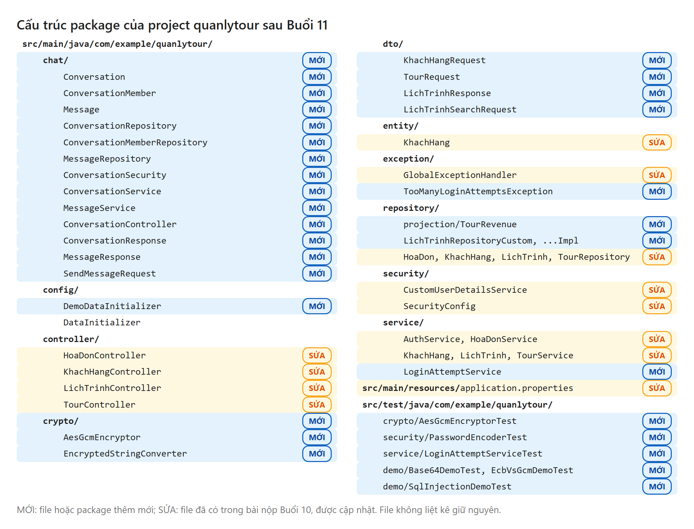

*Hai package mới là chat và crypto; nhãn SỬA đánh dấu file đã có trong bài nộp Buổi 10 được cập nhật.*

### II. Bảng users và quan hệ 1-1 với khách hàng

#### 1. Yêu cầu

- Thêm thực thể `User`: `username` không trùng, mật khẩu lưu BCrypt, `role` là `USER` hoặc `ADMIN`.
- Quan hệ 1-1 với `KhachHang`: khóa ngoại `ma_khach_hang` nằm ở bảng `users`, không trùng, được phép `NULL` vì ADMIN không phải khách hàng.

#### 2. Code thực hiện

`entity/User.java`:

```java
@Entity
@Table(name = "users")
@Getter
@Setter
public class User implements UserDetails {

    @Id
    @GeneratedValue(strategy = GenerationType.IDENTITY)
    private Long id;

    @Column(name = "username", nullable = false, unique = true, length = 50)
    private String username;

    @Column(name = "password", nullable = false, length = 100)
    private String password;

    @Enumerated(EnumType.STRING)
    @Column(name = "role", nullable = false, length = 20)
    private Role role;

    @OneToOne(fetch = FetchType.LAZY)
    @JoinColumn(name = "ma_khach_hang", unique = true)
    private KhachHang khachHang;

    @Override
    public Collection<? extends GrantedAuthority> getAuthorities() {
        return List.of(new SimpleGrantedAuthority("ROLE_" + role.name()));
    }

}
```

- `@Table(name = "users")`: không đặt tên `user` vì đó là từ khóa của nhiều hệ quản trị CSDL.
- `@JoinColumn(name = "ma_khach_hang", unique = true)`: không có `nullable = false` nên ADMIN để trống được; `unique = true` chặn hai tài khoản trỏ vào cùng một khách hàng.
- `@Enumerated(EnumType.STRING)`: lưu chữ `USER`, `ADMIN` thay vì số thứ tự. Hibernate 7 tự tạo cột kiểu `enum('ADMIN','USER')`.
- `getAuthorities()`: Spring Security cần tiền tố `ROLE_` để `hasRole("ADMIN")` hoạt động.

#### 3. Kết quả

ADMIN gọi `GET /api/users` (API ở mục VII) để xem dữ liệu bảng `users`:

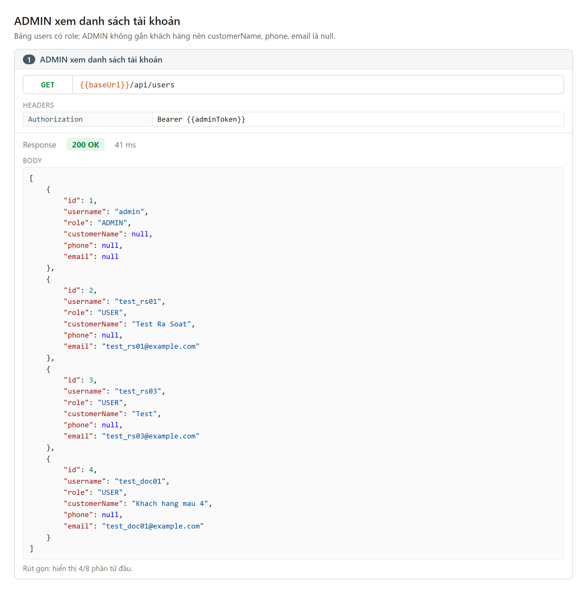

- Dòng `admin` có `customerName`, `phone`, `email` là `null`: không gắn khách hàng. Các USER đều có khách hàng riêng.

### III. Cấu hình nền tảng

#### 1. Yêu cầu

- Thêm thư viện Spring Security và JJWT; khai báo `jwt.secret`, `jwt.expiration-ms`, tài khoản ADMIN mặc định.
- Khởi động lần đầu thì tự tạo tài khoản ADMIN.

#### 2. Code thực hiện

`pom.xml`, khối `<dependencies>`:

```xml
<dependency>
    <groupId>org.springframework.boot</groupId>
    <artifactId>spring-boot-starter-security</artifactId>
</dependency>
<dependency>
    <groupId>io.jsonwebtoken</groupId>
    <artifactId>jjwt-api</artifactId>
    <version>${jjwt.version}</version>
</dependency>
<dependency>
    <groupId>io.jsonwebtoken</groupId>
    <artifactId>jjwt-impl</artifactId>
    <version>${jjwt.version}</version>
    <scope>runtime</scope>
</dependency>
<dependency>
    <groupId>io.jsonwebtoken</groupId>
    <artifactId>jjwt-jackson</artifactId>
    <version>${jjwt.version}</version>
    <scope>runtime</scope>
</dependency>
```

`src/main/resources/application.properties`:

```properties
spring.application.name=quanlytour
server.port=8080
spring.datasource.url=jdbc:mysql://localhost:3306/quanlydattour?useSSL=false&serverTimezone=Asia/Ho_Chi_Minh&allowPublicKeyRetrieval=true
spring.datasource.username=root
spring.datasource.password=${DB_PASSWORD}
spring.jpa.hibernate.ddl-auto=update
spring.jpa.show-sql=true
spring.jpa.properties.hibernate.format_sql=true
jwt.secret=${JWT_SECRET}
jwt.expiration-ms=3600000
app.admin.username=admin
app.admin.password=Admin@123
app.encryption.key=${APP_ENCRYPTION_KEY}
app.demo-data.enabled=true
```

`config/DataInitializer.java`, method `run`:

```java
    @Override
    public void run(String... args) {
        if (userRepository.existsByUsername(adminUsername)) {
            return;
        }
        User admin = new User();
        admin.setUsername(adminUsername);
        admin.setPassword(passwordEncoder.encode(adminPassword));
        admin.setRole(Role.ADMIN);
        userRepository.save(admin);
        LOGGER.info("Da tao tai khoan ADMIN mac dinh: {}", adminUsername);
    }
```

- `jjwt-api` dùng khi viết code; `jjwt-impl`, `jjwt-jackson` chỉ cần lúc chạy. Thiếu một trong hai thì tạo, đọc token bị lỗi.
- `${DB_PASSWORD}`, `${JWT_SECRET}`, `${APP_ENCRYPTION_KEY}`: giá trị đọc từ biến môi trường, không nằm trong Git (Phần 3.V).
- `jwt.secret` phải là Base64 của ít nhất 32 byte, ngắn hơn thì JJWT báo `WeakKeyException`.
- `DataInitializer` chỉ tạo ADMIN khi chưa có, nên đổi `app.admin.password` sau lần chạy đầu không có tác dụng.

`config/DemoDataInitializer.java` (mới) tạo dữ liệu demo bằng chính các Service của dự án, chỉ chạy khi `app.demo-data.enabled=true` và chưa có tài khoản `tv1`:

```java
    @Override
    public void run(String... args) {
        if (userRepository.existsByUsername("tv1")) {
            return;
        }
        createMember("tv1", "Thanh vien 1", "0911111111");
        createMember("tv2", "Thanh vien 2", "0922222222");
        createMember("tv3", "Thanh vien 3", "0933333333");

        LichTrinh daLat = createLichTrinh(findOrCreateTour("Da Lat 3N2D", "Da Lat"), 30, 2500000.0);
        LichTrinh haLong = createLichTrinh(findOrCreateTour("Ha Long 2N1D", "Quang Ninh"), 45, 1800000.0);

        HoaDonResponse hoaDonTv1 = hoaDonService.bookTicket(new BookTicketRequest(daLat.getId(), 2), "tv1");
        HoaDonResponse hoaDonTv3 = hoaDonService.bookTicket(new BookTicketRequest(daLat.getId(), 1), "tv3");
        HoaDonResponse hoaDonTv2 = hoaDonService.bookTicket(new BookTicketRequest(haLong.getId(), 1), "tv2");

        Conversation doanDaLat = conversationRepository.findByLichTrinhId(daLat.getId()).orElseThrow();
        Conversation doanHaLong = conversationRepository.findByLichTrinhId(haLong.getId()).orElseThrow();
        messageService.sendMessage(doanDaLat.getId(), "tv1", "Chao ca doan, 6h sang tap trung o cong cong ty nhe");
        messageService.sendMessage(doanDaLat.getId(), "tv3", "Minh se den som 15 phut");
        messageService.sendMessage(doanDaLat.getId(), "tv1", "Nho mang CCCD de lam thu tuc");
        messageService.sendMessage(doanHaLong.getId(), "tv2", "Doan Ha Long co ai di chung xe tu Ha Noi khong?");

        LOGGER.info("Da tao du lieu demo: tv1, tv2, tv3 (mat khau {})", DEMO_PASSWORD);
        LOGGER.info("Hoa don: tv1 = {}, tv3 = {}, tv2 = {}", hoaDonTv1.id(), hoaDonTv3.id(), hoaDonTv2.id());
        LOGGER.info("Nhom doan: {} = {} (tv1, tv3); {} = {} (tv2)",
                doanDaLat.getName(), doanDaLat.getId(), doanHaLong.getName(), doanHaLong.getId());
    }
```

- `@ConditionalOnProperty(name = "app.demo-data.enabled", havingValue = "true")` trên class: tắt cờ thì Bean không được tạo.
- Đặt vé qua `hoaDonService.bookTicket` nên người đặt tự được thêm vào nhóm đoàn (mục XII), giống hệt khi gọi API.

#### 3. Kết quả

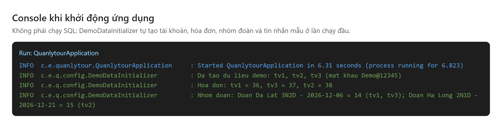

### IV. JWT và bộ lọc xác thực

#### 1. Yêu cầu

- Mỗi request gửi `Authorization: Bearer <token>`. Token hợp lệ thì đặt người dùng vào `SecurityContext`.
- Không có token, token sai, token hết hạn đều trả `401` dạng JSON, không trả trang HTML hay `500`.

#### 2. Code thực hiện

`security/JwtAuthenticationFilter.java`, method `doFilterInternal`:

```java
    @Override
    protected void doFilterInternal(HttpServletRequest request,
                                    HttpServletResponse response,
                                    FilterChain filterChain) throws ServletException, IOException {
        String authorizationHeader = request.getHeader(HttpHeaders.AUTHORIZATION);
        if (authorizationHeader == null || !authorizationHeader.startsWith(BEARER_PREFIX)) {
            filterChain.doFilter(request, response);
            return;
        }

        String token = authorizationHeader.substring(BEARER_PREFIX.length());
        try {
            String username = jwtService.extractUsername(token);
            UserDetails userDetails = customUserDetailsService.loadUserByUsername(username);
            UsernamePasswordAuthenticationToken authentication =
                    new UsernamePasswordAuthenticationToken(userDetails, null, userDetails.getAuthorities());
            SecurityContext context = SecurityContextHolder.createEmptyContext();
            context.setAuthentication(authentication);
            SecurityContextHolder.setContext(context);
        } catch (ExpiredJwtException exception) {
            request.setAttribute(JWT_ERROR_ATTRIBUTE, "Token da het han");
        } catch (JwtException | IllegalArgumentException | UsernameNotFoundException exception) {
            request.setAttribute(JWT_ERROR_ATTRIBUTE, "Token khong hop le");
        }

        filterChain.doFilter(request, response);
    }
```

`security/RestAuthenticationEntryPoint.java`, method `commence`:

```java
    @Override
    public void commence(HttpServletRequest request,
                         HttpServletResponse response,
                         AuthenticationException authException) throws IOException {
        Object jwtError = request.getAttribute(JwtAuthenticationFilter.JWT_ERROR_ATTRIBUTE);
        String message = jwtError != null ? jwtError.toString() : "Chua xac thuc";
        String body = String.format("{\"status\": %d, \"message\": \"%s\"}", HttpStatus.UNAUTHORIZED.value(), message);

        response.setStatus(HttpStatus.UNAUTHORIZED.value());
        response.setContentType(MediaType.APPLICATION_JSON_VALUE);
        response.setCharacterEncoding(StandardCharsets.UTF_8.name());
        response.getWriter().write(body);
    }
```

- Filter không tự trả lỗi: token sai thì chỉ ghi lý do vào attribute `jwtError` rồi cho request đi tiếp.
- Đến bước phân quyền, request chưa có danh tính nên Spring gọi `RestAuthenticationEntryPoint`. Class này đọc `jwtError` để trả đúng thông báo, mặc định là `"Chua xac thuc"`.
- Lỗi trong Filter không đi qua `@RestControllerAdvice`, nên phải tự ghi JSON như trên.

#### 3. Kết quả

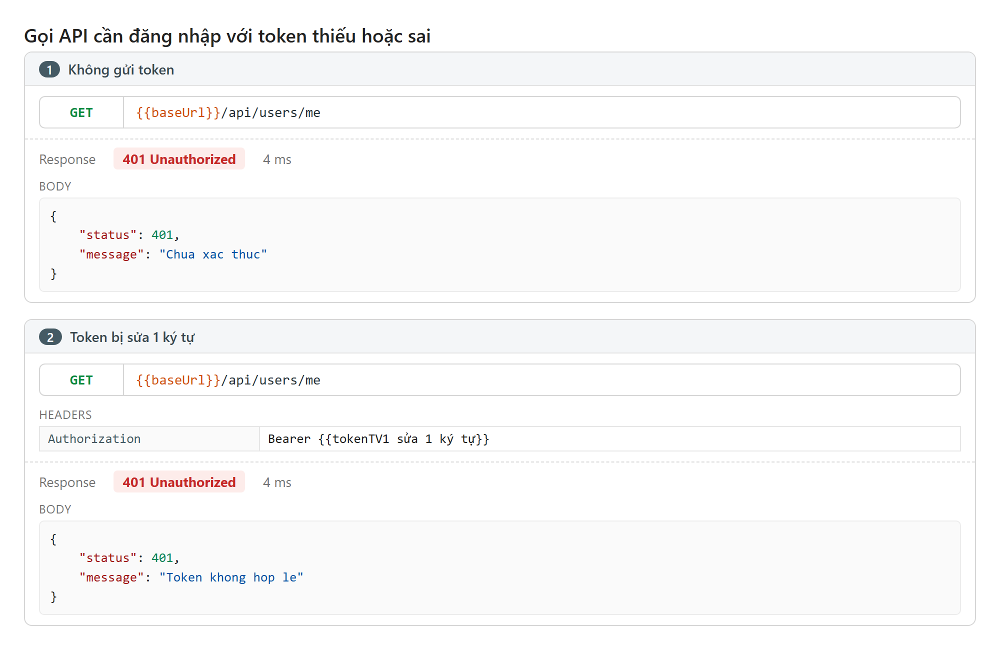

### V. Đăng ký, đăng nhập

#### 1. Yêu cầu

- `POST /api/auth/register`: tạo `KhachHang` và `User` trong một Transaction, chặn trùng username, chặn mật khẩu quá 72 byte.
- `POST /api/auth/login`: kiểm tra bằng `AuthenticationManager`, trả `accessToken`. Sai mật khẩu và sai username trả cùng một thông báo.

#### 2. Code thực hiện

`service/AuthService.java`, method `register` (method `login` ở mục XV):

```java
    @Transactional
    public UserResponse register(RegisterRequest request) {
        String username = request.username();
        if (userRepository.existsByUsername(username)) {
            throw new IllegalStateException("Ten dang nhap da ton tai");
        }
        if (request.password().getBytes(StandardCharsets.UTF_8).length > MAX_PASSWORD_BYTES) {
            throw new IllegalStateException("Mat khau vuot qua 72 byte");
        }

        KhachHang khachHang = new KhachHang();
        khachHang.setCustomerName(request.customerName().trim());
        khachHang.setPhone(request.phone());
        khachHang.setEmail(request.email());
        khachHangRepository.save(khachHang);

        User user = new User();
        user.setUsername(username);
        user.setPassword(passwordEncoder.encode(request.password()));
        user.setRole(Role.USER);
        user.setKhachHang(khachHang);
        return UserResponse.from(userRepository.save(user));
    }
```

- `@Transactional`: lưu `User` lỗi thì `KhachHang` vừa lưu cũng bị hủy, không để lại khách hàng không có tài khoản.
- `getBytes(StandardCharsets.UTF_8).length > 72`: đếm byte, không đếm ký tự. Chữ `ạ` chiếm 3 byte. BCrypt chỉ so 72 byte đầu (Phần 3.II).
- `UserResponse.from(...)`: trả DTO, không trả cột `password`.
- `RegisterRequest` có `@Size(min = 4, max = 50)` cho username, nên username đăng ký qua API phải từ 4 ký tự (`tv1` là tài khoản demo tạo trực tiếp bằng Service).

#### 3. Kết quả

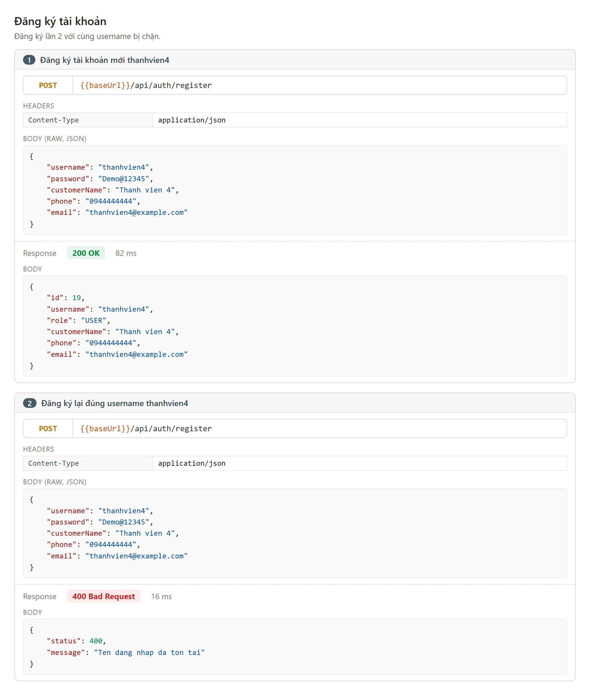

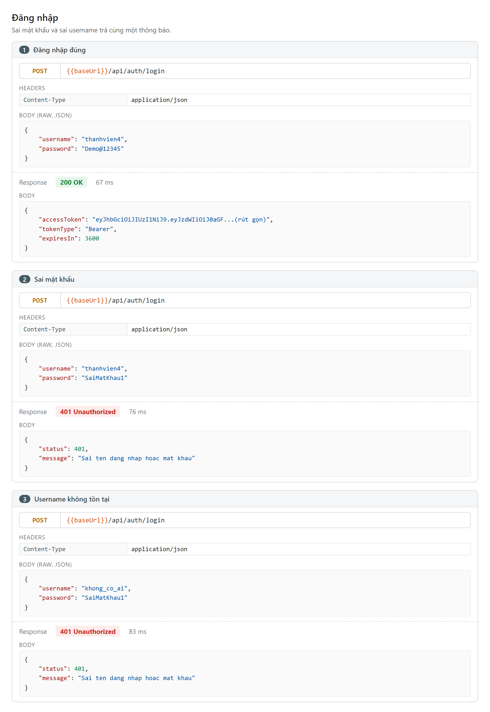

- Sai mật khẩu và username không tồn tại trả cùng `401 "Sai ten dang nhap hoac mat khau"`: kẻ dò không biết username nào có thật.

### VI. API thông tin của chính mình

#### 1. Yêu cầu

- `GET /api/users/me` không nhận tham số, danh tính lấy từ token. Mỗi người chỉ thấy thông tin của mình.

#### 2. Code thực hiện

`controller/UserController.java`:

```java
    @GetMapping("/me")
    public UserResponse getCurrentUser(@AuthenticationPrincipal User currentUser) {
        return userService.getCurrentUser(currentUser.getUsername());
    }
```

`service/UserService.java`:

```java
    @Transactional(readOnly = true)
    public UserResponse getCurrentUser(String username) {
        User user = userRepository.findWithKhachHangByUsername(username)
                .orElseThrow(() -> new IllegalArgumentException("Khong tim thay user: " + username));
        return UserResponse.from(user);
    }
```

- `@AuthenticationPrincipal User currentUser`: chính object `JwtAuthenticationFilter` đã đặt vào `SecurityContext`. Import đúng `com.example.quanlytour.entity.User`, import nhầm `User` của Spring Security thì `currentUser` luôn `null`.
- `findWithKhachHangByUsername` có `@EntityGraph(attributePaths = {"khachHang"})`: nạp khách hàng trong cùng câu SQL, tránh `LazyInitializationException`.
- Không làm `GET /api/users/{id}`: đổi số trên URL là xem được người khác (IDOR, Phần 4.III).

#### 3. Kết quả

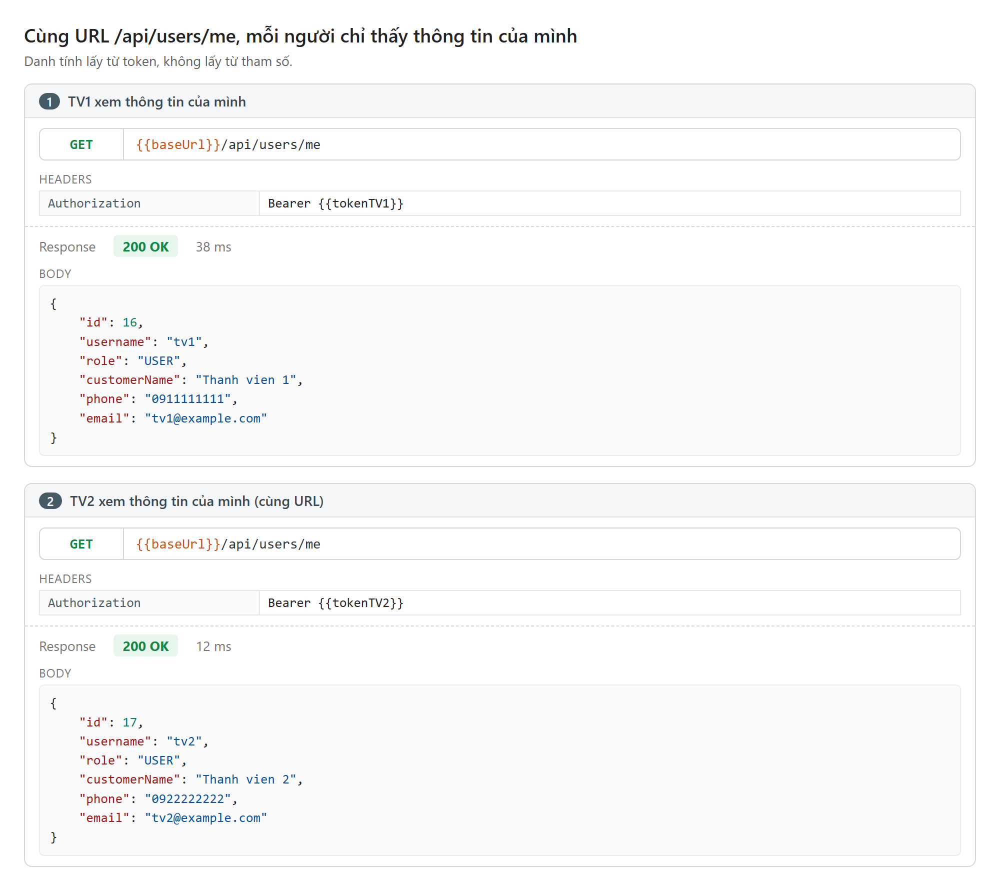

### VII. API danh sách tài khoản cho ADMIN

#### 1. Yêu cầu

- `GET /api/users` chỉ ADMIN gọi được, chặn ở cả `SecurityConfig` và `@PreAuthorize`. Không bị N + 1 câu SQL.

#### 2. Code thực hiện

`controller/UserController.java`:

```java
    @GetMapping
    @PreAuthorize("hasRole('ADMIN')")
    public List<UserResponse> getAllUsers() {
        return userService.getAllUsers();
    }
```

`repository/UserRepository.java`:

```java
    @EntityGraph(attributePaths = {"khachHang"})
    @Query("SELECT u FROM User u ORDER BY u.id")
    List<User> findAllWithKhachHang();
```

- `@PreAuthorize("hasRole('ADMIN')")` là lớp chặn thứ hai, cùng với dòng `.requestMatchers(HttpMethod.GET, "/api/users").hasRole("ADMIN")` trong `SecurityConfig` (mục VIII).
- Viết `hasRole("ADMIN")`, không viết `hasRole("ROLE_ADMIN")`: Spring tự thêm tiền tố.
- `findAllWithKhachHang` nạp user kèm khách hàng bằng một câu `left join`. Dùng `findAll()` thì mỗi user sinh thêm một câu `select ... from khach_hang`.

#### 3. Kết quả

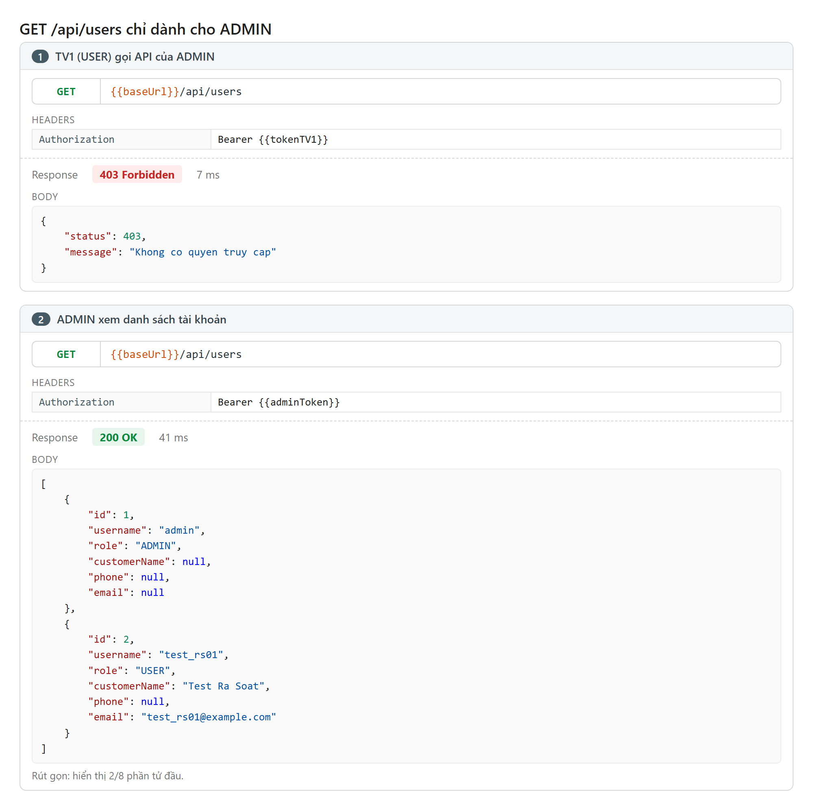

### VIII. Áp ma trận phân quyền cho API cũ

#### 1. Yêu cầu

Ma trận phân quyền:

| API                                                     | Không token | USER  | ADMIN |
| ------------------------------------------------------- | ----------- | ----- | ----- |
| `POST /api/auth/**`                                     | Được        | Được  | Được  |
| `GET /api/tours/**`, `GET /api/lich-trinh/**`           | `401`       | Được  | Được  |
| `GET /api/tours/revenue`                                | `401`       | `403` | Được  |
| `POST`, `PUT`, `DELETE` tour và lịch trình              | `401`       | `403` | Được  |
| `POST /api/hoa-don` (đặt vé)                            | `401`       | Được  | `403` |
| `GET /api/hoa-don/search`                               | `401`       | `403` | Được  |
| `/api/khach-hang/**`                                    | `401`       | `403` | Được  |
| `GET /api/users`                                        | `401`       | `403` | Được  |
| Các API còn lại (`/api/users/me`, `/api/conversations`) | `401`       | Được  | Được  |

- Đặt vé không nhận `khachHangId` từ client: khách hàng lấy từ token.

#### 2. Code thực hiện

`security/SecurityConfig.java`, khối `authorizeHttpRequests`:

```java
                .authorizeHttpRequests(auth -> auth
                        .requestMatchers("/error").permitAll()
                        .requestMatchers("/api/auth/**").permitAll()
                        .requestMatchers(HttpMethod.GET, "/api/users/me").authenticated()
                        .requestMatchers(HttpMethod.GET, "/api/users").hasRole("ADMIN")
                        .requestMatchers(HttpMethod.GET, "/api/tours/revenue").hasRole("ADMIN")
                        .requestMatchers(HttpMethod.GET, "/api/tours/**", "/api/lich-trinh/**").authenticated()
                        .requestMatchers("/api/tours/**", "/api/lich-trinh/**").hasRole("ADMIN")
                        .requestMatchers(HttpMethod.POST, "/api/hoa-don").hasRole("USER")
                        .requestMatchers(HttpMethod.GET, "/api/hoa-don/search").hasRole("ADMIN")
                        .requestMatchers("/api/khach-hang/**").hasRole("ADMIN")
                        .anyRequest().authenticated())
```

`controller/HoaDonController.java`, method `bookTicket`:

```java
    @PostMapping
    public HoaDonResponse bookTicket(@Valid @RequestBody BookTicketRequest request,
                                     @AuthenticationPrincipal User currentUser) {
        return hoaDonService.bookTicket(request, currentUser.getUsername());
    }
```

- Spring duyệt quy tắc từ trên xuống, gặp quy tắc khớp đầu tiên là dừng. Vì vậy `GET /api/tours/revenue` (cụ thể) phải đứng trước `GET /api/tours/**` (chung); đảo lại thì USER xem được doanh thu.
- Dòng `"/api/tours/**", "/api/lich-trinh/**"` không ghi method, nhưng đứng sau dòng `GET` nên chỉ còn áp cho `POST`, `PUT`, `DELETE`.
- `anyRequest().authenticated()` đứng cuối: API mới quên khai báo vẫn bắt buộc đăng nhập.
- `BookTicketRequest` chỉ có `lichTrinhId`, `guestCount`; người đặt là `currentUser`.

#### 3. Kết quả

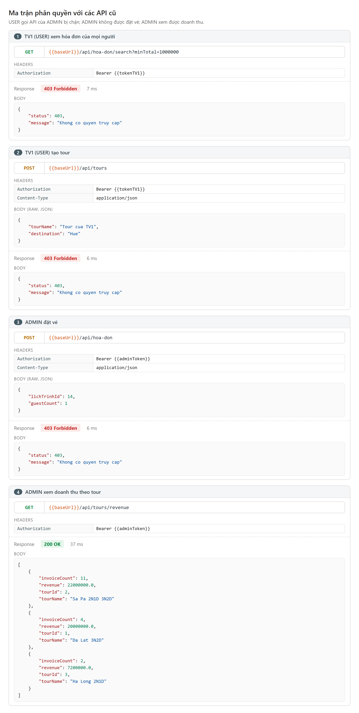

- Bài nộp Buổi 10 chưa có khối quy tắc này: USER xem được hóa đơn của mọi người, tạo được tour; ADMIN đặt vé nhận `400` thay vì `403`.

### IX. Ba API tìm kiếm, thống kê

#### 1. Yêu cầu

- `GET /api/lich-trinh/tour/{tourId}/upcoming`: lịch trình sắp khởi hành của một tour (Derived Query), trả DTO.
- `GET /api/tours/revenue`: doanh thu theo tour (Native Query + Projection).
- `GET /api/lich-trinh/search`: tìm lịch trình theo các điều kiện tùy chọn (Criteria API).
- `GET /api/khach-hang/search?name=`: tìm khách hàng theo tên, không phân biệt hoa thường.

#### 2. Code thực hiện

`repository/LichTrinhRepository.java`, `repository/KhachHangRepository.java`:

```java
    List<LichTrinh> findByTourIdAndDepartureDateAfterOrderByDepartureDateAsc(Long tourId, LocalDate date);
```

```java
    List<KhachHang> findByCustomerNameContainingIgnoreCase(String customerName);
```

`repository/TourRepository.java` và `repository/projection/TourRevenue.java`:

```java
    @Query(value = """
            SELECT t.id AS tourId,
                   t.tour_name AS tourName,
                   COUNT(h.id) AS invoiceCount,
                   COALESCE(SUM(h.tong_tien), 0) AS revenue
            FROM tours t
            LEFT JOIN lich_trinh l ON l.ma_tour = t.id
            LEFT JOIN hoa_don h ON h.ma_lich_trinh = l.id
            GROUP BY t.id, t.tour_name
            ORDER BY revenue DESC
            """, nativeQuery = true)
    List<TourRevenue> getRevenueByTour();
```

```java
public interface TourRevenue {

    Long getTourId();

    String getTourName();

    Long getInvoiceCount();

    Double getRevenue();

}
```

`repository/LichTrinhRepositoryCustomImpl.java`, method `search`:

```java
    @Override
    @SuppressWarnings("unchecked")
    public List<LichTrinh> search(LichTrinhSearchRequest request) {
        CriteriaBuilder criteriaBuilder = entityManager.getCriteriaBuilder();
        CriteriaQuery<LichTrinh> criteriaQuery = criteriaBuilder.createQuery(LichTrinh.class);
        Root<LichTrinh> root = criteriaQuery.from(LichTrinh.class);
        Fetch<LichTrinh, Tour> tourFetch = root.fetch("tour");
        Join<LichTrinh, Tour> tourJoin = (Join<LichTrinh, Tour>) tourFetch;

        List<Predicate> predicates = new ArrayList<>();

        if (StringUtils.hasText(request.destination())) {
            predicates.add(criteriaBuilder.equal(tourJoin.get("destination"), request.destination().trim()));
        }
        if (request.fromDate() != null) {
            predicates.add(criteriaBuilder.greaterThanOrEqualTo(root.get("departureDate"), request.fromDate()));
        }
        if (request.maxPrice() != null) {
            predicates.add(criteriaBuilder.lessThanOrEqualTo(root.get("basePrice"), request.maxPrice()));
        }
        if (request.minAvailableSlots() != null) {
            Expression<Integer> bookedSlots = criteriaBuilder.coalesce(root.<Integer>get("bookedSlots"), 0);
            Expression<Integer> availableSlots = criteriaBuilder.diff(root.<Integer>get("totalSlots"), bookedSlots);
            predicates.add(criteriaBuilder.greaterThanOrEqualTo(availableSlots, request.minAvailableSlots()));
        }

        criteriaQuery.select(root)
                .where(predicates.toArray(new Predicate[0]))
                .orderBy(criteriaBuilder.asc(root.get("departureDate")));

        return entityManager.createQuery(criteriaQuery).getResultList();
    }
```

`dto/LichTrinhResponse.java`:

```java
    public static LichTrinhResponse from(LichTrinh lichTrinh) {
        int bookedSlots = lichTrinh.getBookedSlots() == null ? 0 : lichTrinh.getBookedSlots();
        return new LichTrinhResponse(
                lichTrinh.getId(),
                lichTrinh.getTour().getId(),
                lichTrinh.getTour().getTourName(),
                lichTrinh.getDepartureDate(),
                lichTrinh.getBasePrice(),
                lichTrinh.getTotalSlots() - bookedSlots);
    }
```

- Derived Query: Spring đọc tên method để sinh câu truy vấn. `ContainingIgnoreCase` sinh `upper(ten_khach_hang) like upper(?)`.
- Native Query: bốn alias `tourId`, `tourName`, `invoiceCount`, `revenue` khớp bốn getter của `TourRevenue`. `LEFT JOIN` và `COALESCE(..., 0)` giữ lại tour chưa bán vé với doanh thu `0`.
- Criteria API: chỉ điều kiện nào có giá trị mới được thêm vào `predicates`, nên một method phục vụ mọi tổ hợp tham số. `root.fetch("tour")` nạp tour trong cùng câu SQL.
- `LichTrinhRepository extends JpaRepository<LichTrinh, Long>, LichTrinhRepositoryCustom`: Spring tự ghép với class có hậu tố `Impl`.
- `LichTrinhResponse`: trả DTO thay vì Entity, tính sẵn `availableSlots`, coi `bookedSlots` là `0` nếu `null`.

#### 3. Kết quả

Doanh thu theo tour ở ảnh mục VIII (request 4).

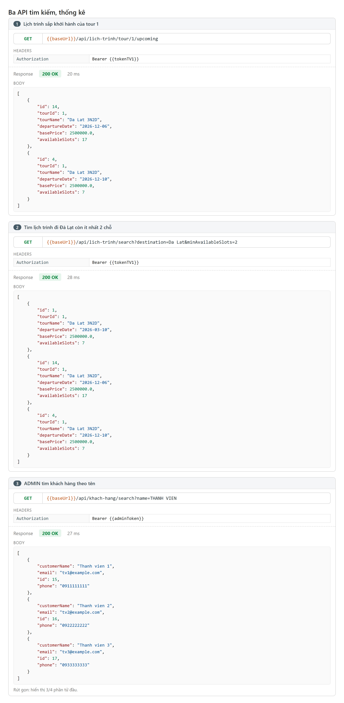

### X. Đặt vé đồng thời không vượt số chỗ

#### 1. Yêu cầu

- Nhiều người đặt cùng một lịch trình cùng lúc thì tổng số chỗ đã đặt không được vượt `so_cho_toi_da`, không request nào lỗi `500`.

#### 2. Code thực hiện

`repository/LichTrinhRepository.java`:

```java
    @Lock(LockModeType.PESSIMISTIC_WRITE)
    @Query("SELECT l FROM LichTrinh l WHERE l.id = :id")
    Optional<LichTrinh> findByIdForUpdate(@Param("id") Long id);
```

`service/HoaDonService.java`, method `bookTicket`:

```java
    @Transactional
    public HoaDonResponse bookTicket(BookTicketRequest request, String username) {
        User user = findUser(username);
        KhachHang khachHang = findLinkedKhachHang(user);

        LichTrinh lichTrinh = lichTrinhRepository.findByIdForUpdate(request.lichTrinhId())
                .orElseThrow(() -> new IllegalArgumentException("Khong tim thay lich trinh id = " + request.lichTrinhId()));

        int bookedSlots = lichTrinh.getBookedSlots() == null ? 0 : lichTrinh.getBookedSlots();
        if (bookedSlots + request.guestCount() > lichTrinh.getTotalSlots()) {
            throw new IllegalStateException("Khong du cho trong");
        }
        lichTrinh.setBookedSlots(bookedSlots + request.guestCount());

        HoaDon hoaDon = new HoaDon();
        hoaDon.setKhachHang(khachHang);
        hoaDon.setLichTrinh(lichTrinh);
        hoaDon.setGuestCount(request.guestCount());
        hoaDon.setTicketPrice(lichTrinh.getBasePrice());
        HoaDon savedHoaDon = hoaDonRepository.save(hoaDon);

        conversationService.joinTourGroup(lichTrinh, user);
        return HoaDonResponse.from(savedHoaDon);
    }
```

- `@Lock(LockModeType.PESSIMISTIC_WRITE)`: Hibernate thêm `for update` vào câu `select`. Request thứ hai đọc cùng lịch trình phải chờ request thứ nhất kết thúc Transaction.
- Nhờ đã khóa, phép "đọc số chỗ, kiểm tra, cộng thêm" chạy lần lượt từng request; không có hai request cùng thấy "còn 2 chỗ".
- Không khóa (bài Buổi 10): 10 request mỗi request 2 khách vào lịch trình 10 chỗ cho ra 12 khách và 4 request `500 Deadlock`.
- `conversationService.joinTourGroup(...)` (mới ở Buổi 11): đưa người đặt vào nhóm chat của đoàn, giải thích ở mục XII.

#### 3. Kết quả

ADMIN tạo lịch trình 10 chỗ, rồi một script gửi 10 request đặt vé (mỗi request 2 khách) cùng lúc:

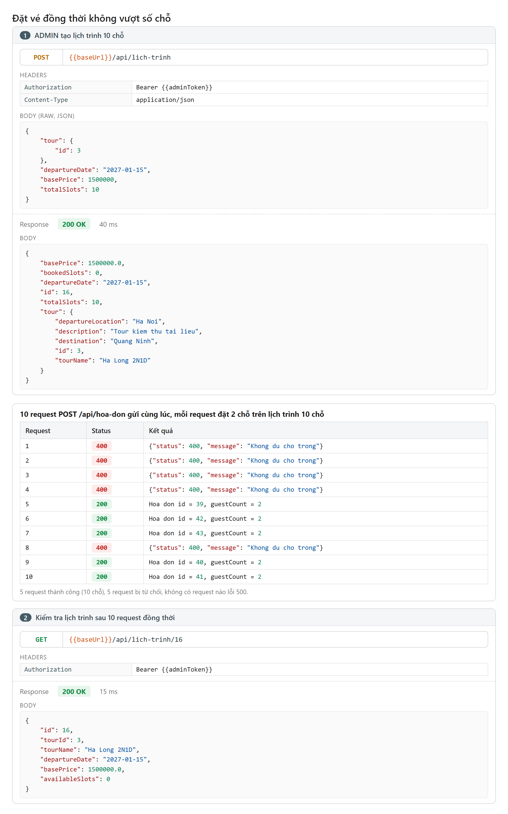

### XI. Hóa đơn của chính mình

#### 1. Yêu cầu

- `GET /api/hoa-don/me`: USER xem danh sách hóa đơn của mình.
- `GET /api/hoa-don/{id}`: USER chỉ xem được hóa đơn của mình; hóa đơn người khác và id không tồn tại trả cùng `404`. ADMIN xem được mọi hóa đơn.
- Lý thuyết: Phần 2.II và Phần 4.III.

#### 2. Code thực hiện

`repository/HoaDonRepository.java`:

```java
    @Query("SELECT h FROM HoaDon h JOIN FETCH h.khachHang JOIN FETCH h.lichTrinh l JOIN FETCH l.tour WHERE h.id = :id")
    Optional<HoaDon> findDetailById(@Param("id") Long id);

    @Query("SELECT h FROM HoaDon h JOIN FETCH h.khachHang k JOIN FETCH h.lichTrinh l JOIN FETCH l.tour WHERE h.id = :id AND k.id = :khachHangId")
    Optional<HoaDon> findDetailByIdAndKhachHangId(@Param("id") Long id, @Param("khachHangId") Long khachHangId);

    @Query("SELECT h FROM HoaDon h JOIN FETCH h.khachHang k JOIN FETCH h.lichTrinh l JOIN FETCH l.tour WHERE k.id = :khachHangId ORDER BY h.createdAt DESC, h.id DESC")
    List<HoaDon> findAllDetailByKhachHangId(@Param("khachHangId") Long khachHangId);
```

`service/HoaDonService.java`:

```java
    @Transactional(readOnly = true)
    public HoaDonResponse getHoaDon(Long id, String username) {
        User user = findUser(username);
        return findVisibleHoaDon(id, user)
                .map(HoaDonResponse::from)
                .orElseThrow(() -> new IllegalArgumentException("Khong tim thay hoa don id = " + id));
    }

    private Optional<HoaDon> findVisibleHoaDon(Long id, User user) {
        if (user.getRole() == Role.ADMIN) {
            return hoaDonRepository.findDetailById(id);
        }
        if (user.getKhachHang() == null) {
            return Optional.empty();
        }
        return hoaDonRepository.findDetailByIdAndKhachHangId(id, user.getKhachHang().getId());
    }
```

`controller/HoaDonController.java`:

```java
    @GetMapping("/me")
    public List<HoaDonResponse> getMyInvoices(@AuthenticationPrincipal User currentUser) {
        return hoaDonService.getMyInvoices(currentUser.getUsername());
    }

    @GetMapping("/{id}")
    public HoaDonResponse getHoaDon(@PathVariable Long id, @AuthenticationPrincipal User currentUser) {
        return hoaDonService.getHoaDon(id, currentUser.getUsername());
    }
```

- Điều kiện chủ sở hữu `AND k.id = :khachHangId` nằm ngay trong `WHERE`: USER chỉ tìm trong hóa đơn của mình, không tốn thêm câu SQL kiểm tra.
- Không tìm thấy thì ném `IllegalArgumentException`, `GlobalExceptionHandler` trả `404`. Hóa đơn của người khác và hóa đơn không tồn tại ra cùng một kết quả.
- `findVisibleHoaDon`: role đọc từ database, không đọc từ claim trong token.
- `JOIN FETCH` đủ khách hàng, lịch trình, tour cho `HoaDonResponse` trong một câu SQL.

#### 3. Kết quả

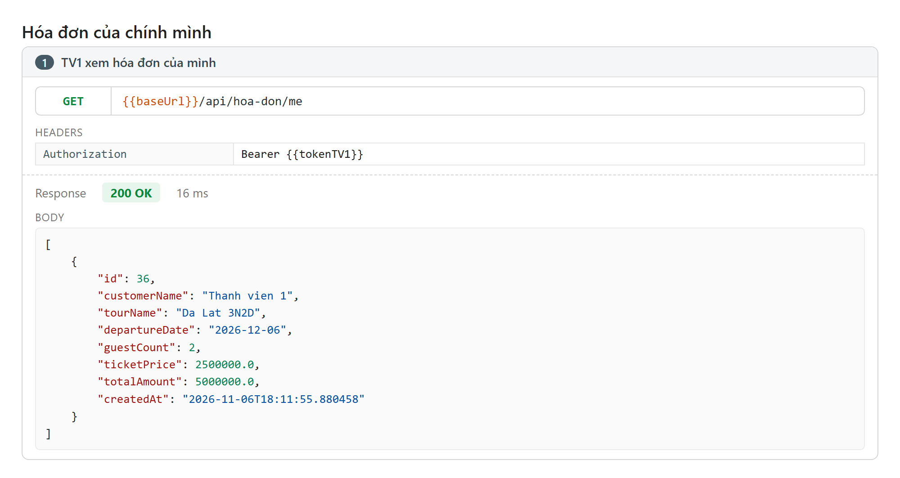

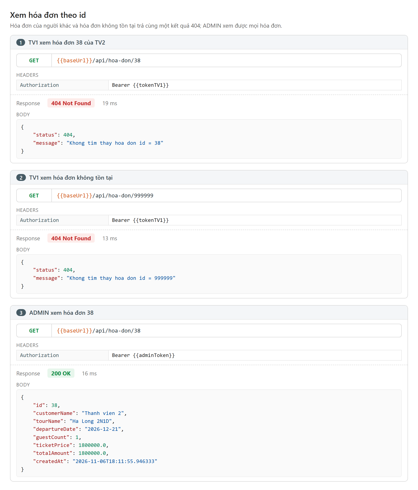

### XII. Nhóm chat của đoàn

#### 1. Yêu cầu

- Mỗi lịch trình (một đoàn khởi hành) có một nhóm chat. Khách đặt vé lịch trình nào thì tự được thêm vào nhóm của đoàn đó.
- `GET /api/conversations/me`: các nhóm đoàn của tôi.
- `GET /api/conversations/{conversationId}/messages?page=0&size=20`: lịch sử tin nhắn, mới nhất trước, tối đa 50 tin mỗi trang.
- `POST /api/conversations/{conversationId}/messages`: gửi tin.
- Chỉ thành viên đọc, gửi được. Người ngoài nhóm, kể cả ADMIN, và nhóm không tồn tại cùng trả `403`.
- Lý thuyết: Phần 2.

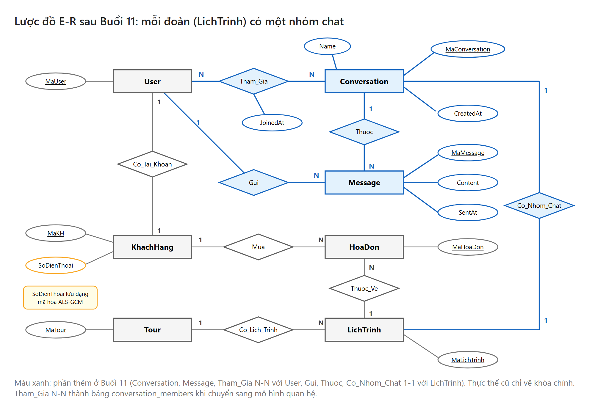

*Thêm Conversation, Message và các quan hệ tô xanh; Co_Nhom_Chat nối mỗi đoàn (LichTrinh) với đúng một nhóm chat.*

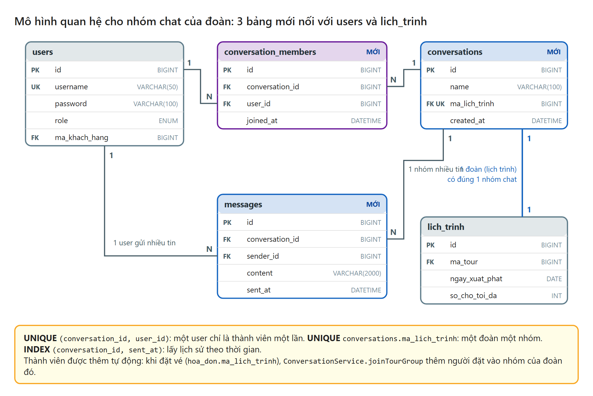

*Bảng conversation_members trả lời câu hỏi "có phải thành viên không"; cột ma_lich_trinh UNIQUE bảo đảm mỗi đoàn một nhóm.*

#### 2. Code thực hiện

Package `chat` gom Entity, Repository, Service, Controller của tính năng, để thấy cả tính năng trong một thư mục.

`chat/Conversation.java` (hai Entity `ConversationMember`, `Message` theo đúng các cột trong hình trên):

```java
@Entity
@Table(name = "conversations")
@Getter
@Setter
public class Conversation {

    @Id
    @GeneratedValue(strategy = GenerationType.IDENTITY)
    private Long id;

    @Column(name = "name", nullable = false, length = 100)
    private String name;

    @OneToOne(fetch = FetchType.LAZY)
    @JoinColumn(name = "ma_lich_trinh", nullable = false, unique = true)
    private LichTrinh lichTrinh;

    @Column(name = "created_at", nullable = false, updatable = false)
    private LocalDateTime createdAt;

    @PrePersist
    protected void onCreate() {
        createdAt = LocalDateTime.now();
    }

}
```

- `@OneToOne` với `unique = true`: một lịch trình chỉ có một nhóm.
- `ConversationMember` có `@UniqueConstraint(name = "uk_member_conversation_user", columnNames = {"conversation_id", "user_id"})`: một người vào một nhóm một lần.
- `Message` có `@Index(name = "idx_message_conversation_sent_at", columnList = "conversation_id, sent_at")` cho câu lấy lịch sử.

`chat/ConversationService.java`, method `joinTourGroup` (được gọi trong `HoaDonService.bookTicket`, mục X):

```java
    @Transactional(propagation = Propagation.MANDATORY)
    public Conversation joinTourGroup(LichTrinh lichTrinh, User user) {
        Conversation conversation = conversationRepository.findForUpdateByLichTrinhId(lichTrinh.getId())
                .orElseGet(() -> createTourGroup(lichTrinh));
        if (conversationMemberRepository.findForUpdateByConversationIdAndUserId(conversation.getId(), user.getId()).isEmpty()) {
            ConversationMember member = new ConversationMember();
            member.setConversation(conversation);
            member.setUser(user);
            conversationMemberRepository.save(member);
        }
        return conversation;
    }

    private Conversation createTourGroup(LichTrinh lichTrinh) {
        Conversation conversation = new Conversation();
        conversation.setLichTrinh(lichTrinh);
        conversation.setName("Doan " + lichTrinh.getTour().getTourName() + " - " + lichTrinh.getDepartureDate());
        return conversationRepository.save(conversation);
    }
```

- Đoàn chưa có nhóm thì tạo nhóm tên `Doan <tên tour> - <ngày khởi hành>`; người đặt chưa là thành viên thì thêm vào. Đặt vé lần hai cho cùng đoàn không thêm trùng.
- `Propagation.MANDATORY`: bắt buộc chạy trong Transaction của `bookTicket`. Đặt vé lỗi thì việc vào nhóm cũng bị hủy.
- `findForUpdate...` có `@Lock(LockModeType.PESSIMISTIC_WRITE)`. Lý do: MySQL mặc định `REPEATABLE READ`, câu `select` thường đọc theo ảnh chụp từ đầu Transaction nên không thấy nhóm do request trước vừa tạo, dẫn đến insert trùng và lỗi `500`. Câu `select ... for update` luôn đọc bản mới nhất đã commit.

`chat/ConversationSecurity.java`:

```java
@Component("conversationSecurity")
@RequiredArgsConstructor
public class ConversationSecurity {

    private final ConversationMemberRepository conversationMemberRepository;

    public boolean isMember(Long conversationId, Authentication authentication) {
        if (conversationId == null || authentication == null || !authentication.isAuthenticated()) {
            return false;
        }
        return conversationMemberRepository.existsByConversationIdAndUserUsername(conversationId, authentication.getName());
    }

}
```

`chat/ConversationController.java`:

```java
    @GetMapping("/me")
    public List<ConversationResponse> getMyConversations(@AuthenticationPrincipal User currentUser) {
        return conversationService.getMyConversations(currentUser.getUsername());
    }

    @GetMapping("/{conversationId}/messages")
    @PreAuthorize("@conversationSecurity.isMember(#conversationId, authentication)")
    public List<MessageResponse> getMessages(@PathVariable Long conversationId,
                                             @RequestParam(defaultValue = "0") int page,
                                             @RequestParam(defaultValue = "20") int size) {
        return messageService.getMessages(conversationId, page, size);
    }

    @PostMapping("/{conversationId}/messages")
    @PreAuthorize("@conversationSecurity.isMember(#conversationId, authentication)")
    public MessageResponse sendMessage(@PathVariable Long conversationId,
                                       @Valid @RequestBody SendMessageRequest request,
                                       @AuthenticationPrincipal User currentUser) {
        return messageService.sendMessage(conversationId, currentUser.getUsername(), request.content());
    }
```

`chat/MessageService.java`, method `getMessages`:

```java
    @Transactional(readOnly = true)
    public List<MessageResponse> getMessages(Long conversationId, int page, int size) {
        if (page < 0 || size < 1) {
            throw new IllegalStateException("page phai >= 0 va size phai >= 1");
        }
        int pageSize = Math.min(size, MAX_PAGE_SIZE);
        return messageRepository.findByConversationIdOrderBySentAtDescIdDesc(conversationId, PageRequest.of(page, pageSize))
                .stream()
                .map(MessageResponse::from)
                .toList();
    }
```

- `@Component("conversationSecurity")`: tên Bean dùng trong SpEL `@conversationSecurity`. `#conversationId` là tham số của method, `authentication` là người đăng nhập.
- `existsByConversationIdAndUserUsername`: Derived Query, sinh câu `select ... where conversation_id=? and username=? limit ?`. Không tìm thấy thì `false`, `@PreAuthorize` ném `AuthorizationDeniedException`, `GlobalExceptionHandler` trả `403`.
- Nhóm không tồn tại cũng không có thành viên, nên trả đúng `403` đó: không ai dò được nhóm nào có thật.
- `Math.min(size, MAX_PAGE_SIZE)`: xin `size=100` chỉ nhận 50 tin. `findByConversationIdOrderBySentAtDescIdDesc` có `@EntityGraph(attributePaths = {"sender"})` để tránh N + 1.
- `MessageResponse` chỉ có `senderUsername`, không trả object `User` (có `password`).
- `SendMessageRequest` có `@NotBlank`, `@Size(max = 2000)`.

#### 3. Kết quả

TV1 xem nhóm của mình và đọc tin của đoàn Đà Lạt:

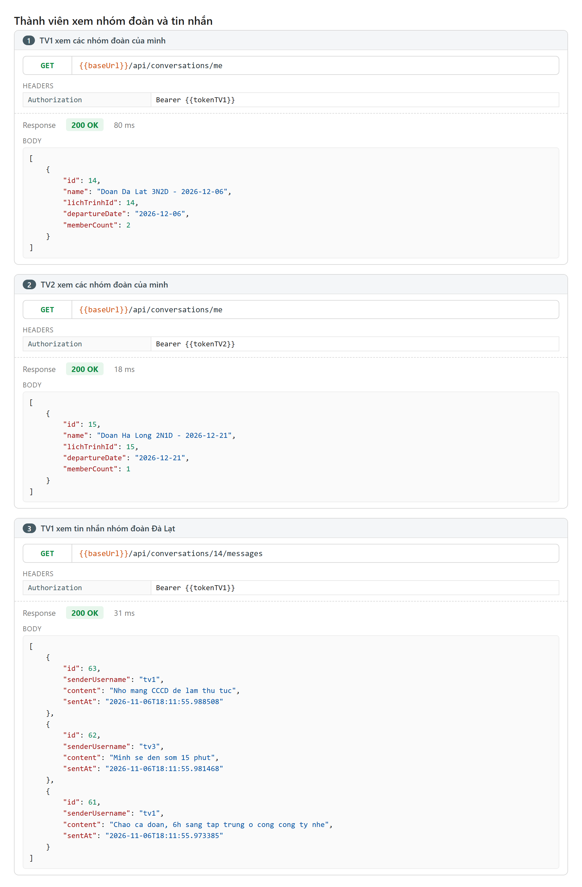

Người ngoài đoàn bị chặn, kể cả ADMIN:

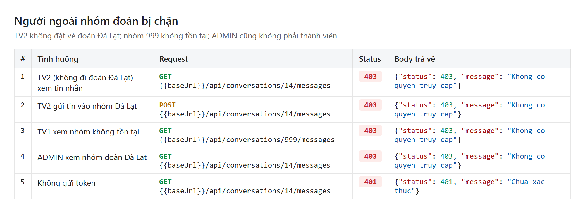

Thành viên gửi tin:

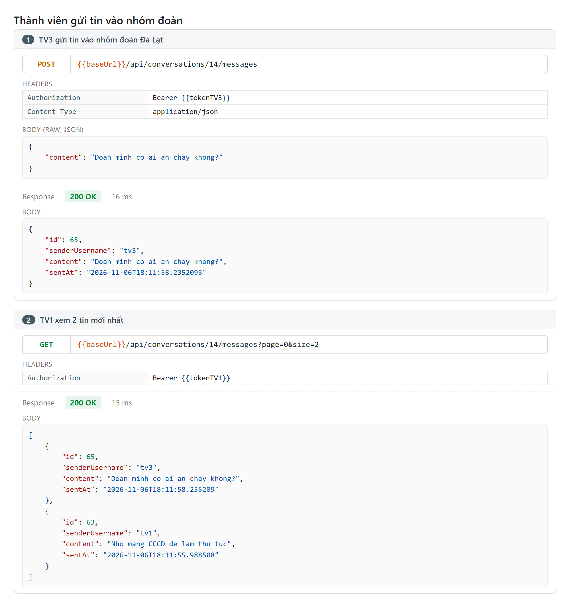

TV2 đặt vé đoàn Đà Lạt, sau đó đọc được tin nhắn của đoàn. Request 3 dưới đây chính là request 1 vừa bị `403` ở ảnh trên:

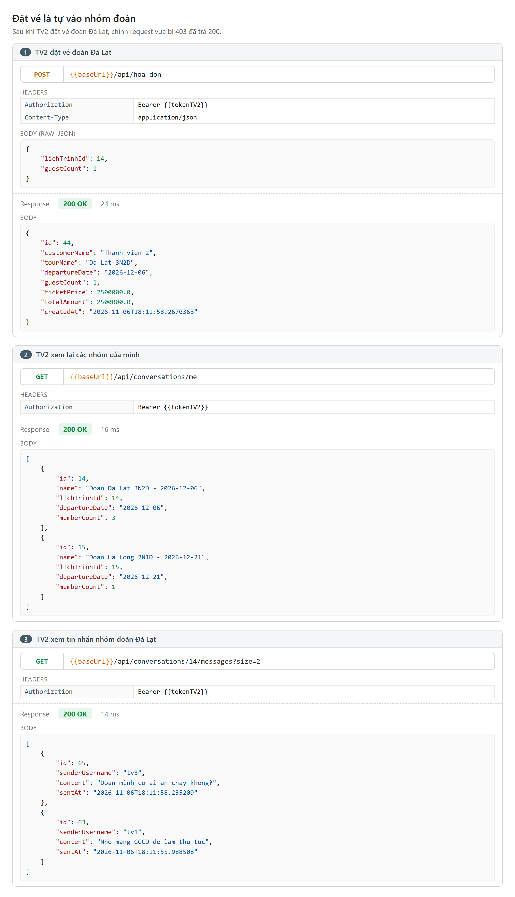

### XIII. Nâng cấp lưu mật khẩu

#### 1. Yêu cầu

- Hash mới có dạng `{bcrypt}$2a$10$...`. Hash cũ `$2a$10$...` (tạo ở Buổi 10) vẫn đăng nhập được và tự đổi sang dạng mới ở lần đăng nhập đúng. Giữ kiểm tra 72 byte.
- Lý thuyết: Phần 3.II, 3.III.

#### 2. Code thực hiện

`security/SecurityConfig.java`:

```java
    private static final String PASSWORD_ENCODER_ID = "bcrypt";

    @Bean
    public PasswordEncoder passwordEncoder() {
        DelegatingPasswordEncoder passwordEncoder = new DelegatingPasswordEncoder(
                PASSWORD_ENCODER_ID, Map.of(PASSWORD_ENCODER_ID, new BCryptPasswordEncoder()));
        passwordEncoder.setDefaultPasswordEncoderForMatches(new BCryptPasswordEncoder());
        return passwordEncoder;
    }
```

`security/CustomUserDetailsService.java`:

```java
@Service
@RequiredArgsConstructor
public class CustomUserDetailsService implements UserDetailsService, UserDetailsPasswordService {

    private final UserRepository userRepository;

    @Override
    public UserDetails loadUserByUsername(String username) throws UsernameNotFoundException {
        return findUser(username);
    }

    @Override
    @Transactional
    public UserDetails updatePassword(UserDetails userDetails, String newPassword) {
        User user = findUser(userDetails.getUsername());
        user.setPassword(newPassword);
        return userRepository.save(user);
    }

    private User findUser(String username) {
        return userRepository.findByUsername(username)
                .orElseThrow(() -> new UsernameNotFoundException("Khong tim thay user: " + username));
    }

}
```

- `new DelegatingPasswordEncoder("bcrypt", ...)`: hash mới có tiền tố `{bcrypt}`.
- `setDefaultPasswordEncoderForMatches(new BCryptPasswordEncoder())`: hash không có tiền tố được kiểm tra bằng BCrypt. **Thiếu dòng này thì mọi tài khoản cũ không đăng nhập được.**
- `UserDetailsPasswordService.updatePassword`: đăng nhập đúng mà hash cần nâng cấp thì Spring gọi method này. `newPassword` là hash mới, không phải mật khẩu gốc.
- `AuthService`, `DataInitializer` không phải sửa vì chỉ dùng interface `PasswordEncoder`.

#### 3. Kết quả

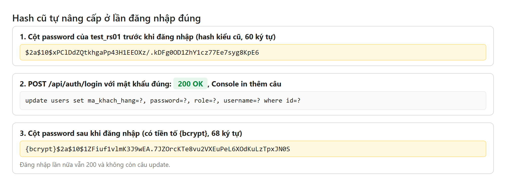

Test `src/test/java/com/example/quanlytour/security/PasswordEncoderTest.java`, chạy `./mvnw.cmd test -Dtest=PasswordEncoderTest`:

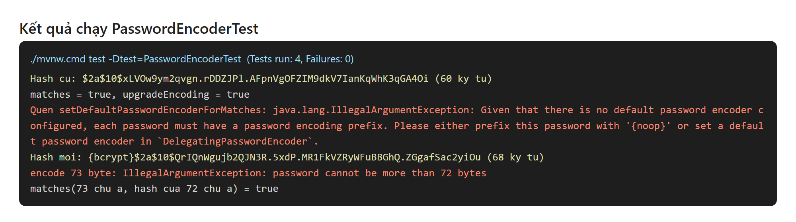

### XIV. Mã hóa số điện thoại khách hàng

#### 1. Yêu cầu

- Cột `so_dien_thoai` lưu bản mã AES-256-GCM. API vẫn nhận và trả số gốc. Khóa 32 byte đọc từ biến môi trường `APP_ENCRYPTION_KEY`.
- Lý thuyết: Phần 3.IV.

#### 2. Code thực hiện

`crypto/AesGcmEncryptor.java`:

```java
    public String encrypt(String plainText) {
        byte[] iv = new byte[IV_LENGTH_BYTES];
        secureRandom.nextBytes(iv);
        try {
            Cipher cipher = Cipher.getInstance(TRANSFORMATION);
            cipher.init(Cipher.ENCRYPT_MODE, secretKey, new GCMParameterSpec(TAG_LENGTH_BITS, iv));
            byte[] cipherTextWithTag = cipher.doFinal(plainText.getBytes(StandardCharsets.UTF_8));
            byte[] stored = ByteBuffer.allocate(iv.length + cipherTextWithTag.length)
                    .put(iv)
                    .put(cipherTextWithTag)
                    .array();
            return Base64.getEncoder().encodeToString(stored);
        } catch (GeneralSecurityException exception) {
            throw new IllegalStateException("Khong ma hoa duoc du lieu", exception);
        }
    }

    public String decrypt(String encryptedText) {
        byte[] stored;
        try {
            stored = Base64.getDecoder().decode(encryptedText);
        } catch (IllegalArgumentException exception) {
            throw new IllegalStateException("Du lieu ma hoa khong hop le", exception);
        }
        if (stored.length <= IV_LENGTH_BYTES) {
            throw new IllegalStateException("Du lieu ma hoa khong hop le");
        }
        try {
            Cipher cipher = Cipher.getInstance(TRANSFORMATION);
            cipher.init(Cipher.DECRYPT_MODE, secretKey, new GCMParameterSpec(TAG_LENGTH_BITS, stored, 0, IV_LENGTH_BYTES));
            byte[] plainBytes = cipher.doFinal(stored, IV_LENGTH_BYTES, stored.length - IV_LENGTH_BYTES);
            return new String(plainBytes, StandardCharsets.UTF_8);
        } catch (GeneralSecurityException exception) {
            throw new IllegalStateException("Khong giai ma duoc du lieu", exception);
        }
    }
```

`crypto/EncryptedStringConverter.java`:

```java
@Component
@Converter
@RequiredArgsConstructor
public class EncryptedStringConverter implements AttributeConverter<String, String> {

    private final AesGcmEncryptor aesGcmEncryptor;

    @Override
    public String convertToDatabaseColumn(String attribute) {
        return attribute == null ? null : aesGcmEncryptor.encrypt(attribute);
    }

    @Override
    public String convertToEntityAttribute(String dbData) {
        return dbData == null ? null : aesGcmEncryptor.decrypt(dbData);
    }

}
```

`entity/KhachHang.java`, trường `phone`:

```java
    @Convert(converter = EncryptedStringConverter.class)
    @Column(name = "so_dien_thoai", length = 100)
    private String phone;
```

- `TRANSFORMATION = "AES/GCM/NoPadding"`, IV 12 byte sinh mới mỗi lần, tag 128 bit. Bản lưu là Base64 của `IV | bản mã | tag`.
- Constructor (không trích) đọc `${app.encryption.key}`: không phải Base64 của đúng 32 byte thì ném `IllegalStateException`, ứng dụng không khởi động.
- `Cipher` tạo mới mỗi lần gọi vì không an toàn khi dùng chung giữa nhiều luồng.
- Hibernate gọi `convertToDatabaseColumn` trước khi ghi, `convertToEntityAttribute` sau khi đọc. Service, Controller không phải sửa gì.
- `length = 100`: bản mã dài 52 ký tự, cột cũ `VARCHAR(15)` không đủ. `ddl-auto=update` tự tăng độ dài cột.
- Số cũ dạng rõ không giải mã được (`GET /api/users` trả `500`). Dữ liệu mẫu đã được xóa số cũ; dữ liệu thật thì phải mã hóa lại từng số một lần trước khi bật converter.

#### 3. Kết quả

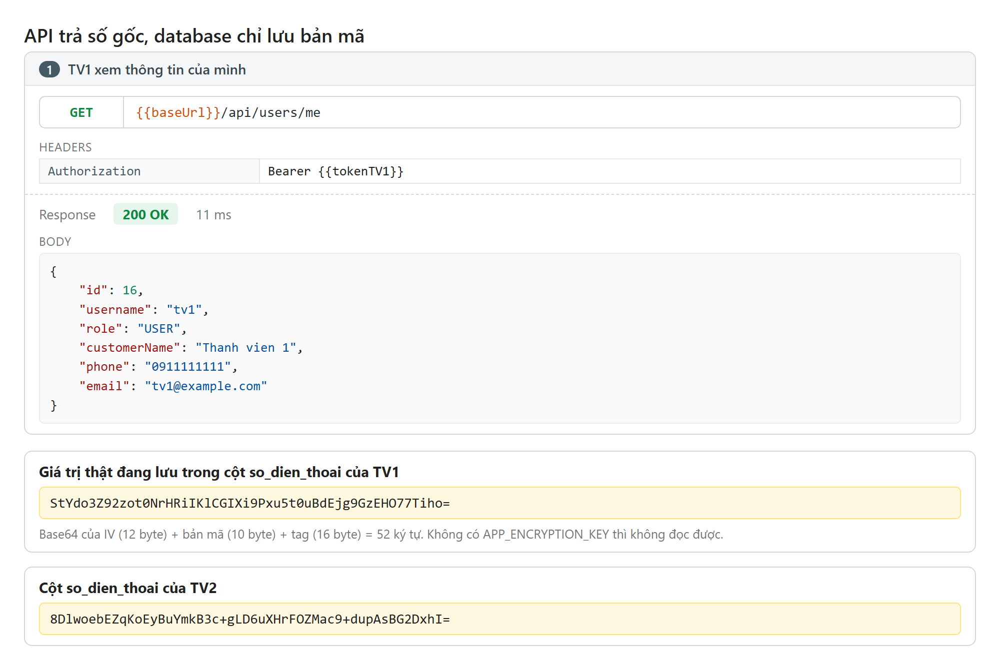

Test `src/test/java/com/example/quanlytour/crypto/AesGcmEncryptorTest.java`:

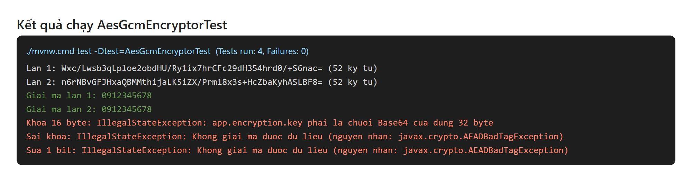

- Cùng số `0912345678` mã hóa 2 lần ra 2 bản mã khác nhau, giải mã đều đúng. Sửa 1 bit, sai khóa, khóa 16 byte đều bị từ chối.

### XV. Chống dò mật khẩu

#### 1. Yêu cầu

- Sai 5 lần trong 15 phút thì khóa username đó 15 phút, mọi lần đăng nhập trong lúc khóa trả `429`.
- Username không phân biệt hoa thường, username không tồn tại cũng bị đếm. Lý thuyết: Phần 4.VI.

#### 2. Code thực hiện

`service/LoginAttemptService.java`:

```java
    public boolean isBlocked(String username) {
        Instant now = clock.instant();
        Attempt attempt = attempts.computeIfPresent(toKey(username),
                (key, current) -> current.isExpiredAt(now) ? null : current);
        return attempt != null && attempt.isLockedAt(now);
    }

    public void loginFailed(String username) {
        Instant now = clock.instant();
        attempts.compute(toKey(username), (key, current) -> {
            if (current == null || current.isExpiredAt(now)) {
                return new Attempt(1, now, null);
            }
            int failures = current.failures() + 1;
            Instant lockedUntil = failures >= MAX_FAILED_ATTEMPTS ? now.plus(LOCK_DURATION) : null;
            return new Attempt(failures, current.firstFailureAt(), lockedUntil);
        });
    }

    public void loginSucceeded(String username) {
        attempts.remove(toKey(username));
    }

    private String toKey(String username) {
        return username == null ? "" : username.trim().toLowerCase(Locale.ROOT);
    }
```

`service/AuthService.java`, method `login`:

```java
    public AuthResponse login(LoginRequest request) {
        String username = request.username();
        if (loginAttemptService.isBlocked(username)) {
            throw new TooManyLoginAttemptsException(TOO_MANY_ATTEMPTS_MESSAGE);
        }

        Authentication authentication;
        try {
            authentication = authenticationManager.authenticate(
                    new UsernamePasswordAuthenticationToken(username, request.password()));
        } catch (BadCredentialsException exception) {
            loginAttemptService.loginFailed(username);
            throw exception;
        }
        loginAttemptService.loginSucceeded(username);

        User user = (User) authentication.getPrincipal();
        String accessToken = jwtService.generateToken(user);
        return new AuthResponse(accessToken, TOKEN_TYPE, jwtService.getExpirationMs() / 1000);
    }
```

- `attempts` là `ConcurrentHashMap<String, Attempt>`; `compute` cập nhật bộ đếm trong một thao tác nguyên tử.
- `MAX_FAILED_ATTEMPTS = 5`, `LOCK_DURATION = Duration.ofMinutes(15)`. Lần sai đầu tiên quá 15 phút thì bộ đếm làm lại từ đầu.
- `toKey`: `" TV1 "` và `"tv1"` là cùng một khóa.
- `login` kiểm tra khóa **trước** khi gọi `AuthenticationManager`: đang bị khóa thì không kiểm tra mật khẩu nữa. Chỉ `BadCredentialsException` bị đếm; đăng nhập đúng thì xóa bộ đếm.
- `TooManyLoginAttemptsException` được `GlobalExceptionHandler` đổi thành `429` (mục XVII).
- `LoginAttemptService` có thêm constructor nhận `Clock` để test tua thời gian mà không phải chờ 15 phút.

#### 3. Kết quả

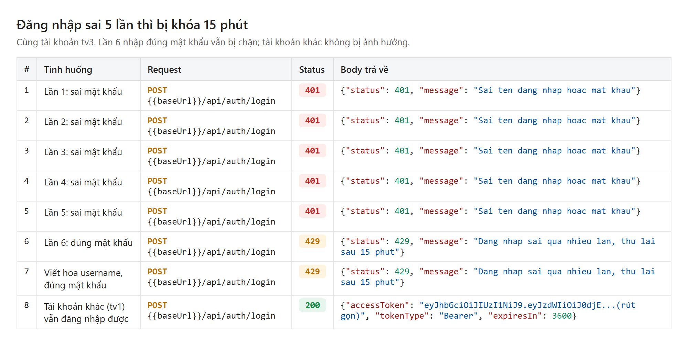

- Bộ đếm nằm trong RAM: khởi động lại ứng dụng là mở khóa ngay.

Test `src/test/java/com/example/quanlytour/service/LoginAttemptServiceTest.java`:

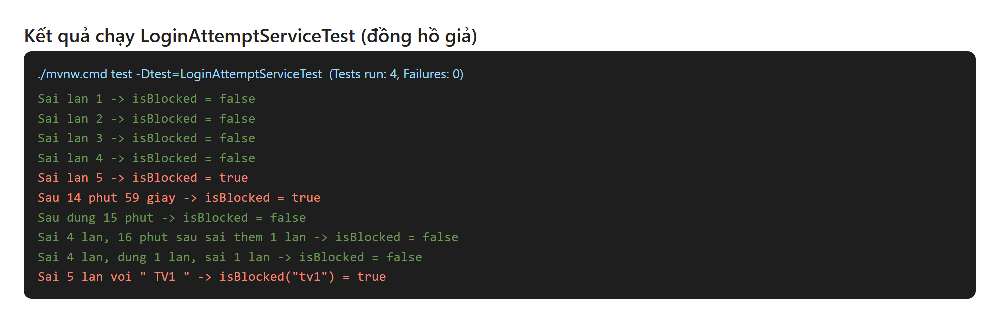

### XVI. Chặn Mass Assignment

#### 1. Yêu cầu

- `POST /api/khach-hang`, `POST /api/tours`, `PUT /api/tours/{id}` nhận DTO thay vì Entity. Client gửi kèm `"id"` không được ghi đè bản ghi cũ.
- Lý thuyết: Phần 4.VII.

#### 2. Code thực hiện

`dto/KhachHangRequest.java` (`dto/TourRequest.java` viết tương tự):

```java
public record KhachHangRequest(

        @NotBlank(message = "Ten khach hang khong duoc de trong")
        @Size(max = 100, message = "Ten khach hang toi da 100 ky tu")
        String customerName,

        @Pattern(regexp = "^0\\d{9}$", message = "So dien thoai gom 10 chu so va bat dau bang 0")
        String phone,

        @Email(message = "Email khong dung dinh dang")
        @Size(max = 100, message = "Email toi da 100 ky tu")
        String email) {
}
```

`service/KhachHangService.java` và `controller/KhachHangController.java`:

```java
    public KhachHang createKhachHang(KhachHangRequest request) {
        KhachHang khachHang = new KhachHang();
        khachHang.setCustomerName(request.customerName().trim());
        khachHang.setPhone(request.phone());
        khachHang.setEmail(request.email());
        return khachHangRepository.save(khachHang);
    }
```

```java
    @PostMapping
    public KhachHang createKhachHang(@Valid @RequestBody KhachHangRequest request) {
        return khachHangService.createKhachHang(request);
    }
```

- Record không có trường `id`: JSON gửi `"id": 1` thì Jackson bỏ qua.
- Service tự `new KhachHang()` nên `save` luôn là thêm mới. Nhận Entity làm Body thì `id` có giá trị làm `save` thành `merge`, ghi đè bản ghi cũ.
- `@Size(max = ...)` khớp độ dài cột, chuỗi quá dài nhận `400` thay vì lỗi database.
- `TourService.updateTour(id, request)` chỉ chép 4 trường của `TourRequest` vào tour đang có, không đụng `id`.

#### 3. Kết quả

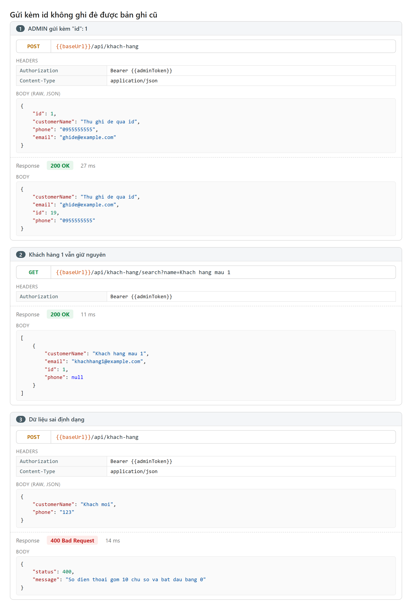

- Khách hàng mới nhận id mới; khách hàng `1` giữ nguyên tên.

### XVII. Xử lý lỗi, header CSP và secret

#### 1. Yêu cầu

- Lỗi do client (JSON hỏng, sai kiểu tham số, thiếu tham số, sai URL, sai method) trả `4xx` với thông báo chung.
- Lỗi không lường trước trả `500 "Loi he thong, vui long thu lai sau"`, chi tiết chỉ ghi ở log server.
- Thêm header `Content-Security-Policy`. Secret đọc từ biến môi trường.
- Lý thuyết: Phần 4.IV, 4.VIII, Phần 3.V.

#### 2. Code thực hiện

`exception/GlobalExceptionHandler.java`:

```java
    @ExceptionHandler({HttpMessageNotReadableException.class, MethodArgumentTypeMismatchException.class})
    public ResponseEntity<Map<String, Object>> handleBadRequestException(Exception exception) {
        return buildResponse(HttpStatus.BAD_REQUEST, "Du lieu gui len khong dung dinh dang");
    }

    @ExceptionHandler(AccessDeniedException.class)
    public ResponseEntity<Map<String, Object>> handleAccessDeniedException(AccessDeniedException exception) {
        return buildResponse(HttpStatus.FORBIDDEN, "Khong co quyen truy cap");
    }

    @ExceptionHandler(TooManyLoginAttemptsException.class)
    public ResponseEntity<Map<String, Object>> handleTooManyLoginAttemptsException(TooManyLoginAttemptsException exception) {
        return buildResponse(HttpStatus.TOO_MANY_REQUESTS, exception.getMessage());
    }

    @ExceptionHandler(Exception.class)
    public ResponseEntity<Map<String, Object>> handleGeneralException(Exception exception) {
        if (exception instanceof ErrorResponse errorResponse) {
            HttpStatusCode status = errorResponse.getStatusCode();
            return buildResponse(status, messageForStatus(status));
        }
        LOGGER.error("Loi khong mong doi", exception);
        return buildResponse(HttpStatus.INTERNAL_SERVER_ERROR, "Loi he thong, vui long thu lai sau");
    }

    private ResponseEntity<Map<String, Object>> buildResponse(HttpStatusCode status, String message) {
        Map<String, Object> body = new LinkedHashMap<>();
        body.put("status", status.value());
        body.put("message", message);
        return new ResponseEntity<>(body, status);
    }
```

`security/SecurityConfig.java`, trong `securityFilterChain`:

```java
                .headers(headers -> headers
                        .contentSecurityPolicy(csp -> csp.policyDirectives(CONTENT_SECURITY_POLICY)))
```

- `HttpMessageNotReadableException` (JSON hỏng) và `MethodArgumentTypeMismatchException` (`/api/tours/abc`) không tự mang mã lỗi, phải bắt riêng để trả `400`.
- `AccessDeniedException` phải import từ `org.springframework.security.access`, import nhầm `java.nio.file.AccessDeniedException` thì handler không bao giờ chạy và `@PreAuthorize` từ chối lại thành `500`.
- `handleGeneralException`: exception cài `ErrorResponse` (`NoResourceFoundException`, `MissingServletRequestParameterException`, `HttpRequestMethodNotSupportedException`) giữ đúng mã `404`, `400`, `405`. Còn lại ghi log đầy đủ, client chỉ nhận thông báo chung.
- `LinkedHashMap` giữ `status` đứng trước `message`.
- `CONTENT_SECURITY_POLICY = "default-src 'none'; frame-ancestors 'none'"`: API chỉ trả JSON nên không cho tải tài nguyên nào, không cho nhúng vào `iframe`.
- Secret trong `application.properties` ở mục III.

#### 3. Kết quả

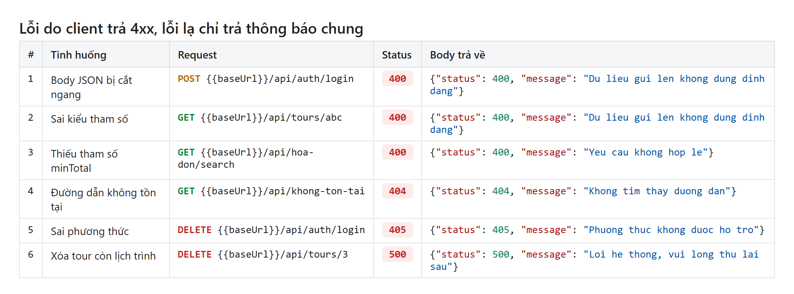

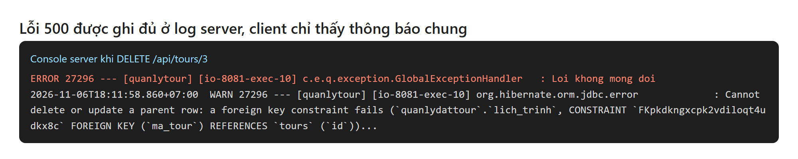

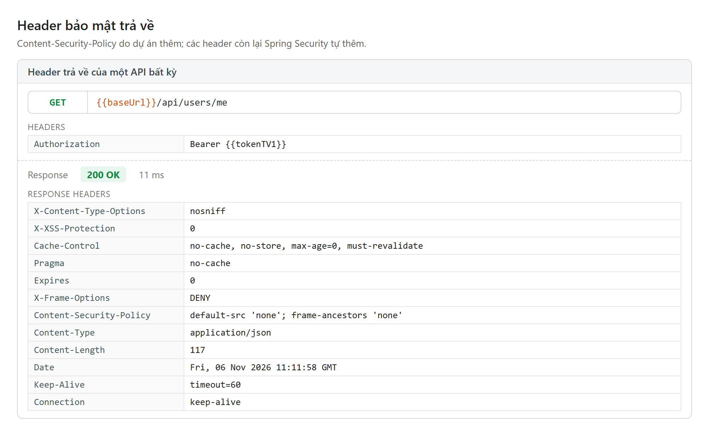

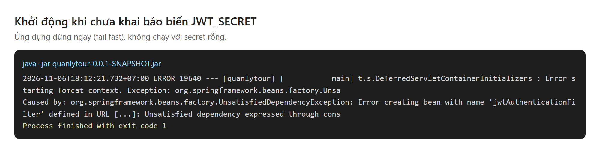

### XVIII. Lưu ý khi chạy trên Spring Boot 4

| Điểm                              | Spring Boot 3.5           | Spring Boot 4.1.1 (dự án)                                                                           |
| --------------------------------- | ------------------------- | --------------------------------------------------------------------------------------------------- |
| Starter web                       | `spring-boot-starter-web` | `spring-boot-starter-webmvc` (tên cũ deprecated)                                                    |
| Jackson                           | Jackson 2, `ObjectMapper` | Jackson 3 (`tools.jackson`), `JsonMapper`; `com.fasterxml.jackson.annotation.JsonIgnore` giữ nguyên |
| Mock trong test                   | `@MockBean`               | Đã xóa, dùng `@MockitoBean`                                                                         |
| `MockMvc` trong `@SpringBootTest` | Có sẵn                    | Phải thêm `@AutoConfigureMockMvc`                                                                   |
| Spring Security                   | 6.5                       | 7.1.1: không còn `.and()`, `authorizeRequests`, `AntPathRequestMatcher`                             |

- Trả Entity có Proxy Lazy: Jackson 3 không báo lỗi `No serializer found` mà in thêm `"hibernateLazyInitializer": {}`, khó phát hiện. Vẫn phải trả DTO.
- `ddl-auto=update` của Hibernate 7 tự sửa kiểu cột: tăng `length` hay thêm giá trị vào `enum` đều sinh câu `alter table ... modify column`.
- `UserDetails`: `isEnabled()`, `isAccountNonLocked()`... đã là `default`, chỉ cần cài `getAuthorities()`, `getUsername()`, `getPassword()`.

---

## Phần 2. Phân quyền theo dữ liệu

Câu hỏi chuẩn bị (chép nguyên văn):

> Với những trường hợp cần xác thực phức tạp, ví dụ như lấy lịch sử một cuộc hội thoại, cần phải check xem người gửi request có phải là thành viên trong nhóm không. Em sẽ làm như thế nào?

Đây là bài toán **Authorization**: token đã cho biết bạn là ai, còn phải hỏi bạn có được xem nhóm này không. Trong dự án tour, "nhóm" là nhóm chat của một đoàn khởi hành.

**Trả lời ngắn:**

- Lấy danh tính từ token, **không** nhận `userId` từ client.
- Lưu thành viên trong bảng `conversation_members (conversation_id, user_id)` có `UNIQUE (conversation_id, user_id)`. Khách đặt vé đoàn nào thì được thêm vào nhóm đoàn đó.
- Trước khi trả lịch sử, chạy một câu `exists` kiểm tra người đăng nhập có trong nhóm trên URL không. Dự án đặt ở `@PreAuthorize("@conversationSecurity.isMember(#conversationId, authentication)")`.
- Không phải thành viên trả `403`; nhóm không tồn tại cũng trả **đúng** `403` đó, để không ai dò được nhóm nào có thật.
- Phân trang (`size` tối đa 50) và index `(conversation_id, sent_at)`.

### I. Phân quyền theo vai trò và theo dữ liệu

#### 1. Khái niệm và bài toán

- **RBAC** (Role-Based Access Control): quyền gắn với vai trò, ví dụ `hasRole("ADMIN")`. Mọi USER như nhau.
- **Phân quyền theo dữ liệu:** quyền gắn với từng bản ghi, ví dụ "là chủ hóa đơn", "có đi đoàn này".
- Thiếu lớp thứ hai thì bị **IDOR**: server tin `id` client gửi mà không kiểm tra quyền (OWASP API Security 2023 gọi là API1 BOLA).
- Ví dụ: TV1 và TV2 đều là `USER`. Chỉ có `anyRequest().authenticated()` thì TV2 đổi số trên URL `GET /api/conversations/{id}/messages` là đọc được tin của đoàn mình không đi.

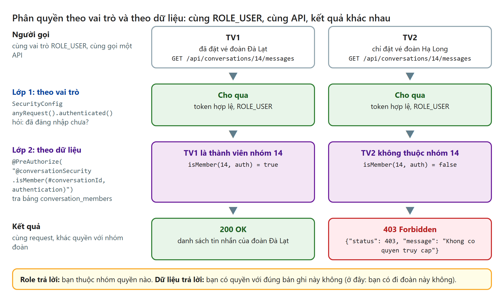

*TV1 và TV2 cùng ROLE_USER nên cùng qua lớp role; chỉ TV1 đi đoàn Đà Lạt nên chỉ TV1 qua lớp dữ liệu.*

#### 2. Lưu ý

| Tiêu chí     | Theo role                        | Theo dữ liệu                                                                     |
| ------------ | -------------------------------- | -------------------------------------------------------------------------------- |
| Câu hỏi      | Bạn thuộc nhóm quyền nào?        | Bạn có quyền với bản ghi này không?                                              |
| Dữ liệu cần  | Role trong `users`               | Quan hệ người dùng với bản ghi (`conversation_members`, `hoa_don.ma_khach_hang`) |
| Nơi kiểm tra | `SecurityConfig`, `hasRole(...)` | `@PreAuthorize` gọi Bean, `WHERE` theo chủ                                       |
| Ví dụ        | `GET /api/users` chỉ ADMIN       | Tin nhắn chỉ thành viên đoàn; hóa đơn chỉ chủ                                    |

- Việc "của tôi" thì lấy danh tính từ token, giống `GET /api/users/me`. API nào nhận `id` cũng phải kiểm tra quyền với đối tượng đó.

#### 3. Demo

**Input:** TV1 (đi đoàn Đà Lạt) và TV2 (chỉ đi đoàn Hạ Long) cùng gọi `GET {{baseUrl}}/api/conversations/{id nhóm Đà Lạt}/messages`.

**Code xử lý:** `chat/ConversationController.java` (`@PreAuthorize` trên `getMessages`), `chat/ConversationSecurity.java` (`isMember`).

**Cách xử lý:**

- `JwtAuthenticationFilter` đọc token, cả hai đều qua lớp role vì `anyRequest().authenticated()`.
- Trước khi vào `getMessages`, Spring chạy `isMember(id, authentication)`. TV1 có dòng trong `conversation_members` nên `true`; TV2 không có nên `false`, Spring ném `AuthorizationDeniedException`.

**Output:** TV1 nhận danh sách tin (ảnh Phần 1.XII), TV2 nhận `403`:


### II. Các cách đặt chốt kiểm tra quyền trên dữ liệu

#### 1. Bốn cách và cách chọn

| Tiêu chí                           | `if` trong Service | `@PreAuthorize` gọi Bean         | Lọc trong câu truy vấn       | `AuthorizationManager` tự viết        |
| ---------------------------------- | ------------------ | -------------------------------- | ---------------------------- | ------------------------------------- |
| Chạy ở đâu                         | Trong Service      | Trước method Controller          | Trong database               | Trong Filter                          |
| Số câu SQL thêm                    | 1                  | 1                                | 0                            | 1                                     |
| Dễ quên khi thêm API               | Cao                | Thấp                             | Trung bình                   | Thấp                                  |
| Lỗi đi qua `@RestControllerAdvice` | Có                 | Có                               | Có                           | Không (qua `RestAccessDeniedHandler`) |
| Hợp với                            | Nghiệp vụ phức tạp | Quyền gắn với đối tượng trên URL | API vừa đọc vừa kiểm tra chủ | Quy tắc cho cả nhóm URL               |

- `@PreAuthorize`: `@conversationSecurity` là tên Bean, `#conversationId` là tham số method, `authentication` là người đăng nhập. Từ chối thì ném `AuthorizationDeniedException` (lớp con của `AccessDeniedException`).
- **Nhóm chat** dùng `@PreAuthorize` gọi Bean: chặn trước khi lấy tin, dùng lại cho cả API đọc và API gửi.
- **Hóa đơn** lọc trong `WHERE h.id = :id AND k.id = :khachHangId`: không tốn thêm câu SQL, không lộ hóa đơn có tồn tại hay không.

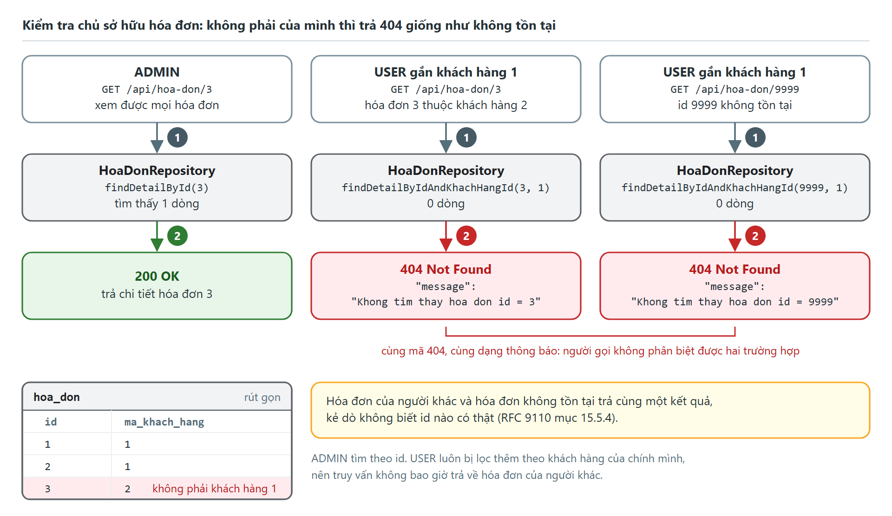

*USER chỉ tìm trong hóa đơn của chính mình, nên hóa đơn của người khác và hóa đơn không tồn tại cùng ra 404.*

#### 2. Lưu ý

- **`403` hay `404` đều được** (RFC 9110 mục 15.5.4 cho phép trả `404` để giấu tài nguyên). Bắt buộc là "không tồn tại" và "không được xem" phải ra cùng mã, cùng message. Dự án: nhóm chat trả `403`, hóa đơn trả `404`.
- **Tên tham số trong SpEL:** `#conversationId` cần cờ biên dịch `-parameters` (parent Spring Boot bật sẵn). Không dùng parent thì ghi `@P("conversationId")` trước tham số.
- **Lỗi đi đâu:** lỗi `@PreAuthorize` đi qua `GlobalExceptionHandler.handleAccessDeniedException`; lỗi trong Filter thì không. Hai nơi phải trả cùng định dạng JSON.
- **`@Valid` chạy trước `@PreAuthorize`:** người ngoài nhóm gửi tin rỗng nhận `400` thay vì `403`, vì Body được kiểm tra khi chuẩn bị tham số, trước khi gọi method.

#### 3. Demo

**Input:** TV1 gọi `GET {{baseUrl}}/api/hoa-don/{id}` với id hóa đơn của TV2, rồi với id `999999`; ADMIN gọi lại id hóa đơn của TV2.

**Code xử lý:** `service/HoaDonService.java`, method `findVisibleHoaDon`; `repository/HoaDonRepository.java`, method `findDetailByIdAndKhachHangId`.

**Cách xử lý:**

- ADMIN đi nhánh `findDetailById(id)`, tìm trong toàn bộ.
- USER đi nhánh `findDetailByIdAndKhachHangId(id, khachHangId của mình)`. Hóa đơn của TV2 không thỏa điều kiện chủ nên không có dòng nào, giống hệt id không tồn tại.

**Output:**


### III. Bài mẫu: nhóm chat của đoàn tour

#### 1. Thiết kế

- Mỗi lịch trình là một đoàn khởi hành. Mỗi đoàn có đúng một nhóm chat để khách trao đổi trước chuyến đi (giờ tập trung, giấy tờ, xe đưa đón).
- Ba bảng mới:
  - `conversations (id, name, ma_lich_trinh, created_at)`, `ma_lich_trinh` UNIQUE.
  - `conversation_members (id, conversation_id, user_id, joined_at)`, `UNIQUE (conversation_id, user_id)`.
  - `messages (id, conversation_id, sender_id, content VARCHAR(2000), sent_at)`, index `(conversation_id, sent_at)`.
- Thành viên không do client tự khai: đặt vé thành công thì `HoaDonService.bookTicket` gọi `ConversationService.joinTourGroup`, trong cùng Transaction.
- Luồng đọc tin: chưa đăng nhập thì `401`; không phải thành viên thì `403`; đủ điều kiện thì trả tối đa 50 tin, mới nhất trước.
- Người ngoài đoàn, kể cả ADMIN, nhận `403`: quyền gắn với đoàn, không gắn với vai trò.

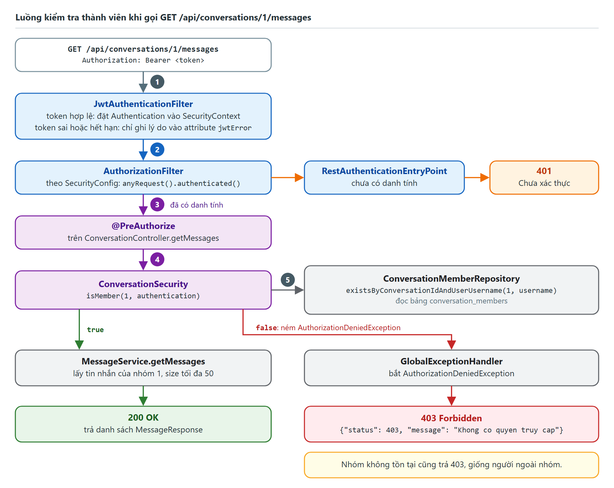

*Request đi qua 3 chốt: chưa có danh tính thì 401, không phải thành viên thì 403, đủ điều kiện mới lấy tin nhắn.*

#### 2. Lưu ý

- Index `(conversation_id, sent_at)` phục vụ cả lọc theo nhóm lẫn sắp theo thời gian.
- `@PreAuthorize` chạy trước thân method, nên người ngoài gửi `page=-1` vẫn nhận `403` chứ không phải `400`.
- Tạo nhóm và thêm thành viên phải dùng locking read (`@Lock(PESSIMISTIC_WRITE)`), nếu không 2 người đặt vé cùng lúc có thể cùng tạo nhóm và một người nhận `500` (Phần 1.XII).
- Cần ADMIN kiểm duyệt thì thêm điều kiện `hasRole('ADMIN') or @conversationSecurity.isMember(...)`, đừng bỏ kiểm tra.

#### 3. Demo

**Input:** TV2 (chưa đi đoàn Đà Lạt) gọi `POST {{baseUrl}}/api/hoa-don` với Body `{"lichTrinhId": <id lịch trình Đà Lạt>, "guestCount": 1}`, sau đó gọi `GET /api/conversations/me` và `GET /api/conversations/{id nhóm Đà Lạt}/messages`.

**Code xử lý:** `service/HoaDonService.java` (`bookTicket`) gọi `chat/ConversationService.java` (`joinTourGroup`).

**Cách xử lý:**

- `bookTicket` khóa dòng lịch trình, kiểm tra còn chỗ, lưu hóa đơn.
- `joinTourGroup` tìm nhóm của lịch trình (có khóa), TV2 chưa là thành viên nên thêm một dòng `conversation_members`.
- Request đọc tin sau đó qua được `isMember`.

**Output:** request đọc tin trước đó bị `403`, giờ trả `200`; nhóm Đà Lạt tăng lên 3 thành viên.


---

## Phần 3. Lưu mật khẩu, mã hóa và giải mã

Encoding, Encryption, Hashing giải ba bài toán khác nhau. Chọn nhầm là lỗi bảo mật dù code vẫn chạy.

### I. Hashing, Encryption và Encoding

#### 1. Khái niệm và bài toán

| Tiêu chí                 | Encoding (Base64)                | Encryption (AES-GCM)      | Hashing mật khẩu (BCrypt)      |
| ------------------------ | -------------------------------- | ------------------------- | ------------------------------ |
| Cần khóa                 | Không                            | Có, khóa bí mật           | Không (có salt, lưu cùng hash) |
| Lấy lại giá trị gốc      | Có, ai cũng được                 | Có, chỉ người có khóa     | Không, chỉ so khớp được        |
| Cùng đầu vào, 2 lần chạy | Giống nhau                       | Khác nhau (IV ngẫu nhiên) | Khác nhau (salt ngẫu nhiên)    |
| Dùng trong dự án         | Payload JWT, lưu bản mã dạng chữ | Số điện thoại             | Mật khẩu                       |

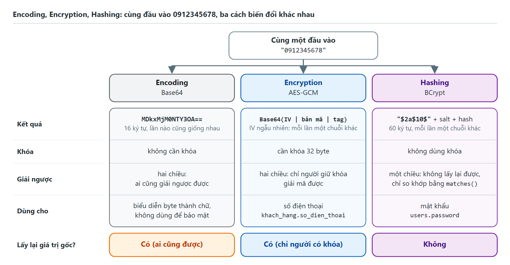

*Base64 ai cũng giải được; AES-GCM chỉ người có khóa giải được; BCrypt không ai lấy lại được, chỉ so khớp được.*

- **Mật khẩu dùng hash:** server chỉ cần biết "nhập đúng không". Hash cho mật khẩu (BCrypt, scrypt, Argon2) có salt và cố tình chạy chậm.
- **Số điện thoại dùng encryption:** nhân viên cần đọc lại số gốc để gọi khách.
- **Base64** chỉ đổi cách viết để đưa dữ liệu nhị phân vào JSON, URL. Không bảo vệ gì.

#### 2. Lưu ý

- Không "mã hóa" mật khẩu bằng AES: ai có khóa sẽ đọc được mật khẩu của mọi người.
- `MDkxMTExMTExMQ==` trông "lạ" nhưng giải ra số điện thoại ngay.
- JWT của dự án chỉ được **ký** (HS256), không mã hóa: ai cũng đọc được payload. Không đưa dữ liệu nhạy cảm vào token.

#### 3. Demo

**Input:** số điện thoại `0911111111` của TV1 và một token JWT của `tv1`.

**Code xử lý:** `src/test/java/com/example/quanlytour/demo/Base64DemoTest.java`.

```java
    @Test
    void base64AndJwtPayloadCanBeReadWithoutKey() {
        String phone = "0911111111";
        String encoded = Base64.getEncoder().encodeToString(phone.getBytes(StandardCharsets.UTF_8));
        String decoded = new String(Base64.getDecoder().decode(encoded), StandardCharsets.UTF_8);

        byte[] secret = new byte[32];
        new SecureRandom().nextBytes(secret);
        JwtService jwtService = new JwtService(Base64.getEncoder().encodeToString(secret), 3600000);
        User user = new User();
        user.setUsername("tv1");
        user.setRole(Role.USER);
        String token = jwtService.generateToken(user);
        String payload = token.split("\\.")[1];
        String json = new String(Base64.getUrlDecoder().decode(payload), StandardCharsets.UTF_8);

        System.out.println("So dien thoai     : " + phone);
        System.out.println("Base64 encode     : " + encoded);
        System.out.println("Base64 decode     : " + decoded);
        System.out.println("Payload JWT (giai ma khong can jwt.secret): " + json);
        assertThat(decoded).isEqualTo(phone);
        assertThat(json).contains("\"sub\":\"tv1\"");
    }
```

**Cách xử lý:**

- `Base64.getEncoder()`, `getDecoder()` đổi qua lại, không cần khóa.
- Token tạo bằng chính `JwtService` của dự án với một secret ngẫu nhiên. `token.split("\\.")[1]` lấy phần payload, `Base64.getUrlDecoder()` giải ra JSON mà không cần biết secret.

**Output** (`./mvnw.cmd test -Dtest=Base64DemoTest`):

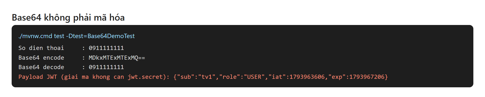

### II. Lưu mật khẩu đúng cách

#### 1. Khái niệm và bài toán

- **Salt:** chuỗi ngẫu nhiên riêng cho từng mật khẩu. Hai người cùng đặt `123456` vẫn ra hai hash khác nhau.
- **Work factor:** `$2a$10$` là BCrypt cost 10 (2^10 vòng). Tăng cost 1 thì thời gian gấp đôi.
- **Pepper:** bí mật chung lưu ngoài database, là lớp thêm, không thay được salt.
- Lộ database thì kẻ tấn công thử mật khẩu offline không giới hạn. Salt buộc thử riêng từng tài khoản, work factor làm mỗi lần thử chậm.
- Spring Security 7.1.1 có `CompromisedPasswordChecker`, `HaveIBeenPwnedRestApiPasswordChecker` để chặn mật khẩu đã từng bị lộ.

Tham số tối thiểu (OWASP Password Storage Cheat Sheet, tra cứu 02/11/2026):

| Thuật toán         | Tham số tối thiểu               | Ghi chú               |
| ------------------ | ------------------------------- | --------------------- |
| Argon2id           | 19 MiB, 2 vòng lặp, song song 1 | Ưu tiên               |
| scrypt             | N = 2^17, r = 8, p = 1          | Khi không có Argon2id |
| bcrypt             | Cost 10, đầu vào tối đa 72 byte | Chỉ cho hệ thống cũ   |
| PBKDF2-HMAC-SHA256 | 600.000 vòng                    | Khi cần FIPS-140      |

- Dự án dùng BCrypt cost 10: đạt mức tối thiểu.

#### 2. Lưu ý

- **Giới hạn 72 byte của BCrypt:** `encode` chuỗi 73 byte ném `IllegalArgumentException`; `matches` không báo lỗi mà chỉ so 72 byte đầu. Vì vậy phải chặn khi đăng ký (Phần 1.V).
- **Đổi sang Argon2:** hash `{argon2}...` dài hơn 100 ký tự, phải tăng cột `password` trước. Cần thêm thư viện BouncyCastle hoặc `com.password4j:password4j`, nên Buổi 11 vẫn giữ BCrypt.
- Không dùng `MD5`, `SHA-256` cho mật khẩu: chúng chạy nhanh, đúng thứ kẻ tấn công cần.

#### 3. Demo

**Input:** chuỗi 72 chữ `a` và 73 chữ `a`.

**Code xử lý:** `src/test/java/com/example/quanlytour/security/PasswordEncoderTest.java`, method `bcryptOnlyChecksFirst72Bytes`:

```java
    @Test
    void bcryptOnlyChecksFirst72Bytes() {
        BCryptPasswordEncoder bcrypt = new BCryptPasswordEncoder();
        String password72 = "a".repeat(72);
        String password73 = "a".repeat(73);

        Throwable thrown = catchThrowable(() -> bcrypt.encode(password73));
        boolean matches = bcrypt.matches(password73, bcrypt.encode(password72));

        System.out.println("encode 73 byte: " + thrown.getClass().getSimpleName() + ": " + thrown.getMessage());
        System.out.println("matches(73 chu a, hash cua 72 chu a) = " + matches);
        assertThat(thrown).isInstanceOf(IllegalArgumentException.class);
        assertThat(matches).isTrue();
    }
```

**Cách xử lý:** hash chuỗi 73 byte để thấy lỗi; so chuỗi 73 byte với hash của chuỗi 72 byte để thấy byte thứ 73 bị bỏ qua.

**Output:** hai dòng cuối của ảnh Phần 1.XIII:


### III. DelegatingPasswordEncoder và nâng cấp hash

#### 1. Cách hoạt động

- Hash được lưu kèm mã thuật toán: `{bcrypt}$2a$10$...` (68 ký tự). `{bcrypt}` cho biết dùng encoder nào để kiểm tra.
- Hash mới luôn dùng encoder `idForEncode` (`bcrypt`). Hash cũ không có `{id}` được kiểm tra bằng encoder đặt qua `setDefaultPasswordEncoderForMatches`.
- `upgradeEncoding(hash)` trả `true` khi hash không có `{id}`, khác `idForEncode` hoặc cost thấp hơn. Khi đó, nếu đăng nhập đúng, `DaoAuthenticationProvider` gọi `UserDetailsPasswordService.updatePassword(...)` lưu hash mới.
- Spring tự gắn `UserDetailsPasswordService` khi có đúng một `UserDetailsService` và không tự khai báo `AuthenticationProvider` (dự án thỏa cả hai).
- Kết quả: hash cũ tự nâng cấp dần, không ai phải đặt lại mật khẩu.

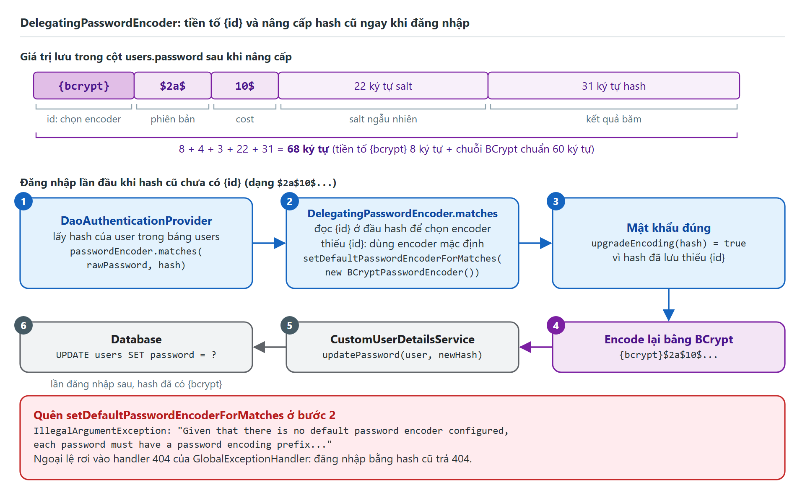

*Tiền tố {id} cho biết thuật toán; hash cũ không có {id} được kiểm tra bằng encoder mặc định rồi tự đổi sang dạng mới ngay lần đăng nhập đúng.*

#### 2. Lưu ý

- **Quên `setDefaultPasswordEncoderForMatches`:** tài khoản hash cũ đăng nhập nhận `404` với message `Given that there is no default password encoder configured, each password must have a password encoding prefix...`.
  - Là `404` vì đây là `IllegalArgumentException`, rơi vào handler `404` của `GlobalExceptionHandler`.
  - Tài khoản đã có `{bcrypt}` vẫn `200`, nên dễ bỏ sót nếu chỉ thử tài khoản mới.
- Khó quay lui: code cũ dùng `BCryptPasswordEncoder` thuần không đọc được hash `{bcrypt}...`.

#### 3. Demo

**Input:** tài khoản `test_rs01` đang lưu hash kiểu cũ; gọi `POST {{baseUrl}}/api/auth/login` với `{"username": "test_rs01", "password": "Demo@12345"}`.

**Code xử lý:** `security/SecurityConfig.java` (`passwordEncoder`), `security/CustomUserDetailsService.java` (`updatePassword`).

**Cách xử lý:**

- `DaoAuthenticationProvider` gọi `matches`: hash không có `{id}` nên dùng encoder mặc định BCrypt, khớp.
- `upgradeEncoding` trả `true`, Spring gọi `updatePassword` với hash mới `{bcrypt}...`, Hibernate sinh câu `update users`.

**Output:**


### IV. Mã hóa đối xứng AES-GCM

#### 1. Cách hoạt động

- AES đối xứng: một khóa để mã hóa và giải mã. Dự án dùng khóa 32 byte (AES-256).
- GCM vừa mã hóa vừa sinh **tag** 128 bit: dữ liệu bị sửa 1 bit là giải mã báo `AEADBadTagException`.
- **IV** 12 byte sinh mới mỗi lần bằng `SecureRandom`, lưu ở đầu bản mã (NIST SP 800-38D khuyến nghị 96 bit).
- Cột `so_dien_thoai` lưu Base64 của `IV | bản mã | tag`: 12 + 10 + 16 = 38 byte, thành 52 ký tự.
- Lộ database mà không có `APP_ENCRYPTION_KEY` thì vẫn không đọc được số.

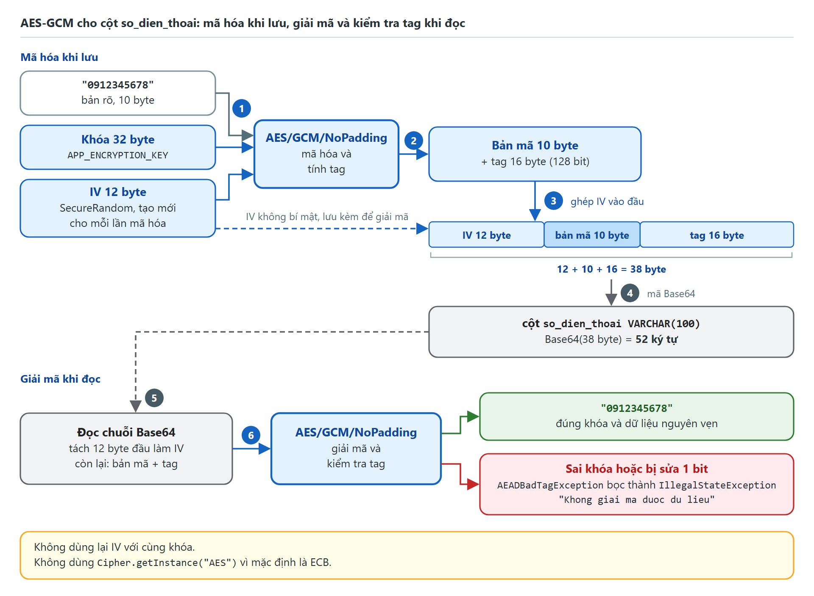

*Mỗi lần mã hóa có IV mới nên cùng số điện thoại ra bản mã khác nhau; tag giúp phát hiện dữ liệu bị sửa hoặc giải mã sai khóa.*

#### 2. Lưu ý

| Tiêu chí                 | ECB (mặc định của `Cipher.getInstance("AES")`) | CBC                   | GCM (dự án dùng)        |
| ------------------------ | ---------------------------------------------- | --------------------- | ----------------------- |
| Cùng khối bản rõ         | Ra cùng bản mã, lộ mẫu                         | Khác nhau nhờ IV      | Khác nhau nhờ IV        |
| Phát hiện dữ liệu bị sửa | Không                                          | Không (cần MAC riêng) | Có (tag)                |
| Cần IV                   | Không                                          | 16 byte               | 12 byte, không dùng lại |

- Luôn ghi đủ `"AES/GCM/NoPadding"`, không ghi `"AES"`.
- Không dùng lại IV với cùng khóa (NIST SP 800-38D).
- Không tìm được bằng điều kiện `phone = ?` vì bản mã mỗi lần một khác.

#### 3. Demo

**Input:** 32 byte `0911111111-KHACH0911111111-KHACH`, gồm hai khối 16 byte giống hệt nhau.

**Code xử lý:** `src/test/java/com/example/quanlytour/demo/EcbVsGcmDemoTest.java`:

```java
    @Test
    void ecbLeaksRepeatedBlocksButGcmDoesNot() throws Exception {
        KeyGenerator keyGenerator = KeyGenerator.getInstance("AES");
        keyGenerator.init(256);
        SecretKey key = keyGenerator.generateKey();

        Cipher defaultCipher = Cipher.getInstance("AES");
        defaultCipher.init(Cipher.ENCRYPT_MODE, key);
        boolean ecbEqual = printBlocks("AES mac dinh (ECB)", defaultCipher.doFinal(TWO_EQUAL_BLOCKS));

        byte[] iv = new byte[12];
        new SecureRandom().nextBytes(iv);
        Cipher gcmCipher = Cipher.getInstance("AES/GCM/NoPadding");
        gcmCipher.init(Cipher.ENCRYPT_MODE, key, new GCMParameterSpec(128, iv));
        boolean gcmEqual = printBlocks("AES/GCM/NoPadding ", gcmCipher.doFinal(TWO_EQUAL_BLOCKS));

        assertThat(ecbEqual).isTrue();
        assertThat(gcmEqual).isFalse();
    }
```

**Cách xử lý:** `Cipher.getInstance("AES")` để JDK tự chọn ECB; bản GCM dùng IV 12 byte. `printBlocks` in hai khối 16 byte đầu của bản mã dạng hex.

**Output:**

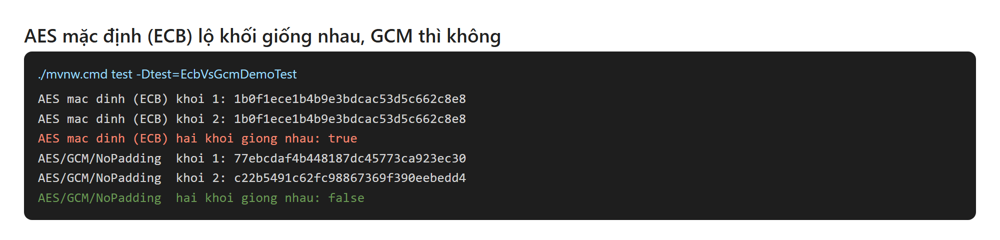

- ECB cho hai khối bản mã giống hệt: nhìn bản mã là biết bản rõ lặp lại. Kết quả mã hóa thật của dự án ở Phần 1.XIV.

### V. Quản lý khóa và secret

#### 1. Khái niệm và bài toán

- Có `jwt.secret` là ký được token giả của ADMIN; có `APP_ENCRYPTION_KEY` là giải mã được mọi số điện thoại; có mật khẩu MySQL là sửa thẳng database.
- Spring đọc `${TEN_BIEN}` từ biến môi trường. Thiếu biến và không có giá trị mặc định thì ứng dụng dừng ngay (fail fast).
- File trên Git chỉ chứa tên biến, không chứa giá trị.

#### 2. Lưu ý

- Không đặt giá trị mặc định kiểu `${JWT_SECRET:abc123}`: quên khai báo vẫn chạy với secret yếu.
- Viết đúng cú pháp `${TEN_BIEN}`. Viết `${<giá trị thật>}` là bắt Spring tìm một biến có tên bằng giá trị đó, ứng dụng không khởi động.
- Secret đã lộ trên Git thì phải đổi, vì giá trị cũ còn trong lịch sử commit.
- Mất `APP_ENCRYPTION_KEY` là mất dữ liệu. Sao lưu khóa tách khỏi bản sao lưu database.
- Sinh `JWT_SECRET` và `APP_ENCRYPTION_KEY` bằng `openssl rand -base64 32` (Git Bash), hai giá trị khác nhau.

#### 3. Demo

**Input:** chạy `java -jar target/quanlytour-0.0.1-SNAPSHOT.jar` khi chưa khai báo `JWT_SECRET`.

**Code xử lý:** `application.properties` dòng `jwt.secret=${JWT_SECRET}`; `security/JwtService.java` nhận giá trị qua `@Value("${jwt.secret}")`.

**Cách xử lý:** khi tạo Bean `jwtService`, Spring không tìm được biến `JWT_SECRET`, ném `PlaceholderResolutionException`, ứng dụng dừng.

**Output:**


---

## Phần 4. Các kiểu tấn công phổ biến và cách ngăn chặn

Mỗi kiểu tấn công đều được thử trên project tour. "Trước" là bài nộp Buổi 10; "sau" là code đã chữa ở Phần 1.

### I. OWASP Top 10

#### 1. Khái niệm

- Danh sách 10 nhóm rủi ro phổ biến nhất của ứng dụng web. Bản mới nhất là **OWASP Top 10:2025** (owasp.org, tra cứu 02/11/2026). Điểm mới: SSRF gộp vào A01, A03 thành chuỗi cung ứng phần mềm, A10 là nhóm mới.

| Mã       | Nhóm rủi ro                           | Ví dụ trong dự án                                     | Chặn ở                                                |
| -------- | ------------------------------------- | ----------------------------------------------------- | ----------------------------------------------------- |
| A01:2025 | Broken Access Control                 | USER xem mọi hóa đơn, xem hóa đơn người khác qua `id` | `SecurityConfig`, `@PreAuthorize`, truy vấn theo chủ  |
| A02:2025 | Security Misconfiguration             | Thiếu CSP; secret trong file cấu hình                 | CSP, biến môi trường                                  |
| A03:2025 | Software Supply Chain Failures        | jjwt phải tự cập nhật version                         | Theo dõi bản vá Spring Boot, jjwt                     |
| A04:2025 | Cryptographic Failures                | Số điện thoại dạng rõ; hash không có `{id}`           | AES-GCM, `DelegatingPasswordEncoder`                  |
| A05:2025 | Injection                             | SQL nối chuỗi trả mọi dòng                            | Bind tham số (mục II)                                 |
| A06:2025 | Insecure Design                       | Đặt vé đồng thời vượt số chỗ                          | Pessimistic Lock (Phần 1.X)                           |
| A07:2025 | Authentication Failures               | Thử mật khẩu không giới hạn                           | `LoginAttemptService` (Phần 1.XV)                     |
| A08:2025 | Software or Data Integrity Failures   | Bản mã bị sửa mà không ai biết                        | Tag AES-GCM, chữ ký JWT                               |
| A09:2025 | Security Logging & Alerting Failures  | Lỗi `500` không được ghi log                          | `LOGGER.error` trong `GlobalExceptionHandler`         |
| A10:2025 | Mishandling of Exceptional Conditions | JSON sai trả `500` kèm message nội bộ                 | `GlobalExceptionHandler` (Phần 1.XVII)                |

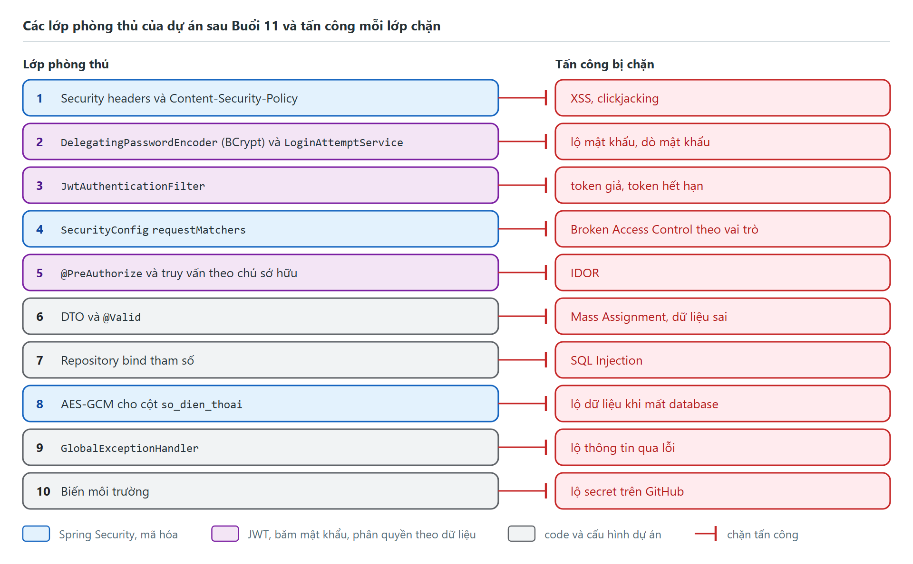

*Mỗi lớp chặn một kiểu tấn công; một lớp bị vượt qua thì các lớp sau vẫn còn tác dụng.*

#### 2. Lưu ý

- Dùng Top 10 như danh sách kiểm tra; nó không thay cho rà soát từng tính năng.
- Phòng thủ nhiều lớp: không lớp nào thay được lớp khác.

#### 3. Demo

**Input:** TV1 (USER) gọi `GET {{baseUrl}}/api/hoa-don/search?minTotal=1000000` (A01); một request đăng nhập có Body JSON bị cắt ngang (A10).

**Code xử lý:** `security/SecurityConfig.java` (ma trận phân quyền), `exception/GlobalExceptionHandler.java` (`handleBadRequestException`).

**Cách xử lý:** dòng `.requestMatchers(HttpMethod.GET, "/api/hoa-don/search").hasRole("ADMIN")` chặn USER ở tầng Filter; JSON hỏng sinh `HttpMessageNotReadableException`, handler trả `400`.

**Output:** trước khi chữa, lệnh 1 trả `200` kèm hóa đơn của mọi khách, lệnh 2 trả `500 "JSON parse error: ..."`. Sau khi chữa: request 1 của ảnh Phần 1.VIII và request 1 của ảnh Phần 1.XVII:


### II. SQL Injection

#### 1. Khái niệm và bài toán

- Lỗi xảy ra khi dữ liệu người dùng được **nối chuỗi** vào câu truy vấn và trở thành cú pháp.
- Bind tham số: câu lệnh có chỗ trống (`:destination`, `?`) gửi trước, giá trị gửi riêng, luôn được coi là dữ liệu.
- Ví dụ: ô tìm tour theo nơi đến, nhập `' OR '1'='1` thì lấy được mọi tour.
- Dự án an toàn: Derived Query, JPQL và Native Query có `:tham_so`, Criteria API đều bind tham số.
- Nguồn: OWASP SQL Injection Prevention Cheat Sheet.

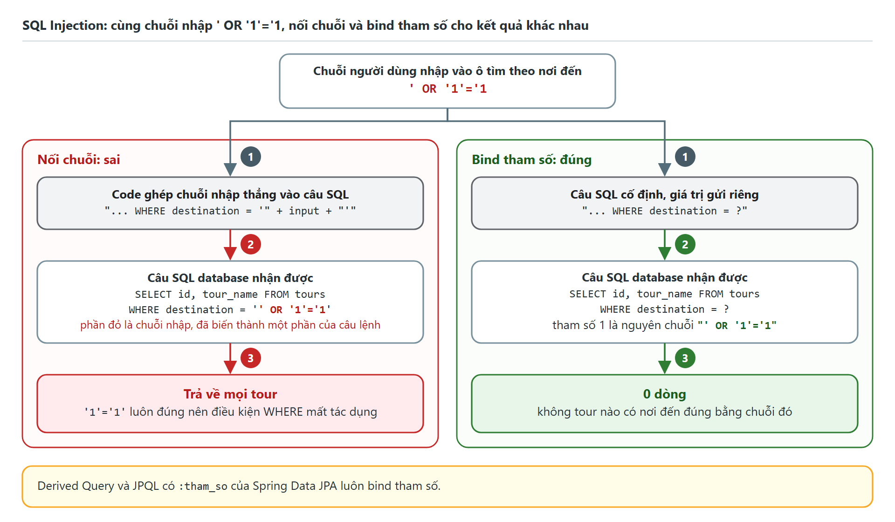

*Cùng một input: nối chuỗi trả về mọi dòng, bind tham số trả về 0 dòng.*

#### 2. Lưu ý

- Chỗ dễ sai: tự ghép chuỗi trong `entityManager.createQuery("... '" + input + "'")` hoặc `createNativeQuery(...)`. JPQL cũng bị injection, không riêng SQL.
- Tên cột, `ORDER BY` không bind được: chỉ cho chọn trong danh sách do code định nghĩa.
- Không thay bind tham số bằng tự escape.
- Dự án đang kết nối bằng `root`. Tài khoản ứng dụng chỉ nên có quyền `SELECT`, `INSERT`, `UPDATE`, `DELETE` để giảm thiệt hại.

#### 3. Demo

**Input:** người dùng nhập nơi đến là `' OR '1'='1`.

**Code xử lý:** `src/test/java/com/example/quanlytour/demo/SqlInjectionDemoTest.java`:

```java
    @Test
    void concatenationReturnsEveryTourButBindParameterReturnsNothing() {
        String concatenated = "SELECT t FROM Tour t WHERE t.destination = '" + INPUT + "'";
        List<Tour> unsafe = entityManager.createQuery(concatenated, Tour.class).getResultList();

        List<Tour> safe = entityManager.createQuery("SELECT t FROM Tour t WHERE t.destination = :destination", Tour.class)
                .setParameter("destination", INPUT)
                .getResultList();

        long totalTours = entityManager.createQuery("SELECT COUNT(t) FROM Tour t", Long.class).getSingleResult();

        System.out.println("Input nguoi dung nhap : " + INPUT);
        System.out.println("Cau JPQL sau khi noi  : " + concatenated);
        System.out.println("Noi chuoi  -> " + unsafe.size() + " tour: " + unsafe.stream().map(Tour::getTourName).toList());
        System.out.println("Bind tham so -> " + safe.size() + " tour");
        assertThat(unsafe).hasSize((int) totalTours);
        assertThat(safe).isEmpty();
    }
```

**Cách xử lý:**

- Cách nối chuỗi: dấu `'` trong input đóng chuỗi sớm, `OR '1'='1'` luôn đúng nên điều kiện lọc mất tác dụng.
- Cách bind: `setParameter` gửi nguyên chuỗi `' OR '1'='1` như một giá trị nơi đến, không tour nào có nơi đến như vậy.
- Test là `@SpringBootTest` chạy trên database thật, cần 3 biến môi trường như khi chạy ứng dụng; `@Transactional` không để lại dữ liệu.

**Output** (`./mvnw.cmd test -Dtest=SqlInjectionDemoTest`):

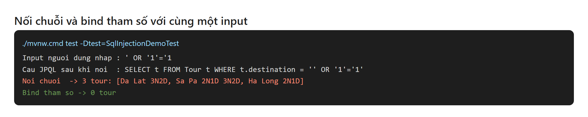

### III. Broken Access Control và IDOR

#### 1. Khái niệm và bài toán

- Người dùng làm được việc ngoài quyền. Leo quyền dọc: USER làm việc của ADMIN. Leo quyền ngang (IDOR): USER đụng vào dữ liệu của USER khác.
- Bài nộp Buổi 10: USER xem được mọi hóa đơn, sửa tour, xóa lịch trình. API xem hóa đơn theo `id` mà thiếu điều kiện chủ là IDOR.

| Tiêu chí    | Leo quyền dọc                    | Leo quyền ngang (IDOR)                      |
| ----------- | -------------------------------- | ------------------------------------------- |
| Ví dụ       | USER `POST /api/tours`           | USER `GET /api/hoa-don/{id}` của người khác |
| Cần để chặn | Role người gọi                   | Quan hệ người gọi với bản ghi               |
| Nơi chặn    | `SecurityConfig`, `hasRole(...)` | `@PreAuthorize` gọi Bean, truy vấn theo chủ |
| Mã trả về   | `403`                            | `403` (nhóm chat) hoặc `404` (hóa đơn)      |

#### 2. Lưu ý

- `anyRequest().authenticated()` đứng cuối: API mới quên khai báo vẫn phải đăng nhập.
- Quy tắc cụ thể đặt trước quy tắc chung, rồi thử từng dòng ma trận bằng request thật.
- `id` khó đoán (UUID) không thay được kiểm tra quyền.

#### 3. Demo

**Input:** TV1 gọi `GET {{baseUrl}}/api/hoa-don/{id hóa đơn của TV2}` (leo quyền ngang); TV1 gọi `POST {{baseUrl}}/api/tours` (leo quyền dọc).

**Code xử lý:** `service/HoaDonService.java` (`findVisibleHoaDon`); `security/SecurityConfig.java` (dòng `"/api/tours/**", "/api/lich-trinh/**"` `hasRole("ADMIN")`).

**Cách xử lý:** leo quyền ngang bị lọc trong `WHERE` theo chủ hóa đơn; leo quyền dọc bị chặn theo role trước khi vào Controller.

**Output:** leo quyền ngang ở ảnh Phần 2.II (request 1 trả `404`), leo quyền dọc ở ảnh Phần 1.VIII (request 2 trả `403`).

### IV. XSS

#### 1. Khái niệm và bài toán

- XSS: kẻ tấn công đưa script vào dữ liệu, script chạy trong trình duyệt của người khác (lấy token, gửi request thay họ). Có 3 dạng: stored, reflected, DOM-based.
- API dự án trả JSON, không render HTML. Rủi ro nằm ở frontend hiển thị dữ liệu đó.
- Ví dụ: một thành viên gửi vào nhóm đoàn tin nhắn chứa thẻ ``. Frontend dùng `innerHTML` thì ai mở nhóm cũng chạy script đó.

#### 2. Lưu ý

- Frontend hiển thị bằng `textContent` hoặc cơ chế tự escape của framework, không dùng `innerHTML`.
- Header mặc định của Spring Security 7.1.1:
  - `X-Content-Type-Options: nosniff`: không đoán lại kiểu nội dung.
  - `X-Frame-Options: DENY`: không cho nhúng vào `iframe`.
  - `X-XSS-Protection: 0`: tắt bộ lọc XSS cũ đã lỗi thời.
  - `Cache-Control: no-cache, no-store, max-age=0, must-revalidate`, `Pragma: no-cache`, `Expires: 0`: không lưu đệm.
  - `Strict-Transport-Security`: chỉ có khi chạy HTTPS.
- CSP phải tự thêm và chỉ là lớp phụ (OWASP Content Security Policy Cheat Sheet). API chỉ trả JSON thì `default-src 'none'; frame-ancestors 'none'` là đủ.

#### 3. Demo

**Input:** tin nhắn của TV3 có nội dung là một thẻ `img` lỗi kèm `onerror`.

**Code xử lý:** đoạn JavaScript phía frontend:

```javascript
const message = { senderUsername: "tv3", content: "Script trong tin nhan da chay!</b>'\">" };
document.querySelector("#unsafe").innerHTML = message.content;
document.querySelector("#safe").textContent = message.content;
```

**Cách xử lý:**

- `innerHTML` biến chuỗi thành thẻ HTML thật; ảnh lỗi nên trình duyệt chạy `onerror`.
- `textContent` coi cả chuỗi là chữ, hiển thị nguyên văn.

**Output** (ảnh chụp từ trình duyệt Edge chạy đúng đoạn code trên; `onerror` trong ảnh chỉ đổi nội dung ô để thấy script đã chạy):

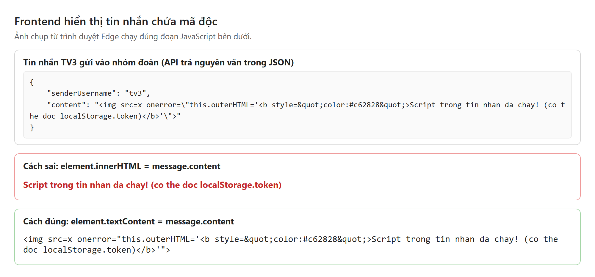

Header thật trả về từ API sau khi thêm CSP:


### V. CSRF

#### 1. Khái niệm và bài toán

- CSRF: trang giả mạo khiến trình duyệt nạn nhân gửi request tới hệ thống thật, kèm **cookie tự động**.
- Dự án gửi token trong header `Authorization` do code client tự gắn, trang giả mạo không gắn được. Vì vậy `csrf(csrf -> csrf.disable())` vẫn an toàn.

| Tiêu chí               | Xác thực bằng cookie | Xác thực bằng header `Authorization` (dự án) |
| ---------------------- | -------------------- | -------------------------------------------- |
| Trình duyệt tự gửi kèm | Có                   | Không                                        |
| Bị CSRF                | Có                   | Không                                        |
| Cần CSRF token         | Có                   | Không                                        |
| Rủi ro chính           | CSRF                 | XSS lấy cắp token                            |

#### 2. Lưu ý

- Spring Security khuyên chỉ tắt CSRF khi service không phục vụ trình duyệt dùng cookie.
- Phải bật lại khi chuyển JWT vào cookie (kể cả `HttpOnly`), dùng session form login, hoặc có trang HTML do server render. Spring Security 7.1.1 có `csrf.spa()`.

#### 3. Demo

**Input:** request giả lập trang giả mạo: có `Origin: https://trang-gia-mao.example`, có cookie `JSESSIONID=abc123`, không có `Authorization`.

**Code xử lý:** `security/SecurityConfig.java` (`SessionCreationPolicy.STATELESS`, không đọc session), `security/JwtAuthenticationFilter.java` (chỉ đọc header `Authorization`).

**Cách xử lý:** server không dùng cookie để xác thực, request không có token nên không có danh tính.

**Output:**

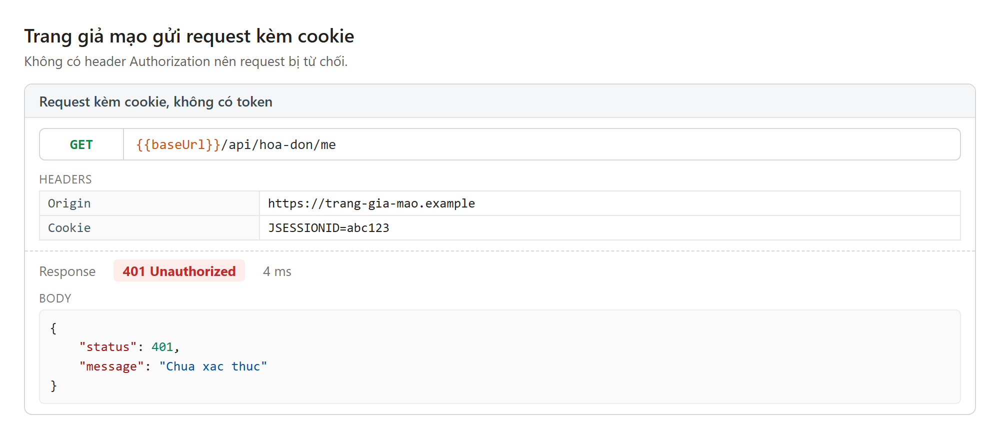

### VI. Dò mật khẩu (Brute force, Credential stuffing)

#### 1. Khái niệm và bài toán

- Brute force: thử nhiều mật khẩu cho **một** tài khoản. Credential stuffing: dùng cặp tài khoản đã lộ ở nơi khác thử trên **nhiều** tài khoản.
- Bài nộp Buổi 10 không giới hạn số lần thử vào `POST /api/auth/login`.
- Cách chặn: đếm lần sai theo username (theo tài khoản, không theo IP, theo OWASP Authentication Cheat Sheet). Sai 5 lần trong 15 phút thì khóa 15 phút, trả `429 Too Many Requests`.

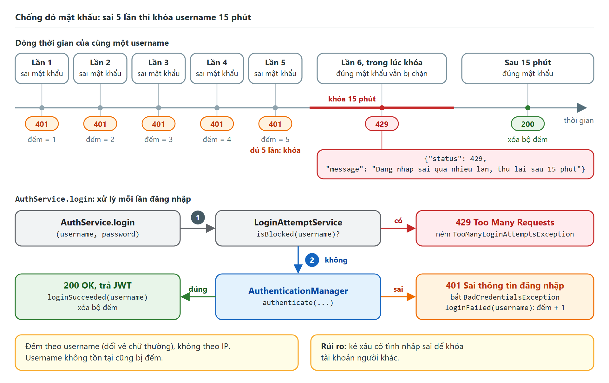

*Sai 5 lần thì khóa 15 phút, trong lúc khóa nhập đúng mật khẩu vẫn nhận 429; hết khóa đăng nhập đúng thì bộ đếm được xóa.*

#### 2. Lưu ý

- Kẻ xấu có thể cố tình sai 5 lần để khóa người khác, nên chỉ khóa ngắn.
- Username không tồn tại cũng bị đếm và cũng nhận `429`, message sai luôn chung chung.
- Giới hạn của bộ đếm trong RAM (`ConcurrentHashMap`):
  - Khởi động lại là mất; nhiều server thì mỗi server đếm riêng.
  - Nhiều username ngẫu nhiên làm map phình to; request song song có thể lọt thêm vài lần thử.
  - Cần bền vững thì dùng Redis hoặc database.
- Không chặn được credential stuffing rải trên nhiều tài khoản; MFA là cách mạnh nhất.

#### 3. Demo

**Input:** gửi 5 lần `POST {{baseUrl}}/api/auth/login` với `{"username": "tv3", "password": "SaiMatKhau1"}`, lần 6 gửi đúng mật khẩu `Demo@12345`, sau đó thử `TV3` viết hoa và tài khoản `tv1`.

**Code xử lý:** `service/AuthService.java` (`login`), `service/LoginAttemptService.java`.

**Cách xử lý:** mỗi lần sai `loginFailed("tv3")` tăng bộ đếm; lần thứ 5 đặt `lockedUntil` sau 15 phút; từ lần 6, `isBlocked` trả `true` nên ném `TooManyLoginAttemptsException` trước cả khi kiểm tra mật khẩu.

**Output:**


### VII. Mass Assignment

#### 1. Khái niệm và bài toán

- Server gán **mọi** trường client gửi vào object, kể cả `id`, `role`, `bookedSlots` (OWASP API Security 2023, API3).
- `save(entity)` gọi `persist` khi `id` là `null`, gọi `merge` khi có `id`. Nhận Entity làm Body là để client chọn thêm mới hay ghi đè.
- Bài nộp Buổi 10: `POST /api/khach-hang` với `{"id": 5, "customerName": "Bi ghi de qua id"}` ghi đè khách 5, `phone`, `email` thành `null`, xóa sạch tour yêu thích. `POST /api/tours` cũng vậy.

#### 2. Lưu ý

| Tiêu chí              | Nhận Entity làm Body           | Nhận DTO request                     |
| --------------------- | ------------------------------ | ------------------------------------ |
| Client gửi `id`       | `save()` thành `merge`, ghi đè | Record không có `id`, Jackson bỏ qua |
| Trường nội bộ         | Có thể bị gán                  | Không có trong DTO                   |
| Validation            | Dùng chung cho mọi API         | Riêng theo từng API                  |
| Đổi cấu trúc database | Ảnh hưởng API                  | API giữ nguyên                       |

- `@JsonIgnore` hay `setId(null)` (như `LichTrinhService.createLichTrinh`) đều phải nhớ làm từng chỗ; DTO không có gì để quên.

#### 3. Demo

**Input:** ADMIN gọi `POST {{baseUrl}}/api/khach-hang`, Body cố tình kèm `"id": 1`.

**Code xử lý:** `dto/KhachHangRequest.java`, `service/KhachHangService.java` (`createKhachHang`).

**Cách xử lý:** Jackson đọc Body vào `KhachHangRequest`, trường `id` không có nên bị bỏ qua; Service tạo `new KhachHang()` nên `save` là thêm mới.

**Output:**


### VIII. Lộ thông tin qua lỗi và cấu hình sai

#### 1. Khái niệm và bài toán

- Message lỗi có tên class, câu SQL, tên constraint giúp kẻ tấn công hiểu bên trong. Lỗi do client phải trả `4xx`, không phải `500`.
- Lỗi trong Filter không đi qua `@RestControllerAdvice`; lỗi của `@PreAuthorize` thì có.
- `NoResourceFoundException` (`404`), `MissingServletRequestParameterException` (`400`), `HttpRequestMethodNotSupportedException` (`405`) cài sẵn `ErrorResponse`. `HttpMessageNotReadableException`, `MethodArgumentTypeMismatchException` thì không, phải tự xử lý.
- Bài nộp Buổi 10: xóa tour còn lịch trình trả về cho client cả tên constraint `FKpkdkngxcpk2vdiloqt4udkx8c` và câu `delete from tours where id=?`.
- `spring.jpa.show-sql=true`, `ddl-auto=update` hợp khi học, không hợp môi trường thật.

#### 2. Lưu ý

- Lỗi lạ: ghi log đầy đủ ở server, client chỉ nhận message chung (OWASP Error Handling Cheat Sheet). Không trả `exception.getMessage()`.
- Một định dạng JSON lỗi cho mọi nơi; `LinkedHashMap` giữ `status` trước `message`.

| Request                           | Trước Buổi 11                                        | Sau Buổi 11                                  |
| --------------------------------- | ---------------------------------------------------- | -------------------------------------------- |
| Body JSON bị cắt ngang            | `500` "JSON parse error: ..."                        | `400` "Du lieu gui len khong dung dinh dang" |
| `GET /api/tours/abc`              | `500` "Method parameter 'id': Failed to convert ..." | `400` "Du lieu gui len khong dung dinh dang" |
| Thiếu `minTotal`                  | `500` "Required request parameter 'minTotal' ..."    | `400` "Yeu cau khong hop le"                 |
| `GET /api/khong-ton-tai` có token | `500` "No static resource ..."                       | `404` "Khong tim thay duong dan"             |
| `DELETE /api/auth/login`          | Chưa thử                                             | `405` "Phuong thuc khong duoc ho tro"        |
| Xóa tour còn lịch trình           | `500` kèm constraint, câu SQL                        | `500` "Loi he thong, vui long thu lai sau"   |

#### 3. Demo

**Input:** 6 request ở bảng trên, trong đó ADMIN gọi `DELETE {{baseUrl}}/api/tours/3` khi tour 3 còn lịch trình.

**Code xử lý:** `exception/GlobalExceptionHandler.java` (`handleBadRequestException`, `handleGeneralException`).

**Cách xử lý:** lỗi do client được đổi sang `4xx`; lỗi khóa ngoại khi xóa tour là lỗi không lường trước, rơi vào `handleGeneralException`, ghi `LOGGER.error` kèm toàn bộ stack trace rồi trả thông báo chung.

**Output:**


---

## Tóm tắt nhanh

| Chủ đề               | Ý cần nhớ                                                                                                                                                 |
| -------------------- | --------------------------------------------------------------------------------------------------------------------------------------------------------- |
| Phân quyền           | Role trả lời "bạn là ai"; quyền theo dữ liệu trả lời "bạn được đụng vào bản ghi nào". Ma trận chỉ có tác dụng khi nằm trong `SecurityConfig`, đúng thứ tự |
| Nhóm chat của đoàn   | Token cho biết bạn là ai, `conversation_members` cho biết bạn đi đoàn nào. "Không tồn tại" và "không được xem" phải giống hệt nhau                        |
| Kiểm tra quyền       | Luôn ở server, gần dữ liệu nhất: `@PreAuthorize` gọi Bean hoặc ngay trong `WHERE`                                                                         |
| Đồng thời            | Đọc rồi ghi trên cùng dữ liệu thì khóa dòng; đọc để quyết định insert thì dùng locking read                                                               |
| Lưu dữ liệu nhạy cảm | Mật khẩu thì hash, số điện thoại thì mã hóa, Base64 chỉ là đổi cách viết                                                                                  |
| Nâng cấp hash        | `{bcrypt}` là nhãn thuật toán; quên encoder mặc định thì hash cũ không đăng nhập được                                                                     |
| Secret               | Nằm trong biến môi trường, không nằm trong Git; mất khóa mã hóa là mất dữ liệu                                                                            |
| Tấn công             | Truy vấn thì bind tham số; nhận DTO chứ không nhận Entity; token trong header không bị CSRF nhưng sợ XSS; lỗi lạ ghi log, trả message chung               |
| Spring Boot 4        | Một số lỗi không còn báo đỏ (Proxy trong JSON), phải chủ động trả DTO; kiểm tra bằng request thật                                                         |

---
