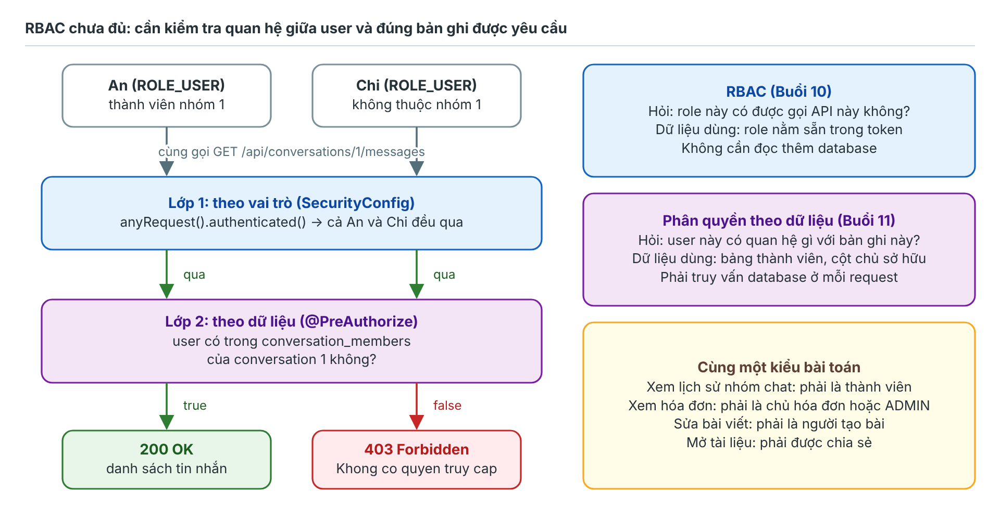
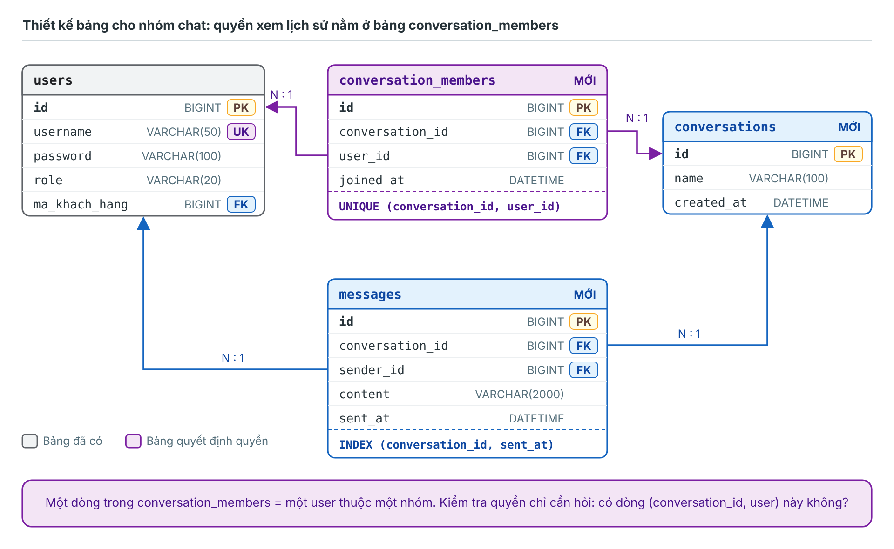
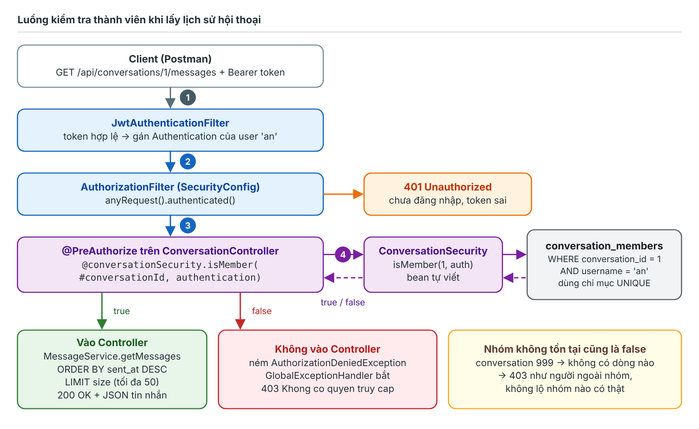
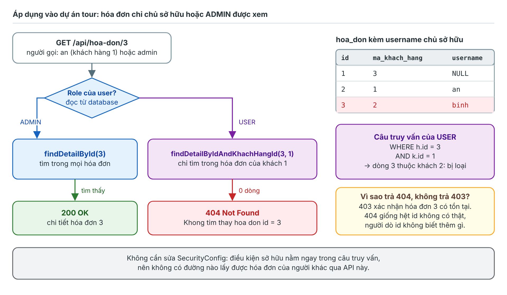
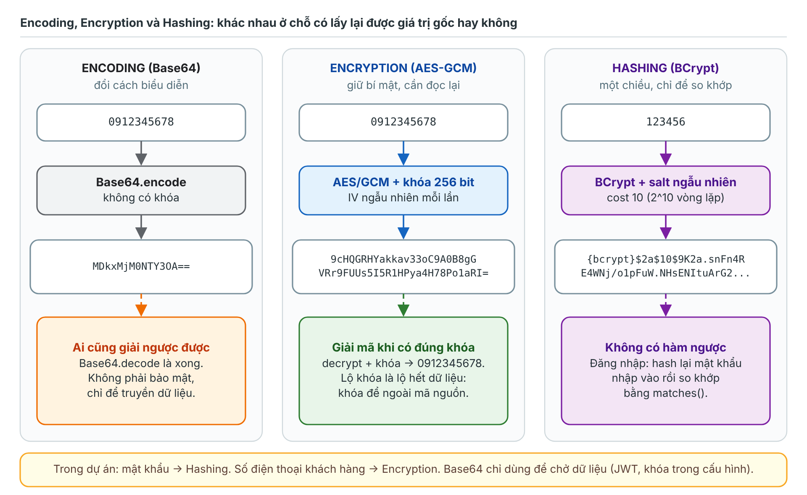
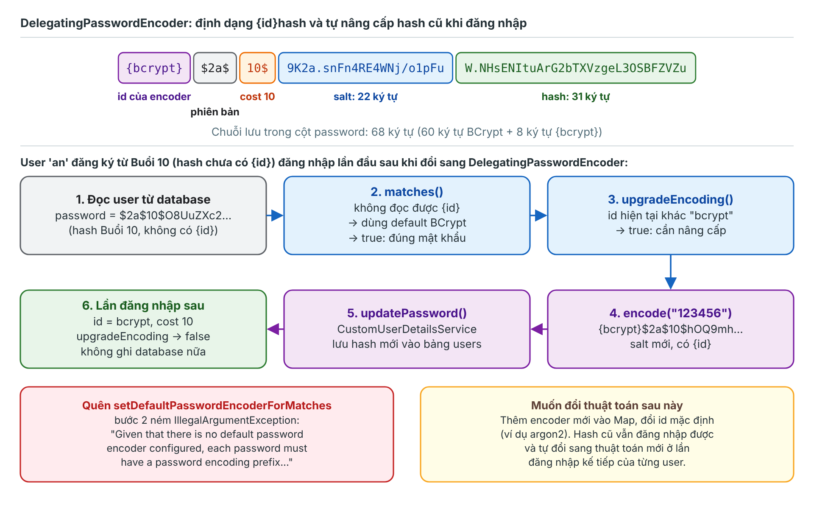
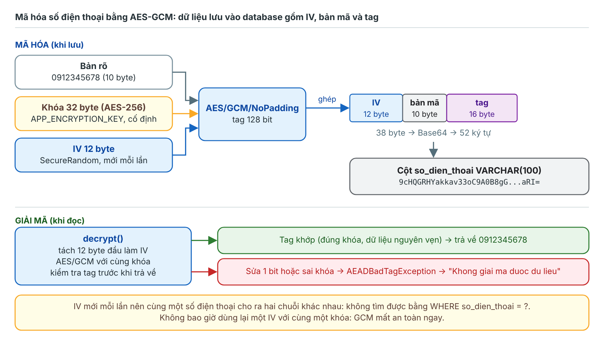
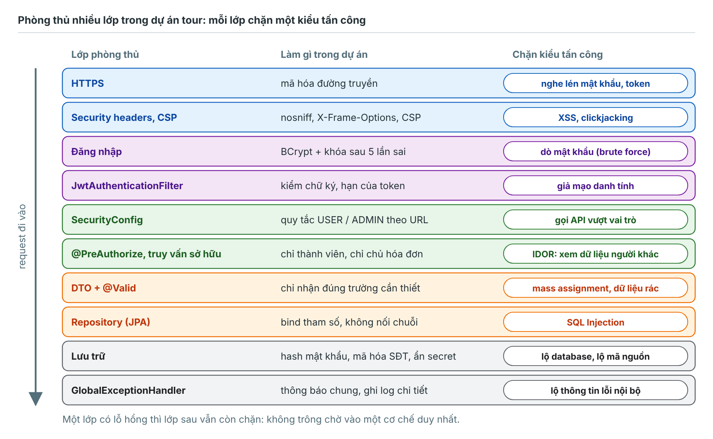
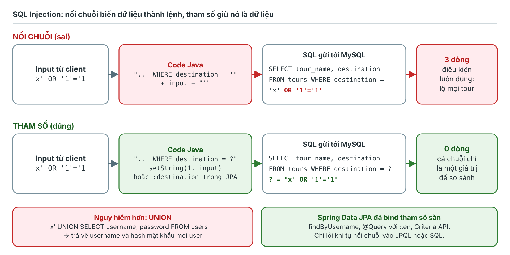
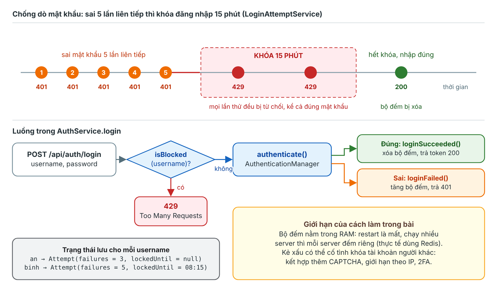

# BUỔI 11: SECURITY 2 VÀ CHỮA BÀI TẬP

*Tài liệu chuẩn bị buổi 11*

---

**Mục lục**

- [BUỔI 11: SECURITY 2 VÀ CHỮA BÀI TẬP](#buổi-11-security-2-và-chữa-bài-tập)
  - [Phần 1: Hoàn thiện và chữa bài tập Buổi 10](#phần-1-hoàn-thiện-và-chữa-bài-tập-buổi-10)
    - [I. Đối chiếu với tiêu chí hoàn thành](#i-đối-chiếu-với-tiêu-chí-hoàn-thành)
    - [II. Lỗi thường gặp và cách sửa](#ii-lỗi-thường-gặp-và-cách-sửa)
    - [III. Chạy trên Spring Boot 4](#iii-chạy-trên-spring-boot-4)
    - [IV. Những điểm Buổi 10 chưa xử lý](#iv-những-điểm-buổi-10-chưa-xử-lý)
  - [Phần 2: Phân quyền theo dữ liệu](#phần-2-phân-quyền-theo-dữ-liệu)
    - [I. Phân quyền theo vai trò và theo dữ liệu](#i-phân-quyền-theo-vai-trò-và-theo-dữ-liệu)
    - [II. Bốn cách đặt chốt kiểm tra](#ii-bốn-cách-đặt-chốt-kiểm-tra)
    - [III. Bài mẫu: lịch sử hội thoại nhóm](#iii-bài-mẫu-lịch-sử-hội-thoại-nhóm)
      - [1. Thiết kế bảng](#1-thiết-kế-bảng)
      - [2. Entity](#2-entity)
      - [3. Repository](#3-repository)
      - [4. Bean kiểm tra quyền `ConversationSecurity`](#4-bean-kiểm-tra-quyền-conversationsecurity)
      - [5. DTO, Service, Controller](#5-dto-service-controller)
      - [6. Dữ liệu mẫu và kiểm thử](#6-dữ-liệu-mẫu-và-kiểm-thử)
    - [IV. Áp dụng vào dự án tour: hóa đơn của chính mình](#iv-áp-dụng-vào-dự-án-tour-hóa-đơn-của-chính-mình)
      - [1. Yêu cầu](#1-yêu-cầu)
      - [2. `HoaDonRepository`](#2-hoadonrepository)
      - [3. `HoaDonService`](#3-hoadonservice)
      - [4. `HoaDonController`](#4-hoadoncontroller)
      - [5. Kiểm thử](#5-kiểm-thử)
  - [Phần 3: Lưu mật khẩu, mã hóa và giải mã](#phần-3-lưu-mật-khẩu-mã-hóa-và-giải-mã)
    - [I. Hashing, Encryption và Encoding](#i-hashing-encryption-và-encoding)
    - [II. Lưu mật khẩu đúng cách](#ii-lưu-mật-khẩu-đúng-cách)
    - [III. Nâng cấp PasswordEncoder trong dự án](#iii-nâng-cấp-passwordencoder-trong-dự-án)
      - [1. `SecurityConfig`](#1-securityconfig)
      - [2. `CustomUserDetailsService`](#2-customuserdetailsservice)
      - [3. Luồng tự nâng cấp khi đăng nhập](#3-luồng-tự-nâng-cấp-khi-đăng-nhập)
      - [4. Kiểm thử](#4-kiểm-thử)
    - [IV. Mã hóa đối xứng AES-GCM](#iv-mã-hóa-đối-xứng-aes-gcm)
    - [V. Mã hóa số điện thoại khách hàng trong dự án](#v-mã-hóa-số-điện-thoại-khách-hàng-trong-dự-án)
      - [1. Tạo khóa và cấu hình](#1-tạo-khóa-và-cấu-hình)
      - [2. `AesGcmEncryptor`](#2-aesgcmencryptor)
      - [3. `EncryptedStringConverter`](#3-encryptedstringconverter)
      - [4. Sửa Entity `KhachHang`](#4-sửa-entity-khachhang)
      - [5. Chuyển dữ liệu cũ](#5-chuyển-dữ-liệu-cũ)
      - [6. Kiểm thử](#6-kiểm-thử)
  - [Phần 4: Các kiểu tấn công phổ biến và cách ngăn chặn](#phần-4-các-kiểu-tấn-công-phổ-biến-và-cách-ngăn-chặn)
    - [I. OWASP Top 10:2025 nhìn từ dự án tour](#i-owasp-top-102025-nhìn-từ-dự-án-tour)
    - [II. SQL Injection](#ii-sql-injection)
    - [III. Broken Access Control và IDOR](#iii-broken-access-control-và-idor)
    - [IV. XSS (Cross-Site Scripting)](#iv-xss-cross-site-scripting)
    - [V. Dò mật khẩu (Brute force, Credential stuffing)](#v-dò-mật-khẩu-brute-force-credential-stuffing)
    - [VI. Mass Assignment](#vi-mass-assignment)
    - [VII. Lộ thông tin qua lỗi và cấu hình sai](#vii-lộ-thông-tin-qua-lỗi-và-cấu-hình-sai)
    - [VIII. Các tấn công khác cần biết](#viii-các-tấn-công-khác-cần-biết)
  - [Phần 5: Bài tập áp dụng (Buổi 11)](#phần-5-bài-tập-áp-dụng-buổi-11)
    - [I. Danh sách việc cần làm](#i-danh-sách-việc-cần-làm)
    - [II. Tổng hợp case kiểm thử](#ii-tổng-hợp-case-kiểm-thử)
    - [III. Tiêu chí hoàn thành](#iii-tiêu-chí-hoàn-thành)
    - [IV. Hướng mở rộng](#iv-hướng-mở-rộng)
  - [Tài liệu tham khảo](#tài-liệu-tham-khảo)

---

**Trước khi đọc:**

- **Mục tiêu:**
  - Tự kiểm tra và hoàn thiện bài tập Buổi 10.
  - Trả lời được câu hỏi chuẩn bị: kiểm tra "người gửi request có phải thành viên nhóm không" khi lấy lịch sử hội thoại.
  - Lưu mật khẩu, mã hóa và giải mã dữ liệu nhạy cảm đúng cách.
  - Nhận diện và chặn được các kiểu tấn công phổ biến trong chính dự án Quản lý đặt tour.
- **Môi trường áp dụng:** Spring Boot 4.1.2 (đi kèm Spring Security 7.1.2, cùng phát hành ngày 23/10/2026), Java 17 trở lên, jjwt 0.13.0, MySQL.
- **Dự án hiện tại:** kết quả Buổi 10 gồm bảng `users`, đăng ký, đăng nhập bằng JWT, phân quyền USER/ADMIN theo URL. Đáp án đầy đủ của Buổi 10 nằm ở Phần 4 tài liệu Buổi 10.
- **Quy ước màu trong hình:**
  - Xanh lá: cho qua (200). Cam: 401 hoặc cảnh báo. Đỏ: bị chặn (403, 404, 429).
  - Xanh dương: Spring Security, mã hóa. Tím: phân quyền theo dữ liệu, hash. Xám: database, code của dự án. Vàng: ghi chú.
- **Trạng thái kiểm thử:**
  - Code Spring Boot trong tài liệu **chưa chạy thực tế**: môi trường soạn tài liệu không tải được thư viện từ Maven Central. Toàn bộ code đã qua kiểm tra cú pháp và kiểm tra import. Output của API là kết quả **mong đợi**, suy ra từ code.
  - Các phần **đã chạy thật**:
    - `AesGcmEncryptor` và `LoginAttemptService` (chỉ dùng JDK, Java 21).
    - `DelegatingPasswordEncoder` (biên dịch từ mã nguồn Spring Security 7.1.2).
    - Câu lệnh tạo bảng, dữ liệu mẫu, truy vấn kiểm tra thành viên, kiểm tra chủ hóa đơn và SQL Injection (MariaDB 10.11, tương thích MySQL).

---

## Phần 1: Hoàn thiện và chữa bài tập Buổi 10

Phần này giúp tự chấm bài Buổi 10 trước giờ học: đối chiếu với tiêu chí, sửa các lỗi hay gặp, chạy được trên Spring Boot 4, và biết bài làm còn hở ở đâu để các phần sau xử lý tiếp.

### I. Đối chiếu với tiêu chí hoàn thành

| Yêu cầu Buổi 10 | Cách tự kiểm tra | Đạt khi |
| --- | --- | --- |
| 1. Cập nhật CSDL | Chạy `SHOW CREATE TABLE users;` | Đủ 5 cột `id`, `username`, `password`, `role`, `ma_khach_hang`; `UNIQUE` trên `username`, `ma_khach_hang`; khóa ngoại tới `khach_hang(id)` |
| 2. Cấu hình nền tảng | Chạy ứng dụng lần đầu | Console có `Da tao tai khoan ADMIN mac dinh: admin`, **không** có `Using generated security password` |
| 3. JWT và Security | `GET /api/tours` không gửi token | `401`, Body `{"status": 401, "message": "Chua xac thuc"}` |
| 4. Đăng ký, đăng nhập | Đăng ký `an`, rồi đăng nhập | Đăng ký không trả trường `password`; đăng nhập trả `accessToken`, `tokenType` là `Bearer`, `expiresIn` là `3600` |
| 5. API của chính mình | `GET /api/users/me` bằng token `an` và token `admin` | Hai kết quả khác nhau; API không nhận tham số `id` nào |
| 6. Danh sách user | `GET /api/users` bằng token USER rồi token ADMIN | USER nhận `403`; ADMIN nhận `200` và Console chỉ có **một** câu SQL |
| 7. Phân quyền API cũ | USER đặt vé có gửi kèm `khachHangId` của người khác | `200`, hóa đơn vẫn đứng tên chính USER đó; ADMIN đặt vé nhận `403` |
| 8. Token bị sửa, hết hạn | Sửa 1 ký tự giữa chữ ký; đặt hạn 10 giây | `401` với đúng message `Token khong hop le` và `Token da het han` |

### II. Lỗi thường gặp và cách sửa

| Hiện tượng | Nguyên nhân | Cách sửa |
| --- | --- | --- |
| IntelliJ báo `Could not autowire. No beans of 'ObjectMapper' type found` | Spring Boot 4 dùng Jackson 3, bean tự cấu hình là `JsonMapper` (package `tools.jackson.databind.json`), không còn `ObjectMapper` của Jackson 2 | Hai class xử lý lỗi bảo mật tự ghép chuỗi JSON (bản cập nhật của tài liệu Buổi 10), không inject `ObjectMapper` |
| Gọi API không có token nhận `403` thay vì `401` | Quên đăng ký `authenticationEntryPoint`, Spring Security dùng `Http403ForbiddenEntryPoint` mặc định | Khai báo `exceptionHandling(...)` với `RestAuthenticationEntryPoint` |
| Mọi lỗi `400`, `404` đều biến thành `401 Chua xac thuc` | Thiếu `.requestMatchers("/error").permitAll()`; Spring chuyển lỗi sang `/error` và bị chặn | Thêm quy tắc `/error` lên đầu |
| `LazyInitializationException: could not initialize proxy - no Session` | Gọi `currentUser.getKhachHang()` trên `User` lấy từ token: đối tượng này được nạp ở filter, đã ra khỏi transaction | Trong Service, đọc lại user bằng `findWithKhachHangByUsername` (có `@EntityGraph`) bên trong `@Transactional` |
| Khởi động lỗi `WeakKeyException` | `jwt.secret` ngắn hơn 32 byte sau khi giải mã Base64 | Tạo lại bằng `openssl rand -base64 32` |
| Token ADMIN vẫn nhận `403` | Viết `hasRole("ROLE_ADMIN")` (Spring tự thêm `ROLE_` thành `ROLE_ROLE_ADMIN`), hoặc `getAuthorities()` trả `"ADMIN"` thiếu tiền tố | Dùng `hasRole("ADMIN")` và authority `"ROLE_" + role.name()` |
| Quy tắc chỉ ADMIN bị bỏ qua | `requestMatchers` khớp quy tắc **đầu tiên**; quy tắc rộng `GET /api/tours/**` đứng trước `GET /api/tours/revenue` | Đặt quy tắc cụ thể lên trước quy tắc rộng |
| Đăng nhập đúng mật khẩu vẫn `401` | Dòng `users` được `INSERT` tay với mật khẩu dạng rõ | Tạo user qua API đăng ký, hoặc lưu chuỗi BCrypt |
| `GET /api/users` sinh N + 1 câu SQL | Thiếu `@EntityGraph(attributePaths = {"khachHang"})` | Dùng `findAllWithKhachHang()` |

### III. Chạy trên Spring Boot 4

Bài Buổi 10 viết cho Spring Boot 3.5.16. Dự án đang dùng Spring Boot 4 chỉ cần sửa hai chỗ trong `pom.xml`:

```xml
<parent>
    <groupId>org.springframework.boot</groupId>
    <artifactId>spring-boot-starter-parent</artifactId>
    <version>4.1.2</version>
    <relativePath/>
</parent>
```

```xml
<dependency>
    <groupId>org.springframework.boot</groupId>
    <artifactId>spring-boot-starter-webmvc</artifactId>
</dependency>
```

Giải thích:

- `spring-boot-starter-webmvc` là tên mới của `spring-boot-starter-web`. Tên cũ vẫn chạy nhưng đã bị đánh dấu deprecated, sẽ bị xóa ở bản sau.
- **Jackson 3:** package đổi từ `com.fasterxml.jackson` sang `tools.jackson`. Riêng annotation như `@JsonIgnore` vẫn ở `com.fasterxml.jackson.annotation`, nên các Entity không phải sửa.
- **jjwt-jackson 0.13.0** vẫn dùng Jackson 2. Spring Boot 4 vẫn quản lý version Jackson 2, nên hai bản cùng tồn tại, không phải sửa gì. Muốn bỏ hẳn Jackson 2 thì thay `jjwt-jackson` bằng `jjwt-gson`.
- **Spring Security 7:** mọi API dùng trong bài (Lambda DSL, `authorizeHttpRequests`, `requestMatchers` dạng chuỗi, `@EnableMethodSecurity`) giữ nguyên. Bản 7 chỉ xóa các kiểu viết cũ: `.and()`, `authorizeRequests`, `AntPathRequestMatcher`.
- **Test:** `@MockBean` đã bị xóa, thay bằng `@MockitoBean`. `@SpringBootTest` không còn tự cấp `MockMvc`, phải thêm `@AutoConfigureMockMvc`.
- Nếu JSON trả về khác Buổi 10 ở thứ tự trường: Jackson 3 có vài mặc định mới. Nội dung vẫn đúng; muốn giữ hành vi gần Jackson 2 có thể bật `spring.jackson.use-jackson2-defaults=true`.

### IV. Những điểm Buổi 10 chưa xử lý

Bài Buổi 10 đã chặn đúng "ai được gọi API nào", nhưng còn các lỗ hổng sau. Mỗi dòng được xử lý ở một phần của tài liệu này:

| Lỗ hổng | Ví dụ trong dự án | Xử lý ở |
| --- | --- | --- |
| Chưa có cách kiểm tra quyền trên **từng bản ghi** | Muốn thêm API xem hóa đơn theo id, USER `an` đổi id trên URL là xem được hóa đơn của người khác (IDOR) | Phần 2 |
| Hash mật khẩu không ghi thuật toán | Chuỗi `$2a$10$...` không có `{bcrypt}`, sau này khó đổi sang thuật toán khác | Phần 3.III |
| Dữ liệu cá nhân lưu dạng rõ | Lộ một bản sao database là lộ toàn bộ số điện thoại khách hàng | Phần 3.IV, 3.V |
| Đăng nhập sai không giới hạn số lần | Chạy script thử hàng nghìn mật khẩu cho `admin` | Phần 4.V |
| `POST /api/khach-hang` nhận thẳng Entity | Gửi kèm `"id": 1` là ghi đè khách hàng số 1 | Phần 4.VI |
| Handler cuối cùng trả `500` kèm `exception.getMessage()` | Gọi sai URL nhận `500` thay vì `404`; message nội bộ lộ ra ngoài | Phần 4.VII |
| Secret, mật khẩu ADMIN ghi thẳng trong `application.properties` | Đẩy code lên GitHub công khai là lộ khóa ký JWT | Phần 3.V.1 |

**Ghi nhớ nhanh:**

- Đáp án Buổi 10 không đổi; Spring Boot 4 chỉ cần đổi version parent và tên starter web.
- Lỗi `ObjectMapper` trên Spring Boot 4 là do Jackson 3, không phải lỗi cấu hình Security.
- Bài Buổi 10 mới phân quyền theo **vai trò**; Buổi 11 bổ sung phân quyền theo **dữ liệu** và các lớp phòng thủ khác.

---

## Phần 2: Phân quyền theo dữ liệu

**Câu hỏi chuẩn bị:** Với những trường hợp cần xác thực phức tạp, ví dụ lấy lịch sử một cuộc hội thoại, cần kiểm tra người gửi request có phải thành viên trong nhóm không. Em sẽ làm như thế nào?

Theo thuật ngữ Buổi 10, đây là bài toán **phân quyền** (Authorization): server đã biết người gửi là ai nhờ token, việc còn lại là hỏi "người này có được xem nhóm này không".

**Trả lời ngắn:**

- **A. Lưu quan hệ thành viên trong database:** bảng `conversation_members`, mỗi dòng là một cặp (nhóm, user), có ràng buộc `UNIQUE (conversation_id, user_id)`.
- **B. Lấy đúng hai dữ kiện:** user lấy từ token (`authentication.getName()`), không nhận `userId` do client gửi; id nhóm lấy từ URL.
- **C. Kiểm tra trước khi đọc dữ liệu:** `@PreAuthorize("@conversationSecurity.isMember(#conversationId, authentication)")` gọi một câu `exists` trên bảng thành viên. Không phải thành viên thì trả `403`, method lấy tin nhắn không hề chạy.
- **D. Truy vấn tin nhắn luôn lọc theo đúng id nhóm đã kiểm tra**, có phân trang, giới hạn số dòng mỗi trang.
- **E. Kiểm thử đủ 4 trường hợp:** thành viên `200`, người ngoài nhóm `403`, nhóm không tồn tại `403`, không gửi token `401`.

Chi tiết từng bước ở Mục I đến III; Mục IV áp dụng cùng kỹ thuật cho hóa đơn trong dự án tour.

### I. Phân quyền theo vai trò và theo dữ liệu

#### 1. Bản chất kỹ thuật

- **A.** **RBAC** (Role-Based Access Control, phân quyền theo vai trò) là cách làm ở Buổi 10: quyết định dựa trên role nằm sẵn trong token. Câu hỏi nó trả lời: "Loại người dùng này có được gọi API này không?".
- **B.** **Phân quyền theo dữ liệu** (object-level authorization): quyết định dựa trên **quan hệ** giữa user và **đúng bản ghi** được yêu cầu. Ví dụ: là thành viên của nhóm, là chủ của hóa đơn, được chia sẻ tài liệu.
- **C.** Dữ liệu dùng để quyết định nằm trong database (bảng thành viên, cột chủ sở hữu), không nằm trong token. Vì vậy mỗi request phải truy vấn thêm.
- **D.** Thiếu bước kiểm tra này là lỗi **IDOR** (Insecure Direct Object Reference): đổi id trên URL là xem được dữ liệu người khác. IDOR thuộc nhóm **A01:2025 Broken Access Control**, nhóm rủi ro đứng đầu OWASP Top 10:2025.
- **E.** Spring Security hỗ trợ bằng **method security**: `@PreAuthorize` gọi được bean tự viết (`@tenBean.tenMethod(...)`) và đọc được tham số của method (`#tenThamSo`).



*Cả An và Chi đều có ROLE_USER nên cùng qua lớp 1; chỉ lớp 2 (đọc bảng thành viên) mới tách được thành viên và người ngoài.*

#### 2. Giải quyết bài toán gì?

- Mọi khách hàng đều có cùng `ROLE_USER`. Nếu chỉ dựa vào role, ai đăng nhập cũng đọc được tin nhắn của **mọi** nhóm bằng cách đổi số trên URL: `/api/conversations/1/messages`, `/2/messages`, `/3/messages`.
- Id thường là số tăng dần nên rất dễ dò. Ẩn id hay dùng UUID chỉ làm việc dò khó hơn, không thay được bước kiểm tra quyền.
- Phân quyền theo dữ liệu đảm bảo: dù biết id, người ngoài nhóm vẫn bị chặn.

#### 3. Lưu ý & Best Practices

- **Danh tính lấy từ token:** dùng `authentication.getName()` hoặc `@AuthenticationPrincipal`. Không nhận `userId`, `username` của người gọi qua Body hay tham số URL.
- **Kiểm tra ở mọi API chạm vào dữ liệu nhóm:** xem tin nhắn, gửi tin, thêm thành viên, rời nhóm. Thiếu một API là thủng cả tính năng.
- **Mặc định từ chối:** tham số `null`, nhóm không tồn tại, lỗi khi truy vấn đều coi là "không phải thành viên".
- **Kiểm tra và đọc dữ liệu dùng cùng một id:** id nhóm đã kiểm tra phải là id dùng trong câu truy vấn tin nhắn. Không kiểm tra theo id trên URL rồi lại đọc theo id nằm trong Body.
- **Hai lớp bổ sung nhau:** quy tắc URL trong `SecurityConfig` vẫn giữ (`anyRequest().authenticated()`), lớp dữ liệu chỉ thêm vào chứ không thay thế.

#### 4. Demo

Câu truy vấn kiểm tra thành viên (Spring Data JPA sẽ sinh câu tương đương ở Mục III.3), chạy với dữ liệu mẫu: nhóm 1 có `an`, `binh`; nhóm 2 có `chi`.

```sql
SELECT 'an hoi nhom 1' AS truong_hop,
       EXISTS (SELECT 1 FROM conversation_members cm JOIN users u ON u.id = cm.user_id
               WHERE cm.conversation_id = 1 AND u.username = 'an') AS la_thanh_vien
UNION ALL
SELECT 'chi hoi nhom 1',
       EXISTS (SELECT 1 FROM conversation_members cm JOIN users u ON u.id = cm.user_id
               WHERE cm.conversation_id = 1 AND u.username = 'chi')
UNION ALL
SELECT 'an hoi nhom 999',
       EXISTS (SELECT 1 FROM conversation_members cm JOIN users u ON u.id = cm.user_id
               WHERE cm.conversation_id = 999 AND u.username = 'an');
```

Output (đã chạy trên MariaDB 10.11):

```text
+-----------------+---------------+
| truong_hop      | la_thanh_vien |
+-----------------+---------------+
| an hoi nhom 1   |             1 |
| chi hoi nhom 1  |             0 |
| an hoi nhom 999 |             0 |
+-----------------+---------------+
```

Giải thích:

- `EXISTS (...)` trả `1` nếu có ít nhất một dòng khớp, ngược lại `0`. Không cần đếm hết, tìm thấy dòng đầu là dừng.
- Nhóm 999 không tồn tại cũng trả `0`: người gọi không phân biệt được "nhóm không có" và "nhóm có nhưng mình không thuộc".
- `EXPLAIN` cho thấy câu này dùng chỉ mục `uk_member_conversation_user` với kiểu truy cập `const`: mỗi lần kiểm tra chỉ đọc đúng một dòng, không quét bảng.

### II. Bốn cách đặt chốt kiểm tra

#### 1. Bản chất kỹ thuật

| Cách | Viết ở đâu | Ưu điểm | Nhược điểm |
| --- | --- | --- | --- |
| 1. `if` trong Service | Đầu method Service: không phải thành viên thì `throw new AccessDeniedException(...)` | Dễ hiểu, không cần kiến thức mới | Dễ quên ở method mới; trộn code nghiệp vụ và code phân quyền |
| 2. `@PreAuthorize` gọi bean | Annotation trên method Controller hoặc Service | Quy tắc nằm ngay trên method, dùng lại cho nhiều API, chặn trước khi method chạy | Biểu thức là chuỗi: gõ sai tên bean, tên tham số chỉ lộ lỗi lúc chạy |
| 3. Lọc trong câu truy vấn | Điều kiện `WHERE ... AND chu_so_huu = :userHienTai` | Không bao giờ đọc nhầm dữ liệu; không có thì trả `404` tự nhiên | Phải nhớ thêm điều kiện ở mọi câu truy vấn |
| 4. Quy tắc URL tự viết | `SecurityConfig`: `.requestMatchers(...).access(authorizationManager)` | Mọi quy tắc tập trung một chỗ | Phải tự đọc biến từ URL, khó đọc, khó kiểm thử |

#### 2. Giải quyết bài toán gì?

- **Hội thoại nhóm dùng cách 2.** Cùng một quy tắc "phải là thành viên" áp cho nhiều API (xem tin nhắn, gửi tin, xem danh sách thành viên). Viết một bean, gắn một dòng annotation lên từng method.
- **Hóa đơn dùng cách 3.** Hóa đơn có đúng một chủ, điều kiện sở hữu ghép thẳng vào câu truy vấn, vừa kiểm tra quyền vừa lấy dữ liệu trong một lần gọi database.
- Cách 1 vẫn đúng nếu làm đủ; cách 4 hợp với quy tắc đơn giản theo URL hơn là quy tắc cần đọc database.

#### 3. Lưu ý & Best Practices

- **403 hay 404?** RFC 9110 (mục 15.5.4) cho phép server trả `404` thay cho `403` khi muốn giấu việc tài nguyên có tồn tại. Quan trọng nhất là **nhất quán**: "không có" và "không được xem" phải cho ra cùng một kết quả.
  - Hội thoại trong bài: cả hai trường hợp đều `403`.
  - Hóa đơn trong bài: cả hai trường hợp đều `404`.
- **Tên tham số:** `#conversationId` trong biểu thức phải trùng tên tham số của method. Spring đọc tên này nhờ cờ biên dịch `-parameters` (`spring-boot-starter-parent` bật sẵn); nếu build không qua Maven, thêm `@P("conversationId")` trước tham số.
- **Tên bean:** `@conversationSecurity` tham chiếu tới bean tên `conversationSecurity`, nên đặt tên rõ ràng: `@Component("conversationSecurity")`.
- **Không lọc sau khi đã tải:** `@PostAuthorize`, `@PostFilter` chạy method xong mới kiểm tra, tốn công tải dữ liệu thừa. Với danh sách lớn, lọc ngay trong câu truy vấn.
- **Khi từ chối**, `@PreAuthorize` ném `AuthorizationDeniedException` (lớp con của `AccessDeniedException`). Handler `AccessDeniedException` có sẵn từ Buổi 10 trả về `403` đúng định dạng JSON của dự án.

#### 4. Demo

Cách 1, viết kiểm tra ngay trong Service (chỉ để so sánh, bài mẫu không dùng):

```java
@Transactional(readOnly = true)
public List<MessageResponse> getMessages(Long conversationId, int page, int size, String username) {
    if (!conversationMemberRepository.existsByConversationIdAndUserUsername(conversationId, username)) {
        throw new AccessDeniedException("Khong co quyen truy cap");
    }
    PageRequest pageRequest = PageRequest.of(page, Math.min(size, MAX_PAGE_SIZE));
    return messageRepository.findByConversationIdOrderBySentAtDescIdDesc(conversationId, pageRequest)
            .stream()
            .map(MessageResponse::from)
            .toList();
}
```

Cách 2, cùng quy tắc chỉ còn một dòng trên Controller:

```java
@PreAuthorize("@conversationSecurity.isMember(#conversationId, authentication)")
```

Giải thích:

- Cách 1 phải truyền thêm `username` vào Service và lặp lại khối `if` ở mọi method cần kiểm tra.
- Cách 2 tách hẳn phần phân quyền ra bean `ConversationSecurity`; Service chỉ còn nghiệp vụ lấy tin nhắn.
- Input: `chi` gọi `GET /api/conversations/1/messages`. Output mong đợi của cả hai cách: `403`, Body `{"status": 403, "message": "Khong co quyen truy cap"}`.

### III. Bài mẫu: lịch sử hội thoại nhóm

Toàn bộ class của tính năng đặt trong package mới `com.example.quanlytour.chat` (gom theo tính năng), dùng lại Entity `User` của Buổi 10. Không phải sửa `SecurityConfig`: quy tắc `anyRequest().authenticated()` đã bắt buộc đăng nhập cho `/api/conversations/**`.

#### 1. Thiết kế bảng



*Ba bảng mới; bảng tím conversation_members là nơi quyết định quyền xem lịch sử.*

- **A.** `conversations`: thông tin nhóm (tên, thời điểm tạo).
- **B.** `conversation_members`: bảng trung gian nhiều - nhiều giữa `users` và `conversations`. Tách thành Entity riêng (thay vì `@ManyToMany`) vì cần thêm cột `joined_at`, sau này có thể thêm vai trò trong nhóm.
- **C.** `UNIQUE (conversation_id, user_id)`: một user không thể vào cùng một nhóm hai lần. Ràng buộc này đồng thời là chỉ mục giúp câu kiểm tra thành viên chạy nhanh.
- **D.** `messages`: chỉ mục `(conversation_id, sent_at)` phục vụ đúng câu truy vấn "tin nhắn của một nhóm, mới nhất trước".

Hibernate tự tạo các bảng này khi `spring.jpa.hibernate.ddl-auto=update`. Câu lệnh tương đương để đối chiếu (đã chạy trên MariaDB 10.11):

```sql
CREATE TABLE conversations (
    id BIGINT NOT NULL AUTO_INCREMENT,
    name VARCHAR(100) NOT NULL,
    created_at DATETIME(6) NOT NULL,
    PRIMARY KEY (id)
) ENGINE = InnoDB;

CREATE TABLE conversation_members (
    id BIGINT NOT NULL AUTO_INCREMENT,
    conversation_id BIGINT NOT NULL,
    user_id BIGINT NOT NULL,
    joined_at DATETIME(6) NOT NULL,
    PRIMARY KEY (id),
    CONSTRAINT uk_member_conversation_user UNIQUE (conversation_id, user_id),
    CONSTRAINT fk_member_conversation FOREIGN KEY (conversation_id) REFERENCES conversations (id),
    CONSTRAINT fk_member_user FOREIGN KEY (user_id) REFERENCES users (id)
) ENGINE = InnoDB;

CREATE TABLE messages (
    id BIGINT NOT NULL AUTO_INCREMENT,
    conversation_id BIGINT NOT NULL,
    sender_id BIGINT NOT NULL,
    content VARCHAR(2000) NOT NULL,
    sent_at DATETIME(6) NOT NULL,
    PRIMARY KEY (id),
    INDEX idx_message_conversation_sent_at (conversation_id, sent_at),
    CONSTRAINT fk_message_conversation FOREIGN KEY (conversation_id) REFERENCES conversations (id),
    CONSTRAINT fk_message_sender FOREIGN KEY (sender_id) REFERENCES users (id)
) ENGINE = InnoDB;
```

Thêm trùng một thành viên vào cùng nhóm (đã chạy thật):

```text
ERROR 1062 (23000) at line 1: Duplicate entry '1-1' for key 'uk_member_conversation_user'
```

#### 2. Entity

`Conversation.java`:

```java
package com.example.quanlytour.chat;

import jakarta.persistence.Column;
import jakarta.persistence.Entity;
import jakarta.persistence.GeneratedValue;
import jakarta.persistence.GenerationType;
import jakarta.persistence.Id;
import jakarta.persistence.PrePersist;
import jakarta.persistence.Table;
import java.time.LocalDateTime;
import lombok.Getter;
import lombok.Setter;

@Entity
@Table(name = "conversations")
@Getter
@Setter
public class Conversation {

    @Id
    @GeneratedValue(strategy = GenerationType.IDENTITY)
    private Long id;

    @Column(name = "name", nullable = false, length = 100)
    private String name;

    @Column(name = "created_at", nullable = false, updatable = false)
    private LocalDateTime createdAt;

    @PrePersist
    protected void onCreate() {
        createdAt = LocalDateTime.now();
    }

}
```

`ConversationMember.java`:

```java
package com.example.quanlytour.chat;

import com.example.quanlytour.entity.User;
import jakarta.persistence.Column;
import jakarta.persistence.Entity;
import jakarta.persistence.FetchType;
import jakarta.persistence.GeneratedValue;
import jakarta.persistence.GenerationType;
import jakarta.persistence.Id;
import jakarta.persistence.JoinColumn;
import jakarta.persistence.ManyToOne;
import jakarta.persistence.PrePersist;
import jakarta.persistence.Table;
import jakarta.persistence.UniqueConstraint;
import java.time.LocalDateTime;
import lombok.Getter;
import lombok.Setter;

@Entity
@Table(name = "conversation_members",
        uniqueConstraints = @UniqueConstraint(name = "uk_member_conversation_user",
                columnNames = {"conversation_id", "user_id"}))
@Getter
@Setter
public class ConversationMember {

    @Id
    @GeneratedValue(strategy = GenerationType.IDENTITY)
    private Long id;

    @ManyToOne(fetch = FetchType.LAZY)
    @JoinColumn(name = "conversation_id", nullable = false)
    private Conversation conversation;

    @ManyToOne(fetch = FetchType.LAZY)
    @JoinColumn(name = "user_id", nullable = false)
    private User user;

    @Column(name = "joined_at", nullable = false, updatable = false)
    private LocalDateTime joinedAt;

    @PrePersist
    protected void onCreate() {
        joinedAt = LocalDateTime.now();
    }

}
```

`Message.java`:

```java
package com.example.quanlytour.chat;

import com.example.quanlytour.entity.User;
import jakarta.persistence.Column;
import jakarta.persistence.Entity;
import jakarta.persistence.FetchType;
import jakarta.persistence.GeneratedValue;
import jakarta.persistence.GenerationType;
import jakarta.persistence.Id;
import jakarta.persistence.Index;
import jakarta.persistence.JoinColumn;
import jakarta.persistence.ManyToOne;
import jakarta.persistence.PrePersist;
import jakarta.persistence.Table;
import java.time.LocalDateTime;
import lombok.Getter;
import lombok.Setter;

@Entity
@Table(name = "messages",
        indexes = @Index(name = "idx_message_conversation_sent_at", columnList = "conversation_id, sent_at"))
@Getter
@Setter
public class Message {

    @Id
    @GeneratedValue(strategy = GenerationType.IDENTITY)
    private Long id;

    @ManyToOne(fetch = FetchType.LAZY)
    @JoinColumn(name = "conversation_id", nullable = false)
    private Conversation conversation;

    @ManyToOne(fetch = FetchType.LAZY)
    @JoinColumn(name = "sender_id", nullable = false)
    private User sender;

    @Column(name = "content", nullable = false, length = 2000)
    private String content;

    @Column(name = "sent_at", nullable = false, updatable = false)
    private LocalDateTime sentAt;

    @PrePersist
    protected void onCreate() {
        sentAt = LocalDateTime.now();
    }

}
```

Giải thích:

- `@PrePersist`: gán thời điểm tạo ngay trước khi `INSERT`, client không gửi được giá trị này.
- `@Table(uniqueConstraints = @UniqueConstraint(...))`: khai báo ràng buộc `UNIQUE` trên hai cột; `columnNames` ghi **tên cột trong database**, không phải tên thuộc tính Java.
- `@ManyToOne(fetch = FetchType.LAZY)`: chỉ nạp `Conversation`, `User` khi thật sự cần, tránh kéo dữ liệu thừa.
- `@Table(indexes = @Index(...))`: khai báo chỉ mục `(conversation_id, sent_at)` để Hibernate tạo cùng bảng.
- `content` dài tối đa 2000 ký tự: giới hạn kích thước dữ liệu ngay từ thiết kế.

#### 3. Repository

`ConversationMemberRepository.java`:

```java
package com.example.quanlytour.chat;

import org.springframework.data.jpa.repository.JpaRepository;

public interface ConversationMemberRepository extends JpaRepository<ConversationMember, Long> {

    boolean existsByConversationIdAndUserUsername(Long conversationId, String username);

}
```

`MessageRepository.java`:

```java
package com.example.quanlytour.chat;

import java.util.List;
import org.springframework.data.domain.Pageable;
import org.springframework.data.jpa.repository.EntityGraph;
import org.springframework.data.jpa.repository.JpaRepository;

public interface MessageRepository extends JpaRepository<Message, Long> {

    @EntityGraph(attributePaths = {"sender"})
    List<Message> findByConversationIdOrderBySentAtDescIdDesc(Long conversationId, Pageable pageable);

}
```

Giải thích:

- `existsByConversationIdAndUserUsername`: Spring Data tự tách tên method thành điều kiện `conversation.id = ?` và `user.username = ?`, trả `boolean`. Câu SQL mong đợi có dạng `select cm.id from conversation_members cm join users u on u.id = cm.user_id where cm.conversation_id = ? and u.username = ? limit ?`.
- Kiểm tra bằng `username` thay vì `userId` vì `Authentication` trong SecurityContext có sẵn `getName()` là username, không phải truy vấn thêm để lấy id.
- `findByConversationIdOrderBySentAtDescIdDesc`: lọc theo nhóm, sắp xếp tin mới nhất trước; `IdDesc` phá thế hòa khi hai tin có cùng thời điểm.
- Tham số `Pageable`: Spring Data thêm `limit`, `offset` vào câu SQL, không tải cả nghìn tin nhắn một lúc.
- `@EntityGraph(attributePaths = {"sender"})`: nạp luôn người gửi trong cùng câu SQL, tránh N + 1 khi đọc `getSender().getUsername()`.

#### 4. Bean kiểm tra quyền `ConversationSecurity`

```java
package com.example.quanlytour.chat;

import lombok.RequiredArgsConstructor;
import org.springframework.security.core.Authentication;
import org.springframework.stereotype.Component;

@Component("conversationSecurity")
@RequiredArgsConstructor
public class ConversationSecurity {

    private final ConversationMemberRepository conversationMemberRepository;

    public boolean isMember(Long conversationId, Authentication authentication) {
        if (conversationId == null || authentication == null || !authentication.isAuthenticated()) {
            return false;
        }
        return conversationMemberRepository.existsByConversationIdAndUserUsername(
                conversationId, authentication.getName());
    }

}
```

Giải thích:

- `@Component("conversationSecurity")`: đăng ký bean với tên cố định để biểu thức `@PreAuthorize` gọi được bằng `@conversationSecurity`.
- `isMember(Long conversationId, Authentication authentication)`: nhận id nhóm và thông tin xác thực của request hiện tại, trả `true` hoặc `false`.
- Khối `if` đầu tiên: thiếu dữ kiện thì từ chối luôn (mặc định từ chối).
- `authentication.getName()`: username của người đang đăng nhập, lấy từ token đã được `JwtAuthenticationFilter` kiểm tra.
- Bean chỉ trả lời "có quyền không"; việc ném `AuthorizationDeniedException` và trả `403` do Spring Security đảm nhận.

#### 5. DTO, Service, Controller



*Request đi qua 3 chốt: token (401), đăng nhập (401), thành viên (403); chỉ thành viên mới vào tới Controller.*

`MessageResponse.java`:

```java
package com.example.quanlytour.chat;

import java.time.LocalDateTime;

public record MessageResponse(
        Long id,
        String senderUsername,
        String content,
        LocalDateTime sentAt) {

    public static MessageResponse from(Message message) {
        return new MessageResponse(
                message.getId(),
                message.getSender().getUsername(),
                message.getContent(),
                message.getSentAt());
    }

}
```

`MessageService.java`:

```java
package com.example.quanlytour.chat;

import java.util.List;
import lombok.RequiredArgsConstructor;
import org.springframework.data.domain.PageRequest;
import org.springframework.stereotype.Service;
import org.springframework.transaction.annotation.Transactional;

@Service
@RequiredArgsConstructor
public class MessageService {

    private static final int MAX_PAGE_SIZE = 50;

    private final MessageRepository messageRepository;

    @Transactional(readOnly = true)
    public List<MessageResponse> getMessages(Long conversationId, int page, int size) {
        if (page < 0 || size < 1) {
            throw new IllegalStateException("page phai >= 0 va size phai >= 1");
        }
        PageRequest pageRequest = PageRequest.of(page, Math.min(size, MAX_PAGE_SIZE));
        return messageRepository.findByConversationIdOrderBySentAtDescIdDesc(conversationId, pageRequest)
                .stream()
                .map(MessageResponse::from)
                .toList();
    }

}
```

`ConversationController.java`:

```java
package com.example.quanlytour.chat;

import java.util.List;
import lombok.RequiredArgsConstructor;
import org.springframework.security.access.prepost.PreAuthorize;
import org.springframework.web.bind.annotation.GetMapping;
import org.springframework.web.bind.annotation.PathVariable;
import org.springframework.web.bind.annotation.RequestMapping;
import org.springframework.web.bind.annotation.RequestParam;
import org.springframework.web.bind.annotation.RestController;

@RestController
@RequestMapping("/api/conversations")
@RequiredArgsConstructor
public class ConversationController {

    private final MessageService messageService;

    @GetMapping("/{conversationId}/messages")
    @PreAuthorize("@conversationSecurity.isMember(#conversationId, authentication)")
    public List<MessageResponse> getMessages(@PathVariable Long conversationId,
                                             @RequestParam(defaultValue = "0") int page,
                                             @RequestParam(defaultValue = "20") int size) {
        return messageService.getMessages(conversationId, page, size);
    }

}
```

Giải thích:

- `MessageResponse`: chỉ trả `id`, `senderUsername`, `content`, `sentAt`. Không trả Entity `User` của người gửi (tránh lộ `password`, `role`).
- `MAX_PAGE_SIZE = 50`: client xin `size=100000` cũng chỉ nhận tối đa 50 tin mỗi lần, chặn kiểu tấn công làm cạn tài nguyên server.
- `page < 0 || size < 1` ném `IllegalStateException`, handler có sẵn trả `400`.
- `@PreAuthorize("@conversationSecurity.isMember(#conversationId, authentication)")`:
  - `@conversationSecurity`: bean ở Mục 4.
  - `#conversationId`: giá trị tham số `conversationId` của method, chính là số trên URL.
  - `authentication`: biến có sẵn trong biểu thức, là `Authentication` của request hiện tại.
- `@PreAuthorize` chạy **trước** method: không phải thành viên thì `messageService.getMessages` không bao giờ được gọi.
- Annotation này hoạt động nhờ `@EnableMethodSecurity` đã bật trong `SecurityConfig` từ Buổi 10.

#### 6. Dữ liệu mẫu và kiểm thử

**Chuẩn bị:**

- **A.** Chạy ứng dụng một lần để Hibernate tạo 3 bảng mới.
- **B.** Đăng ký thêm hai tài khoản `binh` và `chi` bằng `POST /api/auth/register` (như Case 2.1 của Buổi 10), rồi đăng nhập lấy token của `an` và `chi`.
- **C.** Chạy script sau trong MySQL Workbench (đã chạy thật trên MariaDB 10.11 với cấu trúc bảng ở Mục 1):

```sql
SET @an = (SELECT id FROM users WHERE username = 'an');
SET @binh = (SELECT id FROM users WHERE username = 'binh');
SET @chi = (SELECT id FROM users WHERE username = 'chi');

INSERT INTO conversations (name, created_at) VALUES ('Nhom Da Lat 3N2D', NOW(6));
SET @nhom1 = LAST_INSERT_ID();
INSERT INTO conversations (name, created_at) VALUES ('Nhom Phu Quoc', NOW(6));
SET @nhom2 = LAST_INSERT_ID();

INSERT INTO conversation_members (conversation_id, user_id, joined_at) VALUES
    (@nhom1, @an, NOW(6)),
    (@nhom1, @binh, NOW(6)),
    (@nhom2, @chi, NOW(6));

INSERT INTO messages (conversation_id, sender_id, content, sent_at) VALUES
    (@nhom1, @an, 'Chao ca nhom, 7h sang tap trung o ben xe nhe', '2026-11-01 20:00:00'),
    (@nhom1, @binh, 'Ok, minh mang them ao am', '2026-11-01 20:05:00'),
    (@nhom1, @an, 'Nho mang CCCD de check-in khach san', '2026-11-01 20:10:00'),
    (@nhom2, @chi, 'Ve may bay da gui qua email', '2026-11-01 21:00:00');
```

- `SET @an = (SELECT ...)`: lấy id thật của user, không phụ thuộc thứ tự đăng ký.
- `LAST_INSERT_ID()`: id vừa sinh của nhóm. Các bước dưới giả định bảng còn trống nên nhóm 1 có id `1`.

**Case C1: Thành viên xem lịch sử.** `GET {{baseUrl}}/api/conversations/1/messages`, Bearer token của `an`.

Output mong đợi: `200 OK`, tin mới nhất trước:

```json
[
    {
        "id": 3,
        "senderUsername": "an",
        "content": "Nho mang CCCD de check-in khach san",
        "sentAt": "2026-11-01T20:10:00"
    },
    {
        "id": 2,
        "senderUsername": "binh",
        "content": "Ok, minh mang them ao am",
        "sentAt": "2026-11-01T20:05:00"
    },
    {
        "id": 1,
        "senderUsername": "an",
        "content": "Chao ca nhom, 7h sang tap trung o ben xe nhe",
        "sentAt": "2026-11-01T20:00:00"
    }
]
```

**Case C2: Người ngoài nhóm.** Cùng URL, Bearer token của `chi`.

Output mong đợi: `403 Forbidden`, Body `{"status": 403, "message": "Khong co quyen truy cap"}`.

**Case C3: Nhóm không tồn tại.** `GET {{baseUrl}}/api/conversations/999/messages`, token của `an`.

Output mong đợi: `403 Forbidden`, giống hệt Case C2.

**Case C4: Không gửi token.** `GET {{baseUrl}}/api/conversations/1/messages`, tab Authorization chọn **No Auth**.

Output mong đợi: `401 Unauthorized`, Body `{"status": 401, "message": "Chua xac thuc"}`.

**Case C5: Phân trang.** `GET {{baseUrl}}/api/conversations/1/messages?page=0&size=2`, token của `an`.

Output mong đợi: `200 OK`, chỉ 2 tin id `3` và `2`. Đổi thành `page=1&size=2` thì còn tin id `1`; `page=-1` thì `400`, message `page phai >= 0 va size phai >= 1`.

### IV. Áp dụng vào dự án tour: hóa đơn của chính mình

#### 1. Yêu cầu

Thêm hai API, không phải sửa `SecurityConfig` (đã có `anyRequest().authenticated()`):

| API | USER | ADMIN |
| --- | --- | --- |
| `GET /api/hoa-don/me` | Danh sách hóa đơn của chính mình, mới nhất trước | `400`: tài khoản ADMIN không gắn với khách hàng |
| `GET /api/hoa-don/{id}` | Chỉ xem được hóa đơn của mình; hóa đơn người khác hoặc id không tồn tại đều `404` | Xem được mọi hóa đơn |



*USER chỉ tìm trong hóa đơn của chính mình (cách 3: lọc trong câu truy vấn); ADMIN tìm trong toàn bộ.*

#### 2. `HoaDonRepository`

```java
package com.example.quanlytour.repository;

import com.example.quanlytour.entity.HoaDon;
import java.util.List;
import java.util.Optional;
import org.springframework.data.jpa.repository.JpaRepository;
import org.springframework.data.jpa.repository.Query;
import org.springframework.data.repository.query.Param;

public interface HoaDonRepository extends JpaRepository<HoaDon, Long> {

    @Query("SELECT h FROM HoaDon h JOIN FETCH h.khachHang JOIN FETCH h.lichTrinh l JOIN FETCH l.tour WHERE h.totalAmount > :minTotal ORDER BY h.totalAmount DESC")
    List<HoaDon> findInvoicesWithTotalGreaterThan(@Param("minTotal") Double minTotal);

    @Query("SELECT h FROM HoaDon h JOIN FETCH h.khachHang JOIN FETCH h.lichTrinh l JOIN FETCH l.tour WHERE h.id = :id")
    Optional<HoaDon> findDetailById(@Param("id") Long id);

    @Query("SELECT h FROM HoaDon h JOIN FETCH h.khachHang k JOIN FETCH h.lichTrinh l JOIN FETCH l.tour WHERE h.id = :id AND k.id = :khachHangId")
    Optional<HoaDon> findDetailByIdAndKhachHangId(@Param("id") Long id, @Param("khachHangId") Long khachHangId);

    @Query("SELECT h FROM HoaDon h JOIN FETCH h.khachHang k JOIN FETCH h.lichTrinh l JOIN FETCH l.tour WHERE k.id = :khachHangId ORDER BY h.createdAt DESC")
    List<HoaDon> findAllDetailByKhachHangId(@Param("khachHangId") Long khachHangId);

}
```

Giải thích:

- Giữ nguyên `findInvoicesWithTotalGreaterThan` của Buổi 9, thêm 3 câu truy vấn mới.
- `JOIN FETCH h.khachHang`, `JOIN FETCH h.lichTrinh l JOIN FETCH l.tour`: nạp đủ dữ liệu cho `HoaDonResponse` trong một câu SQL, tránh `LazyInitializationException` và N + 1.
- `findDetailByIdAndKhachHangId`: điều kiện `AND k.id = :khachHangId` chính là bước kiểm tra chủ sở hữu. Hóa đơn của người khác không bao giờ được đọc lên.
- `findAllDetailByKhachHangId`: danh sách hóa đơn của một khách hàng, mới nhất trước.
- Tham số truyền bằng `:id`, `:khachHangId` (bind tham số), an toàn trước SQL Injection (Phần 4.II).

#### 3. `HoaDonService`

```java
package com.example.quanlytour.service;

import com.example.quanlytour.dto.BookTicketRequest;
import com.example.quanlytour.dto.HoaDonResponse;
import com.example.quanlytour.entity.HoaDon;
import com.example.quanlytour.entity.KhachHang;
import com.example.quanlytour.entity.LichTrinh;
import com.example.quanlytour.entity.Role;
import com.example.quanlytour.entity.User;
import com.example.quanlytour.repository.HoaDonRepository;
import com.example.quanlytour.repository.LichTrinhRepository;
import com.example.quanlytour.repository.UserRepository;
import java.util.List;
import java.util.Optional;
import lombok.RequiredArgsConstructor;
import org.springframework.stereotype.Service;
import org.springframework.transaction.annotation.Transactional;

@Service
@RequiredArgsConstructor
public class HoaDonService {

    private final HoaDonRepository hoaDonRepository;
    private final LichTrinhRepository lichTrinhRepository;
    private final UserRepository userRepository;

    @Transactional
    public HoaDonResponse bookTicket(BookTicketRequest request, String username) {
        KhachHang khachHang = findLinkedKhachHang(findUser(username));

        LichTrinh lichTrinh = lichTrinhRepository.findById(request.lichTrinhId())
                .orElseThrow(() -> new IllegalArgumentException("Khong tim thay lich trinh id = " + request.lichTrinhId()));

        int bookedSlots = lichTrinh.getBookedSlots() == null ? 0 : lichTrinh.getBookedSlots();
        if (bookedSlots + request.guestCount() > lichTrinh.getTotalSlots()) {
            throw new IllegalStateException("Khong du cho trong");
        }
        lichTrinh.setBookedSlots(bookedSlots + request.guestCount());

        HoaDon hoaDon = new HoaDon();
        hoaDon.setKhachHang(khachHang);
        hoaDon.setLichTrinh(lichTrinh);
        hoaDon.setGuestCount(request.guestCount());
        hoaDon.setTicketPrice(lichTrinh.getBasePrice());

        return HoaDonResponse.from(hoaDonRepository.save(hoaDon));
    }

    @Transactional(readOnly = true)
    public List<HoaDonResponse> searchByMinTotal(Double minTotal) {
        return hoaDonRepository.findInvoicesWithTotalGreaterThan(minTotal)
                .stream()
                .map(HoaDonResponse::from)
                .toList();
    }

    @Transactional(readOnly = true)
    public HoaDonResponse getHoaDon(Long id, String username) {
        User user = findUser(username);
        Optional<HoaDon> hoaDon;
        if (user.getRole() == Role.ADMIN) {
            hoaDon = hoaDonRepository.findDetailById(id);
        } else if (user.getKhachHang() == null) {
            hoaDon = Optional.empty();
        } else {
            hoaDon = hoaDonRepository.findDetailByIdAndKhachHangId(id, user.getKhachHang().getId());
        }
        return hoaDon.map(HoaDonResponse::from)
                .orElseThrow(() -> new IllegalArgumentException("Khong tim thay hoa don id = " + id));
    }

    @Transactional(readOnly = true)
    public List<HoaDonResponse> getMyInvoices(String username) {
        KhachHang khachHang = findLinkedKhachHang(findUser(username));
        return hoaDonRepository.findAllDetailByKhachHangId(khachHang.getId())
                .stream()
                .map(HoaDonResponse::from)
                .toList();
    }

    private User findUser(String username) {
        return userRepository.findWithKhachHangByUsername(username)
                .orElseThrow(() -> new IllegalArgumentException("Khong tim thay user: " + username));
    }

    private KhachHang findLinkedKhachHang(User user) {
        if (user.getKhachHang() == null) {
            throw new IllegalStateException("Tai khoan chua gan voi khach hang");
        }
        return user.getKhachHang();
    }

}
```

Giải thích:

- `bookTicket` giữ nguyên logic Buổi 10; phần tìm user và lấy khách hàng được tách thành hai method `findUser`, `findLinkedKhachHang` để dùng lại.
- `getHoaDon(Long id, String username)`:
  - Đọc lại `User` từ database (kèm `khachHang`) thay vì dùng đối tượng trong token, tránh `LazyInitializationException`.
  - ADMIN: tìm trong mọi hóa đơn.
  - USER chưa gắn khách hàng: coi như không có hóa đơn nào.
  - USER bình thường: chỉ tìm trong hóa đơn của khách hàng của mình.
  - Không thấy thì ném `IllegalArgumentException`, handler có sẵn trả `404`, cùng message cho cả "không tồn tại" và "không phải của bạn".
- `getMyInvoices(String username)`: tài khoản chưa gắn khách hàng (ADMIN) ném `IllegalStateException`, trả `400`.

#### 4. `HoaDonController`

```java
package com.example.quanlytour.controller;

import com.example.quanlytour.dto.BookTicketRequest;
import com.example.quanlytour.dto.HoaDonResponse;
import com.example.quanlytour.entity.User;
import com.example.quanlytour.service.HoaDonService;
import jakarta.validation.Valid;
import java.util.List;
import lombok.RequiredArgsConstructor;
import org.springframework.security.core.annotation.AuthenticationPrincipal;
import org.springframework.web.bind.annotation.GetMapping;
import org.springframework.web.bind.annotation.PathVariable;
import org.springframework.web.bind.annotation.PostMapping;
import org.springframework.web.bind.annotation.RequestBody;
import org.springframework.web.bind.annotation.RequestMapping;
import org.springframework.web.bind.annotation.RequestParam;
import org.springframework.web.bind.annotation.RestController;

@RestController
@RequestMapping("/api/hoa-don")
@RequiredArgsConstructor
public class HoaDonController {

    private final HoaDonService hoaDonService;

    @PostMapping
    public HoaDonResponse bookTicket(@Valid @RequestBody BookTicketRequest request,
                                     @AuthenticationPrincipal User currentUser) {
        return hoaDonService.bookTicket(request, currentUser.getUsername());
    }

    @GetMapping("/search")
    public List<HoaDonResponse> searchByMinTotal(@RequestParam Double minTotal) {
        return hoaDonService.searchByMinTotal(minTotal);
    }

    @GetMapping("/me")
    public List<HoaDonResponse> getMyInvoices(@AuthenticationPrincipal User currentUser) {
        return hoaDonService.getMyInvoices(currentUser.getUsername());
    }

    @GetMapping("/{id}")
    public HoaDonResponse getHoaDon(@PathVariable Long id, @AuthenticationPrincipal User currentUser) {
        return hoaDonService.getHoaDon(id, currentUser.getUsername());
    }

}
```

Giải thích:

- `@AuthenticationPrincipal User currentUser`: lấy user từ token; chỉ dùng `getUsername()` rồi giao cho Service.
- `GET /me` và `GET /{id}` không xung đột: Spring MVC ưu tiên đường dẫn cố định `/me`, `/search` trước đường dẫn có biến `/{id}`.
- Không có tham số nào cho client tự khai "tôi là ai": danh tính luôn lấy từ token.

#### 5. Kiểm thử

Chuẩn bị: `an` đã có hóa đơn từ Buổi 10. Đăng nhập `binh`, đặt vé một lần để có hóa đơn của người khác; ghi lại `id` hóa đơn vừa nhận (giả sử là `3`), `id` hóa đơn của `an` giả sử là `2`.

| Case | Request | Token | Output mong đợi |
| --- | --- | --- | --- |
| H1 | `GET /api/hoa-don/me` | `an` | `200`, chỉ các hóa đơn có `customerName` của `an` |
| H2 | `GET /api/hoa-don/2` | `an` | `200`, chi tiết hóa đơn 2 |
| H3 | `GET /api/hoa-don/3` | `an` | `404`, `{"status": 404, "message": "Khong tim thay hoa don id = 3"}` |
| H4 | `GET /api/hoa-don/9999` | `an` | `404`, `Khong tim thay hoa don id = 9999`: giống hệt H3, không phân biệt được |
| H5 | `GET /api/hoa-don/3` | `admin` | `200`, chi tiết hóa đơn của `binh` |
| H6 | `GET /api/hoa-don/me` | `admin` | `400`, `Tai khoan chua gan voi khach hang` |
| H7 | `GET /api/hoa-don/abc` | `an` | `400`, `Du lieu gui len khong dung dinh dang` (cần handler mới ở Phần 4.VII) |

Điều kiện lọc theo chủ sở hữu đã chạy thử bằng SQL tương đương trên MariaDB, với dữ liệu giống giả định trên (khách hàng 1 là `an` có hóa đơn 2; khách hàng 2 là `binh` có hóa đơn 3):

```text
+---------------------+---------+
| truong_hop          | so_dong |
+---------------------+---------+
| an xem hoa don 2    |       1 |
| an xem hoa don 3    |       0 |
| an xem hoa don 9999 |       0 |
| admin xem hoa don 3 |       1 |
+---------------------+---------+
```

**Ghi nhớ nhanh:**

- Role trả lời "loại người này được gọi API không"; phân quyền theo dữ liệu trả lời "người này có quan hệ gì với **đúng bản ghi** này".
- Quan hệ thành viên lưu ở bảng riêng có `UNIQUE (conversation_id, user_id)`; kiểm tra bằng một câu `exists` dùng chỉ mục.
- Danh tính lấy từ token, id tài nguyên lấy từ URL, quyền hỏi database.
- `@PreAuthorize("@bean.method(#thamSo, authentication)")` hợp với quy tắc dùng chung cho nhiều API; lọc trong câu truy vấn hợp với dữ liệu có chủ sở hữu.
- "Không tồn tại" và "không được xem" phải trả cùng một kết quả.

---

## Phần 3: Lưu mật khẩu, mã hóa và giải mã

### I. Hashing, Encryption và Encoding

#### 1. Bản chất kỹ thuật

- **A.** **Encoding** (mã hóa ký tự, ví dụ Base64): chỉ đổi cách **biểu diễn** dữ liệu. Không có khóa, ai cũng giải ngược được. Encoding **không phải** cơ chế bảo mật.
- **B.** **Encryption** (mã hóa) biến bản rõ thành bản mã bằng một **khóa**; **Decryption** (giải mã) dùng khóa để lấy lại bản rõ. Hai loại:
  - Đối xứng (ví dụ AES): cùng một khóa để mã hóa và giải mã. Nhanh, hợp với mã hóa dữ liệu lưu trong database.
  - Bất đối xứng (ví dụ RSA): khóa công khai để mã hóa, khóa bí mật để giải mã. HTTPS dùng loại này để trao đổi khóa.
- **C.** **Hashing** (băm): hàm **một chiều**, biến dữ liệu bất kỳ thành chuỗi độ dài cố định. Không có hàm ngược; muốn kiểm tra thì băm lại giá trị nhập vào rồi so sánh.
- **D.** Hash dùng cho mật khẩu cần thêm hai tính chất: có **salt** ngẫu nhiên và **chậm có chủ đích** (BCrypt, Argon2id, scrypt, PBKDF2). SHA-256 quá nhanh nên không dùng trực tiếp cho mật khẩu.



*Base64 ai cũng giải ngược; AES-GCM giải được khi có khóa; BCrypt không có hàm ngược, chỉ so khớp.*

| Tiêu chí | Encoding | Encryption | Hashing |
| --- | --- | --- | --- |
| Lấy lại giá trị gốc | Ai cũng lấy lại được | Chỉ người có khóa | Không ai lấy lại được |
| Cần khóa bí mật | Không | Có | Không (có salt, không phải khóa) |
| Ví dụ | Base64, URL encoding | AES-GCM, RSA | BCrypt, Argon2id |
| Dùng trong dự án tour | Phần thân JWT, khóa trong file cấu hình | Số điện thoại khách hàng | Mật khẩu |

#### 2. Giải quyết bài toán gì?

- **Mật khẩu:** server chỉ cần biết "nhập đúng hay sai", không bao giờ cần đọc lại mật khẩu gốc. Dùng hash: lộ database vẫn không lộ mật khẩu.
- **Số điện thoại, CCCD:** nhân viên cần đọc lại để gọi cho khách, nên không hash được. Dùng mã hóa: lộ database mà không lộ khóa thì dữ liệu vẫn an toàn.
- **Base64:** chở dữ liệu nhị phân (khóa, chữ ký) dưới dạng chữ để đặt trong JSON, header, file cấu hình.

#### 3. Lưu ý & Best Practices

- Không mã hóa mật khẩu (giải mã được thì lộ khóa là lộ hết). Càng không lưu mật khẩu dạng Base64.
- Không tự chế thuật toán. Dùng thư viện chuẩn: `javax.crypto` của JDK, `spring-security-crypto`.
- Phần thân JWT chỉ là Base64URL: ai cầm token cũng đọc được, không đặt dữ liệu bí mật trong token (Buổi 10).
- Khóa mã hóa không nằm cùng chỗ với dữ liệu: không ghi trong code, không lưu trong database (Mục V.1).

#### 4. Demo

Base64 không cần khóa vẫn giải được, kể cả phần thân của token Buổi 10:

```java
import java.nio.charset.StandardCharsets;
import java.util.Base64;

public class Base64Demo {

    public static void main(String[] args) {
        String phone = "0912345678";
        String encoded = Base64.getEncoder().encodeToString(phone.getBytes(StandardCharsets.UTF_8));
        String decoded = new String(Base64.getDecoder().decode(encoded), StandardCharsets.UTF_8);
        System.out.println("Encode: " + encoded);
        System.out.println("Decode: " + decoded);
        String jwtPayload = "eyJzdWIiOiJhbiIsInJvbGUiOiJVU0VSIiwiaWF0IjoxNzkyOTgzNjAwLCJleHAiOjE3OTI5ODcyMDB9";
        System.out.println("Payload JWT: " + new String(Base64.getUrlDecoder().decode(jwtPayload), StandardCharsets.UTF_8));
    }

}
```

Output (đã chạy thật với Java 21, lệnh `java Base64Demo.java`):

```text
Encode: MDkxMjM0NTY3OA==
Decode: 0912345678
Payload JWT: {"sub":"an","role":"USER","iat":1792983600,"exp":1792987200}
```

Giải thích:

- `Base64.getEncoder().encodeToString(...)`: biến mảng byte thành chuỗi ký tự an toàn để truyền đi.
- `Base64.getDecoder().decode(...)`: lấy lại byte gốc, không cần bất kỳ bí mật nào.
- `getUrlDecoder()`: biến thể Base64URL mà JWT dùng. Kết quả cho thấy ai cầm token cũng đọc được `sub`, `role`.

### II. Lưu mật khẩu đúng cách

#### 1. Bản chất kỹ thuật

- **A.** **Salt:** chuỗi ngẫu nhiên riêng cho từng mật khẩu, lưu ngay trong chuỗi hash. Hai người cùng đặt `123456` vẫn có hai hash khác nhau; bảng tra hash có sẵn (rainbow table) trở nên vô dụng.
- **B.** **Work factor:** mỗi lần hash cố tình tốn thời gian hoặc bộ nhớ. Người dùng thật chỉ đăng nhập vài lần nên không thấy chậm; kẻ trộm database phải đoán hàng tỉ lần nên bị chậm đi rất nhiều.
- **C.** Tham số tối thiểu theo OWASP Password Storage Cheat Sheet:

| Thuật toán | Tham số tối thiểu | Khi nào dùng |
| --- | --- | --- |
| Argon2id | Bộ nhớ 19 MiB, 2 vòng lặp, độ song song 1 | Lựa chọn ưu tiên |
| scrypt | N = 2^17, r = 8, p = 1 | Khi không có Argon2id |
| bcrypt | Cost từ 10 trở lên; mật khẩu tối đa 72 byte | Hệ thống cũ; mặc định của Spring Security (cost 10) |
| PBKDF2 | 600.000 vòng với HMAC-SHA-256 | Khi bắt buộc chuẩn FIPS-140 |

- **D.** Trong Spring Security, interface `PasswordEncoder` có 3 method: `encode` (tạo hash), `matches` (so khớp), `upgradeEncoding` (hash này có cần làm lại không).
- **E.** `DelegatingPasswordEncoder` lưu thêm tiền tố `{id}` trước hash, ví dụ `{bcrypt}$2a$10$...`, để biết dòng nào dùng thuật toán nào. Nhờ vậy nhiều thuật toán cùng tồn tại trong một bảng.
- **F.** Spring Security 7 có thêm nhóm encoder dựa trên thư viện Password4j: `Argon2Password4jPasswordEncoder`, `BcryptPassword4jPasswordEncoder`, `ScryptPassword4jPasswordEncoder`, `Pbkdf2Password4jPasswordEncoder`, `BalloonHashingPassword4jPasswordEncoder`. Riêng `Argon2PasswordEncoder` có từ trước thì cần thêm thư viện BouncyCastle.

#### 2. Giải quyết bài toán gì?

- Hash Buổi 10 có dạng `$2a$10$...`, không ghi tên thuật toán. Muốn chuyển sang Argon2id hoặc tăng cost thì không biết dòng nào hash bằng gì, và không hash lại được vì server không có mật khẩu gốc.
- Lúc user đăng nhập **đúng**, server đang cầm mật khẩu gốc trong tay. `DelegatingPasswordEncoder` kết hợp `upgradeEncoding` tận dụng đúng thời điểm này để hash lại bằng thuật toán mới.
- OWASP gọi cách này là rehash khi đăng nhập: nâng cấp dần từng tài khoản, không phải bắt toàn bộ người dùng đặt lại mật khẩu.

#### 3. Lưu ý & Best Practices

- **Giới hạn 72 byte của BCrypt:** giữ nguyên bước kiểm tra trong `AuthService.register` của Buổi 10.
- **Độ dài cột `password`:** `{bcrypt}` cộng 60 ký tự BCrypt là 68 ký tự, `VARCHAR(100)` vẫn đủ. Chuỗi Argon2 kèm `{argon2}` dài hơn 100 ký tự: tăng cột lên `VARCHAR(255)` trước khi đổi thuật toán.
- **Pepper:** một bí mật dùng chung, cất ngoài database (biến môi trường, kho bí mật). Chỉ là lớp bảo vệ thêm, không thay được salt và hàm chậm.
- **Mật khẩu đã từng bị lộ:** Spring Security có `CompromisedPasswordChecker`, bản cài sẵn `HaveIBeenPwnedRestApiPasswordChecker` tra mật khẩu trong danh sách đã lộ trên Internet.
- Không ghi mật khẩu vào log, không trả hash ra API.

#### 4. Demo

Chương trình dưới chạy trực tiếp `DelegatingPasswordEncoder` và `BCryptPasswordEncoder` của Spring Security 7.1.2 để xem 3 method làm gì:

```java
import java.util.Map;
import org.springframework.security.crypto.bcrypt.BCryptPasswordEncoder;
import org.springframework.security.crypto.password.DelegatingPasswordEncoder;

public class PasswordEncoderDemo {

    public static void main(String[] args) {
        String oldHash = new BCryptPasswordEncoder().encode("123456");
        System.out.println("1. Hash Buoi 10      : " + oldHash);

        DelegatingPasswordEncoder noDefault = createEncoder(10, false);
        try {
            noDefault.matches("123456", oldHash);
        } catch (IllegalArgumentException exception) {
            System.out.println("2. Khong co default  : " + exception.getMessage());
        }

        DelegatingPasswordEncoder encoder = createEncoder(10, true);
        System.out.println("3. matches(cu)       : " + encoder.matches("123456", oldHash));
        System.out.println("4. upgradeEncoding   : " + encoder.upgradeEncoding(oldHash));

        String newHash = encoder.encode("123456");
        System.out.println("5. Hash moi          : " + newHash + " (" + newHash.length() + " ky tu)");
        System.out.println("6. matches(moi)      : " + encoder.matches("123456", newHash));
        System.out.println("7. Sai mat khau      : " + encoder.matches("654321", newHash));
        System.out.println("8. upgradeEncoding   : " + encoder.upgradeEncoding(newHash));

        DelegatingPasswordEncoder cost12 = createEncoder(12, true);
        System.out.println("9. Doi cost 12, upgradeEncoding(hash cost 10): " + cost12.upgradeEncoding(newHash));
        System.out.println("10. Thoi gian hash   : cost 10 = " + measureMillis(encoder) + " ms, cost 12 = " + measureMillis(cost12) + " ms");
    }

    private static DelegatingPasswordEncoder createEncoder(int strength, boolean withDefault) {
        DelegatingPasswordEncoder encoder = new DelegatingPasswordEncoder(
                "bcrypt", Map.of("bcrypt", new BCryptPasswordEncoder(strength)));
        if (withDefault) {
            encoder.setDefaultPasswordEncoderForMatches(new BCryptPasswordEncoder());
        }
        return encoder;
    }

    private static long measureMillis(DelegatingPasswordEncoder encoder) {
        long start = System.nanoTime();
        encoder.encode("123456");
        return (System.nanoTime() - start) / 1_000_000;
    }

}
```

Output (đã chạy thật, biên dịch từ mã nguồn Spring Security 7.1.2; chuỗi hash và thời gian thay đổi mỗi lần chạy):

```text
1. Hash Buoi 10      : $2a$10$O8UuZXc25ftE7aC1PUW6nO1hqEm9MK0D0mU7JstjQQjTv.oXICn1m
2. Khong co default  : Given that there is no default password encoder configured, each password must have a password encoding prefix. Please either prefix this password with '{noop}' or set a default password encoder in `DelegatingPasswordEncoder`.
3. matches(cu)       : true
4. upgradeEncoding   : true
5. Hash moi          : {bcrypt}$2a$10$hOQ9mh/OBeERuv39pstObeMUer1/8.SIWgtMLmEwW0r5khWcKk1Qe (68 ky tu)
6. matches(moi)      : true
7. Sai mat khau      : false
8. upgradeEncoding   : false
9. Doi cost 12, upgradeEncoding(hash cost 10): true
10. Thoi gian hash   : cost 10 = 92 ms, cost 12 = 384 ms
```

Giải thích:

- Dòng 2: hash không có `{id}` và chưa khai báo encoder mặc định thì `matches` ném `IllegalArgumentException`. Tài liệu Spring cũ ghi message `There is no PasswordEncoder mapped for the id "null"`; bản 7.1.2 in ra message mới như trên.
- Dòng 3, 4: có `setDefaultPasswordEncoderForMatches` thì hash cũ vẫn đăng nhập được, và `upgradeEncoding` báo cần nâng cấp vì hash chưa có `{bcrypt}`.
- Dòng 5 đến 8: hash mới có tiền tố, dài 68 ký tự; đã đúng chuẩn nên `upgradeEncoding` trả `false`.
- Dòng 9: đổi cost lên 12 thì mọi hash cost 10 đều được báo cần nâng cấp, kể cả hash đã có `{bcrypt}`.
- Dòng 10: tăng cost thêm 2 thì thời gian hash tăng khoảng 4 lần (mỗi đơn vị cost nhân đôi số vòng lặp).

### III. Nâng cấp PasswordEncoder trong dự án

#### 1. `SecurityConfig`

Thay bean `PasswordEncoder` và thêm cấu hình header (header giải thích ở Phần 4.IV). File hoàn chỉnh:

```java
package com.example.quanlytour.security;

import java.util.Map;
import lombok.RequiredArgsConstructor;
import org.springframework.context.annotation.Bean;
import org.springframework.context.annotation.Configuration;
import org.springframework.http.HttpMethod;
import org.springframework.security.authentication.AuthenticationManager;
import org.springframework.security.config.annotation.authentication.configuration.AuthenticationConfiguration;
import org.springframework.security.config.annotation.method.configuration.EnableMethodSecurity;
import org.springframework.security.config.annotation.web.builders.HttpSecurity;
import org.springframework.security.config.annotation.web.configuration.EnableWebSecurity;
import org.springframework.security.config.http.SessionCreationPolicy;
import org.springframework.security.crypto.bcrypt.BCryptPasswordEncoder;
import org.springframework.security.crypto.password.DelegatingPasswordEncoder;
import org.springframework.security.crypto.password.PasswordEncoder;
import org.springframework.security.web.SecurityFilterChain;
import org.springframework.security.web.authentication.UsernamePasswordAuthenticationFilter;

@Configuration
@EnableWebSecurity
@EnableMethodSecurity
@RequiredArgsConstructor
public class SecurityConfig {

    private static final String PASSWORD_ENCODER_ID = "bcrypt";

    private final JwtAuthenticationFilter jwtAuthenticationFilter;
    private final RestAuthenticationEntryPoint restAuthenticationEntryPoint;
    private final RestAccessDeniedHandler restAccessDeniedHandler;

    @Bean
    public SecurityFilterChain securityFilterChain(HttpSecurity http) throws Exception {
        http
                .csrf(csrf -> csrf.disable())
                .sessionManagement(session -> session.sessionCreationPolicy(SessionCreationPolicy.STATELESS))
                .headers(headers -> headers
                        .contentSecurityPolicy(csp -> csp.policyDirectives("default-src 'none'; frame-ancestors 'none'")))
                .authorizeHttpRequests(auth -> auth
                        .requestMatchers("/error").permitAll()
                        .requestMatchers("/api/auth/**").permitAll()
                        .requestMatchers(HttpMethod.GET, "/api/users/me").authenticated()
                        .requestMatchers(HttpMethod.GET, "/api/users").hasRole("ADMIN")
                        .requestMatchers(HttpMethod.GET, "/api/tours/revenue").hasRole("ADMIN")
                        .requestMatchers(HttpMethod.GET, "/api/tours/**", "/api/lich-trinh/**").authenticated()
                        .requestMatchers("/api/tours/**", "/api/lich-trinh/**").hasRole("ADMIN")
                        .requestMatchers(HttpMethod.POST, "/api/hoa-don").hasRole("USER")
                        .requestMatchers(HttpMethod.GET, "/api/hoa-don/search").hasRole("ADMIN")
                        .requestMatchers("/api/khach-hang/**").hasRole("ADMIN")
                        .anyRequest().authenticated())
                .exceptionHandling(exception -> exception
                        .authenticationEntryPoint(restAuthenticationEntryPoint)
                        .accessDeniedHandler(restAccessDeniedHandler))
                .addFilterBefore(jwtAuthenticationFilter, UsernamePasswordAuthenticationFilter.class);
        return http.build();
    }

    @Bean
    public PasswordEncoder passwordEncoder() {
        DelegatingPasswordEncoder passwordEncoder = new DelegatingPasswordEncoder(
                PASSWORD_ENCODER_ID, Map.of(PASSWORD_ENCODER_ID, new BCryptPasswordEncoder()));
        passwordEncoder.setDefaultPasswordEncoderForMatches(new BCryptPasswordEncoder());
        return passwordEncoder;
    }

    @Bean
    public AuthenticationManager authenticationManager(AuthenticationConfiguration configuration) throws Exception {
        return configuration.getAuthenticationManager();
    }

}
```

Giải thích phần `passwordEncoder()`:

- `new DelegatingPasswordEncoder(PASSWORD_ENCODER_ID, Map.of(...))`: hash mới tạo bằng encoder có id `bcrypt`, lưu dạng `{bcrypt}...`.
- `Map.of(PASSWORD_ENCODER_ID, new BCryptPasswordEncoder())`: danh sách thuật toán được hỗ trợ. Sau này đổi sang Argon2id thì thêm một cặp id, encoder và đổi `PASSWORD_ENCODER_ID`.
- `setDefaultPasswordEncoderForMatches(new BCryptPasswordEncoder())`: hash không có `{id}` (toàn bộ dữ liệu Buổi 10) được so khớp bằng BCrypt.
- `AuthService`, `DataInitializer` không phải sửa: chúng chỉ phụ thuộc interface `PasswordEncoder`.

#### 2. `CustomUserDetailsService`

```java
package com.example.quanlytour.security;

import com.example.quanlytour.entity.User;
import com.example.quanlytour.repository.UserRepository;
import lombok.RequiredArgsConstructor;
import org.springframework.security.core.userdetails.UserDetails;
import org.springframework.security.core.userdetails.UserDetailsPasswordService;
import org.springframework.security.core.userdetails.UserDetailsService;
import org.springframework.security.core.userdetails.UsernameNotFoundException;
import org.springframework.stereotype.Service;
import org.springframework.transaction.annotation.Transactional;

@Service
@RequiredArgsConstructor
public class CustomUserDetailsService implements UserDetailsService, UserDetailsPasswordService {

    private final UserRepository userRepository;

    @Override
    public UserDetails loadUserByUsername(String username) throws UsernameNotFoundException {
        return findUser(username);
    }

    @Override
    @Transactional
    public UserDetails updatePassword(UserDetails userDetails, String newPassword) {
        User user = findUser(userDetails.getUsername());
        user.setPassword(newPassword);
        return userRepository.save(user);
    }

    private User findUser(String username) {
        return userRepository.findByUsername(username)
                .orElseThrow(() -> new UsernameNotFoundException("Khong tim thay user: " + username));
    }

}
```

Giải thích:

- `implements UserDetailsPasswordService`: interface có một method `updatePassword(UserDetails, String)`, được gọi khi cần lưu hash mới.
- Spring Security tự tìm bean `UserDetailsPasswordService` và gắn vào `DaoAuthenticationProvider` (đối tượng thực hiện bước kiểm tra mật khẩu). Không phải khai báo thêm gì trong `SecurityConfig`.
- `updatePassword`: đọc lại user trong transaction, gán hash mới, lưu xuống database.
- `findUser`: dùng chung cho hai method, giữ nguyên message lỗi của Buổi 10.

#### 3. Luồng tự nâng cấp khi đăng nhập



*Đăng nhập đúng lần đầu: so khớp bằng BCrypt mặc định, phát hiện hash cũ, hash lại và lưu; từ lần sau không ghi database nữa.*

- **A.** `DaoAuthenticationProvider` gọi `matches` để kiểm tra mật khẩu.
- **B.** Đúng mật khẩu thì gọi tiếp `upgradeEncoding(hashTrongDatabase)`.
- **C.** Kết quả `true` thì `encode(matKhauVuaNhap)` và gọi `updatePassword` để lưu hash mới.
- **D.** Toàn bộ diễn ra trong lúc đăng nhập, người dùng không thấy khác biệt.

#### 4. Kiểm thử

**Case P1: Hash cũ được nâng cấp.**

- **A.** Trước khi chạy code mới, chạy:

```sql
SELECT username, LENGTH(password) AS do_dai, LEFT(password, 15) AS dau_chuoi FROM users;
```

Output mong đợi: mọi dòng dài `60`, bắt đầu bằng `$2a$10$`.

- **B.** Chạy ứng dụng với code mới, đăng nhập `an` bằng mật khẩu đúng. Output mong đợi: `200 OK`, có `accessToken` như Buổi 10.
- **C.** Chạy lại câu `SELECT`. Output mong đợi: dòng `an` dài `68`, bắt đầu bằng `{bcrypt}$2a$10$`; các user chưa đăng nhập lại vẫn giữ hash cũ.

**Case P2: Đăng nhập lần hai không ghi database.** Đăng nhập `an` thêm lần nữa, chạy lại câu `SELECT`. Output mong đợi: chuỗi `password` của `an` giữ nguyên như sau bước P1.C.

**Case P3: User mới.** Đăng ký user mới. Output mong đợi: `password` bắt đầu ngay bằng `{bcrypt}`.

**Case P4: Đăng nhập sai không nâng cấp.** Đăng nhập `admin` (hash còn từ Buổi 10) bằng mật khẩu sai. Output mong đợi: `401`; `password` của `admin` vẫn dài `60`, chưa có `{bcrypt}`.

### IV. Mã hóa đối xứng AES-GCM

#### 1. Bản chất kỹ thuật

- **A.** **AES** là chuẩn mã hóa đối xứng, khóa dài 128, 192 hoặc 256 bit. Dự án dùng khóa 256 bit (32 byte).
- **B.** AES cần chọn **chế độ** (mode). **GCM** là chế độ có xác thực: ngoài bản mã còn sinh một **tag** 128 bit. Bản mã bị sửa dù 1 bit, hoặc giải mã sai khóa, thì bước giải mã báo lỗi thay vì trả về dữ liệu rác.
- **C.** **IV** (còn gọi là nonce) dài 12 byte, sinh ngẫu nhiên cho **mỗi lần** mã hóa. IV không bí mật, được lưu ngay cạnh bản mã để lúc giải mã đọc lại.
- **D.** Chuỗi lưu vào database là Base64 của `IV | bản mã | tag`. Số điện thoại 10 byte thành 12 + 10 + 16 = 38 byte, tức 52 ký tự Base64.
- **E.** Bài dùng `javax.crypto` của JDK để thấy rõ từng bước. Spring Security 7.1 cũng có sẵn `AesGcmBytesEncryptor` (tạo bằng `withSecretKey(...)` hoặc `withPassword(...)`); các hàm cũ `Encryptors.stronger`, `Encryptors.delux` đã bị đánh dấu deprecated.



*Khóa cố định, IV mới mỗi lần; database lưu IV, bản mã và tag. Sai khóa hoặc dữ liệu bị sửa thì giải mã thất bại.*

#### 2. Giải quyết bài toán gì?

- Bản sao database bị lộ (file backup, máy cá nhân của lập trình viên, lỗi SQL Injection): cột `so_dien_thoai` chỉ còn là chuỗi vô nghĩa nếu kẻ tấn công không có khóa.
- Ứng dụng vẫn giải mã được để hiển thị, để nhân viên gọi cho khách: điều mà hash không làm được.
- Tag của GCM phát hiện dữ liệu bị sửa thẳng trong database.

#### 3. Lưu ý & Best Practices

- **Không viết `Cipher.getInstance("AES")`:** Java hiểu là `AES/ECB/PKCS5Padding`. ECB cho cùng bản rõ ra cùng bản mã, lộ mẫu dữ liệu, và không có tag. Luôn ghi đủ `AES/GCM/NoPadding`.
- **Không bao giờ dùng lại IV với cùng một khóa:** chuẩn NIST SP 800-38D yêu cầu IV của GCM là duy nhất. Sinh 12 byte bằng `SecureRandom` mỗi lần là cách đơn giản nhất.
- **Quản lý khóa:**
  - Khóa là 32 byte ngẫu nhiên, đặt trong biến môi trường, không ghi trong code, không lưu trong database.
  - Mất khóa là mất dữ liệu vĩnh viễn: cất bản sao khóa ở nơi an toàn, tách khỏi bản backup database.
- **Không tìm kiếm được theo cột đã mã hóa:** IV đổi mỗi lần nên `WHERE so_dien_thoai = ?` không bao giờ khớp. Cần tìm theo số điện thoại thì thêm một cột "blind index" (HMAC của số điện thoại): hướng mở rộng.
- Chỉ mã hóa cột thật sự nhạy cảm: mã hóa làm dữ liệu dài hơn và tốn thêm thời gian xử lý.

#### 4. Demo

Chương trình gọi thẳng `AesGcmEncryptor` (code ở Mục V.2) với một khóa 32 byte ngẫu nhiên và một khóa khác để thử giải mã sai khóa:

```java
package com.example.quanlytour.crypto;

import java.util.Base64;

public class AesGcmEncryptorDemo {

    public static void main(String[] args) {
        AesGcmEncryptor encryptor = new AesGcmEncryptor(args[0]);
        String first = encryptor.encrypt("0912345678");
        String second = encryptor.encrypt("0912345678");
        System.out.println("1. Ma hoa lan 1 : " + first + " (" + first.length() + " ky tu)");
        System.out.println("2. Ma hoa lan 2 : " + second);
        System.out.println("3. Giai ma      : " + encryptor.decrypt(first) + " | " + encryptor.decrypt(second));
        System.out.println("4. Tieng Viet   : " + encryptor.decrypt(encryptor.encrypt("Nguyễn Văn An")));

        byte[] tampered = Base64.getDecoder().decode(first);
        tampered[tampered.length - 1] ^= 1;
        tryDecrypt("5. Sua 1 bit    : ", encryptor, Base64.getEncoder().encodeToString(tampered));
        tryDecrypt("6. Sai khoa     : ", new AesGcmEncryptor(args[1]), first);
        tryDecrypt("7. Du lieu cu   : ", encryptor, "0912345678");
        try {
            new AesGcmEncryptor(Base64.getEncoder().encodeToString(new byte[16]));
        } catch (IllegalStateException exception) {
            System.out.println("8. Khoa 16 byte : " + exception.getMessage());
        }
    }

    private static void tryDecrypt(String label, AesGcmEncryptor encryptor, String data) {
        try {
            System.out.println(label + encryptor.decrypt(data));
        } catch (IllegalStateException exception) {
            String cause = exception.getCause() == null ? "" : " (" + exception.getCause().getClass().getSimpleName() + ")";
            System.out.println(label + exception.getMessage() + cause);
        }
    }

}
```

Output (đã chạy thật với Java 21; bản mã thay đổi mỗi lần chạy):

```text
1. Ma hoa lan 1 : 9cHQGRHYakkav33oC9A0B8gGVRr9FUUs5I5R1HPya4H78Po1aRI= (52 ky tu)
2. Ma hoa lan 2 : 3Ab9ab1ZZWbGouJya9dUhNd6DZaUGnUfAiKMH2B363Dfa5HKn2k=
3. Giai ma      : 0912345678 | 0912345678
4. Tieng Viet   : Nguyễn Văn An
5. Sua 1 bit    : Khong giai ma duoc du lieu (AEADBadTagException)
6. Sai khoa     : Khong giai ma duoc du lieu (AEADBadTagException)
7. Du lieu cu   : Du lieu ma hoa khong hop le
8. Khoa 16 byte : app.encryption.key phai la chuoi Base64 cua dung 32 byte
```

Giải thích:

- Dòng 1, 2: cùng một số điện thoại, hai bản mã khác nhau do IV khác nhau; độ dài 52 ký tự đúng như tính ở Mục 1.D.
- Dòng 3, 4: giải mã ra đúng bản rõ, kể cả chuỗi tiếng Việt có dấu (mã hóa theo byte UTF-8).
- Dòng 5, 6: sửa 1 bit hoặc dùng sai khóa đều bị tag phát hiện (`AEADBadTagException`).
- Dòng 7: dữ liệu cũ chưa mã hóa không đọc được: phải chuyển đổi dữ liệu trước (Mục V.5).
- Dòng 8: khóa sai độ dài bị từ chối ngay khi tạo đối tượng, tức là ngay lúc ứng dụng khởi động.

### V. Mã hóa số điện thoại khách hàng trong dự án

#### 1. Tạo khóa và cấu hình

Tạo khóa 32 byte ngẫu nhiên, chọn một trong hai cách:

```bash
openssl rand -base64 32
```

```java
var b = new byte[32]; new java.security.SecureRandom().nextBytes(b); System.out.println(java.util.Base64.getEncoder().encodeToString(b));
```

- Lệnh `openssl` chạy trong Terminal của macOS, Linux hoặc Git Bash trên Windows.
- Dòng Java dán vào `jshell` (có sẵn trong JDK). Mỗi lần chạy ra một khóa khác, ví dụ `Qg8Owy+McHAIpjIptukyCacPe43/rqPlwwPvyQ+lSRY=` (chỉ là mẫu, không dùng cho dự án thật).

Sửa `application.properties`: secret và mật khẩu không còn ghi thẳng trong file, mà đọc từ biến môi trường:

```properties
jwt.secret=${JWT_SECRET}
jwt.expiration-ms=3600000
app.admin.username=admin
app.admin.password=${ADMIN_PASSWORD}
app.encryption.key=${APP_ENCRYPTION_KEY}
```

Khai báo biến môi trường trong IntelliJ:

- **A.** Menu **Run**, chọn **Edit Configurations...**, chọn cấu hình chạy `QuanLyTourApplication`.
- **B.** Ô **Environment variables** (nếu chưa thấy, bấm **Modify options** và chọn **Environment variables**), nhập trên một dòng: `JWT_SECRET=<secret Buổi 10>;ADMIN_PASSWORD=<mật khẩu admin>;APP_ENCRYPTION_KEY=<khóa vừa tạo>`.
- **C.** Bấm **OK**, chạy lại ứng dụng.

Giải thích:

- `${APP_ENCRYPTION_KEY}`: Spring đọc giá trị từ biến môi trường cùng tên. Thiếu biến thì ứng dụng **không khởi động**, báo lỗi dạng `Could not resolve placeholder 'APP_ENCRYPTION_KEY'`. Thà dừng ngay còn hơn chạy với khóa rỗng.
- Không viết giá trị mặc định kiểu `${APP_ENCRYPTION_KEY:abc}`: giá trị mặc định sẽ nằm trong mã nguồn, đẩy lên GitHub là lộ.
- `JWT_SECRET` là chuỗi Base64 32 byte như Buổi 10; `ADMIN_PASSWORD` chỉ dùng khi `DataInitializer` tạo ADMIN lần đầu.

#### 2. `AesGcmEncryptor`

```java
package com.example.quanlytour.crypto;

import java.nio.ByteBuffer;
import java.nio.charset.StandardCharsets;
import java.security.GeneralSecurityException;
import java.security.SecureRandom;
import java.util.Base64;
import javax.crypto.Cipher;
import javax.crypto.SecretKey;
import javax.crypto.spec.GCMParameterSpec;
import javax.crypto.spec.SecretKeySpec;
import org.springframework.beans.factory.annotation.Value;
import org.springframework.stereotype.Component;

@Component
public class AesGcmEncryptor {

    private static final String TRANSFORMATION = "AES/GCM/NoPadding";
    private static final int KEY_LENGTH_BYTES = 32;
    private static final int IV_LENGTH_BYTES = 12;
    private static final int TAG_LENGTH_BITS = 128;

    private final SecretKey secretKey;
    private final SecureRandom secureRandom = new SecureRandom();

    public AesGcmEncryptor(@Value("${app.encryption.key}") String base64Key) {
        byte[] keyBytes = Base64.getDecoder().decode(base64Key);
        if (keyBytes.length != KEY_LENGTH_BYTES) {
            throw new IllegalStateException("app.encryption.key phai la chuoi Base64 cua dung 32 byte");
        }
        this.secretKey = new SecretKeySpec(keyBytes, "AES");
    }

    public String encrypt(String plainText) {
        try {
            byte[] iv = new byte[IV_LENGTH_BYTES];
            secureRandom.nextBytes(iv);
            Cipher cipher = Cipher.getInstance(TRANSFORMATION);
            cipher.init(Cipher.ENCRYPT_MODE, secretKey, new GCMParameterSpec(TAG_LENGTH_BITS, iv));
            byte[] cipherText = cipher.doFinal(plainText.getBytes(StandardCharsets.UTF_8));
            byte[] output = ByteBuffer.allocate(iv.length + cipherText.length)
                    .put(iv)
                    .put(cipherText)
                    .array();
            return Base64.getEncoder().encodeToString(output);
        } catch (GeneralSecurityException exception) {
            throw new IllegalStateException("Khong ma hoa duoc du lieu", exception);
        }
    }

    public String decrypt(String encryptedText) {
        try {
            byte[] input = Base64.getDecoder().decode(encryptedText);
            if (input.length <= IV_LENGTH_BYTES) {
                throw new IllegalStateException("Du lieu ma hoa khong hop le");
            }
            Cipher cipher = Cipher.getInstance(TRANSFORMATION);
            cipher.init(Cipher.DECRYPT_MODE, secretKey, new GCMParameterSpec(TAG_LENGTH_BITS, input, 0, IV_LENGTH_BYTES));
            byte[] plainText = cipher.doFinal(input, IV_LENGTH_BYTES, input.length - IV_LENGTH_BYTES);
            return new String(plainText, StandardCharsets.UTF_8);
        } catch (GeneralSecurityException | IllegalArgumentException exception) {
            throw new IllegalStateException("Khong giai ma duoc du lieu", exception);
        }
    }

}
```

Giải thích:

- Các hằng số: thuật toán `AES/GCM/NoPadding`, khóa 32 byte, IV 12 byte, tag 128 bit.
- Constructor: giải mã Base64 của khóa, kiểm tra đủ 32 byte rồi tạo `SecretKeySpec`. Sai thì ném `IllegalStateException`, ứng dụng dừng ngay lúc khởi động.
- `SecureRandom`: bộ sinh số ngẫu nhiên an toàn cho mật mã, dùng để sinh IV. Không dùng `java.util.Random`.
- `encrypt`:
  - Sinh IV mới, khởi tạo `Cipher` ở chế độ mã hóa với `GCMParameterSpec(128, iv)`.
  - `doFinal` trả về bản mã đã gắn sẵn tag ở cuối.
  - `ByteBuffer` ghép `IV + bản mã + tag` rồi đổi sang Base64.
- `decrypt`:
  - Giải Base64, kiểm tra dữ liệu dài hơn 12 byte.
  - Lấy 12 byte đầu làm IV, phần còn lại đưa vào `doFinal`; tag sai thì `doFinal` ném `AEADBadTagException`.
- `catch (GeneralSecurityException | IllegalArgumentException ...)`: gom mọi lỗi mật mã và lỗi Base64 thành một `IllegalStateException` với message chung, không lộ chi tiết ra ngoài.

#### 3. `EncryptedStringConverter`

```java
package com.example.quanlytour.crypto;

import jakarta.persistence.AttributeConverter;
import jakarta.persistence.Converter;
import lombok.RequiredArgsConstructor;
import org.springframework.stereotype.Component;

@Component
@Converter
@RequiredArgsConstructor
public class EncryptedStringConverter implements AttributeConverter<String, String> {

    private final AesGcmEncryptor aesGcmEncryptor;

    @Override
    public String convertToDatabaseColumn(String attribute) {
        return attribute == null ? null : aesGcmEncryptor.encrypt(attribute);
    }

    @Override
    public String convertToEntityAttribute(String dbData) {
        return dbData == null ? null : aesGcmEncryptor.decrypt(dbData);
    }

}
```

Giải thích:

- `AttributeConverter<String, String>`: interface của JPA để đổi giá trị giữa Entity và cột database.
  - `convertToDatabaseColumn`: chạy trước khi `INSERT`, `UPDATE`, mã hóa giá trị.
  - `convertToEntityAttribute`: chạy khi đọc dữ liệu lên, giải mã giá trị.
- `@Converter`: đánh dấu đây là converter của JPA. Không bật `autoApply`, chỉ cột nào ghi rõ `@Convert` mới được mã hóa.
- `@Component` và constructor injection: Spring Boot cấu hình Hibernate lấy converter từ Spring, nên converter nhận được bean `AesGcmEncryptor`.
- Giá trị `null` giữ nguyên `null`: khách hàng không có số điện thoại thì không mã hóa.

#### 4. Sửa Entity `KhachHang`

Chỉ sửa khai báo trường `phone`:

```java
@Convert(converter = EncryptedStringConverter.class)
@Column(name = "so_dien_thoai", length = 100)
private String phone;
```

Thêm hai import vào đầu file:

```java
import com.example.quanlytour.crypto.EncryptedStringConverter;
import jakarta.persistence.Convert;
```

Giải thích:

- `@Convert(converter = EncryptedStringConverter.class)`: cột này đi qua converter ở Mục 3.
- `length = 100`: bản mã Base64 của số 10 chữ số dài 52 ký tự, cột cũ `VARCHAR(15)` không đủ.
- Code Java khác (`AuthService.register`, `UserResponse`) không phải sửa: Entity vẫn chứa số điện thoại dạng rõ, việc mã hóa diễn ra trong lúc lưu và đọc.

#### 5. Chuyển dữ liệu cũ

`ddl-auto=update` **không** sửa độ dài cột đã có, và dữ liệu cũ đang ở dạng rõ (Demo dòng 7 cho thấy sẽ không đọc được). Với dữ liệu học tập, chạy trước khi khởi động code mới:

```sql
ALTER TABLE khach_hang MODIFY so_dien_thoai VARCHAR(100);
UPDATE khach_hang SET so_dien_thoai = NULL WHERE so_dien_thoai IS NOT NULL;
```

- Câu 1: tăng độ dài cột (đã chạy thật trên MariaDB 10.11).
- Câu 2: xóa số điện thoại dạng rõ; nhập lại sau khi code mới chạy. Nếu MySQL Workbench chặn câu `UPDATE` không dùng khóa chính, bỏ chọn **Safe Updates** trong **Edit, Preferences, SQL Editor** rồi kết nối lại.
- Dữ liệu thật thì không xóa: viết một chương trình chạy một lần, đọc giá trị rõ, mã hóa bằng đúng `AesGcmEncryptor`, ghi lại (thường đặt trong công cụ migration như Flyway).

#### 6. Kiểm thử

**Case E1: Lưu dạng mã hóa, đọc ra dạng rõ.** Đăng ký user mới `dung` với `"phone": "0912345678"`, rồi chạy:

```sql
SELECT k.id, k.so_dien_thoai, LENGTH(k.so_dien_thoai) AS do_dai
FROM khach_hang k JOIN users u ON u.ma_khach_hang = k.id
WHERE u.username = 'dung';
```

Output mong đợi: `so_dien_thoai` là chuỗi Base64 dài `52`, không còn thấy `0912345678`. Đăng nhập `dung`, gọi `GET /api/users/me`: `"phone": "0912345678"`.

**Case E2: Cùng số, khác bản mã.** Đăng ký thêm `em` với cùng số `0912345678`. Output mong đợi: hai dòng trong `khach_hang` có hai chuỗi `so_dien_thoai` khác nhau.

**Case E3: Dữ liệu bị sửa trong database.** Đổi một ký tự ở giữa chuỗi `so_dien_thoai` của `dung` bằng `UPDATE`, rồi gọi lại `GET /api/users/me` bằng token của `dung`.

Output mong đợi: request thất bại, không trả số điện thoại sai; Console có `Khong giai ma duoc du lieu` kèm `AEADBadTagException`. Mã lỗi phụ thuộc cách Hibernate bọc ngoại lệ (thường là `500` với message chung của Phần 4.VII).

**Case E4: Thiếu biến môi trường.** Xóa `APP_ENCRYPTION_KEY` khỏi cấu hình chạy. Output mong đợi: ứng dụng dừng lúc khởi động với lỗi `Could not resolve placeholder 'APP_ENCRYPTION_KEY'`.

**Ghi nhớ nhanh:**

- Mật khẩu: **hash** (BCrypt, Argon2id), không bao giờ mã hóa. Dữ liệu cần đọc lại: **mã hóa** (AES-GCM). Base64 không phải bảo mật.
- `DelegatingPasswordEncoder` lưu `{id}` trước hash; cộng `UserDetailsPasswordService` thì hash cũ tự nâng cấp khi người dùng đăng nhập đúng.
- Nhớ `setDefaultPasswordEncoderForMatches` khi database còn hash không có `{id}`.
- AES-GCM: khóa 32 byte cố định, IV 12 byte mới mỗi lần, tag phát hiện dữ liệu bị sửa.
- Khóa, secret, mật khẩu ADMIN đọc từ biến môi trường, không ghi trong mã nguồn.

---

## Phần 4: Các kiểu tấn công phổ biến và cách ngăn chặn

### I. OWASP Top 10:2025 nhìn từ dự án tour

OWASP Top 10 là danh sách 10 nhóm rủi ro phổ biến nhất của ứng dụng web, do tổ chức OWASP tổng hợp từ dữ liệu thực tế. Bản mới nhất là **2025**, nhóm A01 có thêm SSRF, nhóm A10 hoàn toàn mới.

| Mã | Nhóm rủi ro | Ví dụ trong dự án tour | Chặn ở |
| --- | --- | --- | --- |
| A01 | Broken Access Control | USER đổi id để xem hóa đơn, tin nhắn của người khác; gọi API chỉ dành cho ADMIN | Buổi 10 (`SecurityConfig`), Phần 2 |
| A02 | Security Misconfiguration | Secret JWT, mật khẩu ADMIN ghi trong `application.properties`; CORS mở cho mọi trang | Phần 3.V.1, Phần 4.VII |
| A03 | Software Supply Chain Failures | Dùng phiên bản Spring, jjwt cũ có lỗ hổng đã công bố | Mục VIII |
| A04 | Cryptographic Failures | Mật khẩu lưu dạng rõ hoặc MD5; số điện thoại dạng rõ; secret JWT quá ngắn | Phần 3 |
| A05 | Injection | Nối chuỗi input vào câu SQL, JPQL | Mục II |
| A06 | Insecure Design | Không giới hạn số lần đăng nhập sai; API trả cả nghìn tin nhắn một lần | Mục V, Phần 2.III |
| A07 | Authentication Failures | Dò mật khẩu; token không có hạn dùng | Buổi 10 (JWT có hạn), Mục V |
| A08 | Software or Data Integrity Failures | Tin dữ liệu chưa kiểm tra toàn vẹn: token không kiểm chữ ký, bản mã bị sửa | Buổi 10 (chữ ký JWT), Phần 3.IV (tag GCM) |
| A09 | Security Logging and Alerting Failures | Lỗi `500` không để lại log, không biết đang bị dò mật khẩu | Mục VII |
| A10 | Mishandling of Exceptional Conditions | Handler trả message nội bộ, biến lỗi `404` thành `500` | Mục VII |



*Mỗi lớp chặn một kiểu tấn công; lớp này có lỗ hổng thì lớp sau vẫn còn chặn.*

### II. SQL Injection

#### 1. Bản chất kỹ thuật

- **A.** SQL Injection xảy ra khi input của người dùng được **nối chuỗi** vào câu SQL. Database không phân biệt được đâu là lệnh của lập trình viên, đâu là dữ liệu, nên input có thể **thành một phần của lệnh**.
- **B.** Ví dụ input `x' OR '1'='1`: dấu `'` đóng chuỗi sớm, phần `OR '1'='1'` biến điều kiện thành luôn đúng.
- **C.** **Bind tham số** (Prepared Statement) gửi câu SQL có chỗ trống `?` và giá trị **tách riêng**. Database biên dịch câu lệnh trước, giá trị chỉ được dùng để so sánh, không bao giờ được hiểu là lệnh.
- **D.** Thuộc nhóm **A05:2025 Injection**. JPQL, HQL cũng bị injection y hệt nếu nối chuỗi.



*Cùng một input: nối chuỗi trả về mọi dòng, bind tham số trả về 0 dòng.*

#### 2. Giải quyết bài toán gì?

- Kẻ tấn công không cần mật khẩu, không cần quyền: chỉ cần một ô tìm kiếm có nối chuỗi là đọc được bảng khác (`users`, kèm hash mật khẩu), sửa hoặc xóa dữ liệu.
- Bind tham số chặn tận gốc: dù input chứa gì, nó vẫn chỉ là một giá trị.

#### 3. Lưu ý & Best Practices

- **Dự án tour đã an toàn ở các chỗ sau,** vì đều bind tham số:
  - Method suy ra từ tên của Spring Data: `findByUsername`, `existsByConversationIdAndUserUsername`.
  - `@Query` dùng `:tenThamSo`: các câu truy vấn trong `HoaDonRepository`.
  - Criteria API: `LichTrinhRepositoryCustomImpl` của Buổi 9.
- **Chỉ nguy hiểm khi tự nối chuỗi** vào `createQuery`, `createNativeQuery`, `JdbcTemplate`.
- **Tìm gần đúng vẫn bind được:** truyền `"%" + keyword + "%"` làm giá trị tham số, không ghép vào câu lệnh.
- **Tên cột, chiều sắp xếp không bind được:** kiểm tra theo danh sách cho phép, ví dụ chỉ chấp nhận `departureDate` hoặc `basePrice`.
- **Quyền tối thiểu cho tài khoản database:** tài khoản ứng dụng không cần quyền `DROP`, `GRANT`.

#### 4. Demo

Hai cách viết cùng một chức năng "tìm tour theo điểm đến" bằng `EntityManager`:

```java
public List<Tour> searchUnsafe(String destination) {
    return entityManager.createQuery(
                    "SELECT t FROM Tour t WHERE t.destination = '" + destination + "'", Tour.class)
            .getResultList();
}

public List<Tour> searchSafe(String destination) {
    return entityManager.createQuery(
                    "SELECT t FROM Tour t WHERE t.destination = :destination", Tour.class)
            .setParameter("destination", destination)
            .getResultList();
}
```

Giải thích:

- `searchUnsafe`: chuỗi `destination` trở thành một phần của câu JPQL. Không bao giờ viết như vậy.
- `searchSafe`: `:destination` là chỗ trống, `setParameter` truyền giá trị riêng.

Để thấy tận mắt, chạy hai cách tương đương ngay trên MySQL với bảng `tours` có 3 dòng (đã chạy thật trên MariaDB 10.11). Cách nối chuỗi:

```text
INPUT : x' OR '1'='1
SQL   : SELECT tour_name, destination FROM tours WHERE destination = 'x' OR '1'='1'
+---------------+-------------+
| tour_name     | destination |
+---------------+-------------+
| Da Lat 3N2D   | Da Lat      |
| Phu Quoc 4N3D | Phu Quoc    |
| Ha Long 2N1D  | Ha Long     |
+---------------+-------------+

INPUT : x' UNION SELECT username, password FROM users -- 
SQL   : SELECT tour_name, destination FROM tours WHERE destination = 'x' UNION SELECT username, password FROM users -- '
+-----------+----------------------------------------------------------------------+
| tour_name | destination                                                          |
+-----------+----------------------------------------------------------------------+
| an        | {bcrypt}$2a$10$9K2a.snFn4RE4WNj/o1pFuW.NHsENItuArG2bTXVzgeL3OSBFZVZu |
| binh      | {bcrypt}$2a$10$Z0gF5iJoPQU6gcyVikwX/.ugreQtYW0/rMG7clo/5q77ZVemu1vgq |
| chi       | {bcrypt}$2a$10$SXz3lJLZ6Plj.FB9eDW2du2.Iw6W3cm3w1iLuLWTEgNuP07ouurj2 |
+-----------+----------------------------------------------------------------------+
```

Cách bind tham số (`PREPARE ... ?` rồi `EXECUTE ... USING @p`), cùng hai input trên:

```text
INPUT : x' OR '1'='1
SQL   : SELECT tour_name, destination FROM tours WHERE destination = ?
+---------+
| so_dong |
+---------+
|       0 |
+---------+

INPUT : x' UNION SELECT username, password FROM users -- 
SQL   : SELECT tour_name, destination FROM tours WHERE destination = ?
+---------+
| so_dong |
+---------+
|       0 |
+---------+
```

Giải thích:

- Input thứ nhất làm điều kiện `WHERE` luôn đúng: lộ toàn bộ tour.
- Input thứ hai ghép thêm một câu `SELECT` vào bảng `users`: lộ username và hash mật khẩu của mọi người. `--` biến phần còn lại thành chú thích SQL.
- Bind tham số: database tìm tour có điểm đến **đúng bằng** chuỗi `x' OR '1'='1`, không có tour nào như vậy nên trả 0 dòng.
- Hash mật khẩu bị lộ vẫn chưa phải mật khẩu: đây là lý do Phần 3 dùng BCrypt có salt, cost cao.

### III. Broken Access Control và IDOR

#### 1. Bản chất kỹ thuật

- **A.** **Broken Access Control** là thiếu hoặc sai bước kiểm tra quyền, đứng đầu OWASP Top 10:2025 (A01). Hai dạng hay gặp:
  - **Vượt vai trò** (theo chiều dọc): USER gọi được API của ADMIN.
  - **Xem dữ liệu ngang hàng** (theo chiều ngang, IDOR): USER này xem được dữ liệu của USER khác cùng vai trò.
- **B.** Buổi 10 đã chặn dạng thứ nhất bằng quy tắc URL; Phần 2 chặn dạng thứ hai bằng phân quyền theo dữ liệu.

#### 2. Giải quyết bài toán gì?

- Đây là lỗ hổng dễ khai thác nhất: chỉ cần đổi một con số trên URL bằng Postman, không cần công cụ đặc biệt.
- Hậu quả trực tiếp: lộ hóa đơn, tin nhắn, thông tin cá nhân của khách hàng khác.

#### 3. Lưu ý & Best Practices

- **Mặc định từ chối:** quy tắc cuối cùng luôn là `anyRequest().authenticated()`; bean kiểm tra quyền trả `false` khi thiếu dữ kiện.
- **Danh tính từ token:** không nhận `khachHangId`, `userId` của người gọi qua Body (bài học `BookTicketRequest` Buổi 10).
- **Kiểm tra mọi phương thức HTTP:** `GET` có kiểm tra mà `PUT`, `DELETE` cùng đường dẫn quên kiểm tra thì vẫn thủng.
- **Ẩn nút trên giao diện không phải phân quyền:** server phải tự chặn.
- **Kiểm thử bằng hai tài khoản cùng vai trò:** dùng token của người này gọi vào id dữ liệu của người kia, như Case C2 và H3.

#### 4. Demo

Các case đã có ở Phần 2, tổng hợp lại theo hai dạng:

| Dạng | Request | Output mong đợi |
| --- | --- | --- |
| Vượt vai trò | Token `an` (USER) gọi `GET /api/users` | `403` |
| Vượt vai trò | Token `an` gọi `DELETE /api/tours/1` | `403` |
| Ngang hàng | Token `chi` gọi `GET /api/conversations/1/messages` | `403` |
| Ngang hàng | Token `an` gọi `GET /api/hoa-don/3` (hóa đơn của `binh`) | `404` |

### IV. XSS (Cross-Site Scripting)

#### 1. Bản chất kỹ thuật

- **A.** XSS là chèn mã JavaScript vào dữ liệu, để **trình duyệt của người khác** chạy mã đó khi trang web hiển thị dữ liệu.
- **B.** Ba dạng:
  - **Stored:** mã độc được lưu vào database (tên khách hàng, nội dung tin nhắn), ai xem trang cũng dính.
  - **Reflected:** mã độc nằm trong URL, server trả ngược lại vào trang.
  - **DOM-based:** JavaScript của frontend tự chèn dữ liệu không an toàn vào trang.
- **C.** Dự án tour là REST API trả JSON, tự nó không render HTML. Rủi ro nằm ở frontend: hiển thị `customerName` hay nội dung tin nhắn bằng `innerHTML`.
- **D.** Spring Security mặc định gửi kèm mọi response các header bảo mật:

```text
Cache-Control: no-cache, no-store, max-age=0, must-revalidate
Pragma: no-cache
Expires: 0
X-Content-Type-Options: nosniff
Strict-Transport-Security: max-age=31536000 ; includeSubDomains
X-Frame-Options: DENY
X-XSS-Protection: 0
```

- `X-Content-Type-Options: nosniff`: trình duyệt không được "đoán" JSON thành HTML để chạy.
- `X-Frame-Options: DENY`: không cho trang khác nhúng trang này vào `iframe` (chống clickjacking).
- `Strict-Transport-Security`: chỉ gửi khi request đi qua HTTPS.
- `X-XSS-Protection: 0`: tắt bộ lọc XSS cũ của trình duyệt (đã lỗi thời), đúng khuyến nghị hiện tại của OWASP.
- `Content-Security-Policy` (CSP) **không** có sẵn, phải tự cấu hình.

#### 2. Giải quyết bài toán gì?

- Mã độc chạy trong trình duyệt của nạn nhân đọc được mọi thứ trang web đọc được, kể cả JWT lưu trong `localStorage`, rồi gửi về máy kẻ tấn công.
- Có token, kẻ tấn công gọi API thay nạn nhân cho tới khi token hết hạn.

#### 3. Lưu ý & Best Practices

- **Chặn chính ở frontend:** hiển thị dữ liệu bằng `textContent`. React, Vue, Angular tự escape khi hiển thị; chỉ nguy hiểm khi dùng `innerHTML`, `dangerouslySetInnerHTML`, `v-html`.
- **Backend:** luôn trả `Content-Type: application/json` (Spring tự đặt) và giữ header mặc định của Spring Security.
- **CSP:** giới hạn nguồn được phép chạy script. API chỉ trả JSON nên dùng chính sách chặt nhất: `default-src 'none'; frame-ancestors 'none'`.
- **Kiểm tra đầu vào chỉ là lớp phụ:** tên tiếng Việt có dấu rất đa dạng, khó lọc hết; nếu muốn, có thể từ chối ký tự `<`, `>` trong tên bằng `@Pattern`.
- Lưu JWT trong `localStorage` thì XSS đọc được; chuyển sang cookie `HttpOnly` thì JavaScript không đọc được, nhưng khi đó phải bật lại chống CSRF (Mục VIII).

#### 4. Demo

Thêm CSP vào `SecurityConfig` (file đầy đủ ở Phần 3.III.1):

```java
.headers(headers -> headers
        .contentSecurityPolicy(csp -> csp.policyDirectives("default-src 'none'; frame-ancestors 'none'")))
```

Giải thích:

- `headers(...)`: tùy chỉnh nhóm header bảo mật; các header mặc định vẫn giữ nguyên.
- `default-src 'none'`: không cho tải bất kỳ script, ảnh, CSS nào từ response này.
- `frame-ancestors 'none'`: không trang nào được nhúng response vào `iframe`.

Input: đăng ký user có `"customerName": ""`, rồi gọi `GET /api/users/me`, mở tab **Headers** của response trong Postman.

Output mong đợi:

- Body trả về tên đúng như đã nhập, dưới dạng một chuỗi JSON. API làm đúng việc của nó: lưu và trả dữ liệu.
- Tab Headers có đủ các header mặc định ở Mục 1.D (trừ `Strict-Transport-Security` vì đang chạy HTTP), thêm dòng `Content-Security-Policy: default-src 'none'; frame-ancestors 'none'`.

Phía frontend, cùng một dữ liệu nhưng hai cách hiển thị cho kết quả khác nhau:

```javascript
document.getElementById("ten").innerHTML = user.customerName;
document.getElementById("ten").textContent = user.customerName;
```

- Dòng 1: trình duyệt hiểu chuỗi là HTML, tạo thẻ `img` lỗi và chạy `alert(1)`: đó là XSS.
- Dòng 2: chuỗi được hiển thị nguyên văn như chữ, không chạy gì.

### V. Dò mật khẩu (Brute force, Credential stuffing)

#### 1. Bản chất kỹ thuật

- **A.** **Brute force:** chương trình tự động thử liên tục nhiều mật khẩu cho một tài khoản, thường lấy từ danh sách mật khẩu phổ biến (`123456`, `admin123`...).
- **B.** **Credential stuffing:** dùng các cặp username, mật khẩu đã lộ từ trang web khác, vì nhiều người dùng chung mật khẩu ở nhiều nơi.
- **C.** API `POST /api/auth/login` của Buổi 10 cho thử không giới hạn. Thuộc nhóm **A07:2025 Authentication Failures**.
- **D.** Cách chặn trong bài: đếm số lần sai **theo username**; sai 5 lần liên tiếp thì khóa đăng nhập tài khoản đó 15 phút, trả `429 Too Many Requests`.



*Sai 5 lần thì mọi lần thử trong 15 phút đều nhận 429, kể cả đúng mật khẩu; hết khóa và đăng nhập đúng thì bộ đếm bị xóa.*

#### 2. Giải quyết bài toán gì?

- BCrypt cost 10 mất khoảng 0,1 giây mỗi lần kiểm tra, nhưng chạy song song nhiều luồng thì vẫn thử được rất nhiều mật khẩu mỗi giờ.
- Khóa sau 5 lần sai làm số lần thử mỗi tài khoản giảm xuống còn 5 lần mỗi 15 phút: dò hết danh sách mật khẩu phổ biến trở nên không khả thi.

#### 3. Lưu ý & Best Practices

- **Đếm theo tài khoản, không theo IP:** OWASP khuyến nghị gắn bộ đếm với tài khoản, vì kẻ tấn công đổi IP rất dễ.
- **Không làm lộ username nào tồn tại:** user không tồn tại vẫn bị `BadCredentialsException` (Spring Security tự đổi lỗi "không tìm thấy user" thành lỗi sai mật khẩu), nên vẫn bị đếm và vẫn bị khóa. Nhận `429` không cho biết username có thật hay không.
- **Khóa có thể bị lạm dụng:** kẻ xấu cố tình nhập sai để khóa tài khoản người khác. Hướng giảm thiểu: thời gian khóa ngắn, CAPTCHA sau vài lần sai, cho phép đặt lại mật khẩu qua email khi bị khóa.
- **Xác thực nhiều lớp (MFA)** là biện pháp mạnh nhất trước dò mật khẩu và credential stuffing.
- **Giới hạn của bản trong bài:** bộ đếm nằm trong RAM. Khởi động lại là mất; chạy nhiều server thì mỗi server đếm riêng. Thực tế lưu bộ đếm ở Redis, hoặc dùng thư viện giới hạn tốc độ như Bucket4j.
- Nên ghi log mỗi lần khóa tài khoản để phát hiện đang bị tấn công (A09).

#### 4. Demo

**A. `LoginAttemptService`**

```java
package com.example.quanlytour.service;

import java.time.Clock;
import java.time.Duration;
import java.time.Instant;
import java.util.Locale;
import java.util.Map;
import java.util.concurrent.ConcurrentHashMap;
import org.springframework.stereotype.Service;

@Service
public class LoginAttemptService {

    public static final int MAX_ATTEMPTS = 5;
    public static final Duration LOCK_DURATION = Duration.ofMinutes(15);

    private final Map<String, Attempt> attempts = new ConcurrentHashMap<>();
    private final Clock clock;

    public LoginAttemptService() {
        this(Clock.systemUTC());
    }

    LoginAttemptService(Clock clock) {
        this.clock = clock;
    }

    public boolean isBlocked(String username) {
        Attempt attempt = attempts.get(toKey(username));
        return attempt != null && attempt.isLockedAt(clock.instant());
    }

    public void loginFailed(String username) {
        Instant now = clock.instant();
        attempts.compute(toKey(username), (key, current) -> {
            int failures = (current == null || current.isExpiredAt(now)) ? 1 : current.failures() + 1;
            Instant lockedUntil = failures >= MAX_ATTEMPTS ? now.plus(LOCK_DURATION) : null;
            return new Attempt(failures, lockedUntil);
        });
    }

    public void loginSucceeded(String username) {
        attempts.remove(toKey(username));
    }

    private String toKey(String username) {
        return username.trim().toLowerCase(Locale.ROOT);
    }

    private record Attempt(int failures, Instant lockedUntil) {

        boolean isLockedAt(Instant now) {
            return lockedUntil != null && now.isBefore(lockedUntil);
        }

        boolean isExpiredAt(Instant now) {
            return lockedUntil != null && !now.isBefore(lockedUntil);
        }

    }

}
```

Giải thích:

- `MAX_ATTEMPTS = 5`, `LOCK_DURATION = 15 phút`: để `public` cho `AuthService` dùng khi tạo message.
- `ConcurrentHashMap`: nhiều request đăng nhập chạy song song trên nhiều luồng; `compute` cập nhật bộ đếm một cách an toàn giữa các luồng.
- `Clock`: nguồn thời gian. Code chạy thật dùng `Clock.systemUTC()`; khi kiểm thử truyền một đồng hồ giả để "tua" thời gian, không phải chờ 15 phút. Spring dùng constructor không tham số vì class có nhiều constructor mà không cái nào đánh dấu `@Autowired`.
- `loginFailed`: chưa có bản ghi, hoặc lần khóa trước đã hết hạn thì đếm lại từ 1; đủ 5 lần thì đặt `lockedUntil`.
- `toKey`: đổi username về chữ thường. MySQL so sánh chuỗi không phân biệt hoa thường, nên `AN` và `an` là cùng một tài khoản; không đổi thì kẻ tấn công lách bộ đếm bằng cách đổi hoa thường.
- `record Attempt`: dữ liệu bất biến gồm số lần sai và thời điểm hết khóa.

**B. `TooManyLoginAttemptsException`**

```java
package com.example.quanlytour.exception;

public class TooManyLoginAttemptsException extends RuntimeException {

    public TooManyLoginAttemptsException(String message) {
        super(message);
    }

}
```

**C. `AuthService`**

```java
package com.example.quanlytour.service;

import com.example.quanlytour.dto.AuthResponse;
import com.example.quanlytour.dto.LoginRequest;
import com.example.quanlytour.dto.RegisterRequest;
import com.example.quanlytour.dto.UserResponse;
import com.example.quanlytour.entity.KhachHang;
import com.example.quanlytour.entity.Role;
import com.example.quanlytour.entity.User;
import com.example.quanlytour.exception.TooManyLoginAttemptsException;
import com.example.quanlytour.repository.KhachHangRepository;
import com.example.quanlytour.repository.UserRepository;
import com.example.quanlytour.security.JwtService;
import java.nio.charset.StandardCharsets;
import lombok.RequiredArgsConstructor;
import org.springframework.security.authentication.AuthenticationManager;
import org.springframework.security.authentication.BadCredentialsException;
import org.springframework.security.authentication.UsernamePasswordAuthenticationToken;
import org.springframework.security.core.Authentication;
import org.springframework.security.crypto.password.PasswordEncoder;
import org.springframework.stereotype.Service;
import org.springframework.transaction.annotation.Transactional;

@Service
@RequiredArgsConstructor
public class AuthService {

    private static final String TOKEN_TYPE = "Bearer";
    private static final int MAX_PASSWORD_BYTES = 72;

    private final UserRepository userRepository;
    private final KhachHangRepository khachHangRepository;
    private final PasswordEncoder passwordEncoder;
    private final AuthenticationManager authenticationManager;
    private final JwtService jwtService;
    private final LoginAttemptService loginAttemptService;

    @Transactional
    public UserResponse register(RegisterRequest request) {
        String username = request.username();
        if (userRepository.existsByUsername(username)) {
            throw new IllegalStateException("Ten dang nhap da ton tai");
        }
        if (request.password().getBytes(StandardCharsets.UTF_8).length > MAX_PASSWORD_BYTES) {
            throw new IllegalStateException("Mat khau vuot qua 72 byte");
        }

        KhachHang khachHang = new KhachHang();
        khachHang.setCustomerName(request.customerName().trim());
        khachHang.setPhone(request.phone());
        khachHang.setEmail(request.email());
        khachHangRepository.save(khachHang);

        User user = new User();
        user.setUsername(username);
        user.setPassword(passwordEncoder.encode(request.password()));
        user.setRole(Role.USER);
        user.setKhachHang(khachHang);
        return UserResponse.from(userRepository.save(user));
    }

    public AuthResponse login(LoginRequest request) {
        String username = request.username();
        if (loginAttemptService.isBlocked(username)) {
            throw new TooManyLoginAttemptsException("Dang nhap sai qua nhieu lan, thu lai sau "
                    + LoginAttemptService.LOCK_DURATION.toMinutes() + " phut");
        }
        Authentication authentication;
        try {
            authentication = authenticationManager.authenticate(
                    new UsernamePasswordAuthenticationToken(username, request.password()));
        } catch (BadCredentialsException exception) {
            loginAttemptService.loginFailed(username);
            throw exception;
        }
        loginAttemptService.loginSucceeded(username);
        User user = (User) authentication.getPrincipal();
        String accessToken = jwtService.generateToken(user);
        return new AuthResponse(accessToken, TOKEN_TYPE, jwtService.getExpirationMs() / 1000);
    }

}
```

Giải thích phần `login`:

- Kiểm tra `isBlocked` **trước** khi kiểm tra mật khẩu: đang bị khóa thì không chạy BCrypt, không cho thử tiếp.
- `catch (BadCredentialsException exception)`: ghi nhận một lần sai rồi ném lại lỗi để handler cũ trả `401` như Buổi 10.
- Đăng nhập đúng thì `loginSucceeded` xóa bộ đếm.
- `register` giữ nguyên Buổi 10.
- Handler cho `TooManyLoginAttemptsException` (trả `429`) nằm trong `GlobalExceptionHandler` ở Mục VII.

**D. Chạy thử logic khóa**

Chương trình đặt cùng package `service` để dùng được constructor nhận `Clock`:

```java
package com.example.quanlytour.service;

import java.time.Clock;
import java.time.Duration;
import java.time.Instant;
import java.time.ZoneId;
import java.time.ZoneOffset;

public class LoginAttemptServiceDemo {

    public static void main(String[] args) {
        MutableClock clock = new MutableClock(Instant.parse("2026-11-02T08:00:00Z"));
        LoginAttemptService service = new LoginAttemptService(clock);

        for (int i = 1; i <= 5; i++) {
            service.loginFailed("an");
            System.out.println("Sai lan " + i + "                -> bi khoa? " + service.isBlocked("an"));
        }
        System.out.println("Thu bang 'AN'            -> bi khoa? " + service.isBlocked("AN"));
        System.out.println("User khac 'binh'         -> bi khoa? " + service.isBlocked("binh"));

        clock.advance(Duration.ofMinutes(14).plusSeconds(59));
        System.out.println("Sau 14 phut 59 giay      -> bi khoa? " + service.isBlocked("an"));
        clock.advance(Duration.ofSeconds(1));
        System.out.println("Sau dung 15 phut         -> bi khoa? " + service.isBlocked("an"));

        service.loginFailed("an");
        System.out.println("Het khoa, sai 1 lan      -> bi khoa? " + service.isBlocked("an"));
        for (int i = 0; i < 3; i++) {
            service.loginFailed("an");
        }
        service.loginSucceeded("an");
        service.loginFailed("an");
        System.out.println("Sai 4, dung 1, sai 1     -> bi khoa? " + service.isBlocked("an"));
    }

    private static class MutableClock extends Clock {

        private Instant now;

        MutableClock(Instant now) {
            this.now = now;
        }

        void advance(Duration duration) {
            now = now.plus(duration);
        }

        @Override
        public ZoneId getZone() {
            return ZoneOffset.UTC;
        }

        @Override
        public Clock withZone(ZoneId zone) {
            return this;
        }

        @Override
        public Instant instant() {
            return now;
        }

    }

}
```

Output (đã chạy thật với Java 21):

```text
Sai lan 1                -> bi khoa? false
Sai lan 2                -> bi khoa? false
Sai lan 3                -> bi khoa? false
Sai lan 4                -> bi khoa? false
Sai lan 5                -> bi khoa? true
Thu bang 'AN'            -> bi khoa? true
User khac 'binh'         -> bi khoa? false
Sau 14 phut 59 giay      -> bi khoa? true
Sau dung 15 phut         -> bi khoa? false
Het khoa, sai 1 lan      -> bi khoa? false
Sai 4, dung 1, sai 1     -> bi khoa? false
```

Giải thích:

- `MutableClock`: đồng hồ giả, `advance` tua thời gian tới trước.
- Kết quả kiểm tra đủ case thường và case biên: khóa đúng ở lần thứ 5, không phân biệt hoa thường, không ảnh hưởng user khác, còn khóa ở giây cuối cùng, hết khóa đúng mốc 15 phút, đếm lại từ đầu sau khi hết khóa, đăng nhập đúng xóa bộ đếm.

**E. Kiểm thử trên Postman**

- **Case B1:** đăng nhập `an` sai mật khẩu 5 lần liên tiếp. Output mong đợi: cả 5 lần `401`, `Sai ten dang nhap hoac mat khau`.
- **Case B2:** lần thứ 6, nhập **đúng** mật khẩu. Output mong đợi: `429 Too Many Requests`, Body `{"status": 429, "message": "Dang nhap sai qua nhieu lan, thu lai sau 15 phut"}`.
- **Case B3:** cùng lúc đó đăng nhập `binh` đúng mật khẩu. Output mong đợi: `200`, user khác không bị ảnh hưởng.
- **Case B4:** khởi động lại ứng dụng, đăng nhập `an` đúng mật khẩu. Output mong đợi: `200` vì bộ đếm trong RAM đã mất (đúng với giới hạn đã nêu ở Mục 3).

### VI. Mass Assignment

#### 1. Bản chất kỹ thuật

- **A.** Jackson gán **mọi** trường JSON trùng tên vào object nhận request. Nếu Controller nhận thẳng Entity, client gán được cả những trường không được phép sửa: `id`, `role`, `totalAmount`.
- **B.** OWASP API Security Top 10 2023 xếp lỗi này vào **API3:2023 Broken Object Property Level Authorization**: kiểm tra quyền ở mức từng thuộc tính của object.
- **C.** Với Spring Data, `save(entity)` có `id` khác `null` được hiểu là **cập nhật** (`merge`), không phải thêm mới.

#### 2. Giải quyết bài toán gì?

- Buổi 10 đã tránh được lỗi nặng nhất: `register` nhận `RegisterRequest` chứ không nhận Entity `User`. Nếu nhận `User`, ai cũng gửi được `"role": "ADMIN"` để tự cấp quyền quản trị.
- Còn sót một chỗ từ Buổi 8: `POST /api/khach-hang` nhận thẳng Entity `KhachHang`. Gửi kèm `"id": 1` là **ghi đè** khách hàng số 1 thay vì tạo khách hàng mới.

#### 3. Lưu ý & Best Practices

- **Input luôn là DTO:** chỉ khai báo đúng các trường client được phép gửi, kèm `@Valid`.
- **Output cũng nên là DTO** (như `UserResponse`, `HoaDonResponse`), để không vô tình trả thêm trường nhạy cảm khi Entity thay đổi.
- `@JsonIgnore` hay `@JsonProperty(access = READ_ONLY)` trên Entity chỉ là chữa cháy: dễ quên khi thêm trường mới.
- Các trường do server quyết định (`id`, `role`, thời điểm tạo, chủ sở hữu, tổng tiền) không bao giờ lấy từ request.

#### 4. Demo

**A. Trước khi sửa.** Token `admin`, `POST {{baseUrl}}/api/khach-hang`, Body:

```json
{
    "id": 1,
    "customerName": "Ten bi ghi de"
}
```

Output mong đợi: `200 OK`, Body có `"id": 1`. Khách hàng số 1 bị đổi tên, mất số điện thoại và email (bị ghi `null`), thay vì sinh ra khách hàng mới. Chỉ thử trên dữ liệu học tập.

**B. Sửa:** tạo `KhachHangRequest.java` trong package `dto`:

```java
package com.example.quanlytour.dto;

import jakarta.validation.constraints.Email;
import jakarta.validation.constraints.NotBlank;
import jakarta.validation.constraints.Pattern;

public record KhachHangRequest(

        @NotBlank(message = "Ten khach hang khong duoc de trong")
        String customerName,

        @Pattern(regexp = "^0\\d{9}$", message = "So dien thoai gom 10 chu so va bat dau bang 0")
        String phone,

        @Email(message = "Email khong dung dinh dang")
        String email) {
}
```

Sửa method `createKhachHang` trong `KhachHangService` (thêm `import com.example.quanlytour.dto.KhachHangRequest;`):

```java
public KhachHang createKhachHang(KhachHangRequest request) {
    KhachHang khachHang = new KhachHang();
    khachHang.setCustomerName(request.customerName().trim());
    khachHang.setPhone(request.phone());
    khachHang.setEmail(request.email());
    return khachHangRepository.save(khachHang);
}
```

Sửa method `createKhachHang` trong `KhachHangController` (thêm cùng import):

```java
@PostMapping
public KhachHang createKhachHang(@Valid @RequestBody KhachHangRequest request) {
    return khachHangService.createKhachHang(request);
}
```

Giải thích:

- `KhachHangRequest` không có trường `id`: Jackson bỏ qua `"id": 1` trong Body.
- Service tự tạo `new KhachHang()` nên `id` luôn `null`, `save` luôn là thêm mới.
- `@Pattern` cho `phone` giống `RegisterRequest`: dữ liệu sai định dạng bị chặn trước khi mã hóa.

**C. Sau khi sửa.** Gửi lại đúng Body ở bước A.

Output mong đợi: `200 OK`, Body có `id` mới (lớn hơn id lớn nhất hiện có), khách hàng số 1 giữ nguyên.

### VII. Lộ thông tin qua lỗi và cấu hình sai

#### 1. Bản chất kỹ thuật

- **A.** **A10:2025 Mishandling of Exceptional Conditions** (nhóm mới): xử lý lỗi sai cách làm lộ thông tin nội bộ, trả sai mã trạng thái, hoặc "lỗi thì cho qua" (fail open) thay vì "lỗi thì từ chối" (fail closed).
- **B.** **A02:2025 Security Misconfiguration:** cấu hình mặc định không an toàn, secret nằm trong mã nguồn, CORS mở cho mọi trang.
- **C.** Handler cuối cùng của Buổi 10 bắt mọi `Exception`, trả `500` kèm `exception.getMessage()`:
  - Message của lỗi SQL có thể chứa tên bảng, tên cột, câu lệnh.
  - Lỗi của Spring MVC như sai URL (`404`), sai phương thức HTTP (`405`), JSON hỏng (`400`) đều bị biến thành `500`.

#### 2. Giải quyết bài toán gì?

- Kẻ tấn công dựa vào message lỗi chi tiết để đoán cấu trúc database, phiên bản thư viện, từ đó chọn cách tấn công.
- Client nhận sai mã trạng thái thì xử lý sai: `500` khiến frontend báo "lỗi server" trong khi lỗi nằm ở request.

#### 3. Lưu ý & Best Practices

- **Trả message chung, ghi log chi tiết:** người dùng nhận `Loi he thong, vui long thu lai sau`; lập trình viên xem stack trace trong log.
- **Giữ đúng mã trạng thái** của các lỗi do framework ném ra.
- **Fail closed:** lỗi trong lúc kiểm tra quyền phải dẫn tới từ chối, như `ConversationSecurity` trả `false` khi thiếu dữ kiện.
- **Cấu hình:**
  - Secret, mật khẩu đọc từ biến môi trường (Phần 3.V.1).
  - Không bật `server.error.include-stacktrace=always`.
  - CORS chỉ cho phép đúng địa chỉ frontend (ví dụ `http://localhost:5173`), không dùng `*` khi có gửi thông tin xác thực.

#### 4. Demo

`GlobalExceptionHandler` hoàn chỉnh:

```java
package com.example.quanlytour.exception;

import java.util.LinkedHashMap;
import java.util.Map;
import java.util.Objects;
import org.slf4j.Logger;
import org.slf4j.LoggerFactory;
import org.springframework.http.HttpStatus;
import org.springframework.http.HttpStatusCode;
import org.springframework.http.ResponseEntity;
import org.springframework.http.converter.HttpMessageNotReadableException;
import org.springframework.security.access.AccessDeniedException;
import org.springframework.security.authentication.BadCredentialsException;
import org.springframework.web.ErrorResponse;
import org.springframework.web.bind.MethodArgumentNotValidException;
import org.springframework.web.bind.annotation.ExceptionHandler;
import org.springframework.web.bind.annotation.RestControllerAdvice;
import org.springframework.web.method.annotation.MethodArgumentTypeMismatchException;

@RestControllerAdvice
public class GlobalExceptionHandler {

    private static final Logger LOGGER = LoggerFactory.getLogger(GlobalExceptionHandler.class);

    @ExceptionHandler(MethodArgumentNotValidException.class)
    public ResponseEntity<Map<String, Object>> handleValidationException(MethodArgumentNotValidException exception) {
        String message = exception.getBindingResult().getFieldErrors().get(0).getDefaultMessage();
        return buildResponse(HttpStatus.BAD_REQUEST, message);
    }

    @ExceptionHandler({HttpMessageNotReadableException.class, MethodArgumentTypeMismatchException.class})
    public ResponseEntity<Map<String, Object>> handleBadRequestException(Exception exception) {
        return buildResponse(HttpStatus.BAD_REQUEST, "Du lieu gui len khong dung dinh dang");
    }

    @ExceptionHandler(IllegalArgumentException.class)
    public ResponseEntity<Map<String, Object>> handleIllegalArgumentException(IllegalArgumentException exception) {
        return buildResponse(HttpStatus.NOT_FOUND, exception.getMessage());
    }

    @ExceptionHandler(IllegalStateException.class)
    public ResponseEntity<Map<String, Object>> handleIllegalStateException(IllegalStateException exception) {
        return buildResponse(HttpStatus.BAD_REQUEST, exception.getMessage());
    }

    @ExceptionHandler(BadCredentialsException.class)
    public ResponseEntity<Map<String, Object>> handleBadCredentialsException(BadCredentialsException exception) {
        return buildResponse(HttpStatus.UNAUTHORIZED, "Sai ten dang nhap hoac mat khau");
    }

    @ExceptionHandler(TooManyLoginAttemptsException.class)
    public ResponseEntity<Map<String, Object>> handleTooManyLoginAttemptsException(TooManyLoginAttemptsException exception) {
        return buildResponse(HttpStatus.TOO_MANY_REQUESTS, exception.getMessage());
    }

    @ExceptionHandler(AccessDeniedException.class)
    public ResponseEntity<Map<String, Object>> handleAccessDeniedException(AccessDeniedException exception) {
        return buildResponse(HttpStatus.FORBIDDEN, "Khong co quyen truy cap");
    }

    @ExceptionHandler(Exception.class)
    public ResponseEntity<Map<String, Object>> handleGeneralException(Exception exception) {
        if (exception instanceof ErrorResponse errorResponse) {
            String detail = Objects.requireNonNullElse(errorResponse.getBody().getDetail(), "Yeu cau khong hop le");
            return buildResponse(errorResponse.getStatusCode(), detail);
        }
        LOGGER.error("Loi khong mong doi", exception);
        return buildResponse(HttpStatus.INTERNAL_SERVER_ERROR, "Loi he thong, vui long thu lai sau");
    }

    private ResponseEntity<Map<String, Object>> buildResponse(HttpStatusCode status, String message) {
        Map<String, Object> body = new LinkedHashMap<>();
        body.put("status", status.value());
        body.put("message", message);
        return ResponseEntity.status(status).body(body);
    }

}
```

Giải thích:

- `buildResponse`: một chỗ duy nhất dựng Body. `LinkedHashMap` giữ thứ tự chèn nên mọi JSON lỗi đều in `status` trước `message`, giống JSON của hai class bảo mật Buổi 10.
- `HttpMessageNotReadableException` (JSON hỏng), `MethodArgumentTypeMismatchException` (ví dụ `/api/hoa-don/abc`): trả `400` với message chung.
- `TooManyLoginAttemptsException`: trả `429` cho Mục V.
- Handler cuối cùng:
  - `exception instanceof ErrorResponse`: các lỗi chuẩn của Spring MVC (`404` sai URL, `405` sai phương thức, thiếu tham số bắt buộc...) tự mang mã trạng thái và mô tả an toàn cho client. Giữ nguyên mã đó.
  - `Objects.requireNonNullElse(...)`: phòng trường hợp lỗi không có mô tả.
  - Lỗi còn lại: ghi log kèm stack trace bằng `LOGGER.error(...)`, trả `500` với message chung.

| Request (đã đăng nhập) | Trước khi sửa | Sau khi sửa (mong đợi) |
| --- | --- | --- |
| `GET /api/khong-ton-tai` | `500`, message nội bộ của Spring | `404`, message dạng `No static resource api/khong-ton-tai.` |
| `DELETE /api/users/me` | `500` | `405`, message dạng `Method 'DELETE' is not supported.` |
| `POST /api/auth/login` với Body `{"username": ` | `500` | `400`, `Du lieu gui len khong dung dinh dang` |
| `GET /api/hoa-don/abc` | `500` | `400`, `Du lieu gui len khong dung dinh dang` |
| Lỗi không lường trước trong Service | `500` kèm message của exception | `500`, `Loi he thong, vui long thu lai sau`; Console có stack trace |

### VIII. Các tấn công khác cần biết

| Tấn công | Dự án tour đã chặn bằng | Lưu ý |
| --- | --- | --- |
| CSRF (giả mạo request từ trang khác) | Token gửi qua header `Authorization`, trình duyệt không tự gắn vào request từ trang khác, nên `csrf.disable()` an toàn (Buổi 10) | Chuyển token sang cookie thì phải bật lại CSRF; Spring Security 7 có `csrf.spa()` cho ứng dụng một trang |
| Giả mạo JWT | `parseSignedClaims` của jjwt kiểm chữ ký HS256 với secret 256 bit; token không có chữ ký (`"alg": "none"`) bị từ chối | Secret ngắn có thể bị đoán; tạo bằng `openssl rand -base64 32` |
| Clickjacking | `X-Frame-Options: DENY` và CSP `frame-ancestors 'none'` | Có sẵn sau Mục IV |
| Nghe lén trên đường truyền | HTTPS khi triển khai thật | Header HSTS chỉ được gửi trên HTTPS |
| Làm cạn tài nguyên | `size` tối đa 50; giới hạn độ dài bằng `@Size`, `length` | Thực tế thêm giới hạn tốc độ (rate limit) ở cổng API |
| Thư viện có lỗ hổng (A03) | Dùng Spring Boot 4.1.2, jjwt 0.13.0 | Bật GitHub Dependabot hoặc chạy OWASP Dependency-Check để được cảnh báo |

**Ghi nhớ nhanh:**

- Không có lớp phòng thủ nào đủ một mình; dự án tour chặn mỗi kiểu tấn công ở một lớp.
- SQL Injection: luôn bind tham số, không nối chuỗi input vào SQL hay JPQL.
- Broken Access Control: mặc định từ chối, danh tính từ token, kiểm tra quyền theo dữ liệu.
- XSS: frontend hiển thị bằng `textContent`; backend giữ header mặc định và thêm CSP.
- Dò mật khẩu: đếm theo tài khoản, khóa tạm thời, trả cùng một kiểu phản hồi cho user có và không tồn tại.
- Mass Assignment: input là DTO, không bao giờ là Entity.
- Lỗi: message chung cho client, chi tiết vào log, giữ đúng mã trạng thái.

---

## Phần 5: Bài tập áp dụng (Buổi 11)

Tiếp nối dự án sau Buổi 10. Làm theo đúng thứ tự dưới đây; xong mỗi bước thì chạy lại ứng dụng và chạy các case của bước đó trước khi sang bước sau.

### I. Danh sách việc cần làm

| Bước | File | Việc cần làm | Hướng dẫn |
| --- | --- | --- | --- |
| 1 | `application.properties`, cấu hình chạy IntelliJ | Đưa `jwt.secret`, `app.admin.password` ra biến môi trường, thêm `app.encryption.key` | Phần 3.V.1 |
| 2 | `exception/GlobalExceptionHandler`, `exception/TooManyLoginAttemptsException` | Thay handler mới, thêm exception mới | Phần 4.V, 4.VII |
| 3 | `security/SecurityConfig`, `security/CustomUserDetailsService` | `DelegatingPasswordEncoder`, tự nâng cấp hash, thêm CSP | Phần 3.III, 4.IV |
| 4 | `crypto/AesGcmEncryptor`, `crypto/EncryptedStringConverter`, `entity/KhachHang` | Mã hóa số điện thoại; chạy SQL chuyển dữ liệu cũ trước | Phần 3.V |
| 5 | `repository/HoaDonRepository`, `service/HoaDonService`, `controller/HoaDonController` | API hóa đơn của chính mình | Phần 2.IV |
| 6 | Package `chat` (9 file) | Lịch sử hội thoại nhóm, kiểm tra thành viên | Phần 2.III |
| 7 | `service/LoginAttemptService`, `service/AuthService` | Khóa đăng nhập sau 5 lần sai | Phần 4.V |
| 8 | `dto/KhachHangRequest`, `service/KhachHangService`, `controller/KhachHangController` | Bỏ nhận Entity ở `POST /api/khach-hang` | Phần 4.VI |

### II. Tổng hợp case kiểm thử

| Nhóm | Case | Nội dung | Mục |
| --- | --- | --- | --- |
| Hội thoại | C1 đến C5 | Thành viên `200`; người ngoài, nhóm không tồn tại `403`; không token `401`; phân trang | Phần 2.III.6 |
| Hóa đơn | H1 đến H7 | Của mình `200`; của người khác, không tồn tại `404`; ADMIN xem mọi hóa đơn | Phần 2.IV.5 |
| Mật khẩu | P1 đến P4 | Hash cũ thành `{bcrypt}` sau khi đăng nhập đúng; đăng nhập sai không đổi | Phần 3.III.4 |
| Mã hóa | E1 đến E4 | Database lưu Base64 52 ký tự, API trả số rõ; thiếu khóa thì không khởi động | Phần 3.V.6 |
| Dò mật khẩu | B1 đến B4 | Sai 5 lần thì `429`; user khác không ảnh hưởng | Phần 4.V.4 |
| Mass assignment | Bước A, C | Gửi `"id"` không còn ghi đè khách hàng cũ | Phần 4.VI.4 |
| Xử lý lỗi | Bảng ở Phần 4.VII.4 | `404`, `405`, `400` đúng mã; lỗi lạ `500` với message chung | Phần 4.VII.4 |
| Header | Phần 4.IV.4 | Response có `Content-Security-Policy`, `X-Content-Type-Options`, `X-Frame-Options` | Phần 4.IV.4 |

### III. Tiêu chí hoàn thành

- **A.** `application.properties` không còn chứa secret JWT, mật khẩu ADMIN, khóa mã hóa; thiếu một biến môi trường thì ứng dụng không khởi động.
- **B.** Database có 3 bảng `conversations`, `conversation_members` (có `UNIQUE (conversation_id, user_id)`), `messages`; case C1 đến C5 đúng kết quả.
- **C.** Case H1 đến H7 đúng; với token USER không có cách nào xem được hóa đơn của người khác.
- **D.** Sau khi đăng nhập lại, `password` của user cũ dài 68 ký tự, bắt đầu bằng `{bcrypt}`; đăng nhập lần nữa không đổi chuỗi.
- **E.** Cột `so_dien_thoai` chứa chuỗi Base64, không còn số dạng rõ; `GET /api/users/me` vẫn trả số đúng.
- **F.** Case B1 đến B3 đúng, Body của `429` đúng định dạng `{"status": ..., "message": "..."}`.
- **G.** `POST /api/khach-hang` có `"id"` trong Body luôn tạo khách hàng mới.
- **H.** Mọi JSON lỗi có `status` đứng trước `message`; không còn response `500` nào chứa message nội bộ.
- **I.** Ảnh chụp minh chứng:
  - Postman: C1, C2, C3, H2, H3, H5, B2 và tab Headers của một response bất kỳ.
  - MySQL Workbench: `SELECT username, LENGTH(password), LEFT(password, 15) FROM users;` trước và sau P1; cột `so_dien_thoai` sau E1.
  - IntelliJ: ô Environment variables (che bớt giá trị thật).

### IV. Hướng mở rộng

Chỉ liệt kê để tự tìm hiểu, không thuộc phạm vi bài tập:

- **Annotation riêng cho quy tắc nhóm:** gói `@PreAuthorize("@conversationSecurity.isMember(...)")` thành annotation `@IsConversationMember` bằng meta-annotation của Spring Security, tránh gõ lại biểu thức dài.
- **Đủ chức năng nhóm chat:** gửi tin nhắn, thêm, xóa thành viên với cùng quy tắc; chỉ trưởng nhóm được thêm người (thêm cột vai trò trong `conversation_members`).
- **Chat thời gian thực:** với WebSocket, kiểm tra thành viên ngay khi client đăng ký nhận tin của một nhóm.
- **Argon2id:** thêm encoder Argon2 (cần BouncyCastle hoặc Password4j), đổi id mặc định, tăng cột `password` lên `VARCHAR(255)`; user cũ tự nâng cấp khi đăng nhập.
- **Chặn mật khẩu đã lộ:** khai báo bean `CompromisedPasswordChecker` dùng `HaveIBeenPwnedRestApiPasswordChecker`.
- **Tìm kiếm theo số điện thoại đã mã hóa:** thêm cột blind index (HMAC-SHA-256 của số điện thoại với một khóa riêng).
- **Đổi khóa mã hóa định kỳ:** lưu thêm phiên bản khóa trong chuỗi mã hóa để giải mã được dữ liệu cũ.
- **Giới hạn tốc độ dùng chung nhiều server:** lưu bộ đếm đăng nhập trong Redis, hoặc dùng Bucket4j.
- **Xác thực hai lớp:** mã OTP từ ứng dụng Authenticator (TOTP).

---

## Tài liệu tham khảo

- [Spring Boot 4.1.2 available now](https://spring.io/blog/2026/10/23/spring-boot-4-1-2-available-now/) (spring.io, 23/10/2026)
- [Spring Security 7.0.8 and 7.1.2 Available Now](https://spring.io/blog/2026/10/23/spring-security-maintenance-releases) (spring.io, 23/10/2026)
- [Spring Boot 4.0 Migration Guide](https://github.com/spring-projects/spring-boot/wiki/Spring-Boot-4.0-Migration-Guide)
- [Spring Security Reference: Method Security](https://docs.spring.io/spring-security/reference/servlet/authorization/method-security.html)
- [Spring Security Reference: Password Storage](https://docs.spring.io/spring-security/reference/features/authentication/password-storage.html)
- [Spring Security Reference: Security HTTP Response Headers](https://docs.spring.io/spring-security/reference/features/exploits/headers.html)
- [Mã nguồn `DelegatingPasswordEncoder` của Spring Security 7.1.2](https://github.com/spring-projects/spring-security/blob/7.1.2/crypto/src/main/java/org/springframework/security/crypto/password/DelegatingPasswordEncoder.java)
- [OWASP Top 10:2025](https://owasp.org/Top10/2025/0x00_2025-Introduction)
- [OWASP Password Storage Cheat Sheet](https://cheatsheetseries.owasp.org/cheatsheets/Password_Storage_Cheat_Sheet.html)
- [OWASP Authentication Cheat Sheet](https://cheatsheetseries.owasp.org/cheatsheets/Authentication_Cheat_Sheet.html)
- [OWASP Mass Assignment Cheat Sheet](https://cheatsheetseries.owasp.org/cheatsheets/Mass_Assignment_Cheat_Sheet.html)
- [OWASP API Security Top 10 2023: API3 Broken Object Property Level Authorization](https://owasp.org/API-Security/editions/2023/en/0xa3-broken-object-property-level-authorization/)
- [RFC 9110 HTTP Semantics, mục 15.5.4 (403 Forbidden)](https://www.rfc-editor.org/rfc/rfc9110.html#section-15.5.4)
- [NIST SP 800-38D: Recommendation for Block Cipher Modes of Operation: GCM](https://nvlpubs.nist.gov/nistpubs/legacy/sp/nistspecialpublication800-38d.pdf)
